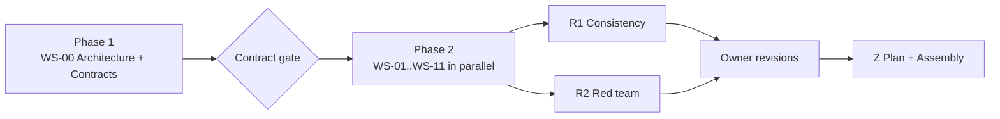

# Software Factory Spec: Multi-Agent Authoring Prompts

This directory holds the prompt set for producing the full technical specification and reference
architecture of the enterprise software factory. It is designed to be executed by a lead Claude
agent that coordinates multiple subagents.

## How to run

Start a Claude Code session in this repository and give it:

```
Read prompts/software-factory/00-orchestrator.md and execute it.
```

The orchestrator reads everything else itself. All output lands in `spec/`.

## Layout

| Path | Purpose |
|---|---|
| `00-orchestrator.md` | Lead agent instructions: phases, subagent dispatch, gates, assembly |
| `01-shared-context.md` | Mission, decided constraints, corrections, conventions. Every subagent reads this first |
| `phase-1/WS-00-architecture-contracts.md` | Architecture and frozen interface contracts. Runs alone, before anything else |
| `phase-2/WS-01..WS-11` | Parallel deep-dive workstreams, each producing one spec section |
| `phase-3/R1-consistency-review.md` | Cross-workstream consistency and contract conformance review |
| `phase-3/R2-red-team.md` | Adversarial review: security, failure modes, UX, long-term viability |
| `phase-3/Z-implementation-plan-and-assembly.md` | Phased implementation plan, traceability matrix, final assembly |

## Phase flow



## Editing guidance

- Change a decided constraint in `01-shared-context.md` (section 3), never inside a workstream brief.
- Scale and SLO targets (section 2 of shared context) are confirmed; the spec sizes infrastructure
  from them.
- Testing against real GitHub uses a dev GitHub App you register from the manifest and install on a
  personal org (D-24). Have that org and a sample repo ready before Phase 3 walkthrough validation.
