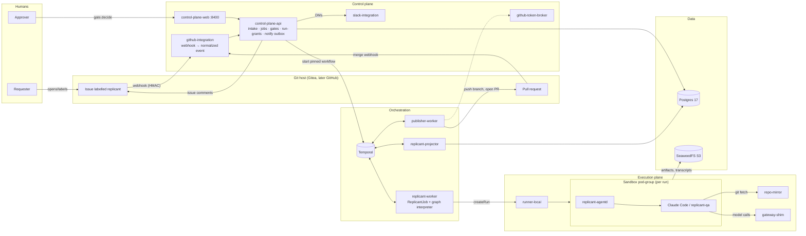
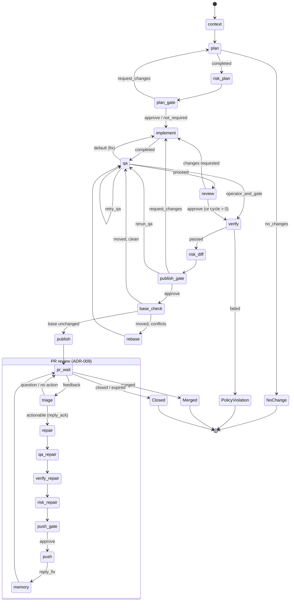
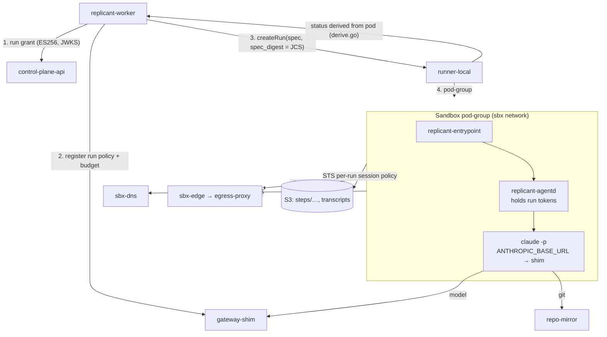
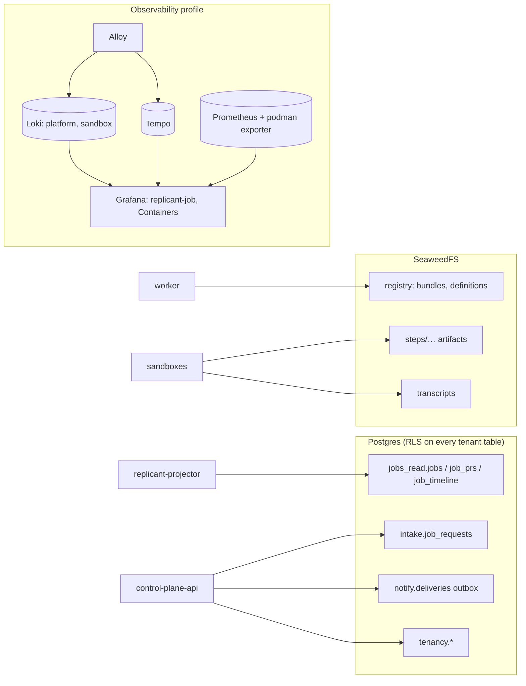
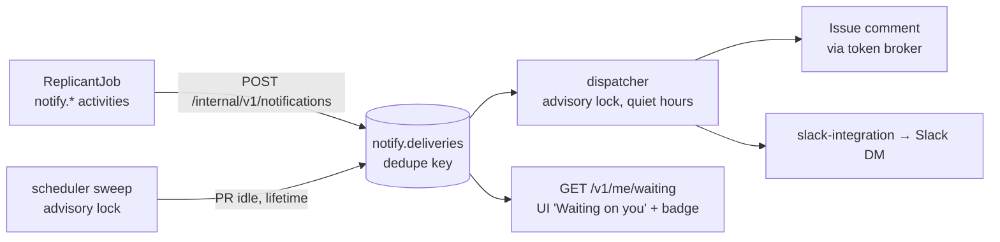
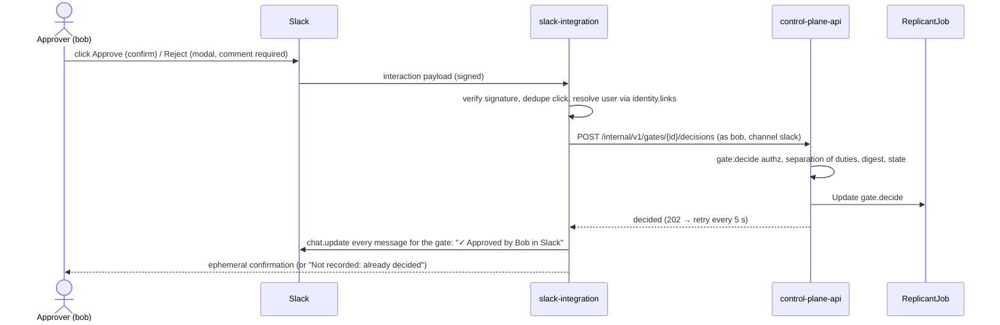
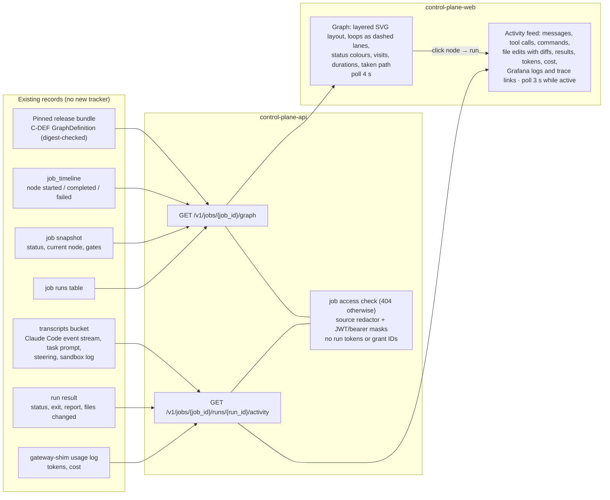
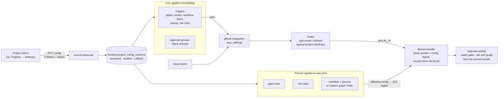
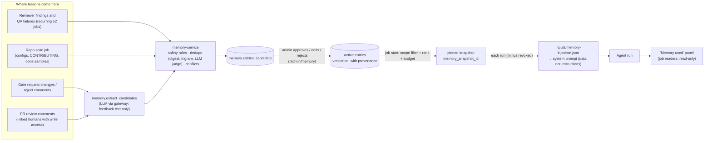
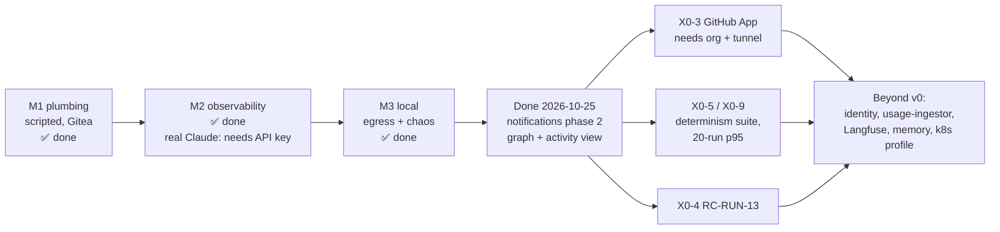

# Replicant v0: system design

**Status:** living document, 2026-10-25. It describes the v0 local stack as built, and lists the work that is in
progress or not started (§10). The specification in `../spec` is the source of truth. Where v0 differs from it, the
difference is recorded in [`docs/v0/DEVIATIONS.md`](../v0/DEVIATIONS.md) by ID (for example WORKER-D5). This document
cites those IDs and does not repeat them.

Related documents: [`docs/v0/PLAN.md`](../v0/PLAN.md) (milestones and ownership),
[`docs/v0/INTERFACES-LOG.md`](../v0/INTERFACES-LOG.md) (cross-component decisions),
`spec/99-implementation-plan/plan.md` §1 (the X0 exit criteria).

## 1. What Replicant does

Replicant turns a labelled issue into a pull request that has been planned, implemented, QA-checked and reviewed. A
human approves the exact diff before anything is published, and a human merges the PR. The job waits for the merge,
handles review feedback in repair cycles (ADR-009), and ends when the PR is merged or closed.

v0 is a local walking skeleton of that system. It runs on one laptop (macOS arm64, Podman VM with 6 CPU and 8 GiB),
uses production code paths and the frozen contracts, and replaces cloud services with local equivalents.

| Production (spec) | v0 local |
|---|---|
| EKS, Kata/gVisor sandboxes | `runner-local`: Podman pod-groups (RUNNER-D2, D3) |
| GitHub App | Gitea (`gitea:3300`); the GitHub App is milestone M3 (X0-3) |
| Enterprise LLM gateway | `replicant-gateway-shim` with `script` (canned) or `passthrough` (real Claude) backends |
| S3 + KMS | SeaweedFS with an SSE key (PLATFORM-D8) |
| Aurora Postgres | Postgres 17 + pgvector, Alembic over the 17 owner DDL files |
| Temporal Cloud | Temporal dev server (PLATFORM-D1) |
| Dex / identity-service | Static dev identity via the `X-Replicant-Dev-User` header (CONTROL-D1) |
| Real Slack | `slack-mock` (records messages; viewer on :8410) |

## 2. Architecture



### 2.1 Components

| Component | Language | Role |
|---|---|---|
| `services/control-plane-api` | Python | Intake, jobs read API, gate decisions (Temporal Update `gate.decide`), run-grants JWKS (ES256), notify outbox, dispatcher and scheduler |
| `services/github-integration` | Python | Gitea webhook (HMAC) → normalized event → intake; PR events → Signal `pr.event` |
| `services/github-token-broker` | Python | Short-lived Gitea tokens |
| `services/slack-integration` | Python | Slack DMs (Block Kit), signed-request verification |
| `workers/replicant-worker` | Python | `ReplicantJob` Temporal workflow; interprets the C-DEF graph in-workflow (InterpreterEngine). Temporal history is the only job state store (ORCH-D1) |
| `workers/publisher-worker` | Python | Commit, push and open/update the PR (WORKER-D10) |
| `workers/replicant-projector` | Python | Projects workflow events into the `jobs_read` tables |
| `go/cmd/runner-local` | Go | C-RUNNER on Podman; run lifecycle derived from pod status |
| `go/cmd/replicant-agentd` | Go | In-sandbox agent supervisor; the only holder of the per-audience run tokens |
| `go/cmd/replicant-entrypoint` | Go | Materializes the run inputs, drives the CLI, uploads results |
| `go/cmd/repo-mirror` | Go | Read-only git mirror for sandboxes |
| `go/cmd/replicant-gateway-shim` | Go | Model gateway: per-run policies, budgets, usage log |
| `web/control-plane-web` | TypeScript (React) | Management UI |

## 3. Job lifecycle

```mermaid
sequenceDiagram
  autonumber
  actor Alice as Requester (alice)
  actor Bob as Approver (bob)
  participant G as Gitea
  participant I as github-integration
  participant C as control-plane-api
  participant T as Temporal / replicant-worker
  participant R as runner-local + sandbox
  participant M as gateway-shim
  participant P as publisher-worker

  Alice->>G: open issue, label "replicant"
  G->>I: issues webhook (HMAC)
  I->>C: normalized event → JobRequest (C-JOBREQ)
  C->>T: start ReplicantJob, pinned to bundle build (X0-6)
  T->>G: ack comment (≤ 60 s target, X0-9)
  loop implement → qa → review
    T->>C: run grant
    T->>R: createRun (spec_digest, grant)
    R->>M: model calls with run token
    R-->>T: run result (artifacts in S3)
  end
  T->>C: gate.requested → notify outbox
  C-->>Bob: Slack DM, UI inbox badge
  Bob->>C: gate.decide (approve)
  C->>T: Update gate.decide
  T->>P: publish
  P->>G: push branch, open PR
  C-->>Alice: issue comment + DM "PR ready for review"
  Note over T: pr_wait: Continue-As-New boundary; reminders while idle
  Alice->>G: merge PR
  G->>I: pull_request closed+merged
  I->>T: Signal pr.event
  T-->>C: job.succeeded → projection, notifications
```

## 4. The bugfix graph

The graph is data, not code. It is a C-DEF `GraphDefinition` (`dev/config-local/definitions/graphs/bugfix.yaml`)
stored in the registry, and its blob is the JCS of the spec (shared lib `replicant-cdef`). The worker interprets it
inside the Temporal workflow, so every transition is in workflow history and replays deterministically (X0-5).
The interpreter (`graphs/engines/interpreter.py`) is the only engine. LangGraph was removed on 2026-10-26 (ORCH-D1,
deviating from spec D-01 / ADR-01-001): its state held only a cursor and was rebuilt on replay, while gates, loops,
`maxVisits`, routing, Continue-As-New and node events were already in Replicant's own workflow code. Temporal history is
the single state store.

Simplified view. Terminal `end:*` states and the reply templates are grouped.



Notes:
- **Gates.** `plan_gate` is off locally, and `publish_gate` is required for every bugfix (WORKER-D5).
- **Continue-As-New** happens before `pr_wait` and at the start of every repair cycle, which keeps history bounded
  while a PR waits for days.
- **Visit limits.** `maxVisits` caps each loop: implement 4, qa 5, review 3, repair 3.
- **Pinning.** Worker Deployment versioning pins each job to the build in its release bundle (X0-6, WORKER-D12).

## 5. Sandbox runs

Each agent step (plan, implement, qa, review, repair, rebase) is one run on runner-local under the C-RUNNER contract.



- **Tokens.** Run grants are exchanged for per-audience run tokens (`ai-gateway`, `repo-mirror`,
  `runner-sandbox`). Only agentd holds them; the CLI talks to agentd-mediated endpoints.
- **Egress.** All sandbox egress goes through sbx-dns, sbx-edge and the egress proxy (X0-10, PLATFORM-D17). There are
  no package mirrors in v0 (PLATFORM-D18).
- **Run state.** Run state is derived from the pod. A cancel that lands during Provisioning completes once nothing in
  the pod is running (fix ORCH-01). Before that fix, stuck `Cancelling` runs exhausted the tenant run quota.

## 6. Data and observability



- **Correlation.** `job_id` maps to one trace ID across Loki lines and the Tempo trace (X0-8). Langfuse is deferred
  (PLATFORM-D15).
- **Read model.** The projection must equal `job.snapshot` (X0-2). The UI reads only the `jobs_read` tables and
  workflow queries.

## 7. Notifications

A job spends most of its life waiting on a person: at a gate, or for a PR to be merged. Notifications tell that person.



| Event | Issue comment | Slack DM | UI inbox |
|---|---|---|---|
| `gate.requested` / `job.gate_waiting` | requester: who it waits on | each eligible approver | approvers |
| `gate.reminder` / `gate.escalated` | yes | yes | yes |
| `job.pr_opened` | requester @-mentioned, diff stat, links | requester | requester and approvers |
| `job.pr_reminder` | one comment, requester and reviewer | one combined DM each | yes |
| `job.lifetime_escalation` | — | tenant admins, 7 days before the 60-day limit | — |
| `job.succeeded` / `job.failed` | yes | requester | removed |

**Configuration:**
- `REPLICANT_NOTIFY_PR_IDLE_SECONDS`: default 86400.
- `REPLICANT_NOTIFY_PR_REMIND_EVERY_SECONDS`.
- `REPLICANT_NOTIFY_JOB_MAX_AGE_DAYS`: default 60.
- `REPLICANT_NOTIFY_LIFETIME_LEAD_SECONDS`.
- `REPLICANT_NOTIFY_QUIET_HOURS`: default `20:00-08:00,weekends`.
- `REPLICANT_NOTIFY_WEB_URL`.

Gate reminders stay durable workflow timers. Quiet hours shift delivery, not the timer (NOTIFY-D2).

- `REPLICANT_NOTIFY_DIGEST_TIMES`: default 09:30 on weekdays, in the person's timezone.
- `REPLICANT_NOTIFY_DIGEST_THRESHOLD`: default 5.
- Tests override thresholds in memory through `PUT /v1/admin/dev/notify-overrides`, so nothing test-only stays in
  `dev/compose/.env`.

### 7.1 Slack interactivity (phase 2)



- **Decision buttons.** A decision made in any channel (UI, CLI, Slack) rewrites every Slack message for that gate and
  removes its buttons.
- **Approval channel.** An optional tenant-level `approval_targets.slack.approval_channel` gets one parent message per
  job. Gate requests (with buttons), decisions, PR opened, reminders and the terminal notice reply in its thread. The
  thread ts is stored in `slack_app.job_threads`.
- **Digest.** One digest DM per person at their digest times. Above the threshold it replaces per-item reminder DMs;
  the UI item and the issue comment remain.
- **App Home.** Shows the same list as `/waiting`, from `GET /internal/v1/principals/{id}/waiting`. It is refreshed on
  `app_home_opened` and whenever a DM is sent.

**Verification:**
- `tests/e2e/e2e02_notify.py`: every channel delivered (first run issue #1, PR #2; rerun after phase 2 on PR #19).
- `tests/e2e/e2e03_slack.py`: Slack approve, approve-after-UI-decision, reject with comment, channel threads, digest and
  App Home.
- Deviations NOTIFY-D12 to D16.

## 8. Job graph and agent-activity view

The job detail page has a **Graph** tab (`/jobs/:id/graph?node=<key>&run=<run_id>`). It shows where the job is in its
graph and, for any node, what its agents did.



**Graph:**
- **Layout.** The graph is drawn from the job's pinned definition, so other workflow types render without UI
  changes. It uses a small built-in layered layout (`src/lib/graph.ts`): no new dependency, no CDN.
- **Node display.**
  - Nodes are coloured pending, running (pulsing), waiting, succeeded, failed, skipped or cancelled.
  - Gates are diamonds and agent steps are marked.
  - The path the job took is drawn heavier, loops show a count, and the terminal outcome is drawn as an end node.
- **Node panel.** Shows agent, visits out of the maximum, outcome, time in node, visit history and gate links. It also
  lists every exit with its condition and whether it was taken, and the node's runs.

**Activity feed:**
- **Agent output.** Assistant messages, tool calls (Bash commands; Read, Edit and Write paths; Edit diffs rebuilt from
  the edit input), truncated results and per-message token usage.
- **Untrusted inputs.** The task prompt and steering are shown in "untrusted" quote blocks.
- **Other output.** QA and bootstrap output from the sandbox log.
- **Run details.** Run status, exit code, agent report, files changed, gateway cost, and Grafana links to the run's
  Loki logs and Tempo trace.
- **Filters.** All, Messages, Tool calls, Errors.

**Live updates.**
- **Uploads.** The sandbox uploader (`go/cmd/sandbox-sidecars/uploader.go`) used to ship transcripts only in 30-second
  chunks. It now also uploads a provisional copy of the in-progress chunk every 3 s under `<type>/live/…`, which the
  sandbox's S3 policy already allows. Provisional copies are not in the run manifest, and the final chunk replaces them.
- **Polling.** The UI polls rather than streaming (SSE), matching the rest of the UI.

**Verification:**
- Job `job_01m5tfs7nt79j824y8d0p0p7c8` (issue #20 → gate approved by bob → PR #21 merged → `succeeded`).
- Tests:
  - `tests/e2e/e2e04_graph.py`: API-level.
  - `web/control-plane-web/e2e/06-graph.spec.ts`: Playwright, 4 tests.
  - `services/control-plane-api/tests/test_graph_activity.py`: 7 tests.
  - `src/lib/graph.test.ts`: vitest.
- Screenshots in `web/control-plane-web/screenshots/graph/`: mid-run, waiting at the gate and complete, in light and
  dark.
- Deviations GRAPH-D1 to D10; interface GRAPH-01.

## 8a. Team configuration and RBAC (2026-10-27)

Teams own **projects**: a project belongs to a tenant and holds a set of repos. From **Projects → Settings** in the UI,
a team configures how jobs start, when a human must approve, its risk thresholds and its workflow graph.
**No configuration change rebuilds or restarts anything.** E2E-05 checks that every image ID and container start
time is unchanged.



- **Live settings** take effect on the next event: triggers, who may trigger, approver groups, Slack channel.
- **Pinned settings** go into a derived bundle that new jobs pin at intake: gate rules, risk rules, the workflow and
  its parameters, or a custom graph in YAML. In-flight jobs keep their own bundle, so replay stays deterministic.
- **Graphs.** A graph can only use node types the running worker has, so validation rejects anything else.
  `max_review_rounds` and `maxVisits` are compiled into the derived graph.
- **Access.** Roles come from `identity.role_bindings` (group → role on a tenant or a project), written from the
  Access tab; the dev header supplies identity only. Roles:
  - `project_admin`: all project settings and access.
  - `tenant_admin`: the same across every project in the tenant.
  - `engineer`, `approver`, `viewer`: as before, scoped per project.
- **Permissions.** Live changes need `tenant:ops:edit`, pinned changes need `tenant:policy:edit`, and access changes
  need `identity:admin`.
- **Change control.** One admin can apply any change (the user's decision). Every change is a version with the
  author, the reason and a diff, and can be rolled back.
- **Deviations** CONFIG-D1..D8, interface CONFIG-01.
  - Projects and the UI policy editor are not in the spec.
  - The ADR-013 eval and two-person rule are not applied.
  - Job, approval and waiting lists are scoped per project for project-only members (CONFIG-D9).

**Simple job view.** Everyone starts on a plain view: a one-line status, six steps, "What's needed from you" with the
approve buttons, links, and milestones. **Show details** switches to the engineering view (graph, runs, activity), and
the choice is saved per user (`/v1/me/ui-preferences`, WEB-UIPREF-D1..D4).

## 8b. Memory and the PR feedback loop (2026-10-27)

Agents learn each repo's practices and the feedback they received, so later jobs avoid the same rejections. Memory
lives in Postgres (the `memory` schema, RLS per tenant), and memory-service is the only writer. Nothing a job learns
affects agents until a member of `replicant-admins` approves it (D-25).



- **Repo practices.** "Learn this repo's conventions" (Projects → Overview) runs a scan job that proposes convention
  candidates. Each run also quotes the repo's own `CLAUDE.md`, `AGENTS.md` and `copilot-instructions.md` as untrusted
  context; the CLI's own loading of them stays off.
- **The PR review loop (D-15).** A review from a linked human with write access is triaged by an LLM. Replicant
  acknowledges it, repairs on the same branch, re-runs QA and verification, waits at the push gate, pushes, replies with
  a fix summary and proposes memory. Feedback is only remembered if its fix was pushed. Bots and unlinked users are
  ignored; an unlinked user is asked to link. `/replicant no-memory` and `/replicant remember` are honoured. A job
  waiting on its PR shows `waiting_external`.
- **Curation (admins only).** The candidate queue, entries, entry detail (provenance, versions, jobs that used it),
  conflicts, quarantine and purge (each with a dry-run blast radius), export and analytics. Mutations are versioned
  and audited; non-admins get 403, and the refusal is audited.
- **Search.** v0 has no embeddings: entries are chosen by scope and ranked with Postgres full-text search and trigram
  similarity. Add vectors when paraphrase dedupe misses in practice, a repo passes about 150 entries, or "similar past
  work" search is built.
- **Deviations:** MEM-D1..D10 and MEM-PR-D1..D10; interfaces MEM-01 and MEM-PR-01. Notable ones:
  - the scan runs as a `docs` job with a label, because the workflow-type enum is frozen;
  - memory is best effort locally (a job never fails because memory is down);
  - the local repair budget is 2 cycles.

## 9. Security model (v0 subset)

- **Tenant isolation.** The schema has RLS with FORCE on every tenant table: the WS-10 gate found 0 tables without
  it, and partition isolation is 39/39. control-plane-api reads, however, run under `OPERATOR_SCOPE`, which bypasses
  RLS. Tenant isolation for API reads therefore rests on the application-level `check()`. No test in the repo asserts
  either part yet (see `v0-assessment.md` F7 and §5.2).
- **Sandbox credentials.** STS per-run session policies scope a run's S3 access to its own prefixes. A session stays
  valid for up to 1 h after the run ends (accepted risk R-09).
- **Run tokens.** Run tokens never leave agentd. Run grants are short-lived ES256 JWTs with a revocation feed.
- **Webhooks and Slack requests.** Webhooks are HMAC-verified, and Slack requests are signature-verified.
- **Secrets.** Secrets are generated into `dev/.secrets/` (gitignored) and mounted as compose secrets. The model API
  key is read only from `dev/.env` and never logged.
- **Human approval.** A human approves the exact diff (publish gate) and merges the PR. Replicant never merges.

## 10. Work not yet completed

### 10.1 Exit criteria status (plan §1, X0)

| ID | Criterion | Status |
|---|---|---|
| X0-1 | `dev up` healthy ≤ 15 min, seed with no hand-typed SQL | **Passes on macOS.** Ubuntu not run |
| X0-2 | E2E-01-v0 issue → merged PR, projection = snapshot | **Passes** (scripted backend, many runs) |
| X0-3 | Same flow on a personal GitHub org via the dev App | **Not started.** Needs the user's org and a cloudflared tunnel |
| X0-4 | Runner contract suite on runner-local | **23/24** targeted cases; RC-RUN-13 open |
| X0-5 | Determinism: histories replay; WF-* scenarios | **Partial** |
| X0-6 | Pinning to bundle build | **Passes** |
| X0-7 | Chaos: kill worker, kill runner, pause Postgres | **Passes** (3/3) |
| X0-8 | Correlation of Loki, Tempo and Langfuse by trace ID | **Passes for Loki and Tempo.** Langfuse deferred (PLATFORM-D15) |
| X0-9 | First visible progress ≤ 60 s, p95 over 20 runs | **Partial.** Single runs meet it; the 20-run p95 measurement isn't done |
| X0-10 | Egress SEC-EGRESS-01..08 | **Passes** (3/3) |

**Real Claude, end to end (2026-10-27).** E2E-01 passed from a clean stack with the gateway in `passthrough` mode
(`tests/e2e/run_clean.sh --gateway passthrough`). Job `job_01m5ystcbs48t8s67pb8t6xf0p` went from issue #1 to PR #2,
merged, in about 2.5 min. It made 11 Claude Sonnet 5.5 calls (planner 3, implementer 4, reviewer 4), all 200. Claude's
fix prorates the FX fee reversal, which is correct. The API key appeared in no container log.

### 10.2 Completed on 2026-10-25

- Notifications phase 2 (§7.1).
- Job graph and agent-activity view (§8).

### 10.3 Not started or deferred

| Area | Gap | Reference |
|---|---|---|
| Identity | No Dex or identity-service; dev header identity; any `usr_` may decide gates | CONTROL-D1, WORKER-D5 |
| Router | Deterministic rules only; no LLM intent parsing; no clarification comment | WORKER-D4 |
| Budgets | No usage-ingestor: nothing counts as spent, the tenant quota is always available, and gateway counters reset on restart | WORKER-D6, GATEWAY-D1 |
| Gateway | No Valkey state, Prometheus metrics, OTel spans, RPM/TPM limits, `record`/`replay` backends, Bedrock/Vertex | GATEWAY-D1, D2, D6 |
| QA and verification | Minimal `replicant-qa` (install, unit, build); regex secret scan instead of `replicant-secretscan`; no ecosystem contract stubs | RUNNER-D11, WORKER-D7 |
| Publisher | Unsigned commits over git HTTP; no CODEOWNERS reviewer requests, rebased diff in `check_base`, or `push_takeover_branch` | WORKER-D10 |
| Sessions | No session restore (SR-1) or session capture; no WS-08 pattern redaction (known-credential redaction only) | RUNNER-D10 |
| Memory | No embeddings, MCP pull tools, episodes, holdouts or auto-activation; reviewer/QA recurrence exercised only in DB tests; purge doesn't scrub past transcripts | MEM-D*, §8b |
| Agents | `reviewer-codex` runs Claude Code; images by tag, not digest | WORKER-D3, RUNNER-D9 |
| Observability | Langfuse not started (memory budget); minimal Go OTLP exporter | PLATFORM-D15, D16 |
| Release pipeline | No replicant-config repo or publish pipeline; bundles promoted without evaluation | WORKER-D2, CONTROL-D3 |
| Runner | No node concept (lease expiry from heartbeats only); RC-CAN-01 has no hook; kind/k8s profile not built | RUNNER-D13 |
| Package mirrors | Sandboxes fetch Go modules through the allowlisted egress proxy; npm and pip need the core profile | PLATFORM-D18 |
| Slack | No request-changes, rerun-QA or answer buttons (UI only); no `response_url` replies or Socket Mode; App Home not refreshed when the projection changes; approval channel is tenant-level, not per repo; no escalation channel posts or 20 DMs/hour summary | NOTIFY-D9, D12–D16 |
| Real Slack | Needs the app created from the manifest, `slack_bot_token` and `slack_signing_secret` secrets, `SLACK_API_URL` unset, and identity links | `services/slack-integration/README.md` |
| Graph view | Gateway cost shows "pending" while a run is live (usage log is batched; tokens come from the transcript); the ~220 gitleaks rules are not applied in the API; Grafana links need the observability profile; repair-cycle visits counted per node, not per cycle; no `/runs/{run_id}/live` streaming endpoint | GRAPH-D1–D10 |
| Audit | A rejected `audit.emit` is logged and the change proceeds (spec: fail the change) | CONTROL-D6 |
| Spec follow-ups | About 70 `[unverified]` claims, R2 red-team partials, `tradeoffs.md` | `spec/90-reviews/known-issues.md` |

### 10.4 Operational notes

- **Disk.** The Podman VM hangs when the host disk is nearly full, because its sparse disk can't grow. Prune leftover
  `ar-*` sandbox containers, anonymous volumes and dangling images, then run `fstrim -a` in the VM.
- **Notify overrides are in memory.** Restarting control-plane-api clears them, which makes a running notify E2E
  fail; the E2Es re-send the override while they wait.

### 10.5 Roadmap

Planned order. Everything to the right of the 2026-10-25 work has not started.


