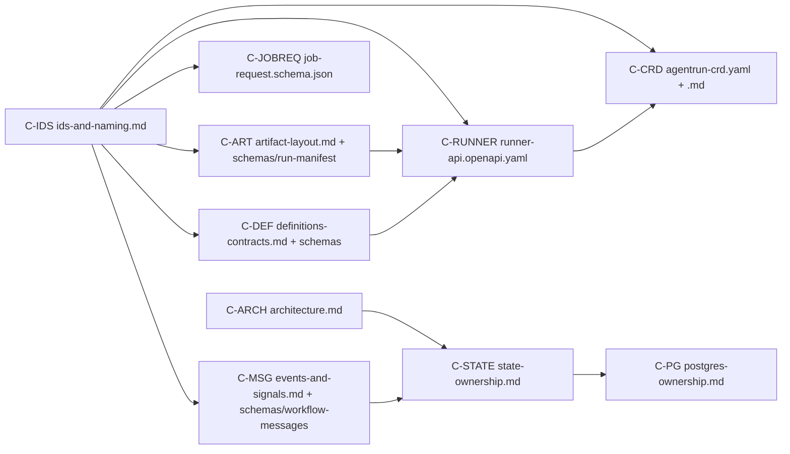

# 00 — Architecture and Contracts (WS-00)

Phase 1 output. These contracts fix boundaries, ownership, identifiers, and interfaces. Phase 2
designs internals that conform to them. After the orchestrator freezes them (`FROZEN.md`, written
by the orchestrator), any change goes through `spec/_coordination/contract-change-requests.md`.

## Purpose

This section is the single place a Phase 2 workstream looks for what it must conform to: component
boundaries, state ownership, identifiers, the Runner API, the AgentRun CRD, workflow messages, the
normalized trigger, registry and bundle envelopes, object storage layout, and database ownership.

## Decisions summary

| Area | Decision | Constraint | ADR |
|---|---|---|---|
| Gates and job control | Temporal Updates. Machine notifications are Signals | D-01, D-19 | [001](adr/001-gates-updates-vs-signals.md) |
| Runner completion | Signal hint from run-notifier, plus timer and polling `runner.get_run` | D-04 | [002](adr/002-runner-completion-callback-vs-poll.md) |
| Temporal hosting | Self-hosted on EKS, PostgreSQL 16 persistence (initial; WS-10 finalizes) | D-22 | [003](adr/003-temporal-self-hosted-vs-cloud.md) |
| UI consistency | Projection activity at each transition, plus reconciler; the UI reads one store | D-09 | [004](adr/004-ui-read-model-projection.md) |
| Versioning unit | Closed, content-addressed Release Bundle | D-03 | [005](adr/005-release-bundle-unit-of-versioning.md) |
| Worker version selection | Bundle assignment, with a pinned versioning override at start | D-02 | [006](adr/006-bundle-assignment-drives-version-pinning.md) |
| Isolation topology | Separate exec EKS cluster in its own AWS account (CCR-09-07) | D-21 | [007](adr/007-separate-execution-cluster.md) |
| Idempotency | Explicit logical activity IDs; `run_id` derived from the key; etcd name uniqueness | D-04, D-23 | [008](adr/008-deterministic-run-identity.md) |
| Job lifetime | One job through PR review and repair cycles | D-15 | [009](adr/009-job-lifetime-spans-pr-review.md) |
| Steering | Runner-managed per-run inbox | §4 UX | [010](adr/010-steering-via-runner-inbox.md) |
| GitHub credentials | Token broker is the sole key holder with a caller allowlist and never-granted permissions (CCR-09-06); read-only repo-mirror for sandboxes | D-21, D-24 | [011](adr/011-github-token-broker-and-repo-mirror.md) |
| Identifiers | Prefixed lowercase Crockford base32 | — | [012](adr/012-identifier-scheme.md) |
| Tenant policy | Tenant-derived bundles; behavioral vs operational configuration | D-03 | [013](adr/013-behavioral-vs-operational-config-tenant-derived-bundles.md) |
| **Challenge D-07** | FS quota monitoring does not enforce; replace with enforcing mechanisms | D-07 | [014](adr/014-challenge-d07-fsquota-monitoring-is-not-enforcement.md) |

## Contract index

Versions below are authoritative together with `FROZEN.md`, which the orchestrator maintains. The CCR-09, CCR-03, CCR-06, CCR-04, CCR-05, CCR-07, CCR-02, CCR-10, CCR-08, and CCR-01 changes, and fix-round wave 0 (R2-002, R2-004, R2-005, R2-016, R2-044, R1 roles), and fix-round wave 1, were applied by WS-00 on 2026-10-24.

| ID | Version | Files | Validated |
|---|---|---|---|
| `C-ARCH` | **2.0.0** (… 1.5.4: wave 3 — R1V-050/076/079, scale table and MaintenanceShard, R1V-006; 2.0.0: ORCH-02 product rename) | [architecture.md](architecture.md) | Mermaid parsed (mermaid 11.4.1) |
| `C-STATE` | **2.0.0** (… 1.10.2: wave 3 — R1V-077; 2.0.0: ORCH-02 product rename) | [state-ownership.md](state-ownership.md) | Mermaid parsed |
| `C-IDS` | **2.0.0** (… 1.13.4: wave 3 — R1V-078/085/098, MaintenanceShard; 2.0.0: ORCH-02 product rename) | [ids-and-naming.md](ids-and-naming.md) | Reference code reproduces the test vectors |
| `C-RUNNER` | **3.0.0** (… 2.5.3: citation only; 3.0.0: ORCH-02 product rename) | [runner-api.openapi.yaml](runner-api.openapi.yaml), [schemas/run-result.schema.json](schemas/run-result.schema.json) | `openapi-spec-validator` (OpenAPI 3.1.1) passes; examples validate against their schemas |
| `C-CRD` | **3.0.0** (… 2.4.0: 02-06, 09-09; 3.0.0: ORCH-02 product rename) | [agentrun-crd.yaml](agentrun-crd.yaml), [agentrun-crd.md](agentrun-crd.md) | Applied to kube-apiserver v1.34.1 (envtest). Example object accepted. CEL rules exercised: immutability, one-way cancel, terminal phase finality, name derivation, prefix consistency, optional-field add/remove, selectable fields |
| `C-MSG` | **2.0.0** (… 1.7.4: wave 3 — queue_position removed (R1V-093); shard accepts batch.child_progress; 2.0.0: ORCH-02 product rename) | [events-and-signals.md](events-and-signals.md), [schemas/workflow-messages.schema.json](schemas/workflow-messages.schema.json) | JSON Schema 2020-12 meta-valid; sample payloads validate |
| `C-JOBREQ` | **2.0.0** (… 1.4.2: max_repos 15,000, R1V-006; 2.0.0: ORCH-02 product rename) | [job-request.schema.json](job-request.schema.json) | Meta-valid; example validates; negative case rejected |
| `C-DEF` | **3.0.0** (… 2.5.0: 06-07c, 06-12, 06-16; 3.0.0: ORCH-02 product rename) | [definitions-contracts.md](definitions-contracts.md), [schemas/definition-envelope.schema.json](schemas/definition-envelope.schema.json), [schemas/release-bundle.schema.json](schemas/release-bundle.schema.json) | Meta-valid; bundle example validates |
| `C-ART` | **2.0.0** (… 1.10.4: CCR-10-13 recorded; 2.0.0: ORCH-02 product rename) | [artifact-layout.md](artifact-layout.md), [schemas/run-manifest.schema.json](schemas/run-manifest.schema.json) | Meta-valid; manifest example validates |
| `C-PG` | **2.0.0** (… 1.4.3: wave 3 — R1V-050/073/075; 2.0.0: ORCH-02 product rename) | [postgres-ownership.md](postgres-ownership.md) | — |

## Which contracts each Phase 2 workstream must conform to

| WS | Must conform to | Must not change without a contract change request |
|---|---|---|
| WS-01 Orchestration | C-MSG (handlers, validators, Update IDs), C-IDS (workflow IDs, explicit activity IDs, search attributes, task queues), C-STATE §2 (projection emit), C-DEF §1 and §4.5 (config vs code, pinning), C-RUNNER (activity client semantics, polling), ADR-006, ADR-009 | message names and payloads, search attribute set, ID formats |
| WS-02 Execution | C-RUNNER (implement both listeners), C-CRD (controller observable behavior), C-ART (prefixes, manifest, upload semantics), C-IDS §8, ADR-007, ADR-008, ADR-010, ADR-014 | CRD schema, failure reasons, notification payload |
| WS-03 Agents/tools | C-DEF (AgentDefinition, EnvironmentDefinition, budgets, codebase_bindings `spec` inside the envelope), C-RUNNER `RunTokenClaims` and run-result envelope, C-ART (inputs and outputs), C-IDS §7 (env vars, gateway headers), C-PG (`cost`) | envelope, reference grammar |
| WS-04 Memory/context | C-PG (`memory`, `ecosystem`), C-IDS (memory IDs, snapshot IDs), C-ART (handoff, session state, memory exports), C-DEF (memory_snapshot policy), C-RUNNER run token audiences (`memory-mcp`, `context-mcp`) | memory ID formats, snapshot pinning fields |
| WS-05 QA | C-ART (QA artifact types incl. `qa_generated_flow`), C-RUNNER (role `qa`, workload class `qa_build`), run-result `role_result` (owns the qa schema), C-DEF (environment definition QA section), C-PG (`qa` schema DDL), C-IDS §11 (`qa_stage`) | artifact type list (add via change request) |
| WS-06 Releases/evals | C-DEF (bundle schema, resolution, assignment, promotion states), C-PG (`evals`, `registry` bundle tables), ADR-005, ADR-006, ADR-013 | bundle `spec` fields |
| WS-07 Control plane/UX | C-JOBREQ, C-MSG (senders, outboxes), C-STATE §2 (read models), C-PG (`tenancy`, `identity`, `intake`, `jobs_read`, `approvals`, `notify`, `*_app`), C-ART §5 (presigned access), ADR-011 | JobRequest, gate decision semantics |
| WS-08 Observability | C-IDS §5, §9–§11 (trace rule, Loki labels and metadata, Langfuse keys, Prometheus labels), C-ART (redaction column, transcript types), C-PG (`audit`) | label and metadata keys |
| WS-09 Security | All. Specifically §6 of C-ARCH (credentials), C-MSG §1 (Temporal credential holders), ADR-007, ADR-011, C-ART (KMS) | — (reviews; files change requests) |
| WS-10 Data platform | C-PG, C-ART, C-STATE, ADR-003 | schema ownership, bucket classes |
| WS-11 Local dev/test | C-ARCH §3 (local composition), C-RUNNER (contract test suite for both runners), C-CRD (envtest), C-IDS (test vectors) | — |

## Must-answer index

| Question | Answer |
|---|---|
| Which process holds Temporal client credentials to Signal workflows on Runner completion, and how is it secured? | `run-notifier` only (exec cluster). mTLS cert with Signal-only authorization; hint-only semantics. [events-and-signals.md §1.1](events-and-signals.md#11-how-run-notifier-is-secured), [ADR-002](adr/002-runner-completion-callback-vs-poll.md) |
| How is a job identified across Continue-As-New and child workflows? | Root workflow ID = `job_id`; children `<job_id>:<kind>:<n>`; search attribute `ReplicantJobId` on all. [ids-and-naming.md §3](ids-and-naming.md#3-job-identity-across-continue-as-new-and-child-workflows-must-answer) |
| How does the UI show a consistent job view without querying four stores? | A Postgres projection maintained per transition, plus a reconciler. [state-ownership.md §2](state-ownership.md#2-ui-read-model-projection-must-answer-a-consistent-job-view-without-querying-four-stores) |
| Where is the configuration-versus-code boundary? | Rules CC-1 to CC-4. [definitions-contracts.md §1](definitions-contracts.md#1-the-configuration-versus-code-rule-must-answer) |

## Open questions (top; full list in each file and in `spec/_coordination/open-questions.md`)

See the coordination file entries tagged `WS-00`.

## Risks

- Several decisions depend on preview-stage Temporal features: `temporalio-langgraph` (public
  preview) and upgrade-on-Continue-As-New (public preview). Fallbacks are specified, and WS-01 owns
  the details.
- ADR-014 challenges D-07. If the orchestrator rejects it, WS-02 must still provide an enforcing
  limit to satisfy "fail loudly".

## Interfaces

- **Provided:** C-ARCH, C-STATE, C-IDS, C-RUNNER, C-CRD, C-MSG, C-JOBREQ, C-DEF, C-ART, C-PG.
- **Consumed:** `prompts/software-factory/01-shared-context.md` (D-01 to D-26).
