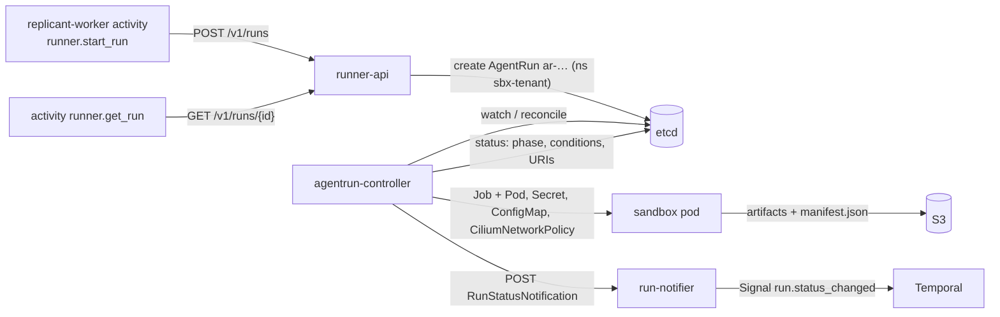
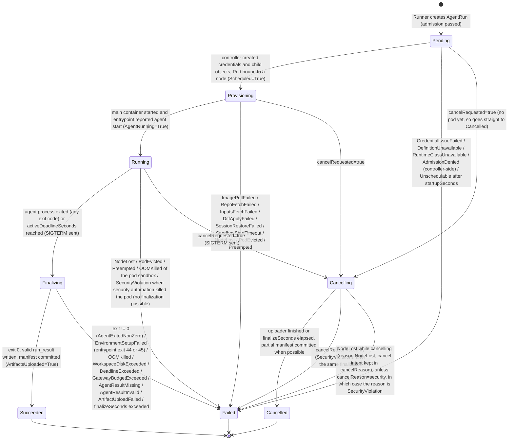

# AgentRun CRD: Semantics and Lifecycle

**Contract ID:** `C-CRD` · **Version:** 3.0.0 · **Schema:** [agentrun-crd.yaml](agentrun-crd.yaml) · **Owner:** WS-00 (contract), WS-02 (controller)

**Changelog:** 3.0.0 (breaking). Product rename to Replicant (CCR-ORCH-02). Every product-named identifier changes; there is no structural change. Domain `factory.example.com` (labels, annotations, schema `$id` host) becomes `replicant.example.com`; env prefix `FACTORY_` becomes `REPLICANT_`; headers `X-Factory-*` become `X-Replicant-*`; names `factory-*`/`factory_*` (services, task queues, Temporal namespace, roles, buckets, groups, hosts, networks) become `replicant-*`/`replicant_*`; CamelCase `Factory*` (workflow types, search attributes) becomes `Replicant*`. API group `replicant.example.com`, CRD `agentruns.replicant.example.com`, labels and annotations `replicant.example.com/*`, priority classes `replicant-run-*`. 2.4.0 (wave 1). `priorityClassName` gains `replicant-eval` (CCR-02-06). After a security cancel, every terminal path derives `SecurityViolation`, including node loss (CCR-09-09). 2.3.1 (fix, R2-002): the spec-digest annotation also excludes `trace_context`; `spec.traceContext` keeps the first create's value. 2.3.0 (additive). CCR-08-03 adds optional, immutable `spec.workflowType`; the controller also sets the pod labels `workflow-type` and `acting-for` (from the verified `spec.runGrant`). 2.2.0 (additive). CCR-02-05 adds failure reason `DefinitionUnavailable`. 2.1.0 (additive). CCR-03-01 adds failure reason `EnvironmentSetupFailed`. 2.0.0 (breaking: new required spec field). CCR-09-02 adds the required, immutable `spec.runGrant`. CCR-09-04 adds failure reason `SecurityViolation` and cancel reason `security`. The API version stays `v1alpha1`, since no AgentRun objects exist yet; once objects exist, a change of this kind needs a new served version.

## Purpose

`replicant.example.com/v1alpha1 AgentRun` is the unit of isolated work (D-05). This document fixes what
the CRD schema cannot express: the phase state machine, condition types and reasons, the
failure-reason table with retryability, the field mapping from the Runner API, and the controller's
obligations. WS-02 designs the reconcile loop, pod template, and credential mechanics. They must
produce exactly the observable behavior below.

## Decisions summary

| Decision | Reference |
|---|---|
| The status holds phase, conditions, timestamps, and two URIs, nothing else. Failure detail lives in condition `Succeeded` (reason, message) and in the run manifest in object storage | D-05 |
| An AgentRun runs the agent process **at most once**. The controller never retries a run. Retrying is a workflow decision with a new `ordinal`, which means a new idempotency key and a new `run_id` | D-04; [ADR-008](adr/008-deterministic-run-identity.md) |
| Phase `Succeeded` means the sandbox executed and the artifacts were committed (the manifest is written). It does **not** mean the task succeeded. Task outcome is in the run result (`result_uri`) | this doc |
| The spec is immutable except `cancelRequested` (false → true) and `cancelReason`. CEL enforces this. Verified against kube-apiserver v1.34.1 (envtest) on 2026-10-24: the CRD applied, and the immutability, one-way cancel, terminal-phase finality, name-derivation, prefix-consistency, and selectable-field rules all behaved as specified | D-05 |
| The controller emits completion events to run-notifier. It holds no Temporal credentials | D-04; [ADR-002](adr/002-runner-completion-callback-vs-poll.md) |
| Validated against Kubernetes 1.34. Target EKS 1.36 or 1.37 (1.37 is the newest EKS version; 1.34 reaches upstream end of life on 2026-10-27) [verified: https://kubernetes.io/releases/ and https://docs.aws.amazon.com/eks/latest/userguide/kubernetes-versions.html, 2026-10-24] | WS-02, WS-10 |

## 1. Phase state machine

Transition rules:

1. Phases only move forward along the arrows. The CRD enforces that terminal phases (`Succeeded`,
   `Failed`, `Cancelled`) are final.
2. **Failure with finalization.** When the agent process exits on its own, including failures the
   entrypoint detects (disk watchdog, gateway budget, OOM of the CLI child process), the run passes
   through `Finalizing`. Logs, transcript, and partial artifacts are therefore uploaded and the
   manifest is committed with `"partial": true`. Only failures that destroy the pod (node loss,
   eviction, preemption, pod-level OOM) go straight from `Running` to `Failed`. Evidence then
   consists of whatever the shipper sidecar had already streamed (transcripts are streamed in
   chunks, [artifact-layout.md](artifact-layout.md) §5).
3. **Deadline.** At `agentStartedAt + activeDeadlineSeconds` the controller sends SIGTERM to the
   entrypoint and enters `Finalizing`. It sets the pod's `activeDeadlineSeconds` to
   `startupSeconds + activeDeadlineSeconds + finalizeSeconds` as a backstop that kills the pod. The
   final reason is `DeadlineExceeded`.
4. **Cancellation** (`spec.cancelRequested=true`) is honored in any non-terminal phase. From `Pending`
   with no pod, the run goes `Cancelling` → `Cancelled` immediately. When `cancelReason=security`
   (security automation, CCR-09-04), the terminal phase is `Failed` with reason `SecurityViolation`
   instead of `Cancelled`. Evidence (logs, transcript chunks) is still finalized, and run-token refresh
   is refused immediately rather than after finalization. **Once `cancelReason=security` is set, every
   terminal transition derives reason `SecurityViolation` (non-retryable), including node loss while
   cancelling.** A node is usually replaced after a security cordon, and deriving `NodeLost` would make
   the run retryable and skip grant revocation (CCR-09-09, R1-223).
5. **Controller restart.** Phase is recomputed from observed child state (Job/Pod status, manifest
   presence in S3), never from in-memory state. The reconcile is idempotent.
6. Every transition sets `status.observedGeneration`, updates the matching timestamp, and triggers
   exactly one RunStatusNotification (at-least-once delivery, §5).

## 2. Field mapping: Runner API `RunSpec` → AgentRun `spec`

| RunSpec (snake_case) | AgentRun spec (camelCase) | Transform |
|---|---|---|
| `tenant_id`, `job_id`, `workflow_id`, `logical_activity_id`, `role`, `workload_class`, `release_bundle_id`, `workflow_type` (optional, CCR-08-03) | same names, camelCase | copy |
| header `Idempotency-Key` | `idempotencyKey` | sf-string unquoted. CEL checks it equals `ik1:<workflowId>:<logicalActivityId>` |
| — | `runId` | `derived("run", tenant_id, idempotencyKey)` ([ids-and-naming.md](ids-and-naming.md)) |
| `agent_definition`, `environment_definition` | `agentDefinition`, `environmentDefinition` | drop `kind` |
| `resource_profile` | `resourceProfile`, plus resolved `resources` and `workspace` | Runner resolves the profile from the environment definition blob (fetched by digest) |
| `repo`, `additional_repos` | `repo`, `additionalRepos` | copy |
| `inputs` | `inputs` | copy |
| `artifact_prefixes` | `artifacts.{artifactsPrefix,transcriptsPrefix,sessionPrefix}`; `artifacts.maxOutputBytes` from `limits.max_output_bytes` or the environment definition | copy |
| `isolation_hint` | `runtimeClassName` | resolved by policy: `gvisor`→`replicant-gvisor`, `kata-fc`→`replicant-kata-fc`, `kata-clh`→`replicant-kata-clh` |
| `network_profile` | `networkProfile` | validated against tenant policy |
| `priority` | `priorityClassName` | `replicant-run-<priority>`; runs with `role: eval` or tenant `replicant-eval` → `replicant-eval` (value 50, `preemptionPolicy: Never`, below `replicant-run-low`; WS-02 ships the PriorityClass; CCR-02-06) |
| `timeouts` | `timeouts` | copy |
| `limits.max_cost_usd` | `limits.maxCostMicrosUsd` | × 1,000,000, rounded down |
| `steering.enabled` | `steering.enabled` | AND with agent definition `steering.live` |
| `trace_context` | `traceContext` | the Runner replaces the parent span ID with its own `runner.create_run` span |
| `callback` | `callback` | drop `kind` |
| `run_grant` | `runGrant` | Copied after the Runner verifies it (C-RUNNER, CCR-09-02). Immutable. On an idempotent repeat, the original grant is kept |

The Runner sets the labels and annotations in [ids-and-naming.md](ids-and-naming.md) §8.
`replicant.example.com/spec-digest` is `sha256(JCS(RunSpec without its per-attempt fields))` of the
request body, where the per-attempt fields are `run_grant` and `trace_context` (C-RUNNER 2.4.1). It is
the idempotency comparison value. An activity retry re-signs the grant and runs in a new span, and
neither may turn a retry into `idempotency_key_reuse`. On a repeat, the AgentRun keeps the first
create's `spec.runGrant` and `spec.traceContext`; both fields are immutable.

## 3. Conditions

All conditions use `metav1.Condition` [verified:
https://github.com/kubernetes/apimachinery/blob/master/pkg/apis/meta/v1/types.go, 2026-10-24].
`message` is optional upstream, and the CRD does not require it.

| Type | True means | Reasons (`status`) |
|---|---|---|
| `Accepted` | The controller validated the spec against its own checks: RuntimeClass exists, namespace quota allows it, definitions fetched and digests verified | `Admitted` (True); `RuntimeClassUnavailable`, `DefinitionDigestMismatch`, `DefinitionFetchFailed`, `AdmissionDenied` (False) |
| `CredentialsIssued` | The run token and prefix-scoped storage credentials were issued and projected | `Issued` (True); `IssueFailed` (False); `Revoked` (False, after the terminal phase) |
| `Scheduled` | The Pod is bound to a node | `PodScheduled` (True); `Unschedulable`, `ImagePullBackOff` (False); `Waiting` (Unknown) |
| `WorkspaceReady` | Repo checked out at `baseSha`, inputs verified, diff applied and session restored when listed | `Prepared` (True); `RepoFetchFailed`, `InputsFetchFailed`, `DiffApplyFailed`, `SessionRestoreFailed` (False) |
| `AgentRunning` | The CLI process is running | `Started` (True); `Exited` (False, after exit) |
| `ArtifactsUploaded` | `manifest.json` committed (write-once) | `Uploaded` (True); `PartialUpload` (True, `partial: true` manifest); `UploadFailed` (False); `NotStarted` (Unknown) |
| `Succeeded` | Terminal summary | `Completed` (True); `InProgress` (Unknown); any **failure reason** from §4 (False); `CancelledByRequest` (False) |
| `CallbackDelivered` | run-notifier confirmed Temporal accepted the Signal for the **latest** phase | `Delivered` (True); `DeliveryPending` (Unknown); `WorkflowClosed` (True: nothing to deliver to); `DeliveryFailing` (False, retrying) |
| `DiskPressure` | The watchdog reported workspace usage at or above 85% of `workspace.sizeLimit` | `WithinLimit` (False); `ApproachingLimit` (True); `Exceeded` (True) |

## 4. Failure reasons (closed set)

`retryable` tells the workflow whether re-running the same node (new ordinal) is reasonable without
changing anything. The workflow's retry policy decides how many times (WS-01). Non-retryable failures
surface to the user or operator.

| Reason | Phase reached via | retryable | Typical cause / owner |
|---|---|---|---|
| `AdmissionDenied` | Pending | no | Controller-side policy check (WS-02/WS-09) |
| `DefinitionUnavailable` | Pending | yes | A registry blob for a pinned definition or bundle policy could not be fetched after the controller's retry budget (S3 or registry outage). Distinct from `ControllerError`, which pages for controller defects (CCR-02-05) |
| `RuntimeClassUnavailable` | Pending | yes | No node pool for the runtime class; capacity (WS-02) |
| `CredentialIssueFailed` | Pending | yes | STS/KMS/run-token issuer error |
| `Unschedulable` | Pending | yes | No capacity before `startupSeconds` |
| `ImagePullFailed` | Provisioning | yes | Registry or mirror error; a missing digest is non-retryable and is reported in the message as `ImagePullFailed: manifest unknown` |
| `SandboxStartTimeout` | Provisioning | yes | Total startup exceeded `startupSeconds` |
| `RepoFetchFailed` | Provisioning | yes | repo-mirror or GitHub error |
| `InputsFetchFailed` | Provisioning | no | Inputs missing or digest mismatch: a workflow bug |
| `DiffApplyFailed` | Provisioning | no | Prior diff does not apply to `baseSha` (the workflow must rebase) |
| `SessionRestoreFailed` | Provisioning | no | The session capture is incompatible with the CLI version (WS-04 falls back to a handoff) |
| `WorkspaceDiskExceeded` | Finalizing | no | Workspace above its limit; the profile needs resizing (D-07, D-12) |
| `OOMKilled` | Finalizing / Failed | no | Memory limit; the profile needs resizing |
| `DeadlineExceeded` | Finalizing | no | `activeDeadlineSeconds` reached |
| `AgentExitedNonZero` | Finalizing | yes | CLI crash or unexpected exit (WS-03 maps exit codes) |
| `EnvironmentSetupFailed` | Finalizing | yes | A bootstrap step with `onFailure: fail`, or a sidecar service's readiness or seed step, failed: mirror outage, lockfile drift, or a missing service. Entrypoint exit codes 44 and 45 map to it (WS-03 cli-invocation.md §4.6; CCR-03-01). Distinct from agent crashes for right-sizing, alerting, and retry policy |
| `AgentResultMissing` | Finalizing | yes | Exit 0 but no `run_result` |
| `AgentResultInvalid` | Finalizing | no | `run_result` fails schema validation |
| `GatewayBudgetExceeded` | Finalizing | no | Per-run or per-job budget exhausted (WS-03); the workflow may open a `budget_extension` gate |
| `GatewayUnavailable` | Finalizing | yes | Gateway 5xx persisted past the entrypoint's retry budget |
| `ArtifactUploadFailed` | Finalizing | yes | S3 error after retries |
| `NodeLost` | Failed | yes | Node NotReady or deleted (spot interruption, hardware) |
| `PodEvicted` | Failed | yes | Kubelet eviction (node pressure). Disk overrun produces `WorkspaceDiskExceeded`, not this |
| `Preempted` | Failed | yes | A higher-priority run preempted this one |
| `ControllerError` | any | yes | Bug or unexpected API error; also raises an operator alert |
| `CancelledByRequest` | Cancelled | no | `spec.cancelRequested` |
| `OrchestratorDeadlineExceeded` | (workflow-side only) | yes | The workflow gave up waiting and cancelled the run (Runner API) |
| `SecurityViolation` | Cancelling → Failed (or Running → Failed if the pod was killed) | **no** | Security automation stopped the run: a node runtime-security detection (for example Tetragon), token misuse, or a policy violation (CCR-09-04; WS-09). The workflow does not retry. An operator alert is raised, and the job fails with this reason |

## 5. Controller obligations (normative)

1. **Notification.** For each phase transition, POST `RunStatusNotification` (Runner OpenAPI
   `webhooks.runStatusChanged`) to run-notifier, at least once, in per-run phase order. Back off
   from 1 s to 5 min with no retry limit until success. Set `CallbackDelivered` accordingly. If a
   later phase supersedes an undelivered earlier one, delivering the later one is sufficient.
2. **Artifacts before terminal.** `Succeeded` requires `ArtifactsUploaded=True` with a committed
   manifest whose `artifacts[].sha256` were verified (by the uploader, or by the controller via S3
   checksums, as WS-02 decides). `status.artifactManifestUri` and `status.resultUri` are set before
   or in the same status update that sets the terminal phase.
3. **Credential revocation.** After a terminal phase: delete the run's Secret, stop refreshing
   tokens, and set `CredentialsIssued=False/Revoked`. Outstanding run tokens expire within 60 min, and
   refresh is refused once the run is terminal.
4. **Finalizer** `replicant.example.com/agentrun-cleanup`. On deletion, remove child objects and verify
   no pod remains, then release. On deletion of a non-terminal run, cancel first.
5. **Garbage collection.** Delete AgentRuns 45 days after `finishedAt`: longer than the 30-day
   longest wait plus margin, so idempotent retries during a job's life always hit the existing
   object. Child Jobs/Pods are deleted 1 hour after terminal (`ttlSecondsAfterFinished: 3600`).
6. **Orphans.** Every 10 minutes, list Pods and Jobs labelled `app.kubernetes.io/managed-by=agentrun-controller`
   with no owning AgentRun and delete them. Count them in metric
   `replicant_controller_orphans_deleted_total`.
7. **No artifact bodies in etcd.** No status field, condition message (≤ 32 KiB), or event may
   contain transcript, diff, or log content beyond a one-line summary.

## 6. Kubernetes child objects (names; WS-02 owns content)

| Object | Name | Notes |
|---|---|---|
| `batch/v1 Job` | `ar-<body>` | `backoffLimit: 0`, `podFailurePolicy` mapping exit codes to reasons, `ttlSecondsAfterFinished: 3600`. Job name ≤ 63 [verified: https://kubernetes.io/docs/concepts/workloads/controllers/job/, 2026-10-24]. WS-02 may choose a bare Pod instead; the observable contract is unchanged |
| `v1 Secret` | `ar-<body>-creds` | Run token, storage credential bootstrap. Deleted at terminal |
| `v1 ConfigMap` | `ar-<body>-config` | Materialized non-secret agent config (WS-03) |
| `cilium.io/v2 CiliumNetworkPolicy` or equivalent | `ar-<body>-egress` | Rendered from `networkProfile` (WS-02/WS-09 decide the mechanism) |
| `v1 ServiceAccount` | `sbx-runner` (one per namespace) | `automountServiceAccountToken: false`. No Kubernetes API access from sandboxes |

## Open questions

| Question | Who decides | Options | Recommendation |
|---|---|---|---|
| Job vs bare Pod | WS-02 | Job (podFailurePolicy, TTL) vs Pod (fewer objects) | Job. Since `backoffLimit: 0` there is no retry semantics to fight |
| Hard workspace limit mechanism | WS-02 | see [ADR-014](adr/014-challenge-d07-fsquota-monitoring-is-not-enforcement.md) | `guestBlockDevice` under Kata; `xfsProjectQuota` (enforcing) under gvisor |
| Should `Succeeded` also require the result to pass schema validation (controller-side)? | WS-02/WS-03 | entrypoint validates, or controller re-validates | The entrypoint validates and the controller checks presence only. Schema validation in Go would duplicate WS-03's schema |

## Risks

- `selectableFields` and CEL require a recent API server. EKS 1.36+ satisfies this.
- `Succeeded` ≠ task success is a common misreading. The UI must show the run result outcome
  separately (WS-07).
- 45-day AgentRun retention × ~3 runs × 1,000 jobs/day peak ≈ 135,000 objects in etcd at peak. Each
  is about 4 KiB, so roughly 550 MB. That is within etcd limits but large. If WS-02 measures it as
  a problem, keep 7 days in etcd and move longer-horizon idempotency to a tombstone ConfigMap per
  job (a contract change request).

## Interfaces

- **Provided:** `C-CRD` (schema plus this document), consumed by WS-02 (controller, Runner), WS-08
  (metrics/printer columns), WS-09 (policy), WS-11 (envtest, kind).
- **Consumed:** `C-IDS`, `C-RUNNER`, `C-ART`.
