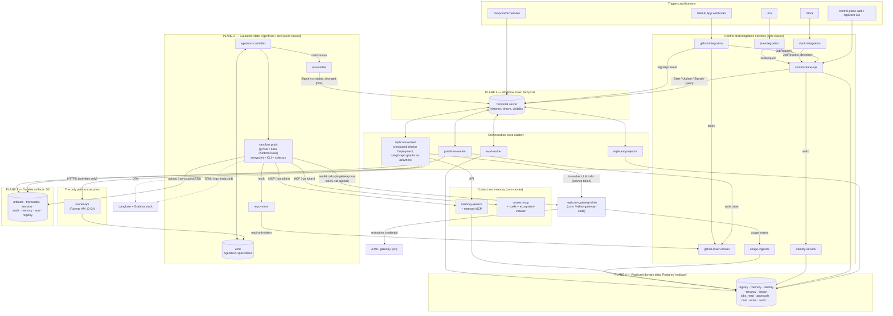
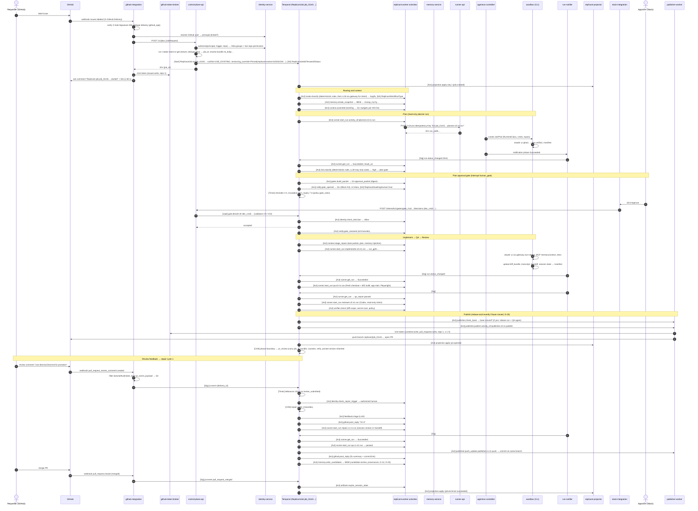

# Reference Architecture

**Contract ID:** `C-ARCH` · **Version:** 2.0.0 · **Owner:** WS-00

**Changelog:** 2.0.0 (breaking). Product rename to Replicant (CCR-ORCH-02). Every product-named identifier changes; there is no structural change. Domain `factory.example.com` (labels, annotations, schema `$id` host) becomes `replicant.example.com`; env prefix `FACTORY_` becomes `REPLICANT_`; headers `X-Factory-*` become `X-Replicant-*`; names `factory-*`/`factory_*` (services, task queues, Temporal namespace, roles, buckets, groups, hosts, networks) become `replicant-*`/`replicant_*`; CamelCase `Factory*` (workflow types, search attributes) becomes `Replicant*`. Monorepo `replicant/`, CLI `replicant`, compose project `replicant`, networks `replicant-core`/`replicant-sbx`. 1.5.4 (wave 3). audit-exporter: 1 replica with a leader lease; it also calls `audit.emit` (reconciler) and has a column-limited `approvals` read (R1V-050, R1V-076). replicant-projector writes `qa`; core rows for `retention-sweeper` and `audit-indexer` (R1V-079). New §4.1 table of scale limits and 10x change paths, including `MaintenanceShard` (R1V-006, R2-046). 1.5.3. Break-glass role `replicant-<env>-killswitch-operator` (CCR-09-12). 1.5.2. The codec server language is fixed as Python; decode audit goes through control-plane-api (CCR-01-11). 1.5.1 (conflict resolution). runner-api gains a write to `ops` `exec-revocations/<env>/*` only, and no exec role writes `audit`. Legal-hold role `replicant-<env>-legal-hold`. 1.5.0 (wave 1). Merged `agentrun-controller` role (CCR-09-08, CCR-02-10). The temporal-codec key is replaced by tenant keys plus `replicant-system` (CCR-09-08b); `replicant-kata-fc` is marked disabled (CCR-09-08c). OTLP collector in invariant 2 (CCR-02-11). Shim on ElastiCache with its durable usage log and gateway callers (CCR-03-07). New workloads `audit-exporter`, `ops-worker`, `alloy-cloudwatch`, `langfuse-retention-sweeper` and their roles (CCR-08-06a). Local topology (CCR-11-04). Ownership: WS-09 keys, WS-02 subnets and firewall (R1-240). 1.4.0: the `agentrun-controller` role is aligned with WS-02's design, and a fourth exec role, `run-notifier` (tenant-key `kms:GenerateDataKey` only), is added (fix round, R1). 1.0.1 CCR-11-02, CCR-11-03 (applied by the orchestrator). 1.1.0 (additive): CCR-09-02 (run-grant signing in §6), CCR-09-06 (broker caller allowlist, §6 and decisions), CCR-09-07 (exec cluster in its own AWS account, §4 and decisions). 1.3.0: the cross-account policies name a third exec role, `agentrun-controller` (orchestrator decision on CCR-02-04 versus CCR-09-07; §4, decisions). 1.2.0 (additive): CCR-03-03 adds `replicant-gateway-shim`, the `replicant-agentd` sidecar, and the `profile-rightsizer` job; sandboxes and workers reach the enterprise AI gateway only through the shim (§1, §2, §4, §6).

## Purpose

This document defines the shape of Replicant: every component, who owns it, how it is deployed
locally and on AWS, which state plane it touches, and how one bugfix job flows end to end, with the
Temporal primitive named at each step. Phase 2 designs the internals behind the boundaries fixed
here and in the sibling contracts.

## Decisions summary

| Decision | Constraint | ADR |
|---|---|---|
| Four state planes, strictly separated: Temporal (workflow), etcd (execution), S3 (artifacts), Postgres (domain). The Runner API is the only path from orchestration to execution | D-01, D-04, D-05, D-08, D-09 | [state-ownership.md](state-ownership.md) |
| **Two EKS clusters per environment, in two AWS accounts**: `core` (control plane, workers, Temporal, observability) in `replicant-<env>-core`, and `exec` (Runner, controller, notifier, sandboxes) in `replicant-<env>-exec`. They cross only through PrivateLink endpoint services and cross-account bucket and key policies naming exactly four exec roles (`sandbox-artifacts`, `runner-api`, `agentrun-controller`, `run-notifier`). A sandbox escape lands in a cluster and account that hold no Replicant secrets, no Temporal, and no Postgres credentials (CCR-09-07) | D-04, D-21, D-22 | [ADR-007](adr/007-separate-execution-cluster.md), WS-09 [ADR-09-001](../09-security/adr/001-confirm-adr-007-exec-cluster-separate-account.md) |
| Human gates and actions are Temporal **Updates**. Machine notifications are **Signals**. Runner completion is a Signal **hint** plus timer and polling | D-01, D-04, D-19 | [ADR-001](adr/001-gates-updates-vs-signals.md), [ADR-002](adr/002-runner-completion-callback-vs-poll.md) |
| The Release Bundle is the unit of versioning. Bundle assignment, per percentage **or** tenant, decides the pinned worker deployment version at start | D-02, D-03 | [ADR-005](adr/005-release-bundle-unit-of-versioning.md), [ADR-006](adr/006-bundle-assignment-drives-version-pinning.md), [ADR-013](adr/013-behavioral-vs-operational-config-tenant-derived-bundles.md) |
| A job stays open (as one workflow ID) through PR review and repair until merge, close, or expiry | D-15, D-19 | [ADR-009](adr/009-job-lifetime-spans-pr-review.md) |
| The UI reads only the Postgres projection | D-09 | [ADR-004](adr/004-ui-read-model-projection.md) |
| Self-hosted Temporal on EKS, with persistence on dedicated PostgreSQL (initial recommendation; WS-10 finalizes) | D-22 | [ADR-003](adr/003-temporal-self-hosted-vs-cloud.md) |
| Run identity is deterministic from the idempotency key, so etcd name uniqueness is the idempotency store | D-04, D-23 | [ADR-008](adr/008-deterministic-run-identity.md) |
| Steering is delivered through a Runner-managed, per-run inbox | §4 UX | [ADR-010](adr/010-steering-via-runner-inbox.md) |
| Only `github-token-broker` holds the GitHub App private key. It mints narrowly scoped installation tokens for an allowlist of callers: publisher-worker, github-integration, repo-mirror, identity-service, zoekt-indexer, and ecosystem-indexer. No caller may obtain `workflows`, `administration`, `secrets`, or `actions`, and the App registration does not hold them (CCR-09-06) | D-21, D-24 | [ADR-011](adr/011-github-token-broker-and-repo-mirror.md) |
| Prefixed, lowercase Crockford identifiers | — | [ADR-012](adr/012-identifier-scheme.md) |
| All model traffic goes through `replicant-gateway-shim` (core, Go, Valkey `gateway-state`). The shim verifies `ai-gateway`-audience run tokens, enforces run, job, and tenant budgets and rate limits, emits usage to usage-ingestor, and alone holds the enterprise AI gateway credential. Sandboxes never reach the enterprise gateway directly (CCR-03-03) | D-11, D-21, D-23 | WS-03 [gateway.md](../03-agents-and-tools/gateway.md) |
| **Challenge D-07:** `LocalStorageCapacityIsolationFSQuotaMonitoring` monitors usage but does not enforce a limit. The hard limit needs another mechanism | D-07 | [ADR-014](adr/014-challenge-d07-fsquota-monitoring-is-not-enforcement.md) |

The configuration-versus-code boundary is stated as rules CC-1 to CC-4 in
[definitions-contracts.md §1](definitions-contracts.md#1-the-configuration-versus-code-rule-must-answer).

---

## 1. Component inventory

Languages follow D-23: Python for everything that touches the Replicant Postgres, Go for the
execution boundary, TypeScript only for the UI. Clusters: **core**, **exec**, or **ext** (external or
managed).

### 1.1 Replicant services

| Component | Responsibility (one line) | Owner WS | Language / runtime | Deployment unit | Cluster / namespace | Writes |
|---|---|---|---|---|---|---|
| `control-plane-web` | Operator and engineer UI (jobs, approvals, releases, registries, memory curation for admins, cost, admin) | WS-07 | TypeScript (SPA) | static bundle behind nginx `Deployment` (2 replicas) + CloudFront optional | core / `replicant-control` | — |
| `control-plane-api` | Public API for UI/CLI; job intake (`POST /v1/jobs`); authorization; sends all human Updates; release, registry, and bundle operations; presigned downloads; SSE | WS-07 | Python 3.12, FastAPI, `temporalio` client | `Deployment` (3 replicas, HPA) | core / `replicant-control` | PG `tenancy`, `intake`, `registry`, `notify`; Temporal (start, Update, Signal) |
| `identity-service` | SCIM 2.0 server for Okta; identity linking (GitHub, Slack, Jira); authorization decision API (Okta groups + live repo permission); admin-group check (D-25) | WS-07 (WS-09 reviews) | Python, FastAPI | `Deployment` (3) | core / `replicant-control` | PG `identity` |
| `github-integration` | GitHub App webhook ingestion (signature, dedupe, redelivery replay), JobRequest building, `pr.event` Signals, PR/issue comments and replies, check runs | WS-07 | Python, FastAPI | `Deployment` (3) + async consumer | core / `replicant-integrations` | PG `github_app`; S3 `artifacts` (`events/`, `intake/`); Temporal (Signal) |
| `github-token-broker` | Sole holder of the GitHub App private key(s). Mints per-action installation tokens restricted by repository and permission | WS-07 (WS-09 reviews) | Python | `Deployment` (2), no ingress except from allowlisted callers | core / `replicant-integrations` | — (audit via `audit.emit`) |
| `slack-integration` | Slash commands, shortcuts, Block Kit approvals, interaction signature verification, message updates across channels | WS-07 | Python (Bolt for Python) | `Deployment` (2) | core / `replicant-integrations` | PG `slack_app` |
| `jira-integration` | Jira webhooks → JobRequest; status comments back to Jira | WS-07 | Python | `Deployment` (2) | core / `replicant-integrations` | PG `jira_app` |
| `replicant-worker` | Temporal worker hosting `ReplicantJob`, `MaintenanceBatch`, and system workflows, with LangGraph graph execution and node activities (router, context assembler, risk, gates, Runner calls, notify, memory writer). **Versioned Worker Deployment** | WS-01 (nodes: WS-04 context and memory, WS-05 QA node, WS-03 Runner-call materialization) | Python 3.12, `temporalio`, `temporalio-langgraph` / `langgraph` | `Deployment` per build ID (Worker Deployment Version), HPA on task-queue backlog | core / `replicant-workers` | Temporal; S3 `artifacts`, `audit`; calls APIs |
| `publisher-worker` | Activities on `replicant-publisher`: rebase and verify, push branch from the diff bundle, open or update the PR, post the PR description. Outside the sandbox (D-21) | WS-07 (git mechanics with WS-01) | Python, `temporalio`, `pygit2` or git CLI | `Deployment` (2) | core / `replicant-workers` | GitHub; S3 `artifacts` |
| `replicant-projector` | Activities on `replicant-projections`: apply ProjectionEvents to read models; reconciler activity | WS-07 | Python, `temporalio`, SQLAlchemy | `Deployment` (2) | core / `replicant-workers` | PG `jobs_read`, `approvals`, `qa` |
| `memory-service` | Memory store API (internal), memory MCP server for sandboxes (run-token auth), snapshots, candidate intake, admin curation backend (D-25) | WS-04 | Python, FastAPI, MCP Python SDK, `pgvector` | `Deployment` (3) | core / `replicant-context` | PG `memory`; S3 `memory` |
| `context-mcp` | MCP server exposing service catalog, contracts, call sites, and Zoekt code search to agents (D-13) | WS-04 | Python, MCP SDK | `Deployment` (3) | core / `replicant-context` | — |
| `ecosystem-indexer` | Derives catalog, contracts, and dependency graph from Backstage, CODEOWNERS, CI-extracted contracts, and Tempo service graphs | WS-04 | Python (CronJobs + worker) | `CronJob`s + `Deployment` | core / `replicant-context` | PG `ecosystem` |
| `zoekt` (zoekt-indexer + webserver) | Lexical and structural code search index and webserver. The indexer fetches opted-in repos with broker tokens (`contents:read`) | WS-04 | Go (upstream OSS) | `StatefulSet` (indexer + webserver, gp3 PVC) | core / `replicant-context` | own index volume |
| `usage-ingestor` | Cost ledger: ingests shim usage events (`gwu_…`) and sandbox compute usage; rollups; budget queries; nightly cost reconciliation (`rec_…`) | WS-03 (WS-08 reviews) | Python | `Deployment` (2) | core / `replicant-control` | PG `cost` |
| `profile-rightsizer` | Proposes resource-profile changes (`rsp_…`) from observed usage, as PRs to the config repo that a human approves (D-12) | WS-03 | Python (job in usage-ingestor) | `CronJob` (`0 5 * * 1` UTC) plus event triggers | core / `replicant-control` | PG `cost` (proposals); config-repo PRs |
| `replicant-gateway-shim` | Sole path to the enterprise AI gateway (D-11). Verifies `ai-gateway`-audience run tokens (with run grant) and worker service tokens; enforces run, job, and tenant budgets and rate limits; injects the enterprise credential; streams pass-through; emits usage events to usage-ingestor. **Never connects to Postgres** | WS-03 | Go | `Deployment` (3+) + Amazon ElastiCache for Valkey `gateway-state` (1 primary + 1 replica, Multi-AZ, IAM AUTH, no snapshots; ephemeral) (CCR-03-07). Callers: sandboxes (run tokens through agentd), and replicant-worker, memory-service, and eval-worker (projected SA tokens, purpose-bound via `X-Replicant-Purpose`) | core / `replicant-gateway` | ElastiCache `gateway-state`; the durable usage log to S3 `artifacts` `platform/gateway-usage/` (`gateway_usage_log`); usage events → usage-ingestor |
| `eval-worker` | Temporal worker for `EvalSuite` / `EvalCase` workflows; scoring; result storage | WS-06 | Python, `temporalio` | Worker Deployment `eval-worker` | core / `replicant-eval` | PG `evals`; S3 `eval`; Langfuse scores |
| `migrate` | Alembic migrations for database `replicant`, holding a Postgres advisory lock | WS-10 | Python, Alembic | `Job` (Argo CD PreSync or Helm pre-upgrade; WS-10 decides) | core / `replicant-control` | PG all schemas (DDL), `ops` |
| `audit-exporter` | Exports audit events and partitions, and workflow history skeletons and full exports (C-ART), using a read-only Temporal identity (CCR-08-06) | WS-08 | Python | `Deployment` (**1 replica, leader lease**; the single writer of audit exports, XD-FIX-R1-194) | core / `replicant-system`; IAM role `replicant-<env>-audit-exporter` | S3 `audit` (exports, skeletons, and reconciled `approval_record`s, C-ART), S3 `artifacts` (full history exports); PG `audit` via `audit.record_partition_export` **and** `audit.emit` (approval-record reconciler events, for example `approval_record.reconciled`); a column-limited read of `approvals` (C-PG) |
| `retention-sweeper` | Session-state sweep: deletes `session` run prefixes of terminal jobs after `sessionStateGraceDays` (C-ART rule 5), writing the deletion ledger first | WS-10 | Python, `temporalio` | Worker `Deployment` on `replicant-retention` (WS-10 sizes it) | core / `replicant-workers`; IAM role `retention-sweeper` | S3 `session` deletes (prefix-scoped); deletion ledger in S3 `audit` |
| `audit-indexer` | Reads Okta System Log exports from S3 `audit`, keeps replicant-app events, and pushes them to Loki `audit` (WS-08 audit.md §4) | WS-08 | Python | `CronJob` (every 5 min) | core / `observability` | Loki only; no database login |
| `ops-worker` | Temporal worker on `replicant-ops` (`LeakPurge` and other operational workflows); service account `leak-purge-worker` (CCR-08-06) | WS-08 | Python, `temporalio` | `Deployment` (2) | core / `replicant-workers`; IAM role `replicant-<env>-leak-purge` | S3 deletes and supersessions per C-ART rule 4a; PG via `audit.emit` only |
| `alloy-cloudwatch` | Pulls CloudWatch metrics for managed services (RDS, ElastiCache, S3, NLB) into Mimir (CCR-08-06) | WS-08 | Grafana Alloy | `Deployment` (1) | core / `observability`; IAM role with `cloudwatch:GetMetricData`, `cloudwatch:ListMetrics`, `tag:GetResources` | — |
| `langfuse-retention-sweeper` | Applies Langfuse retention (CCR-08-06) | WS-08 | Python | `CronJob` | core / `langfuse`; no AWS role | Langfuse API |
| `temporal-codec-server` | Decodes encrypted payloads for the Temporal UI and CLI (KMS). Audits every decode through control-plane-api `POST /internal/v1/audit/events` (event `temporal.payload_decoded`); it has no database login, so D-23 holds | WS-01 (WS-09 keys) | **Python** (CCR-01-11; reuses `TenantContextCodec`) | `Deployment` (2), behind Okta | core / `temporal` | — |
| `runner-api` | Runner API (orchestration and sandbox listeners): admission, AgentRun creation, status, cancel, steering inbox, run-token issuance, per-run AWS credential vending | WS-02 | Go | `Deployment` (3), internal NLB | exec / `replicant-runner` | etcd (AgentRun); S3 `artifacts` (`inbox/`) |
| `agentrun-controller` | Reconciles AgentRun → Job/Pod/Secret/ConfigMap/network policy; artifact commit detection; completion notifications; GC | WS-02 | Go, controller-runtime (kubebuilder) | `Deployment` (2, leader election) | exec / `replicant-runner` | etcd |
| `run-notifier` | Receives controller notifications and Signals `run.status_changed`. The only exec-side Temporal client | WS-02 | Go, Temporal Go SDK client | `Deployment` (2) | exec / `replicant-runner` | Temporal (Signal only) |
| `repo-mirror` | Read-only Git smart-HTTP mirror and cache for sandboxes (run-token auth per `repo_ids`); refreshes from GitHub with read-only installation tokens from the broker | WS-02 | Go (or Gitaly-style OSS; WS-02 decides) | `StatefulSet` with NVMe or gp3 volumes | exec / `replicant-mirror` | own cache |
| Sandbox pod: `entrypoint` | Materializes CLI config outside the repo; runs `claude -p` / Agent SDK / `codex exec`; captures transcripts; writes `run_result` | WS-03 | WS-03 decides (static Go binary recommended) | container in the AgentRun pod | exec / `sbx-<tenant>` | S3 run prefixes |
| Sandbox pod: `replicant-agentd` | Native sidecar and sole in-pod holder of the run tokens (`REPLICANT_RUN_TOKEN_DIR`). Loopback auth proxy for gateway, MCP, git, and inputs; token refresh; steering long-poll. The agent container never sees a credential | WS-03 | Go (static) | native sidecar (`initContainers[]`, `restartPolicy: Always`) | exec / `sbx-<tenant>` | — |
| Sandbox pod: sidecars | Artifact uploader, log/transcript shipper (redaction, WS-08), disk watchdog | WS-02 (redaction rules WS-08) | Go | sidecar containers | exec / `sbx-<tenant>` | S3 run prefixes |
| Egress control | Default-deny egress; FQDN allowlists; package mirror and proxy path | WS-02 (WS-09 reviews) | Cilium FQDN policies and/or Envoy/Squid egress proxy (WS-02 decides) | DaemonSet / `Deployment` | exec / `kube-system`, `replicant-egress` | — |

### 1.2 Platform components (self-hosted)

| Component | Responsibility | Owner WS | Deployment |
|---|---|---|---|
| Temporal server (frontend, history, matching, internal worker) + Temporal UI | Durable execution (D-01). Self-hosted 1.32.x [verified: GitHub releases, temporalio/temporal v1.32.1 2026-10-08, checked 2026-10-24] | WS-01 (WS-10 persistence) | Helm `temporalio/temporal` in core / `temporal`. UI behind Okta |
| Langfuse v4 (web, worker), ClickHouse, Valkey | LLM traces, prompt management, scores, datasets (D-17) [verified: https://langfuse.com/self-hosting, 2026-10-24] | WS-08 | core / `langfuse`, ClickHouse via operator or StatefulSet on `platform` nodes |
| Grafana, Loki, Tempo, Mimir or Prometheus, Grafana Alloy | Logs, traces, metrics, dashboards. Alloy collectors in both clusters (Promtail is end of life [verified: https://grafana.com/docs/loki/latest/send-data/promtail/, 2026-10-24]) | WS-08 | core / `observability`; Alloy DaemonSet in core and exec |
| cert-manager, External Secrets Operator, Karpenter, AWS Load Balancer Controller, Cilium | Cluster platform | WS-10 / WS-09 / WS-02 | both clusters |

### 1.3 Stores and external systems

| Component | Role | Owner WS |
|---|---|---|
| PostgreSQL `replicant` (with pgvector) | Domain data ([postgres-ownership.md](postgres-ownership.md)) | WS-10 |
| PostgreSQL `temporal` | Temporal persistence and visibility (PG 16) | WS-10 |
| PostgreSQL `langfuse` | Langfuse metadata | WS-10 / WS-08 |
| Amazon S3 (7 buckets per environment) | Artifacts ([artifact-layout.md](artifact-layout.md)) | WS-10 |
| AWS KMS | Per-tenant data keys; platform keys (including `replicant-system`); Temporal payloads are encrypted under the job's **tenant key**, or `replicant-system` for non-tenant workflows, with encryption context `replicant:purpose=temporal-payload`. There is no separate codec key (CCR-09-08b). Run-token signing key (exec account); run-grant key. **Ownership (R1-240): WS-09 owns all keys; WS-02 owns the exec subnets and the network firewall** | WS-09 |
| AWS Secrets Manager (or Vault; WS-09 decides) | GitHub App keys, webhook secrets, Slack signing secret, DB credentials | WS-09 |
| Amazon ECR | Replicant, CLI, and base images (by digest) | WS-03 / WS-10 |
| **Okta** (ext) | OIDC for users; SCIM for users and groups (D-18) | WS-07 |
| **GitHub** (ext) | Repos, PRs, GitHub App (prod and dev registrations, D-24) | WS-07 |
| **Slack** (ext) | Triggers, approvals, notifications | WS-07 |
| **Jira** (ext) | Triggers, status | WS-07 |
| **Internal AI/ML gateway** (ext to Replicant; enterprise) | Upstream of `replicant-gateway-shim`. Reached only from the shim, with a Replicant service credential held in core (CCR-03-03) | WS-03 (integration contract) |
| **Package mirror** (Artifactory/Nexus, ext) | Package installs for sandboxes (D-21) | WS-02 |
| **Backstage catalog, CI contract artifacts** (ext) | Ecosystem sources (D-13) | WS-04 |

### 1.4 Local-only components (D-20; WS-11 owns)

`s3` (S3-compatible server: SeaweedFS by default, MinIO built from source as profile `s3-minio`; CCR-11-02), `dex` or `keycloak` (stub IdP), `gitea` or `forgejo` (local Git with webhooks and PRs),
`slack-mock`, `replicant-gateway-shim` with local upstream backends `passthrough`, `record`, `replay`,
and `script` plus a `gateway-state` Valkey (CCR-11-04), `runner-local` (Runner API over Docker/Podman),
`run-grants` (core run-grant JWKS and `/grants/revoked`), `ops-worker` (`replicant-ops`),
`retention-sweeper` (`replicant-retention`), `ecosystem-stubs`, `egress-proxy` plus local package
mirror, and a Cloudflare quick tunnel (`cloudflared`) behind `webhook-ingress` for the dev GitHub
App (WS-07 ADR-07-004).

---

## 2. Logical architecture (four state planes)

Read the diagram with these invariants:
1. Only `replicant-worker` activities call `runner-api`, and nothing else in core touches the exec
   cluster's Kubernetes API (D-04).
2. Sandboxes reach exactly these services: `replicant-gateway-shim` (never the enterprise AI gateway), memory MCP, context MCP, repo-mirror, the
   Runner sandbox listener, S3 (run prefixes, through a VPC endpoint), the package mirror (D-21), and
   the sandbox OTLP collector (`otel-sandbox.<env>.replicant.internal:4318`, WS-08 `alloy-sandbox-otlp`;
   CCR-02-11).
3. Sandboxes hold no GitHub credentials, no Temporal credentials, and no Postgres credentials.

---

## 3. Local composition (D-20)

```mermaid
flowchart TB
  subgraph Host["Developer laptop: Docker or Podman"]
    subgraph Core["compose profile: core"]
      direction TB
      MIG["migrate (one-shot, depends_on: service_completed_successfully)"]
      PGF[("postgres-replicant<br/>pgvector")]
      TS["temporal (server + UI)<br/>+ postgres-temporal"]
      MINIO[("s3 (SeaweedFS)<br/>7 buckets, org=local")]
      CPAL[control-plane-api]
      WEB[control-plane-web]
      IDSL[identity-service]
      DEX["dex / keycloak<br/>(seeded users and groups)"]
      GHIL[github-integration]
      TBL[github-token-broker]
      SLIL[slack-integration]
      SLM[slack-mock]
      GITEA["gitea / forgejo<br/>(webhooks, PRs)"]
      FWL[replicant-worker]
      PUBL[publisher-worker]
      PRJL[replicant-projector]
      MEML[memory-service]
      CML["context-mcp + zoekt<br/>+ ecosystem-stubs"]
      USGL[usage-ingestor]
      GWS["replicant-gateway-shim<br/>(backends passthrough / record / replay / script)<br/>+ gateway-state Valkey"]
      RGR["run-grants<br/>(grant JWKS + /grants/revoked)"]
      OPSW["ops-worker (replicant-ops)"]
      RSW["retention-sweeper (replicant-retention)"]
      RL["runner-local<br/>(Runner API over Docker/Podman;<br/>includes notifier)"]
      SBXL["sandbox containers<br/>(same images as prod:<br/>CLI → replicant-agentd)"]
      EGP["egress-proxy + local package mirror"]
      FWD["cloudflared quick tunnel<br/>→ webhook-ingress (dev GitHub App)"]
      LFW[langfuse-web]
      LFK[langfuse-worker]
      CH[(clickhouse)]
      VK[(valkey)]
      PGL[(postgres-langfuse)]
    end
    subgraph Obs["compose profile: observability"]
      GRA[grafana]
      LOKI[loki]
      TEMPO[tempo]
      PROM[prometheus]
      ALLOY[alloy]
    end
    subgraph K8s["profile: k8s (kind or k3d)"]
      KAPI["kube-apiserver + AgentRun CRD"]
      KRA[runner-api]
      KCT[agentrun-controller]
      KRN[run-notifier]
      KPOD["sandbox pods<br/>(Kata on Linux+KVM, runc fallback on macOS)"]
    end
  end
  GHCOM["github.com (dev GitHub App on a personal org)"]
  MIG --> PGF
  CPAL --> PGF
  CPAL --> TS
  FWL --> TS
  FWL -->|"Runner API (same OpenAPI)"| RL
  FWL -.->|"k8s profile: Runner API"| KRA
  RL --> SBXL
  SBXL -->|"CLI → replicant-agentd → shim"| GWS
  RL --> RGR
  OPSW --> TS
  RSW --> MINIO
  SBXL --> MINIO
  SBXL --> EGP
  KRA --> KAPI
  KCT --> KAPI
  KCT --> KPOD
  KRN --> TS
  RL -->|"Signal run.status_changed"| TS
  GITEA -->|webhooks| GHIL
  GHCOM -->|webhooks via tunnel| FWD --> GHIL
  CPAL --> DEX
  ALLOY --> LOKI
  ALLOY --> TEMPO
  FWL -.OTel.-> LFW
```

Local rules (WS-11 owns details):
- The same service images and the same `replicant-db` migrations as production. `replicant dev up`
  starts `core` (plus `observability` with `--with-observability`). `replicant dev seed` seeds through
  the API only (D-26).
- `runner-local` and the `k8s`-profile `runner-api` must both pass the **same Runner API contract
  test suite** (WS-11).
- `runner-local` uses the Docker or Podman API to start sandbox containers. That socket is
  local-only and never exists in production. Every behavior difference is listed in WS-11
  `parity.md`.

---

## 4. Production composition (AWS, one environment)

Per CCR-09-07 (C-ARCH 1.1.0), each environment uses **two AWS accounts**: `replicant-<env>-core`
and `replicant-<env>-exec`. The exec cluster lives in its own account. The accounts cross only at
explicit points:

- **PrivateLink endpoint services:**
  - exec exposes the Runner orchestration listener to core worker subnets;
  - core exposes temporal-frontend (consumer: run-notifier subnet only), memory-mcp, context-mcp,
    and replicant-gateway-shim `ai-gateway.<env>.replicant.internal` (consumers: sandbox subnets; CCR-03-03),
    and github-token-broker (consumer: repo-mirror subnet only);
  - sandbox subnets reach Artifactory through a PrivateLink endpoint. They never reach the enterprise
    AI gateway; the shim does, from the core account.
- **Cross-account resource policies:** S3 bucket policies and tenant KMS key policies in the core
  account name exactly **four** exec-account roles:
  - `sandbox-artifacts`: the Runner-vended per-run sessions.
  - `runner-api`: includes writes to `…/runs/<run_id>/inbox/*` (steering messages, `_head.json`,
    `ack-*`, and `_control.json`; C-ART), and `s3:PutObject` scoped to the `ops` bucket prefix
    `exec-revocations/<env>/*` with `kms:GenerateDataKey` on the `ops` key (the revocation feed,
    CCR-02-09). **No exec role writes the `audit` bucket.**
  - `agentrun-controller`: one merged list (CCR-09-08, CCR-02-10; WS-02 controller.md §9b):
    - `s3:GetObject` on **every object under the run's three prefixes** (`artifacts`,
      `transcripts`, `session`). S3 authorizes HeadObject as `s3:GetObject`, and there is no
      `s3:HeadObject` action [verified: https://docs.aws.amazon.com/AmazonS3/latest/API/API_HeadObject.html,
      2026-10-24]. **This role can therefore read run content.** The scope stays limited to the
      three run prefixes;
    - `s3:GetObject` on the `registry` bucket `blobs/sha256/*` and `bundles/*`;
    - `s3:PutObject` (required `If-None-Match: *`) and `s3:PutObjectTagging` on
      `…/runs/<run_id>/agentrun_record/*` and `…/runs/<run_id>/inbox/_control.json`;
    - KMS `kms:Decrypt` on tenant keys and the `registry` key, and `kms:GenerateDataKey` on
      tenant keys, all with `kms:ViaService` S3;
    - explicitly **no** `s3:ListBucket`, **no** `s3:DeleteObject*`, **no**
      `s3:BypassGovernanceRetention`, and no access to `audit`, `memory`, or `eval`.
  - `run-notifier`: `kms:GenerateDataKey` **only**, on tenant keys (and `replicant-system`) with
    encryption context `replicant:purpose=temporal-payload`, and **no** `kms:Decrypt`. It encodes Signal payloads under
    the tenant codec and never decodes (R1 finding; WS-01 ADR-010). It has no S3 access.
- **No default route on sandbox subnets.** Only the repo-mirror subnet routes to `github.com` and
  `api.github.com`, through a central egress VPC with AWS Network Firewall domain allowlisting.

This strengthens [ADR-007](adr/007-separate-execution-cluster.md); the evidence and the account SCP
are in WS-09 [ADR-09-001](../09-security/adr/001-confirm-adr-007-exec-cluster-separate-account.md).

```mermaid
flowchart TB
  subgraph ACORE["AWS account replicant-prod-core (us-east-1, 3 AZs)"]
    subgraph VPCC["core VPC (private subnets)"]
      subgraph CORE["EKS cluster fct-prod-core (1.36+)"]
        subgraph NPsys["node pool system: m7i.large x3"]
          SYS["CoreDNS · Karpenter · AWS LB Controller ·<br/>cert-manager · External Secrets · Cilium"]
        end
        subgraph NPplat["node pool platform: m7i.2xlarge (Temporal, Langfuse, Grafana) · r7i.2xlarge (ClickHouse)"]
          NS_T["ns temporal: frontend, history, matching, worker,<br/>temporal-ui, temporal-codec-server"]
          NS_LF["ns langfuse: web, worker, ClickHouse, Valkey"]
          NS_OBS["ns observability: Grafana, Loki, Tempo, Mimir, Alloy gateway"]
        end
        subgraph NPapps["node pool apps: m7i.xlarge (Karpenter, 6–20 nodes)"]
          NS_CTL["ns replicant-control: control-plane-web, control-plane-api<br/>(also serves run-grant JWKS + revocation list),<br/>identity-service, usage-ingestor, migrate Job"]
          NS_INT["ns replicant-integrations: github-integration,<br/>github-token-broker, slack-integration, jira-integration"]
          NS_WRK["ns replicant-workers: replicant-worker (per build ID, signs run grants),<br/>publisher-worker, replicant-projector"]
          NS_CTX["ns replicant-context: memory-service, context-mcp,<br/>ecosystem-indexer, zoekt (indexer + webserver)"]
          NS_EVAL["ns replicant-eval: eval-worker"]
          NS_GW["ns replicant-gateway: replicant-gateway-shim,<br/>Valkey gateway-state"]
        end
      end
      EPS_C["PrivateLink endpoint services (core):<br/>temporal-frontend, memory-mcp, context-mcp,<br/>replicant-gateway-shim, github-token-broker"]
      EPI_C["PrivateLink interface endpoint → exec runner orchestration listener"]
    end
    RDSF[("RDS/Aurora PostgreSQL 17+ 'replicant'<br/>Multi-AZ, pgvector 0.8")]
    RDST[("RDS PostgreSQL 16 'temporal'<br/>Multi-AZ")]
    RDSL[("RDS PostgreSQL 'langfuse'")]
    S3B[("S3: acme-replicant-prod-{artifacts, transcripts,<br/>session, audit, memory, eval, registry}<br/>bucket policies name exec roles sandbox-artifacts,<br/>runner-api, agentrun-controller<br/>(tenant keys also name run-notifier)")]
    KMSC["KMS (core): tenant keys ×40, replicant-system,<br/>audit, registry, eval, ops, run-grant, github-app<br/>(Temporal payloads: tenant / replicant-system keys)"]
    SM[Secrets Manager]
    ECR[ECR]
  end
  subgraph AEXEC["AWS account replicant-prod-exec (SCP-restricted)"]
    subgraph VPCE_X["exec VPC (sandbox subnets: no default route)"]
      subgraph EXEC["EKS cluster fct-prod-exec (1.36+)"]
        subgraph NPexs["node pool exec-system: m7i.xlarge x3"]
          NS_RUN["ns replicant-runner: runner-api, agentrun-controller, run-notifier"]
          NS_MIR["ns replicant-mirror: repo-mirror"]
          NS_EG["ns replicant-egress: egress proxy (if chosen)"]
        end
        subgraph NPkata["node pools sbx-kata-*: NVMe + KVM-capable<br/>(e.g. m8id/c8id with nested virtualization, or *.metal, WS-02 decides)<br/>taint replicant.example.com/sandbox=true:NoSchedule"]
          SBXK["ns sbx-TENANT ×40: AgentRun pods<br/>RuntimeClass replicant-kata-clh<br/>(replicant-kata-fc defined, disabled by policy)"]
        end
        subgraph NPgv["node pool sbx-gvisor: NVMe (e.g. m7gd/m6id)"]
          SBXG["ns sbx-TENANT: AgentRun pods<br/>RuntimeClass replicant-gvisor"]
        end
      end
      EPS_X["PrivateLink endpoint service (exec): runner orchestration listener<br/>(consumers: core worker subnets)"]
      EPI_X["PrivateLink interface endpoints → core services (incl. gateway shim), Artifactory"]
      VPCE["S3 gateway VPC endpoint<br/>(policy: replicant buckets only)"]
      KMSX["KMS (exec): run-token signing key"]
    end
    EGV["central egress VPC + AWS Network Firewall<br/>(repo-mirror subnet only: github.com, api.github.com)"]
  end
  OKTA["Okta (OIDC + SCIM)"]
  GHX["GitHub (prod App)"]
  SLX[Slack]
  JRX[Jira]
  AIGW["Internal AI/ML gateway → model providers"]
  PKG["Artifactory / Nexus"]

  NS_WRK --> EPI_C --> EPS_X --> NS_RUN
  NS_RUN -->|run-notifier| EPI_X
  EPI_X --> EPS_C
  EPS_C --> NS_T
  EPS_C --> NS_CTX
  EPS_C --> NS_INT
  EPS_C --> NS_GW
  NS_WRK --> NS_GW
  NS_GW -->|enterprise credential| AIGW
  SBXK --> EPI_X
  SBXG --> EPI_X
  SBXK --> NS_RUN
  SBXK --> VPCE --> S3B
  NS_WRK --> S3B
  NS_CTL --> RDSF
  NS_WRK --> RDSF
  NS_CTX --> RDSF
  NS_T --> RDST
  NS_LF --> RDSL
  NS_INT --> GHX
  NS_INT --> SLX
  NS_INT --> JRX
  NS_CTL --> OKTA
  OKTA -->|SCIM| NS_CTL
  EPI_X -->|PrivateLink| PKG
  NS_MIR --> EGV --> GHX
  EXEC -.images.-> ECR
  CORE -.images.-> ECR
```

Notes:
- **Separate databases** (D-09): `replicant`, `temporal` (pinned to PostgreSQL 16, the latest version
  Temporal has tested), and `langfuse` are distinct RDS instances or clusters. WS-10 makes the final
  hosting decision.
- **Accounts** (CCR-09-07). Core-account resources stay in core: data stores, the GitHub App key,
  the run-grant key, and the tenant keys. Exec holds only the run-token signing key, the
  `sandbox-artifacts`, `runner-api`, `agentrun-controller`, and `run-notifier` roles, and the exec VPC. EKS Pod Identity in exec assumes
  exec-account roles, and access to core buckets and keys goes through resource policies, not role
  chaining. The enterprise AI gateway is reached only by `replicant-gateway-shim` from the core account
  (CCR-03-03). That Artifactory is reachable through PrivateLink is an assumption about a system
  outside Replicant; WS-02 and WS-10 confirm it.
- Sandbox node pools follow WS-02's runtime recommendation. EC2 nested virtualization is now
  available on several non-metal families, including M8id and C8id, which also have local NVMe
  [verified:
  https://docs.aws.amazon.com/AWSEC2/latest/UserGuide/amazon-ec2-nested-virtualization.html,
  2026-10-24]. That opens Kata without `.metal` instances. WS-02 benchmarks it against metal.
- Sizing anchor (WS-02 refines): 150 concurrent AgentRuns × about 6 vCPU / 16 GiB / 40 GiB disk
  at the limits gives about 900 vCPU and 2.4 TiB RAM peak in sandbox pools. That is roughly 20
  hosts of 48 vCPU each. The design changes shape above about 1,000 concurrent runs (per-cluster
  pod churn, etcd write load), and at that point sharding exec clusters per tenant group is the
  next step.
- Additional environments: `staging` (same topology and account split, smaller) and `dev` (one
  shared cluster allowed, `core` and `exec` as separate node pools with the same namespaces;
  documented as a deliberate parity gap).

### 4.1 Scale limits and 10x change paths (R2-046)

The design is sized for 1,500 repositories, 40 tenants, and 150 concurrent runs (shared context §2).
The table lists every limit that is frozen into a contract or a fixed sizing, its value at 10x
(15,000 repositories, 400 tenants, 1,500 concurrent runs), and how it changes. "Contract" means a
change request against the named contract; "config" means no contract change.

| Limit | Today | At 10x | Change path | Owner |
|---|---|---|---|---|
| `target_selector.max_repos` (C-JOBREQ) | was 1,500 | **15,000 (raised now, C-JOBREQ 2.0.0)** | Done. Beyond 15,000, a contract change | WS-00 |
| Repos per `MaintenanceBatch` history | ≤ 4,000 measured within the 256 KiB state budget (WS-01) | 15,000 | **`MaintenanceShard`** (below). Already defined, so no further change | WS-01 |
| Explicit `targets` per JobRequest | 200 | 200 | Unchanged: large sweeps use `target_selector` | WS-00 |
| Bundle `ref_list` `maxItems` (C-DEF) | 500 | 500 | Unchanged. Refs scale with *definitions* (codebase types, agents, policies), not repositories, so 10x repos does not raise it. Raise it by C-DEF change request if definitions exceed about 400 | WS-00, WS-06 |
| SQL-visibility custom search attributes | 8/10 Keyword | same | Unchanged at 10x jobs. At more than 10 Keyword attributes, move visibility to OpenSearch (ADR-003) | WS-10 |
| repo-mirror shards | 3 (fixed) | about 30 | Config: shard count and cache volume per shard, by repo-hash partition | WS-02 |
| Zoekt index sizing | sized for 1,500 repos | 15,000 repos | Config: indexer shards and webserver replicas by repo partition; storage grows linearly | WS-04 |
| Exec cluster concurrency | 150 runs | 1,500 runs | Shard exec clusters per tenant group above about 1,000 concurrent runs (ADR-007 "revisit when") | WS-02, WS-10 |
| Capacity and cost model | 1,500 repos | 15,000 repos | Add a repo-scale row to WS-10 capacity-and-cost.md | WS-10 |

**`MaintenanceShard` (R1V-006 shape, XD-W3-R1V-006).**
- A `MaintenanceBatch` resolves its `target_selector` through an activity into a repository list. It
  stores that list in S3 (`children_index_uri`), never in history.
- If the list has **≤ 2,000** repositories, the batch fans out child jobs itself, as today.
- Above 2,000, it partitions the list into shards of ≤ 2,000 and starts one internal child workflow
  per shard:
  - type `MaintenanceShard`, ID `<job_id>:shard:<n>` (C-IDS);
  - task queue `replicant-jobs`, pinned to the batch's worker version, which pinned children inherit;
  - `ParentClosePolicy.REQUEST_CANCEL`.
- Each shard creates its child jobs through `intake.create_child_job` (own `job_id`, `parent_job_id`
  = the batch's `job_id`) with `ParentClosePolicy.ABANDON`. It receives their
  `batch.child_progress` Signals, enforces its share of the batch concurrency limit, and runs
  Continue-As-New on its own history thresholds.
- A shard completes when every child is in `pr_review` or terminal, returning per-status counts.
- The batch aggregates shard results into `batch.snapshot`.
- The 2,000 threshold is half of WS-01's measured 4,000-repository history bound.

---

## 5. End-to-end happy path: bugfix job

Primitives are named in brackets: **[Start]** StartWorkflowExecution, **[Act]** activity,
**[LA]** local activity (none used for side effects), **[Timer]** durable timer, **[Upd]** Update,
**[Sig]** Signal, **[CAN]** Continue-As-New, **[Child]** child workflow, **[SA]** search attribute
upsert, **[Q]** Query. Every projection is `[Act] projection.apply` on `replicant-projections`, not
awaited (shown once per phase).

### 5.1 Failure modes along the flow

| Step | Failure | Behavior | User-visible |
|---|---|---|---|
| Webhook | Signature invalid | 401; not processed; metric `replicant_github_webhook_invalid_signature_total` | none |
| Webhook | Duplicate delivery | Deduped on `X-GitHub-Delivery`. A re-submit also dedupes on the JobRequest `dedupe_key` | none |
| Intake | Requester unlinked or lacks repo permission | Rejected before the workflow starts. GitHub comment: "Link your GitHub account at <url>" or "You need write access" | comment |
| Intake | Temporal unavailable | `intake.job_requests` row exists with `start_status=pending`. The intake retrier starts the workflow (`USE_EXISTING` makes it idempotent) | "Queued" in UI |
| Router | LLM intent unclear | `clarification` gate (Update `gate.decide` with `answer`) | question in the originating channel |
| Any activity | Transient error | Temporal retry policy (WS-01 values). Not visible unless retries are exhausted | node shows "retrying" after 3 attempts |
| Runner | 429 tenant quota | Activity retries honoring `Retry-After`; job phase stays, with sub-status `waiting_capacity` | "Waiting for sandbox capacity" |
| Run | Retryable failure (`NodeLost` …) | Workflow re-invokes the node with ordinal+1 (new `run_id`), max per `repair_limits` policy | timeline shows the retry |
| Run | Non-retryable (`WorkspaceDiskExceeded`, `OOMKilled`) | Node fails, then the job fails with the reason. An operator alert proposes a resource profile change (WS-03) | failure with actionable reason |
| Gate | No decision before expiry | `expired` → auto-cancel per policy; all channels updated | "Expired after 7 days" |
| Gate | Approver lost group membership in flight | `identity.check_decision` denies; the gate stays open | "You are no longer an approver" |
| Publish | Base moved | Rebase run plus QA (and a gate again if the risk rules say so) | "Rebasing on main" |
| Publish | Push rejected (branch protection) | Non-retryable; job `failed` with reason; operator alert if systematic | PR not created, reason shown |
| PR review | Comment from a bot or unlinked user | Ignored by github-integration. Unlinked humans get a reply with a link instruction | reply |
| Repair | Repair budget exhausted (`repair_limits`) | Job ends `failed` with outcome `repair_budget_exhausted`; reply on the PR | PR comment |
| Long wait | Worker version drained while waiting | The pinned version's workers are kept until drained (WS-01). Migration is offered via `job.offer_bundle_migration` | banner |

---

## 6. Trust boundaries and credentials (summary; WS-09 owns the model)

| Holder | Credential | Scope | Lifetime |
|---|---|---|---|
| control-plane-api | Temporal mTLS client cert; DB role `svc_control_plane_api`; Okta OIDC client | namespace actions listed in [events-and-signals.md §1](events-and-signals.md) | cert 24 h |
| run-notifier | Temporal mTLS cert; exec role `run-notifier` | `SignalWorkflowExecution` only; tenant-key `kms:GenerateDataKey` (context `replicant:purpose=temporal-payload`) to encode Signal payloads, with **no** `kms:Decrypt` | 24 h (cert) |
| github-token-broker | GitHub App private key (prod or dev registration) | mints tokens | rotated per WS-09 |
| publisher-worker | Installation token from broker | `contents:write`, `pull_requests:write`, one repo | ≤ 1 h (GitHub maximum [verified: https://docs.github.com/en/apps/creating-github-apps/authenticating-with-a-github-app/generating-an-installation-access-token-for-a-github-app, 2026-10-24]) |
| github-integration | Installation token from broker; webhook secret | `issues:write`, `pull_requests:write` (comments), `checks:write`, one repo | ≤ 1 h |
| repo-mirror | Installation token from broker | `contents:read`, `metadata:read` | ≤ 1 h |
| identity-service | Installation token from broker | `metadata:read` (collaborator permission, one repo), `members:read` (org membership) | ≤ 1 h |
| zoekt-indexer, ecosystem-indexer | Installation token from broker | `contents:read`, `metadata:read`, opted-in repos only | ≤ 1 h |
| *(no caller)* | — | `workflows`, `administration`, `secrets`, `actions` are never requested, and the App registration does not hold them | — |
| runner-api (exec account) | KMS sign permission on the exec-account run-token key; STS AssumeRole into `sandbox-artifacts`. Can mint run tokens only for runs whose core-signed run grant it holds (CCR-09-02) | per run, within the grant | — |
| sandbox | One run token per audience (JWT, embedding the run grant, CCR-09-01/02); STS session credentials scoped to its run prefixes and tenant KMS key | one run, within its grant | ≤ 60 min, refreshed until terminal |
| replicant-worker | DB role (read registry, …); S3 role (job prefixes); gateway service credential for in-worker LLM calls (router, triage, extraction); `kms:Sign` on the core-account `run-grant` key (ECC_NIST_P256), used by the Runner-call activity to sign run grants (CCR-09-02) | — | IRSA or Pod Identity |
| replicant-gateway-shim | Enterprise AI gateway service credential (Secrets Manager, core account); ElastiCache IAM AUTH; S3 `PutObject` on `artifacts` `platform/gateway-usage/*`. Verifies `ai-gateway`-audience run tokens and grants, plus worker service tokens (projected SA token, audience `ai-gateway`) | all model traffic | rotated per WS-09 |
| audit-exporter | IAM role `replicant-<env>-audit-exporter`; Temporal identity `audit-exporter`, read-only (`ListWorkflowExecutions`, `GetWorkflowExecutionHistory`); PG login `svc_audit_exporter` | audit exports per C-ART; `audit.record_partition_export` | IRSA or Pod Identity |
| ops-worker | IAM role `replicant-<env>-leak-purge` (service account `leak-purge-worker`); Temporal worker identity `ops-worker` on `replicant-ops`; PG login `svc_ops_worker` (`EXECUTE audit.emit` only) | C-ART rule 4a deletions | — |
| legal team (`replicant-<env>-legal-hold`, assumed through WS-09's approval flow) | IAM role `replicant-<env>-legal-hold` | the only principal that places or removes legal holds, and only on `audit` and the legal bucket `<org>-replicant-<env>-legal`; writes the litigation copies there. `replicant-leak-purge` may also supersede and delete un-held legal-bucket objects (C-ART 1.10.3, CCR-ORCH-01) | time-boxed session |
| kill-switch break-glass (`replicant-<env>-killswitch-operator`, assumed through the access broker with a ticket tag, second approver, and session expiry) | IAM role `replicant-<env>-killswitch-operator` | CAS `PutObject` on `ops` `kill-switches/v1/state.json` only; every use audited, mirror-drift alert (CCR-09-12) | time-boxed session |
| Okta System Log stream | Firehose delivery role `replicant-<env>-okta-log-firehose` | writes `okta_system_log_export` to `audit` | — |
| control-plane-api (grants) | Publishes the run-grant JWKS (`https://grants.<env>.replicant.internal/.well-known/jwks.json`) and the grant revocation list (`/grants/revoked`), per WS-09 [agent-capabilities.md §2.2](../09-security/agent-capabilities.md) | public keys and revoked grant IDs only | — |

---

## Open questions

| Question | Who decides | Options | Recommendation |
|---|---|---|---|
| Two EKS clusters or one? | WS-02 / WS-09 / WS-10 | separate exec cluster; one cluster with isolated node pools | Separate clusters ([ADR-007](adr/007-separate-execution-cluster.md)) |
| Publisher owner | Orchestrator | WS-07 (GitHub surface) / WS-01 (graph node) | WS-07 owns `publisher-worker` and its GitHub semantics. WS-01 owns where the publish node sits in graphs |
| Sandbox entrypoint language | WS-03 | Go static binary / Python | Go static binary: no interpreter dependency in diverse base images |
| Does the AI gateway exist with per-run credentials and usage events? | WS-03 plus the platform owner | existing gateway / build a thin Replicant gateway (for example LiteLLM proxy) | WS-03 states the minimum interface. If the existing gateway lacks per-run tokens, put a replicant-owned thin gateway in front of it |

## Risks

- Two clusters cost more (control-plane fees, duplicate add-ons) and add cross-cluster networking.
  This is accepted for isolation (priority 1).
- `temporalio-langgraph` is public preview / beta [verified:
  https://docs.temporal.io/develop/python/integrations/langgraph and PyPI `temporalio-langgraph`
  0.1.0, 2026-10-24]. WS-01's adapter layer and fallback interpreter are mandatory, not optional.
- Update-based approvals depend on worker availability. The sender outboxes keep decisions
  durable but delayed during worker outages.

## Interfaces

- **Provided:** `C-ARCH` (component inventory, deployment topology, e2e flow).
- **Consumed:** all other WS-00 contracts.
