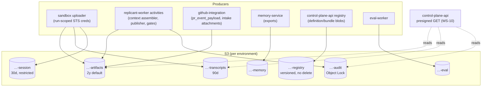

# Object Storage Contract (Artifact Layout)

**Contract ID:** `C-ART` · **Version:** 2.0.0 · **Owner:** WS-00 (contract), WS-10 (implementation: IAM, lifecycle JSON, KMS, MinIO)
**Schemas:** [schemas/run-manifest.schema.json](schemas/run-manifest.schema.json)

**Changelog:** 2.0.0 (breaking). Product rename to Replicant (CCR-ORCH-02). Every product-named identifier changes; there is no structural change. Domain `factory.example.com` (labels, annotations, schema `$id` host) becomes `replicant.example.com`; env prefix `FACTORY_` becomes `REPLICANT_`; headers `X-Factory-*` become `X-Replicant-*`; names `factory-*`/`factory_*` (services, task queues, Temporal namespace, roles, buckets, groups, hosts, networks) become `replicant-*`/`replicant_*`; CamelCase `Factory*` (workflow types, search attributes) becomes `Replicant*`. Buckets `<org>-replicant-<env>-*` (local `local-replicant-local-*`), media type `application/vnd.replicant.*`, schema `$id` host. 1.10.4. CCR-10-13 (corrected form) is recorded for rule 5.3: the session-state sweep deletes all session keys except `workspace_archive/` keys, which keep `r30d`. The rule matches by key, not by tag; the text was already applied in 1.10.3. 1.10.3 (wave 3). The audit-exporter approval-record reconciler is an `approval_record` writer (R1V-005). The session-state sweep excludes `workspace_archive/`, which keeps `r30d` (R1V-066). 1.10.2. Third `ops` writer `replicant-<env>-killswitch-operator`, break-glass and limited to `kill-switches/` (CCR-09-12). `replicant-leak-purge` may write and delete in the legal bucket only for objects with no active legal hold (CCR-ORCH-01). 1.10.1 (conflict resolution). CCR-10-10 adds the legal bucket. Legal holds are allowed only on `audit` and the legal bucket, and the CCR-10-11 legal-bucket clause is applied (rule 4a, rule 5). CCR-02-09 places `exec_revocation_feed` in the `ops` bucket under `exec-revocations/<env>/` with 90-day expiry and a runner-api prefix-scoped write. 1.10.0 (wave 1). Audit bucket COMPLIANCE mode for 730 days (decision). `ops` bucket and `kill_switch_state` (CCR-09-10). `memory_export` purge (CCR-04-06). `release_evidence_packet` and `judge_anchor_item` (CCR-06-14). `agent_prompt`, `gateway_usage_log`, and run-plan as `run_inputs` (CCR-03-06). `inbox/_control.json` (CCR-02-09b, part). QA as a producer of `secret_scan_report` (CCR-05-05). DR replicas (CCR-10-07). replicant-worker session `inputs/` copies (CCR-10-08). Exact pre-expiry deletion paths (CCR-10-11 as corrected). Okta exports written by the Firehose role (CCR-08-06d). 1.9.0. R2-004: `approval_record` is reference-only, and approval free text moves to the new `approval_text` type in `artifacts`. R2-005: the workflow history export is split into `workflow_history_skeleton` (audit bucket, never purged) and `workflow_history_export` (moved to `artifacts`, purgeable). Rule 4a is rewritten, and no role holds `s3:BypassGovernanceRetention`. The approval-record shape change has no deployed consumers yet. 1.8.0 (additive). CCR-01-03 adds artifact types `feedback_triage` and `node_report`. 1.7.0 (additive). CCR-08-04 adds four audit-bucket artifact types and leak-purge supersession (rule 4a). CCR-08-05 adds the observability buckets outside the seven classes. 1.6.0. CCR-10-02 makes bucket enforcement multipart-safe: deny-if-present conditions, a quarantine default key, a backstop lifecycle rule, and a daily storage audit. CCR-10-05 adds write-once registry version-index objects. CCR-10-06 adds artifact types `audit_event_export` and `deletion_ledger_entry`. All compatible with 1.5.0 producers. 1.5.0 (additive). CCR-02-01 adds inbox control keys (type `steering_control`). CCR-02-02 adds the registry bundle pointer `bundles/<release_bundle_id>.json`. CCR-02-04 adds artifact type `agentrun_record`, written by agentrun-controller. 1.4.0 (additive). CCR-05-01 adds artifact type `qa_generated_flow`. 1.3.0 (additive). CCR-04-01 lets memory-service delete all object versions of memory snapshot exports and memory injections during an admin purge, and adds a write-once key for the tombstoned export. CCR-04-02 adds artifact type `context_assembly_report`. 1.2.0 (additive). CCR-06-02 adds prompt escrow blobs to `registry_blob`. 1.1.0 (additive). CCR-09-05 adds artifact type `secret_scan_report` and the key `events/scans/` for github-integration's pre-post scans.

## Purpose

This contract fixes where every durable artifact lives (D-08): buckets per environment and data
class, key layout, the per-run manifest, and the artifact type registry (content type, maximum
size, retention class, redaction requirement, encryption key class). Object storage is the system
of record for artifact **bodies**. Postgres and Temporal hold only references.

## Decisions summary

| Decision | Reference |
|---|---|
| One bucket per **(environment, data class)**. Seven classes: `artifacts`, `transcripts`, `session`, `audit`, `memory`, `eval`, `registry`. Different classes have different access patterns, retention, Object Lock, and blast radius | D-08, D-21 |
| Tenant-first key layout `tenants/<tenant_id>/jobs/<job_id>/runs/<run_id>/<artifact_type>/<name>`. Per-run credentials are scoped to the exact run prefix | D-05, D-21 |
| Stores reference artifacts **logically** as `{bucket_class, key}`. The physical `s3://<bucket>/<key>` form is derived per environment and is used only on the wire (Runner, CRD, sandbox). DR can re-point buckets without rewriting rows | D-09 |
| SSE-KMS with a customer-managed key **per (environment, tenant)** for tenant data, plus platform keys for `registry` and `audit`. S3 Bucket Keys are enabled. Offboarding a tenant can crypto-shred its data | D-21, D-22 |
| Retention is enforced by S3 lifecycle rules filtered on the object tag `replicant-retention`. Tags are set at upload, and a bucket policy denies untagged writes. Lifecycle filters support tags, and an object can carry up to 10 tags [verified: https://docs.aws.amazon.com/AmazonS3/latest/userguide/intro-lifecycle-filters.html and https://docs.aws.amazon.com/AmazonS3/latest/userguide/object-tagging.html, 2026-10-24] | D-08 |
| A run's `manifest.json` is written last and once (`If-None-Match: *`). Its presence commits the run's artifacts | D-05 |



## 1. Buckets

Physical name: `<org>-replicant-<env>-<class>`. `org` is an install-time constant, for example `acme`.
`env ∈ {local, dev, staging, prod}`. Every name is ≤ 63 characters. Local (MinIO) uses `org=local`.

| Class | Example (prod) | Contents | Versioning | Object Lock | KMS key class | Who may write |
|---|---|---|---|---|---|---|
| `artifacts` | `acme-replicant-prod-artifacts` | Diffs, run results, manifests, QA reports, screenshots, traces, handoffs, plans, briefings, inputs, approval packets, PR event payloads, intake attachments; the platform prefix `platform/gateway-usage/` | on | off | tenant (platform prefix: `replicant-system`) | sandbox (run prefix), replicant-worker, publisher-worker, github-integration (`events/`, `intake/`), runner-api (`inbox/`, including `_control.json`), replicant-gateway-shim (`platform/gateway-usage/` only, CCR-03-06), agentrun-controller (`agentrun_record/` and `inbox/_control.json` only, write-once, via the exec role `agentrun-controller` named in the core bucket policy, C-ARCH §4; CCR-02-04); memory-service may only **delete all versions** of `memory_injection` objects during an admin purge (CCR-04-01) |
| `transcripts` | `acme-replicant-prod-transcripts` | Redacted CLI transcripts and event streams, sandbox logs | on | off | tenant | sandbox (run prefix) |
| `session` | `acme-replicant-prod-session` | **Raw** CLI session state, workspace archives (takeover). Not redacted, so access is restricted: the same job's later runs (through inputs staging) and break-glass | on | off | tenant | sandbox (run prefix); replicant-worker **only** `tenants/<t>/jobs/<j>/runs/<run_id>/inputs/*`, by server-side `CopyObject` from the same job's `cli_session_state/` (`x-amz-tagging-directive: REPLACE`), so raw session state never leaves this bucket (CCR-10-08) |
| `audit` | `acme-replicant-prod-audit` | Approval snapshots (what the approver saw plus the decision), audit event exports, deletion ledger | on | **COMPLIANCE mode, default retention 730 days** (decision, after a 30-day staging trial at 1 day). This is irreversible per object and acceptable only because of the audit-bucket invariant (rule 4a). `r7y` objects set a per-object retain-until of 7 years. Legal holds may be placed only by `replicant-<env>-legal-hold`, and only on this bucket and the legal bucket (below) | platform `audit` | replicant-worker (gates), audit exporter (WS-08: event, partition, and workflow-history **skeleton** exports), Firehose delivery role `replicant-<env>-okta-log-firehose` (Okta System Log exports, CCR-08-06d), audit-exporter's approval-record reconciler (writes **missing** `approval_record`s at `tenants/<t>/jobs/<j>/gates/<gate_id>/decision-<decision_id>.json` with `If-None-Match: *`, from the history skeleton and `audit.events`; XD-W2-08-03, R1V-005), `LeakPurge` (purge records), services that delete data (deletion ledger only, CCR-10-06) |
| `memory` | `acme-replicant-prod-memory` | Memory exports and memory snapshot exports | on | off | tenant (per-tenant export), platform (org-wide export) | memory-service (writes; during an admin purge it may also delete all versions of `memory_snapshot_export` objects, CCR-04-01) |
| `eval` | `acme-replicant-prod-eval` | Golden task repo snapshots, eval run outputs | on | off | platform `eval` | eval-worker |
| `registry` | `acme-replicant-prod-registry` | Content-addressed definition and bundle blobs | on | off; bucket policy denies `DeleteObject` | platform `registry` | control-plane-api (registry) |

**Operations bucket (CCR-09-10).** `<org>-replicant-<env>-ops` sits outside the seven classes:
versioned, no Object Lock, SSE-KMS `alias/replicant/<env>/ops`. It has exactly three writers:
- **control-plane-api** writes the out-of-band kill-switch mirror (`kill-switches/v1/state.json`,
  type `kill_switch_state`). Intake, the Publisher, and `runner.start_run` read it
  (`ops.read_kill_switches`) when the Replicant Postgres is down (C-MSG `ops.kill_switch`, R2-016).
- **runner-api** (exec role `runner-api`) writes the execution revocation feed, with a write
  scoped to the prefix `exec-revocations/<env>/*` (type `exec_revocation_feed`). This prefix
  has a 90-day lifecycle expiry (CCR-02-09, orchestrator resolution). The `audit` bucket has no
  execution-account writer.
- **`replicant-<env>-killswitch-operator`** (**break-glass**, CCR-09-12):
  - `s3:PutObject` on `kill-switches/v1/state.json` **only**;
  - compare-and-swap is required (`If-Match` / `If-None-Match: *`, enforced in the bucket policy);
  - assumed only through the access broker with a ticket and a second approver, so the session
    carries a ticket tag and expires;
  - every use is audited, and a mirror-drift alert fires until control-plane-api reconciles the
    Postgres state.

  It exists for WS-07's break-glass CLI when control-plane-api is down.

**Legal bucket (CCR-10-10).** `<org>-replicant-<env>-legal` sits outside the seven classes:
- Object Lock in **governance** mode, with no default retention: legal holds only.
- Platform `legal` KMS key.
- Holds are placed and removed **only** by `replicant-<env>-legal-hold`, which the legal team assumes
  through WS-09's approval flow. That role also writes the litigation copies and reads the bucket.
- `replicant-leak-purge` may `s3:PutObject` a superseding object (`If-None-Match: *`) and
  `s3:DeleteObjectVersion` in this bucket **only for objects with no active legal hold**. A held
  object makes the purge record `blocked_by_legal_hold` (rule 4a) (CCR-ORCH-01).

Litigation copies of purgeable content go here, **never** into `audit`. These are objects from
the `artifacts`, `transcripts`, and `session` prefixes of named jobs. WS-10 owns the key layout
(object-storage.md). Together with `audit`, this is one of exactly **two** places where legal
holds are allowed.

**DR replicas (CCR-10-07).** Each of the seven buckets has one DR replica,
`<org>-replicant-<env>-<class>-us-west-2`, using CRR with RTC, the same keys and prefixes, and KMS
multi-Region replica keys. Services accept a replica name **only** when deployed with the
`dr-us-west-2` values during a region failover (WS-10 recovery.md §7.3). Otherwise the §3 rule
("reject any bucket outside the environment's seven") stands. Deleting principals (offboarding,
leak purge, session sweep, memory purge) act on the primary **and** its replica.

**Observability buckets (CCR-08-05).** The seven bucket classes cover Replicant **artifacts only**.
Observability backends store their data in separate buckets
`<org>-replicant-<env>-obs-{loki,loki-ruler,tempo,mimir-blocks,mimir-ruler,mimir-alertmanager,langfuse,clickhouse-backup}`.
These are encrypted with SSE-KMS `alias/replicant/<env>/observability`, are owned by WS-08, and are
not artifact buckets: no artifact type lives in them and no Replicant reference points into them.
The longest name, `acme-replicant-staging-obs-mimir-alertmanager` (43 characters), is within the
63-character limit.

S3 object keys may be at most 1,024 bytes of UTF-8 [verified:
https://docs.aws.amazon.com/AmazonS3/latest/userguide/object-keys.html, 2026-10-24]. The longest
canonical prefix in this layout is about 150 bytes, which leaves at least 850 bytes for names.

## 2. Key layout (normative)

```
# artifacts / transcripts / session buckets: run-produced
tenants/<tenant_id>/jobs/<job_id>/runs/<run_id>/manifest.json                 # run_manifest (written last)
tenants/<tenant_id>/jobs/<job_id>/runs/<run_id>/inputs/manifest.json          # run_inputs (staged by workflow)
tenants/<tenant_id>/jobs/<job_id>/runs/<run_id>/inputs/<name>                 # staged input objects
tenants/<tenant_id>/jobs/<job_id>/runs/<run_id>/inbox/<seq:06d>-<message_id>.json   # steering_message (Runner writes)
tenants/<tenant_id>/jobs/<job_id>/runs/<run_id>/inbox/_head.json              # steering_control: {"next_seq": n}, runner-api only, compare-and-swap (If-Match / If-None-Match: *) (CCR-02-01)
tenants/<tenant_id>/jobs/<job_id>/runs/<run_id>/inbox/ack-<message_id>.json   # steering_control: write-once {"state":"delivered|rejected","detail","at"} (CCR-02-01)
tenants/<tenant_id>/jobs/<job_id>/runs/<run_id>/inbox/_control.json          # steering_control: write-once {cancel_reason, at}; writers runner-api and agentrun-controller (CCR-02-09b)
tenants/<tenant_id>/jobs/<job_id>/runs/<run_id>/inputs/system-append.md        # agent_prompt (CCR-03-06)
tenants/<tenant_id>/jobs/<job_id>/runs/<run_id>/inputs/first-message.md        # agent_prompt (CCR-03-06)
tenants/<tenant_id>/jobs/<job_id>/runs/<run_id>/inputs/run-plan.json           # run_inputs listed object (producer agents.build_run_plan, CCR-03-06)

# artifacts bucket: platform prefix (non-tenant, key replicant-system)
platform/gateway-usage/<yyyy>/<mm>/<dd>/<hh>/<pod>-<seq:010d>.ndjson.zst          # gateway_usage_log (replicant-gateway-shim, CCR-03-06)
tenants/<tenant_id>/jobs/<job_id>/runs/<run_id>/agentrun_record/agentrun.json # agentrun_record (agentrun-controller, write-once, at terminal phase) (CCR-02-04)
tenants/<tenant_id>/jobs/<job_id>/runs/<run_id>/<artifact_type>/<name>        # everything else the run produces

# artifacts bucket: activity-produced ("steps")
tenants/<tenant_id>/jobs/<job_id>/steps/<node_key>.c<cycle>.n<ordinal>/manifest.json
tenants/<tenant_id>/jobs/<job_id>/steps/<node_key>.c<cycle>.n<ordinal>/<artifact_type>/<name>

# artifacts bucket: job-level
tenants/<tenant_id>/jobs/<job_id>/gates/<gate_id>/packet-r<revision>.json       # approval_packet (immutable per revision)
tenants/<tenant_id>/jobs/<job_id>/gates/<gate_id>/text-<decision_id>.json       # approval_text (free text referenced by digest from approval_record, R2-004)
tenants/<tenant_id>/jobs/<job_id>/history/<temporal_run_id>.json.zst            # workflow_history_export (full codec-encrypted history, moved here from audit, R2-005)
tenants/<tenant_id>/jobs/<job_id>/events/pr/<delivery_id>.json                  # pr_event_payload
tenants/<tenant_id>/jobs/<job_id>/events/scans/<name>.json                       # secret_scan_report (github-integration pre-post scan)
tenants/<tenant_id>/jobs/<job_id>/index/seq-<seq:08d>.json                      # job_artifact_index (immutable per seq)
tenants/<tenant_id>/jobs/<job_id>/takeover/<takeover_id>/package.json           # takeover_package
tenants/<tenant_id>/intake/<request_id>/attachments/<name>                      # intake_attachment

# audit bucket
tenants/<tenant_id>/jobs/<job_id>/gates/<gate_id>/decision-<decision_id>.json   # approval_record (reference-only, R2-004)
org/audit-exports/events/<yyyy>/<mm>/<dd>/<hh>/<first_aud_id>.ndjson.zst       # audit_event_export (CCR-10-06)
org/deletion-ledger/<yyyy>/<mm>/<dd>/<del_id>.json                             # deletion_ledger_entry, write-once (CCR-10-06)
tenants/<tenant_id>/jobs/<job_id>/history/<temporal_run_id>.skeleton.json.zst   # workflow_history_skeleton (payload-free, R2-005)
tenants/<tenant_id>/jobs/<job_id>/purges/<leak_id>.json                         # leak_purge_record (CCR-08-04)
org/audit-exports/events_<YYYY>_<MM>.ndjson.zst (+ .manifest.json)               # audit_partition_export (CCR-08-04)
org/okta-system-log/<YYYY>/<MM>/<DD>/<firehose object>                           # okta_system_log_export (CCR-08-04)

# memory bucket
tenants/<tenant_id>/exports/<export_id>/<name>                                   # memory_export (tenant); export_id = mexp_<ulid>
org/exports/<export_id>/<name>                                                   # memory_export (org-wide)
tenants/<tenant_id>/snapshots/<memory_snapshot_id>.json                          # memory_snapshot_export
tenants/<tenant_id>/snapshots/<memory_snapshot_id>.purged-<purge_id>.json        # memory_snapshot_export re-materialized after purge mprg_<ulid> (write-once, CCR-04-01)

# eval bucket
golden/<golden_task_id>/<name>                                                   # golden_task_snapshot
runs/<eval_run_id>/<name>                                                        # eval_output
pipelines/<pipeline_id>/evidence/<signoff_point>-r<revision>.json                # release_evidence_packet (CCR-06-14)
anchors/<anchor_set>/<item>.json                                                 # judge_anchor_item (CCR-06-14)

# ops bucket (outside the seven classes, CCR-09-10)
kill-switches/v1/state.json                                                      # kill_switch_state (control-plane-api)
exec-revocations/<env>/<yyyymmddhh>.ndjson                                       # exec_revocation_feed (runner-api, prefix-scoped write, 90-day expiry; CCR-02-09)

# registry bucket
blobs/sha256/<hex64>.json                                                        # registry_blob (definitions, bundles, prompt escrow)
index/<kind>/<scope>/<name>/<version>.json                                       # registry_blob version index {"digest","published_at","source_commit"}, write-once (CCR-10-05)
bundles/<release_bundle_id>.json                                                 # registry_blob pointer {"release_bundle_id","digest":"sha256:<hex>"}, write-once (CCR-02-02)
```

Rules:

1. `<name>` matches `^[A-Za-z0-9][A-Za-z0-9._-]{0,199}(/[A-Za-z0-9][A-Za-z0-9._-]{0,199}){0,4}$`.
   Path segments are allowed and `..` is not. Producers never put user-controlled strings
   (branch names, file paths from the repo) into keys unescaped. They use an index file inside
   the artifact instead.
2. The same run prefix (`tenants/<t>/jobs/<j>/runs/<r>/`) exists in `artifacts`, `transcripts`, and
   `session`. These are the three `artifact_prefixes` in the Runner `RunSpec` and the CRD
   `spec.artifacts`.
3. Write-once keys (manifests, packets, index files, registry blobs, approval records) use
   `If-None-Match: *` [verified:
   https://docs.aws.amazon.com/AmazonS3/latest/userguide/conditional-writes.html, 2026-10-24]. A
   producer that receives 412 must read the existing object and compare digests. Equal digests mean
   success: the write was idempotent. Different digests are a bug, so it alerts.
4. Nothing is ever overwritten in place. Index and packet revisions get new keys. **Exception:**
   `inbox/_head.json` is a compare-and-swap counter (`If-Match` on its ETag) that only runner-api
   updates. It allocates inbox sequence numbers without a database (D-23) and holds no content
   (CCR-02-01).
4a. **Leak-purge supersession (CCR-08-04).** A `LeakPurge` workflow (`leak_<ulid>`) may write a
   redacted superseding object at `<original key>.p<n>` (n = 1, 2, …; write-once) and then delete
   all versions of the original, through the dedicated role `replicant-leak-purge`. Every purge is
   recorded in `tenants/<t>/jobs/<j>/purges/<leak_id>.json` (old key → new key, sha256 per object).
   Readers resolve supersession through the job's `purges/` records, and manifests are not
   rewritten.

   **Purge scope.** A leak purge targets only objects in the `artifacts`, `transcripts`, and
   `session` buckets and their DR replicas (CCR-10-07) (tenant keys, no Object Lock), plus
   litigation copies in the **legal bucket** (CCR-10-10, CCR-10-11). These include `approval_text` and
   `workflow_history_export`. `replicant-leak-purge` therefore needs `s3:PutObject` (superseding key,
   `If-None-Match: *`), `s3:DeleteObjectVersion`, and `s3:GetObject` on those buckets. **No role
   anywhere holds `s3:BypassGovernanceRetention`.**

   **Audit-bucket invariant (R2-004, R2-005).** Objects in the Object-Locked `audit` bucket contain
   **no tenant content and no human-entered or model-generated free text**: no titles, comments,
   answers, issue text, payload bodies, or memory text. They hold only identifiers, enums,
   principals, timestamps, keys, and sha256 digests. Free text is stored in the `artifacts` bucket
   and referenced from the audit object by digest. So audit objects never need purging, and
   tenant offboarding (crypto-shredding the tenant's keys) removes every piece of tenant free text.
   Okta System Log exports are identity events, not tenant content, and are exempt.

   **Legal hold (orchestrator resolution).** Legal holds are allowed in exactly two places, both
   placed only by `replicant-<env>-legal-hold`:
   - `audit`: COMPLIANCE mode, never a purge target. A hold there never blocks a purge.
   - the **legal bucket**: governance mode, holding litigation copies of purgeable content.

   No hold is possible in `artifacts`, `transcripts`, or `session`; they have no Object Lock.

   When a leak purge reaches a legal-bucket object under an active legal hold, the purge does not
   bypass it: no role holds `s3:BypassGovernanceRetention`. Instead:
   - the purge records `blocked_by_legal_hold` for that object in the purge record and the
     deletion ledger;
   - it escalates through the `leak_purge` gate to the approvers and the legal-hold owner;
   - it completes every other step.

   **The leaked secret is rotated regardless**, so a held copy keeps only a dead credential. The
   held object is purged when the hold is released.

   Two-person approval for a purge is gate kind `leak_purge` (C-MSG).
5. **Pre-expiry deletions (CCR-10-11 as corrected).** Exactly four paths delete objects before
   lifecycle expiry. Each writes a `deletion_ledger_entry` **first**, and each acts on the primary
   and its DR replica:
   1. **Leak purge** (rule 4a, role `replicant-leak-purge`): the `artifacts`, `transcripts`, and
      `session` buckets, and the legal bucket. Held legal-bucket objects record
      `blocked_by_legal_hold` and escalate (rule 4a).
   2. **Admin memory purge** (memory-service): only the keys listed below.
   3. **Session-state sweep** (`replicant-retention`, role `retention-sweeper`): **only** `session`
      keys `tenants/<t>/jobs/<j>/runs/*` (all versions) of terminal jobs after
      `sessionStateGraceDays`, **except** `…/workspace_archive/*`. Takeover archives keep their `r30d`
      lifecycle and are not tenant-shortenable (R2-026, R1V-066, CCR-10-13 corrected form: the exclusion is by key, `workspace_archive/`). It deletes nothing in `artifacts`
      (erratum).
   4. **Tenant offboarding** (`tenant-offboarding`): every tenant prefix in every bucket except
      `audit` and `registry`.

   `audit` and `registry` deny every delete.

   **Admin memory purge (CCR-04-01, CCR-04-06):**
   - Which objects: memory-service, executing an admin purge `mprg_<ulid>` (D-25), or the memory
     step of a leak purge, deletes **all object versions** of:
     - (i) affected `memory_snapshot_export` objects in `memory`;
     - (ii) affected `memory_injection` objects at
       `tenants/<t>/jobs/<j>/runs/<r>/inputs/memory-injection.json` in `artifacts`;
     - (iii) `memory_export` objects (`tenants/<t>/exports/<export_id>/*`,
       `org/exports/<export_id>/*`) whose manifest lists a purged entry (CCR-04-06).

     Each deletion is audited (`audit.emit`).
   - The replacement export goes to the new write-once key `….purged-<purge_id>.json`, with purged
     items replaced by tombstones. That is a deletion plus a new key, never an overwrite, so rule 4
     still holds.
   - **No Object Lock conflict.** Both buckets have Object Lock off. Version deletion needs only
     `s3:DeleteObjectVersion`, granted to memory-service's role for those key patterns.
   - The Object-Locked `audit` bucket must never contain memory text: `approval_packet` and
     `approval_record` carry memory entry **references only** (normative).
   - Purge propagation to other stores (transcripts, session state, Langfuse) is defined by WS-04
     data-model.md §8.

## 3. Logical and physical references

| Form | Where | Example |
|---|---|---|
| Logical `{bucket_class, key}` | Postgres rows, manifests (`bucket_class`, `key`), Temporal state (preferred) | `{"bucket_class":"artifacts","key":"tenants/payments/jobs/job_01m5p7x7r0bt69j0h0fbxepw90/runs/run_gj3h3ep3phjfs9e23v768zrca5/diff_bundle/changes.tar.zst"}` |
| Physical `s3://` URI | Runner API, CRD, sandbox env, Temporal message payloads (`*_uri` fields) | `s3://acme-replicant-prod-artifacts/tenants/payments/jobs/job_01m5p7x7r0bt69j0h0fbxepw90/runs/run_gj3h3ep3phjfs9e23v768zrca5/diff_bundle/changes.tar.zst` |

The mapping is `bucket = f"{org}-replicant-{env}-{bucket_class}"`, implemented in the shared
`replicant-storage` Python package and its Go equivalent. Every service that receives a physical URI
checks that the bucket is one of its environment's seven buckets (or their `-us-west-2` replicas,
only when deployed with the `dr-us-west-2` values, CCR-10-07). Anything else is rejected, which
blocks SSRF-style reads from other buckets.

## 4. Artifact type registry

Retention classes (tag `replicant-retention`): `r7d`, `r30d`, `r90d`, `r1y`, `r2y`, `r7y`, `job37d`
(session data: deleted by the workflow 7 days after the job reaches a terminal state, with a
lifecycle backstop at 37 days after creation), and `perm` (registry). Shared-context defaults:
diffs 2 years, transcripts 90 days [D-08 / §2 SLO table].

Redaction column:
- **required**: content passes the WS-08 redaction pipeline (secrets, entropy, PII) before upload.
  The manifest records `redaction.ruleset_version`.
- **scan-block**: content cannot be altered (code, built artifacts). It is secret-scanned, and
  findings block publishing (WS-09).
- **raw-restricted**: stored unredacted in a restricted bucket and never shown in the UI or sent
  to Loki or Langfuse.
- **n/a**: replicant-generated structured data with no untrusted text.

| Type | Bucket class | Content type | Max size | Retention | Redaction | Producer → consumer |
|---|---|---|---|---|---|---|
| `run_inputs` | artifacts | `application/json` | 1 MiB (manifest) + listed objects | r90d | required (contains issue text) | context assembler activity → entrypoint. The listed objects include `inputs/run-plan.json` (producer `agents.build_run_plan`, CCR-03-06) |
| `agent_prompt` | artifacts | `text/markdown` (`inputs/system-append.md`, `inputs/first-message.md`) | 1 MiB | r90d | required (contains issue text) | context assembler (`context.stage_inputs`) → entrypoint (CCR-03-06) |
| `gateway_usage_log` | artifacts (platform prefix `platform/gateway-usage/`, key `replicant-system`) | `application/x-ndjson` (zstd) | 64 MiB per object | r7d | n/a (usage metadata only, no content) | replicant-gateway-shim → usage-ingestor. The durable replay store for usage (at least 72 h) (CCR-03-06, R1-077) |
| `task_packet` | artifacts | `application/json` | 4 MiB | r90d | required | context assembler → entrypoint |
| `briefing` | artifacts | `application/json` or `text/markdown` | 16 MiB | r90d | required | context assembler (WS-04) → entrypoint, context MCP |
| `memory_injection` | artifacts | `application/json` (key `runs/<run_id>/inputs/memory-injection.json`) | 1 MiB | r2y | n/a (curated memory) | context assembler → entrypoint. All versions deleted on admin purge (rule 5) |
| `context_assembly_report` | artifacts | `application/json` (key `runs/<run_id>/inputs/context-assembly-report.json`; schema WS-04 `schemas/context-assembly-report.schema.json`) | 1 MiB | r2y | n/a (counts, refs, and digests only, no untrusted text) | context assembler (`context.stage_inputs`) → UI, eval, Langfuse metadata. Records what was cut by budgeting (CCR-04-02) |
| `steering_message` | artifacts | `application/json` | 64 KiB | r90d | required | Runner → entrypoint |
| `run_manifest` | artifacts | `application/json` | 4 MiB | r2y | n/a | uploader → controller, workflow |
| `run_result` | artifacts | `application/json` | 1 MiB | r2y | required (summary is model text) | entrypoint → workflow |
| `diff_bundle` | artifacts | `application/vnd.replicant.diff-bundle.v1+tar+zstd` (contains `changes.patch` from `git diff --binary <base_sha>`, `metadata.json`, optional `commits.mbox`) | 256 MiB | r2y | scan-block | implementer/repair → QA run, publisher, approval packet |
| `plan` | artifacts | `application/json` + `text/markdown` | 2 MiB | r2y | required | planner → gate packet, implementer |
| `handoff` | artifacts | `application/json` (WS-04 schema) | 2 MiB | r2y | required | each run → next run, takeover |
| `review_report` | artifacts | `application/json` | 4 MiB | r2y | required | reviewer → verifier, gate packet |
| `qa_report` | artifacts | `application/json` (WS-05 QA result schema) | 16 MiB | r2y | required | QA → graph, gate packet, PR comment |
| `qa_generated_flow` | artifacts | `application/x-tar+zstd` (key `<run prefix>qa_generated_flow/flows.tar.zst`: Playwright `*.spec.ts` files written by the QA agent, a `flows.json` index, lint results) | 4 MiB | r1y | scan-block (generated code: secret-scanned, never altered) | QA run → UI, approval packet ("what exactly was checked"), teams copying flows into repos (CCR-05-01; WS-05 headless-validation.md §5) |
| `junit_xml` | artifacts | `application/xml` | 64 MiB | r1y | required | QA |
| `build_log` | artifacts | `text/plain` (zstd) | 256 MiB | r90d | required | QA |
| `health_log` | artifacts | `text/plain` (zstd) | 64 MiB | r90d | required | QA |
| `screenshot` | artifacts | `image/png` | 16 MiB each, 500 per run | r1y | required (screenshots may contain PII; WS-08 decides masking) | QA → gate packet, UI |
| `playwright_trace` | artifacts | `application/zip` | 256 MiB | r90d | required | QA → UI download |
| `video` | artifacts | `video/webm` | 256 MiB | r30d | required | QA (if WS-05 enables) |
| `a11y_report` | artifacts | `application/json` | 8 MiB | r1y | n/a | QA (axe-core) |
| `sbom` | artifacts | `application/spdx+json` | 32 MiB | r2y | n/a | QA build |
| `image_metadata` | artifacts | `application/json` (digests, sizes) | 1 MiB | r2y | n/a | QA build |
| `transcript` | transcripts | `application/x-ndjson` (zstd, chunked `transcript/part-<seq:05d>.ndjson.zst`) | 512 MiB total | r90d | required | entrypoint shipper → UI, Langfuse (selected events), WS-04 extraction |
| `cli_events` | transcripts | `application/x-ndjson` (zstd, chunked) | 512 MiB | r90d | required | entrypoint (stream-json / Codex JSONL) |
| `sandbox_log` | transcripts | `text/plain` (zstd, chunked) | 256 MiB | r90d | required | log shipper |
| `cli_session_state` | session | `application/vnd.replicant.session.v1+tar+zstd` | 2 GiB | job37d | raw-restricted | entrypoint → a later run of the same job (WS-04) |
| `workspace_archive` | session | `application/x-tar+zstd` | 10 GiB | r30d (lifecycle tag; excluded from the session-state sweep, rule 5; not tenant-shortenable, R1V-066) | raw-restricted | takeover run → requester download (presigned, audited) |
| `approval_packet` | artifacts | `application/json` (manifest referencing plan, diff, QA, risk, memory, cost) | 1 MiB | r2y | n/a (references only; memory as `mem_…@v` refs, never text, rule 5) | gate open → UI, Slack, GitHub |
| `audit_event_export` | audit | `application/x-ndjson` (zstd) | 256 MiB | r7y (Object Lock) | n/a (audit events, already minimal) | WS-08 audit exporter, about 1-minute cadence, so audit has an RPO independent of database point-in-time recovery → auditors, restore reconciliation (CCR-10-06) |
| `deletion_ledger_entry` | audit | `application/json` (schema WS-10 `schemas/deletion-ledger-entry.schema.json`) | 64 KiB | r7y (Object Lock) | n/a (IDs, keys, digests; never deleted content) | each service that deletes data → restore replay, so restores never resurrect deleted data (CCR-10-06) |
| `workflow_history_skeleton` | audit | `application/json` (zstd): per event, the event type, event ID, timestamp, activity or child type, Update or Signal ID and name, and the **sha256 of each payload**. No payload bodies | 16 MiB | r2y by default, r7y by tenant retention policy (Object Lock) | n/a (no content) | WS-08 exporter, after each workflow run closes. Audit trail beyond Temporal's 30-day closed retention; never purged; proves the integrity of the purgeable full export (R2-005) |
| `workflow_history_export` | **artifacts** | `application/json` (zstd), full history with codec-encrypted payloads | 64 MiB | r2y | n/a (encrypted); purgeable by rule 4a and shredded at tenant offboarding | WS-08 exporter → replay testing (WS-01 versioning.md §8), forensics. Payload digests are checked against the skeleton (CCR-08-04, moved from `audit` by R2-005) |
| `audit_partition_export` | audit | `application/x-ndjson` (zstd) + `.manifest.json` | 4 GiB | r7y (Object Lock) | n/a | WS-08 audit exporter, monthly partition snapshot (CCR-08-04) |
| `okta_system_log_export` | audit | as delivered by Firehose | per Firehose object | r7y | n/a (identity events) | Okta System Log stream, keeping it beyond Okta's 90-day retention (CCR-08-04) |
| `leak_purge_record` | audit | `application/json` | 1 MiB | r7y | n/a (keys and digests only, never the leaked value) | `LeakPurge` workflow → auditors, readers resolving supersession (CCR-08-04) |
| `approval_record` | audit (written by replicant-worker at decision time, or by audit-exporter's reconciler when missing, R1V-005) | `application/json`, **reference-only** (R2-004): `gate_id`, `gate_kind`, `decision_id`, `decision` enum, decider `principal_id`, `channel`, `decided_at`, `presented_digest`, `packet_key`, `text_key` and `text_sha256` (pointing at `approval_text`), and the memory refs used | 64 KiB | r2y (Object Lock) | n/a (no free text by construction) | gate decision → auditors |
| `approval_text` | artifacts | `application/json`: the decision `comment`, the `answer_text`, and the job title as shown to the approver | 64 KiB | r2y | required | gate decision → UI, auditors (integrity checked by `text_sha256` in the approval record). Purgeable by rule 4a; shredded at offboarding (R2-004) |
| `pr_event_payload` | artifacts | `application/json` | 2 MiB | r90d | required | github-integration → triage activity |
| `intake_attachment` | artifacts | as uploaded | 100 MiB | r90d | required | channel adapters → context assembler |
| `job_artifact_index` | artifacts | `application/json` | 4 MiB | r2y | n/a | workflow (projector reads) → UI |
| `takeover_package` | artifacts | `application/json` (links to branch, archive, transcripts, plan, handoff) | 1 MiB | r30d | n/a | takeover subflow → requester |
| `memory_candidates` | artifacts | `application/json` | 1 MiB | r1y | required | repair/feedback runs → memory writer |
| `memory_snapshot_export` | memory | `application/json` | 8 MiB | r2y | n/a | memory-service (reproducibility). After a purge, all versions of the original are deleted and a `.purged-<purge_id>.json` replacement with tombstones is written (rule 5) |
| `memory_export` | memory | `application/x-ndjson` (zstd) | 1 GiB | r1y | n/a | memory-service (admin export, D-25) |
| `golden_task_snapshot` | eval | `application/x-git-bundle` or tar+zstd | 2 GiB | perm (WS-06 may expire) | scan-block | WS-06 |
| `eval_output` | eval | various | 1 GiB per case | r1y | required | eval-worker |
| `release_evidence_packet` | eval | `application/json` | 4 MiB | `perm` for promoted bundles, else r2y | n/a | ReleasePipeline → sign-off UI. `presented_digest` of `release.signoff` is its sha256 (CCR-06-14) |
| `judge_anchor_item` | eval | `application/json` | 8 MiB | perm | required | WS-06 judge calibration anchors (CCR-06-14) |
| `exec_revocation_feed` | **ops** bucket, prefix `exec-revocations/<env>/` | `application/x-ndjson` (`{run_id, job_id, at, reason}` per line) | 64 MiB | r90d (lifecycle expiry on the prefix) | n/a (IDs only) | runner-api → durable copy behind `GET /v1/revocations` (C-RUNNER, CCR-02-09) |
| `kill_switch_state` | **ops** bucket (outside the seven) | `application/json` | 64 KiB | perm (noncurrent versions 400 d) | n/a (enums, IDs, and timestamps only) | control-plane-api (normal), `replicant-<env>-killswitch-operator` (break-glass, CAS, CCR-09-12) → intake, Publisher, `runner.start_run` when Postgres is down (CCR-09-10) |
| `secret_scan_report` | artifacts | `application/json` | 1 MiB | r2y | n/a (rule IDs, paths, lines, and HMAC fingerprints only, **never secret values**) | verifier step (`steps/<step_id>/secret_scan_report/`), github-integration pre-post scan (`events/scans/`), QA run (role `qa`, image build with `secretScan`, `runs/<run_id>/secret_scan_report/image.json`, same schema `replicant.secret-scan-report/v1`; CCR-05-05) → publish gate, approval packet, UI (CCR-09-05; WS-09 data-handling.md §4) |
| `steering_control` | artifacts | `application/json` (`inbox/_head.json`, `inbox/ack-<message_id>.json`, `inbox/_control.json`) | 4 KiB | r90d | n/a | runner-api; `_control.json` (write-once cancel cause) also agentrun-controller (CCR-02-09b). Sandbox session policies already deny writes to `inbox/*`; the entrypoint acknowledges through the sandbox listener (CCR-02-01) |
| `agentrun_record` | artifacts | `application/json` (key `<run prefix>agentrun_record/agentrun.json`) | 64 KiB | r2y | n/a (final AgentRun object with `spec.runGrant` removed and condition messages truncated) | agentrun-controller at the terminal phase (written after the manifest, and not listed in it) → runner-api (tombstone for `410 run_expired` after AgentRun GC) and auditors. GC of the AgentRun waits until the record exists (CCR-02-04) |
| `feedback_triage` | artifacts | `application/json` (key `tenants/<t>/jobs/<j>/steps/triage.c<c>.n<o>/feedback_triage/triage.json`) | 2 MiB | r1y | required (quotes reviewer comments) | activity `feedback.triage` → repair run inputs, UI, memory extraction (WS-04 consumes the redacted form) (CCR-01-03) |
| `node_report` | artifacts | `application/json` (key `tenants/<t>/jobs/<j>/steps/<node>.c<c>.n<o>/node_report/<name>.json`). The manifest entry **must** carry `attributes.report_kind`, for example `contract_compat`, `consumer_impact`, `docs_scope`, `license_policy_scan` | 16 MiB | r2y | required | auxiliary node activities (`checks.run_step`, inserted check nodes) → approval packet, UI. New auxiliary node types ship without a contract change (CCR-01-03) |
| `registry_blob` | registry | `application/json` | 4 MiB | perm | n/a | registry → Runner, controller, workers. Also **prompt escrow** (CCR-06-02): the canonical body `JCS({type, prompt, config})` of every prompt pinned by a bundle, keyed by the prompt digest. Written at bundle build, read only when Langfuse returns 404 for the pinned version |

A new artifact type needs a contract change request that adds a row here. Producers must reject
unregistered types.

Size enforcement: the uploader truncates text types at the maximum, records
`truncated: true` and `totals.truncated_types` in the manifest, and fails binary types that exceed
the limit (`ArtifactUploadFailed` only if a **required output** fails). `spec.artifacts.maxOutputBytes`
caps the run's total.

## 5. Upload semantics

1. **Streaming types** (`transcript`, `cli_events`, `sandbox_log`) are uploaded as chunk objects
   at most every 30 s or every 8 MiB while the run is alive, so that a node loss keeps evidence up
   to the last chunk.
2. All other run artifacts are uploaded during `Finalizing`, then the manifest is written.
3. Each `PutObject` sets:
   - `x-amz-server-side-encryption: aws:kms`
   - `x-amz-server-side-encryption-aws-kms-key-id: <tenant key ARN>`
   - `x-amz-server-side-encryption-bucket-key-enabled: true`
   - `x-amz-tagging: replicant-retention=<class>&replicant-type=<type>&replicant-tenant=<tenant_id>`
   - `x-amz-checksum-sha256`

   Enforcement is multipart-safe (CCR-10-02). `CreateMultipartUpload`, `UploadPart`, and
   `CompleteMultipartUpload` are all authorized as `s3:PutObject`, but only the first carries tags
   and SSE headers. A deny requiring those headers would therefore block multipart uploads, so:
   - **Deny if present.** The bucket policy denies a `replicant-retention` value not allowed in that
     bucket, and a KMS key outside the environment's key set, **when the header is present** (the
     `…IfExists` condition forms).
   - **Quarantine key.** Objects written without SSE headers are encrypted with the environment's
     quarantine key (`alias/replicant/<env>/quarantine`, default bucket encryption).
   - **Backstop lifecycle rule.** A whole-bucket rule set to the bucket's longest retention class
     bounds untagged objects.
   - **Daily storage audit** over S3 Metadata tables flags both untagged and quarantine-key objects.
   - Producers still MUST send the headers listed above.
   Per-run session policies further restrict the key to the tenant's key, and grant
   `s3:PutObjectTagging` alongside `s3:PutObject` (CCR-10-03). WS-10 writes the policy JSON and a
   staging conformance test.
4. With S3 Bucket Keys enabled, the KMS encryption context is the bucket ARN rather than the object
   ARN, so KMS-side policies cannot scope to a prefix. Prefix scoping is enforced in IAM and S3
   policy, and tenant isolation by key [verified:
   https://docs.aws.amazon.com/AmazonS3/latest/userguide/bucket-key.html, 2026-10-24].
5. Reads from the UI are presigned GETs (15-minute expiry), issued by control-plane-api after an
   authorization check. Every presign is audited. `raw-restricted` types are presigned only for
   `workspace_archive` to the job's requester during takeover.

## 6. Manifest (per run, per step)

Schema: [schemas/run-manifest.schema.json](schemas/run-manifest.schema.json). Example:

```json
{
  "schema": "replicant.run-manifest/v1",
  "tenant_id": "payments",
  "job_id": "job_01m5p7x7r0bt69j0h0fbxepw90",
  "producer": {
    "kind": "run",
    "run_id": "run_gj3h3ep3phjfs9e23v768zrca5",
    "agentrun": "ar-gj3h3ep3phjfs9e23v768zrca5",
    "role": "implementer",
    "release_bundle_id": "rb_ds5p3wmcj4dag2e9a8ncp4py6k",
    "exit_code": 0,
    "agent_started_at": "2026-10-24T08:02:23Z",
    "agent_exited_at": "2026-10-24T08:24:05Z"
  },
  "created_at": "2026-10-24T08:24:38Z",
  "partial": false,
  "result": {
    "type": "run_result",
    "bucket_class": "artifacts",
    "key": "tenants/payments/jobs/job_01m5p7x7r0bt69j0h0fbxepw90/runs/run_gj3h3ep3phjfs9e23v768zrca5/run_result/result.json",
    "content_type": "application/json",
    "size_bytes": 6120,
    "sha256": "8d4f0a3c6b2e1f9a7d5c3b1e0f8a6d4c2b0e9f7a5d3c1b9e7f5a3d1c0b8e6f4a",
    "redacted": true
  },
  "artifacts": [
    {
      "type": "diff_bundle",
      "bucket_class": "artifacts",
      "key": "tenants/payments/jobs/job_01m5p7x7r0bt69j0h0fbxepw90/runs/run_gj3h3ep3phjfs9e23v768zrca5/diff_bundle/changes.tar.zst",
      "content_type": "application/vnd.replicant.diff-bundle.v1+tar+zstd",
      "size_bytes": 18734,
      "sha256": "1e3a5c7b9d0f2e4a6c8b0d1f3e5a7c9b2d4f6e8a0c3b5d7f9e1a2c4b6d8f0e3a",
      "attributes": {"files_changed": 3, "insertions": 41, "deletions": 12}
    },
    {
      "type": "transcript",
      "bucket_class": "transcripts",
      "key": "tenants/payments/jobs/job_01m5p7x7r0bt69j0h0fbxepw90/runs/run_gj3h3ep3phjfs9e23v768zrca5/transcript/part-00001.ndjson.zst",
      "content_type": "application/x-ndjson",
      "content_encoding": "zstd",
      "size_bytes": 2211840,
      "sha256": "2f4b6d8c0e1a3f5b7d9c1e3a5f7b0d2c4e6a8f1b3d5c7e9a0f2b4d6c8e1a3f5b",
      "redacted": true
    },
    {
      "type": "cli_session_state",
      "bucket_class": "session",
      "key": "tenants/payments/jobs/job_01m5p7x7r0bt69j0h0fbxepw90/runs/run_gj3h3ep3phjfs9e23v768zrca5/cli_session_state/claude-session.tar.zst",
      "content_type": "application/vnd.replicant.session.v1+tar+zstd",
      "size_bytes": 4718592,
      "sha256": "3a5c7e9d1f2b4a6c8e0d2f4b6a9c1e3d5f7b9a2c4e6d8f0b1a3c5e7d9f2b4a6c",
      "redacted": false
    }
  ],
  "redaction": {"ruleset_version": "redact-2026.10.1", "findings_count": 2},
  "totals": {"objects": 14, "bytes": 40053964, "truncated_types": []}
}
```

## Open questions

| Question | Who decides | Options | Recommendation |
|---|---|---|---|
| Object Lock mode for `audit` | WS-09 / WS-10 | governance or compliance | Governance, 2 years. Compliance mode cannot be undone even for erroneous PII, and GDPR erasure needs an escape hatch |
| Should raw transcripts be kept anywhere? | WS-08 / WS-09 | never; raw-restricted for 14 days | Never. Redact before upload. Session state is the only raw CLI data, and it lives in `session` |
| Screenshot PII masking | WS-05 / WS-08 | none; Playwright `mask` locators from the environment definition | Masking via environment definition selectors, plus default masks for inputs of type password and email |

## Risks

- Per-tenant KMS keys with Bucket Keys: a request from a new role or session policy counts as a new
  requester and fetches a fresh bucket key [verified:
  https://docs.aws.amazon.com/AmazonS3/latest/userguide/bucket-key.html, 2026-10-24]. Per-run
  session policies therefore reduce the Bucket Key savings. At about 3,000 runs per day this is
  still small (thousands of KMS calls, not millions).
- The tag-based lifecycle depends on every producer tagging. Mitigation (CCR-10-02, §5.3): the
  backstop whole-bucket rule, the quarantine key, and the daily storage audit.

## Interfaces

- **Provided:** `C-ART`. Consumed by WS-02 (uploader, prefixes, credentials), WS-03 (entrypoint
  outputs), WS-04 (handoff, session state, memory exports), WS-05 (QA artifact types), WS-06 (eval),
  WS-07 (UI downloads, approval packets), WS-08 (redaction, transcripts), WS-09 (KMS, IAM), WS-10
  (buckets, lifecycle, IAM JSON, MinIO).
- **Consumed:** `C-IDS`.
