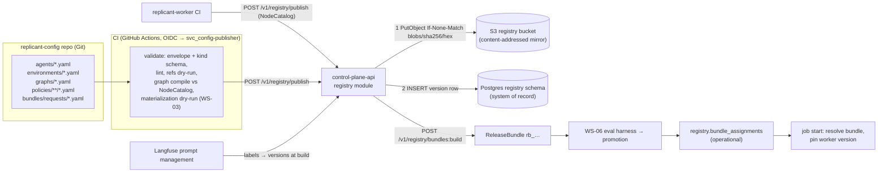

# Registry Object Contracts and Release Bundles

**Contract ID:** `C-DEF` · **Version:** 3.0.0 · **Owner:** WS-00 (envelope, references, bundle), WS-03 / WS-01 / WS-06 / others (kind internals)
**Schemas:** [schemas/definition-envelope.schema.json](schemas/definition-envelope.schema.json), [schemas/release-bundle.schema.json](schemas/release-bundle.schema.json)

**Changelog:** 3.0.0 (breaking). Product rename to Replicant (CCR-ORCH-02). Every product-named identifier changes; there is no structural change. Domain `factory.example.com` (labels, annotations, schema `$id` host) becomes `replicant.example.com`; env prefix `FACTORY_` becomes `REPLICANT_`; headers `X-Factory-*` become `X-Replicant-*`; names `factory-*`/`factory_*` (services, task queues, Temporal namespace, roles, buckets, groups, hosts, networks) become `replicant-*`/`replicant_*`; CamelCase `Factory*` (workflow types, search attributes) becomes `Replicant*`. Schema `$id` host `schemas.replicant.example.com`; registry and bundle names that carried the product name. 2.5.0 (wave 1). Eval-toolchain exception (CCR-06-07c). Shadow and live-pin slot rows, `eval_only` refusal, and derived-bundle build timing (CCR-06-12). Valid example request (CCR-06-16). 2.4.0 (additive). V06-14 verified (V01-01); the one-new-build ramp limit of CCR-06-05(b) is lifted (§4.5). 2.3.0 (additive). CCR-10-05 adds the write-once registry version index and changes the publish order to blob → index → row. 2.2.0 (additive). CCR-02-02 adds the bundle pointer object, so Go services can resolve `release_bundle_id` to its digest. 2.1.1 (correction). The bundle example used `claude-sonnet-4-5-20250929`, which retires on 2026-11-30; it now uses current undated Claude IDs. The model-ID rule now states what "exact" means for undated IDs. 2.1.0 (additive, compatible). CCR-06-02 adds prompt escrow blobs (§4.3 step 6, §6). CCR-06-05(a) defines which promotion states each assignment slot accepts (§4.4). CCR-06-05(b), accepted **conditionally** on V06-14, adds up to 3 concurrent ramps on disjoint bucket ranges (§4.5). With one ramp and `bucket_lo = 0`, the formula equals 2.0.0. 2.0.0 (CCR-03-02). This is a semantic change to how unpinned selectors resolve: they now resolve to the registry **head**, not the latest active version. There are no wire-format changes. The publish API gains `dry_run` and full-snapshot semantics. It is classed as breaking because the same selector can now resolve to a different version.

## Purpose

This contract fixes the envelope, versioning, immutability, content addressing, reference grammar,
and publish flow for every registry object, and the shape and resolution of the **Release Bundle**
(D-03). It also states the rule for what counts as **configuration** (no deploy) and what counts as
**code** (worker deployment version) (D-02). Each kind's `spec` internals are owned by Phase 2.

## Decisions summary

| Decision | Reference |
|---|---|
| Five authored kinds share one envelope: `AgentDefinition`, `EnvironmentDefinition`, `GraphDefinition`, `Policy` (typed by `policyType`), `NodeCatalog` (published by worker CI). `ReleaseBundle` is generated, never authored. A sixth authored document, `ReleaseBundleRequest` (format owned by WS-06), is the input to bundle builds and is not a registry object | D-03, D-12 |
| Versions are immutable. Identity is `(kind, scope, name, version)`. Content identity is `digest = sha256(JCS(document))` (RFC 8785). Publishing identical content is a no-op | D-03 |
| The Postgres `registry` schema is the system of record. A content-addressed **blob mirror** in S3 (`registry` bucket class) serves Go services and sandboxes, which never touch Postgres (D-23). Blobs are verified by digest on every read, so they cannot diverge from the record | D-09, D-23 |
| A bundle is **closed**: it lists every object it can reach, pinned by version and digest. Runtime lookups outside the job's bundle are errors | D-03; [ADR-005](adr/005-release-bundle-unit-of-versioning.md) |
| A bundle pins exactly one `replicant-worker` deployment version. Workflows start with a pinned versioning override to it, so ramping happens at bundle assignment (per percentage **or** tenant) | D-02; [ADR-006](adr/006-bundle-assignment-drives-version-pinning.md) |
| Tenant policy changes produce **tenant-derived bundles** (base bundle plus tenant layer), so every job is still fully determined by one bundle | D-03; [ADR-013](adr/013-behavioral-vs-operational-config-tenant-derived-bundles.md) |



## 1. The configuration-versus-code rule (must-answer)

> **Rule CC-1.** A change is **configuration** when it can be expressed as a new version of a registry
> document (agent, environment, graph, policy), a new Langfuse prompt version, a new CLI image digest,
> or a new model identifier, **and** every behavior it selects is already implemented by node types in
> the `NodeCatalog` of a worker deployment version that is already deployed. Configuration ships as a new
> Release Bundle. It needs **no deploy of anything**.
>
> **Rule CC-2.** A change is **code** when it requires Python that the worker imports: a new or changed
> node type, a new predicate or condition function beyond the graph DSL's built-in operators, a new
> activity, a change to workflow state shape, or a change to the graph interpreter. Code ships as a new
> **worker deployment version** of `replicant-worker` (an image plus a `NodeCatalog`), followed by a new
> Release Bundle that references it. It **never** needs a control-plane change: control-plane-api,
> the UI, the Runner, and the controller treat node types as opaque catalog entries.
>
> **Rule CC-3.** Neither kind of change affects a running job. Jobs are pinned at start to one bundle,
> and through it to one worker deployment version. A running job picks up a change only by explicit,
> consented bundle migration (`job.offer_bundle_migration`, WS-01) at a safe point.
>
> **Rule CC-4.** Changes to the contracts in `spec/00-contracts/` (message schemas, Runner API, CRD,
> JobRequest) are **platform changes**. They follow the contract change process and are deployed
> compatibly: N and N+1 coexist for at least the longest pin lifetime (37 days).

Examples:

| Change | Kind | Path |
|---|---|---|
| Insert the existing `license_scan` node before `implementer` for tenant `payments`' Go repos | configuration | New `GraphDefinition` version or tenant `codebase_bindings` → new (tenant-derived) bundle → eval → assignment |
| New prompt text for the reviewer | configuration | New Langfuse version → bundle build resolves the label → new bundle |
| Claude Code 2.1.x → 2.2.0 | configuration | New CLI image digest in an `AgentDefinition` version → new bundle (WS-06 `upgrades.md`) |
| Raise the default `npm ci` disk to 40 GiB | configuration | New `EnvironmentDefinition` version |
| New node type `sbom_diff_check` | code | New `replicant-worker` build with a `NodeCatalog` listing the node → graph version uses it → new bundle |
| Fix a bug in the `implementer` node's result parsing | code | New worker deployment version → new bundle. Jobs already running stay on the old code unless migrated ([ADR-006](adr/006-bundle-assignment-drives-version-pinning.md) §Consequences) |
| Add a field to `GateDecideRequest` | platform | Contract change request |

## 2. Kinds and internal ownership

| Kind | `spec` owner | Schema `$id` the owner publishes | Notes |
|---|---|---|---|
| `AgentDefinition` | WS-03 | `https://schemas.replicant.example.com/kinds/agent-definition/v1.json` | Must include: `cli` (`claude-code`, `claude-agent-sdk`, `codex`), `cliImage` (digest), `model`, `prompts` (references), `tools`, `mcpServers`, `limits`, `gateway`, `steering.live` (bool), `outputContract`. May reference prompts and models only |
| `EnvironmentDefinition` | WS-03 (QA section: WS-05) | `…/kinds/environment-definition/v1.json` | Must include `resourceProfiles` (map name → requests/limits/workspace), `isolationHint`, `networkProfile` reference, `qa` section |
| `GraphDefinition` | WS-01 | `…/kinds/graph-definition/v1.json` | Nodes reference `NodeCatalog.nodeType` plus `AgentDefinition` references |
| `Policy` | per `policyType` (below) | `…/kinds/policy-<policyType>/v1.json` | One document per policy type per scope |
| `NodeCatalog` | WS-01 | `…/kinds/node-catalog/v1.json` | Published by worker CI. `metadata.name` = deployment name. One version per build ID |

`policyType` owners: `router_rules`, `repair_limits`, `runner_polling` → WS-01; `risk_rules`,
`gate_rules`, `approval_channels` → WS-07 (risk-rule semantics jointly with WS-09; D-19
determinism); `budgets` → WS-03; `runtime_selection`, `network_profiles` → WS-02 with WS-09;
`memory_snapshot` → WS-04; `codebase_bindings` → WS-03 (maps repo selectors to an environment
definition, agent overrides, and graph modifiers); `retention` → WS-10.

Rules for every `spec`:

- No secret values. Secrets are referenced by name: `secretRef: {store: aws-secrets-manager, name: replicant/prod/...}`.
- No URLs to fetch at runtime, except allowlisted internal service names (WS-09 lints this).
- References to other registry objects use the grammar in §3.

## 3. References

**Pinned reference** (the only form accepted at runtime, inside bundles, the Runner API, and the CRD):

```
<kind>/<name>[.<tenant_id>]@<version>#sha256:<64 hex>
```

`kind ∈ {agent, environment, graph, policy, nodecatalog}`. A `.<tenant_id>` suffix denotes a
tenant-scoped object. Global names contain no `.`, so the suffix is unambiguous. JSON form:
`{"ref": "agent/implementer-claude@7", "digest": "sha256:9f2c…"}`. Runner and CRD form:
`{name, version, digest}` with the kind implied by the field.

**Selectors** (allowed only in authored documents and bundle requests; resolved at bundle build):

| Selector | Meaning |
|---|---|
| `agent/implementer-claude` | The registry **head** for `(kind, scope, name)` at bundle-build time: the version whose content matches the document in the most recent publish from the config repo's default branch (table `registry.definition_heads`, owned by control-plane-api). It is **not** the highest version number. A `git revert` to older content reproduces the older digest, the publish returns that existing version, and the head moves back to it (CCR-03-02). A head whose version is `revoked` fails the build. A name with no head (document deleted from the repo) cannot be selected unpinned |
| `agent/implementer-claude@7` | Exactly version 7 |
| `prompt/reviewer-system@label:production` | Langfuse label resolved to its current version at build |
| `prompt/reviewer-system@12` | Langfuse version 12 |

Langfuse serves the `production` label by default, `latest` tracks the newest version, and fetching
by both label and version is an error [verified:
https://langfuse.com/docs/prompt-management/features/prompt-version-control, 2026-10-24].

## 4. Versioning, immutability, publish flow

### 4.1 Rules

1. `version` is a positive integer assigned by the registry per `(kind, scope, name)`. It is
   monotonic, possibly with gaps.
2. `digest = "sha256:" + hex(sha256(JCS(document_as_json)))` over the **entire** authored
   document (envelope plus spec). Any change, including a description change, is a new version.
3. Canonicalization of YAML to JSON follows these rules: YAML 1.2 core schema only; no anchors,
   aliases, or custom tags; mapping keys must be strings; duplicate keys are an error; integers
   must be within ±2^53; non-integer numbers are rejected unless the kind schema declares
   `type: number` for that field. The JSON is then JCS-serialized.
4. Version records are never updated or deleted. A `state` column (`active`, `deprecated`,
   `revoked`) is the only mutable attribute. It records operational intent and is not part of the
   content. `revoked` blocks new bundle builds from selecting the version and triggers
   `release.notice(bundle_revoked)` for every promoted bundle containing it.
5. Blob, then index, then row (CCR-10-05):
   - The registry writes `blobs/sha256/<hex>.json` with `If-None-Match: *` [verified:
     https://docs.aws.amazon.com/AmazonS3/latest/userguide/conditional-writes.html, 2026-10-24].
   - It then writes the version index `index/<kind>/<scope>/<name>/<version>.json` =
     `{"digest", "published_at", "source_commit"}`, also with `If-None-Match: *`.
   - Then it inserts the version row.

   Consequences:
   - A row never references a missing blob.
   - A version number can never be reused for different content: a 412 on the index object with a
     different digest aborts the publish.
   - After a Replicant database restore, lost version rows are rebuilt from the index.
   - An orphan blob or index, left when the insert fails, is harmless. Rebuild adopts it, and blobs
     not referenced by any index are swept after 7 days.

### 4.2 Publish API (owned by control-plane-api; WS-03 designs CI)

`POST /v1/registry/publish` (caller `svc_config-publisher`, GitHub Actions OIDC token exchanged for
a Replicant service token) takes `{publish_id, commit_sha, source, dry_run, documents: [ {path, content_yaml} ]}`. `publish_id` is a client-generated `pub_<ulid>` and is idempotent. `source` is `config_repo` or `worker_ci`. `dry_run: true` performs full validation and reference resolution against that environment's registry and writes nothing. PR CI calls it against every environment before merge (CCR-03-02).

For `source: config_repo`, the request must contain **every** registry document in the commit (a full snapshot). Heads are set to the published versions, and names absent from the snapshot lose their head. Their versions remain and stay pinnable. `source: worker_ci` publishes only `NodeCatalog` documents and never touches config-repo heads. It validates
each document against the envelope schema, then against the kind schema (by `apiVersion` + `kind`,
or `policyType`). It resolves references to confirm they exist. For a `GraphDefinition`, it
compiles the graph against the `NodeCatalog` of every worker deployment version it declares
compatibility with. It publishes, updates heads, and returns `[{path, ref, digest, created: bool, head: bool}]` (with `dry_run`, the same shape describes what would happen). The call is
atomic per request: all documents publish or none do. Each environment's registry (dev, staging,
prod) is published from the same commit, which yields the same digests.

### 4.3 Bundle build

`POST /v1/registry/bundles:build` takes a **bundle request**, an authored document in
`bundles/requests/` (WS-06 owns the format):

```yaml
apiVersion: replicant.example.com/v1
kind: ReleaseBundleRequest
metadata:
  name: main
  owners: [replicant-platform]
  description: Full resolution of every selector at build time.
spec:
  mode: full
  changeSummary: Nightly full build from config repo HEAD.
  full:
    workerDeployment: {deploymentName: replicant-worker, buildId: b20261024-3f9a1c2e7d4b}
    router: policy/router-rules
    graphs:
      bugfix: graph/bugfix
      feature: graph/feature
      api_change: graph/api-change
      docs: graph/docs-low-risk
      hotfix: graph/hotfix
      maintenance: graph/maintenance-fanout
      pr_repair: graph/pr-repair
      qa_only: graph/qa-only
    policies:
      - policy/risk-rules
      - policy/gate-rules
      - policy/approval-channels
      - policy/budgets
      - policy/runtime-selection
      - policy/network-profiles
      - policy/codebase-bindings
      - policy/repair-limits
      - policy/retention
      - policy/runner-polling
    memorySnapshotPolicy: policy/memory-snapshot-default
    inWorkerPrompts:
      - prompt/router-intent@label:production
      - prompt/feedback-triage@label:production
      - prompt/memory-extraction@label:production
    inWorkerModels:
      - {purpose: router_intent, gatewayModelId: anthropic/claude-haiku-5-5}
      - {purpose: feedback_triage, gatewayModelId: anthropic/claude-sonnet-5-5}
      - {purpose: memory_extraction, gatewayModelId: anthropic/claude-sonnet-5-5}
  evaluation:
    tierFloor: T2
```

(CCR-06-16: this is WS-06's canonical `06-releases-and-evals/config/bundle-requests/main.yaml`, and it validates against WS-06's `release-bundle-request.schema.json`.)

Resolution algorithm (normative):

1. Resolve every selector to a pinned reference. Prompts are resolved by calling Langfuse
   `get_prompt(name, label=…)` and recording `{name, version, digest}`.
2. Compute the **closure**. For each graph, collect its node agent references. For each agent,
   collect its prompts, its CLI image, and its model. For each codebase binding, collect its
   environment and agent overrides. Repeat until nothing new is found.
3. Check the closure:
   - every graph node type exists in the pinned `NodeCatalog`;
   - every required `policyType` is present exactly once per scope;
   - `cli_images` and `models` equal the sets derived from `agents`;
   - no `revoked` version is included;
   - model identifiers are the provider's exact published model ID: no `latest` aliases, and no
     shorthand alias of a dated snapshot. Current Claude models publish **undated** exact IDs
     (`claude-opus-5-5`, `claude-sonnet-5-5`, `claude-haiku-5-5`), and these are used as-is with no
     date suffix. Older Claude models whose short name is an alias of a dated snapshot are pinned by
     the dated ID. A model with a published retirement date before the bundle's expected assignment
     window ends is rejected at build (WS-06 supplies the retirement calendar).
4. Sort every list by `ref` and build `spec`. Compute `digest = sha256(JCS(spec))` and
   `release_bundle_id = "rb_" + b32_130(digest)` ([ids-and-naming.md](ids-and-naming.md)).
5. If the bundle already exists, return it (`created: false`). Otherwise write the blob, then the
   write-once pointer `bundles/<release_bundle_id>.json` = `{"release_bundle_id", "digest": "sha256:<hex>"}`
   (CCR-02-02), then the row with `promotion_state = built`.
6. **Prompt escrow (CCR-06-02).** For every pinned prompt, write its canonical body
   `JCS({type, prompt, config})` to the `registry` bucket at `blobs/sha256/<prompt digest hex>.json`
   (`If-None-Match: *`). Langfuse prompt versions can be deleted, so a 30-day pinned job must not
   depend on nobody deleting one.

### 4.4 Promotion state (outside the bundle document)

States are owned by WS-06 (state machine in
[promotion.md §2](../06-releases-and-evals/promotion.md)): `built`, `evaluating`, `eval_passed`,
`eval_failed`, `shadowing`, `canary`, `promoted`, `deprecated`, `rolled_back`, `revoked`, `withdrawn`.

Which states each assignment slot accepts (CCR-06-05(a); control-plane-api enforces this in the
assignment transaction):

| Assignment slot | Accepted promotion states |
|---|---|
| `default` | `promoted` |
| `tenant_overrides[*]` | `promoted`, `deprecated` (never `revoked`) |
| `ramps[*].candidate` with `purpose: canary` | `canary` |
| `ramps[*].candidate` with `purpose: holdback` | `promoted`, `deprecated` |
| `ramps[*].candidate` with `purpose: experiment` | `canary` |
| eval tenant (`replicant-eval`), `requested_release_bundle_id` | any state except `revoked` and `withdrawn` |
| Shadow job (`options.evaluation.mode = shadow`), `requested_release_bundle_id`, requester `svc_release-controller` with `on_behalf_of` | `shadowing` only: the candidate, or its derived bundle for the job's tenant (CCR-06-12) |
| Any other explicit `requested_release_bundle_id` in a live tenant | `promoted`, `deprecated` (CCR-06-12) |

Every slot refuses a bundle marked `eval_only` outside tenant `replicant-eval` (CCR-06-12). Derived
bundles are built when the base enters `shadowing`, `canary`, or `promoted` (CCR-06-12).

Live traffic therefore reaches a non-promoted bundle only as a `canary` ramp candidate, which the
`ReleasePipeline` (WS-06) moved there after offline evaluation (and shadow, where required).

### 4.5 Bundle assignment (operational, not in the bundle)

`registry.bundle_assignments` (written by control-plane-api through release operations; WS-06/WS-07
define the UI) holds, per environment:

- `default`: a promoted base bundle.
- `tenant_overrides`: `tenant_id → bundle` (for example, a tenant held back).
- `ramps`: at most **3** entries `{candidate, purpose (canary | holdback | experiment), bucket_lo
  (0–10000), percent (0–100, two decimals), tenants_included[], tenants_excluded[], pipeline_id?}`.
  The bucket ranges `[bucket_lo, bucket_lo + percent × 100)` must not overlap (CCR-06-05(b)). A
  single ramp with `bucket_lo = 0` is exactly the 1.x/2.0 `ramp` slot.

  **Condition satisfied (V06-14 verified by WS-01, V01-01).** Temporal accepts a start-time
  `PinnedVersioningOverride` to a worker deployment version that is neither current nor ramping,
  provided that version has polled (registered) its task queues. A version that has not registered
  is rejected at start. The earlier limit of **at most one concurrent ramp carrying a new worker
  build is lifted**: any of the up-to-3 ramps may carry a new `replicant-worker` build. The 0%
  ramping-version workaround is no longer needed. The precondition is enforced at assignment:
  control-plane-api refuses a ramp whose candidate's worker build has not registered its task
  queues (WS-01 versioning.md §3.2).

**Resolution at job intake** (control-plane-api, inside the `POST /v1/jobs` transaction):

```
base = tenant_override(tenant) or first(r.candidate for r in ramps if in_ramp(r, job_id, tenant)) or default
in_ramp(r) = tenant ∉ r.excluded and (tenant ∈ r.included or r.bucket_lo <= bucket(job_id) < r.bucket_lo + r.percent * 100)
bucket(job_id) = int(sha256("ramp:" + job_id)[0:8], 16) mod 10000
bundle = derived(base, tenant_layer_version(tenant)) if tenant has a layer else base
```

`requested_release_bundle_id` (privileged) overrides this. The chosen `release_bundle_id` is part
of the workflow start input and is written to `intake.job_requests`. The workflow starts with
`versioning_override = Pinned(bundle.spec.worker_deployment)`. `StartWorkflowExecutionRequest`
carries `versioning_override` [verified:
https://github.com/temporalio/api/blob/master/temporal/api/workflowservice/v1/request_response.proto,
2026-10-24], and the Python SDK exposes `PinnedVersioningOverride` [verified:
https://python.temporal.io/temporalio.common.VersioningOverride.html, 2026-10-24]. Pinned versions
are inherited across Continue-As-New, and by pinned children whose task queue belongs to the
version [verified: https://docs.temporal.io/worker-versioning, 2026-10-24].

## 5. Release Bundle document

The authoritative schema is [schemas/release-bundle.schema.json](schemas/release-bundle.schema.json).
D-03 requires these elements, each mapped to a field:

| D-03 element | Field |
|---|---|
| graph definition version | `spec.graphs.*`, `spec.router` |
| worker deployment version | `spec.worker_deployment`, `spec.node_catalog` |
| agent definition versions | `spec.agents` |
| tool/environment definition versions | `spec.environments` |
| prompt versions (Langfuse labels → concrete versions) | `spec.prompts[].version`, `.resolved_from_label` |
| CLI versions (image digests) | `spec.cli_images` (derived from agents) |
| model identifiers | `spec.models` (derived) |
| policy versions | `spec.policies`, `spec.tenant_layer.policies` |
| memory snapshot policy | `spec.memory_snapshot_policy` |

Example (abbreviated by real omission of list entries, not by ellipses):

```json
{
  "apiVersion": "replicant.example.com/v1",
  "kind": "ReleaseBundle",
  "metadata": {
    "display_version": "2026.10.24-3",
    "created_at": "2026-10-24T06:12:44Z",
    "created_by": "svc_config-publisher",
    "change_summary": "reviewer prompt v12 → v13; claude-code 2.1.240",
    "source_commit": "4e1d9c0b7a2f3e5d6c8b9a0f1e2d3c4b5a697887"
  },
  "spec": {
    "worker_deployment": {"deployment_name": "replicant-worker", "build_id": "b20261024-3f9a1c2e7d4b", "image_digest": "sha256:aa41c2b5d1e0f9a8b7c6d5e4f3a2b1c0d9e8f7a6b5c4d3e2f1a0b9c8d7e6f5a4"},
    "node_catalog": {"ref": "nodecatalog/replicant-worker@41", "digest": "sha256:2c4e6a8b0d1f3e5a7c9b1d3f5e7a9c0b2d4f6e8a0c1e3b5d7f9a1c3e5b7d9f0a"},
    "router": {"ref": "policy/router-rules@9", "digest": "sha256:3d5f7b9a1c2e4d6f8a0b1c3e5d7f9a0b2c4e6d8f0a1b3c5e7d9f1a2b4c6e8d0f"},
    "graphs": {
      "bugfix": {"ref": "graph/bugfix@14", "digest": "sha256:4e6a8c0b2d3f5e7a9c1b3d5f7e9a1c2b4d6f8e0a2c3e5b7d9f1a3c4e6b8d0f2a"},
      "feature": {"ref": "graph/feature@8", "digest": "sha256:5f7b9d1c3e4a6f8b0d2c4e6a8f0b1d3e5c7a9f1b2d4e6c8a0f2b3d5e7c9a1f3b"},
      "api_change": {"ref": "graph/api-change@6", "digest": "sha256:6a8c0e2d4f5b7a9c1e3d5f7b9a2c3e5d7f9b1a3c4e6d8f0b2a4c5e7d9f1b3a5c"},
      "docs": {"ref": "graph/docs-low-risk@4", "digest": "sha256:7b9d1f3e5a6c8b0d2f4e6a8c0b3d4f6e8a0c2b4d5f7e9a1c3b5d6f8e0a2c4b6d"},
      "hotfix": {"ref": "graph/hotfix@5", "digest": "sha256:8c0e2a4f6b7d9c1e3a5f7b9d1c4e5a7f9b1d3c5e6a8f0b2d4c6e7a9f1b3d5c7e"},
      "maintenance": {"ref": "graph/maintenance-fanout@3", "digest": "sha256:9d1f3b5a7c8e0d2f4b6a8c0e2d5f6b8a0c2e4d6f7b9a1c3e5d7f8b0a2c4e6d8f"},
      "pr_repair": {"ref": "graph/pr-repair@11", "digest": "sha256:0e2a4c6b8d9f1e3a5c7b9d1f3e6a7c9b1d3f5e7a8c0b2d4f6e8a9c1b3d5f7e9a"},
      "qa_only": {"ref": "graph/qa-only@2", "digest": "sha256:1f3b5d7c9e0a2f4b6d8c0e2a4f7b8d0c2e4a6f8b9d1c3e5a7f9b0d2c4e6a8f0b"}
    },
    "agents": [
      {"ref": "agent/implementer-claude@7", "digest": "sha256:9f2c4e1a7b3d5f60812a4c6e8b0d2f4a6c8e0b2d4f6a8c0e2b4d6f8a0c2e4b6d"},
      {"ref": "agent/reviewer-codex@5", "digest": "sha256:2a4c6e8d0f1b3a5c7e9d1f3b5a8c9e1d3f5b7a9c0e2d4f6b8a0c1e3d5f7b9a1c"}
    ],
    "environments": [
      {"ref": "environment/go-service@12", "digest": "sha256:1b3d5f7a9c0e2b4d6f8a0c2e4b6d8f0a1c3e5b7d9f1a3c5e7b9d1f3a5c7e9b0d"}
    ],
    "policies": [
      {"ref": "policy/gate-rules@17", "digest": "sha256:3b5d7f9e1a2c4b6d8f0e2a4c6b9d0f2e4a6c8b0d1f3e5a7c9b1d2f4e6a8c0b2d"}
    ],
    "prompts": [
      {"name": "reviewer-system", "version": 13, "digest": "sha256:4c6e8a0f2b3d5c7e9a1f3b5d7c0e1a3f5b7d9c1e2a4f6b8d0c2e3a5f7b9d1c3e", "resolved_from_label": "production"}
    ],
    "cli_images": [
      {"cli": "claude-code", "version": "2.1.240", "image": "123456789012.dkr.ecr.us-east-1.amazonaws.com/replicant/cli-claude-code@sha256:5d7f9b1a3c4e6d8f0b2a4c6e8d1f2b4a6c8e0d2f3b5a7c9e1d3f4b6a8c0e2d4f"},
      {"cli": "codex", "version": "0.84.0", "image": "123456789012.dkr.ecr.us-east-1.amazonaws.com/replicant/cli-codex@sha256:6e8a0c2b4d5f7e9a1c3b5d7f9e2a3c5b7d9f1e3a4c6b8d0f2e4a5c7b9d1f3e5a"}
    ],
    "models": [
      {"gateway_model_id": "anthropic/claude-opus-5-5", "used_by": ["agent/implementer-claude@7"]},
      {"gateway_model_id": "openai/gpt-5-codex-2025-09-15", "used_by": ["agent/reviewer-codex@5"]}
    ],
    "memory_snapshot_policy": {"ref": "policy/memory-snapshot-default@3", "digest": "sha256:7f9b1d3c5e6a8f0b2d4c6e8a0f3b4d6c8e0a2f4b5d7c9e1a3f5b6d8c0e2a4f6b"},
    "lineage": {"parent_release_bundle_id": "rb_c4m8p2r6t0v4x8z2b6d0f4h8k2"}
  }
}
```

(Digests, the bundle ID lineage, CLI versions, and model identifiers in this example are illustrative
values. WS-03/WS-06 pin real ones. The example validates against the schema.)

## 6. How runtime components resolve references

| Component | Reads | How |
|---|---|---|
| `replicant-worker` activities | bundle, definitions, policies | Postgres `registry` (read-only role) by `(kind, scope, name, version)`, verifying `digest`. Cache by digest in-process indefinitely, since content is immutable |
| `runner-api`, `agentrun-controller` (Go) | the job's bundle (runtime selection and network profile policies), agent and environment definitions. **Single exception** (CCR-06-07c): a run with `role: eval` in tenant `replicant-eval` may use a global AgentDefinition labelled `replicant.example.com/eval-toolchain: "true"` from outside the bundle closure. Its environment definition still comes from the closure, and admission refuses the exception for any other role or tenant | Bundle: `registry` bucket `bundles/<release_bundle_id>.json` → digest → `blobs/sha256/<hex>.json` (CCR-02-02), then each pinned reference from the bundle. Definitions: `s3://<org>-replicant-<env>-registry/blobs/sha256/<hex>.json`. Verify `sha256(body) == digest`, and fail closed with `definition_not_resolvable` / `DefinitionDigestMismatch` |
| sandbox entrypoint | materialized config only | From the inputs manifest (WS-03). It never reads the registry |
| control-plane-api / UI | everything | Postgres `registry` |
| context assembler, in-worker prompt loaders | Langfuse prompts | Langfuse API by `(name, version)`, verified against the bundle digest. **On HTTP 404 only**, read the escrow blob `registry` bucket `blobs/sha256/<digest hex>.json` and verify the same digest (CCR-06-02). A digest mismatch from Langfuse still fails closed and never falls back to escrow |

## Open questions

| Question | Who decides | Options | Recommendation |
|---|---|---|---|
| Eval tier for tenant-derived and binding-only bundles | WS-06 | full eval / smoke / mechanical tightening check | A mechanical check that the layer only tightens gates, budgets, and channels, plus a smoke eval subset for binding changes ([ADR-013](adr/013-behavioral-vs-operational-config-tenant-derived-bundles.md)) |
| Is Langfuse prompt-version content immutable? | WS-06/WS-08 | rely on it / verify digests | Verify digests at use (already specified). `[unverified: Langfuse guarantees immutability of a prompt version's content]`. The digest check makes it non-load-bearing |
| One registry per environment, or a shared registry with environment-scoped assignment | WS-10 | per-env DB / shared | Per environment, published from the same commit, which gives identical digests |

## Risks

- Closure computation must stay in step with each kind's reference fields. Mitigation: each kind
  schema marks reference fields with `"x-replicant-ref": "<kind>"`, and the resolver walks those
  markers generically. Kind owners must use the marker.
- Many tenant-derived bundles: 40 tenants × base bundles. Content addressing makes them cheap,
  but the releases UI must group them by base (WS-07).

## Interfaces

- **Provided:** `C-DEF`. Consumed by WS-01 (graph, node catalog, pinning), WS-02 (blob resolution),
  WS-03 (agent/environment/codebase bindings, CI), WS-04 (memory snapshot policy), WS-06 (bundle,
  promotion, assignment), WS-07 (registry and release UI), WS-10 (registry schema).
- **Consumed:** `C-IDS`, `C-ART` (registry bucket class).
