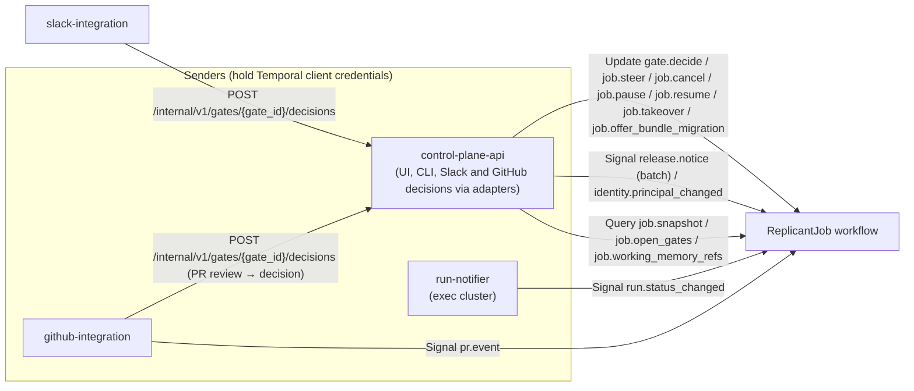
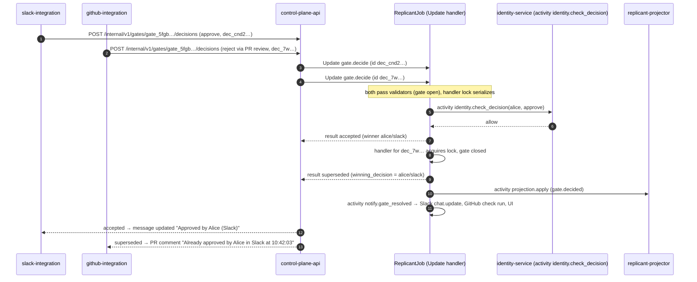
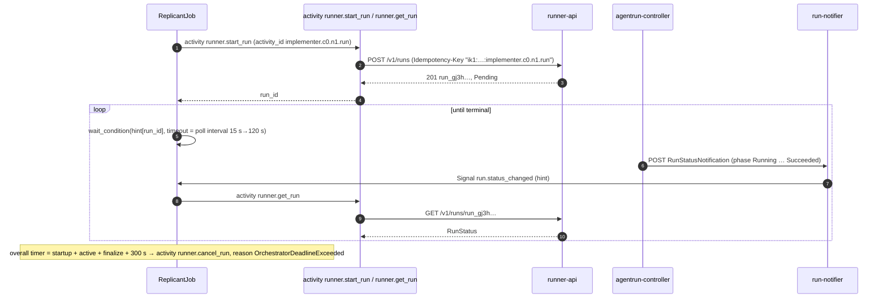

# Workflow Message Catalog (Signals, Updates, Queries)

**Contract ID:** `C-MSG` · **Version:** 2.0.0 · **Owner:** WS-00 · **Schemas (authoritative):** [schemas/workflow-messages.schema.json](schemas/workflow-messages.schema.json)

**Changelog:** 2.0.0 (breaking). Product rename to Replicant (CCR-ORCH-02). Every product-named identifier changes; there is no structural change. Domain `factory.example.com` (labels, annotations, schema `$id` host) becomes `replicant.example.com`; env prefix `FACTORY_` becomes `REPLICANT_`; headers `X-Factory-*` become `X-Replicant-*`; names `factory-*`/`factory_*` (services, task queues, Temporal namespace, roles, buckets, groups, hosts, networks) become `replicant-*`/`replicant_*`; CamelCase `Factory*` (workflow types, search attributes) becomes `Replicant*`. Workflow type `ReplicantJob`, schema `$id` host `schemas.replicant.example.com`. 1.7.4 (wave 3). `JobSnapshot.waiting.queue_position` removed: runner-api has no queue (ruling on XD-W2-02-04, R1V-093). `batch.child_progress` is also accepted by `MaintenanceShard` (R1V-006). 1.7.3. replicant-worker may call `CountWorkflowExecutions` for the pinned-workflows gauge (CCR-01-12). 1.7.2. Temporal identity `replicant-db-migrate`, allowed only `CountWorkflowExecutions` (CCR-10-12). 1.7.1 (ruling). One shared `decision_channel` enum (`ui`, `cli`, `api`, `slack`, `github`, `gitea`, `system`) for `GateDecideRequest.channel`, `winning_decision.channel`, and `decision_log[].channel`. `gitea` is now accepted on the request side, `jira` is dropped from the log, and `GateView.channels` allows `gitea` and `api`. `decision_log[].delegate_of` is log-only: delegation is resolved server-side and never sent by clients. 1.7.0 (wave 1, final). `decision_identity_contested` (CCR-07-06). `GateView.decision_log` and `steering[].actor` (CCR-07-07). `JobSnapshot.waiting` (CCR-07-10 merged with CCR-01-06). V10 and `decided_at` (CCR-01-07). Temporal identities, projector read APIs, and reset as break-glass (CCR-01-08). Authorizer rate limit (CCR-01-10). Update `ops.retry_node` (CCR-07-12). 1.6.0 (wave 1). Decision `rerun_qa` (CCR-05-04). Five sign-off points (CCR-06-11). `bundle_rolled_back`, `override_release_block`, V12, `GateView.release_block`, and migration `consent` (CCR-06-13). Temporal identities `audit-exporter` and `ops-worker` (CCR-08-06c). 1.5.0 (additive, fix round). R2-044 adds notice kind `model_retiring` (forced migration without consent). R2-005 adds gate kind `leak_purge` (two-person: `eligible.min_approvers`, outcome `recorded`, V11). R2-016 adds Signal `ops.kill_switch`. 1.4.0 (additive). CCR-01-01 adds `release.notice` kind `bundle_patched`. CCR-01-04 adds Signal `batch.child_progress`. CCR-01-05 adds the optional batched `ProjectionEvent.events`. 1.3.0 (additive) CCR-07-02 adds two `GateDecideResult.denial_reason` values (handler step 3). 1.1.0 (orchestrator) CCR-11-01 adds `gitea` to the actor `channel_identity.kind` enum. 1.2.0 (additive) CCR-06-01 adds `JobSnapshot.evaluation` and evaluation-mode gate resolution (§2.1). CCR-06-03 adds the `ReleasePipeline` messages (§2.4).

## Purpose

This is the complete list of messages Replicant sends to its Temporal workflows: name, kind,
sender, payload schema, validator rules, idempotency, and which graph interrupt each resumes. WS-01
implements the handlers. WS-07 and WS-02 implement the senders. Adding a message or changing a
payload requires a contract change request. Payloads evolve additively within a major version:
new optional fields only, and receivers ignore unknown optional fields.

## Decisions summary

| Decision | Reference |
|---|---|
| Human decisions (gates, steering, cancel, pause, takeover, migration consent) are **Updates**. The sender gets a validated result (first-wins outcome, denial reason) and needs no extra round trip | D-19; [ADR-001](adr/001-gates-updates-vs-signals.md) |
| Machine notifications where the sender needs no result and the workflow must receive them even with no worker running are **Signals**: run status hints, PR events, release notices, identity changes | D-04, D-15; [ADR-001](adr/001-gates-updates-vs-signals.md), [ADR-002](adr/002-runner-completion-callback-vs-poll.md) |
| Validators do only structural, state-local checks: no I/O, no blocking. Authorization is authoritative **in the handler**, through an activity, at decision time | D-18 |
| Update IDs are deterministic from the human action (`decision_id`, `message_id`, `action_id`), so double clicks and redeliveries dedupe. Temporal dedupes Update IDs per run only, so workflows also carry recent IDs across Continue-As-New | [verified: https://docs.temporal.io/handling-messages, 2026-10-24] |
| Addressed by workflow ID only (never run ID), so messages follow Continue-As-New | [ids-and-naming.md](ids-and-naming.md) §3 |

## 1. Who holds Temporal client credentials (must-answer)

| Process | Cluster | Temporal permissions (Authorizer policy, self-hosted) | Why |
|---|---|---|---|
| `control-plane-api` | core | `StartWorkflowExecution`, `UpdateWorkflowExecution`, `SignalWorkflowExecution`, `QueryWorkflow`, `DescribeWorkflowExecution`, `ListWorkflowExecutions`, `StartBatchOperation` (signal only), `UpdateWorkflowExecutionOptions` (bundle migration pins), Worker Deployment read and write APIs (release operations) on `replicant-<env>` | The single entry point for human actions and release operations. Every action is authorized here (Okta groups + repo permission) before reaching Temporal |
| `github-integration` | core | `SignalWorkflowExecution` on `replicant-<env>` | Sends `pr.event` (no result needed; must be durable when workers are down). GitHub review **decisions** go through control-plane-api |
| `run-notifier` | exec | `SignalWorkflowExecution` on `replicant-<env>` **only** | Completion hints (D-04). It is the only execution-side Temporal client. See §1.1 |
| `replicant-worker`, `publisher-worker`, `replicant-projector`, `eval-worker` | core | Worker role: poll their task queues, respond (`replicant-projector` additionally uses the read APIs `ListWorkflowExecutions`, `QueryWorkflow`, `DescribeWorkflowExecution` for reconciliation, CCR-01-08), plus `StartWorkflowExecution` / `SignalWorkflowExecution` from activities where WS-01 needs them (for example child-job creation goes through control-plane-api instead) `replicant-worker` additionally calls `CountWorkflowExecutions` (read-only) for the pinned-workflows-per-version gauge (CCR-01-12). | Workers |
| `audit-exporter` | core | read-only: `ListWorkflowExecutions`, `GetWorkflowExecutionHistory` on `replicant-<env>` (CCR-08-06c) | History skeleton and full exports (C-ART) |
| `ops-worker` | core | worker role on task queue `replicant-ops` (CCR-08-06c) | Hosts `LeakPurge` and other operational workflows |
| `retention-sweeper` | core | worker role on `replicant-retention`; `ListWorkflowExecutions` (due-job scans) (CCR-01-08) | Session-state sweep (C-ART rule 5) |
| `replicant-db-migrate` | core (the migrate PreSync Job) | **only** `CountWorkflowExecutions` on `replicant-<env>`, read-only; no other API (CCR-10-12) | The contract-phase gate: proves no workflow pinned to a pre-expand `replicant-worker` version is still running before a contract migration (WS-10 schema-management.md §7.4) |
| `replicant-replay-gate` | core (release-pipeline Job) | read-only: `ListWorkflowExecutions`, `GetWorkflowExecutionHistory` (CCR-01-08) | Replay tests of a candidate worker build against recorded histories |
| Temporal UI (behind Okta, operators only) | core | read; terminate and cancel only for the `replicant-operators` group. **`reset` is operator break-glass only** (approved, time-boxed, audited): deterministic activity IDs would replay earlier results, so the supported retry path is `ops.retry_node` (CCR-07-12, CCR-01-08) | Operations (WS-07) |
| slack-integration, jira-integration, identity-service, memory-service, Runner, controller, sandboxes | — | **none** | Narrow trust. Their actions go through control-plane-api |

### 1.1 How run-notifier is secured

- **Identity.** mTLS client certificate issued by cert-manager from an intermediate CA dedicated to
  Temporal clients. 24-hour lifetime, renewed at two-thirds of its life. CN `run-notifier.replicant-runner.exec.<env>`.
  The private key never leaves the pod (cert-manager `CertificateRequest` with a CSI driver or Secret
  plus a restricted RBAC role).
- **Authorization.** The Temporal server is configured with a ClaimMapper and Authorizer. The
  default is a no-op authorizer that allows everything, so both must be set explicitly [verified:
  https://docs.temporal.io/self-hosted-guide/security, 2026-10-24]. The policy maps this identity
  to `SignalWorkflowExecution` on namespace `replicant-<env>`, with every other API denied. A
  stricter check, allowing only signal name `run.status_changed` and only workflow IDs matching
  `^job_`, belongs in the custom Authorizer if the authorizer has access to the request body.
  `[unverified: whether the Authorizer's CallTarget exposes the request payload for SignalWorkflowExecution]`.
  Fallback: the workflow-side hint-only semantics below make the narrower check optional rather
  than load-bearing.
- **Blast radius if compromised.** An attacker can send forged or garbage `run.status_changed`
  Signals to any workflow in the namespace. Effect: the workflow wakes and calls
  `runner.get_run`, which returns the authoritative AgentRun state. **No decision is taken from
  Signal content.** Unknown `run_id`s are ignored. The attacker could inflate history by flooding
  Signals, which is bounded by Temporal's limit of 10,000 Signals per execution [verified:
  https://docs.temporal.io/cloud/limits, 2026-10-24], by a **per-identity token bucket in the custom
  Authorizer** (run-notifier: 50 Signals/s, burst 200; WS-09), and by the per-namespace
  `frontend.namespaceRPS`. Temporal's dynamic config has no per-identity limit [verified:
  temporalio/temporal v1.32.1 `common/dynamicconfig/constants.go`, 2026-10-24] (CCR-01-10). Alert:
  `replicant_workflow_unknown_run_signals_total > 0`.
- **Network.** The notifier reaches the Temporal frontend only through an internal NLB.
  SecurityGroup and CiliumNetworkPolicy restrict the path to notifier pods to Temporal frontend
  port 7233.

## 2. Message catalog

Workflow type for all messages below: `ReplicantJob`, unless noted. "Resumes" names the
LangGraph interrupt or internal wait the message completes (WS-01 owns the node code).

### 2.1 Updates

| Name | Sender | Update ID | Request / Result schema | Resumes |
|---|---|---|---|---|
| `gate.decide` | control-plane-api (UI, CLI, and on behalf of slack-integration and github-integration) | `decision_id` | `GateDecideRequest` / `GateDecideResult` | interrupt `human_gate` for the gate (plan, publish, clarification, budget, migration) |
| `job.steer` | control-plane-api | `message_id` | `JobSteerRequest` / `JobSteerResult` | none (affects the next node or the live run) |
| `job.cancel` | control-plane-api | `action_id` | `JobControlRequest` (action=cancel) / `JobControlResult` | any wait (cancels the workflow's root cancellation scope) |
| `job.pause` | control-plane-api | `action_id` | `JobControlRequest` (action=pause) / `JobControlResult` | none (sets the pause flag checked at node boundaries) |
| `job.resume` | control-plane-api | `action_id` | `JobControlRequest` (action=resume) / `JobControlResult` | interrupt `paused` |
| `job.takeover` | control-plane-api | `action_id` | `JobControlRequest` (action=takeover) / `JobControlResult` | any wait; then the takeover subflow |
| `job.offer_bundle_migration` | control-plane-api (operator action) | `action_id` | `OfferBundleMigrationRequest` / `OfferBundleMigrationResult` | none (opens a `bundle_migration` gate) |
| `batch.cancel` (on `MaintenanceBatch`) | control-plane-api | `action_id` | `JobControlRequest` (action=batch_cancel) / `JobControlResult` | the batch's fan-out wait |
| `ops.retry_node` | control-plane-api (`POST /v1/admin/ops/jobs/{job_id}:retry-node`, actor holds `release:operate`) | `operation_id` (`opr_<ulid>`) | `RetryNodeRequest` / `RetryNodeResult` | none. It re-runs the named node with **ordinal + 1**, so activity IDs never collide with earlier results. The validator rejects only malformed payloads and seen operation IDs. The handler checks that the node exists (`node_unknown`), that its latest attempt failed or is stuck (`not_failed`), that the job is not terminal (`job_terminal`), and that policy allows retrying it (`not_allowed`). A failed check returns `accepted: false` with that reason, so operators always get an answer (CCR-07-12) |

**Evaluation mode (CCR-06-01).** For jobs started with `JobRequest.options.evaluation`, gates still
open, project, and time out normally. They are resolved **inside the workflow** from the gate script
(activity `eval.read_gate_script`), with timeline event `gate.auto_resolved`. No `gate.decide`
Update is sent and no service principal decides a gate, so V8 holds unchanged for all jobs.
Notifications for such gates are suppressed. For every other job, nothing changes.

#### `gate.decide`: validator rules (all must pass; otherwise rejected with `ApplicationError` of the given type)

Rejected Updates are not written to history [verified:
https://github.com/temporalio/temporal/blob/main/docs/architecture/workflow-update.md, 2026-10-24],
so duplicates and stale clicks cost no history.

| # | Rule | Rejection type (details) |
|---|---|---|
| V1 | Payload validates against `GateDecideRequest` | `InvalidPayload` |
| V2 | `gate_id` is a gate this workflow opened | `UnknownGate` |
| V3 | `decision_id` is not in the workflow's applied-decisions set (carried across Continue-As-New) | `DuplicateDecision` (details: the original `GateDecideResult`). Senders treat this as success |
| V4 | The gate is open | `GateAlreadyDecided` (details: `winning_decision`) or `GateClosed` (expired or cancelled) |
| V5 | `decision` is allowed for the gate kind: plan/publish `approve`, `reject`, `request_changes`; clarification `answer`, `reject`; budget/migration/leak_purge `approve`, `reject`. **`rerun_qa`** (CCR-05-04) is valid only on `publish_approval` when the presented packet's `qa.verdict == "inconclusive"` and `qa.actions` contains `rerun_qa`, and at most 2 times per gate (`GateView.qa_reruns_used`) | `DecisionNotAllowed` / `DecisionNotOffered` (rerun_qa outside those conditions) |
| V6 | `presented_digest` equals the gate's current packet digest | `StaleApprovalView` (details: current digest). The UI reloads |
| V7 | `channel` (enum `decision_channel`) is in the gate's `channels` | `ChannelNotAllowed` |
| V8 | `actor.principal_id` starts with `usr_` (services never decide gates) | `ActorNotHuman` |
| V9 | If `requester_may_decide=false`, the actor is not the job's requester | `SelfApprovalForbidden` |
| V10 | **Time rule (CCR-01-07).** Reject if `decided_at > workflow.now() + 60 s` or `decided_at < gate.opened_at − 60 s` (`InvalidPayload`). While `workflow.now() < expires_at`, accept. After `expires_at`, accept only if `decided_at < expires_at`, `workflow.now() − decided_at ≤ 6 h`, **and** the gate's late-expiry grace window has not ended. That window is 15 minutes and opens only when the expiry timer fired more than 60 s late. A gate held by `pause at_next_gate` does not expire while held | `InvalidPayload` / `GateClosed` |
| V11 | If `eligible.min_approvers > 1`: the actor has not already approved this gate, and is not the principal who initiated the gated action (for `leak_purge`, the purge requester) | `DuplicateApprover` / `InitiatorCannotApprove` |
| V12 | If the job's bundle was rolled back or revoked (the gate carries `release_block`, recorded from `release.notice` `bundle_rolled_back` or `bundle_revoked`), an `approve` requires `override_release_block`; the override is audited. `reject`, `request_changes`, and `rerun_qa` are never blocked (CCR-06-13) | `GateBlockedByRelease` |

Handler (normative behavior):

1. Acquire the per-gate `asyncio.Lock`, so decisions on one gate are serialized.
2. Re-check V4. If it fails, return `superseded` with `winning_decision`. This case arises when
   another decision won while this one waited for the lock.
3. Execute activity `identity.check_decision` (task queue `replicant-jobs`, start_to_close 10 s,
   retry max 5). It returns allow or deny, with a reason, from identity-service's live view: SCIM
   group membership as of now, identity link, repo permission via GitHub, tenant match. This is the
   **authoritative** check (D-18: no confused deputy, no cached grant). On deny, emit an audit and a
   projection, and return `denied` with the reason. The gate stays open. The check fails closed with
   two dedicated reasons (CCR-07-02; WS-07 identity.md §10):
   - `identity_unverifiable`: the live Okta read failed and the replica fallback was not allowed
     (critical risk, or replica older than 5 minutes);
   - `identity_recheck_pending`: an Okta event hook flagged the principal and the live reconcile has
     not cleared it yet.
   Both are retryable by the approver later.
4. **`rerun_qa`** (CCR-05-04): supersede the gate revision, re-run QA on the same diff bundle and
   `base_sha` without consuming fix iterations, then open a new revision of the gate. `comment` is
   optional. Otherwise, record the decision and append `decision_id` to the applied set. If the decision is `reject`, or
   `eligible.min_approvers` is 1, the first valid decision wins: close the gate and resume the
   interrupt. Otherwise, an `approve` is recorded and the result is `recorded`
   (`approvals_recorded`/`approvals_required`), and the gate closes as approved only when
   `min_approvers` **distinct** principals have approved.

   **`leak_purge` gates** (R2-005) open on the `LeakPurge` workflow (`leak_<ulid>`, task queue
   `replicant-ops`), not on `ReplicantJob`. They have `min_approvers = 2` and are eligible to the
   Replicant admin group only (D-25 style live check in `identity.check_decision`). The same
   `gate.decide` Update and validators apply.
5. Fire-and-forget activities: `projection.apply` (timeline `gate.decided`) and
   `notify.gate_resolved`. The latter updates every channel's message to "Approved by
   @alice in Slack, 10:42" (WS-07).
6. Return `accepted` with `winning_decision`.

#### `job.steer` validators and handler

Validators: payload valid; `message_id` unseen (carried set); job status not terminal; actor is
`usr_`. Handler: activity `identity.check_action(action="steer")`. On deny, return `denied`.
Otherwise append to the job's steering log (text inline in history; ≤ 16 KiB). If
`delivery ∈ {auto, live_only}` and an active run has `steering.enabled`, call activity
`runner.post_message` (logical activity ID `<node>.c<cycle>.n<ord>.steer_<seq>`). Return
`delivered_live`. Otherwise return `queued_next_node`, and the context assembler includes the
message in the next node's inputs. A `live_only` message that cannot be delivered returns
`not_deliverable`.

#### `job.cancel` / `job.pause` / `job.resume` / `job.takeover`

Validators: payload valid; `action_id` unseen; the action is meaningful in the current status. A
cancel on a terminal job returns `no_op` from the handler, not a rejection, so callers see the
status. Resume while not paused is `no_op`. Handler: activity `identity.check_action`; then:
- **cancel:** cancel the active runs (activity `runner.cancel_run`, reason `job_cancelled`), run
  compensation (WS-01: close the draft PR if one exists, release locks), set status `cancelled`.
- **pause:** set the flag. At the next node boundary (`at_next_node`) or gate (`at_next_gate`),
  enter interrupt `paused` with status `paused`.
- **resume:** clear the flag and resume.
- **takeover:** cancel the active runs with reason `takeover` once their finalize step has
  uploaded the workspace archive. WS-02/WS-03 define the run's takeover snapshot behavior on
  SIGTERM. Then publish the branch through the Publisher (draft, no PR unless requested), assemble
  the takeover package (`takeover_package` artifact), and set status `taken_over`.
  Result: `takeover_id`.

#### `job.offer_bundle_migration`

Validators: payload valid; `action_id` unseen; status is `waiting_human` or `waiting_external`;
target ≠ current bundle. Handler: activity `release.check_migration_eligibility` (WS-01 rule). If
ineligible, return `ineligible`.
- **`consent: requester`** (default): open a `bundle_migration` gate with the requester as the
  eligible approver.
- **`consent: operator`** (CCR-06-13): the actor must hold `release:revoke`, checked by activity.
  No gate opens; the job migrates at its next safe point and the requester is notified. The
  result outcome is `migration_scheduled`.

`model_retiring` notices remain consent-free (R2-044). When it is approved, the workflow performs Continue-As-New onto the target
bundle (WS-01 defines the mechanics, including `UpdateWorkflowExecutionOptions` /
upgrade-on-Continue-As-New).

### 2.2 Signals

| Name | Sender | Dedupe key | Schema | Effect |
|---|---|---|---|---|
| `run.status_changed` | run-notifier | `notification_id` (`<run_id>:<phase>:<generation>`) | `RunStatusChangedSignal` | A hint. If `run_id` is one of the workflow's active runs, set `hint[run_id]=true`, which wakes the run waiter. The waiter immediately calls `runner.get_run` and acts only on that response. Unknown `run_id`: increment metric `replicant_workflow_unknown_run_signals_total`, log, ignore. Never resumes a LangGraph interrupt directly; it completes the internal wait inside the node's Runner-call helper |
| `pr.event` | github-integration | `delivery_id` (carried set, 7 days) | `PrEventSignal` | Buffer the event. When the job is in `pr_review`, the `await_pr_feedback` interrupt resumes with the batch of buffered events after a debounce timer (default 120 s from the last event, so a review's multiple comments become one repair cycle). Before any repair, activity `identity.check_repair_trigger` re-verifies each actor (D-15: linked, org member, write permission or above, not a bot, not the Replicant app). `pull_request_merged` and `pull_request_closed` end the job (`succeeded` / `rejected`) |
| `batch.child_progress` (on `MaintenanceBatch`, or on `MaintenanceShard` when the batch is sharded, C-ARCH §4.1) | child `ReplicantJob` workflows via `SignalExternalWorkflowExecution` (a workflow command, so no client credential is needed; WS-09 notes it in G-23) | highest `seq` per `child_job_id` | `BatchChildProgressSignal` | Updates the parent's view of each child. A child entering `pr_review` or a terminal status frees a concurrency slot. Children run with `ParentClosePolicy.ABANDON`, so this replaces child-completion events (CCR-01-04) |
| `release.notice` | control-plane-api (Temporal batch operation) | `notice_id` | `ReleaseNoticeSignal` | Record it in state and project it (the UI shows a banner). `bundle_revoked`: at the next safe point (node boundary or gate), the workflow pauses with status `waiting_human`, and control-plane-api follows with `job.offer_bundle_migration(required=true)`. `bundle_rolled_back` (CCR-06-13): the job's bundle was rolled back. Open gates get `release_block`, and approving them needs `override_release_block` (V12). An operator may follow with `job.offer_bundle_migration(consent=operator)`. Other kinds are informational unless WS-01 specifies otherwise `bundle_patched` (CCR-01-01): operators moved workflows pinned to build N onto a replay-verified emergency patch build N.p using `UpdateWorkflowExecutionOptions`. `recommended_release_bundle_id` is the patch bundle B′, which differs from B only in `worker_deployment` and `node_catalog`, with `lineage.parent_release_bundle_id = B`. The workflow verifies that lineage in an activity and records B′ as its bundle without consent, which keeps D-03 intact `model_retiring` (R2-044): a model pinned by the job's bundle has a scheduled retirement. `recommended_release_bundle_id` is an operator-approved model-successor bundle B′, which differs from B only in the agent definitions' model fields and the derived `models` index, with `lineage.parent_release_bundle_id = B`. `deadline` is the retirement date. **No requester consent is needed**, because consent covers behaviour changes, not a model that will stop existing. The workflow verifies the lineage in an activity, then migrates onto B′ at its next safe point, before `deadline`. This is separate from worker-version retirement (`worker_version_retire_scheduled`) |
| `ops.kill_switch` | control-plane-api (Temporal batch signal over a visibility query by scope: global, `ReplicantTenantId`, `ReplicantRepos`, or `ReplicantReleaseBundleId`) | `notice_id`; latest `issued_at` per (scope, scope_value) wins | `KillSwitchSignal` | R2-016. The workflow keeps the engaged switches in its state and projects them. `starts`: no new `runner.start_run`; the job waits at its next safe point. `runs`: cancel active runs (`runner.cancel_run`, reason `operator`) and hold. `publishing`: publisher activities raise retryable `PublishingPaused`, and the job shows "Publishing paused by operators". `released` resumes. Delivery uses Temporal only, so it works when the Replicant Postgres is down. Workflows that start after engagement read the out-of-band mirror at start (activity `ops.read_kill_switches`; WS-07/WS-09 own the mirror). The `intake` switch is enforced by intake, not by workflows |
| `identity.principal_changed` | control-plane-api (on identity-service SCIM events) | `notice_id` | `PrincipalChangedSignal` | If the principal is the requester and the change is `deprovisioned` or `suspended`: apply tenant policy `on_requester_deprovisioned` (default: pause and notify tenant admins, who may reassign or cancel). If the principal is a gate's only eligible principal: re-resolve eligibility (activity) and re-notify. Pending decisions by that principal already fail at `identity.check_decision`. **`decision_identity_contested`** (with `decision_id`; CCR-07-06): an approval accepted before the approver's removal propagated. With tenant setting `on_contested_decision: reopen_if_unpublished`, the workflow withdraws that approval and reopens the gate if no publish activity has started for it. Otherwise it records the contest and alerts |

Why `pr.event` is a Signal while GitHub **gate decisions** go through control-plane-api as an
Update: a PR review that maps to a gate decision, configured per tenant (WS-07), needs the
first-wins result, so that the GitHub check run and the Slack message can be updated with who
decided. Review comments are feedback for a later repair. They must be durable even when no
worker is polling, and the sender needs no result.

### 2.3 Queries

| Name | Workflow | Result schema | Used by |
|---|---|---|---|
| `job.snapshot` | `ReplicantJob` | `JobSnapshot` | `ProjectionReconciler` (repairs drift), operators, `replicant status --live` |
| `job.open_gates` | `ReplicantJob` | `OpenGatesQueryResult` | control-plane-api before rendering a decision (fresh `presented_digest`); reconciler |
| `job.working_memory_refs` | `ReplicantJob` | `WorkingMemoryRefsQueryResult` | takeover UI, debugging |
| `batch.snapshot` | `MaintenanceBatch` | `BatchSnapshot` | UI batch view |

Queries need a polling worker for the workflow's pinned version. The UI therefore never depends
on them for page loads ([ADR-004](adr/004-ui-read-model-projection.md)).

### 2.4 ReleasePipeline messages (CCR-06-03; WS-06 owns the workflow)

Workflow type `ReleasePipeline`, workflow ID `rpl_<ulid>`, on `eval-worker` / task queue
`replicant-eval`. The sender is control-plane-api only. The pipeline needs no Signals: guardrails are
polled by timer and activity.

| Name | Kind | Update ID | Request / Result schema | Validators (no I/O) | Handler |
|---|---|---|---|---|---|
| `release.signoff` | Update | `decision_id` | `ReleaseSignoffRequest` / `ReleaseSignoffResult` | actor is `usr_`; `signoff_point` is pending; `presented_digest` equals the current evidence digest (`StaleEvidenceView`); `decision_id` unseen (carried across Continue-As-New, else the stored result is returned) | activity `check_release_signoff`: live group membership, change-author exclusion, two-person distinctness. Audited and projected to `evals.release_signoffs` |
| `release.abort` | Update | `action_id` | `ReleaseControlRequest` (action=abort) / `ReleaseControlResult` | actor is `usr_`; `action_id` unseen | stop progression, roll back the assignment unless `already_rolled_back`, transition the candidate |
| `release.hold` | Update | `action_id` | `ReleaseControlRequest` (action=hold or resume) / `ReleaseControlResult` | actor is `usr_`; `action_id` unseen | pause or resume stage progression |
| `release.snapshot` | Query | — | `ReleaseSnapshot` | — | — |

## 3. Sender obligations

1. **Retry with the same ID.** An Update that has been admitted but not yet accepted lives only in
   memory and can be lost [verified:
   https://github.com/temporalio/temporal/blob/main/docs/architecture/workflow-update.md, 2026-10-24].
   When no worker is available, the SDK client retries indefinitely [verified:
   https://docs.temporal.io/develop/python/message-passing, 2026-10-24]. Senders therefore
   (a) bound each attempt with a 10 s client timeout, (b) persist the pending action in their own
   outbox table (`intake.pending_actions` for control-plane-api; `slack_app.pending_decisions`;
   `github_app.pending_decisions`) before calling, and (c) retry with the **same Update ID** until
   they get a result or a permanent rejection. While retrying, the UI shows "Recording your
   decision…", and Slack shows an ephemeral "Recording…" message.
2. **Limits.** At most 10 in-flight Updates per execution, and at most 2,000 Updates per run
   (Continue-As-New is suggested at 90%) [verified: https://docs.temporal.io/cloud/limits,
   2026-10-24]. Human-action rates are far below this. control-plane-api additionally rate-limits
   per (principal, job) to 1 Update per second.
3. **Authorization before sending.** Senders check authorization first, for fast feedback. The
   workflow's handler check is authoritative. A sender never forwards an action from an unlinked
   identity (D-18).
4. **Untrusted text** (`comment`, `answer_text`, steering `text`, PR comments via `payload_uri`) is
   never interpolated into workflow-generated summaries or timeline text.

## 4. Sequence: two channels race on one gate (D-19)

## 5. Sequence: run completion (hint plus poll)

Failure modes:

| Failure | Behavior |
|---|---|
| run-notifier down | Signals are delayed; polling still completes the wait within one poll interval. Alert when the oldest `CallbackDelivered=Unknown` is older than 5 min |
| Temporal frontend down | The controller keeps retrying the notification; activities fail and Temporal retries after recovery |
| Worker down while waiting | The Signal is durable in history [verified: https://docs.temporal.io/encyclopedia/workflow-message-passing, 2026-10-24]; the timer fires on recovery |
| Runner down | `runner.get_run` retries (retryable 503). After the orchestrator deadline the workflow tries to cancel (it retries until the Runner is back) and marks the node failed |
| Forged Signal | Ignored unless `run_id` is active; then it only causes an extra poll |
| Workflow closed when the Signal arrives | Temporal returns NotFound; the notifier reports `workflow_closed` and the controller sets `CallbackDelivered=True/WorkflowClosed` |

## Open questions

| Question | Who decides | Options | Recommendation |
|---|---|---|---|
| Debounce window for PR review comments | WS-01/WS-04 | 0 s / 120 s / until the review is submitted | Act when `review_submitted` arrives; otherwise 120 s after the last comment |
| GitHub review → gate mapping | WS-07 | Replicant gate only before PR; GitHub approval as gate | Replicant gates happen before the PR; GitHub reviews feed `pr.event`. A per-tenant opt-in maps "approve" reviews from CODEOWNERS to `publish_approval` for already-draft PRs |
| Should `identity.principal_changed` be a Signal from identity-service directly? | WS-07/WS-09 | direct vs via control-plane-api | Via control-plane-api. That keeps the set of Temporal credential holders minimal |

## Risks

- Update senders depend on worker availability. A worker outage blocks approvals while they sit
  in the sender outboxes. The UI shows pending, and nothing is lost.
- The hint-only Signal design costs one extra activity per transition (about 6 per run). History
  budget: about 40 events per run. WS-01 must include this in its 30-day history estimate.

## Interfaces

- **Provided:** `C-MSG` (this catalog plus schemas). Consumed by WS-01 (handlers), WS-02 (notifier),
  WS-07 (senders, UI states), WS-08 (audit of decisions), WS-09 (authorization review), WS-11
  (workflow tests).
- **Consumed:** `C-IDS`, `C-RUNNER`.
