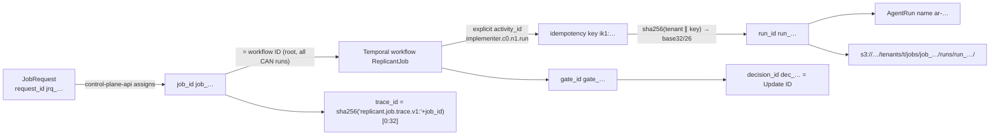

# Identifiers, Naming, and Correlation

**Contract ID:** `C-IDS` · **Version:** 2.0.0 · **Owner:** WS-00 · **Status:** frozen; changes via contract change requests

**Changelog:** 2.0.0 (breaking). Product rename to Replicant (CCR-ORCH-02). Every product-named identifier changes; there is no structural change. Domain `factory.example.com` (labels, annotations, schema `$id` host) becomes `replicant.example.com`; env prefix `FACTORY_` becomes `REPLICANT_`; headers `X-Factory-*` become `X-Replicant-*`; names `factory-*`/`factory_*` (services, task queues, Temporal namespace, roles, buckets, groups, hosts, networks) become `replicant-*`/`replicant_*`; CamelCase `Factory*` (workflow types, search attributes) becomes `Replicant*`. Workflow type `ReplicantJob`, search attributes `Replicant*`, OTel attributes `replicant.*`, branch prefix `replicant/<job_id>`, bot `replicant-bot`. The trace/span seeds (`replicant.job.trace.v1:` and so on) and the session-ID seed (`replicant:<run_id>`) change, so the derived trace, span and session IDs and the test vectors change. 1.13.4 (wave 3). Regexes for `eval_run_id`, `golden_task_id`, `takeover_id` (R1V-078). `ReplicantPhase` is also set on `MaintenanceBatch` (R1V-085). RuntimeClass annotation `replicant.example.com/log-transport` (R1V-098). Workflow type `MaintenanceShard` with ID `<job_id>:shard:<n>` (R1V-006). 1.13.3. CCR-03-10: `X-Replicant-Role` accepts `eval-judge`; `X-Replicant-Budget-Exceeded` gains `tenant_embeddings_day`, `pipeline`, `account`, and `platform`; `X-Replicant-Served-Model` is informational. 1.13.2. Lease annotation `replicant.example.com/disk` (CCR-02-12). 1.13.1. The `opr_` row now names its use as the `ops.retry_node` Update ID. 1.13.0 (wave 1, final). Schedule ID `sch_<ulid>` with a separate `display_name` (CCR-07-08). Message name `ops.retry_node` (CCR-07-12). Wider `paused` meaning (CCR-01-06). 1.12.0 (wave 1). `msnap_` hash includes the tenant (CCR-04-04). Gateway headers `X-Replicant-Served-Model`, `X-Replicant-Purpose`, `X-Replicant-Pipeline-Id` (CCR-03-09). Sandbox env vars and paths, a pod label, an AgentRun annotation, and namespace labels merged in one §8 table (CCR-02-08, CCR-09-11). Workflow type `ComponentSuite` (CCR-06-07d). Prometheus labels `status`, `terminal`, `revision`, `forbidden_label` (CCR-08-07). 1.11.0 (additive). Fix round: message name `ops.kill_switch`; the spec-digest annotation definition (R2-002). 1.10.0 (additive). CCR-01-02 adds the phases `pre_checks`, `fan_out`, `budget_gate`, `migrating`, `takeover`. CCR-01-04 adds message name `batch.child_progress`. 1.9.0 (additive). CCR-08-01 adds rule T-5 (deterministic job and run span IDs) and new span attributes. CCR-08-02 adds bounded Prometheus labels. CCR-08-03 adds sandbox env vars and pod labels for workflow type and acting-for. CCR-08-04 adds workflow `LeakPurge`, prefix `leak_`, and task queue `replicant-ops`. 1.8.0 (additive). CCR-10-04 adds workflow type `DataOperation` and task queue `replicant-retention`. CCR-10-06 adds ID prefix `del_`. 1.7.0 (additive). CCR-02-03 adds the bare-Pod name, the workspace environment variables, the workspace pod labels, and the cancel-reason pod annotation. 1.6.0 (additive). CCR-07-03 and CCR-07-05 add the system workflow types `ProjectionRebuild` and `ScheduledIntake`. CCR-07-04 adds the ID prefixes `art_`, `dlg_`, `opr_`, `lnk_`, `grp_`, `ntf_`. 1.5.0 (additive). CCR-05-03 adds the bounded Prometheus label `qa_stage`. 1.4.0 (additive). CCR-04-03 adds the memory-service prefixes `mcfl_`, `mqtn_`, `mprg_`, `mexp_`, `mact_`. 1.3.0 (additive). CCR-06-03 adds the ID prefixes `rpl_`, `cmp_`, `prop_`, `lbl_`, the release and eval workflow types, the `release.*` messages, and the service principals `svc_release-controller` and `svc_improvement-proposer`. CCR-06-04 adds the bounded Prometheus labels `release_cohort` and `bundle`. 1.2.0 (additive). CCR-03-04 adds the ID prefixes `gwu_`, `rsp_`, `pub_`, `rec_` and the AI gateway budget, limit, and retry headers. 1.1.0 (additive). CCR-09-02 adds the `rgr_` run-grant ID. CCR-09-01 adds the per-audience token directory `REPLICANT_RUN_TOKEN_DIR` and deprecates `REPLICANT_RUN_TOKEN_FILE` after the N/N+1 window.

## Purpose

This contract fixes the format, generation rule, and owner of every identifier Replicant uses. It
also fixes how each identifier appears in Temporal, Kubernetes, object storage, Postgres,
OpenTelemetry, Loki, Langfuse, and Prometheus. Every workstream must use these formats exactly. A
new identifier type needs a contract change request.

## Decisions summary

| Decision | Reference |
|---|---|
| All replicant-minted IDs are `<prefix>_<26 chars>`, lowercase Crockford base32. Time-ordered IDs are ULIDs; derived IDs are truncated SHA-256 hashes | this doc; [ADR-012](adr/012-identifier-scheme.md) |
| The root workflow ID **is** the `job_id`. It is stable across Continue-As-New. Internal child workflows are `<job_id>:<kind>:<n>` | D-01, D-02; [ADR-009](adr/009-job-lifetime-spans-pr-review.md) |
| Side-effecting activities get **explicit, logical activity IDs**. The idempotency key is the workflow ID plus that logical activity ID. Temporal's sequence-number activity IDs are never used as idempotency input | D-04; [ADR-008](adr/008-deterministic-run-identity.md) |
| `run_id` is a pure function of `(tenant_id, idempotency_key)`. The AgentRun name is derived from `run_id`. Idempotency lives on etcd name uniqueness | D-04, D-05, D-23 |
| `release_bundle_id` derives from the SHA-256 digest of the canonical (RFC 8785) bundle spec | D-03; [ADR-005](adr/005-release-bundle-unit-of-versioning.md) |
| One OTel trace per job. The trace ID is derived deterministically from `job_id` | D-17 |
| The searchable Temporal attribute set fits the self-hosted SQL visibility limits, with headroom | D-01, D-22 |



---

## 1. Encoding rules (apply to every ID below)

| Rule | Value |
|---|---|
| Alphabet | Crockford base32, **lowercase**: `0123456789abcdefghjkmnpqrstvwxyz` (no `i l o u`) |
| Body length | 26 characters (130 bits) |
| Time-ordered body | ULID [verified: https://github.com/ulid/spec, 2026-10-24]: 48-bit Unix-ms timestamp plus 80 random bits, rendered lowercase. Generators must be monotonic within a millisecond per process |
| Derived body | `b32_130(sha256(input))`: the first 130 bits of the SHA-256 digest, big-endian, as 26 base32 characters. `input` is UTF-8 with fields joined by `\n` (0x0A) |
| Separator | `_` between prefix and body. Kubernetes object names cannot contain `_`, so Kubernetes uses the `-` forms listed below |
| Case | IDs are case-sensitive and always emitted lowercase. Parsers reject uppercase (no case folding, so there is one canonical form for hashing) |
| Generic regex | `^[a-z]{2,6}_[0-9a-hjkmnp-tv-z]{26}$` |
| Postgres type | `text` with a `CHECK (col ~ '<regex>')` constraint. Do not convert to `uuid` (one canonical form across stores) |

Reference implementation (normative; ships in the shared `replicant-ids` Python package and a Go
package with identical test vectors):

```python
import hashlib
import os
import time

ALPHABET = "0123456789abcdefghjkmnpqrstvwxyz"


def b32_130(digest: bytes) -> str:
    """First 130 bits of digest as 26 lowercase Crockford base32 characters."""
    n = int.from_bytes(digest[:17], "big") >> (136 - 130)
    return "".join(ALPHABET[(n >> (5 * (25 - i))) & 31] for i in range(26))


def derived(prefix: str, *fields: str) -> str:
    return f"{prefix}_{b32_130(hashlib.sha256(chr(10).join(fields).encode()).digest())}"


def ulid(prefix: str, ms: int | None = None) -> str:
    ms = int(time.time() * 1000) if ms is None else ms
    n = (ms << 80) | int.from_bytes(os.urandom(10), "big")
    return f"{prefix}_" + "".join(ALPHABET[(n >> (5 * (25 - i))) & 31] for i in range(26))
```

Test vectors. Every implementation must reproduce these exactly:

| Input | Output |
|---|---|
| `derived("run", "payments", "ik1:job_01m5p7x7r0bt69j0h0fbxepw90:implementer.c0.n1.run")` | `run_gj3h3ep3phjfs9e23v768zrca5` |
| `derived("run", "payments", "ik1:job_01m5p7x7r0bt69j0h0fbxepw90:qa.c0.n1.run")` | `run_chxtsxqzcpds1fc1c4dvw9e4em` |
| `derived("gate", "job_01m5p7x7r0bt69j0h0fbxepw90", "plan_approval", "c0", "n1")` | `gate_r1a2avb51zgbsjy0x4ghyktt2e` |
| `job_trace_id("job_01m5p7x7r0bt69j0h0fbxepw90")` | `fc0575170c8597ce9805552723c08d6e` |

## 2. Identifier catalog

| ID | Format / example | Generated by | Rule | Lifetime / uniqueness |
|---|---|---|---|---|
| `tenant_id` | slug `^[a-z][a-z0-9]*(-[a-z0-9]+)*$`, 3–32 chars. Example: `payments` | control-plane-api (tenant creation, admin only) | Immutable once created. Reserved: `replicant-eval`, `replicant-system`, `local-dev`. Must not start with `sbx`, `kube`, `replicant-` (except reserved), or `aws` | Global, forever. Never reused after offboarding (tombstoned in `tenancy.tenants`) |
| `principal_id` (human) | `usr_<ulid>`. Example: `usr_01knk8dfr0fvjc7v0b9vhvkzbp` | identity-service on first SCIM provision | Stable for the person. Okta `sub` is mapped to it in `identity.users` | Global, forever |
| `principal_id` (service) | `svc_<name>`, name `^[a-z][a-z0-9-]{2,40}$`. Examples: `svc_scheduler`, `svc_github-integration`, `svc_release-controller` (auto-promotion and release transitions under the promotion policy), `svc_improvement-proposer` (proposes candidate bundles, never promotes) (CCR-06-03) | Declared in config (identity schema seed migration) | Used as actor in audit and as the `requester` of scheduled jobs (with `on_behalf_of`) | Forever |
| `request_id` | `jrq_<ulid>` | The channel adapter that builds the JobRequest | One per normalized trigger. Not the dedupe key | Stored in `intake.job_requests` |
| `dedupe_key` | `<channel>:<scope>:<natural key>`, ≤ 256 chars, `^[a-z]+:[A-Za-z0-9._:/@#-]+$`. Examples: `github:delivery:6f1b4a40-5f1e-11ef-8a4b-1c9d6e0b2a11`, `github:issue-label:R_kgDOK2a9Xw:1423:replicant`, `slack:cmd:T024BE7LD:1792822345.123456`, `schedule:sch_01m5q7k2x9c4v8b6n3j1h0g5fd:2026-10-26T06:00:00Z` | Channel adapter | Same real-world trigger → same key. `(tenant_id, dedupe_key)` is unique in `intake.job_requests` | 90 days after the job's terminal state, then pruned |
| `job_id` | `job_<ulid>`. Example: `job_01m5p7x7r0bt69j0h0fbxepw90` | control-plane-api `POST /v1/jobs`, in the same transaction as the intake row (insert-or-get on `(tenant_id, dedupe_key)`) | One per job. Child jobs (maintenance fan-out) get their own `job_id` with `parent_job_id` set | Forever (audit). Primary correlation key everywhere |
| Root workflow ID | `= job_id` | control-plane-api `StartWorkflowExecution` | `WorkflowIdConflictPolicy=USE_EXISTING`, `WorkflowIdReusePolicy=REJECT_DUPLICATE` [verified: https://github.com/temporalio/api/blob/master/temporal/api/enums/v1/workflow.proto, 2026-10-24] | Same across every Continue-As-New run [verified: https://docs.temporal.io/workflow-execution/continue-as-new, 2026-10-24] |
| Internal child workflow ID | `<job_id>:<kind>:<n>`, kind `^[a-z][a-z0-9_]{1,30}$`, n ≥ 1 decimal. Examples: `job_01m5p7x7r0bt69j0h0fbxepw90:qa_stage:1`, `job_01m5p7x7r0bt69j0h0fbxepw90:shard:3` (`MaintenanceShard`, C-ARCH §4.1) | Parent workflow code | `n` is a counter carried in workflow state across Continue-As-New. Never reuse an `(kind, n)` pair within a job | Job lifetime |
| Child **job** workflow ID | `= child job_id` | Parent `MaintenanceBatch` workflow, through activity `intake.create_child_job` (allocates `job_id` through control-plane-api so the intake row exists), then `start_child_workflow` | The child carries `ReplicantParentJobId` | As job |
| System workflow ID | `sys:<name>`. Examples: `sys:projection-reconciler`, `sys:retention-sweeper`; WS-06 (CCR-06-03): `sys:sentinel-eval`, `sys:judge-drift-check`, `sys:golden-miner`, `sys:golden-harvester`, `sys:improvement-proposer`, `sys:cli-upgrade-watcher`, `sys:online-metrics` | Temporal Schedules | Singleton per namespace | Forever |
| Projection rebuild workflow ID | `sys:projection-rebuild:<ulid>` (`ProjectionRebuild`, task queue `replicant-projections`; one per `replicant admin projections rebuild` request, not a singleton) | control-plane-api (admin operation) | CCR-07-03; C-PG rule 5 | Rebuild lifetime |
| Temporal Schedule ID | `sch_<ulid>` (Crockford ULID body). The human name is a separate `display_name`, never part of the ID, so names cannot collide across tenants and renames do not break dedupe (CCR-07-08) | control-plane-api (schedule creation) | Used in `JobRequest.source.schedule.schedule_id` and in the schedule `dedupe_key` | Schedule lifetime |
| Scheduled intake workflow ID | `sys:scheduled-intake:<schedule_id>` plus the timestamp suffix Temporal appends to every workflow a Schedule starts (`ScheduledIntake`) | Temporal Schedule action | One activity, `intake.submit_scheduled`, calls `POST /v1/jobs` as `svc_scheduler` with `on_behalf_of` and `dedupe_key = schedule:<schedule_id>:<scheduled_time>`. The `job_id` is therefore minted in the intake transaction, and a Schedule never starts `ReplicantJob` directly (CCR-07-05) | Per firing |
| Artifact index ID | `art_<derived>` = `derived("art", bucket_class, key)` | replicant-projector | Rows in `jobs_read.job_artifacts`; used in UI URLs instead of raw keys (CCR-07-04) | As the artifact |
| Approval delegation | `dlg_<ulid>` | control-plane-api | Delegation of approval authority (WS-07) | Forever (audit) |
| Admin operation run | `opr_<ulid>` | control-plane-api | Admin operations that replace direct DB access (D-26). Also the `operation_id` and Update ID of `ops.retry_node` (CCR-07-12) | Forever (audit) |
| Identity link | `lnk_<ulid>` | identity-service | One Okta ↔ GitHub/Slack/Jira/Gitea link | Forever (tombstoned) |
| SCIM group ID | `grp_<ulid>` | identity-service | Group `id` returned to Okta over SCIM | Forever |
| Notification ID | `ntf_<derived>` = `derived("ntf", notification_dedupe_key)` | replicant-worker notify activities, control-plane-api | Dedupes notification deliveries (CCR-07-04) | 90 days |
| Release pipeline ID | `rpl_<ulid>`; it is also the `ReleasePipeline` workflow ID | control-plane-api (pipeline start) / eval-worker | One per candidate bundle promotion attempt (CCR-06-03) | Forever (`evals.release_pipelines`) |
| Eval comparison ID / workflow ID | `cmp_<ulid>`; `EvalComparisonRun` workflow ID `<rpl_id>:cmp:<n>` | eval-worker | One paired candidate-versus-baseline comparison | Forever for promoted bundles |
| Improvement proposal ID | `prop_<ulid>` | `sys:improvement-proposer` | Proposed candidate change (never auto-promoted) | 2 years |
| Human eval label ID | `lbl_<ulid>` | control-plane-api (labeling UI) | One human label of an eval case or judge output (judge calibration) | Forever |
| Eval workflow ID | `eval_<ulid>` (suite); `eval_<ulid>:case:<task_id>` (case) | eval-worker | WS-06 | Per eval run |
| Temporal run ID | Temporal-generated UUID | Temporal | Never used as a Replicant key. Recorded only for deep links | Per run |
| Logical activity ID | `<node_key>.c<cycle>.n<ordinal>.<effect>`, ≤ 120 chars, `^[a-z][a-z0-9_]{0,40}\.c[0-9]{1,3}\.n[0-9]{1,3}\.[a-z][a-z0-9_]{0,30}$`. Example: `implementer.c0.n1.run` | Workflow code. It is passed as `activity_id=` to `workflow.execute_activity` for **every activity with an external side effect** | `node_key` is the graph node name. `cycle` is the repair cycle (0 = initial pass). `ordinal` counts deliberate re-invocations of the node within the cycle, starting at 1. `effect` names the side effect (`run`, `cancel`, `publish`, `post_reply`, `write_candidates`). Temporal retry attempts never change it | Unique per job. Carried counters survive Continue-As-New |
| Idempotency key | `ik1:<workflow_id>:<logical_activity_id>`, ≤ 255 bytes. Example: `ik1:job_01m5p7x7r0bt69j0h0fbxepw90:implementer.c0.n1.run`. When the workflow is an internal child: `ik1:job_…:qa_stage:1:qa.c0.n1.run` | Activity code (from `activity.info().workflow_id` and `activity.info().activity_id`) | Sent as the `Idempotency-Key` header, an RFC 9651 sf-string (quoted) [verified: https://datatracker.ietf.org/doc/draft-ietf-httpapi-idempotency-key-header/ (draft-08, 2026-10-22), 2026-10-24]. Same key ⇒ same effect | Runner: AgentRun lifetime (≥ 45 days). Publisher/GitHub: 90 days |
| `run_id` | `run_<derived>` = `derived("run", tenant_id, idempotency_key)`. Example: `run_gj3h3ep3phjfs9e23v768zrca5` | Runner API (authoritative). The workflow may compute it ahead of time to stage inputs, and must verify it equals the Runner's response | Pure function. Two creates with the same key collide on the AgentRun name ([ADR-008](adr/008-deterministic-run-identity.md)) | Forever (artifacts are keyed by it) |
| AgentRun `metadata.name` | `ar-<26-char body of run_id>`. Example: `ar-gj3h3ep3phjfs9e23v768zrca5` (29 chars) | Runner API | DNS-1123 label, ≤ 63 [verified: https://kubernetes.io/docs/concepts/overview/working-with-objects/names/, 2026-10-24] | AgentRun object lifetime |
| AgentRun namespace | `sbx-<tenant_id>` (≤ 36 chars) | Platform (tenant onboarding creates it) | One namespace per tenant in the execution cluster | Tenant lifetime |
| Job / Pod name | Job: `= AgentRun name` (29 chars < 63 [verified: https://kubernetes.io/docs/concepts/workloads/controllers/job/, 2026-10-24]). Pod: Kubernetes-generated `<job-name>-<5 chars>`; when the controller uses a bare Pod (C-CRD §6), the Pod name is `ar-<body>` (= AgentRun name), which gives hard at-most-once (CCR-02-03) | Controller | Hostname-safe | AgentRun lifetime |
| `gate_id` | `gate_<derived>` = `derived("gate", job_id, gate_kind, "c<cycle>", "n<ordinal>")` | Workflow code (deterministic, replay-safe) | One per gate instance. The same gate re-opened after request-changes uses ordinal+1 | Forever (approvals projection, audit) |
| `decision_id` | `dec_<derived>` = `derived("dec", channel, channel_event_id)`. `channel_event_id`: Slack `user.id + ":" + action_ts`; GitHub `X-GitHub-Delivery`; UI/CLI the client's `Idempotency-Key` (a ULID it generated) | The channel adapter (github-integration, slack-integration, control-plane-api) | **Used as the Temporal Update ID** for `gate.decide`. A double click or webhook redelivery dedupes | Forever |
| `message_id` (steering) | `msg_<ulid>` | Client (UI/CLI/Slack adapter) | Used as the Update ID for `job.steer` and as the S3 inbox object name | Job lifetime + 90 d |
| `action_id` (job control) | `act_<ulid>` | Client (UI/CLI/Slack adapter/control-plane-api) | Used as the Temporal Update ID for `job.cancel`, `job.pause`, `job.resume`, `job.takeover`, `job.offer_bundle_migration`, `batch.cancel` | Job lifetime |
| `notice_id` | `ntc_<ulid>` | Sender of `release.notice` / `identity.principal_changed` | Dedupe key in workflow | Job lifetime |
| `takeover_id` | `tko_<derived>` = `derived("tko", job_id, "n<ordinal>")` | Workflow | — | Job lifetime + 14 d |
| `release_bundle_id` | `rb_<b32_130(digest)>`, where `digest = sha256(JCS(bundle.spec))` (RFC 8785). Example: `rb_ds5p3wmcj4dag2e9a8ncp4py6k`. The full digest `sha256:<64 hex>` is stored alongside | Registry publish (control-plane-api) | Content-addressed: same spec ⇒ same ID. Short display form: first 12 characters (`rb_ds5p3wmcj`) | Forever (bundles are never deleted, only revoked) |
| Definition reference | `<kind>/<name>@<version>` plus `#sha256:<hex64>` in pinned form. Example: `agent/implementer-claude@7#sha256:9f2c…` | Registry | See [definitions-contracts.md](definitions-contracts.md) §3 | Forever |
| Definition name | `^[a-z][a-z0-9]*(-[a-z0-9]+)*$`, ≤ 63 chars | Config repo authors | Unique per (kind, scope) | Forever |
| Worker deployment version | `{deployment_name, build_id}` (structured). Deployment names: `replicant-worker`, `publisher-worker`, `replicant-projector`, `eval-worker`. `build_id`: `b<YYYYMMDD>-<git sha, 12 hex>`, e.g. `b20261024-3f9a1c2e7d4b` | CI | Never use the deprecated `deployment.build` string form. Neither `.` nor `:` may appear in a deployment name [verified: https://github.com/temporalio/api/blob/master/temporal/api/deployment/v1/message.proto, 2026-10-24]. In search attributes the version renders as `replicant-worker:b20261024-3f9a1c2e7d4b` | Until retired |
| `memory_entry_id` | `mem_<ulid>`; versions are integers. Pinned reference: `mem_01m42qyvr0dzhe1xg73b1bq38b@3` | memory-service | WS-04 owns internals | Until hard-deleted (tombstone row kept) |
| Leak purge | `leak_<ulid>` (also the `LeakPurge` workflow ID) | control-plane-api (operator action) | One purge of a leaked secret from every sink (CCR-08-04) | 7 years (`leak_purge_record`) |
| Deletion ledger entry | `del_<ulid>` | The service performing a deletion (memory-service purge, retention sweeper, tenant offboarding, secret purge) | One per deletion action, recorded as `deletion_ledger_entry` in the audit bucket (CCR-10-06) | 7 years |
| Memory conflict / quarantine / purge / export / curator action | `mcfl_<ulid>`, `mqtn_<ulid>` (quarantine or bulk disable), `mprg_<ulid>`, `mexp_<ulid>`, `mact_<ulid>` | memory-service (CCR-04-03) | Appear in the admin API, audit events, the UI, and S3 keys (`mexp_` as `<export_id>`, `mprg_` as `<purge_id>`, C-ART §2). DDL: WS-04 `sql/memory.sql` | Forever (audit) |
| `memory_snapshot_id` | `msnap_<b32_130(sha256(JCS({"tenant_id": <tenant>, "entries": <sorted entry refs>, "policy": <pinned policy ref>})))>`. Example: `msnap_my7g26p6dy194fr4kjdehzb5hr` (illustrative) | memory-service at context assembly | Content-addressed **per tenant**: the same entry set gives the same snapshot within a tenant, and two tenants never collide (CCR-04-04, R1-096). Evaluation snapshots hash the scope (source) tenant | 2 years |
| `artifact_ref` | Logical: `{bucket_class, key}`. Physical: `s3://<bucket>/<key>` | Producer | See [artifact-layout.md](artifact-layout.md) | Per retention class |
| `audit_event_id` | `aud_<ulid>` | `audit.emit()` | — | 7 years (WS-08/09 may extend) |
| `eval_run_id`, `golden_task_id` | `eval_<ulid>`, `gtask_<ulid>` | WS-06 | — | — |
| Batch child index | `MaintenanceBatch` children are child jobs. See above | — | — | — |
| Run token `jti` | `rtk_<ulid>` | Runner (run-token issuer); one token per audience (CCR-09-01) | See [runner-api.openapi.yaml](runner-api.openapi.yaml) `RunTokenClaims` | Token TTL |
| Gateway usage event / request ID | `gwu_<ulid>` | replicant-gateway-shim, one per model request | Returned as `X-Replicant-Request-Id`; primary key of usage events in PG[cost] (CCR-03-04) | 2 years (cost ledger) |
| Right-sizing proposal | `rsp_<ulid>` | profile-rightsizer | One per proposed resource-profile change (config-repo PR) | 2 years |
| Registry publish request | `pub_<ulid>` | config-repo CI (client-generated) | `publish_id` of `POST /v1/registry/publish`; idempotency key (C-DEF §4.2) | 2 years |
| Cost reconciliation run | `rec_<ulid>` | usage-ingestor (nightly) | One per reconciliation of shim usage against the upstream gateway's billing | 2 years |
| Run grant `jti` | `rgr_<ulid>` | replicant-worker Runner-call activity, signing with KMS key class `run-grant` (core account, ECC_NIST_P256) (CCR-09-02) | One per signing. An activity retry signs a new grant; the AgentRun keeps the first. See `RunGrantClaims` | Grant `exp` (run deadline + finalize + 300 s); revoked IDs listed at `/grants/revoked` |

### 2.1 Why the activity ID is explicit (pitfall avoided)

The Python SDK's default activity ID is the workflow's command sequence number
(`activity_id = self._input.activity_id or str(self._seq)`) [verified:
https://github.com/temporalio/sdk-python/blob/main/temporalio/worker/_workflow_instance.py,
2026-10-24]. Continue-As-New starts a fresh history, so the sequence restarts. A key built from the
default ID would therefore make the second run's activity "1" collide with the first run's
activity "1": the Runner would return the wrong, earlier run. Inserting an activity earlier in
the code would also shift every later key. **Rule:** every activity that calls the Runner, the
Publisher, GitHub, Slack, or memory-service passes `activity_id=<logical activity ID>`. The worker
fails a lint/CI check (WS-01) if such an activity is invoked without an explicit ID. The logical
counters (`cycle`, per-node `ordinal`) live in workflow state and are carried across
Continue-As-New.

## 3. Job identity across Continue-As-New and child workflows (must-answer)

1. `job_id` is minted once, at intake, by control-plane-api. It never changes.
2. The root workflow's **workflow ID equals `job_id`**. Continue-As-New keeps the workflow ID and
   gets a new Temporal run ID. Search attributes and memo are copied by default
   [verified: Python SDK `workflow.continue_as_new` docstring "search_attributes: Defaults to the
   current workflow's search attributes", https://github.com/temporalio/sdk-python, 2026-10-24].
   The Replicant still passes them explicitly on every Continue-As-New (defensive, and so that
   `ReplicantRepairCycle` / `ReplicantProjectionSeq` are current).
3. Every workflow, root or child, sets search attribute `ReplicantJobId = <job_id>`. Internal children
   have IDs prefixed `<job_id>:`, so `WorkflowId STARTS_WITH "<job_id>"` also finds them.
4. Signals and Updates are always addressed by **workflow ID only** (no run ID), so they reach the
   current run after any number of Continue-As-New transitions.
5. Workflow state carried across Continue-As-New (WS-01 owns the full list) must include:
   `job_id`, `release_bundle_id`, `cycle`, per-node `ordinal` counters, `projection_seq`, open
   gate IDs, the set of applied `decision_id`s and `message_id`s from the last 7 days (Update ID
   dedupe is per run only [verified: https://docs.temporal.io/handling-messages, 2026-10-24]),
   the set of processed `pr.event` delivery IDs (last 7 days), and the active `run_id`s.
6. In Postgres, object storage, Loki, Langfuse, and Prometheus exemplars, the job is identified by
   `job_id` alone. Temporal run IDs appear only in deep links.

## 4. Temporal naming

| Item | Value |
|---|---|
| Namespace | `replicant-<env>`: `replicant-local`, `replicant-dev`, `replicant-staging`, `replicant-prod`. One namespace per environment; tenancy via search attributes plus authorization (WS-01 may propose per-tenant namespaces through a contract change request; ID formats are namespace-agnostic) |
| Workflow types | `ReplicantJob` (every job type; the graph is chosen from the bundle by the router), `MaintenanceBatch` (fan-out parent), `MaintenanceShard` (internal child of a batch above 2,000 repositories, task queue `replicant-jobs`; R1V-006), `EvalSuite`, `EvalCase` (WS-06), `ProjectionReconciler` (system), `RetentionSweeper` (system); WS-06 (CCR-06-03, all on `eval-worker` / `replicant-eval`): `ReleasePipeline`, `EvalComparisonRun`, `SentinelEval`, `JudgeDriftCheck`, `GoldenMiner`, `GoldenHarvester`, `ImprovementProposer`, `CliUpgradeWatcher`, `OnlineMetrics`; WS-07 (CCR-07-03, 07-05): `ProjectionRebuild` (on `replicant-projections`), `ScheduledIntake`; WS-10 (CCR-10-04): `DataOperation`, which runs admin data fixes as resumable, audited workflows on the owning service's worker (D-26); WS-08 (CCR-08-04): `LeakPurge` (workflow ID = `leak_<ulid>`, task queue `replicant-ops`); WS-06 (CCR-06-07d): `ComponentSuite` (eval-worker, `replicant-eval`, workflow ID `eval_<ulid>`). These add **no** custom search attributes; they use `ReplicantReleaseBundleId` and system attributes, so the §4.1 SQL-visibility budget is unchanged. New types: PascalCase, registered in this table through a contract change request |
| Task queues | `replicant-jobs` (workflows and graph activities; deployment `replicant-worker`), `replicant-runner-calls` (Runner API activities; deployment `replicant-worker`), `replicant-publisher` (deployment `publisher-worker`), `replicant-projections` (deployment `replicant-projector`), `replicant-eval` (deployment `eval-worker`), `replicant-retention` (session-state sweeper and retention activities, CCR-10-04), `replicant-ops` (operational workflows such as `LeakPurge`, CCR-08-04). WS-01 may add task queues named `replicant-<purpose>` |
| Message names | `<area>.<verb>` lowercase with `_`: `gate.decide`, `job.steer`, `job.cancel`, `job.pause`, `job.resume`, `job.takeover`, `job.offer_bundle_migration`, `run.status_changed`, `pr.event`, `release.notice`, `identity.principal_changed`, `job.snapshot`, `job.open_gates`, `job.working_memory_refs`, `batch.snapshot`, `batch.cancel`, `release.signoff`, `release.abort`, `release.hold`, `release.snapshot` (CCR-06-03), `batch.child_progress` (CCR-01-04), `ops.kill_switch` (R2-016), `ops.retry_node` (CCR-07-12). Catalog: [events-and-signals.md](events-and-signals.md) |
| Activity type names | `<area>.<verb>`, e.g. `runner.start_run`, `runner.get_run`, `runner.cancel_run`, `runner.post_message`, `projection.apply`, `publisher.publish`, `memory.write_candidates`, `identity.check_decision`. WS-01 owns the list |

### 4.1 Custom search attributes (registered by Replicant)

Limits for self-hosted SQL (PostgreSQL) advanced visibility, per namespace: Bool 3, Datetime 3,
Double 3, Int 3, Keyword 10, KeywordList 3, Text 3. A value may be at most 2 KB, all attributes on
an execution at most 40 KB total [verified: https://docs.temporal.io/search-attribute, 2026-10-24].
The set below leaves headroom in every type. If WS-01 or WS-10 needs more than these limits allow,
the visibility store must move to OpenSearch/Elasticsearch. That threshold is recorded as a WS-10
decision input.

| Name | Type | Set on | Values | Updated when |
|---|---|---|---|---|
| `ReplicantJobId` | Keyword | every Replicant workflow | `job_id` | start |
| `ReplicantTenantId` | Keyword | every Replicant workflow | `tenant_id` | start |
| `ReplicantWorkflowType` | Keyword | `ReplicantJob`, `MaintenanceBatch` | `bugfix`, `feature`, `api_change`, `docs`, `hotfix`, `maintenance`, `pr_repair`, `qa_only`, or `unrouted` until the router decides | router decision |
| `ReplicantStatus` | Keyword | `ReplicantJob`, `MaintenanceBatch` | job status enum (§6) | each status change |
| `ReplicantPhase` | Keyword | `ReplicantJob`, `MaintenanceBatch` (XD-FIX-R1-010, R1V-085) | phase vocabulary (§6) | each phase change |
| `ReplicantReleaseBundleId` | Keyword | every Replicant workflow | `release_bundle_id` (full form) | start; bundle migration |
| `ReplicantParentJobId` | Keyword | child jobs | parent `job_id` | start |
| `ReplicantRiskLevel` | Keyword | `ReplicantJob` | `low`, `medium`, `high`, `critical` | risk classification (may only rise, D-19) |
| *(reserved)* | Keyword ×2 | — | WS-01 may claim through a contract change request | — |
| `ReplicantRepos` | KeywordList | `ReplicantJob` | `<host>/<owner>/<name>` per target, e.g. `github.com/acme-payments/ledger-api` | router decision |
| `ReplicantOpenGateIds` | KeywordList | `ReplicantJob` | open `gate_id`s (normally 0 or 1) | gate open/close |
| *(reserved)* | KeywordList ×1 | — | — | — |
| `ReplicantRepairCycle` | Int | `ReplicantJob` | `cycle` | cycle start |
| `ReplicantProjectionSeq` | Int | `ReplicantJob` | last emitted projection `seq` | every projection (drives reconciliation, [ADR-004](adr/004-ui-read-model-projection.md)) |
| *(reserved)* | Int ×1 | — | — | — |
| `ReplicantWaitingSince` | Datetime | `ReplicantJob` | start of the current human or external wait; cleared when it ends | wait start/end |
| *(reserved)* | Datetime ×2 | — | — | — |
| `ReplicantAwaitingHuman` | Bool | `ReplicantJob` | true while blocked on a gate | gate open/close |
| *(reserved)* | Bool ×2, Double ×3, Text ×3 | — | — | — |

Replicant also reads these **system** attributes: `TemporalWorkerDeployment`,
`TemporalWorkerDeploymentVersion`, `TemporalWorkflowVersioningBehavior`,
`TemporalUsedWorkerDeploymentVersions` [verified: https://docs.temporal.io/search-attribute,
2026-10-24]. The deprecated `BuildIds` attribute is not used.

Example visibility queries, used by the reconciler and the releases screen:

```sql
ReplicantStatus = 'waiting_human' AND TemporalWorkerDeploymentVersion = 'replicant-worker:b20261024-3f9a1c2e7d4b'
ReplicantTenantId = 'payments' AND ExecutionStatus = 'Running' AND ReplicantWaitingSince < '2026-09-24T00:00:00Z'
```

## 5. OpenTelemetry trace propagation rule

**Rule T-1 (one trace per job).** Each job has exactly one trace:
`trace_id = lowercase_hex(sha256("replicant.job.trace.v1:" + job_id))[0:32]`. The value is 32 lowercase
hex characters and never all zeros, as W3C Trace Context Level 1 requires [verified:
https://www.w3.org/TR/trace-context/ (Level 1 REC; Level 2 is still a Candidate Recommendation),
2026-10-24]. Any component holding a `job_id` can compute it. Langfuse accepts 32-hex trace IDs
generated from a seed [verified:
https://langfuse.com/docs/observability/features/trace-ids-and-distributed-tracing, 2026-10-24].
The Langfuse trace for the job uses the same ID.

**Rule T-2 (trigger link).** Trigger services (webhook handlers, Slack handlers, UI requests) run
in their own request traces. When control-plane-api creates the job, it starts root span `job`
(span kind INTERNAL) in the job trace with a **span link** to the trigger span taken from
`JobRequest.trace_context.traceparent`. The trigger span gets attribute
`replicant.job_id`.

**Rule T-3 (hops).** Context propagates by these mechanisms, and no hop may drop it:

| Hop | Mechanism |
|---|---|
| control-plane-api → Temporal start/Update/Signal | Temporal headers via the Python SDK OpenTelemetry integration (`temporalio.contrib.opentelemetry`; `OpenTelemetryPlugin` is preferred, `TracingInterceptor` is legacy) [verified: https://github.com/temporalio/sdk-python/tree/main/temporalio/contrib/opentelemetry, 2026-10-24]. The parent is the job root span |
| workflow → activities, child workflows, Continue-As-New | same integration (headers) |
| activity → Runner API | HTTP `traceparent` / `tracestate` headers, **and** `trace_context` in the run spec (persisted for the controller) |
| Runner → AgentRun | `spec.traceContext.traceparent` (the parent span = Runner's `runner.create_run` span) |
| controller → pod | env `TRACEPARENT`, `TRACESTATE`, plus `OTEL_RESOURCE_ATTRIBUTES` (below) |
| entrypoint → CLI | CLI's own OTel export env (WS-03/WS-08) with the same `OTEL_RESOURCE_ATTRIBUTES` |
| CLI → AI gateway | HTTP `traceparent` header if the CLI forwards it; always the `X-Replicant-*` headers (§7) |
| controller → run-notifier → Temporal Signal | the notification payload carries `traceparent`. The notifier injects it into the Signal headers |
| projector, memory-service, context MCP | inbound headers from the activity/MCP call |

**Rule T-4 (attributes).** Every span and every Langfuse observation emitted on behalf of a job
carries `replicant.job_id` and `replicant.tenant_id`. Spans inside a run also carry `replicant.run_id`.

**Rule T-5 (deterministic span IDs, CCR-08-01).**
- (a) The root span `job` has span ID `lowercase_hex(sha256("replicant.job.span.v1:" + job_id))[0:16]`.
- (b) The entrypoint's `sandbox.run` span has span ID
  `lowercase_hex(sha256("replicant.run.span.v1:" + run_id))[0:16]`.

Components acting for a job without an inbound `traceparent` parent their spans under these IDs.
This covers github-integration on `pr.event`, sweepers, the audit exporter, and agentd and the
gateway shim when a CLI sends no header. A 30-day job therefore produces no orphan roots in Tempo
and no duplicate traces in Langfuse.

Test vectors (reproduced 2026-10-24):
- `job_01m5p7x7r0bt69j0h0fbxepw90` → `2f9b8c2c87b35ba4`
- `run_gj3h3ep3phjfs9e23v768zrca5` → `b776c51d0276da4e`

Resource and span attribute keys (OTel):

| Key | Where |
|---|---|
| `replicant.env` | resource (all) |
| `replicant.tenant_id` | span (all job work) |
| `replicant.job_id` | span (all job work) |
| `replicant.workflow_id`, `replicant.workflow_run_id` | spans emitted by workflow and activity code |
| `replicant.node_key`, `replicant.cycle`, `replicant.ordinal` | node and activity spans |
| `replicant.run_id`, `replicant.agentrun` | Runner, controller, sandbox spans |
| `replicant.role` | sandbox spans (`planner`, `implementer`, `qa`, `reviewer`, `repair`, `takeover`, `eval`) |
| `replicant.release_bundle_id` | root job span; sandbox resource |
| `replicant.gate_id`, `replicant.decision_id` | gate spans |
| `replicant.memory_snapshot_id` | context assembly and sandbox spans |
| `replicant.workflow_type`, `replicant.phase` | all job spans (CCR-08-01; Langfuse trace name and filters need them on every span) |
| `replicant.requester_id` | all job spans: requester `principal_id`, an opaque ID that is never an email |
| `replicant.cli` | sandbox spans (`claude-code`, `claude-agent-sdk`, `codex`) |
| `replicant.request_id`, `replicant.retry_attempt` | gateway shim and agentd spans (`gwu_…`, attempt number) |
| `replicant.memory_entry_ids` | spans of model calls that received injected memory (comma-joined `mem_…@v` refs) |

Sandbox `OTEL_RESOURCE_ATTRIBUTES` value:
`service.name=replicant-sandbox,replicant.env=prod,replicant.tenant_id=payments,replicant.job_id=job_01m5p7x7r0bt69j0h0fbxepw90,replicant.run_id=run_gj3h3ep3phjfs9e23v768zrca5,replicant.role=implementer,replicant.release_bundle_id=rb_ds5p3wmcj4dag2e9a8ncp4py6k`

## 6. Job status and phase vocabulary

`status` (closed enum; terminal values marked †):

| status | meaning |
|---|---|
| `queued` | Accepted by intake; workflow started; router not yet finished |
| `running` | Replicant work in progress |
| `waiting_human` | At a gate (approval, clarification, budget, migration) |
| `waiting_external` | Waiting on PR review or merge, or on external CI |
| `paused` | Paused by `job.pause`, **or held by the Replicant**: a dependency outage or an operator kill switch. `JobSnapshot.waiting.reason` says which (CCR-01-06) |
| `succeeded`† | Outcome achieved (PR merged; or docs/no-PR job finished) |
| `failed`† | Unrecoverable error or repair budget exhausted |
| `cancelled`† | `job.cancel` |
| `rejected`† | A human declined: gate rejected, or PR closed unmerged |
| `expired`† | A wait exceeded its policy (D-19 expiry/auto-cancel) |
| `taken_over`† | Handed to a human via `job.takeover` |

`phase` (open vocabulary; WS-01 may add values through a contract change request):
`intake`, `routing`, `clarification`, `context`, `planning`, `plan_gate`, `implementing`, `qa`,
`review`, `verify`, `publish_gate`, `rebase_reverify`, `publishing`, `pr_review`, `repairing`,
`memory`, `finalizing`, `done`; and from CCR-01-02 `pre_checks` (inserted pre-implementation checks such as a license
scan), `fan_out` (MaintenanceBatch), `budget_gate` (budget extension or tenant quota wait), `migrating`
(handoff run), and `takeover` (takeover subflow). WS-07 renders all of them.

## 7. HTTP headers and sandbox environment variables

| Header | Used on | Value |
|---|---|---|
| `Idempotency-Key` | Runner `POST /v1/runs`, `/messages`, `:cancel`; control-plane-api mutations | sf-string, e.g. `"ik1:job_01m5p7x7r0bt69j0h0fbxepw90:implementer.c0.n1.run"` |
| `traceparent`, `tracestate` | all internal HTTP | W3C |
| `X-Replicant-Tenant-Id` | AI gateway, MCP servers, repo-mirror | `tenant_id` (informational; the run token is authoritative) |
| `X-Replicant-Job-Id` | same | `job_id` |
| `X-Replicant-Run-Id` | same | `run_id` |
| `X-Replicant-Role` | AI gateway | a sandbox role (§5 `replicant.role` values), or `eval-judge` for eval-worker judge calls (CCR-03-10) |
| `X-Replicant-Retry-Attempt` | agentd → replicant-gateway-shim | integer ≥ 1, the attempt number of a retried model request (CCR-03-04) |
| `X-Replicant-Request-Id` | shim → agentd (every data-plane response) | `gwu_<ulid>` |
| `X-Replicant-Budget-Run-Limit-Usd`, `X-Replicant-Budget-Run-Spent-Usd`, `X-Replicant-Budget-Job-Spent-Usd` | shim → agentd | decimal strings with 6 fractional digits |
| `X-Replicant-Budget-Exceeded` | shim → caller (HTTP 402) | `run`, `job`, `tenant_period`, `tenant_embeddings_day`, `pipeline`, `account`, or `platform` (CCR-03-10) |
| `X-Replicant-Served-Model` | shim → caller, every data-plane response (an HTTP trailer for streams) | the upstream model ID actually served. **Informational** (CCR-03-10): callers record it in telemetry and transcripts. The shim enforces model pinning itself, and no caller makes a control decision from this header (CCR-03-09) |
| `X-Replicant-Purpose` | service caller → shim | `worker_llm`, `embedding`, `eval_judge`; required on projected-SA-token calls (CCR-03-09) |
| `X-Replicant-Pipeline-Id` | service caller → shim | ≤ 64 chars: the budget account for a backfill or release pipeline (e.g. `rpl_…`) (CCR-03-09) |
| `X-Replicant-Limit` | shim → agentd (HTTP 429, replicant-imposed only; upstream 429s are passed through without it) | `tenant_rpm`, `tenant_tpm`, `tenant_concurrency`, `run_concurrency` |
| `Authorization: Bearer <run token>` | sandbox → gateway, MCP, repo-mirror, Runner sandbox listener | the run token **for that audience** (`ai-gateway`, `memory-mcp`, `context-mcp`, `repo-mirror`, `runner-sandbox`); JWT claims in the Runner OpenAPI `RunTokenClaims`. Never present one audience's token to another service (CCR-09-01) |

Sandbox environment variables set by the controller (WS-02/WS-03 may add `REPLICANT_*` variables
through a contract change request): `REPLICANT_ENV`, `REPLICANT_TENANT_ID`, `REPLICANT_JOB_ID`,
`REPLICANT_RUN_ID`, `REPLICANT_ROLE`, `REPLICANT_RELEASE_BUNDLE_ID`, `REPLICANT_ARTIFACT_PREFIX` (physical
`s3://` prefix), `REPLICANT_INPUTS_URI`, `REPLICANT_RUN_TOKEN_DIR` (directory `/run/replicant/tokens`
holding one file per audience, `<dir>/<audience>`; never token values in env), `REPLICANT_RUN_TOKEN_FILE`
(deprecated: points at the `runner-sandbox` token during the N/N+1 window of CCR-09-01), `TRACEPARENT`, `TRACESTATE`, `OTEL_RESOURCE_ATTRIBUTES`,
`OTEL_EXPORTER_OTLP_ENDPOINT`, `REPLICANT_WORKSPACE_DIR` (workspace mount path), and `REPLICANT_WORKSPACE_LIMIT_BYTES` (hard
workspace limit in bytes, decimal), the last two from CCR-02-03. Also, from CCR-08-03: `REPLICANT_WORKFLOW_TYPE`
(from `spec.workflowType`, empty if absent), `REPLICANT_WORKFLOW_ID`, and `REPLICANT_LOGICAL_ACTIVITY_ID`.

Reserved paths and variables with restricted visibility (CCR-02-08; token custody only in agentd,
G-01, CCR-09-01):

| Variable | Value | Visible to |
|---|---|---|
| `REPLICANT_RUN_TOKEN_SEED_DIR` | `/run/replicant/token-seed` (projected Secret) | agentd only |
| `REPLICANT_RUN_TOKEN_DIR` | `/run/replicant/tokens` (agentd's tmpfs copy, one file per audience) | agentd only; never the agent container |
| `REPLICANT_UPLOADER_SOCKET` | `/run/replicant/uploader-ipc/agentd.sock` | agentd and the uploader |
| `REPLICANT_S3_VERIFY_READBACK` | `true` or `false` (`false` only in runner-local) | uploader |
| `OTEL_EXPORTER_OTLP_CERTIFICATE` | `/etc/replicant-ca/ca.crt` | all sandbox containers that export OTLP |

## 8. Kubernetes labels and annotations (execution cluster)

| Key | Value | On |
|---|---|---|
| `replicant.example.com/tenant` | `tenant_id` | AgentRun, Job, Pod, Secret, ConfigMap, NetworkPolicy |
| `replicant.example.com/job-id` | `job_id` (30 chars) | same |
| `replicant.example.com/run-id` | `run_id` (30 chars) | same |
| `replicant.example.com/role` | role | AgentRun, Pod |
| `replicant.example.com/workload-class` | `coding`, `qa_build`, `review`, `utility` | AgentRun, Pod |
| `replicant.example.com/isolation` | `gvisor`, `kata-fc`, `kata-clh` | Pod |
| `replicant.example.com/workflow-type` | `spec.workflowType` (§4.1 values) | sandbox Pod (CCR-08-03; CCR-02-08 concurs) |
| `replicant.example.com/network-profile` | `spec.networkProfile` | sandbox Pod; selects the CiliumNetworkPolicy (CCR-02-08) |
| annotation `replicant.example.com/runtime-override` | RuntimeClass name forced by an operator (R2-045) | AgentRun only; never copied to the Pod (G-12) (CCR-02-08) |
| `replicant.example.com/zone` | `sandbox` or `system` | **Namespace** (CCR-09-11) |
| `replicant.example.com/tenant-ready` | `"true"` or `"false"` | Namespace `sbx-<tenant>`; runner-api admission refuses runs while `false` (CCR-09-11) |
| `replicant.example.com/exec-kill-switch` | `"true"` or `"false"` | Namespace `sbx-<tenant>`; when `true`, the controller and admission refuse new pods (CCR-09-11) |
| `replicant.example.com/max-active-runs` | decimal | Namespace `sbx-<tenant>`; admission quota (CCR-09-11) |
| `replicant.example.com/isolation-group` | `shared-standard` or `iso-<tenant_id>` | Namespace `sbx-<tenant>`; node-pool selection and the Cilium baseline (CCR-09-11) |
| `replicant.example.com/acting-for` | `acting_for` principal ID from the **verified** `spec.runGrant` (≤ 30 chars) | sandbox Pod (CCR-08-03). The value is an opaque `usr_<ulid>` or `svc_<name>`: pseudonymous, never an email or name, and resolvable to a person only through the `identity` schema. It must **not** become a Prometheus label (§11 forbids `principal_id`; kube-state-metrics must not allowlist it in `kube_pod_labels`) or a Loki stream label (Alloy maps it to structured metadata `principal_id`). Labels go to the kubelet, containerd, and NRI on the host. The controller sets no `io.katacontainers.*` / runtime-namespace annotations, and the Kata runtime handler keeps `pod_annotations`/`enable_annotations` empty, so nothing is interpreted by Kata (WS-09 G-12). No downward API volume exposes this label in the pod |
| `replicant.example.com/bundle` | first 30 chars of `release_bundle_id` (label values ≤ 63 [verified: https://kubernetes.io/docs/concepts/overview/working-with-objects/labels/, 2026-10-24]) | AgentRun, Pod |
| `app.kubernetes.io/managed-by` | `agentrun-controller` | children |
| `replicant.example.com/workspace-enforcement` | C-CRD `spec.workspace.enforcement` value (`watchdog`, `xfsProjectQuota`, `guestBlockDevice`, `fixedSizeVolume`) | sandbox Pod (CCR-02-03). Read by the node NRI plugin; it must be a **label** because containerd forwards no annotations to Kata (WS-09 G-12) |
| `replicant.example.com/workspace-bytes` | decimal bytes of the hard limit (≤ 63 chars) | sandbox Pod (CCR-02-03) |
| annotation `replicant.example.com/cancel-reason` | C-CRD cancel reason, `deadline`, or `none` | sandbox Pod. Written by agentrun-controller. Read in-pod **only through a downward API volume** by the entrypoint and agentd (XD-03-04). It is not in the `io.katacontainers.*` / `io.containerd.*` / `dev.gvisor.*` namespaces, so no runtime interprets it. Kata's `enable_annotations` stays empty, and WS-09's admission policy denies runtime-namespace annotations (G-12) (CCR-02-03) |
| annotation `replicant.example.com/log-transport` | `otlp`; absent means `stdout` (the B-LOG-01 fallback switch, XD-FIX-R2-039; set only on a RuntimeClass that fails benchmark B-LOG-01) | **RuntimeClass** only. The controller reads it into `bootstrap.json` `endpoints.log_transport`; it is never copied to Pods (G-12) (R1V-098, WS-02 controller.md §4.4) |
| annotation `replicant.example.com/disk` | `<state>:<used_bytes>/<limit_bytes>`, state `ok`, `warn`, or `exceeded` | the run's Lease (WS-02). Written by runner-api from the heartbeat body and watched by agentrun-controller (CCR-02-12) |
| annotation `replicant.example.com/spec-digest` | `sha256:<hex64>` of the JCS-canonical run spec without its per-attempt fields `run_grant` and `trace_context` (C-RUNNER 2.4.1) | AgentRun (set by Runner) |
| annotation `replicant.example.com/idempotency-key` | idempotency key | AgentRun |
| finalizer `replicant.example.com/agentrun-cleanup` | — | AgentRun |

## 9. Loki labels and structured metadata

Loki allows 15 label names per series by default; structured metadata needs schema v13 and the
TSDB index, and is enabled by default in Loki 3.x [verified:
https://grafana.com/docs/loki/latest/get-started/labels/structured-metadata/, 2026-10-24].
Promtail reached end of life on 2026-03-02; collection uses Grafana Alloy [verified:
https://grafana.com/docs/loki/latest/send-data/promtail/, 2026-10-24].

**Stream labels (closed set, low cardinality, at most 9):**

| Label | Values |
|---|---|
| `env` | `local`, `dev`, `staging`, `prod` |
| `cluster` | `core`, `exec`, `local` |
| `namespace` | Kubernetes namespace (bounded: about 50) |
| `service` | deployment name, e.g. `control-plane-api`, `replicant-worker`, `agentrun-controller`, `replicant-sandbox` |
| `tenant` | `tenant_id` (40 values plus reserved) |
| `workflow_type` | §4.1 values, or `none` |
| `role` | sandbox role, or `none` |
| `level` | `debug`, `info`, `warn`, `error` |
| `source` | `app`, `transcript`, `audit`, `k8s-events` |

`phase` is deliberately **not** a label: it changes within one process's stream and would split
streams. It is structured metadata.

**Structured metadata keys (fixed spelling):** `job_id`, `workflow_id`, `workflow_run_id`,
`run_id`, `agentrun`, `trace_id`, `span_id`, `node_key`, `cycle`, `activity_id`, `gate_id`,
`decision_id`, `release_bundle_id`, `phase`, `principal_id`, `pod`, `memory_snapshot_id`.
Email addresses, display names, and repo contents never go in labels or metadata.

## 10. Langfuse keys

Langfuse is self-hosted v4 [verified: https://langfuse.com/self-hosting, 2026-10-24]. OTLP ingestion
is HTTP only, at `/api/public/otel` [verified:
https://langfuse.com/integrations/native/opentelemetry, 2026-10-24]. WS-08 owns project layout.

| Langfuse field | Value | OTel attribute used |
|---|---|---|
| trace id | job trace ID (Rule T-1) | trace id |
| trace name | `replicant-job:<workflow_type>` | `langfuse.trace.name` |
| session id | `job_id` | `langfuse.session.id` |
| user id | requester `principal_id` (never email) | `langfuse.user.id` |
| release | `release_bundle_id` short form | `langfuse.release` |
| environment | `replicant-<env>`; Langfuse environments match `^(?!langfuse)[a-z0-9-_]+$`, ≤ 40 chars | `deployment.environment.name` on every span |
| tags | `tenant:<tenant_id>`, `workflow:<type>`, `bundle:<short>` | `langfuse.trace.tags` |
| trace metadata | `replicant.job_id`, `replicant.tenant_id`, `replicant.workflow_id`, `replicant.release_bundle_id`, `replicant.memory_snapshot_id` | `langfuse.trace.metadata.<key>` |
| observation metadata | `replicant.run_id`, `replicant.node_key`, `replicant.cycle`, `replicant.role`, `replicant.memory_entry_ids` (comma-joined `mem_…@v` refs) | span attributes |
| prompt link | Langfuse prompt name and version from the bundle | `langfuse.observation.prompt.name` / `.version` |

Langfuse filters only see user, session, metadata, tags, and release values that appear on every
span [verified: https://langfuse.com/integrations/native/opentelemetry, 2026-10-24]. Emitters
therefore set them on all spans. A shared span processor in the `replicant-telemetry` package does
this.

## 11. Prometheus label keys

Allowed: `env`, `cluster`, `service`, `tenant`, `workflow_type`, `role`, `workload_class`,
`isolation`, `phase`, `reason`, `gate_kind`, `channel`, `outcome`, `deployment_version`, and (CCR-06-04)
`release_cohort` (closed set: `default`, `candidate`, `holdback`, `experiment`, `override`, `migrated`, `eval`,
`shadow`) and `bundle` (12-character short ID of a base bundle with an active assignment, otherwise `other`).
The `bundle` cardinality is bounded by the assignment slots: one default, at most 3 ramps (C-DEF §4.5), plus
`other`, so at most about 5 live values, and its series multiply only with low-cardinality labels.
`qa_stage` (CCR-05-03) is a closed set of 22 values: `prepare`, `install`, `unit`, `integration`,
`build`, `image_build`, `sbom`, `secret_scan`, `services`, `stubs`, `seed`, `app_start`, `health`,
`smoke`, `routes`, `e2e_repo`, `e2e_generated`, `contract_compat`, `a11y`, `visual`, `shutdown`,
`agent`. Unknown stage names are emitted as `other`. Bound: 23 values × about 43 tenants, used on
`replicant_qa_stage_duration_seconds` and `replicant_qa_checks_total`.

Added by CCR-08-02, all bounded, with value sets named per metric in WS-08 telemetry-model.md §8:

| Label | Values |
|---|---|
| `model` | gateway model ID, bounded by the model sets of assigned bundles |
| `cli` | `claude-code`, `claude-agent-sdk`, `codex` |
| `node_key` | bounded by the NodeCatalog |
| `rule` | redaction rule ID, at most 250 |
| `sink` | `s3`, `loki`, `langfuse`, `tempo`, `stdout` |
| `route`, `method`, `status_code` | HTTP server metrics, with templated routes only |
| `kind`, `stage`, `source`, `type` | bounded enums named per metric |
| `pod` | **only** on the `replicant_sandbox_*` and `replicant_cli_*` families |
| `status` | §6 job status enum (e.g. `replicant_jobs_in_status`) (CCR-08-07) |
| `terminal` | `true`, `false` (e.g. `replicant_controller_agentruns`) (CCR-08-07) |
| `revision` | Alembic revision ID of a live deployment (about 10 values at most; `replicant_db_schema_revision_info`) (CCR-08-07) |
| `forbidden_label` | name of a dropped identifier key: `job_id`, `run_id`, or `principal_id` (safety-check marker) (CCR-08-07) |

Third-party and SDK metric families (Temporal, controller-runtime, cAdvisor, kube-state-metrics,
Loki, Alloy) keep their native labels, except the forbidden identifiers below. **Never**
as labels: `job_id`, `run_id`, `workflow_id`, `gate_id`, `principal_id`, repo names (use exemplars
carrying `trace_id` and `job_id`). Metric names use the prefix `replicant_` plus the component
(`replicant_runner_`, `replicant_controller_`, `replicant_jobs_`, and so on). WS-08 owns the list.

## 12. Validation regexes (normative)

```yaml
tenant_id: '^[a-z][a-z0-9]*(-[a-z0-9]+)*$'          # plus length 3..32
principal_id: '^(usr_[0-9a-hjkmnp-tv-z]{26}|svc_[a-z][a-z0-9-]{2,40})$'
job_id: '^job_[0-9a-hjkmnp-tv-z]{26}$'
request_id: '^jrq_[0-9a-hjkmnp-tv-z]{26}$'
run_id: '^run_[0-9a-hjkmnp-tv-z]{26}$'
agentrun_name: '^ar-[0-9a-hjkmnp-tv-z]{26}$'
gate_id: '^gate_[0-9a-hjkmnp-tv-z]{26}$'
decision_id: '^dec_[0-9a-hjkmnp-tv-z]{26}$'
message_id: '^msg_[0-9a-hjkmnp-tv-z]{26}$'
action_id: '^act_[0-9a-hjkmnp-tv-z]{26}$'
notice_id: '^ntc_[0-9a-hjkmnp-tv-z]{26}$'
run_grant_id: '^rgr_[0-9a-hjkmnp-tv-z]{26}$'
run_token_id: '^rtk_[0-9a-hjkmnp-tv-z]{26}$'
pipeline_id: '^rpl_[0-9a-hjkmnp-tv-z]{26}$'
comparison_id: '^cmp_[0-9a-hjkmnp-tv-z]{26}$'
proposal_id: '^prop_[0-9a-hjkmnp-tv-z]{26}$'
label_id: '^lbl_[0-9a-hjkmnp-tv-z]{26}$'
memory_admin_id: '^(mcfl|mqtn|mprg|mexp|mact)_[0-9a-hjkmnp-tv-z]{26}$'
control_plane_id: '^(art|dlg|opr|lnk|grp|ntf)_[0-9a-hjkmnp-tv-z]{26}$'
deletion_id: '^del_[0-9a-hjkmnp-tv-z]{26}$'
schedule_id: '^sch_[0-9a-hjkmnp-tv-z]{26}$'
leak_purge_id: '^leak_[0-9a-hjkmnp-tv-z]{26}$'
eval_run_id: '^eval_[0-9a-hjkmnp-tv-z]{26}$'
golden_task_id: '^gtask_[0-9a-hjkmnp-tv-z]{26}$'
takeover_id: '^tko_[0-9a-hjkmnp-tv-z]{26}$'
span_id: '^(?!0{16})[0-9a-f]{16}$'
system_workflow_id: '^sys:[a-z][a-z0-9-]{1,60}(:[A-Za-z0-9_.:-]{1,120})?$'
gateway_usage_id: '^gwu_[0-9a-hjkmnp-tv-z]{26}$'
rightsizing_proposal_id: '^rsp_[0-9a-hjkmnp-tv-z]{26}$'
publish_id: '^pub_[0-9a-hjkmnp-tv-z]{26}$'
reconciliation_id: '^rec_[0-9a-hjkmnp-tv-z]{26}$'
release_bundle_id: '^rb_[0-9a-hjkmnp-tv-z]{26}$'
memory_entry_id: '^mem_[0-9a-hjkmnp-tv-z]{26}$'
memory_entry_ref: '^mem_[0-9a-hjkmnp-tv-z]{26}@[1-9][0-9]*$'
memory_snapshot_id: '^msnap_[0-9a-hjkmnp-tv-z]{26}$'
logical_activity_id: '^[a-z][a-z0-9_]{0,40}\.c[0-9]{1,3}\.n[0-9]{1,3}\.[a-z][a-z0-9_]{0,30}$'
idempotency_key: '^ik1:job_[0-9a-hjkmnp-tv-z]{26}(:[a-z][a-z0-9_]{1,30}:[1-9][0-9]*)*:[a-z][a-z0-9_]{0,40}\.c[0-9]{1,3}\.n[0-9]{1,3}\.[a-z][a-z0-9_]{0,30}$'
workflow_id_job: '^job_[0-9a-hjkmnp-tv-z]{26}(:[a-z][a-z0-9_]{1,30}:[1-9][0-9]*)?$'
definition_ref: '^(agent|environment|graph|policy|prompt|cli|model|nodecatalog)/[a-z0-9][a-z0-9._/-]{0,127}@[1-9][0-9]*(#sha256:[0-9a-f]{64})?$'
digest: '^sha256:[0-9a-f]{64}$'
trace_id: '^(?!0{32})[0-9a-f]{32}$'
```

---

## Open questions

| Question | Who decides | Options | Recommendation |
|---|---|---|---|
| One Temporal namespace per environment, or per tenant? | WS-01 with WS-09 | (a) per env plus search attributes; (b) per tenant | (a). 40 namespaces would multiply worker pollers and Worker Deployments 40×, and authorization is enforced in control-plane-api anyway. Revisit if a tenant needs a separate encryption key for Temporal payloads |
| Does the SQL visibility attribute budget suffice? | WS-10 | Postgres visibility or OpenSearch | Postgres visibility. This contract uses 8 of 10 Keyword slots. Switch to OpenSearch if more than 10 Keyword attributes are needed |

## Risks

- Hash-derived 130-bit IDs: collision probability is negligible (birthday bound about 2^65).
- A human-readable `tenant_id` in keys and labels could leak tenant names across tenants via
  shared dashboards. WS-09 decides whether tenant slugs are sensitive.
- Explicit activity IDs depend on workflow-author discipline. Mitigation: the CI lint in WS-01
  plus a runtime check in the Runner-call activity that rejects keys that do not match the regex.

## Interfaces

- **Provided:** `C-IDS` (all formats above), consumed by every workstream.
- **Consumed:** none.
