# Postgres Ownership Map

**Contract ID:** `C-PG` · **Version:** 2.0.0 · **Owner:** WS-00 (ownership), WS-10 (topology, roles, migrations), schema DDL per owning workstream

**Changelog:** 2.0.0 (breaking). Product rename to Replicant (CCR-ORCH-02). Every product-named identifier changes; there is no structural change. Domain `factory.example.com` (labels, annotations, schema `$id` host) becomes `replicant.example.com`; env prefix `FACTORY_` becomes `REPLICANT_`; headers `X-Factory-*` become `X-Replicant-*`; names `factory-*`/`factory_*` (services, task queues, Temporal namespace, roles, buckets, groups, hosts, networks) become `replicant-*`/`replicant_*`; CamelCase `Factory*` (workflow types, search attributes) becomes `Replicant*`. Database `replicant`, roles `replicant_migrator`, `svc_replicant_worker`, `svc_replicant_projector`, `pg_replicant_superuser`. 1.4.3 (wave 3). `svc_audit_exporter` uses the canonical `system:all-tenants` scope (R1V-075). It holds `EXECUTE audit.emit` for the approval-record reconciler and a column-limited `approvals` read (R1V-050). The Langfuse startup-migration tag is verified (R1V-073). 1.4.2. The scope rule is stated in full: human-serving read paths (for example `grafana_ro`) use `operator:all-tenants`, and auditor tenant lists go in `replicant.audit_tenants`. 1.4.1. Canonical `replicant.principal_scope` vocabulary in rule 4 (XD-10-07, orchestrator ruling). 1.4.0 (wave 1, final). Column-limited `github_app.repos` read for github-token-broker (CCR-07-11). 1.3.0 (wave 1). `grafana_ro` on two ecosystem aggregate views (CCR-04-07). eval-worker reads `jobs_read`, `intake.job_requests`, `approvals`, and `cost` only through audited `system:all-tenants` views (CCR-06-15 with constraint). Rule 3 gains `audit.record_partition_export` (CCR-08-06b) and `audit.emit_restored` (CCR-10-09). Logins `svc_audit_exporter` and `svc_ops_worker`. 1.2.0. CCR-10-01 changes the startup check (rule 8) from equality to compatibility. It relaxes a rule rather than adding a field, and services built against 1.1.0 remain correct. D-26 was amended to match. 1.1.0 (additive). CCR-05-02 adds schema `qa` (per-test result history for flake classification), written only by replicant-projector.

## Purpose

This contract fixes which Postgres instances exist, which databases and schemas live in each, and
which **single service** writes each schema (D-09, D-23, D-26). Table DDL belongs to the
workstream named per schema. WS-10 consolidates it and owns the migration machinery.

## Decisions summary

| Decision | Reference |
|---|---|
| Three separate instances or clusters: **Replicant**, **temporal**, **langfuse**. They are never shared | D-09 |
| Each Replicant schema has **exactly one writer service**. The only exception is the append-only `audit` schema, which is written exclusively through the `SECURITY DEFINER` function `audit.emit(...)` so that an audit row commits atomically with the business change | D-09, D-26 |
| No foreign keys across schemas owned by different services. Cross-schema references are by ID only; each owner validates IDs through the owner's API or tolerates dangling references | this doc |
| Every service that writes the Replicant database is Python and uses the shared `replicant-db` package (SQLAlchemy 2.0 `Mapped[]` models, Alembic). Go services never connect | D-23, D-26 |
| Postgres holds no workflow state and no artifact bodies. Projections in `jobs_read` and `approvals` are derived and rebuildable | D-05, D-09 |

```mermaid
flowchart TB
  subgraph FDB["Instance: replicant (PostgreSQL + pgvector)  — database 'replicant'"]
    ops[(ops)]
    tenancy[(tenancy)]
    identity[(identity)]
    intake[(intake)]
    registry[(registry)]
    jobs_read[(jobs_read)]
    approvals[(approvals)]
    memory[(memory)]
    ecosystem[(ecosystem)]
    cost[(cost)]
    evals[(evals)]
    qa[(qa)]
    audit[(audit)]
    notify[(notify)]
    github_app[(github_app)]
    slack_app[(slack_app)]
    jira_app[(jira_app)]
  end
  subgraph TDB["Instance: temporal — databases 'temporal', 'temporal_visibility'"]
    t1[(Temporal persistence)]
    t2[(Temporal visibility)]
  end
  subgraph LDB["Instance: langfuse — database 'langfuse'"]
    l1[(Langfuse)]
  end
  MIG[migrate Job] --> ops
  CPA[control-plane-api] --> tenancy & intake & registry & notify
  IDS[identity-service] --> identity
  PRJ[replicant-projector] --> jobs_read & approvals & qa
  MEM[memory-service] --> memory
  ECO[ecosystem-indexer] --> ecosystem
  USG[usage-ingestor] --> cost
  EVW[eval-worker] --> evals
  GHI[github-integration] --> github_app
  SLI[slack-integration] --> slack_app
  JRI[jira-integration] --> jira_app
  ALL["all writer services (EXECUTE audit.emit)"] -.-> audit
  TS[Temporal server] --> t1 & t2
  LF[Langfuse web/worker] --> l1
```

## 1. Instances

| Instance | Databases | Engine requirements | Migrated by | Notes |
|---|---|---|---|---|
| `replicant` | `replicant` | PostgreSQL 17 or 18 with `pgvector` ≥ 0.8. Amazon RDS and Aurora PostgreSQL ship pgvector 0.8.2 on 17.10+ and 18.4+ [verified: https://docs.aws.amazon.com/AmazonRDS/latest/PostgreSQLReleaseNotes/postgresql-extensions.html, 2026-10-24]. Extensions: `vector`, `pg_trgm`, `pgcrypto` | Alembic via the `migrate` Job (D-26) | Hosting (RDS/Aurora vs CloudNativePG) is decided by WS-10 |
| `temporal` | `temporal`, `temporal_visibility` | PostgreSQL versions **Temporal has tested: 13, 14, 15, 16**. 17 is not listed [verified: https://docs.temporal.io/self-hosted-guide/persistence, 2026-10-24]. Advanced visibility on SQL needs PostgreSQL 12+ [verified: https://docs.temporal.io/search-attribute, 2026-10-24]. Plugin `postgres12_pgx` | `temporal-sql-tool --pl postgres12 … update-schema` [verified: temporalio/temporal Makefile, 2026-10-24] as a pre-upgrade Job | Pin to PostgreSQL 16 until Temporal lists 17. **This is why the instances cannot be consolidated even technically** |
| `langfuse` | `langfuse` | As required by Langfuse v4 (WS-08 verifies) | Langfuse's own startup migrations: Postgres migrations run automatically at web startup unless `LANGFUSE_AUTO_POSTGRES_MIGRATION_DISABLED=true` [verified: https://langfuse.com/self-hosting/configuration, 2026-10-24; WS-08 platform.md §2.2] | ClickHouse, Redis/Valkey, and S3 for Langfuse are outside Postgres |

Grafana's own state database, if WS-08 needs one for HA, is a fourth small database. It may live
on the `langfuse` instance or on its own, **never on `replicant`**.

## 2. Replicant database schemas

"Writer" is the only service whose database role holds `INSERT/UPDATE/DELETE` on the schema's
tables. "DDL owner" is the workstream that writes the table DDL.

| Schema | Purpose | Writer (deployment) | DDL owner | Readers (SELECT grant) |
|---|---|---|---|---|
| `ops` | `alembic_version`, migration run history, schema-revision metric source | `migrate` Job | WS-10 | all services (startup revision check), `grafana_ro` |
| `tenancy` | Tenants, tenant settings (operational config: quotas, approval channel *targets*, kill switches), tenant onboarding state | control-plane-api | WS-07 (WS-09 reviews) | all Python services |
| `identity` | Users and groups (SCIM), group memberships, identity links (Okta ↔ GitHub ↔ Slack ↔ Jira), service principals, role bindings (group → permission per tenant), link-flow nonces | identity-service | WS-07 (WS-09 reviews) | control-plane-api, github-integration, slack-integration, jira-integration, memory-service (admin check is still via identity-service API) |
| `intake` | `job_requests` (JobRequest JSON, `job_id`, `dedupe_key`, assigned `release_bundle_id`, start status), `pending_actions` (Update outbox for UI/CLI) | control-plane-api | WS-07 | replicant-projector, github-integration (dedupe lookups), `grafana_ro`, eval-worker (CCR-06-15: **only** through `system:all-tenants`-scoped views exposing IDs, status, metrics, and digests, with no free-text columns; every read audited; WS-10 implements the views) on `job_requests` |
| `registry` | Definition versions (kind, scope, name, version, digest, document), release bundles plus promotion state, bundle assignments, NodeCatalog versions, worker deployment version records | control-plane-api | WS-03 (definitions), WS-06 (bundles, promotion, assignment) | replicant-worker, publisher-worker, eval-worker, memory-service, `grafana_ro` |
| `jobs_read` | UI read model: `jobs` (current snapshot columns plus JSONB), `job_timeline` (job_id, seq), `job_runs`, `job_artifacts`, `job_memory_usage` (snapshot entries per job), `job_steering`, `batches`, `job_prs` (repo, number ↔ job_id) | replicant-projector | WS-07 | control-plane-api, github-integration (PR → job routing), slack-integration, memory-service (blast radius), usage-ingestor, `grafana_ro`, eval-worker (CCR-06-15: **only** through `system:all-tenants`-scoped views exposing IDs, status, metrics, and digests, with no free-text columns; every read audited; WS-10 implements the views) |
| `approvals` | Gate projection: `gates`, `gate_decisions`, `gate_eligibility` (inbox index), `gate_reminders` | replicant-projector | WS-07 | control-plane-api, slack-integration, github-integration, `grafana_ro`, `svc_audit_exporter` (column-limited `SELECT` granted by WS-07 `approvals.sql` for the approval-record reconciler, under `system:all-tenants`; schema `USAGE` from WS-10; no capability role; R1V-050), eval-worker (CCR-06-15: **only** through `system:all-tenants`-scoped views exposing IDs, status, metrics, and digests, with no free-text columns; every read audited; WS-10 implements the views) |
| `memory` | Entries, versions, provenance, scopes, lifecycle, conflicts, embeddings (`vector`), FTS, usage telemetry, snapshots, quarantine, curator actions | memory-service | WS-04 | replicant-worker (read-only role for snapshot reads, if WS-04 allows; otherwise via the memory-service API), `grafana_ro` **only through views exposing aggregate analytics** (D-25) |
| `ecosystem` | Derived service catalog, extracted contracts index, dependency and call graph, freshness | ecosystem-indexer | WS-04 | replicant-worker, memory-service, context MCP server, `grafana_ro` (aggregate views `ecosystem.v_source_freshness` and `ecosystem.v_graph_stats` **only**, no table grants; CCR-04-07) |
| `qa` | Per-test result history for flake classification: `qa.test_results` (monthly partitions, 120-day retention), `qa.indexed_runs`, `qa.test_stats_daily`, view `qa.test_stats_30d`; RLS on `tenant_id`. **Derived** from `qa_report` artifacts in S3 and rebuildable (CCR-05-02) | replicant-projector (activity `qa.index_results` on `replicant-projections`) | WS-05 (`spec/05-qa/sql/qa-schema.sql`) | replicant-worker (flake classification), control-plane-api (UI flake views), `grafana_ro` (aggregate view `qa.flake_summary_daily` only) |
| `cost` | Cost ledger (gateway usage events, compute usage per run), rollups per job, tenant, and day; budgets consumed | usage-ingestor | WS-03 (WS-08 reviews) | control-plane-api, replicant-worker (budget checks), `grafana_ro`, eval-worker (CCR-06-15: **only** through `system:all-tenants`-scoped views exposing IDs, status, metrics, and digests, with no free-text columns; every read audited; WS-10 implements the views) |
| `evals` | Eval runs, cases, scores, comparisons, judge calibration | eval-worker | WS-06 | control-plane-api, `grafana_ro` |
| `audit` | Append-only audit events (partitioned by month) | **function `audit.emit()` only**: every writer service holds `EXECUTE`, no table privileges | WS-08 (WS-09 reviews) | control-plane-api (audit views, filtered by authorization), `audit_reader` role, `grafana_ro` (aggregate views only) |
| `notify` | Notification preferences, digests, delivery log | control-plane-api | WS-07 | slack-integration |
| `github_app` | Webhook delivery dedupe (`X-GitHub-Delivery`), installations, repos opted in, pending decision outbox, posted comment refs | github-integration | WS-07 | control-plane-api, **`github-token-broker`** (login `svc_github_token_broker`): a **column-limited** `SELECT (provider, host, repo_id, installation_id, tenant_id, archived, removed_at, indexing_enabled)` on `github_app.repos` **only**, so it can refuse indexer tokens for repos that are not opted in without calling control-plane-api. It has no access to other `github_app` columns or tables, or to any identity table; granted in WS-07 `github_app.sql` (CCR-07-11) |
| `slack_app` | Slack message refs per gate (channel, ts), pending decision outbox, interaction dedupe | slack-integration | WS-07 | control-plane-api |
| `jira_app` | Jira webhook dedupe, issue ↔ job links, comment refs | jira-integration | WS-07 | control-plane-api |

Not in Postgres: workflow state (Temporal), AgentRun state (etcd), artifact bodies (S3), traces
(Langfuse, Tempo), logs (Loki), the publisher's state (stateless; idempotency via GitHub plus
Temporal), Runner and controller state (etcd).

## 3. Rules (normative)

1. **One writer per schema.** Each writer service connects as its own login role,
   `svc_<service>` (for example `svc_control_plane_api`), which receives `USAGE` and DML on the
   schemas it owns and `SELECT` on the schemas listed as readable. Grants are created by migrations.
   No service role holds DDL privileges. All objects are owned by the `replicant_migrator` role, used
   only by the `migrate` Job.
2. **No cross-owner foreign keys.** Columns that reference another owner's ID (for example
   `jobs_read.jobs.release_bundle_id`) are plain `text` columns with `CHECK` format constraints.
3. **Audit exception.** `audit.emit(p_event jsonb) RETURNS text` is `SECURITY DEFINER`, owned by
   `audit_owner`, `SET search_path = pg_catalog, audit`, and validates the event against a fixed
   column set. It inserts with `aud_<ulid>` and returns the ID. No role may `UPDATE` or `DELETE`
   `audit.*`. **Exactly two further write paths exist, both `SECURITY DEFINER`, and no role inserts
   into `audit.*` directly:**
   - **`audit.record_partition_export(...)`** (CCR-08-06b): `EXECUTE` held only by login
     `svc_audit_exporter` (WS-08 audit-exporter, member of `audit_reader`, scope `system:all-tenants`). It records
     partition-export bookkeeping.
   - **`audit.emit_restored(...)`** (CCR-10-09): the restore form of `emit`. It is callable only by
     holders of `r_audit_restore` (granted to `replicant_migrator` alone), and only while an
     `ops.restore_events` row is open. It accepts the original `audit_event_id` and `occurred_at`
     and inserts with `ON CONFLICT (audit_event_id) DO NOTHING`. It is the only way lost audit events
     are re-imported after a database restore.

   Login `svc_ops_worker` (ops-worker, `LeakPurge`) holds `EXECUTE audit.emit` only (CCR-08-06b).
   Login `svc_audit_exporter` also holds `EXECUTE audit.emit` for its approval-record reconciler
   events (for example `approval_record.reconciled`). Like every other caller it uses `emit`, never
   a direct insert (R1V-050). Retention is by partition drop, executed only by the `migrate` Job's scheduled
   maintenance mode.
4. **Tenant isolation.** Every table holding tenant data has `tenant_id text NOT NULL` and Row Level
   Security policies keyed on `current_setting('replicant.tenant_id', true)` and
   `current_setting('replicant.principal_scope', true)`. WS-10 defines the session-variable protocol
   in the `replicant-db` package. Services serving cross-tenant operator views use a dedicated role
   with `BYPASSRLS` only where WS-09 approves.

   **Canonical `replicant.principal_scope` values** (XD-10-07; no other value is valid; `org:*` is
   not):

   | Value | Meaning |
   |---|---|
   | `tenant` | single tenant, set by `replicant.tenant_id` |
   | `operator:all-tenants` | **human operators**, and read paths that serve them (for example `grafana_ro` dashboards and control-plane-api operator views), reading across tenants (members of `r_cross_tenant_read`) |
   | `system:all-tenants` | **service principals acting on their own behalf**, reading (or writing, with `r_cross_tenant_write`) across tenants; for example audit-exporter and eval-worker's audited views (CCR-06-15) |
   | `admin:memory` | memory-service (D-25) |
   | `eval:platform` | eval-worker registry access |

   Rule: a service principal acting on its own behalf uses `system:all-tenants`. A human operator,
   or a read path serving one, uses `operator:all-tenants`. A limited auditor's tenant list is
   carried in a **separate** session setting, `replicant.audit_tenants` (comma-separated
   `tenant_id`s), and **never** in `principal_scope`.
5. **Read models are rebuildable.** `qa` is rebuilt by re-indexing `qa_report` artifacts still within
   retention. `jobs_read` and `approvals` can be truncated and rebuilt from
   Temporal (visibility list plus `job.snapshot` Query for open workflows) and from
   `intake.job_requests` plus Temporal history export for closed ones. WS-07/WS-10 provide
   `replicant admin projections rebuild --since <ts>`.
6. **No routine human connections** (D-26). Grafana uses `grafana_ro` (SELECT on the read-model,
   cost, evals, and ops schemas plus approved views). Break-glass uses IAM database authentication
   tokens, which are valid for 15 minutes [verified:
   https://docs.aws.amazon.com/AmazonRDS/latest/UserGuide/UsingWithRDS.IAMDBAuth.html,
   2026-10-24], with approval and session audit (WS-09/WS-10).
7. **Migrations.** There is one Alembic environment for database `replicant`. WS-10 decides whether to
   use one linear history or per-schema branches. Each schema's models live in
   `replicant_db.models.<schema>` and are imported only by their writer service for writes. Reader
   services use read-only model classes or Core `Table` reflection, and the shared package enforces
   that statically: import-linter contracts in CI.
8. **Startup check** (CCR-10-01). Every writer and reader service checks that the database revision
   is **compatible** with the revision it was built against (`replicant_db.revision`). Compatible
   means equal, or ahead only by expand, data, reference, or grants revisions, and by contract
   revisions whose `requires_reader_revision` is ≤ the built revision. Otherwise the service refuses
   readiness. Strict equality is allowed only when `REPLICANT_ENV` is `local` or `ci`. Reason:
   expand → migrate → contract across releases legitimately leaves the database ahead of running
   pods, and pinned replicant-worker versions live up to 37 days (ADR-006, CC-4). WS-10
   schema-management.md §7.3 and §8 define the revision classes.

## Open questions

| Question | Who decides | Options | Recommendation |
|---|---|---|---|
| Can replicant-worker read `memory` directly for snapshot materialization? | WS-04 | direct read-only / memory-service API only | Use the API only (`POST /internal/v1/snapshots`, `GET /internal/v1/snapshots/{id}`). Snapshot creation is a write, and the API keeps D-25 auditing in one place |
| Is `usage-ingestor` a separate deployment, or a module of control-plane-api? | WS-03 / WS-07 | separate / merged | Separate. Ingest volume and gateway coupling differ from the UI API, and the ledger needs its own write role |
| Is `ecosystem` in Postgres, or in a graph store? | WS-04 | Postgres tables / graph DB | Postgres (recursive CTEs over about 1,500 repos is small). This contract reserves the schema |

## Risks

- control-plane-api writes four schemas: a large blast radius for that role. Mitigation: per-schema
  DB roles inside one service (separate connection pools per module), which WS-10 may adopt.
- The `audit.emit()` exception must not become a pattern. Any other cross-schema write is a contract
  change request.

## Interfaces

- **Provided:** `C-PG`. Consumed by WS-03, WS-04, WS-06, WS-07, WS-08 (DDL per schema), WS-10
  (topology, roles, migrations), WS-11 (local stack, `migrate` service).
- **Consumed:** D-09, D-23, D-26.
