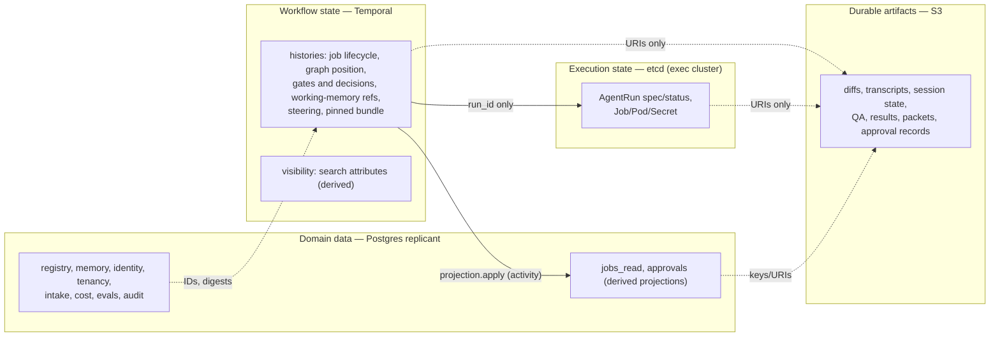
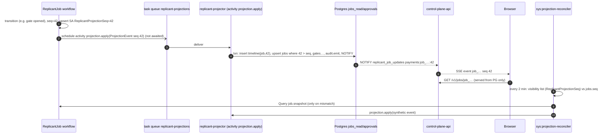

# State Ownership Matrix

**Contract ID:** `C-STATE` · **Version:** 2.0.0 · **Owner:** WS-00

**Changelog:** 2.0.0 (breaking). Product rename to Replicant (CCR-ORCH-02). Every product-named identifier changes; there is no structural change. Domain `factory.example.com` (labels, annotations, schema `$id` host) becomes `replicant.example.com`; env prefix `FACTORY_` becomes `REPLICANT_`; headers `X-Factory-*` become `X-Replicant-*`; names `factory-*`/`factory_*` (services, task queues, Temporal namespace, roles, buckets, groups, hosts, networks) become `replicant-*`/`replicant_*`; CamelCase `Factory*` (workflow types, search attributes) becomes `Replicant*`. Owners and buckets renamed to match (for example `replicant-worker`, `<org>-replicant-<env>-*`). 1.10.2 (wave 3). The legal-bucket writer set matches C-ART 1.10.2 (R1V-077). 1.10.1. Kill-switch mirror: the `ops` bucket, with a break-glass writer (CCR-09-12). 1.10.0 (wave 1, final). Audit-bearing projections and approval-record activities drain with no 10-minute cap (CCR-01-09); schedule IDs are `sch_<ulid>` (CCR-07-08). 1.9.1 (conflict resolution). Rows for the execution revocation feed (`ops` bucket) and litigation copies (legal bucket). 1.9.0 (wave 1). Per-run gateway policy row, owned by Temporal with a derived cache copy (CCR-03-05). replicant-worker session `inputs/` copies (CCR-10-08). Gateway state on ElastiCache (CCR-03-07). 1.8.0. Approval records are reference-only, with a new approval-free-text row (R2-004). The history export is split into a skeleton and a full export (R2-005). Kill switches get their own row with their derived delivery paths (R2-016). 1.7.0 (additive). CCR-01-05: projectors accept batched `ProjectionEvent.events` (§2.1). 1.6.0 (additive). New rows from CCR-08-04: workflow history export and Okta System Log export (both derived copies) and leak purge records; the audit export row now includes partition exports. 1.5.0 (additive). The registry version index joins the registry mirror (CCR-10-05). New rows: deletion ledger, and the audit event export as a derived copy (CCR-10-06). 1.4.0 (additive). Rows for the AgentRun record tombstone (CCR-02-04) and the inbox sequence counter (CCR-02-01); bundle pointers join the registry mirror (CCR-02-02). 1.3.0 (additive). Adds a row for QA test-result history (CCR-05-02). 1.2.0 (additive). Ownership is updated for the gateway shim's real-time budget state (CCR-03-03), registry heads (CCR-03-02), and prompt escrow (CCR-06-02). 1.1.0 (additive). Rows for run grants and the grant revocation list (CCR-09-02). The run-token row reflects per-audience tokens (CCR-09-01).

## Purpose

This contract assigns every piece of Replicant state exactly **one owning store** and states who
writes it, who reads it, its consistency model and retention, and how other stores refer to it. It
also defines the UI read-model projection pattern (Temporal → Postgres) and how that projection is
kept consistent. This enforces D-05's rule: workflow state in Temporal, cluster resource state in
etcd, artifacts in object storage, Replicant domain data in Postgres, and nothing crosses these lines.

## Decisions summary

| Decision | Reference |
|---|---|
| Four state planes plus external systems of record. Every row below has one owner. Copies elsewhere are labelled **derived**, are rebuildable, and are never written back | D-05, D-09 |
| The UI reads **one store**: the Replicant Postgres read model (`jobs_read`, `approvals`, `cost`, `registry`), maintained by a projection activity at every workflow transition and reconciled against Temporal visibility | [ADR-004](adr/004-ui-read-model-projection.md) |
| Derived copies carry the owner's version marker (`seq`, `digest`, `observed_generation`) so staleness is detectable | this doc |

## 1. Matrix

Abbreviations: **T** Temporal (namespace `replicant-<env>`); **E** etcd (exec cluster, via the
Kubernetes API); **S3** object storage (bucket class in brackets); **PG** Replicant Postgres (schema
in brackets); **ext** external system. "Refs" says how other stores point at the state.

### 1.1 Workflow and job state

| State | Owner | Writers | Readers | Consistency | Retention | Referenced elsewhere by |
|---|---|---|---|---|---|---|
| Job lifecycle (status, phase, terminal outcome) | T (history of `ReplicantJob`) | the workflow | projector (via projection events), control-plane-api (Query, Describe), reconciler | Linearizable per workflow | Closed-workflow retention in namespace (WS-01 sets ≥ 30 days); after that, the projection and audit carry the record | `job_id` (= workflow ID). Projected into PG[jobs_read] (derived) |
| Graph position, node states, LangGraph channel state | T (workflow state; replayed from history) | the workflow | Query `job.snapshot` | Linearizable | as above | none outside T, except the projected `current_node` |
| Job working memory: plan, decisions, constraints, files touched, counters (cycle, ordinals), applied Update IDs | T (small values in state); large bodies in S3[artifacts] by reference | the workflow; activities return refs | workflow, Query `job.working_memory_refs` | Linearizable | as above | S3 keys inside workflow state |
| Pinned Release Bundle of a running job (current) | T (workflow input and state; changes only through consented migration) | control-plane-api (start input), workflow (migration) | workflow, projector | Linearizable | as above | `release_bundle_id` in search attribute `ReplicantReleaseBundleId` (derived) and PG[jobs_read] (derived) |
| Initial bundle assignment decision for a job (which rule chose it) | PG[intake] (`job_requests.release_bundle_id`, `assignment_reason`) | control-plane-api | WS-06 analytics, audit | Strong (transaction with `job_id` creation) | 2 years | `job_id` |
| Gate state (open, expiry, reminders, eligible approvers, presented digest) | T | the workflow (timers, Update handler) | Query `job.open_gates`, projector | Linearizable; first-wins inside the handler lock | as above | `gate_id`. Projected into PG[approvals] (derived) |
| Gate decisions (authoritative) | T (accepted Update in history) | the workflow (handler of `gate.decide`) | projector, audit | Linearizable | as above | `decision_id`. Evidence copy: S3[audit] `approval_record` (an immutable derived record) and PG[audit] event (derived) |
| What the approver saw (packet) | S3[artifacts] `approval_packet` | replicant-worker (gate open) | UI, Slack, GitHub renderers | Immutable per revision (`If-None-Match`) | 2 years | `presented_digest` and `packet_uri` in gate state (T) |
| Steering messages (text and delivery outcome) | T (Update request in history) | control-plane-api → workflow | workflow, projector | Linearizable | as above | `message_id`. Inbox copy in S3[artifacts] `steering_message` is a **delivery mechanism** (derived) |
| Release and identity notices received by a job | T | control-plane-api (Signals) | workflow | Linearizable | as above | `notice_id` |
| PR events received | T (Signal), with bodies in S3[artifacts] `pr_event_payload` | github-integration | workflow (triage activity) | At-least-once delivery; deduped by `delivery_id` | as above / 90 days | `delivery_id` |
| Job ↔ PR link (repo, PR number, head SHA) | T (workflow state after publish) | workflow (publisher result) | github-integration (routing via projection) | Linearizable; projection eventual | as above | PG[jobs_read].`job_prs` (derived) |
| Temporal visibility (search attributes) | T visibility store (**derived** from workflow upserts) | Temporal server | reconciler, operators, release operations | Eventually consistent (seconds) | as namespace | — |
| Schedules for maintenance jobs | T (Temporal Schedules) | control-plane-api (CRUD through the Temporal API) | control-plane-api | Strong | until deleted | `sch_<ulid>` (C-IDS, CCR-07-08) in `JobRequest.source.schedule.schedule_id` |
| Worker deployment version routing (current, ramping, draining, drained) | T (Worker Deployment state) | control-plane-api (release operations), CI (registration on deploy) | control-plane-api, workers | Strong (`conflict_token`) | until deleted | `{deployment_name, build_id}` in PG[registry] (`NodeCatalog`, bundles) |

### 1.2 Execution state

| State | Owner | Writers | Readers | Consistency | Retention | Referenced elsewhere by |
|---|---|---|---|---|---|---|
| AgentRun desired spec | E (AgentRun `.spec`) | runner-api (create; `cancelRequested`) | controller, runner-api | Linearizable per object (resourceVersion) | 45 days after terminal | `run_id` in T state and PG[jobs_read] |
| AgentRun phase, conditions, timestamps, URIs | E (AgentRun `.status`) | agentrun-controller | runner-api (`GET /v1/runs`), run-notifier (via notifications) | Linearizable per object | 45 days after terminal | `run_id`. Projected into T (via `runner.get_run` results) and from there to PG[jobs_read].`job_runs` (derived) |
| Run idempotency (key → run) | E (AgentRun name uniqueness + annotations) | runner-api | runner-api | Linearizable (create conflict) | 45 days after terminal | idempotency key in T (activity ID) |
| Child objects (Job, Pod, Secret, ConfigMap, network policy) | E | agentrun-controller | kubelet, controller | Linearizable | Job/Pod 1 h after terminal; Secret deleted at terminal | owner references to the AgentRun |
| Workspace files (checkout, build outputs) | Node ephemeral disk (emptyDir or generic ephemeral volume) | sandbox | sandbox | Local | Deleted with the pod (scratch, D-07) | none. Anything worth keeping goes to S3 before exit |
| Run tokens (one per audience) and STS credentials (issued) | ext (JWTs signed by the exec-account KMS run-token key; AWS STS) | runner-api (sandbox listener), controller | sandbox, gateway, MCP services, repo-mirror | n/a | ≤ 60 min, never beyond the grant's `exp` | `jti`, `grant_jti` / AccessKeyId in audit logs |
| Run grant (core-signed capability for one run) | E (AgentRun `spec.runGrant`, immutable) | replicant-worker signs it (core KMS `run-grant` key); runner-api stores it after verification | runner-api (token minting), verifiers (embedded in tokens) | Immutable | AgentRun lifetime (45 days after terminal); expires at grant `exp` | `grant_jti` (`rgr_…`) in run tokens and verifier logs |
| Run-grant revocation list | **derived** from T via PG[jobs_read]: `job_id`s whose status became `cancelled`, `failed`, or `taken_over`, and `run_id`s of runs cancelled or terminal with `SecurityViolation`. Served by control-plane-api at `/grants/revoked` | control-plane-api | all verifiers (poll every 60 s); a grant is revoked when its `job_id` or `run_id` is listed | Eventually consistent (≤ projection lag + 60 s) | Until 24 h after the last possible grant `exp` for the entry | `job_id`, `run_id` (grant `jti`s are not in the read model) |
| Execution revocation feed (revoked `run_id`s) | S3[ops] `exec-revocations/<env>/` | runner-api (on controller `:revoke`) | token verifiers via `GET /v1/revocations` | Append-only objects; cursor-ordered | 90 days (lifecycle expiry) | `run_id` (CCR-02-09) |
| AgentRun record (final execution state after GC) | S3[artifacts] `agentrun_record/agentrun.json`, write-once copy of the terminal AgentRun (E is the owner until GC) | agentrun-controller | runner-api (`410 run_expired` tombstone), auditors | Written once at terminal; AgentRun GC waits for it | 2 years | `run_id` (CCR-02-04) |
| Steering inbox (per run), including its `_head.json` sequence counter (compare-and-swap) and `ack-*` delivery states | S3[artifacts] `inbox/` — messages **derived** from T; counter and acks owned here | runner-api | sandbox (via sandbox listener) | Write-once objects | as run prefix | `message_id` |

### 1.3 Durable artifacts

| State | Owner | Writers | Readers | Consistency | Retention | Referenced elsewhere by |
|---|---|---|---|---|---|---|
| Diff bundles | S3[artifacts] | sandbox (implementer/repair) | QA run (staged input), publisher, UI, eval | Strong read-after-write; write-once | 2 years | logical `{bucket_class,key}` and sha256 in the run manifest; URI in T state and PG[jobs_read].`job_artifacts` |
| Coding-session transcripts and CLI event streams | S3[transcripts] | sandbox shipper | UI, WS-04 extraction, WS-08 tooling | Strong; chunked write-once | 90 days | manifest. Langfuse holds **selected redacted events** as a derived copy |
| CLI session state captures | S3[session] | sandbox; replicant-worker **only** as a server-side `CopyObject` into a later run's `session` `inputs/` prefix (CCR-10-08) | later runs of the same job (staged), break-glass | Strong; write-once | Job end + 7 days (session-state sweep), backstop 37 days | `latest_session_state_uri` in T |
| Workspace archives (takeover) | S3[session] | takeover run | requester (presigned) | Strong | 30 days | `takeover_package` |
| Run inputs (task packet, briefing, memory injection, handoff copies) | S3[artifacts] `runs/<run_id>/inputs/` | replicant-worker (context assembler) | sandbox | Write-once | 90 days (memory injection 2 years) | `inputs.manifest_uri` in AgentRun spec |
| Run results and manifests | S3[artifacts] | sandbox uploader | workflow, controller, UI | Write-once; the manifest commits the run | 2 years | `status.artifactManifestUri`, `status.resultUri` (E); URIs in T |
| QA artifacts (reports, JUnit, logs, screenshots, traces, SBOM) | S3[artifacts] | QA sandbox | workflow, UI, approval packet, PR comment | Write-once | per type ([artifact-layout.md](artifact-layout.md) §4) | manifest |
| Plans, handoffs, review reports | S3[artifacts] | sandbox (planner, implementer, reviewer) | workflow, next runs, UI, takeover | Write-once | 2 years | T state refs |
| Briefings (generated per job) | S3[artifacts] | replicant-worker (context assembler) | sandbox, context MCP | Write-once | 90 days | T state ref |
| Approval records (reference-only: decision, decider, channel, time, packet digest, text digest) | S3[audit] (Object Lock) | replicant-worker (after a decision) | auditors | Write-once, locked | 2 years | `decision_id` in PG[audit] (R2-004) |
| Approval free text (comment, answer, title shown) | S3[artifacts] `approval_text` (tenant key, purgeable) | replicant-worker (after a decision) | UI, auditors (verified by `text_sha256` in the approval record) | Write-once | 2 years | `text_key` and `text_sha256` in the approval record (R2-004) |
| Registry blobs, bundle pointers (`bundles/<release_bundle_id>.json`, CCR-02-02), and the version index (`index/…`, CCR-10-05; the source for rebuilding version rows after a database restore) | S3[registry] — **derived** content-addressed mirror of PG[registry] | control-plane-api | runner-api, controller | Write-once; verified by digest | Permanent | `digest` |
| Memory exports and snapshot exports | S3[memory] | memory-service | admins (D-25), eval | Write-once | 1–2 years | export ID, `memory_snapshot_id` |
| Golden task repo snapshots | S3[eval] | eval-worker / WS-06 tooling | eval runs | Write-once | WS-06 | golden task ID in Langfuse dataset item metadata |

### 1.4 Domain data (Postgres `replicant`)

| State | Owner | Writers | Readers | Consistency | Retention | Referenced elsewhere by |
|---|---|---|---|---|---|---|
| JobRequest records, dedupe keys, `job_id` assignment | PG[intake] | control-plane-api | projector, github-integration | Strong, unique `(tenant_id, dedupe_key)` | 2 years (dedupe key index pruned 90 days after terminal) | `job_id` (T workflow ID) |
| Pending human actions (Update outbox) | PG[intake], PG[slack_app], PG[github_app] (each sender's own) | the sender | the sender's retry loop | Strong | Until a result arrives, then 30 days | Update ID |
| Tenants and tenant operational settings (quotas, channel targets) | PG[tenancy] | control-plane-api | all services | Strong; read at use (activities record what they read) | Forever (tombstoned) | `tenant_id` |
| Kill switches (scope global, tenant, repo, or bundle; switches intake, starts, runs, publishing) | PG[tenancy] (authoritative) | control-plane-api | intake, Publisher, `runner.start_run`, running workflows | Strong in PG. **Derived** copies: an out-of-band mirror (`ops` bucket `kill_switch_state`, 30 s cache; written by control-plane-api, or in break-glass by `replicant-<env>-killswitch-operator` with CAS, after which a drift alert fires until Postgres is reconciled, CCR-09-12) that intake, the Publisher, and `runner.start_run` read when Postgres is down; and Temporal Signal `ops.kill_switch`, delivered to running workflows through a visibility-query batch, independent of Postgres (R2-016) | Forever (history) | `notice_id` |
| Users, groups, memberships | PG[identity] (SCIM-provisioned replica; **Okta is upstream source**) | identity-service (SCIM endpoint) | identity-service, control-plane-api | Strong locally; ≤ SCIM push delay behind Okta | Deprovisioned users tombstoned for 7 years (audit) | `principal_id` |
| Identity links (Okta ↔ GitHub ↔ Slack ↔ Jira) | PG[identity] | identity-service (link flows, GHE SCIM) | all channel adapters | Strong | until unlinked, then tombstone | `principal_id` |
| Role bindings (group → permission per tenant), admin group name | PG[identity] | identity-service (admin API) | identity-service | Strong. Evaluated per request; no cached grants (D-25) | forever (versioned) | — |
| Repository permission of a principal | **ext (GitHub)**, never stored | — | identity-service (live GitHub collaborator-permission call using a read-only installation token from github-token-broker), cached in memory ≤ 60 s for display only, **never** for gate decisions or triggers | Live | n/a | — |
| Definitions (agent, environment, graph, policy, NodeCatalog) and registry heads (`registry.definition_heads`, CCR-03-02) | PG[registry] | control-plane-api (publish) | workers, control-plane-api; Go services via the S3 blob mirror | Immutable versions | Permanent | `ref@version#digest` in bundles, AgentRun spec, T state |
| Release Bundles | PG[registry] | control-plane-api | everything | Immutable | Permanent | `release_bundle_id` |
| Bundle promotion state | PG[registry] | control-plane-api (on WS-06 pipeline calls) | release UI, intake assignment | Strong | Permanent history | — |
| Bundle assignment rules (default, overrides, ramp) | PG[registry] | control-plane-api (release operations) | control-plane-api (intake) | Strong; read in the intake transaction | Versioned history | — |
| Prompt text and versions (escrow copy of each bundle-pinned version in S3[registry] is **derived**, read only on Langfuse 404, CCR-06-02) | **ext (Langfuse prompt management)** | prompt authors (Langfuse UI/API) | bundle build, context assembler | Versions treated as immutable; verified by digest | Langfuse retention (never delete versions referenced by a promoted bundle; WS-06) | `{name, version, digest}` in bundles |
| Memory entries, versions, provenance, lifecycle, conflicts, embeddings, usage telemetry | PG[memory] | memory-service | memory-service (MCP, admin API), replicant-worker via API | Strong | Per WS-04 lifecycle; hard deletes leave tombstones | `mem_…@v` in snapshots, run results, Langfuse metadata |
| Memory snapshots (which entries a job received) | PG[memory] (`snapshots`) | memory-service (at context assembly) | replicant-worker, UI (read-only view), eval | Immutable | 2 years | `memory_snapshot_id` in T and PG[jobs_read] (derived) |
| Ecosystem catalog, contracts index, dependency graph | PG[ecosystem] (**derived** from repos, CI, Backstage, tracing; the sources are upstream) | ecosystem-indexer | context MCP, replicant-worker | Eventually consistent (freshness per WS-04) | Latest plus history per WS-04 | — |
| Code search index | ext (Zoekt index files) — **derived** from GitHub | Zoekt indexer | context MCP | Eventual | Rebuildable | — |
| Cost ledger (usage events, rollups) | PG[cost] | usage-ingestor | control-plane-api, replicant-worker (budget checks), Grafana | Append-only events; rollups eventual (≤ 60 s) | 2 years | `job_id`, `run_id` |
| Real-time budget counters, rate-limit windows, revoked run and job sets (enforcement) | ElastiCache for Valkey `gateway-state` (core, `replicant-gateway`) | replicant-gateway-shim (CCR-03-03) | replicant-gateway-shim | Atomic per request (Lua admission and settlement) | Ephemeral; rebuilt from PG[cost] after loss (WS-03 gateway.md) | run token `budget_usd`, job and tenant budgets; settled usage flows to PG[cost] via usage-ingestor (`gwu_…`) |
| Per-run gateway policy (models, `budget_usd`, `max_concurrency`, `expires_at`) | T (the run plan in workflow state) | replicant-worker (`agents.stage_inputs`) | replicant-gateway-shim through the **derived** copy in ElastiCache `gateway-state` (`fgw:run:<run_id>:policy`) | Idempotent PUT; rebuilt by re-registration from the workflow's run-wait loop after cache loss | Run lifetime | `run_id` (CCR-03-05) |
| Eval results (runs, cases, scores, comparisons) | PG[evals] | eval-worker | control-plane-api, WS-06 promotion | Strong | Permanent for promoted bundles, 1 year otherwise | `release_bundle_id`. Langfuse scores are a **derived** export for trace-level drill-down |
| Golden task definitions (dataset items) | ext (Langfuse datasets) | WS-06 tooling | eval-worker | Langfuse-defined | WS-06 | `gtask_…` |
| Deletion ledger | S3[audit] `org/deletion-ledger/` (write-once, Object Lock) | each service that deletes data, append-only and one object per `del_…` (the same append-only exception as `audit.emit`) | restore runbooks (replayed after a restore so deleted data is not resurrected), auditors | Write-once | 7 years | `del_…` (CCR-10-06) |
| Audit event export and monthly partition export | S3[audit] `org/audit-exports/` — **derived** copy of PG[audit] | WS-08 audit exporter (about 1-minute event cadence, plus a monthly partition snapshot, CCR-08-04) | auditors, restore reconciliation | Write-once | 7 years | `aud_…` ranges (CCR-10-06) |
| Workflow history skeleton (payload-free, payload sha256 per event) | S3[audit] `…/history/*.skeleton.json.zst` — **derived** from T history | WS-08 exporter, after each workflow run closes | auditors (beyond Temporal's 30-day closed retention) | Write-once, locked, never purged | 2 years, or 7 by tenant policy | Temporal run ID (R2-005) |
| Workflow history export (full, codec-encrypted) | S3[artifacts] `…/history/*.json.zst` — **derived** from T history | WS-08 exporter | replay testing, forensics (checked against skeleton digests) | Write-once; purgeable (C-ART rule 4a); shredded at offboarding | 2 years | Temporal run ID (CCR-08-04, R2-005) |
| Okta System Log export | S3[audit] `org/okta-system-log/` — **derived** copy of ext Okta | Firehose stream | auditors (beyond Okta's 90-day retention) | Append-only objects | 7 years | Okta event IDs (CCR-08-04) |
| Litigation copies under legal hold | S3[legal] `<org>-replicant-<env>-legal` (governance Object Lock) — copies of purgeable content | `replicant-<env>-legal-hold` (writes copies; places and removes holds); `replicant-leak-purge` (superseding Put and DeleteObjectVersion **only for objects with no active legal hold**, C-ART 1.10.2, CCR-ORCH-01) | legal team | Write-once; held until the hold is released | Until release, then normal purge or expiry | source keys of the named jobs (CCR-10-10) |
| Leak purge records | S3[audit] `tenants/<t>/jobs/<j>/purges/<leak_id>.json` (write-once) | `LeakPurge` workflow (role `replicant-leak-purge`) | readers resolving supersession (C-ART rule 4a), auditors | Write-once | 7 years | `leak_…` (CCR-08-04) |
| Audit events | PG[audit] (via `audit.emit()`) | all writer services | auditors (control-plane-api views), Grafana aggregates | Append-only; atomic with the audited change | 7 years (partitioned) | `aud_…`; Okta System Log is a separate external record |
| UI read model: jobs, timeline, runs, artifacts index, memory usage per job, batches | PG[jobs_read] — **derived** from T | replicant-projector | control-plane-api, adapters, Grafana | Eventually consistent, typically < 2 s, ordered by `seq` | 2 years | — |
| QA test-result history (per-test outcomes, daily and 30-day stats for flake classification) | PG[qa] — **derived** from S3[artifacts] `qa_report` | replicant-projector (activity `qa.index_results`) | replicant-worker (classification), control-plane-api, Grafana (aggregate view only) | Eventually consistent (indexed after each QA run); idempotent per run via `qa.indexed_runs` | 120 days (monthly partitions) | `run_id`, `job_id`; rebuildable by re-indexing `qa_report` artifacts within retention |
| Approvals projection (inbox) | PG[approvals] — **derived** from T | replicant-projector | control-plane-api, slack-integration | Eventually consistent | 2 years | — |
| Slack message refs per gate, Slack interaction dedupe | PG[slack_app] | slack-integration | slack-integration | Strong | 90 days after the gate closes | `gate_id` |
| GitHub webhook delivery dedupe, installations, comment refs | PG[github_app] | github-integration | github-integration, control-plane-api | Strong | Dedupe 30 days; installations permanent | `X-GitHub-Delivery` |
| Jira links and dedupe | PG[jira_app] | jira-integration | jira-integration | Strong | 90 days after terminal | — |
| Notification preferences and delivery log | PG[notify] | control-plane-api | replicant-worker notify activities (via API), adapters | Strong | prefs forever; log 90 days | — |
| Schema revision | PG[ops] | `migrate` Job | all services, Grafana | Strong | Permanent | — |

### 1.5 External and observability state

| State | Owner | Writers | Readers | Consistency | Retention | Referenced elsewhere by |
|---|---|---|---|---|---|---|
| Repository content, branches, commits, PRs, reviews, comments | ext (GitHub) | publisher-worker (push, PR), github-integration (comments), humans | everything via APIs | GitHub-defined | GitHub | repo ID, PR number in T |
| Okta users and groups (source of truth) | ext (Okta) | Okta admins | identity-service (SCIM push) | Push | Okta | Okta `sub` in PG[identity] |
| LLM traces, generations, scores, sessions | ext-self-hosted (Langfuse: ClickHouse plus its Postgres plus blob storage) | OTel ingestion from workers, sandboxes, gateway (redacted) | humans, WS-06 | Eventual | WS-08 (transcript-equivalent, 90 days) | Trace ID = job trace ID |
| Logs | Loki | Alloy | Grafana | Eventual | WS-08 | `job_id` structured metadata |
| Distributed traces | Tempo | OTel collectors | Grafana | Eventual | WS-08 | trace ID |
| Metrics | Prometheus/Mimir | scrapers | Grafana, alerting | Eventual | WS-08 | — |
| Secrets (GitHub App keys, webhook secrets, DB creds) | ext (AWS Secrets Manager or Vault, WS-09) | operators/automation | services via External Secrets | — | rotation per WS-09 | secret names in definitions |
| Encryption keys | ext (AWS KMS) | platform | S3, Temporal codec, run-token signer | — | — | key ARNs |
| Container images (CLI, base, Replicant services) | ext (ECR) | CI | kubelet | Immutable by digest | WS-03 | digests in bundles |
| Package mirror caches | ext (Artifactory/Nexus) | proxy | sandboxes | Cache | — | — |
| Git mirror cache | repo-mirror local volumes — **derived** from GitHub | repo-mirror | sandboxes (fetch) | Eventual; verified by commit SHA | Rebuildable | `base_sha` |

## 2. UI read-model projection (must-answer: a consistent job view without querying four stores)

**The UI reads one store.** Every job page, list, and inbox query is served from Postgres
`jobs_read`, `approvals`, `cost`, and `registry`, joined within one database. Temporal, etcd, and S3
are never queried on page load. Exceptions:
1. Artifact **bodies** (diffs, screenshots) are fetched by the browser through presigned S3 URLs,
   on demand.
2. "Live tail" of a running transcript streams from Loki on demand.
3. Explicit operator actions ("refresh from Temporal") issue a Query.

### 2.1 Mechanism

1. **Projection at every transition.** Workflow code calls `emit(event)` at every status, phase,
   node, gate, run, steering, PR, or notice change. `emit` increments `projection_seq` (workflow
   state, carried across Continue-As-New), builds `ProjectionEvent{seq, event, snapshot}`
   ([schemas/workflow-messages.schema.json](schemas/workflow-messages.schema.json)), upserts search
   attribute `ReplicantProjectionSeq=seq`, and starts activity `projection.apply` on task queue
   `replicant-projections` **without awaiting it**: schedule-to-close 24 h, retry initial 1 s,
   backoff 2.0, max interval 60 s, unlimited attempts within schedule-to-close. Before Continue-As-New
   or completion, the workflow drains outstanding activities in two classes (CCR-01-09):
   - **Audit-bearing**, with **no cap**: projection events the projector audits (`gate.*`,
     `bundle.*`, `job.terminal`), the approval-record activity, and the gate-resolution
     activities. The run does not continue-as-new or close until these are applied, because the
     reconciler restores snapshots, not audit rows (R2-013).
   - **Snapshot-only**, with a **10-minute cap**. After the cap, the reconciler covers the gap.
2. **Idempotent, order-insensitive apply.** Projectors accept both forms of `ProjectionEvent`:
   the single `event`, and the optional batched `events` (1..20 timeline events from one workflow
   task, each with its own `seq`, sharing one snapshot at the latest `seq`; CCR-01-05). In one
   transaction, the projector:
   - inserts the `job_timeline` row with `(job_id, seq)` as primary key, `ON CONFLICT DO NOTHING`;
   - upserts `jobs` columns from the snapshot `WHERE excluded.seq > jobs.seq`;
   - upserts `job_runs`, `approvals.gates`, and related rows with the same seq guard;
   - emits `audit.emit()` for gate and decision events;
   - runs `NOTIFY replicant_job_updates, '<tenant_id>:<job_id>:<seq>'`.

   Out-of-order or duplicate deliveries are harmless because every snapshot is complete.
3. **Live push.** control-plane-api `LISTEN`s on `replicant_job_updates` and fans out to
   subscribed browsers over SSE or WebSocket (WS-07 decides). Clients re-fetch the job row when the
   pushed `seq` is greater than the one they hold.
4. **Reconciliation.** System workflow `sys:projection-reconciler` (a Temporal Schedule, every 2 min)
   runs a visibility query for workflows with
   `ExecutionStatus='Running' OR CloseTime > now-1h`. Its activity compares `ReplicantProjectionSeq`
   with `jobs_read.jobs.seq`. On mismatch it Queries `job.snapshot` and applies it as a synthetic
   projection event; for a closed workflow, it uses `DescribeWorkflowExecution` and history. Metric:
   `replicant_projection_lag_seq` (histogram). Alert when lag persists beyond 5 min.
5. **Read-your-own-action.** Human actions return the Update result synchronously, and the UI shows
   it immediately. The projection catches up within about 1–2 s.
6. **Rebuild.** `replicant admin projections rebuild` (see [postgres-ownership.md](postgres-ownership.md) rule 5).

Failure modes:

| Failure | Effect | Handling |
|---|---|---|
| Replicant Postgres down | Projections queue up as retrying activities; the UI is stale or down | Workflows keep running (projection is not awaited). On recovery, activities drain in any order (the seq guard). Alert `ReplicantProjectionBacklog` |
| Projector deployment down | Activities wait in the task queue | Same as above. The schedule-to-close of 24 h bounds them. Beyond that, the reconciler repairs |
| Projection activity times out after 24 h | That event's timeline row is missing | The reconciler re-applies the latest snapshot, which restores current state. Timeline gaps are filled from history by `rebuild --job` (operator) |
| Workflow pinned to an old worker version with an older snapshot schema | The projector must accept every `replicant.job-snapshot/v*` emitted by any live version | Projector compatibility window ≥ 37 days (CC-4) |
| Postgres restored to 15 minutes ago (WS-10 must-answer) | Projections older than the restore point are lost | The reconciler detects `ReplicantProjectionSeq > jobs.seq` for all open jobs and repairs within minutes. Closed jobs are repaired by `rebuild --since <restore point>` |

## 3. Cross-plane references (rules)

1. Temporal holds S3 **URIs** and `run_id`s, never bodies larger than 16 KiB. Total workflow state
   (Continue-As-New payload) is ≤ 256 KiB, against the 2 MB payload error limit [verified:
   https://docs.temporal.io/cloud/limits, 2026-10-24].
2. etcd holds S3 URIs in status only (D-05), and never Postgres IDs other than `tenant_id`,
   `job_id`, `release_bundle_id`, and definition digests, which are opaque strings.
3. Postgres holds logical artifact references (`bucket_class`, `key`, `sha256`), never bodies, and
   never workflow state except derived projections marked as such.
4. S3 objects never contain credentials. They may contain IDs.
5. Derived copies (search attributes, projections, S3 registry mirror, steering inbox, Langfuse
   scores, approval records) are never read as authority for a decision. Exception: the approval
   record is the audit evidence of a decision. It is not the decision itself.

## Open questions

| Question | Who decides | Options | Recommendation |
|---|---|---|---|
| Temporal closed-workflow retention | WS-01 / WS-10 | 7 / 30 / 90 days, plus archival | 30 days, plus Temporal archival to S3 if self-hosted archival meets audit needs. The projection and audit are the long-term record |
| SSE or WebSocket for live push | WS-07 | — | SSE (one-way, proxy-friendly) |

## Risks

- Projection load: about 40 events per job × 1,000 jobs/day = 40,000 small transactions per day,
  which is trivial. Each also adds 3 history events plus one search attribute upsert per
  transition. WS-01 must budget about 160 history events per 40 transitions.
- Treating a derived copy as authority is the main correctness risk. R1 should check every
  workstream's reads against rule 5.

## Interfaces

- **Provided:** `C-STATE`. Consumed by every workstream, especially WS-01 (projection emit), WS-07
  (read models), WS-10 (recovery).
- **Consumed:** `C-MSG`, `C-PG`, `C-ART`, `C-CRD`.
