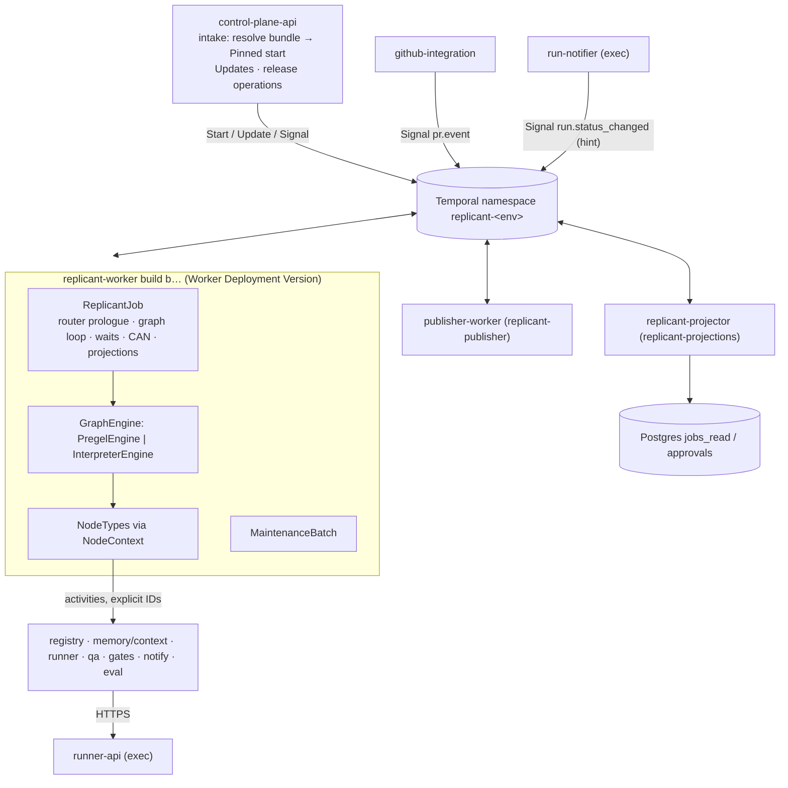

# 01 — Orchestration, Graphs, and Workflow Versioning (WS-01)

## Purpose

How Temporal and LangGraph together execute every workflow type; how workflows extend without
control-plane changes; and how workflow code and configuration are versioned so that jobs lasting up to
30 days always replay correctly while new versions roll out safely. Every design here is backed by a
reference implementation ([reference/](reference/)) that runs on a real Temporal server. All 44 end-to-end
scenarios pass on both graph engines, the 43 compared job traces have identical side-effect sequences, and
every run of every job replays cleanly. The Phase 3 fix round added 25 of those scenarios (15 in wave 1, 9 in wave 2, 1 in wave 3) ([graphs/README.md §9](graphs/README.md#9-test-evidence)).

## Decisions summary

| # | Decision | Constraints | ADR |
|---|---|---|---|
| 1 | **Challenge: D-01.** LangGraph `StateGraph`s run inside the workflow (compiled per job from the bundle); all node I/O runs as explicit-ID activities; the `temporalio-langgraph` plugin (Public Preview) is not a runtime dependency because it registers graphs at worker construction and fixes activity options per node | D-01, D-02, D-04, ADR-008 | [ADR-01-001](adr/001-challenge-d01-langgraph-runs-in-workflow-not-plugin-activity-nodes.md) |
| 2 | Adapter `GraphEngine` + `NodeContext` + node registry; engines `PregelEngine` (LangGraph) and `InterpreterEngine` (fallback, no LangGraph), fixed per build | D-01 | ADR-01-001 |
| 3 | Graph shapes are configuration: GraphDefinition YAML + FGL guards + codebase-binding modifiers, composed per job by activity, compiled in workflow; invariants I-1..I-7 protect core roles | D-02, D-03 | [ADR-01-008](adr/008-graph-definitions-are-configuration-compiled-per-job.md) |
| 4 | Every job is PINNED at start to its bundle's build; ramps are bundle assignments; a pinned start may target any registered version (V06-14 verified) | D-02, D-03 | ADR-006, [versioning.md](versioning.md) |
| 5 | Consented migration through a frozen handoff run plus a pinned override (GA APIs only) | D-02, CC-3 | [ADR-01-002](adr/002-consented-migration-via-handoff-run.md) |
| 6 | `workflow.patched()` only in replay-gated emergency patch builds | D-02 | [ADR-01-003](adr/003-patching-only-for-emergency-patch-builds.md) |
| 7 | Continue-As-New at phase and repair-cycle boundaries and at history safe points; resume at a node with memoized re-entry | D-02 | [ADR-01-004](adr/004-continue-as-new-boundaries-and-resume-at-node.md) |
| 8 | One namespace per environment | D-22 | [ADR-01-005](adr/005-one-namespace-per-environment.md) |
| 9 | Fairness keys = tenant; Runner quota is the hard limit; intake admission for open jobs | scale table | [ADR-01-006](adr/006-tenant-fairness-and-concurrency-controls.md) |
| 10 | Maintenance fan-out as ABANDON child jobs with progress Signals and a sliding window | D-01 | [ADR-01-007](adr/007-maintenance-fan-out-as-abandoned-child-jobs.md) |
| 11 | Gate presence and timing from one WS-07 activity; one transition function for human and evaluation decisions | D-19 | [ADR-01-009](adr/009-gate-routing-delegated-to-ws07-and-one-decision-transition.md) |
| 12 | Tenant-keyed payload encryption routed by the SDK serialization context | D-21 | [ADR-01-010](adr/010-tenant-routed-payload-codec-via-serialization-context.md) |
| 13 | **Pause, don't fail** (fix round, R2-010): every activity call goes through one wrapper. A non-retryable failure ends the job with an outcome, compensation and a terminal projection. Exhausted retries hold the job (`paused`) and re-probe it with jittered backoff, then give up after 72 h. The Temporal execution never fails | D-02, C-STATE §2.1 | [graphs/README.md §2.2](graphs/README.md) |
| 14 | Circuit breaker for platform dependencies (R2-012): gateway, repo-mirror and node-pool outages hold the node on the dependency's breaker, never re-provision during the outage, restart with per-job jitter, and do not consume run retries. Operator kill switches (`ops.kill_switch`: starts, runs, publishing; C-MSG 2.0.0) hold the same way | D-04 | [graphs/README.md §2.1](graphs/README.md) |
| 15 | Handlers never fail after validation (R2-011): identity outages give `denied`/`identity_unverifiable`; approval records and audited projections are awaited before Continue-As-New or close (R2-013); expiry tolerates outage-delayed decisions through `decided_at` and a grace window (R2-014); held gates do not expire (R2-023) | D-18, D-19 | [gates.md](gates.md) |
| 16 | Forced moves without consent are narrow and verified by activity: `bundle_patched` (patch lineage) and `model_retiring` (model-successor lineage). Required moves (revoked bundle, worker or model retirement) have enforced deadlines. Every job has a hard lifetime of `job_max_age_days` = 60 (R2-044, R1-004, R1-005) | D-03, CC-3 | [versioning.md §6](versioning.md) |
| 17 | RunSpec decision fields are built in workflow code from recorded activity results; `runner.start_run` adds only `run_grant` and `trace_context` (C-RUNNER 3.0.0, R1-014) | D-04 | [graphs/README.md §2.4](graphs/README.md) |
| 18 | Every wait is explained in `JobSnapshot.waiting`: capacity (tenant quota, unscheduled > 60 s), dependency outage, operator hold, revoked bundle. `ops.retry_node` replaces Temporal reset for stuck runs (wave 2: CCR-07-10, CCR-01-06, CCR-07-12) | R2-020, R2-048 | [graphs/README.md §2.5](graphs/README.md) |
| 19 | Gates record every decision attempt (`decision_log`), block approvals on rolled-back or revoked bundles (V12), re-run QA on request (`rerun_qa`), and re-open on a contested approver identity before anything is published (wave 2: CCR-07-07, CCR-06-13, CCR-05-04, CCR-07-06) | D-18, D-19 | [gates.md](gates.md) |

## Files

| File | Contents |
|---|---|
| [temporal-langgraph.md](temporal-langgraph.md) | Integration state (verified), adapter layer, engines, determinism rules, graph state and size budget, checkpointer |
| [graphs/README.md](graphs/README.md) | Shared building blocks: Runner-call sequence, retry and timeout table, QA routing, CAN points, terminal outcomes, compensation, UX, test evidence |
| [graphs/bugfix.md](graphs/bugfix.md), [feature-and-api-change.md](graphs/feature-and-api-change.md), [pr-repair.md](graphs/pr-repair.md), [hotfix-and-docs.md](graphs/hotfix-and-docs.md), [maintenance-fanout.md](graphs/maintenance-fanout.md) | The shapes: graph, LangGraph code, sequence diagram, failure modes |
| [graphs/definitions/](graphs/definitions/) | GraphDefinition YAML for all 8 workflow types (bundle schema requires all) |
| [graphs/generated/](graphs/generated/) | Generated LangGraph `StateGraph` modules (topology-identical to the engine) and LangGraph-drawn Mermaid |
| [extensibility.md](extensibility.md) | Node registry, GraphDefinition, FGL, modifiers, invariants, worked example (license scan, both paths) |
| [versioning.md](versioning.md) | Worker Versioning (verified API), pinning, CAN, release operations, long waits, migration protocol, patching, replay testing |
| [history-budget.md](history-budget.md) | Must-answer: history of a 30-day job with 5 repair cycles (measured + model) |
| [router.md](router.md) | Rules, LLM intent parsing, thresholds, clarification, RouterDecision |
| [gates.md](gates.md) | Gate mechanics, validators, authorization, first-wins, timers, rebase-and-reverify, evaluation mode |
| [temporal-platform.md](temporal-platform.md) | Namespaces, task queues, worker topology and scaling, limits, codec, visibility, G-23, self-hosted vs Cloud |
| [schemas/](schemas/) | Kind schemas (GraphDefinition, NodeCatalog, router_rules, repair_limits, runner_polling), RouterDecision, GateRouting |
| [policies/](policies/) | WS-01-owned policies (router rules, repair limits, runner polling) and `gate-routing.fixture.yaml`, a non-envelope test fixture standing in for WS-07's `gate_rules` evaluation (R1-026) |
| [platform/temporal-dynamicconfig.yaml](platform/temporal-dynamicconfig.yaml) | Temporal server dynamic config |
| [adr/](adr/) | ADR-01-001 … ADR-01-010 |
| [reference/](reference/) | Python reference implementation, tests, tools (lint, codegen, history model) — see [reference/README.md](reference/README.md) |

## Must-answers

**What happens if the LangGraph integration is abandoned upstream?** Nothing at runtime. Replicant does
not import `temporalio.langgraph`; it uses LangGraph's public API inside workflows behind `GraphEngine`. If
LangGraph itself became unusable, a build with `REPLICANT_GRAPH_ENGINE=interpreter` runs the same graph
definitions and node code. Both engines pass all 44 scenarios, and the 43 compared job traces have identical side-effect activity sequences.
Running jobs keep their pinned build ([temporal-langgraph.md §3.4](temporal-langgraph.md#34-must-answer-what-happens-if-the-langgraph-integration-is-abandoned-upstream)).

**How does a running job pick up a fix to a bug in node code it has not reached yet?** Through consented
migration at its next safe point. Long-lived jobs are almost always at a gate or in PR review, so that is
immediate. The release UI offers it, the requester approves a `bundle_migration` gate, and the
Migration Handoff Protocol moves the job to the fixed build. The job re-enters the node it was waiting in;
the fixed node runs when reached. If the handoff cannot complete within 30 minutes, the job re-pins to its
source build, alerts operators and continues there (R2-015). If the old bundle is **revoked**, the job holds
with status `waiting_human` at its next safe point. The required offer is accepted there, and the job ends
`bundle_revoked_not_migrated` if the requester declines or the deadline passes (R1-004). Urgent fixes use a
replay-gated emergency patch build. Operators move executions one at a time, and the job verifies the
patch lineage by activity and records the patch bundle without consent (R1-005, R1-012). All of these paths
are implemented and tested (scenarios `migration`, `revoked_migrate`, `revoked_deadline`, `bundle_patched`;
[versioning.md §6–7](versioning.md#7-patching-policy), [ADR-01-003](adr/003-patching-only-for-emergency-patch-builds.md)).

**How is a graph change tested before any production job uses it?** Registry publish dry-run (schema,
FGL, invariants against every compatible NodeCatalog) → graph simulation on the target build with stub
activities and path coverage, replay, and projection validation → WS-06 evaluation on the eval tenant
(evaluation mode) → canary ramp through bundle assignment. Running jobs are unaffected throughout
([versioning.md §8](versioning.md#8-replay-testing)).

**What is the maximum history a 30-day job with 5 repair cycles produces, and how is it bounded?**
The bound is per run: **no Temporal run exceeds about 4,100 events or 4 MB**. Continue-As-New fires at
the next history safe point after the server's suggestion (4,096 events / 4 MB), and safe points include
every node boundary, every gate and PR wait iteration, and every Runner-run poll outside parallel
branches. A single very long run (the worst case about 4,150 events in one node) is therefore split
across runs too. The job's total is bounded by its loops (5 repair cycles, QA fix iterations, `maxVisits`),
time-bounded waits, and the hard lifetime of 60 days. The **typical** heavy case, a high-risk job with
5 repair cycles, is about 5,500 events in 12 runs (4,845 measured on server 1.32.0 with wave-2 code plus modeled
multi-day waits and hints), about 3.4 MB in total, with the largest measured run 1,121 events. The
carry is capped at 256 KiB (measured ≤ 27 KiB) ([history-budget.md](history-budget.md)).

## How cross-workstream requests are addressed

| Request | Where addressed |
|---|---|
| XD-00-01 explicit activity IDs, counters, CI lint | `NodeContext.lid/act`; `tools/lint_activity_ids.py` (L1–L4, 0 findings); no duplicate logical IDs across runs (every scenario) |
| XD-00-02 projections at every transition | `emit()` (non-awaited `projection.apply`, `ReplicantProjectionSeq` coalesced upsert); every ProjectionEvent validated against C-MSG in tests |
| XD-00-03 C-MSG handlers and V1–V10 | `workflow.py`; tests exercise V2, V3, V4, V6, V7, V9, races |
| XD-00-04 / V06-14 pinned start, drain, migration | verified: `versioning_override` keyword; pinned start to a non-current, non-ramping version accepted; unregistered rejected; migration protocol (versioning.md §3.2, §6) |
| G-03 / XD-07-02 approved diff digest to the Publisher | `Publisher` node sends `approved_diff_sha256` + `approval_decision_id` (graphs/README.md §5) |
| G-07 budget self-approval cap | `budget_extension` gate facts carry `amount_usd`; `GateRouting.eligible.requester_may_decide` false above `requesterSelfApproveMaxUsd` (default 0); tested |
| G-23 worker-side Start/Signal calls | [temporal-platform.md §9](temporal-platform.md#9-worker-side-temporal-calls-g-23): none, beyond child-workflow and external Signal/cancel commands |
| G-24 / XD-09-08 worker-side LLM calls | `router.parse_intent`, `feedback.triage`, `risk.llm_review`: tool-less, closed-schema, selection-only (router.md §3, pr-repair.md). **`memory.extract_candidates` is excluded** (R1-024): it is tool-less but generative (it writes candidate text), so WS-04's controls apply (XD-04-14: untrusted-input framing, candidates only, admin-only promotion under D-25, probation per R2-008). WS-09 records the exception in T-PI-12 |
| CCR-09-02 / XD-02-14 / XD-06-13 run grants | `runner.start_run` signs per attempt (graphs/README.md §2); `run_grant_invalid` non-retryable after the activity's internal re-sign; the same Runner-client library serves eval-worker |
| CCR-09-04 `SecurityViolation`, cancel reason `security` | never retried, outcome `security_violation`; tested |
| CCR-03-01 `EnvironmentSetupFailed` | retryable generally; QA routes it through WS-05 (`retry_qa` → `operator_and_gate`); tested |
| XD-03-12 WS-03 activities | `agents.build_run_plan`, `budget.allocate_run`, `agents.stage_inputs` (`.stage_agent`), `budget.apply_extension`, `cost.record_run` placed in `run_agent` |
| XD-04-01 / XD-04-18 WS-04 activities | `memory.create_snapshot` (create / revocation_filter / eval_pinned), `context.build_briefing`, `context.stage_inputs`, `memory.feedback_signals`, `memory.extract_candidates`, `memory.write_candidates`, `memory.record_outcome` + `memory.write_episode` at terminal; WorkingMemory carried |
| XD-05-03 / OQ-05-01 QA decisions | `qa_run` exports `decision`, `risk_floor`; edges per WS-05; `repair_limits.qa.on_fail_after_fixes` (default `fail_job`); tested |
| XD-06-01 `effectClass` | NodeCatalog kind schema and every node type |
| XD-06-02 evaluation mode | scripted gates via `_apply_decision`, `gate.auto_resolved`, scripted review rounds, notification and memory suppression, publish skip; tested |
| XD-06-03 migration for prompt-only and worker changes | handoff protocol works for both (same build or new build); `session_incompatible_with` handled by WS-04 handoff |
| XD-07-01 / XD-07-03 gate routing, identity activities | `gates.resolve_routing` → GateRouting v1 schema; `identity.check_*` thin activities |
| XD-09-06 per-tenant codec | `TenantContextCodec` (ADR-01-010); tested end to end |
| XD-11-01 / XD-11-13 worker CLI and env | `replicant-worker run | nodecatalog export | healthcheck`, `REPLICANT_*` env, set-current-on-start (local only) |
| C-MSG 1.1.0 `gitea` identity kind | treated like `github`; tested (Gitea identity in a gate race) |
| C-MSG 2.0.0 `ops.kill_switch`, `ops.read_kill_switches` | Signal handler (latest `issued_at` per scope wins); mirror read at start; `starts`/`runs`/`publishing` holds; tested (`kill_switch`) |
| C-MSG 2.0.0 `model_retiring`, `leak_purge` | forced successor migration (tested); `leak_purge` gates open on WS-08's `LeakPurge`, never on ReplicantJob, so `DECISIONS_BY_KIND` is unchanged |
| C-RUNNER 3.0.0 decision fields | RunSpec built in workflow code; validated against the C-RUNNER schema in every scenario (graphs/README.md §2.4) |
| C-ART 2.0.0 approval text, history export split | `gates.write_approval_record` input carries the text for `approval_text`; history export by WS-08's `audit-exporter` Deployment (temporal-platform.md §9, XD-FIX-R2-005; R1V-089) |
| XD-08-01 OpenTelemetry plugin, `_replicant-ctx`, headers outside the codec | `worker.connect()` (temporal-platform.md §7, R1-016) |
| Wave 2 co-owner entries | `ops.retry_node`; `gate.decision_superseded` and `decision_log`; contested decisions (CCR-07-06); `release_block`, V12 and `consent: operator` (CCR-06-13); `rerun_qa`; `waiting` (capacity per XD-W2-02-04); takeover branch and critical gate (XD-FIX-R2-001); plan reuse (R2-050); harness jobs (R1-134); compute dollars (R2-064); QA seams (R1-116/118/122/131, XD-05-18, XD-W2-05-05 operator alert); memory and steering shapes (R1-100/101); run-policy rebuild (R1-286); WS-03 IDs (R1-071); codec vectors (R1-044); metrics (R1-195); dynamic config (R1-242); cassettes (R1-264, XD-W2-06-02); approval-record key (XD-W2-08-03); worked-example binding envelope (R1-003); `replicant_testing.activities.FakeActivities` (R1-267). Details: graphs/README.md §2.3–§2.5, gates.md §4 and §8, versioning.md §5, temporal-platform.md §11 |

## Open questions (top; full list in each file and in `spec/_coordination/open-questions.md`)

IDs match `spec/_coordination/open-questions.md` (R1-025).

| ID | Question | Who decides | Recommendation |
|---|---|---|---|
| OQ-01-01 | Accept Challenge: D-01 | Orchestrator | **Resolved: accepted** (FROZEN.md) |
| OQ-01-02 | Closed-workflow retention in the Temporal namespace | WS-10 | 30 days |
| OQ-01-03 | Auto-consent for migrations between bundles that differ only in tightening configuration | Product / WS-06 | Keep consent (CC-3) |
| OQ-01-04 | QA failing after fix iterations: draft-PR gate or fail (OQ-05-01) | Product | Both implemented; default `fail_job` |
| OQ-01-05 | Hotfix repair pushes: publish approval every cycle? | WS-07, Product | Always |
| OQ-01-06 | Hard job lifetime `job_max_age_days` (R2-044) | Product, WS-06 (escrow) | 60 days, **accepted by the orchestrator pending user confirmation**; escrow and image retention 67 days |
| OQ-01-07 | How long a job may hold on a dependency outage before failing (R2-010) | Product, WS-10 | 72 h (`repair_limits.dependency_block.max_hours`); WS-10's runbooks rely on at least 6 h (R1V-091) |

## Risks

- `temporalio-langgraph` and upgrade-on-CAN are preview; neither is load-bearing here. LangGraph's
  in-workflow determinism is empirical: exact pins plus conformance and replay suites, plus the
  interpreter fallback.
- Worker Deployment RPCs are labelled Experimental in API protos; release operations are isolated in
  control-plane-api and covered by contract tests.
- Projection traffic is about 36 % of activities and a large share of history bytes (history-budget.md).
  CCR-01-05 (accepted, C-MSG 1.4.0) allows batched events; the reference still sends one event per
  projection.
- Dependency holds can mask a slow-burning outage for up to 72 h per job. Mitigation: the
  `job.blocked_on_dependency` timeline event feeds WS-08's alert on held-job counts.

## Interfaces

- **Provided:** ReplicantJob and MaintenanceBatch semantics; GraphDefinition, NodeCatalog, router_rules,
  repair_limits, runner_polling kind schemas; RouterDecision and GateRouting schemas; activity catalog
  (`activity_options.py`); release-operation semantics; Migration Handoff Protocol v1; history budget.
- **Consumed (final versions per FROZEN.md):** C-ARCH 2.0.0, C-STATE 2.0.0, C-IDS 2.0.0, C-RUNNER 3.0.0,
  C-CRD 3.0.0, C-MSG 2.0.0, C-JOBREQ 2.0.0, C-DEF 3.0.0, C-ART 2.0.0, C-PG 2.0.0; WS-03, WS-04, WS-05, WS-06, WS-07, WS-08, WS-09, WS-10, WS-11 interfaces listed above.
