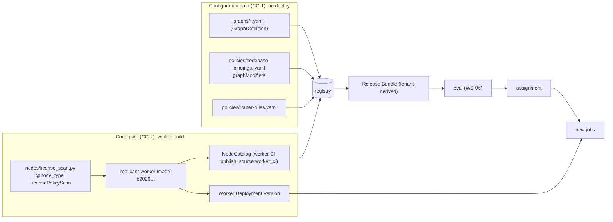

# Extensibility: Node Registry, Graphs as Configuration, Modifiers

**Section:** 01-orchestration (WS-01) · **Constraints:** D-02 ("extensible without redeploying the core"),
D-03 · **Contracts:** C-DEF 3.0.0 (CC-1..CC-4, NodeCatalog envelope, publish `source`) · **ADR:**
[ADR-01-008](adr/008-graph-definitions-are-configuration-compiled-per-job.md)

## Purpose

Define how nodes are declared, typed, and discovered; how graphs are written as configuration and
validated; how per-codebase rules modify a graph; and which guarantees protect core roles. A worked example
adds a license and dependency policy scan before implementation, through both paths.

## Decisions summary

**Stated plainly (D-02):**

> **Configuration-level changes need no deploy:** inserting an existing node into a sequence, changing
> parameters and node configuration, changing subgraph selection rules (router rules), and per-codebase
> constraints (codebase-binding graph modifiers) ship as a new Release Bundle (registry documents and,
> for tenant changes, a tenant-derived bundle), then evaluation and assignment. Nothing is rebuilt or
> redeployed.
>
> **New node code requires a new replicant-worker deployment version (image + NodeCatalog), and never a
> control-plane change:** control-plane-api, the UI, the Runner, and the controller treat node types as
> opaque catalog entries. A bundle that uses the new node then references that build.

| Decision | Reference |
|---|---|
| Node types are Python classes registered with `@node_type`, imported by the build's `nodes` package, and exported as the build's NodeCatalog by worker CI (`replicant-worker nodecatalog export`, published with `source: worker_ci`) | C-DEF 3.0.0, XD-11-13 |
| Each node type declares `role`, `effectClass`, `protected`, `bounded`, `interrupts`, `effects`, `configSchema`, `inputSchema`, `outputSchema` | [schemas/node-catalog.v1.json](schemas/node-catalog.v1.json), XD-06-01 |
| Graphs are GraphDefinition YAML with FGL v1 guards; composed per job with codebase-binding modifiers | [schemas/graph-definition.v1.json](schemas/graph-definition.v1.json) |
| Invariants I-1..I-7 run at publish, at bundle build, and in `graph.compose` | §4 |



## 1. Node registry

```python
class NodeType:                      # registry.py
    node_type: ClassVar[str]         # "license_policy_scan"
    role: ClassVar[str]              # C-DEF role enum
    effect_class: ClassVar[str]      # check_only | workspace_write | external_side_effect (XD-06-01)
    protected: ClassVar[bool]        # core role: no remove / retype / skip by modifiers
    bounded: ClassVar[bool]          # bounds loops by itself (pr_feedback_wait)
    interrupts: ClassVar[bool]       # may pause the graph; never in a parallel branch
    effects: ClassVar[tuple[str, ...]]          # logical-ID effect names used
    config_schema: ClassVar[dict]    # JSON Schema of the node's config in graph definitions
    input_schema: ClassVar[dict]     # JSON Schema of what the node reads (documentation, catalog)
    output_schema: ClassVar[dict]    # JSON Schema of its exports (guards read nodes['<key>'].*)
    async def run(self, ctx: NodeContext, config: dict) -> NodeResult: ...
```

`NodeResult(outcome, exports, refs)`: `outcome` and `exports` become `nodes['<key>'].*` in guards
(declared in `outputSchema`); `refs` are S3 URIs stored in `JobState.refs`.

Discovery: `replicant_orchestration/nodes/__init__.py` imports `core` and the build's node modules. The
workflow sandbox re-imports the package per workflow run, so a node type exists in a build exactly when that
build's `nodes` package imports it. The registry keys types by `nodeType`, and duplicates are an import error.

Core node types in build `b20261024-…` (19): `context_assembler`, `plan_run`, `implement_run`, `repair_run`,
`qa_run`, `review_run`, `skeptic_run`, `risk_classify`, `human_gate`, `verifier`, `check_step`, `base_check`,
`publisher`, `pr_feedback_wait`, `feedback_triage`, `post_reply`, `memory_writer`, `reroute`, `route`
(NodeCatalog export validated against the C-DEF envelope and the kind schema [verified: unit test,
2026-10-24]).

## 2. GraphDefinition format

[schemas/graph-definition.v1.json](schemas/graph-definition.v1.json): `workflowType`, `fglVersion`,
`params`, `entry`, `nodes[] {key, type, phase, config, when, maxVisits}`, `edges[] {from (node or join
list), to | switch[{when, to}] + default}`, `boundaries[] {kind: phase | repair_cycle, before}`. Targets are
node keys or `end:<outcome>`. Example: [graphs/definitions/bugfix.yaml](graphs/definitions/bugfix.yaml).
YAML must satisfy C-DEF canonicalization (no anchors, so shared tails are repeated).

## 3. Replicant Guard Language (FGL v1)

A strict subset of Python expressions, parsed by `ast` and evaluated by a whitelist walker
([dsl.py](reference/replicant_orchestration/dsl.py)): literals, names from the guard context, null-safe
attribute and constant-subscript access, `and/or/not`, comparisons including `in`, and calls only to
`risk_at_least(level, threshold)`, `matches_any(paths, globs)`, `all_match(paths, globs)`, `len(x)`. At most
512 characters and 64 AST nodes. Rejected: conditional expressions, comprehensions, private attributes, any
other call. Total (every guard evaluates), deterministic, and side-effect free.

Guard context: `job` (workflow_type, priority, tenant_id, repos), `request` (summary: require_gates,
labels, dry_run, budget, paths), `risk` (level, rules_fired, raised_by_llm), `nodes` (exports per node),
`gates` (decision per gate node), `cycle`, `params` (graph parameters), `pr`, `repair` (used, max).

## 4. Invariants and core-role guarantees

Checked by `graphspec.validate` / `validate_composed` at publish (registry), bundle build, and job start
(`graph.compose`):

| # | Invariant | Why |
|---|---|---|
| I-1 | Every node is reachable from the entry and can reach a terminal | no dead or stuck nodes |
| I-2 | Node types exist in the pinned NodeCatalog; configs validate against `configSchema`; phases are in the vocabulary; keys match the logical-ID grammar | CC-1, C-IDS |
| I-3 | After any diff-producing node (role `implementer`), **every** path to a publisher passes through a `qa` node, a `verifier`, a diff-stage `risk_classify`, and a `publish_approval` gate node (gate presence then decided by policy). Join edges count as wait-for-all | D-16, D-19, D-21 |
| I-4 | Every cycle contains a node with `maxVisits` or a `bounded` node type | D-15 bounded loops |
| I-5 | Protected nodes (`context_assembler`, `risk_classify`, `human_gate`, `verifier`, `base_check`, `publisher`, `pr_feedback_wait`, `memory_writer`, `reroute`) in the authored graph cannot be removed, retyped, or skipped by modifiers; `when` on protected nodes is forbidden except on `human_gate`, where it only **adds** a gate | core roles |
| I-6 | Boundaries reference existing nodes | CAN correctness |
| I-7 | Nodes with `interrupts` never sit in a parallel branch; a switch source has exactly one outgoing edge; joins combine single-node branches | engine equivalence |

Negative tests (unit suite): skipping `verify`, replacing `publish_gate` or `qa`, skipping `risk_diff`, and
an edge from `review` straight to `publish` are all rejected [verified: 2026-10-24].

## 5. Graph modifiers (per-codebase rules)

A codebase binding (policyType `codebase_bindings`, WS-03 owns the document) maps repo selectors to an
environment, agent overrides, and `graphModifiers` (WS-01 owns that sub-schema, `#/$defs/graphModifier`):

| `op` | Effect | Restrictions |
|---|---|---|
| `insertBefore` (`anchor`, `node`, optional `branches`) | all edges into the anchor go to the new node; the new node continues to the anchor (default) or to its branches | new key unique; invariants re-run |
| `insertAfter` (`anchor`, `node`) | the anchor's outgoing edges move to the new node | no branches |
| `replace` (`target`, `with {type, config}`) | swap type and config, keep key and edges | not protected; same role |
| `setConfig` (`target`, `config`) | deep-merge config | schema re-validated |
| `skipWhen` (`target`, `when`) | node skipped when the guard holds | not protected |
| `requireGateWhen` (`target`, `when`) | OR the guard into a `human_gate` node's presence | gates only added |

Selection order: the bundle's bindings are matched against the job's primary repository (`host/owner/name`
plus catalog facts) by WS-03's selector rules; matched modifiers apply in binding priority order. The
composed graph and its digest are recorded in history (`graph.compose` result).

## 6. Worked example: license and dependency policy scan

**Goal:** before implementation, scan dependencies of tenant `payments`' Go services against a license
deny-list; violations stop the job before any code is written.

### 6.1 Path (a): configuration only (the node type already exists in a deployed build)

Assume build `b20261031-7e2a9c4b1d03` (already deployed, NodeCatalog published) contains node type
`license_policy_scan` (§6.2). The tenant's platform engineer changes only the config repo:

```yaml
# replicant-config: policies/codebase-bindings.payments.yaml (WS-03 binding document; graphModifiers per WS-01)
apiVersion: replicant.example.com/v1
kind: Policy
metadata:
  name: codebase-bindings
  scope: {level: tenant, tenant_id: payments}
  owners: [payments-platform]
spec:
  policyType: codebase_bindings
  bindings:
    - name: payments-go-license          # WS-03 binding envelope (XD-FIX-R1-003)
      priority: 200
      match: {repos: ["github.com/acme-payments/*"], catalog: {languages: [go]}}
      environment: environment/go-service
      graphModifiers:
        - op: insertBefore
          anchor: implement
          node:
            key: license_scan
            type: license_policy_scan
            phase: pre_checks
            maxVisits: 2
            config:
              agent: license-scanner          # x-replicant-ref agent: collected into the bundle closure
              deny: [AGPL-3.0-only, SSPL-1.0, BUSL-1.1]
              failOn: deny
              ecosystems: [go]
          branches:
            - {when: "nodes['license_scan'].outcome == 'violations'", to: "end:policy_violation"}
  default:                             # required by WS-03's kind schema: applies when no binding matches
    environment: environment/go-service
```

End to end, with no deploy:

1. PR to the config repo. CI runs schema validation, then `publish dry_run` against every environment's
   registry (CCR-03-02). The registry composes `graph/bugfix` (and every other graph) with the modifier,
   against the NodeCatalog of every build the bundle may reference, and runs I-1..I-7. Invariants hold:
   the inserted node is `check_only`, not diff-producing, and every publish path still passes QA,
   verifier, diff risk, and the publish gate.
2. Merge publishes `policy/codebase-bindings.payments@5`. The registry builds the **tenant-derived bundle**
   `derived(base, payments layer v5)`. Its closure now includes `agent/license-scanner@…`.
3. WS-06 tightening check: the only change is a `check_only` node insertion, so the bundle is
   tightening-only and follows the auto-promotion path of ADR-06-001 / CCR-06-06 (WS-06 decides).
4. Assignment: tenant `payments` new jobs resolve to the new derived bundle. Running jobs are unaffected (CC-3).
5. At job start, `graph.compose` applies the modifier for `github.com/acme-payments/ledger-api`. The node
   runs as `license_scan.c0.n1.*` (plan, budget, stage, run …) before `implement`.

Measured on the reference implementation (build N+1 with the node): a denied license ends the job as
`policy_violation` with **no implementer run**; a clean scan proceeds, QA runs before implement, and the
PR merges. The scan's run ID is `license_scan.c0.n1.run` [verified: scenario `license_prestep`, both
engines, 2026-10-24].

### 6.2 Path (b): new node code (no such node type exists yet)

Before the new build, the same binding is **rejected at publish**: `node 'license_scan': type
'license_policy_scan' not in NodeCatalog` [verified: unit test `test_license_modifier_needs_build_with_node`,
2026-10-24]. The sequence:

1. **Code** (replicant-worker repo): add [nodes/license_scan.py](reference/replicant_orchestration/nodes/license_scan.py)
   (about 60 lines: the `NodeType`, its JSON schemas, and its one new read-only activity
   `policy.evaluate_licenses`), plus `import` in `nodes/__init__.py`. Its report is a `node_report` with
   `attributes.report_kind: license_scan` (R1-027). Unit and scenario tests. No change to
   the workflow, engines, or contracts. The node uses existing artifact type `sbom` (C-ART) and the
   existing Runner path, with role `qa` and workload class `utility`.
2. **Environment profile** (config, WS-03/WS-05): `environment/go-service` gains resource profile
   `license-scan` whose QA command runs `go-licenses report ./...` and `osv-scanner --format json`, and
   agent definition `license-scanner` (QA-style entrypoint, no coding CLI) is published. This is
   configuration.
3. **Build and deploy** (CI on merge): image → new Worker Deployment Version `b20261031-7e2a9c4b1d03` →
   NodeCatalog `nodecatalog/replicant-worker@<n>` published with `source: worker_ci` → pods poll all three
   task queues → the version is recorded ready (versioning.md §2). Replay gate: golden corpus plus handoff
   protocol (versioning.md §8).
4. **Bundle**: the base `ReleaseBundleRequest` moves `workerDeployment.buildId` to the new build. Eval →
   promotion → assignment (ramp first). From then on the build is in the default bundle, and path (a)
   applies to every tenant who wants the node.
5. **Control plane: no change.** control-plane-api, the UI (node shown by `nodeType` and `description`
   from the catalog), runner-api, and the controller are untouched.

Running jobs on the old build never see the node, unless a requester consents to migration and the job is
waiting at a node that also exists in the new graph.

## 7. Rules for inserting, replacing, and skipping nodes

| Rule | Detail |
|---|---|
| Insert anywhere before or after a non-terminal node | `insertBefore` keeps boundaries attached to the new first node (a boundary before `implement` now precedes the inserted pre-step) |
| Replace only within the same role and never a protected node | e.g. `review_run` → a different reviewer agent: use `setConfig {agent: …}`, not `replace` |
| Skip only non-protected nodes, by FGL guard | e.g. `skipWhen review: "job.priority == 'urgent'"` |
| Gates can be added (`requireGateWhen`, `insertBefore` with a `human_gate`) but never removed | D-19 |
| Every inserted node must declare `maxVisits` if it can be on a cycle | I-4 |
| Inserted nodes see the same `NodeContext`; their side effects get logical IDs from their own key | C-IDS |
| A modifier that references an unknown type, breaks an invariant, or targets a missing node fails publish; a binding can never break a running job | ADR-01-008 |
| Reports of inserted and auxiliary check nodes are artifact type **`node_report`** (C-ART 1.8.0, CCR-01-03) with the mandatory `attributes.report_kind` set to the node's step or type (`contract_compat`, `consumer_impact`, `docs_scope`, `license_scan`, …). `check_step` passes `report: {artifact_type: node_report, report_kind: <step>}` to `checks.run_step`; a new node type passes its own `report_kind` (R1-027) | C-ART |

## Open questions

| Question | Who decides | Options | Recommendation |
|---|---|---|---|
| Should tenants be allowed `skipWhen` at all? | WS-06 / WS-09 | yes for non-protected nodes / admin-only | Admin approval (two-person) for any `skipWhen` in a tenant layer: it is not tightening (ADR-06-001 classifies it behavioral) |

## Risks

- Modifier interactions (two bindings inserting before the same anchor) are order-dependent. The registry
  composes in binding priority order and shows the composed graph in the release UI diff.

## Interfaces

- **Provided:** NodeCatalog and GraphDefinition kind schemas; graphModifier sub-schema; FGL v1;
  `replicant-worker nodecatalog export`.
- **Consumed:** C-DEF 3.0.0 (publish, `source`, heads), WS-03 codebase bindings and agent/environment
  definitions, WS-06 tightening classification (`effectClass`).
