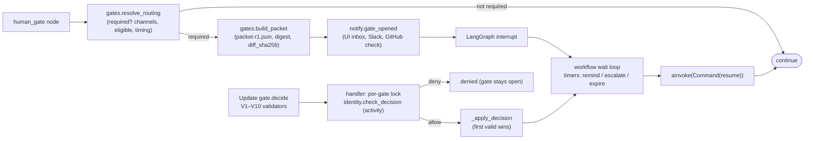
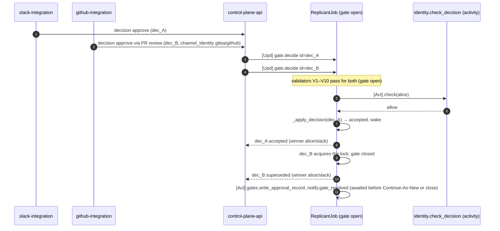
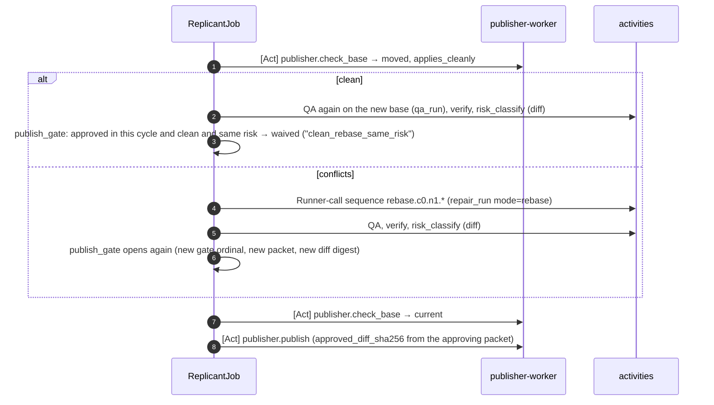

# Human Gates

**Section:** 01-orchestration (WS-01) · **Constraints:** D-01, D-18, D-19, D-21 · **Contracts:** C-MSG 2.0.0
(`gate.decide` V1–V10 and handler), C-IDS (`gate_id`, `decision_id`), C-ART (`approval_packet`,
`approval_record`) · **ADRs:** ADR-001 (contract), [ADR-01-009](adr/009-gate-routing-delegated-to-ws07-and-one-decision-transition.md)

## Purpose

Specify gates inside the graph: interrupt → Temporal Update with validators → authoritative authorization
→ first-wins decision → resume, plus durable timers for reminders, escalation, and expiry, the
rebase-and-reverify path, and evaluation-mode resolution. WS-07 owns channel delivery (UI, Slack, GitHub,
CLI) and the `gate_rules` policy.

## Decisions summary

| Decision | Reference |
|---|---|
| Gates are LangGraph interrupts in `human_gate` nodes (and in `NodeContext.gate` for budget, clarification, and migration gates). The workflow loop owns the wait | D-01 |
| All gate decisions are the Update `gate.decide` (Update ID = `decision_id`). Validators are synchronous and state-local; authorization is checked **in the handler** by activity `identity.check_decision` at decision time | ADR-001, C-MSG |
| Gate presence comes from `gates.resolve_routing` (WS-07 logic over the pinned `gate_rules`), from deterministic facts. Graphs and requests can only add gates | D-19, ADR-01-009 |
| One transition function closes every gate (Update or evaluation script) | ADR-01-009, XD-06-02 |
| Timers: reminders, escalation levels, expiry from `GateRouting.timing` (seconds), computed from `opened_at` and carried across Continue-As-New | D-19 |
| GitHub and Gitea: a PR review mapped to a gate decision arrives as `channel: github`. A local-profile Gitea reviewer's identity is `actor.channel_identity.kind = "gitea"` (C-MSG 1.1.0, CCR-11-01) and is handled exactly like `github`: the workflow never branches on the identity kind; `identity.check_decision` resolves the principal | CCR-11-01 |

## 1. Gate kinds and where they open

| Kind | Opened by | Decisions (V5) | Eligible (default WS-07 routing) |
|---|---|---|---|
| `plan_approval` | `human_gate` node after `risk_plan` | approve, reject, request_changes | CODEOWNERS of planned paths, min `write`; requester not allowed |
| `publish_approval` | `human_gate` after `risk_diff` (`publish_gate`, `push_gate`) | approve, reject, request_changes | CODEOWNERS of changed paths, min `write`; requester not allowed |
| `clarification` | router prologue | answer, reject | requester only |
| `budget_extension` | `NodeContext.run_agent` on `GatewayBudgetExceeded` | approve, reject | tenant budget approvers; requester only up to `requesterSelfApproveMaxUsd` (default $0, G-07) |
| `bundle_migration` | `job.offer_bundle_migration` handler | approve, reject | requester only |

## 2. GateRouting (consumed from WS-07)

`gates.resolve_routing({gate_kind, facts})` returns [GateRouting v1](schemas/gate-routing.v1.json). WS-01
consumes these fields: `required`, `rule_id`, `channels`, `eligible.{okta_groups, principals,
min_repo_permission, requester_may_decide}`, `timing.{reminder_seconds[], reminder_repeat_seconds,
escalation_seconds[], expiry_seconds, on_expiry}`, `reapprove_after_rebase`. WS-07's mapping from its policy
schema to these fields: spec/07-control-plane-and-ux/approvals.md §8a. Facts sent:
`workflow_type, risk_level, rules_fired, requester, tenant_id, repos, require_gates, cycle, changed_paths,
release_bundle_id` and, for budget gates, `amount_usd, extensions_so_far`.

Presence rule: `required = routing.required OR node.when(FGL)`. A graph's `when` on a gate node, and
`requireGateWhen` modifiers, can only add (invariant enforced in `compose`). The request's
`constraints.require_gates` is a routing fact, also add-only.

## 3. Opening a gate (idempotent)

`NodeContext.gate(kind, …)`:

1. `gate_id = derived("gate", job_id, kind, "c<cycle>", "n<gate ordinal>")` (C-IDS), allocated once and
   memoized as `gate:<node>:<kind>:c<cycle>:n<ord>`.
2. `gates.build_packet` (`<node>.c<c>.n<o>.packet_<kind8>_r1`) writes the immutable approval packet
   (`gates/<gate_id>/packet-r1.json`, `If-None-Match: *`) and returns `presented_digest` and the subject
   digests (`diff_sha256`, `plan_sha256`) stored in `GateRecord.subject`.
3. `GateRecord` is created with `expires_at = opened_at + expiry_seconds` and `next_reminder_at`.
   `ReplicantOpenGateIds`, `ReplicantAwaitingHuman`, and `ReplicantWaitingSince` are upserted; projection
   `gate.opened`; status `waiting_human`.
4. `notify.gate_opened` (`….notify_open_<kind8>`), unless the job is paused `at_next_gate` or in evaluation
   mode. A gate opened while the job is paused `at_next_gate` is **held**: it is open, approvers are not
   notified, no reminders run, and the **expiry clock is suspended** (R2-023). `held_since` is recorded,
   the person who paused gets `notify.job_event(kind=gate_held)` (`….notify_held_<kind8>`), and on
   `job.resume` `expires_at` moves later by the held duration (timeline `gate.unheld`) before approvers
   are notified (`….notify_unhold`).
5. `interrupt({"wait": "gate", "gate_id": …})`.

Re-entry (resume after the decision, or Continue-As-New while waiting) finds the gate in `JobState.gates`
and opens nothing twice.

## 4. Deciding: validators, handler, first-wins

Validators (synchronous, no I/O; rejected Updates write no history), exactly C-MSG:

| # | Check | Rejection type |
|---|---|---|
| V1 | payload shape (`schema`, `decision_id`, `gate_id`, `presented_digest`, `actor.principal_id`, `channel`, `answer_text` for answers) | `InvalidPayload` |
| V2 | gate known | `UnknownGate` |
| V3 | `decision_id` not applied in the last 7 days (carried set) | `DuplicateDecision` (details: original result) |
| V4 | gate open | `GateAlreadyDecided` (details: winner) / `GateClosed` |
| V5 | decision allowed for the kind; `rerun_qa` (publish_approval) only when the latest QA verdict is `inconclusive` and the gate's `qa_reruns_used` is below 2 (CCR-05-04, R1V-087). A re-run supersedes the revision, and the new revision opens as the next gate instance carrying the same count, so the limit is per gate and its revisions | `DecisionNotAllowed` / `DecisionNotOffered` |
| V6 | `presented_digest` = current packet digest | `StaleApprovalView` |
| V7 | channel in the gate's channels | `ChannelNotAllowed` |
| V8 | actor is a human (`usr_`) | `ActorNotHuman` |
| V9 | requester may decide, or the actor is not the requester | `SelfApprovalForbidden` |
| V10 | Expiry, evaluated against the decision's `decided_at` (below; C-MSG 2.0.0, CCR-01-07) | `InvalidPayload` / `GateClosed` |
| V12 | the gate carries `release_block` (bundle rolled back or revoked): `approve` needs `override_release_block {reason}`, which the decision and approval record keep (audited); reject, request_changes and rerun_qa are never blocked (CCR-06-13) | `GateBlockedByRelease` |

V11 (distinct approvers, `min_approvers > 1`) applies only to `leak_purge` gates, which open on WS-08's
`LeakPurge` workflow, never on ReplicantJob. So ReplicantJob never returns `recorded` and never emits
`gate.decision_recorded`.

**Decision log and audited events (CCR-07-07, XD-FIX-R1-157).** Every attempt the handler sees is appended to
`GateView.decision_log`: accepted, superseded, or denied, with `decision_id`, decision, principal, channel,
`decided_at`, `presented_digest`, `denial_reason`, and `text_key` when free text exists. At most 20 entries
are carried, below the contract's 50. Scripted (`system`) and `api` decisions are not logged. A losing
decision emits `gate.decision_superseded`, and a denial emits `gate.decision_denied`. Both are audited by
the projector together with `gate.opened`, `gate.decided`, `gate.expired`, `gate.reminded` and
`gate.escalated`. Measured in scenario `contested_reopen`.

**V10 and outages (R2-014, CCR-01-07).** `decided_at` is control-plane-api's receipt time of the click,
stamped when it writes the outbox row (XD-FIX-R2-014). It is not the browser's clock. The validator
rejects a `decided_at` more than 60 s in the future or more than 60 s earlier than the gate's `opened_at`
(`InvalidPayload`, C-MSG 2.0.0 V10, R1V-084).
While `now < expires_at`, every decision passes V10. After `expires_at` (the Update was delayed, for
example by a Temporal outage), a decision passes only if `decided_at < expires_at`, it arrived within
6 h of `decided_at`, and the gate's grace window, if one is open, has not ended. The expiry timer itself
distinguishes a late fire: if it fires more than 60 s after `expires_at` (workers or the server were down),
it does not expire the gate at once. It opens a 15-minute grace window (`grace_until`, timeline
`gate.expiry_grace`) so that outboxes can deliver decisions stamped before expiry, and it expires the gate
when the window ends. A timer that fires on time expires the gate immediately, because any decision made
before expiry would already have arrived. Measured: workers stopped across a 20 s expiry and restarted
85 s later. The late timer opened the grace window, a decision stamped after expiry was rejected with
`GateClosed`, and the decision stamped before expiry was `accepted` [verified: scenario `late_decision`,
2026-10-24].

**Why authorization is in the handler (an activity), not in the validator.** Validators must be
synchronous and side-effect free, so they cannot call identity-service. The check must also be live (D-18:
SCIM group membership now, identity link, repository permission from GitHub now, no cached grant, D-25
"next request"), so it cannot be precomputed into workflow state. Running `identity.check_decision`
(`IDENTITY` class: 10 s, 5 attempts) inside the handler after the validators makes the authoritative check
happen exactly once per accepted Update, records the result in history (audit), and keeps denied decisions
from closing the gate.

**The handler never fails after the validator accepted the Update (R2-011).** Once a validator accepts an
Update, its outcome is written to history, and the sender's retries with the same Update ID return that
outcome forever. A failed Update would therefore lose the click permanently. The `IDENTITY` retry budget
is 5 attempts with backoff 8, 16, 32 and 60 s (about 2 minutes, longer than an Aurora failover). If it is
still exhausted, the handler returns `denied` with `denial_reason: identity_unverifiable` (the CCR-07-02
fail-closed reason, retryable by the approver). The `decision_id` is **not** added to the applied set, so
control-plane-api's outbox re-submits the same decision under a fresh Update ID
`derived("dec", decision_id, "r<n>")` after 60 s, up to 5 times, and the UI shows "Identity service
unavailable, retrying" (XD-FIX-R2-011). `job.cancel`, `job.pause`, `job.resume`, `job.takeover`,
`job.steer` and `job.offer_bundle_migration` follow the same rule: an identity outage gives `denied`
(`identity_unverifiable`), and a Runner outage during live steering falls back to `queued_next_node`.
Measured: with `identity.check_decision` failing, `gate.decide` completed with `denied` /
`identity_unverifiable` and the gate stayed open. A second click after recovery was `accepted` [verified:
scenario `identity_outage`, 2026-10-24].

Handler (`ReplicantJobBase.gate_decide`):

1. Acquire the per-gate `asyncio.Lock`. Decisions on one gate are serialized.
2. Re-check V4. If the gate is closed, return `superseded` with the winner.
3. `identity.check_decision` (live).
4. Re-check V4 (another decision may have won during the activity), then return `superseded`.
5. On deny: projection `gate.decision_denied`, return `denied` with the reason. The gate stays open.
6. On allow: `_apply_decision` records the winning decision, sets the gate state, remembers the
   `decision_id`, updates search attributes, emits `gate.decided`, and starts `gates.write_approval_record`
   and `notify.gate_resolved` (every channel shows "Approved by @alice in Slack, 10:42"). It then wakes the
   wait loop and returns `accepted`. Under C-ART 2.0.0 (R2-004), `gates.write_approval_record` writes the
   free text (`comment`, `answer_text`, and the title as shown) as an `approval_text` object in `artifacts`
   (`gates/<gate_id>/text-<decision_id>.json`). It then writes a **reference-only** `approval_record` to the
   audit bucket (Object Lock) at `tenants/<t>/jobs/<j>/gates/<gate_id>/decision-<decision_id>.json` (C-ART
   1.10.1, XD-W2-08-03) with `text_key`, `text_sha256` and the subject digests. The activity returns
   `text_sha256`, and the workflow copies it into the decision's `GateView.decision_log[].text_sha256`, timeline
   `gate.approval_recorded` (R1V-046). So WS-07 reads the digest from Temporal and does not compute it. The handler does not
   await either activity, so the Update returns at once. Both handles are held, and **Continue-As-New and
   job close wait for them without a cap** (R2-013). Each is bounded by its own schedule-to-close
   (`AUDIT_WRITE`: unlimited attempts, 7 days). Projections whose events the projector audits (`gate.*`,
   `bundle.*`, `job.terminal`) are drained the same way. Only snapshot-only projections keep C-STATE's
   10-minute cap. An approval-record reconciler covers a worker crash between decision and record
   (XD-FIX-R2-013, WS-08).
7. `request_changes` with a comment also appends `{gate_id, gate_kind, decision_id, cycle, text}` to
   `JobState.approver_feedback` (at most 3 entries). The next producing node's Runner-call sequence passes
   it to `context.stage_inputs`, which stages it as an `<untrusted_input source="approver_feedback">` block
   and reports it consumed (R2-019, XD-FIX-R2-019). The next packet revision shows "Addressed feedback
   from r(n)" (WS-07). Measured: in evaluation mode a scripted `request_changes` comment on the plan gate
   reached the planner's staged inputs [verified: scenario `eval_mode`, 2026-10-24].

Measured: two decisions on the same publish gate sent concurrently from Slack (alice) and GitHub (bob, with
a Gitea channel identity) produce exactly one `accepted`. The loser gets `superseded` (it waited on the
lock) or `GateAlreadyDecided` (it arrived after the winner closed the gate). Both report the same winner
[verified: scenario `bugfix_full`, 2026-10-24].

## 5. Durable timers: reminders, escalation, expiry

The wait loop (`_wait_gate`) computes the next due time as the minimum of `next_reminder_at`, the next
escalation threshold (`opened_at + escalation_seconds[level]`), and `expires_at`, then runs
`wait_condition(gate closed or woken, timeout = due − now)`. Each timer fires one action, and each action
has a logical ID, so a replay or Continue-As-New never repeats a sent notification:

| Event | Activity (ID) | Effect |
|---|---|---|
| reminder k | `notify.gate_reminder` (`<node>.c<c>.n<o>.remind_<k>`) | next reminder = `reminder_seconds[k]` after opening, else `reminder_repeat_seconds` |
| escalation level L | `notify.gate_escalated` (`….escalate_<L>`) | WS-07 widens eligibility or notifies the next group |
| expiry fired late (> 60 s after `expires_at`) | none; timeline `gate.expiry_grace` | 15-minute grace for decisions stamped before expiry (§4, V10), then expiry as below |
| expiry, `on_expiry: expire` | `notify.gate_resolved` (`….notify_expired`) | gate `expired` → edge `end:gate_expired` (status `expired`) |
| expiry, `on_expiry: decline` | same | gate `expired` treated as reject (migration declined) |
| expiry, `on_expiry: keep_open_and_alert` | `notify.job_event` (`….overdue`) | gate stays open; operators alerted once |

Measured: with reminders at 2 s and repeat 2 s, escalation at 3 s, and expiry at 7 s, a gate sent 3
reminders and 1 escalation and expired with outcome `gate_expired` [verified: scenario `gate_expiry`,
2026-10-24]. In production the defaults are 4 h and 24 h reminders, daily repeats, escalation at 24 h and
72 h, and expiry at 7 days (WS-07 policy). A gate waiting 30 days continues-as-new when history grows
(about 12 events per reminder), carrying the timing state.

## 6. Rebase and reverify after approval (D-19)

When the base branch moves between approval and publish (graphs/README.md §5):

Measured: the low-risk path with one clean base move re-ran QA on the new base and published [verified:
scenario `low_risk_rebase`, 2026-10-24].

## 7. Evaluation mode (XD-06-02, ADR-06-006)

With `JobRequest.options.evaluation` (accepted at intake only from `release:pin` + `eval:run` principals),
the gate opens exactly as in production (routing, packet, record). `notify.*` is suppressed. Then
`eval.read_gate_script` (`<node>.c<c>.n<o>.script_<kind8>`) returns the scripted decision, and
`_apply_decision` closes the gate with `channel: system` and `source: script`. The decision names the human
the evaluation acts for (`acting_for`: the requester's `on_behalf_of` from C-JOBREQ, otherwise the
requester), never `svc_eval-worker` as a decider (R1-019, C-MSG V8). The timeline event is
`gate.auto_resolved` with the rule index. The approval record carries `source: script`, so auditors can tell
scripted decisions from human ones. `stop_case` (XD-FIX-R1-143) records **no** decision object and no
approval record. The gate is `cancelled`, and the job ends `cancelled` (outcome `eval_stopped`, reason
`eval_stop_case`). `eval.read_gate_script`, `eval.read_review_round` and `release.check_migration_eligibility`
follow eval-harness.md §3.3 and promotion.md §7.3. A scripted review round k becomes a feedback batch whose
`delivery_id`s are `eval-<eval_run_id>-<golden_task_id>-r<k>-<i>`, with actor `svc_eval-worker`, `authorized:
true`, and a closing `review_submitted`.
No `gate.decide` Update is sent and no principal decides through the Update path (C-MSG 2.0.0 §2.1). `stop_case` cancels the gate and ends the job `eval_stopped`. In
shadow mode every gate is approved, and clarification stops the case. Validator V8 is untouched, because no
Update is involved. Measured: a high-risk bugfix in evaluation mode resolved 4 gates by script (plan
`request_changes`, then approve), ran one scripted review round as a repair cycle, and made no `notify.*`,
`identity.*`, or memory-write calls [verified: scenario `eval_mode`, 2026-10-24].

## 8. Pause, cancel, and principal changes during a gate

| Event | Behavior |
|---|---|
| `job.pause(at_next_gate)` before a gate opens | the gate opens held: no notification, no reminders, expiry clock suspended; the pauser is told; `job.resume` moves `expires_at` by the held time and notifies (`….notify_unhold`) [verified: scenario `held_gate`, 2026-10-24] |
| `job.cancel` while waiting | the drive task is cancelled; compensation runs; the gate is left open in history but the projection shows the job `cancelled`, and notify cleans up the channel messages (WS-07) |
| Approver deprovisioned (`identity.principal_changed`) | pending decisions by them fail `identity.check_decision`. If they were a gate's **only** eligible principal (`eligible.principals == [p]`), the workflow re-resolves eligibility at once: `gates.resolve_routing` with facts `exclude_principals: [p]` and `reroute_reason` (`identity.c<c>.n<k>.reroute`). It replaces `eligible` and `channels`, emits `gate.rerouted` and re-notifies (`….renotify`) (R1-020) |
| Requester deprovisioned | job paused at the next safe point (tenant policy `on_requester_deprovisioned`, default pause), tenant admins notified at once (`notify.job_event` kind `requester_deprovisioned`), and gates where the requester was the sole decider (clarification, bundle migration) re-routed as above [verified: scenario `principal_reroute`, 2026-10-24] |
| Denied decision | projection `gate.decision_denied` (the projector writes the audit event), result `denied`; the gate stays open |
| Bundle migration approved while another gate is open | the job migrates at once (handoff run) and re-enters the same open gate on the new build |
| `release.notice(bundle_rolled_back` or `bundle_revoked)` | open plan and publish gates (and gates opened later on that bundle) get `release_block`; V12 blocks `approve` without an override; migrating to another bundle clears the block (CCR-06-13, XD-FIX-R2-021) [verified: scenario `release_block`, 2026-10-24] |
| `identity.principal_changed(decision_identity_contested, decision_id)` | if the gate's routing says `on_contested_decision: reopen_if_unpublished` and no publish activity has consumed that approval, the approval is withdrawn (`gate.decision_identity_contested`, the name WS-07 and WS-08 use, R1V-086). The Publisher node opens a new instance of the gate (gate ordinal + 1, same packet and digest, banner `approval_withdrawn_identity`, timeline `gate.reopened`) and publishes only after it is approved. If a publish already consumed it: `gate.decision_contested_after_publish`, nothing else changes. Otherwise the contest is recorded and alerted. Idempotent on `notice_id` (CCR-07-06, XD-FIX-R1-173) [verified: scenario `contested_reopen`, 2026-10-24] |
| `gates.resolve_routing` returns `escalation_seconds[0] = 0` with `reason: no_reachable_approver` | the first escalation fires at gate open (XD-FIX-R2-025); eligibility is re-resolved immediately on `identity.principal_changed`, never at the next escalation |

## Failure modes

| Failure | Effect | Handling | User sees |
|---|---|---|---|
| No replicant-worker of the pinned version polling | Updates are admitted but not accepted | sender outboxes retry with the same Update ID (C-MSG §3) | "Recording your decision…" |
| identity-service, Okta, broker or GitHub down | `identity.check_decision` retries for about 2 minutes, then the handler returns `denied` / `identity_unverifiable` (the Update **succeeds**; it is in history) | outbox re-submits under `derived("dec", decision_id, "r<n>")`; the gate stays open | "Identity service unavailable, retrying" |
| Worker crash between decision and approval record | `gates.write_approval_record` is retried by Temporal; Continue-As-New and close wait for it | approval-record reconciler (WS-08) as a backstop | none |
| Packet changed (re-opened gate) | V6 `StaleApprovalView` | UI reloads the packet | "This request changed; please review again" |
| Duplicate webhook redelivery | V3 or Temporal Update-ID dedupe | same result returned | none |
| Decision after expiry | V10 `GateClosed`, unless stamped before expiry and delivered within the outage rules | — | "This request expired" |

## Open questions

| Question | Who decides | Options | Recommendation |
|---|---|---|---|
| Should approvers see the agent's response to their feedback before re-approving? | WS-07 | packet section / timeline only | Packet section "Addressed feedback from r(n)" (XD-FIX-R2-019); the comment itself is staged by WS-04 (resolved, R2-019) |

## Risks

- Update delivery depends on live workers of the pinned version (ADR-001). Mitigation: minimum 2 pods per
  live version and the `ReplicantPinnedVersionNoPollers` alert.

## Interfaces

- **Provided:** handler semantics (C-MSG implementation), GateRouting v1 schema, timing behavior.
- **Consumed:** WS-07 `gates.resolve_routing`, `gates.build_packet`, `notify.*`, `identity.check_*`;
  WS-06 `eval.read_gate_script`.
