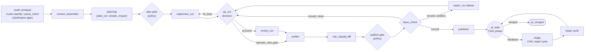
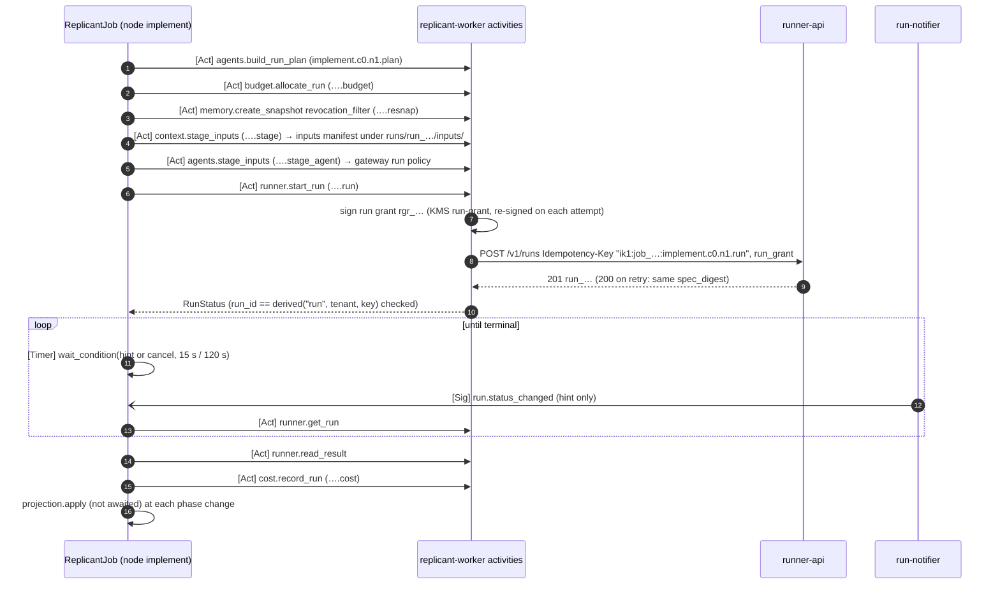

# Graph Shapes: Common Building Blocks

**Section:** 01-orchestration (WS-01) · **Constraints:** D-01, D-04, D-15, D-19 · **Contracts:** C-MSG 2.0.0,
C-RUNNER 3.0.0, C-IDS, C-STATE §2

## Purpose

Every workflow type is one `GraphDefinition` (YAML, [definitions/](definitions/)) executed by `ReplicantJob`.
This page defines what all shapes share: the Runner-call sequence, gates, Continue-As-New points, retry
policies and timeouts, terminal outcomes, compensation, and what the user sees. Each shape page shows the
graph, its LangGraph code, its sequence diagram, and its own failure modes:

| Shape | Page | Definition | Generated LangGraph code | LangGraph-drawn diagram |
|---|---|---|---|---|
| Bugfix | [bugfix.md](bugfix.md) | [bugfix.yaml](definitions/bugfix.yaml) | [bugfix_graph.py](generated/bugfix_graph.py) | [bugfix.mmd](generated/bugfix.mmd) |
| Feature, API change | [feature-and-api-change.md](feature-and-api-change.md) | [feature.yaml](definitions/feature.yaml), [api-change.yaml](definitions/api-change.yaml) | [feature_graph.py](generated/feature_graph.py), [api_change_graph.py](generated/api_change_graph.py) | `.mmd` |
| PR-comment repair | [pr-repair.md](pr-repair.md) | shared tail of every PR graph, plus [pr-repair.yaml](definitions/pr-repair.yaml) | [pr_repair_graph.py](generated/pr_repair_graph.py) | `.mmd` |
| Hotfix, docs/low-risk | [hotfix-and-docs.md](hotfix-and-docs.md) | [hotfix.yaml](definitions/hotfix.yaml), [docs-low-risk.yaml](definitions/docs-low-risk.yaml) | `hotfix_graph.py`, `docs_low_risk_graph.py` | `.mmd` |
| Scheduled maintenance (fan-out) | [maintenance-fanout.md](maintenance-fanout.md) | [maintenance-repo.yaml](definitions/maintenance-repo.yaml) + `MaintenanceBatch` | `maintenance_repo_graph.py` | `.mmd` |
| QA only | this page §8 | [qa-only.yaml](definitions/qa-only.yaml) | `qa_only_graph.py` | `.mmd` |

## Decisions summary

| Decision | Constraint | Reference |
|---|---|---|
| Router prologue (not a graph node) classifies and selects the graph | D-01 | [router.md](../router.md) |
| Every PR-producing graph ends in the same tail: verify → diff risk → publish gate → base check (rebase and reverify) → publish → PR review loop with bounded repair cycles | D-15, D-19, ADR-009 | §5 |
| QA routes on WS-05's `decision` export; environment failures never loop to the implementer | D-16, XD-05-03 | §2.3 |
| Gate presence comes from `gates.resolve_routing` (deterministic); LLMs and graphs can only add gates | D-19 | [gates.md](../gates.md) |
| Continue-As-New before `pr_wait` (phase) and `triage` (repair cycle), plus history thresholds | D-02 | [ADR-01-004](../adr/004-continue-as-new-boundaries-and-resume-at-node.md) |

## 1. Activity IDs and task queues

Every side-effecting activity uses `activity_id = <node_key>.c<cycle>.n<ordinal>.<effect>` (C-IDS §2.1),
computed by `NodeContext.lid()`. The idempotency key sent to the Runner is `ik1:<workflow_id>:<activity_id>`.
The full catalog (58 activities) with queue, timeouts, retry policy, and side-effect flag is
[reference/replicant_orchestration/activity_options.py](../reference/replicant_orchestration/activity_options.py).
Queues: `replicant-jobs` (workflows and most activities), `replicant-runner-calls` (Runner), `replicant-llm-calls`
(new, in-worker LLM calls; same deployment), `replicant-publisher` (publisher-worker), `replicant-projections`
(replicant-projector).

## 2. The Runner-call sequence (every agent node)

`NodeContext.run_agent()` (XD-03-12, XD-04-01, XD-02-14, CCR-09-02). For node `implement`, cycle 0, ordinal 1:

| Step | Activity | Activity ID | Purpose (owner) |
|---|---|---|---|
| 1 | `agents.build_run_plan` | `implement.c0.n1.plan` | effective agent/env/limits, Langfuse prompt render (WS-03) |
| 2 | `budget.allocate_run` | `implement.c0.n1.alloc` (WS-03 IDs, XD-FIX-R1-071) | `budget_usd = min(agent limit, role budget, remaining job budget − reservations)` (WS-03) |
| 3 | `memory.create_snapshot(mode=revocation_filter)` | `implement.c0.n1.resnap` | drop entries revoked since assembly (WS-04) |
| 4 | `context.stage_inputs` | `implement.c0.n1.stage` | inputs manifest: task packet, briefing, memory injection, handoff, session state (server-side copy), steering (WS-04) |
| 5 | `agents.stage_inputs` | `implement.c0.n1.stage_agent` | gateway run policy only, `PUT /internal/v1/runs/{run_id}/policy`; no S3 writes (WS-03, XD-FIX-R1-067). For local eval cases it adds the cassette selection `stub: {root: evals, set: <golden_task_id>, key: <agent>}` (XD-W2-06-02) |
| 6 | `runner.start_run` | `implement.c0.n1.run` | input: the RunSpec decision fields built by workflow code (§2.4) and the grant inputs; adds `run_grant` (KMS `run-grant`) and `trace_context` (the per-attempt fields), `POST /v1/runs` with `Idempotency-Key` |
| 7 | wait loop | timers + `runner.get_run` (default IDs, read-only) | Signal `run.status_changed` hint; poll 15 s Pending/Provisioning, 120 s Running; deadline `startup + active + 2 × finalize + 300 s`, which covers the controller's single finalize extension for throttled uploads (R1V-020, WS-02 controller.md §9) |
| 7a | `runner.cancel_run` | `implement.c0.n1.cancel` | at orchestrator deadline (`OrchestratorDeadlineExceeded`) |
| 8 | `runner.read_result` | default ID | validate `run_result`; outputs, role exports, usage |
| 9 | `cost.record_run` | `implement.c0.n1.cost` | ledger (WS-03); input carries `parent_job_id` for batch spend (XD-FIX-R2-062) |

### 2.1 Run failures

| Runner outcome | Workflow behavior | User-visible |
|---|---|---|
| `Succeeded`, `run_result.outcome` completed / no_changes / blocked / failed | node returns that outcome; graph edges route it | node result in timeline |
| Platform dependency down (R2-012): `GatewayUnavailable` (ai-gateway), `RepoFetchFailed` (repo-mirror), or `NodeLost` while the exec node-pool breaker is open | **circuit breaker**: `platform.dependency_health(dependency)`; the node holds (status `paused`, hold `platform_dependency`, timeline `job.blocked_on_dependency`), re-provisions nothing, probes with jittered backoff (`repair_limits.dependency_block`), restarts with ordinal + 1 after the breaker closes plus a per-job jitter. **Not charged** to `run_retries`; at most `platform_dependency.max_restarts_per_node` (20). Runner admission (tenant quota, 429 `Retry-After`) meters the restart herd | "AI gateway unavailable; your job resumes automatically" |
| `Failed`, `retryable: true` (`NodeLost` with the breaker closed, `PodEvicted`, `Preempted`, `ImagePullFailed`, `AgentExitedNonZero`, `AgentResultMissing`, `ArtifactUploadFailed`, `ControllerError`, `DefinitionUnavailable` (C-RUNNER 2.2.0), `EnvironmentSetupFailed`, `OrchestratorDeadlineExceeded`, …) | re-invoke with **ordinal + 1** (new key, new `run_id`) after `repair_limits.run_retries.backoff_seconds × attempt`, at most `max_per_node` (2) times; session restore or handoff (WS-04) | "Sandbox lost; retrying (2 of 3)" |
| `Failed`, `retryable: false` (`WorkspaceDiskExceeded`, `OOMKilled`, `DeadlineExceeded`, `AgentResultInvalid`, `DiffApplyFailed`, `SessionRestoreFailed`, `InputsFetchFailed`, `AdmissionDenied`) | `NodeFailed(reason)` → job `failed` (`node_failed`); operator alert proposes a resource profile change (WS-03) | failure with actionable reason |
| `SecurityViolation` (CCR-09-04) | never retried, never routed around: job `failed` with outcome `security_violation`; timeline event; WS-09 alerting | "Stopped by security automation" |
| `GatewayBudgetExceeded`, scope run or job | `budget_extension` gate (requester may approve only up to `requesterSelfApproveMaxUsd`, default 0, G-07); approve → `budget.apply_extension` (`….extend`) → ordinal + 1; reject or expire → `budget_exhausted` | "Implementer used its $15.00 run budget. Approve another $10.00?" |
| `GatewayBudgetExceeded`, scope `tenant_period` | no gate; `waiting.reason = tenant_budget_exhausted`, phase `budget_gate`, status unchanged; re-check `budget.tenant_quota_status(raise_if_exhausted=false)` hourly for up to 7 days, then `tenant_quota_exhausted` (R1V-009, R1V-015) | "Team model budget for October is exhausted; resumes when it resets" |
| `Cancelled` after `job.cancel` / `job.takeover` | compensation (§7) | "Cancelled by alice" |
| `Cancelled` by the `runs` kill switch (C-MSG 2.0.0 `ops.kill_switch`, cancel reason `operator`) | hold `kill_switch` (status `paused`) until released, then a new run (ordinal + 1), not charged to `run_retries` | "Runs paused by operators" |
| Runner 429 `tenant_quota_exceeded` on start | `runner.start_run` retries honoring `Retry-After` (unlimited attempts, schedule-to-close 6 h) | "Waiting for sandbox capacity" |
| Runner 422 `run_grant_invalid` | the activity re-signs an expired grant and retries once internally (XD-02-14); otherwise non-retryable → `NodeFailed` | failure, operator alert |
| Runner down during wait | `runner.get_run` errors are tolerated; polling continues until the orchestrator deadline; then `cancel_run` (retried up to 24 h) | "Waiting for sandbox status" |

### 2.2 Retry policies and timeouts (real values; `activity_options.py`)

| Class | Activities | start_to_close | schedule_to_close | RetryPolicy (initial, backoff, max interval, max attempts) | Non-retryable types |
|---|---|---|---|---|---|
| `IO_INTERNAL` | registry, compose, router.classify, memory.*, budget.*, cost.*, gates.resolve_routing, notify.*, eval.*, release.check_migration_eligibility, ops.read_kill_switches, platform.dependency_health | 60 s | 30 min | 1 s, 2.0, 60 s, 10 | `InvalidInput`, `DefinitionDigestMismatch`, `NotInBundle`, `SchemaViolation` |
| `IO_SLOW` (heartbeat 60 s) | context.build_briefing, context.stage_inputs, gates.build_packet, verifier.check, checks.run_step, takeover.assemble_package | 10 min | 1 h | 2 s, 2.0, 2 min, 6 | same |
| `IDENTITY` | identity.check_* | 10 s (C-MSG) | — | 8 s, 2.0, 60 s, 5 (C-MSG "retry max 5"; backoff spans about 2 min, R2-011) | `InvalidInput` |
| `AUDIT_WRITE` | gates.write_approval_record | 60 s | 7 d | 1 s, 2.0, 5 min, unlimited; awaited before Continue-As-New and close (R2-013) | common set |
| `RELEASE_OVERRIDE` | release.apply_migration_override | 30 s | 30 min | 2 s, 2.0, 2 min, unlimited; then the handoff failure path (versioning.md §6.3, R2-015) | common set |
| `QA_STUBS` / `QA_CLASSIFY` (WS-05 table, R1-124) | qa.stage_contract_stubs / qa.classify | 60 s / 120 s | 30 min | 1 s, 2.0, 30 s, 10 / 2 s, 2.0, 60 s, 8 | common set / common set + `QaReportInvalid` |
| `RUNNER_START` | runner.start_run | 30 s | 6 h | 2 s, 2.0, 2 min, unlimited | `invalid_request`, `missing_idempotency_key`, `forbidden`, `run_not_found`, `run_expired`, `idempotency_key_reuse`, `admission_denied`, `definition_not_resolvable`, `steering_not_supported`, `run_not_active`, `run_grant_invalid` |
| `RUNNER_GET` | runner.get_run | 10 s (C-RUNNER) | 10 min | 1 s, 2.0, 30 s, unlimited | `run_not_found`, `run_expired` |
| `RUNNER_CANCEL` | runner.cancel_run | 30 s | 24 h | 2 s, 2.0, 5 min, unlimited | same |
| `RUNNER_MESSAGE` | runner.post_message | 15 s | — | 1 s, 2.0, 10 s, 4 | Runner non-retryable set |
| `LLM` (queue `replicant-llm-calls`) | router.parse_intent, feedback.triage, risk.llm_review, memory.extract_candidates | 120 s | 20 min | 5 s, 2.0, 2 min, 5 | `GatewayBudgetExceeded`, `ContentPolicy`, `InvalidInput` |
| `PUBLISHER` (queue `replicant-publisher`) | publisher.*, github.post_reply, scm.resolve_base | 5 min | 2 h | 5 s, 2.0, 5 min, 8 | `PushRejected`, `BranchProtected`, `MergeConflict`, `PermissionDenied`, `PullRequestClosed`, `InvalidInput` |
| `PROJECTION` (queue `replicant-projections`, not awaited) | projection.apply | 30 s | 24 h | 1 s, 2.0, 60 s, unlimited (C-STATE) | — |

Workflow-level: no workflow execution or run timeout. Job lifetime is policy-driven: gate expiry, PR wait
expiry, and the hard cap `repair_limits.job_max_age_days` (60, R2-044). The workflow task timeout is 10 s
(the default).

**What happens when an activity's retries run out (R2-010, R1-006).** Every activity call goes through
`ReplicantJobBase.call`, which `NodeContext.act` also uses, and its outcome depends on the Temporal
`retry_state`:

| `ActivityError.retry_state` | Meaning | Workflow behavior | User-visible |
|---|---|---|---|
| `NON_RETRYABLE_FAILURE` | the call itself is wrong (schema violation, push rejected, invalid input) | `NodeFailed(<error type>)`: job `failed` (outcome `node_failed`, or the type if it is a known outcome), compensation (§7), terminal projection. The Temporal execution **completes**; it never fails | failure with reason |
| `MAXIMUM_ATTEMPTS_REACHED` or `TIMEOUT` | a dependency (memory-service, S3, control-plane-api, token broker) is down | **pause, don't fail**: hold `dependency` (status `paused`, phase unchanged, timeline `job.blocked_on_dependency`), re-probe by re-running the same activity with the **same activity ID** (same idempotency key) with jittered exponential backoff (`repair_limits.dependency_block`: 60 s doubling to 15 min, ± up to 120 s). `job.resume` by an operator retries at once, and `job.cancel` compensates. On success the hold is released (`job.released`). After `max_hours` (72) the job ends `dependency_unavailable` (`failed`) through `_finish` with compensation | "Waiting for a platform service; resumes automatically" |

The router's intent call (`router.parse_intent`) never holds. If the model is unavailable, routing uses the
rules' fallback type (router.md). Best-effort bookkeeping (`memory.record_outcome`, compensation steps)
uses the non-holding form. The `gate.decide` and `job.*` handlers never fail after validation (gates.md
§4). A dependency outage turns into `denied` / `identity_unverifiable`. Measured: `context.stage_inputs`
down for 8 s held the job and it then completed; an outage beyond `max_hours` ended the job
`dependency_unavailable` with a terminal projection; and a non-retryable `verifier.check` failure ended the
job `node_failed` with the execution `COMPLETED` [verified: scenarios `dependency_outage`,
`dependency_giveup`, 2026-10-24]. Every activity carries `Priority(priority_key, fairness_key=tenant)`
([ADR-01-006](../adr/006-tenant-fairness-and-concurrency-controls.md)).

### 2.3 QA routing (WS-05, XD-05-03)

`qa_run` calls `qa.stage_contract_stubs` (`qa.c<c>.n<o>.stage_stubs`), runs the QA sandbox with
`raise_on_failure=False`, calls `qa.classify` (`….classify`), then WS-05's pure `route_after_qa`
([nodes/qa_routing.py](../reference/replicant_orchestration/nodes/qa_routing.py)). It exports `decision`,
`risk_floor`, `passed`, and `verdict`. Edges in every shape:

| `decision` | Edge | Counter |
|---|---|---|
| `proceed` | next stage (review / verify) | — |
| `fix_loop` | `implement` (or `repair`) with the QA feedback packet staged | `qa_fix_used` ≤ `repair_limits.qa.fix_iterations` (2; hotfix and maintenance 1) |
| `retry_qa` | the same QA node again (environment retry) | `qa_env_retries` ≤ 1 |
| `operator_and_gate` | verify; risk floor `high` opens the publish gate; operator alert `notify.operator` with the XD-W2-05-05 payload (`dedupe_key: qa-env:<run_id>`, `event_key: qa.environment_failure`, recipients operators and environment owners, `vars`, `operator` from `qa.classify`'s `first_env_signature`); the approver may decide **`rerun_qa`** | — |
| `gate_with_failure` | verify; risk floor `critical`; approval publishes a **draft** PR only | OQ-05-01 option |
| `fail_job` | `end:qa_failed` (default after fixes: `repair_limits.qa.on_fail_after_fixes = fail_job`) | — |

Counters reset at each repair-cycle boundary. `risk_classify(stage=diff)` takes `max(current, risk_floor)`.

Wave-2 QA rules (WS-05 seams):
- **Verdict, not outcome (XD-FIX-R1-116 erratum, R1V-088).** The node reads `qa.classify`'s `verdict` only. A QA
  run's C-RUNNER `run_result.outcome` is `completed` for pass and pass_with_warnings, `no_changes` for
  not_applicable, and `failed` for fail or inconclusive (the run phase is still `Succeeded`). It is never
  `blocked`.
- **Calls (XD-FIX-R1-118, R1V-012).** Shapes are WS-05's `qa-activities-io.schema.json`, and the test stub
  validates every call against it. `qa.stage_contract_stubs` gets `{job_id, tenant_id, step_id, run_id
  (precomputed), environment_definition_digest (recorded by graph.compose), targets[], briefing_uri?}` and returns
  `{staged[], missing[]}`. `qa.classify` gets `{job_id, tenant_id, step_id, run_id, workflow_type, run_phase,
  failure_reason?, result_uri?, qa_report_uri?, fix_iteration, previous_blocking[]}`. `step_id` is
  `<node>.c<c>.n<o>`, and the hotfix graph's `qa_again` node falls outside WS-05's pattern (XD-W3-R1V-012).
  After routing, `qa.index_results` (`qa.c<c>.n<o>.index_results`, task queue
  `replicant-projections`, fire-and-forget, drained before Continue-As-New and close) records the classified
  report and the decision.
- **Admission denied (XD-FIX-R1-122).** A `422 admission_denied` at create is not fatal for QA. The node
  classifies with `run_phase: NotCreated`, `failure_reason: AdmissionDenied`, and WS-05 routes it to
  `operator_and_gate`. When the bundle's runtime for `qa_build` is not Kata, the node removes `imageBuild`
  from the staged `qa/config.json` before createRun. It passes `qa_config_remove: ["imageBuild"]` to
  `context.stage_inputs`, which writes `config.json` (XD-W3-R1V-011). No builder is rendered, and the report
  shows `image_build: skipped (runtime_unsupported)` (R1V-011).
- **Resume (XD-W2-05-04, R1V-008).** A QA run retried after `NodeLost`, `PodEvicted`, `Preempted` or
  `ArtifactUploadFailed` passes `qa_resume: {previous_run_id}` to `context.stage_inputs`. WS-04 copies each
  `qa_report/checkpoints/<stage>.json` of that run to `inputs/qa-checkpoints/<stage>.json` and lists it as
  `place: qa_file`, `path: checkpoints/<stage>.json`. The harness reads it at
  `/replicant/inputs/qa/checkpoints/<stage>.json`. This is WS-04's agreed form.
- **Operator alert (XD-W2-05-05, R1V-013).** The `notify.operator` `vars` and `operator` objects come from
  `ClassifyOutput.env_failure` (`stage`, `check_id`, `signature`, `evidence_key`, `definition_ref`,
  `proposed_patch_uri?`). `first_env_signature` is only the signature string.
- **Re-run from the gate (CCR-05-04, XD-FIX-R2-027).** `rerun_qa` on a `publish_approval` gate is offered only
  when the latest QA verdict is `inconclusive`, at most twice per gate, counting its revisions (`GateView.qa_reruns_used`; V5, `DecisionNotOffered`). It
  supersedes the gate revision (state `cancelled`). The edge `publish_gate → qa` (`push_gate → qa_repair`
  in the PR tail) re-runs QA with `trigger: env_retry` on the same diff and base and consumes no fix
  iteration. The new revision carries `GateView.qa_reruns_used` [verified: scenario `rerun_qa`, 2026-10-24].
- **qa_only (XD-FIX-R1-131).** The edges are exactly `proceed → end:qa_completed`, `retry_qa → qa`,
  `verdict == inconclusive → end:qa_inconclusive`, and otherwise `end:qa_failed`. `qa_inconclusive` and
  `qa_failed` end the job `failed`. An environment cause also sends the operator alert.

### 2.4 RunSpec and run-grant construction (normative, R1-014)

C-RUNNER 3.0.0 divides RunSpec fields into **per-attempt** fields (`run_grant`, `trace_context`) and
**decision** fields (every other field). Decision fields must come from the activity input, which comes
from workflow state already recorded in history. They are never read live at call time. Workflow code
(`NodeContext._run_spec`) builds the decision fields, and `runner.start_run` receives them as `run_spec`.
The activity adds only the two per-attempt fields, computes `spec_digest` over the rest, and signs the
grant. A retried activity therefore sends an identical decision-field set, so it gets 200 with the same
`spec_digest`, never `422 idempotency_key_reuse` (R2-002). Every RunSpec the reference builds is validated
against the C-RUNNER `RunSpec` schema in the test stub [verified: all scenarios, 2026-10-24].

| RunSpec field | Source (recorded in history) |
|---|---|
| `schema` | constant `replicant.run-spec/v1` |
| `tenant_id`, `job_id`, `workflow_id`, `release_bundle_id`, `workflow_type` | `JobState`; `workflow_id` = `job_id` for ReplicantJob (C-IDS) |
| `logical_activity_id`, `role`, `workload_class` | node key, cycle, ordinal; node type; node config |
| `agent_definition`, `environment_definition` | `agents.build_run_plan` result `agent_ref` / `environment_ref` (pinned name, version, digest) plus `kind` |
| `resource_profile`, `network_profile`, `isolation_hint` | plan result (node config default); `isolation_hint` only if the plan sets it |
| `repo` | `targets[0]` (provider, host, owner, name, repo_id, base_ref, `base_sha` resolved by the router or the base check) |
| `inputs.manifest_uri`, `inputs.manifest_sha256` | `context.stage_inputs` result. The manifest is write-once (`If-None-Match: *`; on 412 the stager returns the existing manifest's digest), so a retry cannot change it (WS-04, XD-FIX-R1-014) |
| `artifact_prefixes` | `context.stage_inputs` result (canonical run prefixes, C-ART) |
| `timeouts` | plan result `timeouts` (node config overrides, clamped by WS-03) |
| `limits.max_cost_usd` | **workflow code**: `min(budget.allocate_run.budget_usd, plan.max_cost_usd, remaining job budget)`, rounded to cents |
| `limits.max_output_bytes` | plan result, if set |
| `steering.enabled` | node config `steering` (effective only if the agent declares `steering.live`) |
| `priority` | `JobState.priority` |
| `callback` | `{kind: temporal_signal, namespace: <workflow namespace>, workflow_id, signal_name: run.status_changed}` |
| `run_grant`, `trace_context` | **per-attempt**: set inside the activity at each attempt |

| RunGrantClaims field | Source |
|---|---|
| `iss`, `typ`, `jti`, `iat` | activity at signing (per attempt) |
| `exp` | `iat + startup_seconds + active_deadline_seconds + finalize_seconds + 300`; the workflow passes `lifetime_seconds` = that sum + 300 |
| `tenant_id`, `job_id`, `run_id`, `role` | input; `run_id = derived("run", tenant_id, idempotency_key)`, checked equal to the Runner's |
| `repo_ids` | `JobState.repo_ids` (intake's authorized targets) |
| `audiences`, `scopes` | `agents.build_run_plan` result `audiences` and **`scopes`** (WS-03 derives both from the agent definition's tools and the workload class; XD-FIX-R1-014) |
| `budget_usd` | the same `max_cost_usd` as `limits.max_cost_usd` |
| `acting_for` | `JobState.acting_for` (requester, or `on_behalf_of`, CCR-09-03) |
| `spec_digest` | computed by the activity: `sha256(JCS(run_spec without run_grant and trace_context))` |

**`replicant_runner_client` (WS-01, used by the `runner.*` activities and by WS-06's eval-worker):** a Python
package in the replicant-worker image. Its API is `start_run(run_spec: dict, grant: GrantInputs,
idempotency_key: str) -> RunStatus`, `get_run(run_id)`, `cancel_run(run_id, reason, detail)`,
`post_message(run_id, message)`, and `read_result(result_uri, manifest_uri)`. `start_run` signs the grant
with the core `run-grant` KMS key (ES256, CCR-09-02), re-signs once on `422 run_grant_invalid`, injects
`traceparent`, and sends `Idempotency-Key: "ik1:<workflow_id>:<logical_activity_id>"`. It maps Runner
errors to `ApplicationError` types (`RUNNER_NON_RETRYABLE` above), and honors `Retry-After` on 429 through
`next_retry_delay`. Callers other than ReplicantJob (eval-worker) must still provide a `job_…` workflow ID and
a live callback target. XD-06-13 covers their shape.

### 2.5 Waiting states, operator retries, budgets and harness jobs (fix round wave 2)

**`JobSnapshot.waiting` (C-MSG 2.0.0, CCR-07-10 merged with CCR-01-06).** The workflow sets it from
these sources and clears it when work resumes:

| Source | `waiting.reason` | Status |
|---|---|---|
| `runner.start_run` raises typed `CapacityUnavailable{reason: tenant_run_quota, quota_used, quota_limit, retry_after_seconds}` (429; the activity retries at most 60 s) | `tenant_run_quota` | unchanged |
| a run stays `Pending` with condition `Scheduled=False` for more than 60 s (XD-W2-02-04; runner-api has no queue and no 503) | `cluster_capacity` (no queue position) | unchanged |
| the gateway reports the tenant's period budget exhausted (`GatewayBudgetExceeded`, scope `tenant_period`); `budget.tenant_quota_status(raise_if_exhausted=false)` re-checked hourly for up to 7 days (R1V-009, R1V-015) | `tenant_budget_exhausted` with `resets_at` | unchanged, phase `budget_gate` (not `waiting_human`) |
| dependency hold (§2.2) / platform breaker (§2.1) | `dependency_outage` with `dependency` and `next_probe_at` | `paused` |
| kill switch hold | `operator_hold` | `paused` |
| revoked-bundle hold | `bundle_revoked` | `waiting_human` |

A capacity wait is a workflow loop with a durable timer (`retry_after_seconds`, default 30 s). It reuses
the same logical activity ID, so the Runner idempotency key is unchanged. The node's 6-hour limit is a
workflow-clock check, and past it the job ends `capacity_unavailable`. A run that ends `Failed/Unschedulable`
is retried as before [verified: scenario `capacity_wait`, 2026-10-24].

**`ops.retry_node` (C-MSG 2.0.0, CCR-07-12).** This is the supported alternative to Temporal reset. The
Update (ID `opr_<ulid>`) is checked in the handler. Results are `job_terminal`, `node_unknown`,
`not_allowed` (gates, PR waits, publishers), `not_failed` (no stuck run of that node in this cycle), or
`accepted` with `new_ordinal`. The run wait then cancels the stuck run (reason `operator`, ID
`<node>.c<c>.n<o>.cancel_retry`) and re-runs it with ordinal + 1. That costs no `run_retries`, and activity
IDs never collide with earlier results [verified: scenario `retry_node`, 2026-10-24].

**Compute dollars (XD-FIX-R2-064).** If the plan carries the environment's `computeUsdPerJob`, the
workflow reads `cost.run_resource_usage` before dispatching each run, and ends the job `budget_exceeded`
at the limit.

**Run policy rebuild (XD-FIX-R1-286).** `runner.get_run` carries `ensure_run_policy` (tenant, job,
role, bundle, models, budget, max concurrency, expiry). On every poll the activity checks the shim's run
policy and re-PUTs it on 404. That is idempotent and adds no history.

**Restart from an approved plan (XD-FIX-R2-050).** A job whose request carries
`related.supersedes_job_id` asks `artifacts.resolve_superseded_plan` (tenant-checked) once. If the
superseded job's approved plan still exists, the planner run and the plan gate are skipped and the plan
is reused. `context` and plan-stage risk still run against the current base. If the plan is past
retention, the timeline shows `plan.reuse_unavailable` and planning runs normally [verified: scenario
`plan_reuse`, 2026-10-24].

**Steering backlog (XD-W2-04-08).** When more than 4 steering messages are queued at Continue-As-New, the
workflow stages them with `steering.stage_backlog` (`<node>.c<c>.n<segment>.steering`). The input is
`{job_id, node_key, cycle, ordinal, message_ids[], messages[{message_id, text, author, sent_at}]}` per WS-04's
`steering-stage-backlog.schema.json`, with `messages[]` in `message_ids[]` order. A mismatch is the
non-retryable `steering_backlog_mismatch`. The unit test `test_steering_backlog_input_matches_ws04` validates the
workflow's input, the order rule and the result key pattern.

**Harness jobs (XD-FIX-R1-134, eval-harness.md §3.8).** With `options.evaluation.harness_task`, the job skips
the router and the graph. It reads its steps (`eval.read_harness_spec`), and for each step waits up to
15 minutes for eval-worker's staged inputs manifest (`eval.await_inputs`). It then runs the normal
Runner-call sequence with `role: eval` under the step's logical ID (for example
`golden_snapshot.c0.n1.run`), so the grant is signed in core and the callback is this live workflow. A
step's run outcome never fails the job, and the job ends `harness_completed`. A gateway `599
cassette_miss` in a local eval case ends it `harness_error` (XD-W2-06-02) [verified: scenario
`harness_task`, 2026-10-24].

## 3. Gates in graphs

`human_gate` nodes call `gates.resolve_routing` (`<node>.c<c>.n<o>.route_<kind>`), then open the gate
(`gates.build_packet`, `notify.gate_opened`) and interrupt. The workflow loop runs durable timers for
reminders, escalation, and expiry, and the `gate.decide` Update resolves the gate. Edge semantics after a
gate node: `approve` / `not_required` → continue; `request_changes` → back to the producing node (bounded by
`maxVisits`); `expired` → `end:gate_expired`; anything else → `end:rejected_at_gate`. Details:
[gates.md](../gates.md).

## 4. Continue-As-New points

| Point | Kind | Carried | Resume |
|---|---|---|---|
| before `pr_wait`, entering from another phase | `phase` | full `JobState` (≤ 256 KiB) | `pr_wait` |
| before `triage` | `repair_cycle` (cycle + 1, visits reset, QA counters reset) | same | `triage` |
| any node boundary, inside any gate/PR wait, or inside a Runner-run wait outside parallel branches, when `is_continue_as_new_suggested()` or > 8,000 events | `history` | same; interrupted node re-entered | that node |
| docs → bugfix escalation | `reroute` | same; graph recomposed | `startAt` of the new graph |
| consented migration | `migration` (handoff run) | same | interrupted node, on the target build |

## 5. The shared PR tail (all PR-producing graphs)

`verify` (verifier) → `risk_diff` (risk_classify, diff) → `publish_gate` (human_gate publish_approval) →
`base_check` → [`rebase` (repair_run mode rebase) → QA → …] → `publish` (publisher open_pr) → `pr_wait`
(pr_feedback_wait) ⇄ [`triage` → `reply_ack` → `repair` → `qa_repair` → `verify_repair` → `risk_repair` →
`push_gate` → `push` → `reply_fix` → `memory`] ; `reply_no_action` / `reply_question` / `reply_budget` for
the other triage outcomes. Before publishing, the Publisher node requires re-approval of any gate whose
approval was withdrawn because the approver's identity was contested (XD-FIX-R1-173, §3 of gates.md). The
publisher always sends `approved_diff_sha256` (the approved packet's diff
digest, or the verifier-checked digest when no gate was required) and the Publisher refuses a mismatch
(WS-09 G-03, XD-07-02).

**D-19 rebase and reverify.** `base_check` (`publisher.check_base`) answers "has the base moved since the
diff was produced?":

- moved and the patch applies cleanly → QA again on the new base; verify and diff risk run again; the
  publish gate is **waived** if it was approved in this cycle, the rebase was clean, and risk is unchanged
  (unless `reapprove_after_rebase: always`);
- moved with conflicts → `rebase` run → QA → verify → diff risk → publish gate (re-approval required);
- current → publish.

`base_check.maxVisits = 3` bounds rebase loops on a busy branch (`loop_limit_exceeded` → job failed with an
operator alert and a takeover offer).

## 6. Terminal outcomes

`end:<outcome>` targets map to the C-IDS job status (`state.TERMINAL_STATUS_FOR_OUTCOME`):

| Status | Outcomes |
|---|---|
| `succeeded` | `pr_merged`, `docs_published`, `no_change_needed`, `qa_completed`, `batch_completed`, `repair_pushed`, `dry_run_completed`, `ready_to_publish` (evaluation mode), `harness_completed` (eval harness job) |
| `rejected` | `rejected_at_gate`, `pr_closed_unmerged`, `clarification_rejected` |
| `expired` | `gate_expired`, `pr_wait_expired`, `pause_expired`, `job_max_age_exceeded` (R2-044) |
| `cancelled` | `cancelled_by_user`, `bundle_revoked_not_migrated`, `worker_retired_not_migrated`, `model_retired_not_migrated`, `requester_deprovisioned`, `eval_stopped` |
| `taken_over` | `taken_over` |
| `failed` | `repair_budget_exhausted`, `node_failed`, `infrastructure_failure`, `dependency_unavailable`, `loop_limit_exceeded`, `policy_violation`, `qa_failed`, `qa_inconclusive`, `security_violation`, `budget_exhausted`, `budget_exceeded` (compute dollars, XD-FIX-R2-064), `capacity_unavailable` (6 h capacity wait), `tenant_quota_exhausted`, `graph_digest_mismatch`, `harness_error` (eval cassette miss, XD-W2-06-02) |

## 7. Compensation

| Trigger | Compensation (in order) | Activities (IDs) |
|---|---|---|
| `job.cancel` Update or native Temporal cancel | cancel active runs (reason `job_cancelled`); close the PR if it is still a draft; status `cancelled` | `runner.cancel_run` (`<node>.c<c>.n<o>.cancel`), `publisher.close_pr` (`publish.c<c>.n1.close_pr`) |
| `job.takeover` | phase `takeover`; push target branch `replicant-takeover/<job_id>`; when `risk.classify(stage=takeover)` is `critical` (for example `ci_executed_paths`), a `publish_approval` gate for the requester is approved first; a Publisher `PushRejected("ci_paths_takeover_unattested")` (onboarding OB-1 not attested) yields archive + patch without a branch (XD-FIX-R2-001 and WS-07 correction) [verified: scenario `takeover_critical`, 2026-10-24]; cancel active runs (reason `takeover`); **wait for each cancelled run to reach a terminal phase** (`runner.get_run`, bounded by its `finalize_seconds + 300 s`) so its finalize step has uploaded the workspace archive and diff; take the diff and handoff from that run's result (R1-008, C-MSG `job.takeover`); push the branch (draft, no PR); assemble the takeover package; status `taken_over` [verified: scenario `takeover`, 2026-10-24] | `runner.cancel_run`, `publisher.push_takeover_branch` (`takeover.c<c>.n<k>.push_branch`), `takeover.assemble_package` (`….package`) |
| Gate expiry | close gate `expired`; notify all channels; job `expired` | `notify.gate_resolved` (`….notify_expired`) |
| Node failure, dependency give-up, deadline or age limit (R2-010) | cancel runs still active (for example a parallel sibling, reason `job_cancelled`); close the PR if still a draft; job `failed`/`expired`/`cancelled` per outcome; memory outcome recorded. Best effort: a compensation failure never changes the outcome | `runner.cancel_run` (`<node>.c<c>.n<o>.cancel`), `publisher.close_pr` (`publish.c<c>.n1.close_pr`), `memory.record_outcome`, `memory.write_episode` (`finalize.c<c>.n1.*`) |
| PR merged or closed | expire session state 7 days later | `artifacts.expire_session_state` |

Compensation activities are memoized like any other side effect, so a worker crash mid-compensation
resumes without repeating completed steps.

## 8. What the user sees, by phase (projection `phase` + `status`)

| Phase | Status | Timeline examples (generated from structured data, never model text) |
|---|---|---|
| `routing` | `running` | "routed to bugfix (rule)" |
| `clarification` | `waiting_human` | "clarification gate opened" |
| `context` | `running` | "context started" |
| `planning` | `running` | "planner run run_… created", "run run_… Running" |
| `plan_gate` / `publish_gate` | `waiting_human` | "plan_approval gate opened", "gate reminder 1", "escalated to level 1" |
| `implementing` | `running` | run phases; steering "delivered live" / "queued" |
| `qa` | `running` | "qa: fix_loop", "QA environment issue; retrying" |
| `review`, `verify` | `running` | "verify: passed", "risk_diff: high" |
| `rebase_reverify` | `running` | "base moved; re-running QA" |
| `publishing` | `running` | "PR #1431 opened" |
| `pr_review` | `waiting_external` | "PR event review_submitted" |
| `repairing` | `running` | "triage: actionable", "repair run …" |
| `budget_gate` | `waiting_human` | "budget extension requested" |
| any (unchanged) | `paused` (hold `dependency` / `platform_dependency`) | "waiting for a platform dependency (…); retrying automatically" (R2-010, R2-012) |
| any (unchanged) | `paused` (hold `kill_switch`) | "Publishing paused by operators", "new work held by operators" (C-MSG 2.0.0) |
| any (unchanged) | `waiting_human` (hold `revoked`) | "release bundle revoked: waiting for the required migration" (R1-004) |
| `migrating` | `running` | "migrated to rb_…" or "migration to rb_… failed; the job continues on its current bundle" |
| `takeover` | `running` | "takeover: waiting for the run to finalize" |
| `done` | terminal | "job succeeded (pr_merged)" |

QA-only (`qa-only.yaml`): `context` → `qa` → `end:qa_completed` / `end:qa_failed`; `retry_qa` loops once.

## 9. Test evidence

Reference implementation tests on a local Temporal dev server (Temporal CLI 1.9.1, server 1.32.0),
`temporalio` 1.34.0, `langgraph` 1.2.17, Python 3.12. Each scenario replays every run with `Replayer`,
validates every `ProjectionEvent` against C-MSG `workflow-messages.schema.json`, and checks there are no
duplicate Runner idempotency keys and no duplicate logical activity IDs across the job's runs.

Final run after the Phase 3 fix round, wave 2 (2026-10-24). All **44 scenarios pass on both engines** (wave 3 re-run)
(`REPLICANT_GRAPH_ENGINE=langgraph-pregel` and `interpreter`), with `license_scan` enabled through
`EXTRA_NODE_MODULES`. `mid_run_can` runs separately with `REPLICANT_HISTORY_CAN_EVENTS=150`. The
dependency-outage group runs with `REPLICANT_TEST_FAST_RETRY=1` (activity retries exhaust in under a second).
`tests/compare_engines.py` reports **SAME** side-effect activity-ID sequences for all 43 compared job traces
(39 scenarios; `license_prestep`, `takeover_critical` and `small_rules` have two jobs each). Not compared: `maintenance_batch`, `batch_spend_cap`,
`tenant_codec` and `mid_run_can`, which assert child, codec or Continue-As-New behaviour. Every RunSpec the
workflow built was validated against the C-RUNNER 3.0.0 `RunSpec` schema, and every ProjectionEvent against
C-MSG 2.0.0. Event counts are per Temporal run. Pregel and interpreter counts differ by a few events because
of timer and debounce timing, not by activity sequence.

| Scenario | What it proves | Pregel | Interpreter | Key observation |
|---|---|---|---|---|
| `bugfix_full` | Full bugfix path from intake through gates, QA, verification, publish, PR wait and merge | PASS | PASS | 4 runs; 88 projections valid; 75 side-effect activities |
| `feature_parallel` | Parallel reviewer fan-out and join | PASS | PASS | reviewer ×2, then a single implementer |
| `low_risk_rebase` | Low-risk policy skips gates; QA fix loop; rebase | PASS | PASS | implementer ×2, qa ×3 |
| `cancel_during_run` | `job.cancel` while a Runner run is active cancels the run and compensates | PASS | PASS | 1 run |
| `gate_expiry` | Gate reminders and expiry outcome | PASS | PASS | 3 reminders, then `gate_expired` |
| `router_clarify` | Router clarification gate; the answer text reaches `router.parse_intent` as untrusted input (R1-017) | PASS | PASS | 2 runs, routed to `docs` |
| `repair_budget` | Repair cycles, then `repair_budget_exhausted` | PASS | PASS | 6 runs |
| `takeover` | `job.takeover` waits for the cancelled run's finalize and pushes its diff (R1-008) | PASS | PASS | pushed diff is the cancelled run's |
| `steer` | Steering delivered live and queued for the next node | PASS | PASS | |
| `eval_mode` | Evaluation mode: scripted gates (`source: script`, R1-019); the request_changes comment is staged for the planner (R2-019) | PASS | PASS | 4 gates auto-resolved |
| `budget_extension` | Budget-gate extension and re-entry without double counting | PASS | PASS | `implement.c0.n1.run`, `implement.c0.n2.run` |
| `qa_environment` | QA environment failure does not loop to the implementer (XD-05-03) | PASS | PASS | implementer ×1, qa ×2 |
| `security_violation` | `SecurityViolation` is non-retryable (CCR-09-04) | PASS | PASS | |
| `migration` | Consented migration to a new pinned build | PASS | PASS | 3 runs |
| `maintenance_batch` | MaintenanceBatch fan-out, ABANDON children, batch projections | PASS | PASS | 3 children succeeded |
| `tenant_codec` | Tenant-routed codec encrypts every activity input | PASS | PASS | 118 encrypted inputs |
| `license_prestep` | Extension node (license scan) blocks one job and passes another | PASS | PASS | `policy_violation`, `pr_merged` |
| `history_budget` | High-risk job with 5 repair cycles | PASS | PASS | 12 runs, max 1,121 / 1,118 events, total 4,845 / 4,824 (Pregel / interpreter) |
| `mid_run_can` | Continue-As-New inside a long Runner wait (threshold 150) | PASS | PASS | 9 runs, max 184 events, one AgentRun |
| `gateway_outage` | R2-012 circuit breaker: 3 × `GatewayUnavailable`, not charged to run retries | PASS | PASS | 4 implementer runs; 3 holds released |
| `kill_switch` | C-MSG 2.0.0 kill switches: mirror at start (`publishing`), `runs` engaged mid-run (cancel reason `operator`) and released | PASS | PASS | 2 implementer runs; publish held then released |
| `model_retiring` | R2-044 forced migration to the successor bundle without consent | PASS | PASS | build A → B, no `bundle_migration` gate |
| `bundle_patched` | R1-005: patch lineage verified by activity; B′ recorded in state, search attribute and projection | PASS | PASS | |
| `revoked_migrate` | R1-004: revoked bundle, hold `waiting_human` at the next safe point, required offer accepted, migrated | PASS | PASS | |
| `revoked_deadline` | R1-004: deadline passes → `bundle_revoked_not_migrated` (cancelled) | PASS | PASS | |
| `job_max_age` | R2-044 hard lifetime → `job_max_age_exceeded` (expired) | PASS | PASS | |
| `held_gate` | R2-023: held gate does not expire; expiry moved on resume; pauser notified | PASS | PASS | |
| `late_decision` | R2-014: workers down across expiry; grace window; decision stamped before expiry accepted, later one rejected | PASS | PASS | |
| `principal_reroute` | R1-020: sole approver deprovisioned → re-routed by activity, re-notified, admins told | PASS | PASS | |
| `batch_spend_cap` | R2-062 batch spend cap; R1-010 batch projections; R1-011 child IDs | PASS | PASS | stopped after 2 of 4 children |
| `migration_failure` | R2-015 / R1-007: handoff activity fails → re-pin, alert, continue on N | PASS | PASS | |
| `dependency_outage` | R2-010: dependency down 8 s → hold (`paused`), re-probe, complete | PASS | PASS | fast-retry group |
| `dependency_giveup` | R2-010 / R1-006: give-up after `max_hours` → `dependency_unavailable`; non-retryable failure → `node_failed`, execution COMPLETED | PASS | PASS | fast-retry group |
| `identity_outage` | R2-011: handler returns `denied` / `identity_unverifiable`, never fails; the next click is accepted | PASS | PASS | fast-retry group |
| `retry_node` | `ops.retry_node` (CCR-07-12): denials `node_unknown`, `not_allowed`, `not_failed`; a stuck run re-run with ordinal 2 | PASS | PASS | cancel reason `operator` |
| `contested_reopen` | CCR-07-06 / XD-FIX-R1-173: contested plan approval withdrawn, new gate instance (same digest) re-approved before publish; `decision_log` projected | PASS | PASS | |
| `release_block` | CCR-06-13: `bundle_rolled_back` → V12 `GateBlockedByRelease`; `consent: operator` migration clears the block | PASS | PASS | |
| `rerun_qa` | CCR-05-04: inconclusive QA → `rerun_qa` → QA with `trigger: env_retry` → new gate; `DecisionNotOffered` after a pass; `notify.operator` (XD-W2-05-05) | PASS | PASS | |
| `capacity_wait` | XD-FIX-R2-020 / XD-W2-02-04: `waiting.reason` `tenant_run_quota` (typed 429) and `cluster_capacity` (Pending, Scheduled=False > 60 s), then cleared | PASS | PASS | |
| `takeover_critical` | XD-FIX-R2-001: critical takeover diff → requester gate → push to `replicant-takeover/<job_id>`; Publisher rejection → archive + patch | PASS | PASS | two jobs |
| `plan_reuse` | XD-FIX-R2-050: superseded job's approved plan reused; no planner run, no plan gate | PASS | PASS | |
| `harness_task` | XD-FIX-R1-134: harness job runs `golden_snapshot.c0.n1/n2.run` with role `eval`; no router or graph | PASS | PASS | `harness_completed` |
| `small_rules` | XD-FIX-R2-064 `budget_exceeded`; XD-FIX-R1-131 qa_only `qa_inconclusive` with operator alert | PASS | PASS | two jobs |

## Open questions

| Question | Who decides | Options | Recommendation |
|---|---|---|---|
| OQ-05-01: after `qa_fix_iterations`, gate with a failing QA (draft PR) or fail the job? | Product, with WS-05 and WS-07 | `gate_with_failure` / `fail_job` | Implemented both behind `repair_limits.qa.on_fail_after_fixes`; default `fail_job` (as instructed); WS-05 recommends the gate for interactive shapes |
| Should repair pushes on hotfix PRs require publish approval every cycle? | WS-07 (gate_rules) | always (as configured) / risk-based | Keep `always_for: hotfix`; hotfix repair cycles are capped at 2 |

## Risks

- The PR tail is repeated in every definition (C-DEF forbids YAML anchors). The generator in
  `reference/tools` keeps them identical; a registry lint should diff tails across graphs.
- Projection volume dominates history size (§9 and [history-budget.md](../history-budget.md)).

## Interfaces

- **Provided:** GraphDefinitions for all eight workflow types required by the bundle schema; terminal
  outcome vocabulary; activity catalog.
- **Consumed:** C-MSG 2.0.0, C-RUNNER 3.0.0, C-IDS, C-STATE §2, WS-03 (`agents.*`, `budget.*`, `cost.*`),
  WS-04 (`memory.*`, `context.*`), WS-05 (`qa.*`, `route_after_qa`), WS-07 (`gates.*`, `notify.*`,
  `publisher.*`), WS-06 (`eval.*`).
