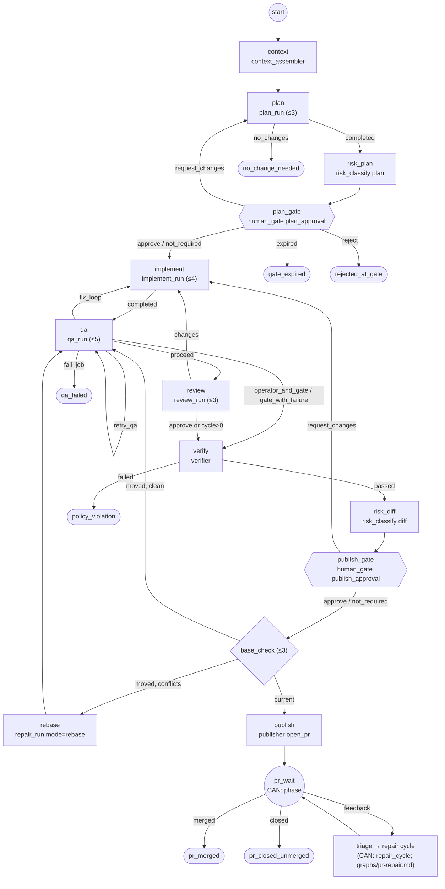
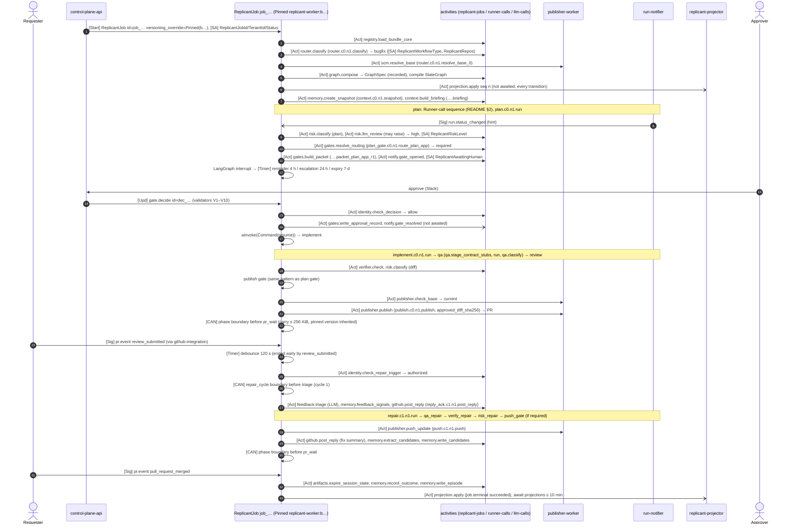

# Shape 1: Bugfix

**Definition:** [definitions/bugfix.yaml](definitions/bugfix.yaml) · **Compiled LangGraph code:**
[generated/bugfix_graph.py](generated/bugfix_graph.py) · **Constraints:** D-01, D-04, D-15, D-19

## Purpose

Fix a reported defect: router → context assembly → plan → (risk-gated) plan approval → implement → QA →
review → verifier → publish, then stay open through PR review and repair until merge (ADR-009).

## Decisions summary

| Decision | Reference |
|---|---|
| The plan gate opens only when `gates.resolve_routing` says so (risk ≥ `high` from deterministic rules on the plan, or `require_gates` in the request). An LLM may only raise risk | D-19, [gates.md](../gates.md) |
| QA failures caused by code loop back to `implement` (at most `qa.fix_iterations` = 2). Environment failures go to the operator and the publish gate | XD-05-03 |
| The reviewer's "changes" sends work back to `implement` once per cycle; in repair cycles (`cycle > 0`) review is advisory | this graph |
| Continue-As-New before `pr_wait` and before each `triage` | ADR-01-004 |

## Graph



## LangGraph code (compiled form)

The workflow compiles this graph from the YAML at start (`build_state_graph`). The generated module is the
explicit equivalent; a test asserts identical topology. Abridged to the pre-publish part; the full module
covers the PR tail.

```python
from langgraph.graph import END, START, StateGraph
from replicant_orchestration.engines.pregel import ReplicantGraphState, node, router, sink, start_router


def build(host) -> StateGraph:
    g = StateGraph(ReplicantGraphState)            # typed state: start_at, terminal, trail
    g.add_node("context", node(host, "context"))      # context_assembler
    g.add_node("plan", node(host, "plan"))            # plan_run, maxVisits 3
    g.add_node("risk_plan", node(host, "risk_plan"))  # risk_classify (plan)
    g.add_node("plan_gate", node(host, "plan_gate"))  # human_gate: interrupt() backed by Update gate.decide
    g.add_node("implement", node(host, "implement"))  # implement_run, maxVisits 4
    g.add_node("qa", node(host, "qa"))                # qa_run, maxVisits 5
    g.add_node("review", node(host, "review"))        # review_run, maxVisits 3
    g.add_node("verify", node(host, "verify"))        # verifier
    g.add_node("risk_diff", node(host, "risk_diff"))  # risk_classify (diff)
    g.add_node("publish_gate", node(host, "publish_gate"))
    g.add_node("base_check", node(host, "base_check"))
    g.add_node("rebase", node(host, "rebase"))        # repair_run mode=rebase
    g.add_node("publish", node(host, "publish"))      # publisher open_pr
    # (PR tail nodes and end__* sinks omitted here; see generated/bugfix_graph.py)
    g.add_conditional_edges(START, start_router, ["context", "plan", "plan_gate", "pr_wait", "triage"])  # abridged
    g.add_edge("context", "plan")
    g.add_conditional_edges("plan", router(host, "plan"), ["risk_plan", "end__no_change_needed", "end__node_failed"])
    g.add_edge("risk_plan", "plan_gate")
    g.add_conditional_edges("plan_gate", router(host, "plan_gate"),
                            ["implement", "plan", "end__gate_expired", "end__rejected_at_gate"])
    g.add_conditional_edges("implement", router(host, "implement"), ["qa", "end__no_change_needed", "end__node_failed"])
    g.add_conditional_edges("qa", router(host, "qa"), ["review", "qa", "verify", "implement", "end__qa_failed"])
    g.add_conditional_edges("review", router(host, "review"), ["verify", "implement"])
    g.add_conditional_edges("verify", router(host, "verify"), ["risk_diff", "end__policy_violation"])
    g.add_edge("risk_diff", "publish_gate")
    g.add_conditional_edges("publish_gate", router(host, "publish_gate"),
                            ["base_check", "implement", "end__gate_expired", "end__rejected_at_gate"])
    g.add_conditional_edges("base_check", router(host, "base_check"), ["publish", "qa", "rebase"])
    g.add_conditional_edges("rebase", router(host, "rebase"), ["qa", "end__node_failed"])
    g.add_conditional_edges("publish", router(host, "publish"),
                            ["pr_wait", "end__dry_run_completed", "end__ready_to_publish"])
    return g
```

The gate node's logic (`nodes/core.py`, `HumanGate`) is where `interrupt` happens:

```python
class HumanGate(NodeType):
    node_type = "human_gate"; role = "human_gate"; protected = True; interrupts = True
    async def run(self, ctx, config):
        kind = config["gateKind"]
        routing = await ctx.routing(kind)                  # gates.resolve_routing (WS-07), memoized
        base = {"risk_level": ctx.s.risk["level"], "rule_id": routing.get("rule_id", "none"),
                "reapprove": routing.get("reapprove_after_rebase", "on_conflict_or_risk_change")}
        if not (routing["required"] or ctx.host.node_when_true(ctx.node_key)):
            return NodeResult("not_required", {"decision": "approve", "required": False, **base})
        if kind == "publish_approval" and ctx.host.reapproval_waived(ctx.node_key):
            return NodeResult("approve", {"decision": "approve", "required": True, **base,
                                          "waived": "clean_rebase_same_risk"})  # D-19 clean rebase
        d = await ctx.gate(kind, packet={"node_key": ctx.node_key}, routing=routing)
        # ctx.gate: build packet + notify once (memoized), then langgraph.types.interrupt({"wait": "gate"});
        # the workflow loop waits on timers + the gate.decide Update, then ainvoke(Command(resume=decision))
        outcome = d.get("decision") or d["state"]
        return NodeResult(outcome, {"decision": outcome, "required": True, **base, "decision_id": d.get("decision_id")})
```

## Sequence (high-risk path: both gates, one repair cycle, merge)



## Timeouts and retries

From [README §2.2](README.md#22-retry-policies-and-timeouts-real-values-activity_optionspy). Shape-specific
run timeouts (node `config.timeouts`): planner 300/1,200/120 s (startup/active/finalize), implementer
300/5,400/300 s, QA 600/3,600/300 s. The orchestrator deadline per run is the sum plus 300 s.

## Failure modes and what the user sees

| Step | Failure | Behavior | User sees |
|---|---|---|---|
| Router | intent unclear | clarification gate ([router.md](../router.md)) | question in the originating channel |
| Plan | run fails (retryable) twice | ordinal 2 and 3; then `node_failed` | "Planner failed: NodeLost (3 attempts)" |
| Plan | `outcome: no_changes` | `end:no_change_needed` (succeeded) | "No change needed" with the planner's summary link |
| Plan gate | rejected / expired | `rejected_at_gate` / `gate_expired` | all channels updated |
| Plan gate | approver lost group membership | `identity.check_decision` → denied; gate stays open | "You are no longer an approver" |
| Implement | budget exhausted | budget extension gate (README §2.1) | approval request with amount |
| QA | regression | fix loop (≤ 2), then `qa_failed` (policy default) | "QA found 1 regression; fixing (1/2)" |
| QA | environment | retry once, then operator alert + publish gate (risk high) | "QA inconclusive: Kafka did not start" |
| Verify | secret found | `end:policy_violation` | "Publishing blocked: secret detected" (report link) |
| Publish | base moved | QA again / rebase run; re-approval only on conflicts or risk change | "Rebasing on main" |
| Publish | push rejected (branch protection) | `PushRejected` non-retryable → `node_failed` | reason shown; operator alert if systematic |
| Publish | digest mismatch (G-03) | Publisher refuses, non-retryable → `node_failed`; security alert | "Diff changed after approval" |
| PR review | 30 days without activity | `end:pr_wait_expired` | PR comment and notification |
| Any | worker version drained | job keeps its pinned version (drain never kills pinned work) | none |

## Open questions

None specific to this shape (see [README](README.md#open-questions)).

## Risks

- A busy main branch can loop `base_check` → QA. Bounded by `maxVisits: 3` (then failure plus takeover offer).

## Interfaces

- **Provided:** `graph/bugfix` (GraphDefinition).
- **Consumed:** README activity catalog; WS-07 gate routing; WS-05 QA routing; WS-03 run plan and budgets.
