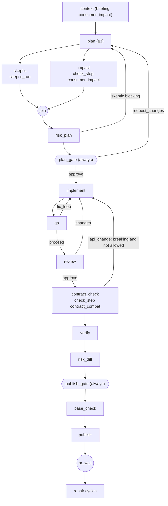
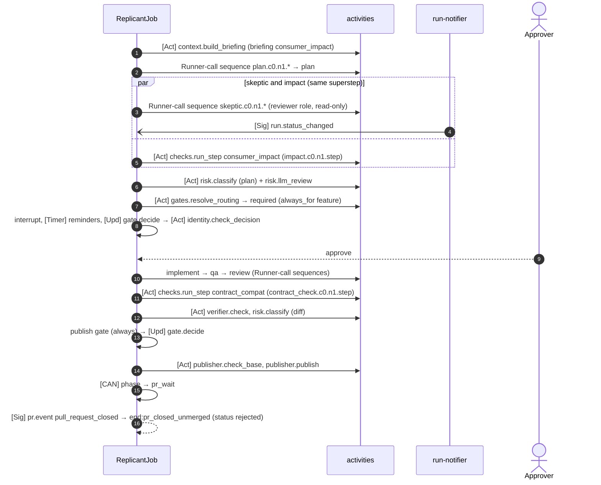

# Shape 2: Feature and API change

**Definitions:** [definitions/feature.yaml](definitions/feature.yaml), [definitions/api-change.yaml](definitions/api-change.yaml)
· **Compiled LangGraph code:** [generated/feature_graph.py](generated/feature_graph.py),
[generated/api_change_graph.py](generated/api_change_graph.py) · **Constraints:** D-01, D-13, D-19

## Purpose

Larger changes, where the plan matters as much as the code. Compared with bugfix, these shapes add a
skeptic/challenger run and a consumer impact briefing that run **in parallel** after the plan, a
contract-compatibility check after review, and **mandatory** plan and publish approval
(`gate_rules`: `always_for: [feature, api_change]`).

## Decisions summary

| Decision | Reference |
|---|---|
| Skeptic and consumer impact run in parallel (static fan-out from `plan`, join edge `[skeptic, impact] → risk_plan`); neither can interrupt (invariant: no interrupts in parallel branches) | ADR-01-008 |
| A blocking skeptic sends the plan back for revision (`plan.maxVisits = 3`) before any human sees it | D-19 (approvers get context, not noise) |
| `api_change`: `contract_check` in `block_on_breaking` mode routes breaking changes back to `implement` unless the request carries label `api-breaking-approved` (FGL `params.breaking_allowed_label in request.labels`) | D-13 |
| Consumer impact uses ecosystem sources (catalog, extracted contracts, call graph) through `checks.run_step(consumer_impact)` (WS-04), never a repository embedding index | D-13 |
| `context_assembler` runs with `briefing: consumer_impact` | WS-04 |

## Graph



## LangGraph code (the distinctive part)

```python
def build(host) -> StateGraph:
    g = StateGraph(ReplicantGraphState)
    for key in ("context", "plan", "skeptic", "impact", "risk_plan", "plan_gate", "implement", "qa",
                "review", "contract_check", "verify", "risk_diff", "publish_gate", "base_check", "rebase",
                "publish", "pr_wait"):                      # + PR tail nodes, see generated/feature_graph.py
        g.add_node(key, node(host, key))
    g.add_edge("context", "plan")
    g.add_edge("plan", "skeptic")                          # static fan-out: both run in one superstep
    g.add_edge("plan", "impact")
    g.add_edge(["skeptic", "impact"], "risk_plan")         # join: waits for both branches
    g.add_conditional_edges("risk_plan", router(host, "risk_plan"), ["plan", "plan_gate"])
    #   risk_plan -> plan when nodes['skeptic'].blocking ; otherwise plan_gate
    g.add_conditional_edges("contract_check", router(host, "contract_check"), ["implement", "verify"])
    #   api_change: implement when nodes['contract_check'].breaking and
    #               not (params.breaking_allowed_label in request.labels)
    ...
```

The interpreter engine runs the same fan-out with `asyncio.gather` and continues at the join. Both engines
schedule the two branches' activities in the same workflow task, so the conformance check compares that
block as a multiset.

## Sequence (feature, low risk, PR closed unmerged)



## Failure modes and what the user sees

| Step | Failure | Behavior | User sees |
|---|---|---|---|
| Skeptic | blocking 3 times | `plan` exceeds `maxVisits` → `loop_limit_exceeded` (failed) | "Plan rejected by the skeptic 3 times" with the reports |
| Impact | ecosystem sources stale or unavailable | `checks.run_step` retries (IO_SLOW); then the step returns `outcome: degraded` and the packet says so | "Consumer impact: partial (catalog stale 3 d)" |
| Join | one branch fails with `NodeFailed` | the job fails (no partial join) | failure with the branch's reason |
| Contract check | breaking change, no label | back to `implement` with the report staged (bounded by `implement.maxVisits`) | "Breaking change to `POST /v1/refunds`; revising" |
| Plan or publish gate | not required by risk | still required (`always_for`) | approval request |

## Open questions

| Question | Who decides | Options | Recommendation |
|---|---|---|---|
| Should `api_change` require approval from consumer owners (CODEOWNERS of impacted services)? | WS-07 (gate_rules eligibility) | requester's reviewers / plus consumer owners | Plus consumer owners: the packet already lists impacted services; `gates.resolve_routing` can widen `eligible` |

## Risks

- Parallel runs double sandbox demand at peak; the Runner quota (ADR-01-006) and per-tenant fairness absorb it.

## Interfaces

- **Provided:** `graph/feature`, `graph/api-change`.
- **Consumed:** WS-04 consumer impact (`checks.run_step consumer_impact`), contract checks (`contract_compat`).
