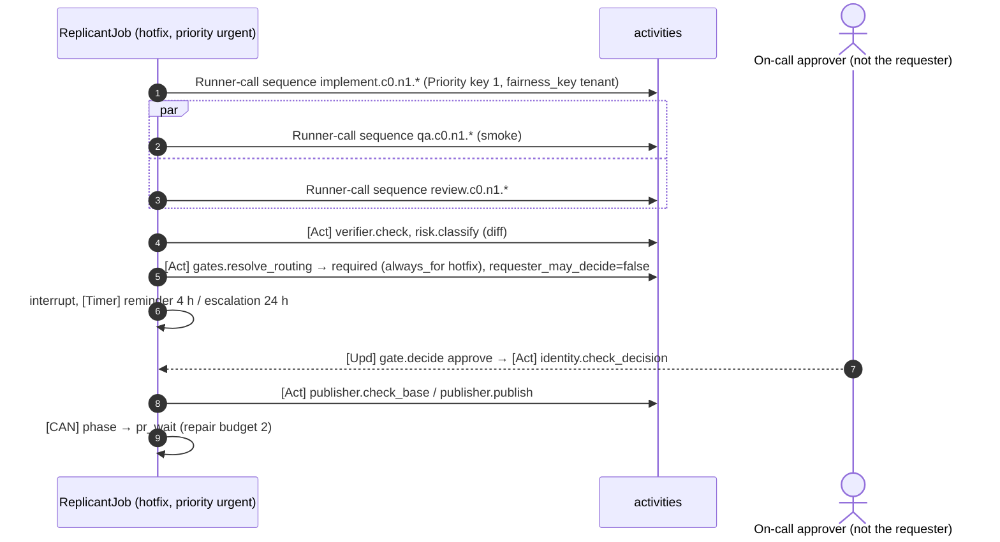
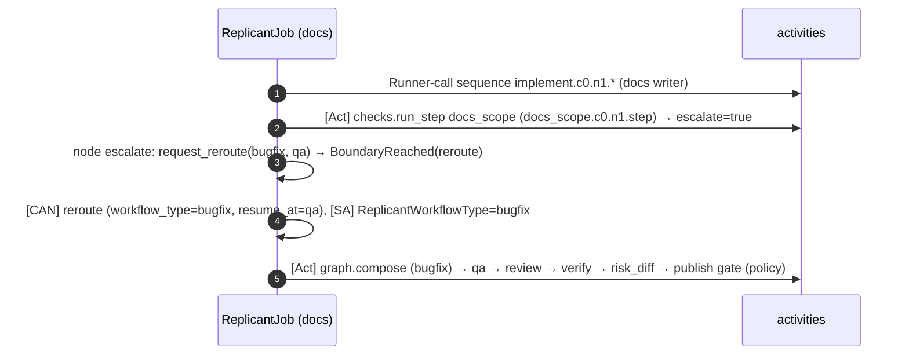

# Shape 4: Hotfix and docs / low-risk (gate variants)

**Definitions:** [definitions/hotfix.yaml](definitions/hotfix.yaml), [definitions/docs-low-risk.yaml](definitions/docs-low-risk.yaml)
· **Compiled code:** [generated/hotfix_graph.py](generated/hotfix_graph.py),
[generated/docs_low_risk_graph.py](generated/docs_low_risk_graph.py) · **Constraints:** D-19

## Purpose

These two shapes show how gate presence varies while the graph topology stays protected. Gate presence is
always decided by `gates.resolve_routing` on deterministic facts (D-19). Graphs and requests can only
**add** gates.

| | Hotfix | Docs / low-risk |
|---|---|---|
| Trigger rule | `requested: [hotfix]` and `priority: urgent` (the principal needs the hotfix permission, checked at intake) | `paths_all` match docs globs, or `requested: [docs]` |
| Plan | none (no planner, no plan gate) | none |
| Implement | `resourceProfile: large`, steering on | `docs-writer-claude`, `resourceProfile: small` |
| QA | `smoke` profile, **in parallel with review** | `docs-lint` profile (link check, build docs site) |
| Publish gate | **always** (`always_for: hotfix`), `requester_may_decide: false` (two-person rule) | only if `risk_diff` ≥ high (deterministic) or the request asked for it |
| Escalation | — | `docs_scope` finds non-docs paths → `reroute` to the bugfix graph at its `qa` node |
| Priority | `Priority(priority_key=1)` on every activity; `PriorityClass replicant-run-urgent` | 3 (normal) |
| Repair budget | 2 cycles; QA fix iterations 1 | 3 cycles |

## Decisions summary

| Decision | Reference |
|---|---|
| Hotfix runs QA and review concurrently to cut wall time (fan-out from `implement`, join into `after_checks`). Approval is never skipped | D-19 |
| A hotfix QA environment retry or re-QA after a rebase uses a standalone `qa_again` node, because re-running `qa` alone would wait forever on the join | invariant: joins only of single-node branches |
| Docs jobs that touch code are **escalated, never published as docs**: `reroute` sets the workflow type to `bugfix`, continues-as-new, and starts the bugfix graph at `qa` with the existing diff (stricter gates, review, verification) | D-19 ("never downgrade") |

## Graphs

```mermaid
flowchart TB
  subgraph Hotfix
    hc[context minimal] --> hi["implement (large)"]
    hi --> hq["qa (smoke)"]
    hi --> hr[review]
    hq --> hj((join))
    hr --> hj
    hj --> ha{"after_checks<br/>route"}
    ha -->|"qa proceed/gate and review approve"| hv[verify]
    ha -->|retry_qa| hqa["qa_again"]
    ha -->|fail_job| hx([qa_failed])
    ha -->|otherwise| hi
    hqa --> hv
    hv --> hrd[risk_diff] --> hpg{{"publish_gate<br/>ALWAYS, requester may not decide"}} --> hbc[base_check] --> hp[publish] --> hw((pr_wait))
  end
  subgraph Docs
    dc[context minimal] --> di["implement (docs writer)"]
    di --> ds{"docs_scope<br/>check_step"}
    ds -->|escalate| dr["escalate<br/>reroute → bugfix @ qa"]
    ds -->|in scope| dq["qa (docs-lint)"] --> dv[verify] --> drd[risk_diff] --> dpg{{"publish_gate<br/>only if risk ≥ high"}} --> dbc[base_check] --> dp[publish] --> dw((pr_wait))
  end
```



## LangGraph code (distinctive parts)

```python
# hotfix: QA and review in one superstep, then a router node after the join
g.add_edge("implement", "qa")
g.add_edge("implement", "review")
g.add_edge(["qa", "review"], "after_checks")
g.add_conditional_edges("after_checks", router(host, "after_checks"),
                        ["verify", "qa_again", "implement", "end__qa_failed"])
#   verify   when nodes['qa'].decision in ['proceed', 'operator_and_gate', 'gate_with_failure']
#                 and nodes['review'].verdict == 'approve'
#   qa_again when nodes['qa'].decision == 'retry_qa'

# docs: escalation instead of publishing a code change as "docs"
g.add_conditional_edges("docs_scope", router(host, "docs_scope"), ["escalate", "qa"])
#   escalate when nodes['docs_scope'].escalate
```

`Reroute.run` calls `host.request_reroute("bugfix", "qa")`. After the node completes, the host raises
`BoundaryReached(kind="reroute")`, continues-as-new with `workflow_type = bugfix`, and recomposes the
bugfix graph. That graph's `qa` node then runs on the docs job's diff.

## Sequences





## Failure modes

| Shape | Failure | Behavior | User sees |
|---|---|---|---|
| Hotfix | requester approves own hotfix | validator V9 `SelfApprovalForbidden` | "Another approver is required" |
| Hotfix | QA fails once | `fix_iterations` 1 → `qa_failed` (policy default) | "Hotfix QA failed" |
| Hotfix | no approver within 24 h | escalation to the on-call group (WS-07 routing) | escalation message |
| Docs | code paths touched | reroute to bugfix | "Escalated to bugfix: code changed in internal/ledger" |
| Docs | QA (docs-lint) environment failure | retry, then operator plus publish gate (risk floor high) | "Docs build environment failed" |

## Interfaces

- **Provided:** `graph/hotfix`, `graph/docs-low-risk`.
- **Consumed:** WS-07 gate_rules (`always_for`, `requester_may_decide`); router rules (router.md).
