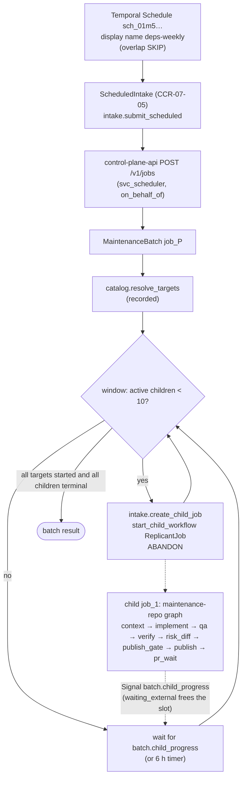
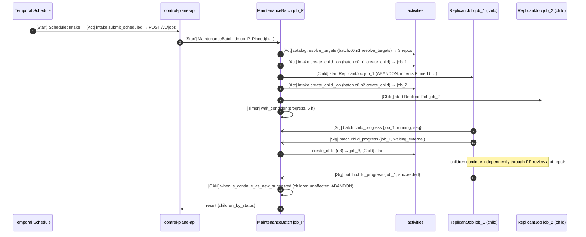

# Shape 5: Scheduled maintenance (fan-out)

**Workflow:** `MaintenanceBatch` ([reference/replicant_orchestration/maintenance.py](../reference/replicant_orchestration/maintenance.py))
· **Child graph:** [definitions/maintenance-repo.yaml](definitions/maintenance-repo.yaml) ·
**Constraints:** D-01 (child workflows), ADR-009 · **ADR:** [ADR-01-007](../adr/007-maintenance-fan-out-as-abandoned-child-jobs.md)

## Purpose

Run a dependency upgrade or a lint/codemod sweep across up to 1,500 repositories from a Temporal Schedule:
one parent workflow, one child **job** per repository, with concurrency limits and per-repository PRs.

## Decisions summary

| Decision | Reference |
|---|---|
| The Temporal Schedule `sch_<ulid>` (C-IDS §12; the human name is the schedule's `display_name`, R1V-038) starts the `ScheduledIntake` system workflow (CCR-07-05), whose activity `intake.submit_scheduled` calls `POST /v1/jobs` as `svc_scheduler` with `on_behalf_of` = the schedule owner and `dedupe_key = schedule:<sch_id>:<time>`. Intake starts `MaintenanceBatch` with workflow ID = `job_id` | C-JOBREQ, C-IDS 1.9.0, CCR-07-05 |
| Overlap policy `SKIP` (a sweep never runs twice concurrently); catchup window 1 h | [verified: `ScheduleOverlapPolicy` SKIP default, catchup default 1 year in temporalio 1.34.0, 2026-10-24] |
| Targets resolved once (`catalog.resolve_targets`, activity ID `batch.c0.n1.resolve_targets`) against the WS-04 service catalog, recorded, capped by `target_selector.max_repos` | D-13 |
| Children: `intake.create_child_job` allocates the child `job_id` and intake row with `parent_job_id`, then `start_child_workflow("ReplicantJob", id=<child job_id>, parent_close_policy=ABANDON)`. The child inherits the parent's pinned version (same deployment's task queue). Activity ID for child index *i* (0-based): `batch.c<i // 999>.n<i % 999 + 1>.create_child`. The C-IDS ordinal is 1 to 999, so the index spreads over the cycle field, which is unique for up to 999,000 children (R1-011; `maintenance.child_activity_id`, unit-tested) | ADR-01-007, C-IDS §2 |
| **Batch spend cap** (R2-062): `repair_limits.maintenance.max_batch_usd` (default $2,000). Before each wave of child starts, and before every 10th start within a wave, the parent reads `cost.batch_spend` (the cost ledger summed by `parent_job_id`; WS-03, XD-FIX-R2-062). At the cap it stops starting children (`stopped_reason: batch_spend_cap`, timeline notice). Running children finish under their own job budgets, so the overshoot is bounded by `max_concurrency × maintenance jobUsd` (10 × $15) | R2-062 |
| **Projection** (R1-010): the batch emits `ProjectionEvent`s with a `JobSnapshot` (`workflow_type: maintenance`, phase `fan_out`, then `done`) at start, once per wake-up when child counts changed (coalesced), and at the end. It upserts `ReplicantStatus` and `ReplicantPhase`. C-IDS 2.0.0 §4.1 now lists `ReplicantPhase` on `MaintenanceBatch`
too (R1V-085). Children's snapshots carry `parent_job_id`, from which the projector derives `jobs_read.batches` counts (XD-FIX-R1-010). The UI never needs the `batch.snapshot` Query on page load | C-STATE §2.1, C-IDS §4.1, ADR-004 |
| Sliding window: at most `max_concurrency` (default 10) children in `queued`/`running`/`waiting_human`/`paused`. A child in `waiting_external` (PR under review) releases its slot | ADR-009 |
| Children report status changes with `SignalExternalWorkflowExecution` `batch.child_progress` (CCR-01-04), guarded by `seq` against reordering | CCR-01-04 |
| `batch.cancel` → `RequestCancelExternalWorkflowExecution` to each non-terminal child; children treat native cancel like `job.cancel` | C-MSG, ADR-001 |
| Priority key 5 and fairness key = tenant on every parent and child activity | ADR-01-006 |

## Graph and flow



## LangGraph and workflow code

The per-repository child runs the `maintenance-repo` graph. Excerpt of
[generated/maintenance_repo_graph.py](generated/maintenance_repo_graph.py) (generated by
`tools/graph_codegen.py` from [definitions/maintenance-repo.yaml](definitions/maintenance-repo.yaml)):

```python
def build(host: Any) -> StateGraph:
    g = StateGraph(ReplicantGraphState)
    g.add_node("context", node(host, "context"))  # context_assembler, phase context
    g.add_node("implement", node(host, "implement"))  # implement_run, phase implementing, maxVisits 3
    g.add_node("qa", node(host, "qa"))  # qa_run, phase qa, maxVisits 4
    g.add_node("verify", node(host, "verify"))  # verifier, phase verify
    g.add_node("risk_diff", node(host, "risk_diff"))  # risk_classify, phase verify
    g.add_node("publish_gate", node(host, "publish_gate"))  # human_gate, phase publish_gate
    g.add_node("base_check", node(host, "base_check"))  # base_check, phase rebase_reverify, maxVisits 3
    g.add_node("publish", node(host, "publish"))  # publisher, phase publishing
    g.add_node("pr_wait", node(host, "pr_wait"))  # pr_feedback_wait, phase pr_review
    # ... the shared PR tail (pr-repair.md), terminal sinks, and start_router for resume-at-node
    g.add_edge('context', 'implement')
    #   implement -> qa when nodes['implement'].outcome == 'completed'
    #   implement -> end__no_change_needed when nodes['implement'].outcome == 'no_changes'
```

The fan-out parent is ordinary workflow code, not a graph (excerpt of
[reference/replicant_orchestration/maintenance.py](../reference/replicant_orchestration/maintenance.py)):

```python
async def run(self, inp: BatchInput) -> dict[str, Any]:  # excerpt
    s = self.s
    ...
    while True:
        started = 0
        while (not s.cancel_requested and s.stopped_reason is None and s.next_index < len(s.targets)
               and sum(1 for st in s.children.values() if st in ACTIVE) < s.max_concurrency):
            if s.max_batch_usd and started % SPEND_CHECK_EVERY == 0 and not await self._spend_ok(prio):
                break  # R2-062: batch spend cap reached
            await self._start_child(s.next_index, prio)  # activity ID child_activity_id(i) (R1-011)
            s.next_index += 1
            started += 1
        if self._last_emitted != self._counts():  # coalesced JobSnapshot projection (R1-010)
            self.emit("phase.entered", "fan-out progress ...")
        ...  # done check, Continue-As-New by history thresholds, wait for batch.child_progress (or 6 h)
```

Measured: with `max_batch_usd` 100 and a ledger reporting $150 after the first wave, the batch stopped
after 2 of 4 children, both children merged, and every batch projection validated against C-MSG, with
phases `fan_out` then `done` [verified: scenario `batch_spend_cap`, 2026-10-24].

## Sequence



Measured: 3 repositories with window 2 → 3 children created, each reaching PR review, merged, batch
`children_by_status = {succeeded: 3}`, parent history replays clean (`tests/test_scenarios.py
maintenance_batch`, 2026-10-24).

## History sizing

The parent spends about 6 events to create a child (activity) plus 2 for the child start, and about 4 per
progress Signal (Signal plus workflow task). With 3 to 5 status changes per child, that is roughly 30 events
per child, so about 45,000 for 1,500 repos. The parent continues-as-new every ~4,096 events (about 130
children per run, roughly 12 runs). The carry holds the status table (1,500 × about 60 bytes ≈ 90 KiB)
within the 256 KiB budget.

**10× scale: `MaintenanceShard` (R2-046, R1V-006, CCR-00-01 ratified, XD-W3-R1V-006).** C-JOBREQ 2.0.0 allows
`target_selector.max_repos` up to 15,000. `catalog.resolve_targets` writes the repository list to S3 and
returns `{children_index_uri, count}`, so repositories never enter history. Workflows read them in pages of 100
with `catalog.read_targets`, and only the current page is carried. Up to 2,000 repositories (`shard_size`, which
policy may lower), the batch fans out itself as described above.

Above 2,000, the batch starts internal `MaintenanceShard` children. Each has ID `<job_id>:shard:<n>`, runs on task
queue `replicant-jobs` with the batch's pinned version, uses ParentClosePolicy `REQUEST_CANCEL`, and covers at most
2,000 repositories. Each shard runs the same sliding window over its index range with an equal share of
`max_concurrency`, creates child jobs through `intake.create_child_job` with `ParentClosePolicy.ABANDON` (the
children's `parent_job_id` is still the batch), and receives their `batch.child_progress` Signals
(`ReplicantJobInput.progress_workflow_id` = the shard; C-MSG 2.0.0). It continues-as-new on its own thresholds
and returns per-status counts. A shard's carry is at most 2,000 × about 60 B, about 120 KiB, so it fits
the 256 KiB budget. The batch's history stays at a few events per shard (at most 8 shards for 15,000
repositories), and it aggregates the shard results. `batch.cancel` cancels the running shards, and each shard
cancels its own children. The batch spend cap still applies, because every shard reads
`cost.batch_spend(batch_job_id)`. Measured with `shard_size` lowered to 2: 5 repositories ran as 3 shards,
all 5 children merged, and the batch reported `{succeeded: 5}`, with every batch and shard history replaying
[verified: scenario `maintenance_shards`, 2026-10-24].

## Failure modes

| Failure | Behavior | User sees |
|---|---|---|
| Catalog unavailable at start | `catalog.resolve_targets` retries (IO_SLOW, 1 h); then the batch fails | "Sweep failed: catalog unavailable" |
| Child creation rejected (repo archived, tenant quota) | activity non-retryable → the child is recorded as `failed` in the table; the sweep continues | child row "skipped: archived" |
| A child fails | counts as terminal `failed`; slot freed | batch view shows failures |
| Parent terminated by an operator | children continue (ABANDON); progress Signals to a closed parent fail and are ignored | children visible individually |
| Signals reordered (child CAN) | `seq` guard keeps the newest status | — |
| Schedule fires while the previous sweep runs | `SKIP` | "Skipped: previous sweep still running" |
| Batch spend cap reached | no new children; running children finish; result `stopped_reason: batch_spend_cap` | "Sweep stopped at its $2,000 spend cap (612 of 1,500 repositories)" |

## Interfaces

- **Requires CCR-01-04:** Signal `batch.child_progress` on `MaintenanceBatch`.
- **Consumed:** WS-04 `catalog.resolve_targets`; WS-07 `intake.create_child_job`; WS-03 `cost.batch_spend`
  (XD-FIX-R2-062).
