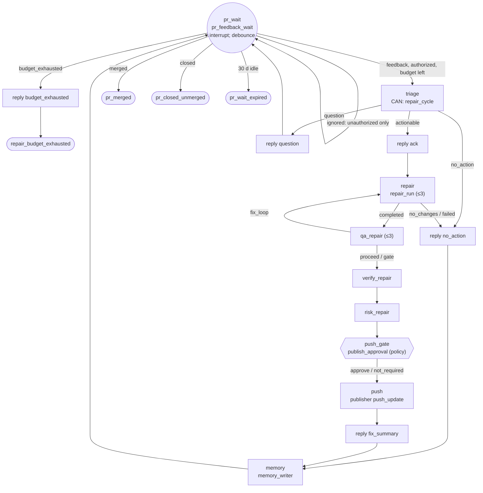
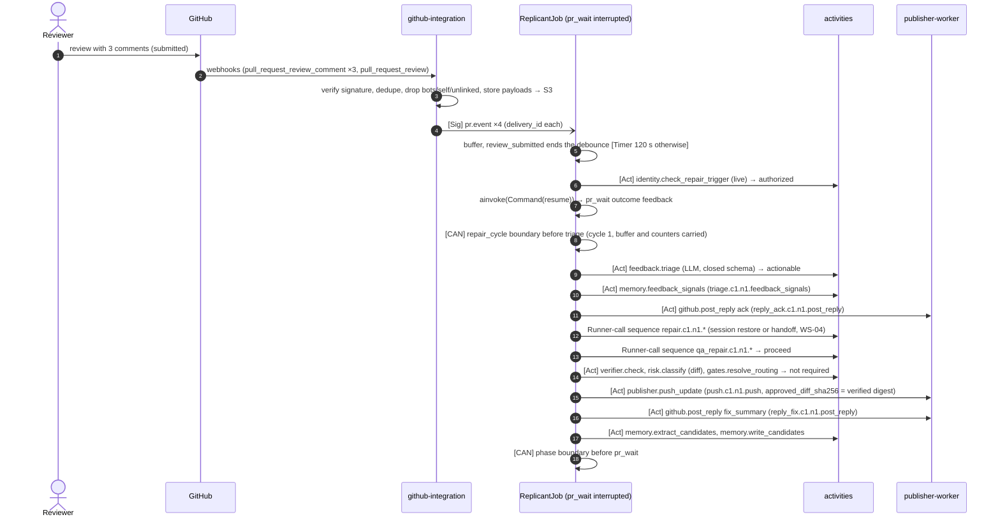

# Shape 3: PR-comment repair

**Definitions:** the shared PR tail of every PR-producing graph (for example
[definitions/bugfix.yaml](definitions/bugfix.yaml) from `pr_wait`), and the standalone
[definitions/pr-repair.yaml](definitions/pr-repair.yaml) · **Compiled code:**
[generated/pr_repair_graph.py](generated/pr_repair_graph.py) · **Constraints:** D-15, D-19, ADR-009

## Purpose

When a Replicant PR receives review comments, the job (still open in `pr_review`) reads them, replies,
repairs on the same branch through a new AgentRun, re-runs QA and verification, pushes through the
Publisher, and writes candidate memory. The loop is bounded per job, and only authorized humans can
trigger it. A standalone `pr_repair` job handles a `/replicant` command on a PR the Replicant did not open, or
on a PR whose job has expired.

## Decisions summary

| Decision | Reference |
|---|---|
| Feedback arrives as Signal `pr.event` (durable without workers), deduplicated by `delivery_id` (carried 7 days), buffered, and debounced: 120 s after the last comment, or immediately on `review_submitted` | C-MSG 2.2 |
| Before any repair, `identity.check_repair_trigger` re-verifies every actor live (linked, org member, write permission or above, not a bot, not the Replicant app). github-integration already filtered; this is the authoritative check | D-15, D-18 |
| One repair cycle = Continue-As-New before `triage` (cycle + 1). Comments arriving during a cycle are buffered into the next one | ADR-01-004 |
| Repair budget `repair_limits.repair_cycles` (default 5; hotfix 2; maintenance 1; docs 3; standalone 1). Exhausted → reply and `end:repair_budget_exhausted` | D-15 |
| Triage is an LLM call that is tool-less and returns a closed schema (`actionable` / `question` / `no_action`, plus comment IDs to address); comment text never reaches workflow-generated text | G-24, C-MSG §3.4 |
| Replies use fixed templates filled with structured data (`ack`, `fix_summary`, `no_action`, `question`, `budget_exhausted`) | D-21 |
| Repair pushes go through the same verification and the same policy-driven publish gate (`push_gate`); the Publisher verifies the approved or verified diff digest | D-19, G-03 |
| Memory: `memory.feedback_signals` after triage; `memory.extract_candidates` + `memory.write_candidates` after each cycle (candidates only; promotion is admin-only, D-25) | D-14, D-15, D-25 |

## Graph (the loop)



Standalone `pr-repair.yaml`: `context → triage → … → push → reply_fix → memory → end:repair_pushed` (one
cycle; follow-up commands are new jobs).

## LangGraph code (the PR tail, from `generated/bugfix_graph.py`)

Excerpt of the code `tools/graph_codegen.py` generates from [definitions/bugfix.yaml](definitions/bugfix.yaml)
(lines 121–155; every PR-producing graph has the same tail). `router(host, key)` evaluates the FGL
guards in the comments against `JobState` through `host.route()`. The standalone graph is
[generated/pr_repair_graph.py](generated/pr_repair_graph.py).

```python
def build(host: Any) -> StateGraph:  # excerpt: nodes, sinks and start_router omitted
    ...
    #   pr_wait -> end__pr_merged when nodes['pr_wait'].outcome == 'merged'
    #   pr_wait -> end__pr_closed_unmerged when nodes['pr_wait'].outcome == 'closed'
    #   pr_wait -> end__pr_wait_expired when nodes['pr_wait'].outcome == 'expired'
    #   pr_wait -> reply_budget when nodes['pr_wait'].outcome == 'budget_exhausted'
    #   pr_wait -> triage when nodes['pr_wait'].outcome == 'feedback'
    #   pr_wait -> pr_wait otherwise
    g.add_conditional_edges('pr_wait', router(host, 'pr_wait'), ['end__pr_closed_unmerged', 'end__pr_merged', 'end__pr_wait_expired', 'pr_wait', 'reply_budget', 'triage'])
    #   triage -> reply_ack when nodes['triage'].outcome == 'actionable'
    #   triage -> reply_question when nodes['triage'].outcome == 'question'
    #   triage -> reply_no_action otherwise
    g.add_conditional_edges('triage', router(host, 'triage'), ['reply_ack', 'reply_no_action', 'reply_question'])
    g.add_edge('reply_ack', 'repair')
    #   repair -> qa_repair when nodes['repair'].outcome == 'completed'
    #   repair -> reply_no_action otherwise
    g.add_conditional_edges('repair', router(host, 'repair'), ['qa_repair', 'reply_no_action'])
    #   qa_repair -> verify_repair when nodes['qa_repair'].decision in ['proceed', 'operator_and_gate', 'gate_with_failure']
    #   qa_repair -> qa_repair when nodes['qa_repair'].decision == 'retry_qa'
    #   qa_repair -> end__qa_failed when nodes['qa_repair'].decision == 'fail_job'
    #   qa_repair -> repair otherwise
    g.add_conditional_edges('qa_repair', router(host, 'qa_repair'), ['end__qa_failed', 'qa_repair', 'repair', 'verify_repair'])
    #   verify_repair -> risk_repair when nodes['verify_repair'].passed
    #   verify_repair -> end__policy_violation otherwise
    g.add_conditional_edges('verify_repair', router(host, 'verify_repair'), ['end__policy_violation', 'risk_repair'])
    g.add_edge('risk_repair', 'push_gate')
    #   push_gate -> push when nodes['push_gate'].outcome in ['approve', 'not_required']
    #   push_gate -> repair when nodes['push_gate'].outcome == 'request_changes'
    #   push_gate -> end__gate_expired when nodes['push_gate'].outcome == 'expired'
    #   push_gate -> end__rejected_at_gate otherwise
    g.add_conditional_edges('push_gate', router(host, 'push_gate'), ['end__gate_expired', 'end__rejected_at_gate', 'push', 'repair'])
    g.add_edge('push', 'reply_fix')
    g.add_edge('reply_fix', 'memory')
    g.add_edge('reply_no_action', 'memory')
    g.add_edge('reply_question', 'pr_wait')
    g.add_edge('memory', 'pr_wait')
    g.add_edge('reply_budget', 'end__repair_budget_exhausted')
```

## Exit conditions (all explicit)

| Condition | Outcome | Status |
|---|---|---|
| PR merged | `pr_merged` | succeeded |
| PR closed unmerged | `pr_closed_unmerged` | rejected |
| No PR activity for `pr_wait.expiry_days` (30; maintenance 14) | `pr_wait_expired` | expired |
| Authorized feedback after `repair_cycles` cycles | `repair_budget_exhausted` (reply posted) | failed |
| QA still failing after `qa.fix_iterations` in a cycle | `qa_failed` (or a draft-only gate per policy) | failed |
| `repair` / `qa_repair` loop exceeds `maxVisits` (3) in one cycle | `loop_limit_exceeded` | failed |
| Secret or policy violation in the repaired diff | `policy_violation` | failed |
| Push gate rejected or expired | `rejected_at_gate` / `gate_expired` | rejected / expired |
| `job.cancel` / `job.takeover` | `cancelled_by_user` / `taken_over` | cancelled / taken_over |

## Sequence (one cycle)



## Failure modes

| Failure | Behavior | User sees |
|---|---|---|
| Comment from a bot, the Replicant app, or an unlinked user | dropped by github-integration (unlinked humans get a link instruction); if one slips through, `identity.check_repair_trigger` filters it and `pr_wait` returns `ignored` | reply with link instruction |
| Commenter lost write permission between comment and repair | live check denies; event ignored | none |
| Signal flood (forged or noisy) | dedupe by `delivery_id`; 10,000 Signals per execution limit; CAN resets the run | none |
| `pull_request_synchronize` by a human pushing to the Replicant branch | buffered; the next repair starts from the PR head (`head_sha`) via the handoff (WS-04) | timeline "PR updated by alice" |
| Repair run produces no changes | `reply_no_action` with the reason | "No change made: …" |
| Publisher push rejected (force-push protection, branch deleted) | non-retryable → `node_failed`; reply posted | "Could not push: branch protected" |

## Open questions

| Question | Who decides | Options | Recommendation |
|---|---|---|---|
| Debounce window (OQ in C-MSG) | WS-01 / WS-04 | 0 s / 120 s / until review submitted | 120 s or `review_submitted`, whichever is first (implemented) |

## Risks

- Long PR waits keep pinned worker versions alive (versioning.md §5 drain sizing).

## Interfaces

- **Consumed:** C-MSG `pr.event`; WS-07 `identity.check_repair_trigger`, `github.post_reply` templates;
  WS-04 memory activities; WS-03 repair runs.
