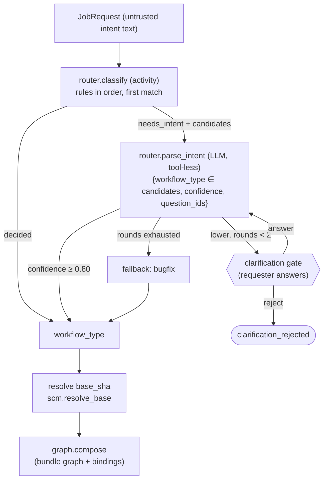

# Router: JobRequest → workflow type and graph

**Section:** 01-orchestration (WS-01) · **Constraints:** D-01 ("the router classifies the trigger and
selects a subgraph"), D-19 (never downgrade), D-21 (untrusted text), G-24 · **Contracts:** C-JOBREQ 2.0.0,
C-MSG 2.0.0 (`gate.decide` answer), C-IDS §4.1 (`ReplicantWorkflowType`)

## Purpose

Classify each normalized `JobRequest` into one of the eight workflow types and its pinned graph:
deterministic rules first, LLM-assisted intent parsing only when the rules cannot decide, confidence
thresholds, and a human clarification path. The result is a `RouterDecision`
([schema](schemas/router-decision.v1.json)).

## Decisions summary

| Decision | Reference |
|---|---|
| The router is the workflow prologue (logical node key `router`), not a graph node, because it selects the graph | D-01 |
| Rules (`policy/router-rules`, policyType `router_rules`, global only) are evaluated by activity `router.classify`; the first matching rule decides. Results are recorded in history | D-19 |
| LLM intent parsing (`router.parse_intent`, queue `replicant-llm-calls`) runs only on `needs_intent`. It is tool-less, its output is a closed-schema **selection** among the rule's candidates plus a confidence, and its free text never reaches workflow state or other prompts | G-24, XD-09-08 |
| Thresholds: accept at ≥ 0.80; ask for clarification below that (the `clarify_below` 0.55 boundary only changes the question template); at most 2 clarification rounds, then `fallback: bugfix` | this doc §3 |
| A requested type is honored only if the channel allows it, and may only be replaced by a **stricter** type (`strictness` order). Docs requests whose paths are not all docs escalate to bugfix | D-19 |
| Graph selection is `bundle.spec.graphs[workflow_type]`, composed with the repository's codebase-binding modifiers | ADR-01-008 |



## 1. Inputs the rules see (deterministic facts only)

`source.channel`, `source.event_type`, `workflow_type` (requested), `priority`, `constraints.labels`,
issue or PR labels from `attachments` metadata (adapter-provided, not free text), `targets[].paths`,
`targets[].pull_request` presence, and the repository's language and service group from the WS-04 catalog.
The rules never see intent text.

## 2. Rule language and the default rule set

Kind schema: [schemas/policy-router-rules.v1.json](schemas/policy-router-rules.v1.json). Default policy:
[policies/router-rules.yaml](policies/router-rules.yaml). Matchers (all must hold): `channel`, `event_type`,
`requested`, `priority`, `labels_any`, `has_pull_request`, `paths_any`, `paths_all`. Decisions:
`workflow_type: <type> | requested`, `require_priority` + `else`, `escalate_if`, or
`needs_intent` + `candidates`.

| # | Rule | Decides |
|---|---|---|
| 1 | `schedule-is-maintenance` | `maintenance` (MaintenanceBatch) |
| 2 | `pr-command-is-pr-repair` (`/replicant` on a PR) | `pr_repair` |
| 3 | `explicit-hotfix` (requested hotfix + urgent; permission checked at intake) | `hotfix` |
| 4 | `hotfix-label-needs-urgent` | `hotfix` if urgent, else `bugfix` |
| 5 | `requested-type-honored` (with docs → bugfix escalation on non-docs paths) | requested |
| 6 | `api-contract-paths` (`*.proto`, `openapi*.y*ml`, `*.graphql`, `asyncapi*`, `api/**`) | `api_change` |
| 7 | `docs-only-paths` | `docs` |
| 8 | `issue-label-bug` | `bugfix` |
| 9 | `issue-label-feature` | `feature` |
| 10 | `otherwise-ask-the-model` | `needs_intent`, candidates bugfix / feature / api_change / docs |

## 3. LLM intent parsing (G-24)

| Property | Value |
|---|---|
| Activity | `router.parse_intent` (queue `replicant-llm-calls`, `LLM` retry class), logical ID `router.c0.n<k>.intent` (memoized: re-entry after a clarification never re-asks) |
| Model | the bundle's pinned router model (C-DEF `models[].used_by` includes `router`) through the AI gateway with the replicant-worker service credential |
| Tools | none. The call uses structured output only |
| Input | `request_id` (the activity loads the intent text and attachments from the intake record and S3 itself), the candidate list, and the clarification answer reference. Untrusted text is wrapped in data delimiters and the system prompt states it is data |
| Output (closed schema) | `{"workflow_type": <one of candidates>, "confidence": 0..1, "question_ids": [<ids from a fixed question catalog>]}`. Any other value → schema violation → treated as confidence 0 |
| Selection-only semantics | the model selects among rule-provided candidates. It cannot introduce a type, cannot choose a less strict type than a rule-decided one, and cannot lower risk (risk is separate, D-19) |
| Prompt | Langfuse prompt pinned in the bundle (`router-intent@<version>`) |

Clarification questions come from a fixed catalog (`which_service`, `bug_or_feature`,
`expected_behavior`, `scope_paths`, `api_compatibility`), rendered by WS-07 into the originating channel. No
model text is shown to the requester.

## 4. Clarification gate

A `clarification` gate (kind `clarification`, `requester_may_decide: true`, eligible: the requester; expiry
14 days; `on_expiry: expire`), opened through `NodeContext.gate` in the prologue. The answer arrives as
`gate.decide` with `decision: answer` and `answer_text` (C-MSG, ≤ 16 KiB). The decision record keeps a
reference (`answer_ref = update:<decision_id>`), and `gates.write_approval_record` stores the text as
`approval_text` (C-ART 2.0.0). The workflow also keeps the text in `JobState.clarification_answer` until
routing ends (R1-017), and the next `router.parse_intent` call receives it **in its activity input**:
`clarification_answer: {decision_id, text, trust: "untrusted"}`. replicant-worker therefore needs no read
access to `intake` or the adapters' stores (C-PG). The activity puts the text only inside a delimited
untrusted-input block, and the output stays a closed-schema selection (G-24). The text leaves the carry when
routing completes. `reject` ends the job as `clarification_rejected`. While the gate is open, the job's phase
is `clarification` (C-IDS). [verified: scenario `router_clarify` checks the second call's input,
2026-10-24]

## 5. Output: RouterDecision

```json
{
  "schema": "replicant.router-decision/v1",
  "workflow_type": "bugfix",
  "requested_type": "auto",
  "method": "llm",
  "rules_fired": ["otherwise-ask-the-model"],
  "confidence": 0.91,
  "candidates": ["bugfix", "feature", "api_change", "docs"],
  "graph": {"ref": "graph/bugfix@14", "digest": "sha256:4e6a8c0b2d3f5e7a9c1b3d5f7e9a1c2b4d6f8e0a2c3e5b7d9f1a3c4e6b8d0f2a",
            "composed_digest": "sha256:9b1f3c5d7e9a0b2c4d6e8f0a1b3c5d7e9f0a2b4c6d8e0f1a3b5c7d9e1f3a5b7c",
            "modifiers_applied": ["insertBefore:policy/codebase-bindings.payments@4"]},
  "targets": [{"repo": "github.com/acme-payments/ledger-api", "base_ref": "main",
               "base_sha": "8c1e4f2a9b7d3c6e5f0a1b2c3d4e5f6a7b8c9d0e"}]
}
```

Effects: `ReplicantWorkflowType` and `ReplicantRepos` search attributes upserted; timeline `job.routed`;
`JobState.exports["router"]` (guards may read `nodes['router'].method`).

## 6. Latency budget (XD-02-09)

Routing is allocated 8 s of the 90 s sandbox-ready p95. Design targets (not yet measured against real services): `registry.load_bundle_core` (~50 ms),
`router.classify` (~100 ms), `scm.resolve_base` (~300 ms), `graph.compose` (~200 ms), plus workflow task
overhead. With an LLM call (~3–6 s, only when rules do not decide) the total stays under 8 s. A
clarification is a human wait and does not count toward sandbox-ready.

## Failure modes

| Failure | Behavior | User sees |
|---|---|---|
| Router policy missing from the bundle | `registry.load_bundle_core` fails validation at bundle build (never at runtime) | — |
| LLM unavailable | `LLM` retry class (5 attempts, 20 min); then the call raises `NodeFailed('dependency_unavailable')` without holding the job (non-holding form, R1-006), and the router uses the rule's `fallback` (`bugfix`) with `method: fallback` and rule `llm_unavailable` | "Routed as bugfix (classifier unavailable)" |
| `router.classify` or `graph.compose` fails non-retryably (for example `SchemaViolation` in the pinned bundle) | `NodeFailed(<type>)`: job `failed` (`node_failed`) with a terminal projection; the execution completes (graphs/README.md §2.2) | failure with reason |
| A dependency of `router.classify` / `registry.load_bundle_core` / `graph.compose` is down past retries | dependency hold (status `paused`), automatic re-probe (graphs/README.md §2.2) | "Waiting for a platform service" |
| Requested type not allowed on the channel | stricter allowed type, or rejection at intake (WS-07) | "hotfix is not available from Jira" |
| Requester never answers the clarification | gate expiry → `expired` | reminder, then expiry notice |
| Prompt injection in the issue text | the model can only select among candidates; selection errors cost a stricter or wrong graph, never a skipped gate (gates come from deterministic risk) | — |

## Open questions

| Question | Who decides | Options | Recommendation |
|---|---|---|---|
| Should `feature` vs `bugfix` misclassification be correctable mid-job? | Product | reroute on request / new job | Allow a requester `job.steer` message to propose reroute; the planner can recommend `reroute` to a stricter graph only |

## Risks

- Label conventions differ across 40 tenants. Tenant layers cannot change routing (global only, CCR-06-06),
  so label mappings are curated centrally. The UI shows `rules_fired` for every job.

## Interfaces

- **Provided:** `router_rules` kind schema; RouterDecision schema.
- **Consumed:** C-JOBREQ; WS-04 catalog facts; WS-07 clarification rendering and answer persistence.
