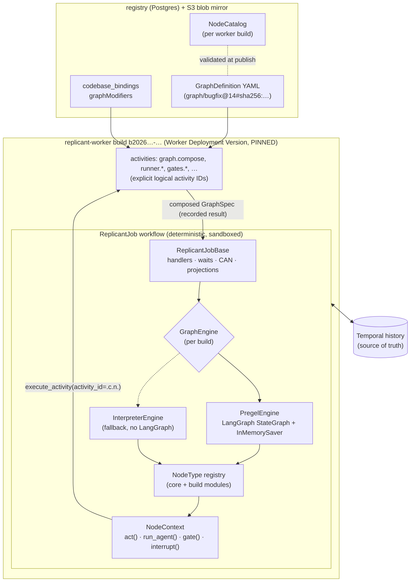
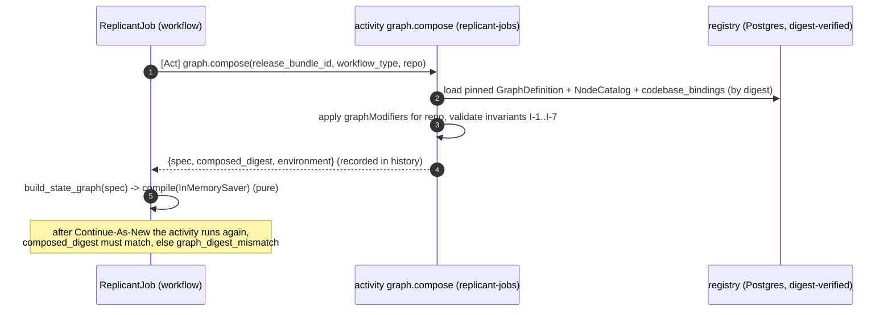

# Temporal and LangGraph Integration

**Section:** 01-orchestration (WS-01) · **Constraints:** D-01, D-02, D-03, D-04 · **Contracts:** C-MSG 2.0.0,
C-IDS, C-STATE §2–§3, C-RUNNER 3.0.0, C-DEF 3.0.0

## Purpose

This document defines how Temporal (the durable execution spine) and LangGraph (graph shapes and routing)
work together for every Replicant workflow. It covers what Temporal's LangGraph integration actually is
today, Replicant's adapter layer and fallback engine, the determinism rules for graph and node code, and
how graph state is represented inside Temporal and within its size limits.

## Decisions summary

| # | Decision | Constraint | ADR |
|---|---|---|---|
| 1 | LangGraph `StateGraph`s execute **inside the workflow** (Pregel runtime, `InMemorySaver`), compiled per job from the bundle's GraphDefinition. Every unit of real work inside a node is an activity with an explicit logical ID | D-01 (challenged in part), D-02, D-04, ADR-008 | [ADR-01-001 Challenge: D-01](adr/001-challenge-d01-langgraph-runs-in-workflow-not-plugin-activity-nodes.md) |
| 2 | The `temporalio-langgraph` plugin is **not** a runtime dependency. Replicant follows its execution model for workflow-executed nodes but does not use its registration (worker construction time) or activity wrapping (static options) | D-01 | ADR-01-001 |
| 3 | Adapter: `GraphEngine` (compile/start/resume) + `NodeContext` (the only API node code uses) + `NodeType` registry. Two engines: `PregelEngine` (default) and `InterpreterEngine` (fallback, no LangGraph), fixed per worker build | D-01 | ADR-01-001 |
| 4 | Graph shapes are registry configuration, composed per job by activity `graph.compose` and compiled in workflow code | D-02 | [ADR-01-008](adr/008-graph-definitions-are-configuration-compiled-per-job.md) |
| 5 | Human gates and PR-review waits are LangGraph **interrupts**. The workflow loop waits on durable timers plus Updates/Signals, then resumes with `Command(resume=…)` | D-01, D-19 | [gates.md](gates.md) |
| 6 | Graph state lives in workflow memory (`JobState`) and is rebuilt by replay. The only checkpointer is a per-run `InMemorySaver`, a pure function of history | D-01 | this doc §6 |
| 7 | Continue-As-New resumes at a node through a conditional edge from `START`; interrupted nodes are re-entered with memoized side effects | D-02 | [ADR-01-004](adr/004-continue-as-new-boundaries-and-resume-at-node.md) |



---

## 1. Current state of Temporal's LangGraph integration (verified)

| Fact | Evidence |
|---|---|
| Two packages with **identical code**: `temporalio.contrib.langgraph` inside `temporalio==1.34.0` (install with extra `temporalio[langgraph]`, requires `langgraph>=1.1.0`), and the standalone `temporalio-langgraph==0.1.0` (module `temporalio.langgraph`, requires `temporalio>=1.34.0,<2`, `langgraph>=1.2.0`, PyPI classifier "Development Status :: 4 - Beta"). Official samples import `temporalio.langgraph` | [verified: PyPI JSON for both packages; `diff -r` of the installed sources shows only import-path differences; https://github.com/temporalio/samples-python/tree/main/langgraph_plugin, 2026-10-24] |
| Maturity: **Public Preview**. Both module docstrings say "This package is experimental and may change in future versions" | [verified: https://docs.temporal.io/develop/python/integrations/langgraph; source `__init__.py`, 2026-10-24] |
| API: `LangGraphPlugin(graphs=…, entrypoints=…, tasks=…, activity_options=…, default_activity_options=…, streaming_topic=…, streaming_batch_interval=100ms)` passed as `Worker(plugins=[…])`; in workflows `graph(name, cache=None)`, `entrypoint(name, cache=None)`, `cache()` | [verified: source `_plugin.py`, 2026-10-24] |
| Node to activity mapping: each node's `metadata` must contain `execute_in: "activity" \| "workflow"`; remaining metadata keys that are `workflow.execute_activity` parameters become activity options. Activity names are `"<graph>.<node>"`. LangGraph `retry_policy` on nodes is rejected (use Temporal `RetryPolicy`). Conditional edge functions run in the workflow and must be `async` | [verified: `_plugin.py`, 2026-10-24] |
| **Graphs are wrapped and registered at Worker construction.** `runnable.afunc` of every node is replaced, and one activity per node is appended to the plugin's activity list. Activity options are fixed then | [verified: `_plugin.py` `__init__`, 2026-10-24] |
| **No per-invocation activity ID.** `wrap_execute_activity` calls `workflow.execute_activity(afunc, input, **static_opts)` | [verified: `_activity.py`, 2026-10-24] |
| Interrupts: `interrupt()` inside an activity node is caught (`GraphInterrupt`) and re-raised in the workflow; resume with `Command(resume=…)` from workflow code; documented HITL pattern is a Query (pending value) plus a Signal (answer). The plugin defines no handlers | [verified: `_activity.py`; sample `graph_api/human_in_the_loop/workflow.py`, 2026-10-24] |
| Checkpointer: `InMemorySaver` only; external checkpointers are not needed; Stores are unsupported (`runtime.store` is None) | [verified: docs page, 2026-10-24] |
| Continue-As-New: `cache()` returns a dict of node results keyed by `sha256(json(task_id, args, kwargs, context))[:32]`, passed to `graph(name, cache=…)` in the next run | [verified: `_task_cache.py`; sample `graph_api/continue_as_new`, 2026-10-24] |
| Sandbox: the plugin passes through `langchain`, `langchain_core`, `langgraph`, `langsmith`, `numpy` | [verified: `_plugin.py` `workflow_runner`, 2026-10-24] |
| Python ≥ 3.11 is needed for the Functional API, `interrupt()`, and workflow-node streaming (contextvars through `asyncio.create_task`) | [verified: `_plugin.py` warning text; docs, 2026-10-24] |
| The plugin imports private LangGraph internals (`langgraph._internal._constants`, `_scratchpad`, `pregel._algo`) | [verified: `_langgraph_config.py`, 2026-10-24] |

Experiments against Temporal CLI 1.9.1 (server 1.32.0) with `temporalio 1.34.0` and `langgraph 1.2.17`
[verified: scratch experiments exp1 and exp2, 2026-10-24; reproduced by `reference/tests/test_scenarios.py`]:

1. `interrupt()` works in `execute_in: "workflow"` nodes (Python 3.12), both through the plugin and in a
   `StateGraph` built directly in workflow code.
2. Explicit `activity_id="plan.c0.n1.run"` passed by node code appears unchanged in history.
3. `Replayer` replays every run, including graphs compiled from **data** at workflow start.
4. `ainvoke(…, version="v2")` returns an object with `.interrupts` and `.value` (LangGraph 1.2).

**Conclusion.** The integration's activity-node mode conflicts with D-02 (graphs as configuration), ADR-008
(explicit activity IDs), and D-04/ADR-002 (Runner wait in workflow code). Its workflow-node mode adds only
sandbox configuration. The Replicant therefore implements the same execution model itself, behind an
adapter, and files [Challenge: D-01](adr/001-challenge-d01-langgraph-runs-in-workflow-not-plugin-activity-nodes.md).

## 2. Why not one activity per node

| Requirement | Activity-node mode | In-workflow node + `NodeContext` |
|---|---|---|
| Runner call waits on Signal hint + timer + poll; cancels at deadline (D-04, ADR-002) | Needs a long-poll heartbeating activity (rejected in ADR-002) | Workflow code: `start_run` activity, `wait_condition(hint, timeout)`, `get_run` activity, `cancel_run` activity |
| Explicit logical activity IDs `<node>.c<cycle>.n<ord>.<effect>` (ADR-008) | Static per node; default sequence IDs | Computed per call from carried counters |
| Graph composed per job from the bundle (D-02) | Registered at worker start | Compiled at workflow start from a recorded activity result |
| A node with several side effects (stage inputs, start run, record cost) | One activity per node | One explicit-ID activity per side effect; each memoized |
| Gates inside nodes (budget extension within a run) | Interrupt inside an activity re-runs the activity on resume | Interrupt in workflow code; completed steps memoized |

## 3. The adapter layer

Code: [reference/replicant_orchestration/](reference/replicant_orchestration/). Workflow code depends only on
these interfaces; node code depends only on `NodeContext`.

```python
# engines/base.py
class GraphEngine(Protocol):
    name: str                                     # "langgraph-pregel" | "interpreter"
    def compile(self, spec: GraphSpec) -> None: ...
    async def start(self, start_at: str) -> EngineResult: ...   # run from a node (entry or resume_at)
    async def resume(self, value: Any) -> EngineResult: ...     # resume the interrupted node with a value

@dataclass
class EngineResult:
    kind: str                 # "terminal" | "interrupt"
    outcome: str | None       # terminal outcome ("pr_merged", "rejected_at_gate", …)
    node_key: str | None      # interrupted node
    payload: dict | None      # {"wait": "gate", "gate_id": …} | {"wait": "pr_feedback"}

class BoundaryReached(Exception):   # raised by the host before a node: phase | repair_cycle | history |
    node_key: str; kind: str        # migration | reroute -> the host continues-as-new
```

The engine calls back into the host (the `ReplicantJob` workflow instance) for exactly two things:
`host.run_node(key, interrupt_fn)` and `host.route(key) -> [target]`. The host owns everything else: when
guards, visit bounds, safe points, ordinals, projections, waits, and Continue-As-New.

```python
# context.py (abridged): the only API a NodeType uses
class NodeContext:
    def lid(self, effect: str, ordinal: int | None = None) -> str: ...  # "<node>.c<cycle>.n<ord>.<effect>"
    async def act(self, name: str, arg: Any, *, effect: str | None = None,
                  ordinal: int | None = None) -> Any: ...  # catalogued activity; side effects need effect=
    async def run_agent(self, *, role: str, agent: str, environment: str, workload_class: str,
                        resource_profile: str = "default", timeouts: dict | None = None,
                        raise_on_failure: bool = True) -> RunOutcome: ...  # D-04 sequence (graphs/README.md §2)
    async def routing(self, kind: str, facts: dict | None = None) -> dict: ...  # GateRouting (WS-07 activity)
    async def gate(self, kind: str, *, packet: dict, routing: dict | None = None,
                   facts: dict | None = None, ordinal: int | None = None) -> dict: ...
    def interrupt(self, payload: dict) -> Any: ...  # engine-specific (LangGraph interrupt or interpreter)
    def set_ref(self, name: str, uri: str | None) -> None: ...
```

```python
# registry.py (abridged): a node type
@node_type
class QaRun(_AgentRun):
    node_type = "qa_run"; role = "qa"; effect_class = "check_only"
    effects = RUN_EFFECTS + ("stage_stubs", "classify", "alert_env")
    config_schema = AGENT_CONFIG
    async def run(self, ctx: NodeContext, config: dict) -> NodeResult: ...
```

### 3.1 PregelEngine (default)

`build_state_graph(spec, host)` emits a `StateGraph(ReplicantGraphState)`:

- one node per GraphSpec node (`node(host, key)` → `await host.run_node(key, langgraph.types.interrupt)`);
- one sink node `end__<outcome>` per terminal, which writes `terminal` and goes to `END`;
- `add_conditional_edges(START, start_router, [all nodes])` where `start_router` returns
  `state["start_at"]` (resume at a node after Continue-As-New);
- static edges `add_edge(a, b)`; join edges `add_edge([a, b], c)` (wait for all); switch edges
  `add_conditional_edges(a, router(host, a), targets)` whose router evaluates FGL guards in the host.

It compiles with `checkpointer=InMemorySaver()` and runs `ainvoke({"start_at": …}, cfg, version="v2")`
with `thread_id = f"{workflow_id}:{run_id}:{n}"` and an explicit `recursion_limit = 10_000`. LangGraph
1.2.17's default is 10,007, but it can be changed by the `LANGGRAPH_DEFAULT_RECURSION_LIMIT` environment
variable [verified: `langgraph/_internal/_config.py`, 2026-10-24]; an explicit value keeps workflow
behavior independent of worker environment. Graphs are bounded by `maxVisits` and invariant I-4.

Generated, human-readable equivalents of every shape: [graphs/generated/](graphs/generated/). A test asserts
that each module builds a graph identical to `build_state_graph`.

### 3.2 InterpreterEngine (fallback)

A small loop over the same GraphSpec: run node, route, follow single targets, `asyncio.gather` a static
fan-out to its join, and on an interrupt return control to the host. On resume it re-enters the interrupted
node, and `ctx.interrupt()` returns the resume value. That is LangGraph's node re-execution rule, so node
code behaves identically. It has no LangGraph import.

### 3.3 Selection and switching

`build_config.ENGINE` (environment `REPLICANT_GRAPH_ENGINE`, read once per process, pass-through module) is
part of the build. It is advertised in NodeCatalog `spec.engine`. A running job never changes engine,
because it is pinned to its build. Switching is a new worker build (CC-2), rolled out like any build.

### 3.4 Must-answer: what happens if the LangGraph integration is abandoned upstream?

Nothing at runtime: Replicant does not import `temporalio.langgraph` or `temporalio.contrib.langgraph`.
Its dependencies are LangGraph's public API (`StateGraph`, `add_conditional_edges`, `interrupt`, `Command`,
`InMemorySaver`, `ainvoke(version="v2")`) and the Temporal Python SDK core. Two further cases:

- **LangGraph itself breaks determinism in a release, or is abandoned.** The pinned `langgraph` version
  (lockfile, per build) does not change for running jobs. The upgrade PR's conformance and replay suites
  (§8) block a bad version. If LangGraph becomes unusable, a build with `REPLICANT_GRAPH_ENGINE=interpreter`
  runs the same graph definitions and node code. Jobs pinned to older builds keep their engine until they
  drain or are migrated. **Switching the engine is never a flag on live jobs (R2-054, accepted).** The two
  engines produce identical side-effect activity-ID sequences, but their histories differ in timer and
  task boundaries, so a running job cannot replay on the other engine. The interpreter build serves new
  jobs, plus jobs that take a consented migration to it (versioning.md §6). That migration relies on the
  handoff protocol's failure paths (§6.3, R2-015). Runbook: build with the interpreter engine, then the
  replay gate on its own golden corpus, then ramp new jobs, then offer migration to waiting jobs. Jobs
  running a node finish on their build.
- **The plugin becomes the better option** (per-run graph registration, per-call activity options): add a
  `PluginEngine` behind the same `GraphEngine` interface in a new build.

## 4. How a job's graph is obtained (configuration, not code)



## 5. Determinism rules (normative; enforced by code review, lint, replay, and the sandbox)

| Rule | Allowed in workflow code (host, engines, NodeType.run, FGL) | Must be an activity |
|---|---|---|
| D-1 I/O | none | every network, file, database, S3, Temporal-client, or Runner call |
| D-2 LLM calls | none | `router.parse_intent`, `feedback.triage`, `risk.llm_review`, `memory.extract_candidates` (queue `replicant-llm-calls`, tool-less, closed-schema output, G-24) |
| D-3 Time | `workflow.now()`, `workflow.sleep()`, `wait_condition(timeout=…)` | wall clock |
| D-4 Randomness and IDs | derived IDs from `ids.py` (pure SHA-256), counters in `JobState` | `uuid4`, `os.urandom`, ULIDs (minted by clients: `decision_id`, `message_id`, `action_id`) |
| D-5 Configuration | only the bundle and composed graph, both loaded by activities and recorded in history; `build_config` constants fixed per build | live reads of tenant settings, feature flags, environment variables |
| D-6 Side-effecting activity calls | always with `activity_id=<node>.c<cycle>.n<ord>.<effect>` (lint `tools/lint_activity_ids.py`, rules L1–L4) | — |
| D-7 Libraries | LangGraph Pregel runtime (pass-through). It generates checkpoint IDs and timestamps internally that are not replay-stable. These values never influence commands: routing depends only on `JobState` through `host.route`, and checkpoint IDs live in the per-run `InMemorySaver` | — |
| D-8 Concurrency | `asyncio.create_task`, `asyncio.gather` (Temporal's deterministic event loop), `asyncio.Lock` per gate | threads |
| D-9 Queries | read-only, no `emit`, no state mutation | — |
| D-10 Versioned behavior | a code change that alters command order for already-recorded histories ships as a new build; `workflow.patched()` only in emergency patch builds | — |

Evidence for D-7: every scenario in `reference/tests/test_scenarios.py` replays all its runs with
`Replayer` on both engines, including runs that interrupted and resumed through LangGraph
[verified: test runs 2026-10-24, see §8].

## 6. Graph state inside Temporal

| Data | Where | Size budget | Carried across Continue-As-New |
|---|---|---|---|
| `JobState` (`state.py`): IDs, status, phase, counters (`cycle`, per-node ordinals, gate ordinals, child counters, `projection_seq`), risk, refs (S3 URIs), gates, runs, dedupe windows, PR link and event buffer, steering queue, memo, node exports, evaluation options, WorkingMemory (WS-04, ≤ 64 KiB) | workflow memory, rebuilt by replay | JSON carry ≤ 256 KiB (`CarryTooLarge` fails loudly) | yes (`replicant.wf-carry/v1`) |
| LangGraph channels (`start_at`, `terminal`, `trail`) | `InMemorySaver`, per run | < 4 KiB | no (rebuilt from `JobState.resume_at`) |
| Node exports (guard context `nodes['<key>'].*`) | `JobState.exports` | ≤ 2 KiB per node (typed small values only) | yes |
| Composed graph spec | activity result in history | 10–30 KiB | no (re-composed; digest checked) |
| Bodies: plans, diffs, transcripts, QA reports, packets, briefings | S3 by reference (C-STATE §3) | — | refs only |
| JobRequest | start input of run 1; dropped from `JobState` once the task packet exists | ≤ 64 KiB intent | only until context assembly |
| Steering text | Update payload in history; queue ≤ 8 inline; backlog staged to S3 (`steering_message`) before CAN | ≤ 16 KiB each | queue ≤ 4 inline, else refs |

**What the checkpointer stores and why it cannot diverge from Temporal history (D-01).** `InMemorySaver`
holds LangGraph channel values and pending-interrupt bookkeeping for the current workflow run only, in
worker memory. It is never persisted, never shared between runs or workers, and never read as authority.
After cache eviction or a worker restart, the workflow replays from history: the graph re-executes, every
activity result comes from history, and the saver is rebuilt identically. After Continue-As-New the next
run starts with an empty saver and resumes from `JobState.resume_at`. Its contents are a pure function of
history.

Payload limits [verified: temporalio/temporal v1.32.1 `common/dynamicconfig/constants.go`, 2026-10-24]:
blob 2 MiB error / 512 KiB warn (`limit.blobSize.*`), so every activity input and result in this design is
≤ 64 KiB except `graph.compose` (≤ 64 KiB) and the carry (≤ 256 KiB). Memo 2 MiB / 2 KiB warn (Replicant
uses no memo). Mutable state 8 MiB (`limit.mutableStateSize.error`).

## 7. Node re-entry (interrupts and Continue-As-New)

LangGraph re-executes an interrupted node from its beginning when resumed, and the Replicant re-enters a node
after Continue-As-New at that node. Node code is therefore written to be re-entrant:

1. `JobState.active_nodes[key]` keeps the node's ordinal. Re-entry reuses it, skips the safe point, and does
   not count a visit.
2. Every side-effecting step (and any read whose answer must not change, such as an LLM classification)
   passes `effect=`. Its result is memoized under its logical activity ID in `JobState.memo`. On re-entry
   the step returns the memoized result and issues **no command**.
3. A gate is opened once: `memo["gate:<node>:<kind>:c<cycle>:n<ord>"] = gate_id`. Re-entry finds it open
   (wait again) or decided (return the decision).
4. A run's terminal status is memoized (`<node>.c<cycle>.n<ord>.final`), so re-entry never re-polls.
5. When a node completes, all memo keys with prefix `<node>.c<cycle>.` and `gate:<node>:` are removed, which
   keeps the carry small.

## 8. Conformance and tests

| Suite | What it proves | Result (2026-10-24, server 1.32.0, SDK 1.34.0, LangGraph 1.2.17) |
|---|---|---|
| `tests/test_units.py` | ID test vectors, schema validity, graph invariants on every shape, modifier rejections, FGL safety, carry budget, NodeCatalog export | all pass |
| `tests/test_scenarios.py` (44 scenarios) | End-to-end behavior on a real Temporal dev server with stub activities; every run of every job replayed with `Replayer`; every ProjectionEvent validated against C-MSG; no duplicate Runner keys or logical IDs | see [graphs/README.md §9](graphs/README.md#9-test-evidence) |
| Engine conformance (`tests/compare_engines.py`) | Both engines produce the same side-effect activity ID sequence for every scenario (multiset per run for parallel fan-outs) | see graphs/README.md §9 |
| `tools/graph_codegen.py` | Generated `StateGraph` modules equal `build_state_graph` topology for all shapes | 8/8 OK |
| `tools/lint_activity_ids.py` | No side-effecting activity without an explicit ID | 0 findings |
| Replay gate (CI, [versioning.md §8](versioning.md#8-replay-testing)) | Golden and production histories replay on the build | per build |

## Failure modes

| Failure | Effect | Handling | User-visible |
|---|---|---|---|
| `graph.compose` fails validation (bad binding) | Job cannot start its graph | Non-retryable `SchemaViolation` becomes `NodeFailed('SchemaViolation')` through `ReplicantJobBase.call`; job fails `node_failed` with a terminal projection; the execution completes (R1-006); operator alert. The registry should have rejected it at publish | "Graph configuration invalid" |
| Any activity's retries exhausted (dependency down) | — | dependency hold, status `paused`, automatic re-probe; `dependency_unavailable` after 72 h (graphs/README.md §2.2, R2-010) | "Waiting for a platform service" |
| Composed digest differs after CAN | Registry corruption or non-pinned input | outcome `graph_digest_mismatch` (C-MSG outcome pattern, R1-009), job fails | operator page |
| LangGraph raises inside `ainvoke` (bug) | Workflow task fails and retries (non-determinism or exception) | Temporal retries the task; the job is stuck until a patch build (versioning.md §7); alert on `WorkflowTaskFailed` | "Job stalled", operator alert |
| Interrupt payload unknown | Workflow task fails | Same as above | — |
| Carry exceeds 256 KiB | `CarryTooLarge` at Continue-As-New | Job fails loudly; alert. Prevented by pruning and S3 staging | "Internal limit" |

## Open questions

| Question | Who decides | Options | Recommendation |
|---|---|---|---|
| Accept Challenge: D-01? | Orchestrator | accept replacement text / keep literal plugin dependency | **Resolved: accepted** (FROZEN.md, ADR-01-001) |
| Pin LangGraph minor versions per build? | WS-01 | exact pin / compatible range | Exact pin in the worker lockfile; upgrades go through the conformance + replay suites |

## Risks

- LangGraph's in-workflow determinism is an empirical property of its Pregel implementation, not a
  documented guarantee. Mitigation: exact pins, the conformance and replay suites on every upgrade, and the
  interpreter fallback.
- The interrupt/resume path re-executes node code. A node author who forgets `effect=` on a step that must
  not repeat causes a duplicate command (a new activity, never a duplicate side effect for Runner calls,
  which are idempotent by key). Mitigation: lint L2, code review checklist, and replay of scenarios that
  interrupt mid-node.

## Interfaces

- **Provided:** GraphEngine/NodeContext/NodeType adapter (WS-03, WS-04, WS-05 write node logic against
  `NodeContext`); GraphDefinition and NodeCatalog kind schemas ([schemas/](schemas/)); FGL v1.
- **Consumed:** C-MSG 2.0.0 (handlers), C-IDS (logical activity IDs, workflow IDs), C-STATE §2–§3 (projection,
  size rules), C-DEF 3.0.0 (registry, bundles, CC-1..CC-4), C-RUNNER 3.0.0 (activity semantics).
