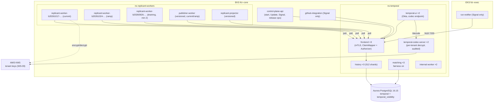

# Temporal Platform

**Section:** 01-orchestration (WS-01) · **Constraints:** D-01, D-17, D-21, D-22 · **Contracts:** C-IDS §4
(namespace, task queues, search attributes), C-MSG §1 (credential holders), ADR-003 (hosting, WS-10
finalizes) · **ADRs:** [ADR-01-005](adr/005-one-namespace-per-environment.md),
[ADR-01-006](adr/006-tenant-fairness-and-concurrency-controls.md)

## Purpose

Namespaces, task queues, worker topology and scaling, rate limits and per-tenant concurrency, history and
payload limits with numbers, the payload codec and codec server, the visibility backend, and WS-01's
position on self-hosted Temporal versus Temporal Cloud.

## Decisions summary

| Decision | Reference |
|---|---|
| One namespace per environment (`replicant-local`, `-dev`, `-staging`, `-prod`); tenancy by search attributes, fairness keys, and tenant-keyed payload encryption | ADR-01-005 (answers OQ-00-08) |
| Task queues: C-IDS set plus `replicant-llm-calls` (same deployment as `replicant-jobs`) | §2 |
| `replicant-worker`: one Kubernetes Deployment per build ID, always with Worker Versioning (PINNED workflows need it), at least 2 pods per live version, KEDA or HPA on backlog | §4 |
| Tenant fairness: Temporal Priority and Fairness (`fairness_key = tenant_id`), Runner quota as the hard limit, intake admission for open jobs | ADR-01-006 |
| Payloads encrypted per tenant (WS-09 `TenantKmsCodec`) routed by the SDK serialization context (`TenantContextCodec`, verified end to end) | §7, XD-09-06 |
| Self-hosted Temporal 1.32.x on EKS with PostgreSQL 16 and SQL visibility (agree with ADR-003; WS-10 finalizes) | §10 |



## 1. Namespaces

`replicant-<env>` (C-IDS §4), one per environment. Retention of closed workflows: **30 days** (`temporal
operator namespace create --retention 720h`; self-hosted has no maximum retention since 1.18, minimum 1 day
[verified: https://docs.temporal.io/temporal-service/temporal-server; cli commands.yaml, 2026-10-24]). After
30 days, the projection (`jobs_read`), audit events, approval records (S3 Object Lock), and the replay
corpus exports are the record. Archival stays off: it is experimental in self-hosted Temporal [verified:
https://docs.temporal.io/self-hosted-guide/archival, 2026-10-24].

Search attributes registered per namespace (C-IDS §4.1). WS-01 uses the contract set unchanged and
**claims no reserved slots**. SQL visibility allows Keyword 10, KeywordList 3, Int 3, Datetime 3, Bool 3,
Double 3, Text 3 [verified: https://docs.temporal.io/search-attribute, 2026-10-24]. Search attribute
values are not encrypted by the codec, so they hold IDs and enums only.

## 2. Task queues

| Queue | Deployment | Pollers serve | Worker options |
|---|---|---|---|
| `replicant-jobs` | `replicant-worker` (versioned) | `ReplicantJob`, `MaintenanceBatch` (no other workflow types); IO, identity, gates, notify, memory, context, release, eval, ops, cost activities | `max_concurrent_workflow_tasks=100`, `max_concurrent_activities=200`, `max_cached_workflows=2000` |
| `replicant-runner-calls` | `replicant-worker` | `runner.*` | `max_concurrent_activities=200` |
| `replicant-llm-calls` (new, C-IDS §4 allows `replicant-<purpose>`) | `replicant-worker` | `router.parse_intent`, `feedback.triage`, `risk.llm_review`, `memory.extract_candidates` | `max_concurrent_activities=32`, `max_task_queue_activities_per_second=20` (server-enforced; the last poller's value wins) [verified: sdk-python `_worker.py`, 2026-10-24] |
| `replicant-publisher` | `publisher-worker` | `publisher.*`, `github.post_reply`, `scm.resolve_base` | WS-07 |
| `replicant-projections` | `replicant-projector` | `projection.apply` (+ reconciler) | WS-07 |
| `replicant-eval` | `eval-worker` | WS-06 | WS-06 |
| `replicant-retention` (C-IDS, CCR-10-04) | `retention-sweeper` (WS-10) | `RetentionSweeper`, `DataOperation`; `retention.purge_session_state` (XD-10-05) | WS-10 |
| `replicant-ops` (C-IDS, CCR-08-04) | `ops-worker` (WS-08) | `LeakPurge` | WS-08 |

**Where every workflow type runs (R1-021).** The table above is complete for the C-IDS 2.0.0 queue
list. Workflow placement:

| Workflow types | Queue / deployment | Versioning |
|---|---|---|
| `ReplicantJob`, `MaintenanceBatch` | `replicant-jobs` / `replicant-worker-<build>` | PINNED (Worker Versioning) |
| `ProjectionReconciler`, `ProjectionRebuild` | `replicant-projections` / `replicant-projector` | AUTO_UPGRADE (short-lived or CAN-heavy system loops; WS-07) |
| `ScheduledIntake` | `replicant-projections` / `replicant-projector` (one activity, `intake.submit_scheduled`, which calls control-plane-api; WS-07 owns, XD-FIX-R1-021) | AUTO_UPGRADE |
| `RetentionSweeper`, `DataOperation` | `replicant-retention` / `retention-sweeper`. `DataOperation`'s steps call the owning service's internal admin API as activities, so "on the owning service's worker" (D-26) means owner-implemented activity logic, hosted here | AUTO_UPGRADE |
| `LeakPurge` | `replicant-ops` / `ops-worker` (WS-08) | AUTO_UPGRADE |
| `ReleasePipeline`, `EvalSuite`, `EvalCase`, `EvalComparisonRun`, `SentinelEval`, `JudgeDriftCheck`, `GoldenMiner`, `GoldenHarvester`, `ImprovementProposer`, `CliUpgradeWatcher`, `OnlineMetrics`, `ComponentSuite` | `replicant-eval` / `eval-worker` (WS-06) | WS-06 decides |

Temporal client identities, each with its own mTLS certificate (CN `<identity>.<cluster>.<env>`), which
WS-09's Authorizer must know (XD-FIX-R1-021). C-MSG §1 lists the first group; CCR-01-08 adds the others:
`control-plane-api`, `github-integration`, `run-notifier`, `replicant-worker`, `publisher-worker`,
`replicant-projector` (poll `replicant-projections`; read `ListWorkflowExecutions`, `QueryWorkflow`,
`DescribeWorkflowExecution` for the reconciler), and `eval-worker`. WS-08's CCR-08-06 adds `audit-exporter`
(read-only `ListWorkflowExecutions`, `GetWorkflowExecutionHistory`; it writes the history skeleton and full
export after each run closes, XD-FIX-R2-005) and `ops-worker` (poll `replicant-ops`). CCR-01-08 adds
`retention-sweeper` (poll `replicant-retention`; read `ListWorkflowExecutions` for the due-job scan,
XD-10-05) and `replicant-replay-gate` (read-only `ListWorkflowExecutions`, `GetWorkflowExecutionHistory`;
patch-build replay gate). C-MSG 2.0.0 adds `replicant-db-migrate` (`CountWorkflowExecutions` only, WS-10's
contract-migration gate, XD-W2-10-06). C-MSG 2.0.0 adds `CountWorkflowExecutions` to `replicant-worker` for the
pinned-workflows gauge (CCR-01-12) (R1V-081). `ResetWorkflowExecution` is break-glass only for
`replicant-operators` (R2-048, CCR-07-12); service identities never hold it.

## 3. Worker topology

Each live replicant-worker build is a separate Kubernetes Deployment `replicant-worker-<build_id>` with:
`REPLICANT_WORKER_BUILD_ID`, `REPLICANT_GRAPH_ENGINE`, `REPLICANT_TEMPORAL_*` (mTLS cert from cert-manager, 24 h),
IRSA/Pod Identity for KMS (codec), S3, and the gateway service credential; `resources: requests 1 CPU /
2 GiB, limits 2 CPU / 4 GiB`; three task queues per pod (`replicant-worker run`); readiness by
`replicant-worker healthcheck` (all three queues registered for the version).

**Requirement found by experiment:** a `PINNED` workflow type cannot run on an unversioned worker. Every
workflow task fails with "versioning behavior cannot be specified without deployment options being set
with versioned mode" [verified: server 1.32.0, 2026-10-24]. Every environment, including local, therefore
runs replicant-worker with `WorkerDeploymentConfig(use_worker_versioning=True)`. Locally,
`REPLICANT_WORKER_SET_CURRENT_ON_START=true` sets the current version (forbidden in staging and prod).

## 4. Worker topology and scaling

| Load (scale table) | Estimate |
|---|---|
| Jobs/day | 300 steady, 1,000 peak |
| Open workflows | about 5,000 to 10,000 (jobs live ≤ 30 days; most idle in PR review) |
| History events/day | about 1,000 jobs × 1,500 to 6,000 events = 1.5 to 6 M/day; 17 to 70 events/s average |
| Workflow tasks/s | about 6 to 25 average; peaks 5× |
| Activity tasks/s | about 5 to 20 average (40 % are non-awaited projections) |
| Concurrent AgentRun waits | 150 (all in workflow timers; no worker slots held, ADR-002) |

Scaling per version Deployment:

| Mechanism | Setting |
|---|---|
| Minimum | 2 replicas per live version (Updates need a live worker of the pinned version, ADR-001) |
| Autoscaling | KEDA `temporal` scaler (v2.17+, community-maintained) on `replicant-jobs` and `replicant-runner-calls` with `queueTypes: workflow,activity`, `targetQueueSize: 20` [verified: https://keda.sh/docs/2.18/scalers/temporal/, 2026-10-24] `[unverified: whether the scaler's buildId parameter selects a Worker Deployment Version (new API) rather than a legacy build ID]`. Fallback: HPA on CPU (target 60 %) plus the SDK metric `temporal_worker_task_slots_available` through the Prometheus adapter |
| Maximum | 10 replicas per version |
| Sticky cache | `max_cached_workflows=2000` per pod; eviction only costs a replay of a few hundred events |

Server sizing (initial; WS-10 owns): 3 frontend, 3 history (512 shards, fixed at creation: about 10×
headroom over 70 events/s), 3 matching, 2 internal workers on `m7i.2xlarge`. Persistence and visibility use WS-10's sizing (XD-FIX-R1-242, R1V-092):
Aurora PostgreSQL 16.15, `db.r8g.xlarge` writer + reader, I/O-Optimized
(10-data-platform temporal-persistence.md §5).

## 5. Rate limits, concurrency, and tenant fairness

See [ADR-01-006](adr/006-tenant-fairness-and-concurrency-controls.md). Summary:

| Control | Where | Value |
|---|---|---|
| Sandbox concurrency per tenant (hard) | Runner admission (429 + Retry-After) | WS-02 policy; 150 global |
| Activity dispatch fairness | `Priority(priority_key, fairness_key=tenant_id)` on every activity; `matching.enableFairness: true` | priority urgent 1 … low 4, maintenance 5 |
| In-worker LLM rate | `replicant-llm-calls` `max_task_queue_activities_per_second=20` | 20/s namespace-wide |
| Open active jobs per tenant | intake admission (visibility count, excluding waiting states) | 50 |
| Maintenance fan-out | `repair_limits.maintenance.max_concurrency` | 10 per batch, 2 batches per tenant |
| Frontend | `frontend.namespaceRPS` 2,400 per instance in prod, 600 elsewhere | ×3 instances |
| Per-identity Signal rate (flood control, R1-022) | WS-09 custom Authorizer token bucket keyed by client certificate CN (Temporal's dynamic config has no per-identity limit; v1.32.1 `constants.go`) | run-notifier 50/s burst 200; others 200/s (XD-FIX-R1-022) |
| Fairness in every environment (R1-022) | `matching.enableFairness: true` with no namespace constraint | local, dev, staging, prod alike |
| Updates | 10 in flight, 2,000 per run; senders rate-limit 1/s per (principal, job) | C-MSG §3 |

Dynamic config file: [platform/temporal-dynamicconfig.yaml](platform/temporal-dynamicconfig.yaml) (all
keys verified to exist in v1.32.1 source).

## 6. History and payload limits (numbers)

| Limit | Value | Replicant design budget |
|---|---|---|
| Events per run (error / warn / suggest CAN) | 51,200 / 10,240 / 4,096 | **bound: about 4,100 events per run** (CAN at the next safe point after the suggestion; safe points include every run-wait poll). Measured max run 1,121 events (history-budget.md) |
| History size per run (error / warn / suggest CAN) | 50 MB / 10 MB / 4 MB | bound 4 MB plus one safe-point interval; measured max run 0.6 MB |
| Payload (blob) | 2 MiB error / 512 KiB warn | activity I/O ≤ 64 KiB; carry ≤ 256 KiB (measured ≤ 27 KiB) |
| Mutable state | 8 MiB | far below |
| Memo | 2 MiB / 2 KiB warn | no memo used |
| Signals per execution | 10,000 | dedupe plus CAN; flood-protected by the notifier's authorization |
| Updates in flight / per run | 10 / 2,000 | human-rate |
| Pending activities / children / signals / cancels | 2,000 each | a batch's children ≤ 1,500 per run |
| Workflow ID length | 1,000 | ≤ 60 |

[verified: temporalio/temporal v1.32.1 `common/dynamicconfig/constants.go`, 2026-10-24]

## 7. Payload codec and codec server

**Client registration (R1-016, XD-08-01).** `worker.connect()` builds every replicant-worker client
(and so every worker built from it) with `plugins=[OpenTelemetryPlugin()]`
(`temporalio.contrib.opentelemetry`, present in temporalio 1.34.0 [verified: introspected package,
2026-10-24]), `interceptors=[ReplicantContextInterceptor()]` (WS-08's `replicant_telemetry.temporal`, header
`_replicant-ctx`), and `header_codec_behavior=HeaderCodecBehavior.NO_CODEC`. NO_CODEC is the SDK default, so
headers are never passed through the payload codec [verified: sdk-python 1.34.0 `client/_client.py`
default `HeaderCodecBehavior.NO_CODEC`, 2026-10-24]. That keeps `_tracer-data` and `_replicant-ctx`
readable without tenant keys, and both carry identifiers only, never tenant content. Workflow code creates
no long-lived spans. publisher-worker, replicant-projector, eval-worker and control-plane-api use the same
`connect()` helper from the shared `replicant_temporal` package (XD-FIX-R1-016).

**Encryption (WS-09 owns keys).** Every client and worker uses `DataConverter(payload_codec=TenantContextCodec(
KmsKeyProvider, TenantDirectory))` ([codec.py](reference/replicant_orchestration/codec.py)) and
`failure_converter_class=DefaultFailureConverterWithEncodedAttributes`, so failure messages are encrypted too
[verified: sdk-python converter, 2026-10-24]:

- The codec implements `WithSerializationContext`. The SDK calls `with_context(...)` with
  `WorkflowSerializationContext(namespace, workflow_id)` or `ActivitySerializationContext(…, workflow_id, …)`
  [verified: introspected `temporalio==1.34.0`, 2026-10-24].
- `job_id → tenant` is learned from the authenticated `replicant-tenant` metadata of the first payload decoded
  for that workflow (start input or activity input), or registered by the client that starts or signals
  the job (control-plane-api, github-integration; run-notifier knows the tenant from the notification).
  Encode fails closed when the tenant is unknown. The tenant is AES-GCM associated data.
- System workflows (`sys:*`) use tenant `replicant-system`.
- Verified end to end: a full bugfix job ran with every payload encrypted; the start input and all 117
  activity inputs carried `encoding: binary/replicant-encrypted-v1` and `replicant-tenant: payments`; search
  attributes stayed in clear (as documented); histories replayed through the codec [verified: scenario
  `tenant_codec`, 2026-10-24].

**Codec server** (`temporal-codec-server`, WS-01 deploys, WS-09 owns policy): endpoints `POST /decode`
(and `/encode` for the CLI) with JSON `{payloads: [...]}` and header `X-Namespace`; CORS
`Access-Control-Allow-Origin: https://temporal.<env>.replicant.internal`, `Allow-Methods: POST, GET, OPTIONS`,
`Allow-Headers: X-Namespace, Content-Type, Authorization`. The Temporal UI is configured with
`TEMPORAL_CODEC_ENDPOINT=https://codec.<env>.replicant.internal` and `TEMPORAL_CODEC_PASS_ACCESS_TOKEN=true`,
so the codec server receives the operator's Okta token and authorizes per tenant: only
`replicant-operators` members whose tenant grants include the payload's `replicant-tenant`. The codec server
is **Python** (it reuses `TenantContextCodec` from this package; R1-287). It audits every decode by calling
control-plane-api's internal audit endpoint `POST /internal/v1/audit/events` (event type
`temporal.payload_decoded`: operator principal, tenant, namespace, workflow ID, payload count). It has no
database login, so the D-23 rule that only Python services with a C-PG login write audit holds through
control-plane-api (XD-FIX-R1-287, WS-07 and WS-10). If the audit call fails, the decode is refused (fail
closed). Each decode is also a CloudTrail KMS `Decrypt` naming the tenant in the encryption context
[verified: https://docs.temporal.io/production-deployment/data-encryption;
https://github.com/temporalio/ui/blob/main/server/config/docker.yaml, 2026-10-24].

## 8. Visibility

SQL advanced visibility on PostgreSQL 16 (`temporal_visibility` database), plugin `postgres12_pgx`. The
Replicant needs 8 of 10 Keyword attributes. Elasticsearch/OpenSearch only if more than 10 Keyword, 3 Int, or
3 KeywordList attributes become necessary (C-IDS §4.1). Queries Replicant runs:

```sql
-- reconciler (every 2 min)
ExecutionStatus = 'Running' OR CloseTime > '<now-1h>'
-- release UI: pinned counts per version
TemporalWorkerDeploymentVersion = 'replicant-worker:b20261017-9c1d3e5f7a2b' AND ExecutionStatus = 'Running'
-- migration offers
TemporalWorkerDeploymentVersion = 'replicant-worker:b20261017-9c1d3e5f7a2b' AND ReplicantStatus IN ('waiting_human', 'waiting_external')
-- intake admission
ReplicantTenantId = 'payments' AND ExecutionStatus = 'Running' AND ReplicantStatus IN ('queued', 'running')
-- replay gate (patch builds)
TemporalWorkerDeploymentVersion = 'replicant-worker:<build>' AND ExecutionStatus = 'Running'
```

## 9. Worker-side Temporal calls (G-23)

Complete enumeration of Temporal state changes that originate from **worker** processes (replicant-worker,
publisher-worker, replicant-projector):

| Origin | Call | Mechanism | Why |
|---|---|---|---|
| `MaintenanceBatch` workflow code | StartChildWorkflowExecution (`ReplicantJob`, ABANDON) | workflow command (executed by the server; no client credential) | fan-out (ADR-01-007) |
| `MaintenanceBatch` workflow code | RequestCancelExternalWorkflowExecution to children | workflow command | `batch.cancel` |
| `ReplicantJob` workflow code (child jobs only) | SignalExternalWorkflowExecution `batch.child_progress` to its parent | workflow command | CCR-01-04 |
| all workflows | ContinueAsNew, UpsertSearchAttributes, timers | workflow commands | — |
| activity `release.apply_migration_override` | **no Temporal call**: HTTP to control-plane-api `POST /internal/v1/jobs/{job_id}:repin`, which calls `UpdateWorkflowExecutionOptions` | control-plane-api holds the permission (C-MSG §1) | migration handoff (ADR-01-002) |
| activity `intake.create_child_job` | **no Temporal call**: allocates `job_id` and the intake row through control-plane-api; the parent starts the child itself | — | — |
| replay-gate Job (`replicant-worker replay`, core cluster, release pipeline) | ListWorkflowExecutions, GetWorkflowExecutionHistory (read-only) | dedicated read-only identity `replicant-replay-gate` (CCR-01-08) | patch-build replay gate (versioning.md §8) |
| `audit-exporter` (WS-08 Deployment, XD-FIX-R2-005; supersedes XD-08-08's retention-sweeper placement) | ListWorkflowExecutions, GetWorkflowExecutionHistory (read-only) | identity `audit-exporter` (CCR-08-06) | `workflow_history_skeleton` (audit) and `workflow_history_export` (artifacts) after each run closes, including a job's final run (C-ART 2.0.0). replicant-worker itself **never** reads history and has no `audit.export_history` activity (R1-015) |
| replicant-projector reconciler (WS-07) | ListWorkflowExecutions, QueryWorkflow `job.snapshot`, DescribeWorkflowExecution (read-only) | projector Temporal client | C-STATE §2 |

**No worker-side `StartWorkflowExecution` or `SignalWorkflowExecution` client calls exist.** A grep of the
reference implementation for `start_workflow`, `.signal(`, `signal_with_start`, `execute_workflow`,
`update_workflow_execution_options`, and `start_batch_operation` outside `testing/` finds only Signal
handler decorators and the external-handle Signal command above. The `testing/` stub calls
`update_workflow_execution_options` directly because it stands in for control-plane-api.
Authorizer policy for worker identities: poll and respond on `replicant-<env>` task queues, plus the read APIs
above for the replay-gate and projector identities.

## 10. Self-hosted versus Temporal Cloud (input for WS-10)

Measured billable actions (Temporal Cloud definition: starts, Continue-As-New, activities, timers, Signals,
Updates, search attribute upserts [verified: https://docs.temporal.io/cloud/actions, 2026-10-24]):

Heavy job (high risk, 5 repair cycles, realistic polling): **1,044 actions** measured (history-budget.md §3). Typical job (one repair cycle, one or two gates): about 400 to 600.

| Volume | Actions/month | Cloud cost at the published tiers ($50/M to 5M, $45 to 10M, $40 to 20M) [verified: https://docs.temporal.io/cloud/pricing, 2026-10-24] |
|---|---|---|
| 300 jobs/day (≈ 600 actions per job) | ≈ 5.4 M | ≈ $270, so the $500/month Business minimum applies |
| 1,000 jobs/day | ≈ 18 M | ≈ $795/month |

Business plan minimum: the greater of $500/month or 10 % of usage, plus storage and fairness (+0.1 action
per action) if enabled.

**Position:** self-hosted, agreeing with ADR-003. Reasons specific to WS-01's design: (1) the run-notifier's
least-privilege Signal-only identity needs the self-hosted Authorizer (Cloud has no per-API authorization,
ADR-002); (2) the tenant-keyed codec keeps decryption inside the AWS account in both options, but
self-hosting also keeps search attributes and history metadata in-account; (3) the load (≤ 70 events/s)
is small for a PostgreSQL-backed cluster; (4) Worker Deployment APIs are marked experimental in protos, and
self-hosting lets the Replicant pin the server minor version and upgrade on its own schedule. Cloud remains
the fallback if fewer than two engineers can operate Temporal (ADR-003); cost would not decide it.

## 11. Worker-side integrations agreed in the fix round (wave 2)

| Item | WS-01 implementation |
|---|---|
| Metrics (XD-FIX-R1-195) | The SDK runtime exports Prometheus on `REPLICANT_METRICS_BIND` (default `:9464`) with global tag `deployment_version="replicant-worker:<build>"`. Gauge `replicant_worker_pinned_open_workflows` (per pod, its own build) comes from `CountWorkflowExecutions("TemporalWorkerDeploymentVersion='replicant-worker:<build>' AND ExecutionStatus='Running'")` every 60 s. The global tag already carries `deployment_version`; adding it to the gauge again emits a duplicate label, which was verified against the exporter. The codec counts refused encodes in `replicant_codec_unknown_tenant_total`, and workflows count `replicant_workflow_unknown_run_signals_total`. replicant-worker needs `CountWorkflowExecutions` on its namespace (XD-W2-01-01) |
| Codec key material (XD-FIX-R1-214, XD-FIX-R1-044) | `codec.py` takes WS-09's `KmsKeyProvider` (Python) through the unchanged `KeyProvider` protocol. Key alias `alias/replicant/<env>/tenant/<tenant_id>`, and `sys:*` uses tenant `replicant-system`. Encryption context `{"replicant:purpose": "temporal-payload", "replicant:tenant": "<t>"}`. The metadata `replicant-wrapped-key` is the base64 KMS CiphertextBlob. Three test vectors (fixed DEK, nonce and tenant; data = nonce, then ciphertext, then tag; AAD = tenant) are at [codec/testvectors.json](codec/testvectors.json). The unit test `test_codec_test_vectors` reproduces them byte for byte, and WS-02's Go encoder consumes the same file |
| Kill-switch mirror (XD-FIX-R2-016, XD-11-16) | `ops.read_kill_switches` reads `REPLICANT_KILL_SWITCH_MIRROR`: `s3://<org>-replicant-<env>-ops/kill-switches/v1/state.json` (schema `replicant.kill-switches/v1`), with ConfigMap `replicant-workers/replicant-kill-switches` as fallback, and the higher `generation` wins. Locally it is `s3://local-replicant-local-ops/kill-switches/v1/state.json` in the same `replicant.kill-switches/v1`
shape (WS-11 compose.yaml, XD-FIX-R2-016-WS07; R1V-082). The earlier `file://` mirror of XD-11-16 is superseded. It returns the engaged switches as `KillSwitchSignal`-shaped items, and later changes arrive by `ops.kill_switch` Signal |
| Run-grant signer (XD-FIX-R1-253) | `runner.start_run` signs through `REPLICANT_RUN_GRANT_SIGNER` = `file` (local and CI: `REPLICANT_RUN_GRANT_KEY_FILE` PEM ES256, `REPLICANT_RUN_GRANT_KID` `rg-local-1`) or `kms` (dev, staging, prod), with `REPLICANT_RUN_GRANT_ISSUER` (`replicant-local-core` / `replicant-<env>-core`). Claims come from the activity input only (graphs/README.md §2.4) |
| Gateway cassettes (XD-FIX-R1-264, XD-W2-06-02) | `agents.stage_inputs` adds `stub: {root, set, key}` to the run-policy PUT only when `REPLICANT_ENV=local`. For eval cases it is `{root: evals, set: <golden_task_id>, key: <agent>}` (file `evals/smoke-local/cassettes/<golden_task_id>/<agent>.ndjson`). For tests with `REPLICANT_GATEWAY_CASSETTE_SET` it is `{root: tests, set, key: <logical activity ID without effect>}`. A `599 cassette_miss` ends an eval job `harness_error` |
| Secret scanning and test inventory (XD-FIX-R1-225, XD-FIX-R2-006) | The `verifier.check` activity scans added diff lines with `replicant-secretscan` (`scan_diff_added_lines`, report `replicant.secret-scan-report/v1`, fingerprints by KMS `GenerateMac` on `alias/replicant/<env>/secretscan-fingerprint`). It also recomputes the static half of the test-inventory delta from the diff bundle: deleted files under test globs, and added skip markers `t.Skip(`, `@pytest.mark.skip`, `@unittest.skip`, `pytest.skip(`, `.skip(`, `xit(`, `xdescribe(`, `@Disabled`, `@Ignore`, `#[ignore]`. It raises risk to `high` when that disagrees with QA's `test_inventory_delta` |
| ops-worker (orchestrator ruling) | WS-08 owns and hosts `ops-worker` and its `LeakPurge` workflow. WS-01 supplies only shared libraries that run there: `replicant_temporal.connect()` (§7) and the payload codec. WS-01 provides no workflow or activity code for `replicant-ops` |

**Time-skipping test server and Worker Versioning (XD-W2-11-02, R1V-094).** Tested on 2026-10-24 with
`WorkflowEnvironment.start_time_skipping()` (temporalio 1.34.0) and a worker with
`WorkerDeploymentConfig(use_worker_versioning=True)`. A `VersioningBehavior.PINNED` workflow ran, with and
without a start-time `PinnedVersioningOverride`, and a 30-day `workflow.sleep` completed in seconds.
However, `SetWorkerDeploymentCurrentVersion` fails with "Worker Versioning not yet supported in test server",
and `DescribeWorkflowExecution` returns empty `versioning_info`, so the test server ignores the override.
[verified: V01-28]. Consequence for WS-11: the 30-day single-build waits (gate expiry, PR wait expiry, job
max age, deadlines) can move to the time-skipping server with unscaled policies. Migration, patch, retire
and ramp cases must stay on the dev server.

## Failure modes

| Failure | Effect | Handling |
|---|---|---|
| Temporal frontend down | starts, Updates, Signals fail | intake rows `start_status=pending` with retrier (the workflow is started **after** the intake transaction commits, R2-048); sender outboxes; run-notifier retries; activities resume after recovery. Expiry timers that fire late open a decision grace window (gates.md §4, R2-014). Activities whose retries ran out during the outage hold the job instead of failing it (graphs/README.md §2.2, R2-010) |
| Operator attempts a Temporal reset | stale results replayed under deterministic IDs | break-glass only (incident-logged); the supported paths are Update `ops.retry_node` (CCR-07-12) and, for a job held on a dependency, `job.resume` (R2-048) |
| History shard hot | latency | 512 shards; alert `temporal_persistence_latency` p99 |
| KMS throttling | codec encode/decode fails, workflow tasks retry | data-key cache (5 min / 10,000 payloads, WS-09); alert |
| Codec tenant unknown on encode | encode raises; task retries | indicates a client that did not register the tenant; alert `ReplicantCodecTenantUnknown` |
| Pinned version without pollers | tasks wait | alert `ReplicantPinnedVersionNoPollers`; minimum 2 replicas |

## Open questions

| Question | Who decides | Options | Recommendation |
|---|---|---|---|
| Hosting (OQ-00-07) | WS-10 with WS-01 | self-hosted / Cloud | Self-hosted (§10) |
| Retention | WS-01 / WS-10 | 7 / 30 / 90 days | 30 days |

## Risks

- Worker Deployment RPCs are labelled Experimental in protos. Pin server and SDK versions; run the
  versioning experiments in this spec as contract tests on every upgrade.
- KEDA's Temporal scaler is community-maintained, with unclear Worker Deployment support. The HPA
  fallback is specified.

## Interfaces

- **Provided:** namespace and task queue layout, dynamic config, codec routing (`TenantContextCodec`),
  worker CLI (`replicant-worker run | nodecatalog export | healthcheck`).
- **Consumed:** WS-09 KMS key provider and codec server policy; WS-10 Temporal persistence; WS-02 run-notifier
  codec use; C-MSG §1.
