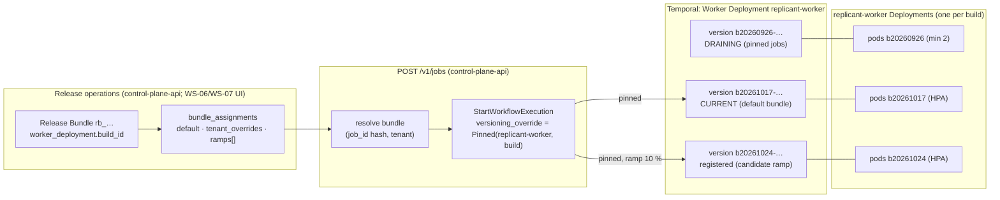
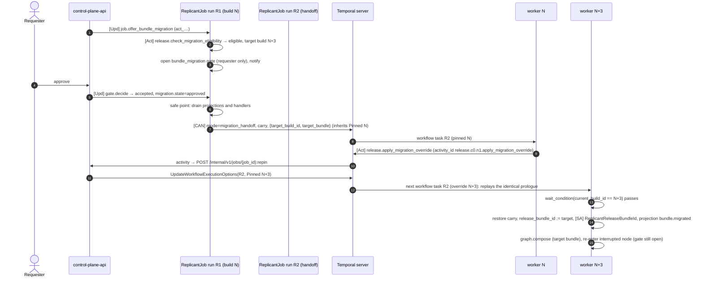

# Workflow Versioning

**Section:** 01-orchestration (WS-01) · **Constraints:** D-02, D-03, CC-1..CC-4 · **Contracts:** C-DEF 3.0.0
§4.5, C-MSG 2.0.0 (`job.offer_bundle_migration`, `release.notice`), C-IDS §2 (worker deployment version)
· **ADRs:** ADR-006 (contract), [ADR-01-002](adr/002-consented-migration-via-handoff-run.md),
[ADR-01-003](adr/003-patching-only-for-emergency-patch-builds.md), [ADR-01-004](adr/004-continue-as-new-boundaries-and-resume-at-node.md)

## Purpose

Jobs last up to 30 days in PR review while workflow code, graphs, prompts, CLIs, and models change weekly.
This document defines how every job keeps replaying on the code that started it, how new versions roll
out by percentage or tenant, how operators roll back, drain, and retire versions, and how a job that
waited 30 days at a gate on version N behaves when N+3 is current.

## Decisions summary

| # | Decision | Reference |
|---|---|---|
| 1 | Every `ReplicantJob` and `MaintenanceBatch` is `VersioningBehavior.PINNED`, started with `versioning_override=PinnedVersioningOverride(WorkerDeploymentVersion("replicant-worker", bundle.build_id))` | ADR-006, §2–§3 |
| 2 | Ramps are **bundle assignments** (percentage of `job_id` hash, or tenant lists), not Temporal ramps. Temporal's current version = the default bundle's build (for unpinned system workflows only) | ADR-006, §5 |
| 3 | A start-time pinned override may target any version registered on the task queue, even one that is neither current nor ramping (**V06-14 verified**). Unregistered versions are rejected at start | §3.2 |
| 4 | Continue-As-New at phase and repair-cycle boundaries and at history thresholds; resume at a node; ≤ 256 KiB carry | ADR-01-004, §4 |
| 5 | Running jobs change bundle only by consented migration at a safe point, through a frozen handoff run plus a pinned override | ADR-01-002, §6 |
| 6 | `workflow.patched()` only in emergency patch builds proven by replay against every live history of the patched version | ADR-01-003, §7 |
| 7 | Every build is replay-tested against a golden corpus, the handoff protocol history, and (for patch builds) all live production histories, before any bundle can reference it | §8 |



## 1. Verified Temporal API surface (Python SDK 1.34.0, server 1.32.x, CLI 1.9.1)

| Capability | Exact API | Evidence |
|---|---|---|
| Worker registers a version | `Worker(…, deployment_config=WorkerDeploymentConfig(version=WorkerDeploymentVersion(deployment_name, build_id), use_worker_versioning=True, default_versioning_behavior=…))` | [verified: introspected `temporalio==1.34.0`, 2026-10-24] |
| Workflow behavior | `@workflow.defn(versioning_behavior=VersioningBehavior.PINNED)`; enum `UNSPECIFIED`, `PINNED`, `AUTO_UPGRADE` | [verified: same] |
| A PINNED workflow requires a versioned worker | Running PINNED `ReplicantJob` on an unversioned worker fails every workflow task: "versioning behavior cannot be specified without deployment options being set with versioned mode" | [verified: experiment, server 1.32.0, 2026-10-24] |
| Start pinned | `client.start_workflow(…, versioning_override=PinnedVersioningOverride(WorkerDeploymentVersion("replicant-worker", build_id)))` (closes the `[unverified]` in ADR-006 and XD-00-04) | [verified: introspected 1.34.0 and experiment, 2026-10-24] |
| Move a running execution | raw RPC `client.workflow_service.update_workflow_execution_options(UpdateWorkflowExecutionOptionsRequest(namespace, workflow_execution, workflow_execution_options=WorkflowExecutionOptions(versioning_override=VersioningOverride(pinned=PinnedOverride(behavior=PINNED, version=…))), update_mask=FieldMask(paths=["versioning_override"])))`; the Python `WorkflowHandle` has no method; CLI `temporal workflow update-options --versioning-override-behavior pinned --versioning-override-deployment-name D --versioning-override-build-id B [--query …]` | [verified: introspection; temporalio/cli v1.9.1 commands.yaml; experiment exp3, 2026-10-24] |
| Routing | `SetWorkerDeploymentCurrentVersion(deployment_name, build_id, conflict_token, ignore_missing_task_queues, allow_no_pollers)`, `SetWorkerDeploymentRampingVersion(…, percentage)` | [verified: temporalio/api proto, 2026-10-24] |
| Drainage | `DescribeWorkerDeploymentVersion(...).worker_deployment_version_info.drainage_info.status` ∈ `DRAINING`, `DRAINED`; refreshed every `matching.wv.VersionDrainageStatusRefreshInterval` (3 min) after a `…VisibilityGracePeriod` (3 min) | [verified: proto; temporalio/temporal v1.32.1 constants.go, 2026-10-24] |
| Delete a version | `DeleteWorkerDeploymentVersion(deployment_version, skip_drainage)`: only if it is not current or ramping, has no active pollers, and is not draining (unless `skip_drainage`) | [verified: proto comments; CLI `delete-version --skip-drainage`, 2026-10-24] |
| Limits | `matching.maxVersionsInDeployment` 100, `matching.maxDeployments` 100 per namespace, `matching.maxTaskQueuesInDeploymentVersion` 100 | [verified: constants.go v1.32.1, 2026-10-24] |
| Stability | All Worker Deployment RPCs are marked "Experimental. This API might significantly change" in proto comments; worker-versioning docs list minimum server 1.29.1, CLI 1.4.1, Python SDK 1.11 and label only upgrade-on-CAN as Public Preview | [verified: temporalio/api proto; https://docs.temporal.io/production-deployment/worker-deployments/worker-versioning, 2026-10-24]. The changelog dates GA to 2026-03-30 (V00-02) |
| Inheritance | Pinned version inherited by Continue-As-New and by children whose task queue belongs to the version; pinned overrides inherited "if the override is pinned AND the new workflow's task queue belongs to the override version". Activities on a task queue outside the pinned version ("independent activities") run on that queue's current or ramping version | [verified: https://docs.temporal.io/worker-versioning#inheritance-semantics, 2026-10-24] |
| Upgrade-on-CAN | `workflow.continue_as_new(initial_versioning_behavior=ContinueAsNewVersioningBehavior.AUTO_UPGRADE \| USE_RAMPING_VERSION)`; `workflow.info().is_target_worker_deployment_version_changed()`. **Public Preview / experimental**; not used | [verified: introspection; docs, 2026-10-24] |
| Patching | `workflow.patched(id)`, `workflow.deprecate_patch(id)` | [verified: introspection, 2026-10-24] |
| Replay | `Replayer(workflows=[…], data_converter=…, workflow_runner=…).replay_workflow(history, raise_on_replay_failure=False)`, `replay_workflows(async_iter)`; `WorkflowHistory.from_json(workflow_id, json)`; `handle.fetch_history()`; CLI `temporal workflow show --workflow-id X --output json` (no `--output-file`) | [verified: introspection; cli commands.yaml, 2026-10-24] |

### 1.1 Deployments

| Deployment | Task queues | Workflow behaviors | Rollout mechanism |
|---|---|---|---|
| `replicant-worker` | `replicant-jobs`, `replicant-runner-calls`, `replicant-llm-calls` | `ReplicantJob` PINNED, `MaintenanceBatch` PINNED | Bundle assignment (pinned at start). Temporal current = default bundle's build |
| `replicant-worker` (system workflows) | `replicant-jobs` | `RetentionSweeper` and other `sys:*` workflows hosted here: AUTO_UPGRADE (short, schedule-started) | Temporal current version |
| `publisher-worker` | `replicant-publisher` | activities only | Temporal current/ramping by percentage. Activity input/output backward compatible ≥ 37 days (CC-4) |
| `replicant-projector` | `replicant-projections` | activities only | Same; must accept every `replicant.job-snapshot/v*` emitted by live replicant-worker versions (C-STATE §2) |
| `eval-worker` | `replicant-eval` | WS-06 | WS-06 |

Activities on `replicant-runner-calls` and `replicant-llm-calls` belong to the job's pinned version, so Runner
and LLM activity code is pinned with the workflow. Publisher and projector activities are "independent
activities" and follow their own deployment's current version.

## 2. Build identity

`build_id = b<YYYYMMDD>-<git sha, 12 hex>` (C-IDS). CI on merge to main:

1. builds the image (digest D), runs unit tests, the scenario suite on both engines, lint, and the replay
   gate (§8);
2. publishes the NodeCatalog (`POST /v1/registry/publish`, `source: worker_ci`, C-DEF 3.0.0) with
   `workerDeployment {deploymentName: replicant-worker, buildId, imageDigest: D}`;
3. deploys a new Kubernetes `Deployment replicant-worker-<build_id>` (2 replicas) whose pods register the
   version on all three task queues;
4. records the version in `registry.worker_deployment_versions` (control-plane-api) once
   `DescribeWorkerDeploymentVersion` lists all three task queues with pollers. The table's DDL lives in
   WS-06's `registry-releases.sql`; its exact shape is XD-FIX-R1-013 (`deployment_name`, `build_id`,
   `image_digest`, `node_catalog_digest`, `registered_at`, `ready_at`, `retire_after`, `retired_at`,
   `patch_of_build_id`, `incident_id`).

Only then can a bundle that references the build be built or promoted (registry check).

## 3. Pinning at start

### 3.1 Resolution and recording

In `POST /v1/jobs` (control-plane-api, C-DEF §4.5, CCR-06-05), **after** the intake transaction that
records the assignment has committed (R2-048: WS-07 starts the workflow after commit; an intake
reconciler starts any committed request without a workflow, and `USE_EXISTING` makes the start
idempotent):

```python
bundle_id = resolve_assignment(job_id, tenant)          # default / tenant override / ramps[] by bucket
bundle = registry.get_bundle(bundle_id)                  # promoted (or canary for a ramp)
build = bundle.spec.worker_deployment.build_id
# precondition; otherwise intake answers 503 bundle_unresolvable, never a fallback (XD-FIX-R1-137 a):
assert registry.version_ready("replicant-worker", build)   # registered on all three task queues, pollers present
handle = await client.start_workflow(
    "ReplicantJob",
    ReplicantJobInput(mode="start", job_id=job_id, tenant_id=tenant, release_bundle_id=bundle_id, job_request=jr),
    id=job_id, task_queue="replicant-jobs",
    id_conflict_policy=WorkflowIDConflictPolicy.USE_EXISTING, id_reuse_policy=WorkflowIDReusePolicy.REJECT_DUPLICATE,
    versioning_override=PinnedVersioningOverride(WorkerDeploymentVersion("replicant-worker", build)),
    search_attributes=TypedSearchAttributes([
        SearchAttributePair(SearchAttributeKey.for_keyword("ReplicantJobId"), job_id),
        SearchAttributePair(SearchAttributeKey.for_keyword("ReplicantTenantId"), tenant),
        SearchAttributePair(SearchAttributeKey.for_keyword("ReplicantStatus"), "queued"),
        SearchAttributePair(SearchAttributeKey.for_keyword("ReplicantReleaseBundleId"), bundle_id),
        SearchAttributePair(SearchAttributeKey.for_keyword("ReplicantWorkflowType"), "unrouted"),
    ]),
    priority=Priority(priority_key={"urgent": 1, "high": 2, "normal": 3, "low": 4}[jr["priority"]], fairness_key=tenant))
```

The job's version is recorded in six places: the start input and `JobState.release_bundle_id` (authority);
`ReplicantReleaseBundleId` (search attribute); `TemporalWorkerDeploymentVersion` (system search attribute);
`intake.job_requests.release_bundle_id` + `assignment_reason`; the projection (`release_bundle_id`,
`worker_deployment_version`); and Langfuse `release`. Inside the job, `graph.compose` records the composed
graph digest (`JobState.graph_spec_digest`), and every Runner call carries `release_bundle_id`, so every
artifact and run is traceable to the bundle.

### 3.2 V06-14: a pinned start may target a version that is neither current nor ramping (verified)

Experiment exp4 (dev server 1.32.0, SDK 1.34.0, 2026-10-24): three versions of deployment `replicant-worker`
were registered with pollers (A current, C ramping at 0 %, B neither).

| Start | Result |
|---|---|
| `PinnedVersioningOverride(B)`, B neither current nor ramping | **accepted; ran on B** |
| `PinnedVersioningOverride(B)` while C is ramping at 0 % | accepted; ran on B |
| `PinnedVersioningOverride(b20991231-dddddddddddd)`, never registered | **rejected at start**: `Pinned version 'replicant-worker:b20991231-dddddddddddd' is not present in task queue 'q' of type 'Workflow'` |

Consequence for WS-06 (CCR-06-05 b, condition V06-14): **multiple concurrent ramps carrying different new
worker builds are supported**, with no 0 % ramping-version workaround. The precondition is that each
candidate build has registered (polled) all of its task queues before any job is assigned to it (§2 step 4).
Recorded in [verification-log.md](../_coordination/verification-log.md) as V01-01.

## 4. Continue-As-New strategy

### 4.1 Boundaries

| Boundary | When | Effect on counters |
|---|---|---|
| `phase` before `pr_wait` | entering PR review from another phase | none |
| `repair_cycle` before `triage` | every repair cycle | `cycle += 1`; `visits`, QA counters reset |
| `history` | any node boundary, gate/PR wait iteration, or **Runner-run wait iteration** (not in a parallel branch) with `is_continue_as_new_suggested()` (server default 4,096 events or 4 MB) or `get_current_history_length() > 8,000` | none; interrupted node re-entered; a run in progress is polled again by the next run (ADR-01-004 as amended) |
| `reroute` | docs → bugfix escalation | graph recomposed |
| `migration` | consented migration approved | handoff run (§6) |

### 4.2 Procedure

`ReplicantJobBase._continue_as_new` (reference): set `resume_at`, apply counter changes, prune dedupe windows
(7 days) and old runs and gates, stage a steering backlog of more than 4 messages to S3, upsert
`ReplicantRepairCycle`, emit a projection, wait at most 10 min for projection activities, wait for
`all_handlers_finished`, then `workflow.continue_as_new(ReplicantJobInput(mode="continue", carry=…))`. Search
attributes are copied by default and kept current by explicit upserts (C-IDS §3). The pinned version is
inherited.

### 4.3 What carries over

`JobState` (schema `replicant.wf-carry/v1`, ≤ 256 KiB; measured 11 KiB after the initial run, 27 KiB after 5
repair cycles):

| Group | Fields |
|---|---|
| Identity | `job_id`, `tenant_id`, `release_bundle_id`, `worker_build_id`, `parent_job_id`, `requester`, `acting_for`, `repo_ids`, `priority`, `title`, `targets` (repo, base_ref, base_sha), `request_summary`, `request` (only until the task packet exists), `evaluation` |
| Position | `workflow_type`, `status`, `phase`, `resume_at`, `boundary_crossed`, `active_nodes`, `memo`, `exports`, `graph_spec_digest`, `segment` |
| Counters (C-IDS §3) | `cycle`, `ordinals`, `visits`, `gate_ordinals`, `child_counters`, `projection_seq`, `steer_seq`, `takeover_ordinal`, `repair_used`, `repair_max`, `qa_fix_used`, `qa_env_retries`, `budget_extensions` |
| Dedupe (C-IDS §3, 7 days) | `applied_ids` (decision, message, action IDs) + `applied_results`, `deliveries` (pr.event), `notices` |
| Gates and runs | `gates` (open + last 10 closed), `runs` (active + last 30) |
| Refs | `refs` (S3 URIs: plan, briefing, task packet, latest diff, handoff, session state, QA report, …), `memory_snapshot_id`, `working_memory` (WS-04, ≤ 64 KiB), `verified_diff_sha256` |
| PR | `pr`, `pr_buffer`, `pr_last_activity_at` |
| Steering | `steering_queue` (≤ 4 inline), `steering_refs`, `steering_log` |
| Risk | `risk`, `risk_floor`, `qa_gate_with_failure` |
| Control | `paused`, `pause_mode`, `paused_by`, `hold`, `pending_notices`, `notice_queue`, `deadlines`, `kill_switches`, `migration`, `revoked_deadline`, `forced_outcome`, `created_at`, `terminal` |
| Inputs for the next node | `approver_feedback` (≤ 3 request_changes comments, R2-019), `clarification_answer` (until routing ends, R1-017) |

`job_id` continuity: the workflow ID is the `job_id` in every run (C-IDS §3). The carried
`projection_seq` keeps the projection monotonic across runs. The carried ordinals keep every logical
activity ID unique across runs (verified by every scenario: no duplicate logical IDs across a job's runs).

## 5. Release operations and their Temporal-level effects

WS-07 builds the screens; these are the operations (control-plane-api, `release:*` permissions, audited):

| Operation | Registry effect | Temporal effect | Preconditions and guards |
|---|---|---|---|
| **List versions** | `registry.worker_deployment_versions` joined with bundles that reference each build | `ListWorkerDeployments`, `DescribeWorkerDeployment` (`version_summaries`, routing config, `conflict_token`), `DescribeWorkerDeploymentVersion` (task queues, pollers, drainage) | — |
| **View pinned workflow counts** | — | `CountWorkflowExecutions("TemporalWorkerDeploymentVersion = 'replicant-worker:<build>' AND ExecutionStatus = 'Running'")`, grouped by `ReplicantStatus`, `ReplicantTenantId`, `ReplicantWaitingSince` buckets (visibility, eventually consistent) | — |
| **Ramp** (bundle candidate by percent or tenants) | `bundle_assignments.ramps[]` (≤ 3 disjoint bucket ranges, CCR-06-05) | none directly; new jobs start pinned to the candidate's build | candidate build ready (§2 step 4); bundle in `canary` or `promoted` |
| **Pause ramp** | means `release.hold` (XD-FIX-R1-137 b): it freezes stage progression only, and traffic is unchanged. There is no `paused` column. Stopping candidate traffic sets that ramp's `percent` to 0 | none; running candidate jobs keep their pin | ramp guards are the C-DEF §4.4 table (canary and experiment → `canary`; holdback → `promoted\|deprecated`) plus CCR-06-12 rows (XD-FIX-R1-137 c) |
| **Promote to default** | `bundle_assignments.default = candidate` | `SetWorkerDeploymentCurrentVersion(build, conflict_token)` so unpinned system workflows follow | eval gates (WS-06) |
| **Rollback** | default (and ramps) back to the previous bundle; new jobs start on it at once | `SetWorkerDeploymentCurrentVersion(previous build)` | jobs already on the bad build: see §5.1 |
| **Drain** | version no longer referenced by any assignable bundle | automatic: not current, not ramping, with open pinned workflows → `DRAINING`; becomes `DRAINED` when none remain (refresh 3 min) | workers stay up (min 2 replicas) while DRAINING |
| **Retire** | `retired_at` on the version record | scale `replicant-worker-<build>` to 0, then `DeleteWorkerDeploymentVersion` | `DRAINED` for ≥ 7 days, and the single retire guard (XD-FIX-R1-137 d, verbatim): "no default, rollback target, ramp candidate (any purpose), tenant override, bundle in `shadowing\|canary`, or running pinned workflow references it" (release-bundle.md §10) |
| **Roll back a bundle** (CCR-06-13) | default back to the previous bundle | batch Signal `release.notice(bundle_rolled_back)`: open plan and publish gates get `release_block`, and approval needs an override (V12). Operators may follow with `job.offer_bundle_migration(consent=operator)` (needs `release:revoke`), which migrates at the next safe point with no gate. The requester is notified, and the result is `migration_scheduled` [verified: scenario `release_block`, 2026-10-24] | rollback dialog per WS-07 (preview, banner) |
| **Migrate eligible workflows** | — | for each workflow from a visibility query (`TemporalWorkerDeploymentVersion = …` and `ReplicantStatus IN ('waiting_human','waiting_external')`): Update `job.offer_bundle_migration` (one Update per job; Updates are not batchable), rate-limited 20/s | target promoted, eligible (§6.2); opens a consent gate per job |
| **Revoke bundle** | definition or bundle `revoked` | batch Signal `release.notice(bundle_revoked, deadline)` (`StartBatchOperation`, signal), then per job, once `ReplicantStatus = 'waiting_human'` (the revoked hold), `job.offer_bundle_migration(required=true)` | the job holds at its next safe point (§6.1 rule 5) |
| **Emergency patch move** | patch bundle B' (ADR-01-003) | **one workflow at a time** (R1-012): control-plane-api lists `TemporalWorkerDeploymentVersion = 'replicant-worker:N' AND ExecutionStatus = 'Running'` (`ListWorkflowExecutions`) and calls `UpdateWorkflowExecutionOptions` (pinned N.p) per workflow, rate-limited to 20/s, then sends `release.notice(bundle_patched)` as a batch Signal (CCR-01-01). Both calls are in control-plane-api's C-MSG §1 grant; no batch options-update operation is needed | replay gate passed on every live history of N; incident ID and two approvers |
| **Model retirement** (R2-044) | operator approves a `model_successor` mapping; the registry builds successor bundle B' (only model fields and the `models` index differ, `lineage.parent_release_bundle_id = B`) | batch Signal `release.notice(model_retiring, recommended=B', deadline=retirement date)` | the job verifies the lineage by activity and migrates at its next safe point **without consent** (§6.1 rule 6) |
| **Retire-scheduled warning** | `retire_after` date set | batch Signal `release.notice(worker_version_retire_scheduled, deadline)` | used only when a version must die before its jobs drain (security); jobs then migrate or stop at the deadline (§6.1 rule 7) |

### 5.1 Rollback when jobs are already on a bad build

| Situation | Action |
|---|---|
| Bad behavior, but the build replays and runs | Leave jobs pinned; offer migration to the previous bundle (eligible if the previous build reads the carry schema); otherwise let them finish |
| Crash or stuck workflow tasks on the bad build | Emergency patch build from the bad build's commit with the fix (`patched()` where needed), replay-gated, then the patch move |
| Unsafe to continue at all | `job.cancel` by operators, with takeover offered to requesters |

### 5.2 Contract migrations and long-pinned versions (R1-028, XD-10-02)

WS-10's contract-migration gate drops a column or table only after every worker version that still reads it
has drained. Pinned versions live at most `repair_limits.job_max_age_days` (60) plus the drain refresh, because
the hard job lifetime ends every job by then (R2-044). The rule: a **contract** (destructive) migration may
run only when `CountWorkflowExecutions("TemporalWorkerDeploymentVersion IN (<versions older than the
expand migration>) AND ExecutionStatus = 'Running'") = 0`. WS-10's gate query uses exactly this. Expand
migrations are never blocked. Because of the lifetime cap, the longest wait between expand and contract is
60 days plus about 7 days of drain. A version that must go sooner uses `worker_version_retire_scheduled`
with a deadline (§6.1 rule 7).

### 5.3 Sizing concurrently live versions

Weekly builds plus PR waits of up to 30 days mean about 6 live versions, plus at most 2 patch lines. Each
live version runs at least 2 pods (Updates need a live worker of the pinned version, ADR-001) of 1 vCPU and
2 GiB, scaled by task-queue backlog. Draining versions hold mostly idle jobs, so 2 pods suffice. The
`matching.maxVersionsInDeployment` limit (100) is far away.

## 6. Long waits and consented migration

### 6.1 The rule (must-answer: a job waiting 30 days at a gate on version N while N+3 is current)

1. **Default: the job continues on N.** N's workers stay up while any job is pinned to N (drain, §5). On
   approval the gate resolves on N and the job proceeds on N's code and N's bundle (D-03: behavior is
   reproducible).
2. **The UI offers migration, never forces it.** When a newer eligible bundle exists, the job page and the
   approval card show a banner: "This job runs on release 2026.09.26-2. Release 2026.10.24-1 is available:
   reviewer prompt v13, CLI 2.1.240. [Review changes] [Move this job]". Operators can also offer it in
   bulk (§5 "Migrate eligible").
3. **Consent:** `job.offer_bundle_migration` opens a `bundle_migration` gate whose only eligible approver
   is the requester (`requester_may_decide=true`), expiring in 14 days (`on_expiry: decline`).
4. **Mechanics on approval:** at the next safe point (immediately, if the job is waiting at a gate or in PR
   review) the workflow performs the Migration Handoff Protocol v1 (§6.3). The job then re-enters the
   node it was waiting in, on N+3, with its open gate, packet, and decision state unchanged.
5. **Required migration (revoked bundle, R1-004):** `release.notice(bundle_revoked, deadline)` records the
   deadline (14 days if absent). At the job's next safe point (node boundary), or immediately if it is
   already waiting at a gate or in PR review, the job **holds with status `waiting_human`** (hold kind
   `revoked`, timeline `job.held`). So `job.offer_bundle_migration`'s validator accepts the required offer that
   control-plane-api sends. An approved migration breaks the hold and the job migrates (§6.3). If the
   requester declines, or the `bundle_migration` gate expires (`on_expiry: decline`), the job ends
   `bundle_revoked_not_migrated` (status `cancelled`), not `cancelled_by_user`. If the deadline passes first,
   it ends the same way at the deadline, through a timer in every wait. Compensation runs, and takeover is
   offered by the UI. Measured: [verified: scenarios `revoked_migrate` and `revoked_deadline`, 2026-10-24].
6. **Forced migration (model retirement, R2-044, C-MSG 2.0.0):** `release.notice(model_retiring,
   recommended=B', deadline)`. The job verifies by activity (`release.check_migration_eligibility` with
   `lineage: model_successor`, ID `release.c0.n<k>.successor_check`) that B' is B's successor lineage
   and eligible (§6.2). It then sets `migration.state = approved` with
   `consent: not_required:model_retiring`, with **no gate**. Consent covers behaviour changes, not a model
   that will stop existing. The migration happens at the next safe point. If B' is ineligible, the job
   keeps running, operators may offer another bundle, and at the deadline the job ends
   `model_retired_not_migrated` (`cancelled`, terminal reason "model_retired"). Operators may instead offer
   `job.offer_bundle_migration(required=true, consent=operator)` at any time before the deadline, which migrates
   without a gate (XD-FIX-XD-ORCH-01). WS-06's model-retirement calendar provides the dates. Measured: a job waiting at its plan gate on build A
   migrated to build B and bundle B' without a consent gate, then re-entered the same plan gate
   [verified: scenario `model_retiring`, 2026-10-24].
7. **Worker-version retirement deadline:** `worker_version_retire_scheduled(deadline)` is enforced the same
   way. Migrating to another build clears it, and an unmigrated job ends `worker_retired_not_migrated` at the
   deadline.
8. **Hard job lifetime (R2-044):** every job ends at `created_at + repair_limits.job_max_age_days` (default
   60 days) with outcome `job_max_age_exceeded` (`expired`), at its next safe point or from a timer in any
   wait. 60 days exceeds the 30-day gate expiry plus a 30-day PR wait. It also bounds the worker versions,
   prompt escrow and image retention that a job needs: WS-06 sizes those to `job_max_age_days + 7`
   (XD-FIX-R2-044). [verified: scenario `job_max_age`, 2026-10-24]

### 6.2 Eligibility (`release.check_migration_eligibility`, deterministic)

| Check | Why |
|---|---|
| Target bundle `promoted` (or `canary` with the tenant in the ramp) and assignable to the tenant | D-03, CCR-06-05 |
| Same tenant layer, or target derived from the tenant's current layer | ADR-013 |
| Target build's NodeCatalog `carrySchemas` contains the job's carry schema | the target can read the state |
| Target graph for the job's `workflow_type` contains the job's current node key (`resume_at`) and every node in `active_nodes`, with the same node type | re-entry is well defined |
| Target build implements `migrationProtocol: replicant.migration-handoff/v1` | §6.3 |
| No run is active (job is at a gate, in PR review, or in the revoked hold) | safe point |
| `lineage` input: `any` (operator offer), `patch` (bundle_patched: B' differs from B only in `worker_deployment` and `node_catalog`), `model_successor` (model_retiring: only model fields and the `models` index differ) | forced moves stay within a narrow, verified difference |
| WS-04: if the CLI version changes and `session_incompatible_with` applies, the next run uses the handoff summary instead of session restore (XD-06-03) | session state compatibility |

Ineligible offers return `ineligible` with the failed check (C-MSG result).

### 6.3 Migration Handoff Protocol v1 (frozen)



Frozen rules: (1) the first command of a `migration_handoff` run in every build is the activity above, with
exactly that activity ID and input shape. Its activity class `RELEASE_OVERRIDE` retries with unlimited
attempts and a 30-minute schedule-to-close. (2) After it succeeds, the run's next command is a durable timer
of 30 minutes (`wait_condition(get_current_build_id() == target, timeout=30 min)`), and it issues no other
command until the build ID equals the target or the timer fires. (3) **Failure path (R2-015, R1-007):** if
the activity fails, or the timer fires first (for example, the target was drained meanwhile), the run,
still on the source build N, issues `release.apply_migration_override` with the **source** build
(activity ID `release.c0.n1.revert_migration_override`, best effort). It then clears `migration`, emits
`bundle.migration_failed`, alerts operators (`notify.job_event` kind `migration_failed`,
`release.c0.n1.notify_migration_failed`), and continues on N. The failure branch runs only on the source
build, so the target build never replays it. Both builds contain identical prologue code, so both issue
the same commands up to the branch. (4) Every build's CI replays the golden handoff histories (§8).
Protocol v1 is frozen with these failure paths included. No build was released with the earlier wording,
so no v2 is needed. Evidence: experiment exp3 and scenario `migration` (two builds, a real `ReplicantJob` waiting at a plan
gate migrated, then approved, published, and merged on build B, with every run replaying) [verified:
2026-10-24].

### 6.4 Every case (no undefined case)

| Situation at approval time | Outcome |
|---|---|
| N still running (draining) | continue on N |
| N scheduled for retirement before the job can finish | `release.notice(worker_version_retire_scheduled, deadline)`; migration offered; at the deadline an unmigrated job ends `worker_retired_not_migrated` (`cancelled`, takeover offered). Retirement is never forced before the deadline |
| N's bundle revoked | §6.1 rule 5 |
| A model the bundle uses is retiring | §6.1 rule 6 (forced, no consent) |
| Emergency patch build N.p | ADR-01-003; `bundle_patched` recorded without consent [verified: scenario `bundle_patched`, 2026-10-24] |
| Migration offered, but the job is running a node | the validator rejects the offer (`NotAtSafePoint`, no history). control-plane-api re-offers when `ReplicantStatus` becomes `waiting_human` or `waiting_external` (R1-004 correction). For a revoked bundle, the revoked hold provides that state at the next node boundary |
| Migration approved, then the requester is deprovisioned | the job is paused by `identity.principal_changed` policy; migration still applies at the next safe point |
| Target ineligible (node removed, carry schema unreadable) | `ineligible`; the job stays on N |
| Migration declined or expired | stays on N (or ends, if required) |
| Two offers | the validator rejects a second offer while one is open (`MigrationPending`) |
| Handoff activity fails for 30 min (control-plane-api down) | §6.3 rule 3: re-pin to N (best effort), `bundle.migration_failed`, operator alert, continue on N |
| Override applied but routing never flips within 30 min (target drained) | §6.3 rule 3 (same path) |
| Job reaches `job_max_age_days` | §6.1 rule 8 |
| Engine switch (Pregel ↔ interpreter) for a live job | a new build, so a consented migration like any other (R2-054, accepted); never a flag flip on a running build |

## 7. Patching policy

Summary of [ADR-01-003](adr/003-patching-only-for-emergency-patch-builds.md):

| Change | Ships as | Reaches running jobs |
|---|---|---|
| Prompt, model, CLI image, agent/environment definition, policy, graph shape (configuration, CC-1) | new bundle | consented migration (prompt-only bundles on the same build: migration still uses the handoff, which is cheap) |
| Node code, activity code, FGL, interpreter, workflow state (CC-2) | new build + bundle | consented migration |
| Security or crash fix that must reach pinned jobs | emergency patch build N.p from N's commit, `workflow.patched("inc-<id>")` guards, replay-gated on every live N history, patch bundle B', per-workflow move, `release.notice(bundle_patched)` | without consent; the job verifies the lineage and records B' |
| Model retirement | successor bundle B' (model fields only) | forced migration without consent (§6.1 rule 6) |
| Change to message schemas, Runner API, CRD, JobRequest (CC-4) | contract change; N and N+1 coexist ≥ 37 days | — |

**Must-answer: how does a running job pick up a fix to node code it has not reached yet?** Normally by
consented migration at its next safe point. That is usually immediate, because long-lived jobs wait at
gates or in PR review. The eligibility check requires that the node the job waits in exists in the target
graph, and the fixed node runs on the new build when the job reaches it. If the fix is in its own bundle
and that bundle is revoked, the job holds at its next safe point for the required offer and stops at the
deadline if not migrated. Emergency fixes use a patch build. Operators move the job's execution to N.p
one workflow at a time, and the job records B' after verifying the lineage by activity. A patch build
often needs no `patched()` guard, because unexecuted code adds no commands to recorded histories, which
the replay gate proves. All three paths are implemented and tested [verified: scenarios `migration`,
`revoked_migrate`, `bundle_patched`, 2026-10-24].

## 8. Replay testing

| Corpus | Source | Gate |
|---|---|---|
| Golden scenario histories | `tests/test_scenarios.py` run on the build in CI (both engines, stub activities, codec off: no tenant data), histories saved as CI artifacts (`WorkflowHistory.to_json()`) | every scenario's runs replay on the build |
| Handoff protocol | golden `migration_handoff` run histories from builds still live | every build replays them (protocol frozen) |
| Previous build's golden corpus | CI artifacts of the previous build | **not** required for normal builds (pinning means a build never replays another build's histories) |
| Production live histories (patch builds only) | fetched at gate time by the replay-gate Job: `ListWorkflowExecutions("TemporalWorkerDeploymentVersion = 'replicant-worker:N' AND ExecutionStatus = 'Running'")` → `fetch_history()` for the current run of each, replayed in memory, never stored | 100 % replay success on N.p before the patch move |
| Sampled production histories (all builds) | WS-08 `workflow_history_export` objects (**artifacts** bucket since C-ART 1.10.3, R2-005; payload digests checked against the audit-bucket `workflow_history_skeleton`) of the last 7 days of the current version. Runs whose export was purged by `LeakPurge` are skipped (the purge record lists them; XD-FIX-R2-005) | replay on the next build is reported (informational; drift detector for LangGraph upgrades) |

The replay job runs **inside the core cluster** as a Kubernetes Job (`replicant-replay-gate`) because
histories are tenant-encrypted. It is the only CI component with codec decrypt rights, through the same
`TenantContextCodec` and KMS key provider as workers. CI (GitHub Actions) triggers it through
control-plane-api and reads only the pass/fail report. Command sketch:

```bash
replicant-worker replay --live-version replicant-worker:b20261017-9c1d3e5f7a2b \
  --build b20261024-5d7e9f1a3b2c --fail-fast   # the patch build N.p replays every open run pinned to N
# equivalent CLI for a single workflow (operators):
temporal workflow show --workflow-id job_01m5p7x7r0bt69j0h0fbxepw90 --run-id <run> --output json > h.json
```

**Must-answer: how is a graph change tested before any production job uses it?**

1. Config-repo PR CI: schema plus FGL validation, invariants I-1..I-7 against the NodeCatalog of every
   build the graph declares compatible, `publish dry_run` against every environment's registry (CCR-03-02),
   and a **graph simulation**: the reference harness runs the graph on the target build with stub
   activities, scripted node outcomes covering every edge (path coverage report), replay of the generated
   histories, and validation of every projection.
2. Bundle build → WS-06 evaluation on tenant `replicant-eval` (real runs; evaluation mode, gates scripted).
3. Canary ramp: a percentage or tenant list through `bundle_assignments.ramps[]`, with WS-06 guardrails.
4. Promotion. Running jobs are unaffected throughout (CC-3).

## 9. History budget (must-answer)

Full model and measurements: [history-budget.md](history-budget.md). The **bound** is per run: no run
exceeds about 4,100 events or 4 MB. Continue-As-New fires at the next history safe point after the
server's suggestion (4,096 events / 4 MB), and safe points include every Runner-run poll, so a long run
cannot push a run past it. The hard limits are 51,200 events and 50 MB. The **typical** total for a 30-day
high-risk job with 5 repair cycles is about 5,500 events in 12 runs (4,845 measured on server 1.32.0, plus
modeled waits and hints), about 3.4 MB. The largest run measured was 1,121 events.

## Failure modes

| Failure | Effect | Handling |
|---|---|---|
| Pinned version has no pollers (deployment scaled to 0 by mistake) | workflow tasks and Updates time out; Updates queue in sender outboxes | alert `ReplicantPinnedVersionNoPollers` (versions with open pinned workflows and 0 pollers); auto-scale floor 2 |
| Start with an unregistered build, or any `AssignmentError` | `StartWorkflowExecution` would be rejected | intake **never falls back to `default`**, because a fallback drops tenant layers (XD-FIX-R1-137 a). It answers `503 bundle_unresolvable` with `Retry-After: 30` and writes no intake row. Channel adapters retry from their outboxes with the same `dedupe_key`, and the counter is `replicant_intake_bundle_unresolvable_total{env,tenant,reason}`. So `assignment_reason=fallback_unregistered` is never written (see the WS-01 wave-2 reply on XD-FIX-R1-158-WS07) |
| `SetWorkerDeploymentCurrentVersion` conflict (`conflict_token`) | concurrent release operation | retry with a fresh describe; UI shows the conflict |
| Replay gate fails for a patch build | patch move blocked | fix the patch; jobs stay on N |
| Visibility lag (counts) | drain status lags ≤ 6 min | UI shows "as of" time |
| An operator runs Temporal **reset** on a job | deterministic logical IDs would return the old runs' results, so a reset replays stale side effects (R2-048) | **break-glass only** (orchestrator decision on CCR-07-12): `ResetWorkflowExecution` stays with `replicant-operators` for incidents, never routine. The supported path is Update `ops.retry_node` (CCR-07-12, accepted). It re-runs a failed or stuck node with ordinal + 1, so activity IDs never collide with earlier results. WS-01 implements the handler as a wave-2 co-owner item. For a job held on a dependency, `job.resume` is "retry now" |

## Open questions

| Question | Who decides | Options | Recommendation |
|---|---|---|---|
| Default retention of closed workflows | WS-01 / WS-10 | 7 / 30 / 90 days + archival | 30 days. Archival is experimental in self-hosted Temporal [verified: https://docs.temporal.io/self-hosted-guide/archival, 2026-10-24], so the projection, audit, approval records, and WS-08 `workflow_history_export` are the long-term record |
| Should migration be auto-approved for prompt-only bundles on the same build? | Product / WS-06 | always consent / auto for tightening-only | Consent (CC-3 as written). Revisit with eval data |

## Risks

- Worker Deployment RPCs are still labelled Experimental in the API protos. A server upgrade could change
  them. Mitigation: pin the server minor version; the release-operation module in control-plane-api is the
  only caller; contract tests on every Temporal upgrade.
- Long-lived pinned versions cost worker capacity (about 6 versions × 2 pods minimum).

## Interfaces

- **Provided:** release operations semantics (to WS-06, WS-07), the handoff protocol, eligibility rules,
  V06-14 result.
- **Consumed:** C-DEF 3.0.0 §4.4–§4.5 (CCR-06-05), C-MSG 2.0.0 (`job.offer_bundle_migration`, `release.notice`
  including `bundle_patched` and `model_retiring`), C-ART 2.0.0 (history export split), ADR-006.
