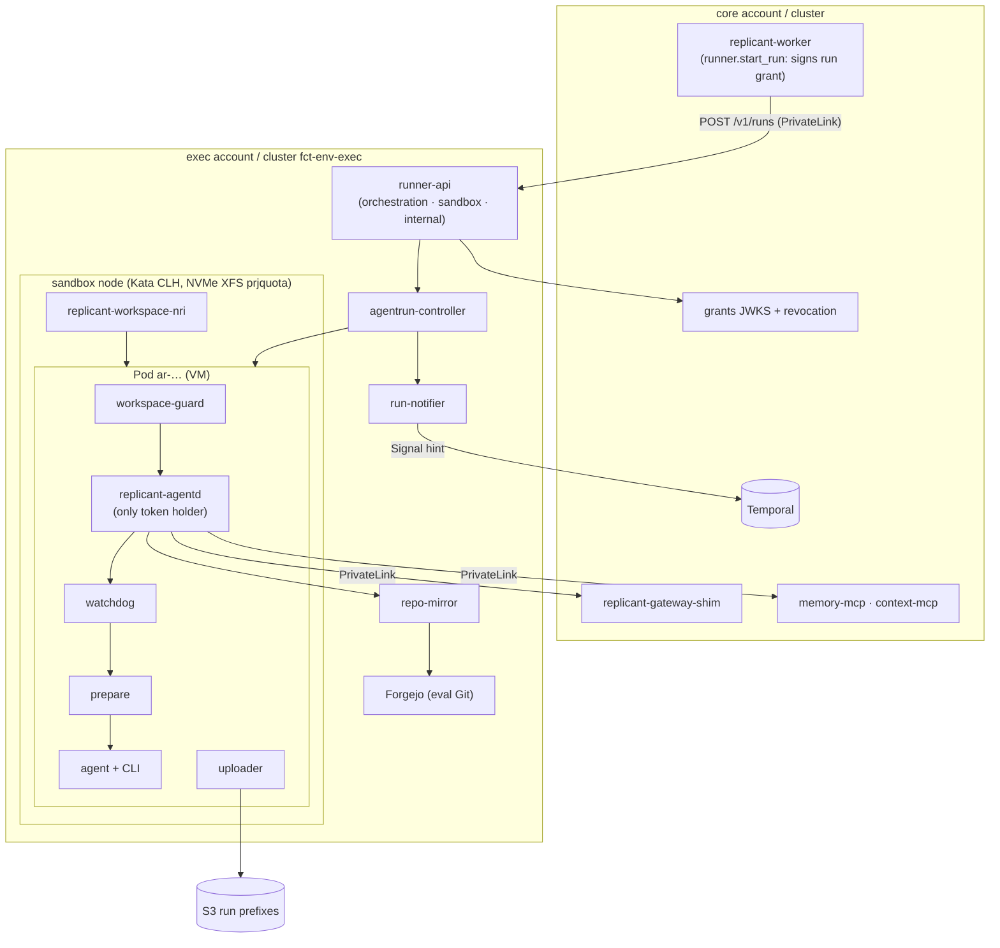

# 02 — Execution, Isolation Runtime, and Workspace Storage (WS-02)

## Purpose

Everything on the execution side of the Runner API: runner-api and run-notifier, the AgentRun
controller, the isolation runtime and its node pools, workspace storage with enforced limits,
sandbox network controls, artifact collection, the fast path to sandbox-ready, and the local
implementations of the same contract. Conforms to C-RUNNER 3.0.0, C-CRD 3.0.0, C-ARCH 2.0.0,
C-ART 2.0.0, C-IDS 2.0.0, ADR-007/008/010/011/014. Updated in fix waves 1–3 for the R1 and R2 findings, the co-owner entries and the R1 verification rows.

## Decisions summary

| # | Decision | Constraint | Where |
|---|---|---|---|
| 1 | **Kata Containers 4.3.1 (runtime-rs) + Cloud Hypervisor is the default for all workload classes**; gVisor (systrap, directfs off) is the deployed standby; Firecracker is defined but never selected. Benchmark gates can flip any class | D-06 | [runtime-evaluation.md](runtime-evaluation.md), [ADR-02-001](adr/02-001-default-runtime-per-workload-class.md) |
| 2 | Sandbox nodes: **nested-virtualization `m8id`/`r8id` 24xlarge/16xlarge** (weight 10; `c8id` at weight 5) via Karpenter `cpuOptions.nestedVirtualization`; `m8id.metal-48xl` as measured fallback (weight 1, one-change switch); on-demand only; ≈ 8 nodes + 2 warm at the 150-run peak | D-06, D-22 | [ADR-02-007](adr/02-007-sandbox-node-pools.md), runtime-evaluation.md §9 |
| 3 | Workspace: emptyDir on our own NVMe RAID0 **XFS `prjquota`**; hard limit **`guestBlockDevice`** (Kata, NRI-provisioned exactly-sized direct block volume) or **`xfsProjectQuota`** (gVisor), **`fixedSizeVolume`** EBS gp3 overflow; fail-closed guard; watchdog → `WorkspaceDiskExceeded` before eviction | D-07 (ADR-014) | [workspace-storage.md](workspace-storage.md), [ADR-02-004](adr/02-004-workspace-hard-limit-per-runtime.md) |
| 4 | Controller: **bare Pod `ar-<body>`** with a pod-creation marker (hard at-most-once), phase as a pure, tested function of observations, graceful delete + pod finalizer, notification state in status | D-04, D-05 | [controller.md](controller.md), [ADR-02-002](adr/02-002-bare-pod-not-job.md) |
| 5 | **Credentials only in `replicant-agentd`** (per-audience tokens within core-signed run grants); trusted **in-pod uploader** (regular container) gets S3 sessions over a private socket and commits the manifest last; controller re-verifies | D-08, D-21 | [ADR-02-003](adr/02-003-in-pod-uploader-split-tokens.md) |
| 6 | Network: **Cilium 1.20 ENI mode, per-run `toFQDNs` policy + DNS allowlist (REFUSED otherwise)**, cluster-wide default deny with `egressDeny` for IMDS/API/nodes, no default route, PrivateLink to core | D-21 | [network.md](network.md), [ADR-02-005](adr/02-005-egress-cilium-fqdn.md) |
| 7 | runner-api: Go, idempotency on AgentRun name + spec digest (excl. grant) + `agentrun_record` tombstone, policy resolved only through the bundle, run-grant verification, KMS-signed per-audience tokens, STS session vending | D-04, D-23 | [runner-service.md](runner-service.md) |
| 8 | Fast path: warm placeholders, image warmer + SOCI parallel pull, in-cluster repo-mirror with blobless exact-SHA fetches, curated package mirror; p95 budget 55 s warm / 79 s cold vs 90 s target | SLO | [fast-path.md](fast-path.md), [ADR-02-006](adr/02-006-repo-mirror.md) |
| 9 | Hardening: containerd forwards **no annotations** to sandbox runtimes; WS-09 Kata hardening adopted; VAPs deployed | D-21 | runtime-evaluation.md §11 |
| 10 | Local: runner-local (shared Go packages, Docker/rootless Podman, `s3`/SeaweedFS) and kind with Kata where KVM exists; 23 documented differences | D-20, D-08 (amended) | [local-runner.md](local-runner.md) |
| 11 | **Run lease and revocation:** agentd heartbeats every 30 s renew a per-run Lease; on any terminal phase or lease expiry the run is added to an exec revocation feed that the shim, MCPs and repo-mirror poll every 10 s; running Pods of terminal runs are deleted immediately | D-21, R2-030, R1-040 | [runner-service.md §7.3](runner-service.md) |
| 12 | **Runtime override:** an operational, two-person, expiring override outside the bundle digest moves new runs off a runtime within hours (security exception path); gVisor pool sized for production peak | D-06, R2-045 | [runner-service.md §3.4](runner-service.md) |
| 13 | **One ephemeral-storage formula** (controller adds `H + F + O` to the profile limit); ceilings `workspace.maxSize` 1 Ti and per-class CPU/memory maxima; overflow resolved from WS-03's policy enum against per-pool local maxima | D-07, R1-036, R2-064, R1-279 | [controller.md §4.1](controller.md) |
| 14 | Cancel reason delivered through the inbox control key `inbox/_control.json` (primary), downward API annotation as a second channel | R2-040 | [runner-service.md §5](runner-service.md) |
| 15 | **Exec VPC subnets, routes and egress firewall are WS-02's** (R1-240): sandbox subnets have no default route; only repo-mirror and exec-system subnets reach the central egress VPC, whose Network Firewall allows GitHub (from the mirror subnets) and the core EKS OIDC issuer (from exec-system) only; NLB subnets `10.41.8–10.0/24` with client IP preservation off | D-21, R1-211, R1-240 | [network.md §6.1](network.md), [manifests/exec-egress-firewall.yaml](manifests/exec-egress-firewall.yaml) |
| 16 | **No kubelet access from the controller** (no `nodes/proxy`); DiskPressure comes from the watchdog via the heartbeat and the run Lease, plus node conditions | R1-210 | [controller.md §11](controller.md) |
| 17 | **Out-of-band kill switches:** runner-api reads the `ops`-bucket mirror for global/repo/bundle `starts` switches and fails closed after 5 minutes without it; tenant switches are namespace labels. The exec revocation feed lives in the `ops` bucket (90-day expiry) | R2-016, C-RUNNER 3.0.0 | [runner-service.md §2.3, §7.3](runner-service.md) |
| 18 | **Admission and supply chain:** WS-09's three VAPs plus Kyverno ≥ 1.19 `replicant-images-signed` in both clusters; images only `(replicant\|mirror)/…@sha256` and cosign-signed; network profiles are WS-09's eight, published to the binding VAP by the controller's policy sync | R1-212, R1-213, R1-224 | [controller.md C-10, §2a](controller.md), [network.md §5](network.md) |
| 19 | Security cancellation ends **`Failed/SecurityViolation` on every terminal path**, including node loss while cancelling (tested) | R1-223 | [controller/derive.go](controller/derive.go) |

## Files

| File | Content |
|---|---|
| [runtime-evaluation.md](runtime-evaluation.md) | Verified facts, isolation and escape classes, EKS operability, Firecracker specifics, performance expectations, builds and sidecars, emptyDir behavior per runtime, **benchmark plan and gates**, density per node, Kata memory and the D-12 challenge, hardening config, recommendation |
| [runner-service.md](runner-service.md) | runner-api listeners, authN, createRun pipeline, idempotency, admission, translation, status, cancel, steering inbox, tokens and grants, STS session policy, run-notifier, failure modes |
| [controller.md](controller.md) | Watches, reconcile loop, pod template, containers, Secret/ConfigMap, credentials lifecycle, deadlines, terminal handling, GC, orphans, exit-code mapping, artifact collection, leader election, metrics |
| [workspace-storage.md](workspace-storage.md) | Node disk setup, kubelet settings, pod YAML, enforcement per runtime, NRI plugin, watchdog, EBS overflow, rejected options, sizing method |
| [fast-path.md](fast-path.md) | Cold-start budget, warm capacity, images, repo-mirror and fetch, eval Git server, dependency caches |
| [network.md](network.md) | Cilium install, baseline and per-run policies, DNS controls, profiles, AWS controls, QA egress, probes |
| [local-runner.md](local-runner.md) | runner-local, credentials against `s3`, kind profile, macOS limits, exhaustive differences |
| [lifecycle-and-failures.md](lifecycle-and-failures.md) | Must-answers (sandbox contents, node loss, unverified facts) and the 46-row failure catalog |
| [api/v1alpha1/agentrun_types.go](api/v1alpha1/agentrun_types.go), [agentrun_helpers.go](api/v1alpha1/agentrun_helpers.go), [api/hack/crd2go.py](api/hack/crd2go.py) | CRD Go types **generated from the frozen C-CRD YAML (2.4.0)** (every validation as a marker), plus hand-written constants and helpers |
| [controller/derive.go](controller/derive.go), [derive_test.go](controller/derive_test.go) | Pure phase/reason state machine with table tests (passing) |
| [schemas/](schemas/) | `runtime_selection` and `network_profiles` policy schemas + validated examples |
| [manifests/](manifests/) | RuntimeClasses, EC2NodeClasses (Kata, metal, gVisor; user data), NodePools (incl. the isolation-group template), StorageClass, capacity reserve and PriorityClasses, Cilium values, network policies, NRI DaemonSet, rendered sandbox Pods (coding and `qa_build`), exec egress firewall |
| [benchmark/README.md](benchmark/README.md) | `sbxbench` harness |
| [adr/](adr/) | ADR-02-001 … ADR-02-007 |

## Must-answer index

| Question | Answer |
|---|---|
| What does the sandbox contain when the CLI starts, and how did each piece get there? | [lifecycle-and-failures.md §1](lifecycle-and-failures.md#1-must-answer-what-the-sandbox-contains-when-the-cli-starts-and-how-each-piece-got-there) |
| What happens when a node is lost mid-run? | [lifecycle-and-failures.md §2](lifecycle-and-failures.md#2-must-answer-what-exactly-happens-when-a-node-is-lost-mid-run) |
| How many concurrent sandboxes fit on the recommended node type? | `m8id.24xlarge`: 20 coding, 16 qa_build, 37 review, 62 utility; every allowed shape and the metal fallback are tabulated ([runtime-evaluation.md §9](runtime-evaluation.md#9-concurrency-per-node-must-answer)) |
| Which runtime facts are unverified, and the fallback for each? | [lifecycle-and-failures.md §4](lifecycle-and-failures.md#4-must-answer-which-runtime-facts-are-unverified-and-the-fallback-for-each) |

## Validation performed (2026-10-24)

- Go: `go vet` and `go test` pass for the generated types and the state machine (41 table cases,
  including every security-cancel terminal path); the types decode the C-CRD example with `DisallowUnknownFields`, re-encode `spec`
  identically, and cover every CRD spec/status property. Go snippets in the docs pass `gofmt`.
- Mermaid: every diagram renders with `@mermaid-js/mermaid-cli@11.4.2`.
- YAML: every manifest and YAML snippet parses (PyYAML); the EC2NodeClass user data's NodeConfig and
  containerd TOML parse; shell scripts pass `bash -n`.
- JSON Schema: both policy schemas are Draft 2020-12 meta-valid; examples validate against the
  C-DEF envelope and the kind schema; a negative case is rejected.
- kubeconform v0.6.7 `-strict` against Kubernetes 1.34 schemas: every Kubernetes manifest valid (CRD-typed
  objects skipped for missing schemas; `cilium-values.yaml` is Helm values and `exec-egress-firewall.yaml`
  is CloudFormation). Not run: controller-gen CRD diff (a CI step).

## Open questions (top; full lists in each file and in `_coordination/open-questions.md`)

Decided by the orchestrator and recorded as such: nested virtualization under Kata (accepted with the
metal fallback), the NRI direct-volume `guestBlockDevice` mechanism (accepted with the B-DISK gate),
WS-03's Challenge: D-12 (D-12 amended; `median_peak` until B-MEM-01 evidence).

| Question | Who decides | Recommendation |
|---|---|---|
| Spot capacity for sandboxes | WS-10 | On-demand only in v1 |
| Auto-cancel on repeated denied egress | WS-09 | Alert only in v1 |
| Per-pod dm-crypt for regulated tenants on top of Nitro instance-store encryption | WS-09 | Only if Nitro encryption cannot be confirmed for M8id/R8id |
| `503 cluster_capacity` at createRun (XD-FIX-R2-020) | Orchestrator | Not at admission (runner-api cannot see a queue); cluster waits come from AgentRun status (XD-W2-02-04) |

## Risks

- Nested-virt performance and several runtime behaviors are unverified until the benchmark runs
  (lifecycle-and-failures.md §4 lists each with its fallback).
- Kata/virtiofsd is the main escape surface; mitigated by WS-09 hardening and the gVisor standby.
- `guestBlockDevice` depends on a Kata interface used in an uncommon way.
- STS sessions are Runner-asserted (WS-09 residual R-04).

## Interfaces consumed / provided

- **Provided:** C-RUNNER implementation (runner-api, runner-local), AgentRun controller behavior per
  C-CRD, run-notifier Signals, `runtime_selection` and `network_profiles` policy schemas, RuntimeClasses,
  node pools, sandbox Pod template and container contract, egress policies, benchmark gates.
- **Consumed:** C-ARCH, C-CRD, C-RUNNER, C-ART, C-IDS, C-DEF, C-MSG; WS-03 process model and exit
  codes; WS-09 policies and hardening; WS-11 local stack; WS-06 eval tenant; WS-10 accounts,
  buckets, and keys.
