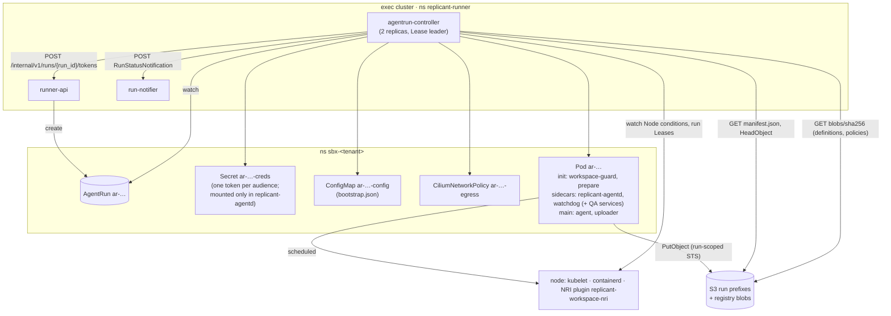
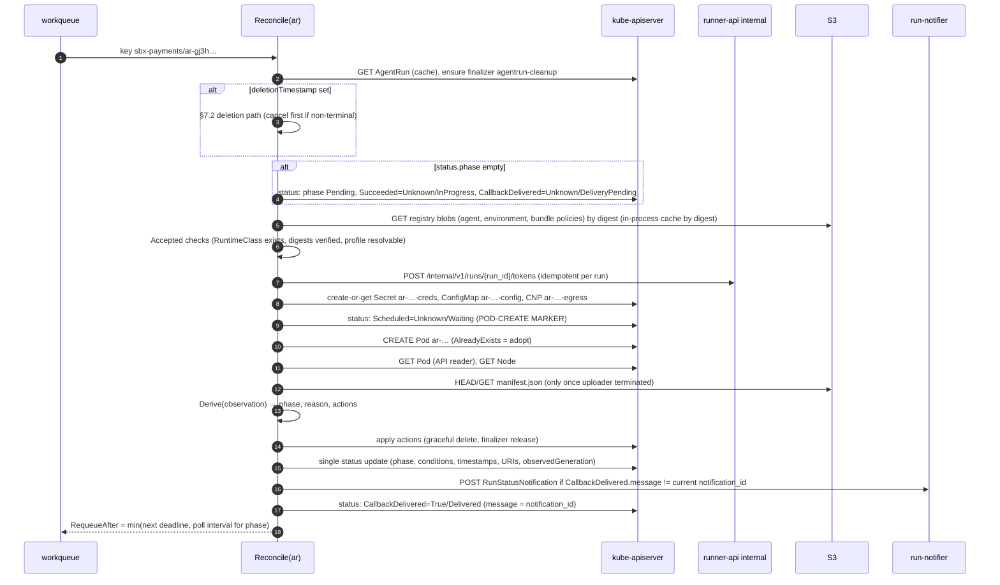

# AgentRun Controller

**Workstream:** WS-02 · **Constraints:** D-04, D-05, D-07, D-08, D-17, D-21 · **Contracts:** C-CRD 3.0.0 (observable behavior; required `spec.runGrant`, optional `spec.workflowType`), C-RUNNER 3.0.0 (notification payload, per-audience run tokens, heartbeat, revocation), C-ART 2.0.0 (prefixes, manifest, upload semantics), C-IDS 2.0.0 §7–§8, C-ARCH 2.0.0 (`agentrun-controller` role)
**ADRs:** [ADR-02-002](adr/02-002-bare-pod-not-job.md) (bare Pod), [ADR-02-003](adr/02-003-in-pod-uploader-split-tokens.md) (in-pod uploader, split tokens), [ADR-02-004](adr/02-004-workspace-hard-limit-per-runtime.md) (workspace limits)
**Code in this section (compiled and tested):** [api/v1alpha1/agentrun_types.go](api/v1alpha1/agentrun_types.go), [controller/derive.go](controller/derive.go), [controller/derive_test.go](controller/derive_test.go)
**Rendered example:** [manifests/sandbox-pod.example.yaml](manifests/sandbox-pod.example.yaml)

## Purpose

`agentrun-controller` turns each AgentRun into exactly one sandbox Pod and its supporting objects,
watches it to a terminal phase, makes sure artifacts are committed before declaring success,
notifies run-notifier on every phase transition, revokes credentials, and cleans up. It must
produce exactly the observable behavior in [agentrun-crd.md](../00-contracts/agentrun-crd.md):
phases, conditions, failure reasons, at-most-once execution, and recovery by recomputation after a
restart.

## Decisions summary

| # | Decision | Ref |
|---|---|---|
| C-1 | **Bare Pod named `ar-<body>`, not a Job.** Pod-name uniqueness gives a hard at-most-once guarantee per AgentRun; the controller owns TTL and deadlines itself | [ADR-02-002](adr/02-002-bare-pod-not-job.md); CCR-02-03 (C-IDS pod name) |
| C-2 | **Pod-creation marker before creation:** the controller writes `Scheduled=Unknown/Waiting` to status, then creates the Pod. If the marker exists and the Pod does not, it never creates again; it fails the run (`NodeLost` after the run had progressed, `ControllerError` otherwise) | agentrun-crd.md rules 5, C-CRD "at most once" |
| C-3 | **In-pod uploader as a regular (non-sidecar) container** that outlives the agent; it receives S3 session credentials from `replicant-agentd` over a private socket. The agent container holds no credential at all (WS-03 ADR-001, WS-09 G-01). The uploader verifies every object through S3 `x-amz-checksum-sha256` (S3 rejects mismatches with `BadDigest`), writes the manifest last with `If-None-Match: *`, and the controller re-verifies the manifest and object sizes/checksums with `HeadObject` before `Succeeded` | [ADR-02-003](adr/02-003-in-pod-uploader-split-tokens.md); C-ART §5 |
| C-4 | **Graceful termination by Pod DELETE with `gracePeriodSeconds = finalizeSeconds + 15`**, plus a Pod finalizer `replicant.example.com/pod-status` that keeps the terminated Pod object until the controller has recorded its container statuses | §6.3 |
| C-5 | **Phase is a pure function of observations** (`controller.Derive`, table-tested) computed from uncached reads of the Pod, the Node, and S3 manifest presence | agentrun-crd.md rule 5 |
| C-6 | **Notification state lives in status:** `CallbackDelivered` condition `message` holds the last delivered `notification_id`; the reconciler delivers the current phase whenever it differs. Later phases supersede undelivered earlier ones | agentrun-crd.md §5.1 |
| C-7 | Exit-code contract is WS-03's normative table; termination messages ≤ 1 KiB; cancel cause passed by Pod annotation through the downward API | §8; XD-02-01 |
| C-10 | **Admission (XD-FIX-R1-213, R1-224):** four WS-09 objects are deployed unchanged with the `replicant-exec` chart: `ValidatingAdmissionPolicy` `replicant-sandbox-pod-shape` (09 vap-sandbox-pods.yaml), `replicant-sandbox-children-writer` (only the controller writes sandbox children), `replicant-agentrun-binding` (namespace = `sbx-<tenantId>`, bucket names, callback namespace, network profile ∈ the binding-params list, writer identities; its params are the ConfigMap of §2a), and Kyverno `ImageValidatingPolicy` `replicant-images-signed` (09 ivp-replicant-images.yaml: cosign signature by KMS key `alias/replicant/<env>/image-signing`, inline public-key PEM rendered by IaC). WS-02 installs **Kyverno ≥ 1.19** in both clusters (exec and core; chart pinned by the platform repo, admission controller 3 replicas, `failurePolicy: Fail` for the sandbox namespaces). The controller itself re-checks namespace↔tenant before acting (CEL in the CRD cannot see the namespace, WS-09 G-11) | §2a, §4.1 |
| C-11 | Accepted CCR-09-02 (run grants) and CCR-09-04 (`SecurityViolation`, cancel reason `security`) are implemented in the types and `Derive` | §4.3, §8 |
| C-8 | Network policy object: one `CiliumNetworkPolicy` `ar-<body>-egress` per run, rendered from the bundle's `network_profiles` policy | [network.md](network.md) |
| C-9 | controller-runtime **v0.25.x** (latest v0.25.2, 2026-10-01), kubebuilder **v4.16** [verified: GitHub releases API, 2026-10-24]; leader election with a Lease; 32 concurrent reconciles | §10 |



---

## 1. API types

The Go schema types in [api/v1alpha1/agentrun_types.go](api/v1alpha1/agentrun_types.go) are
**generated from the frozen YAML** by [api/hack/crd2go.py](api/hack/crd2go.py) (R1-034). The
generator emits a kubebuilder marker for every validation in the C-CRD schema: required fields,
enums (as named types), `pattern`, `minLength`/`maxLength`, `minimum`/`maximum`, `format`,
`maxItems`, list types, defaults, and every `x-kubernetes-validations` rule at the root, on `spec`,
and on each field (including every per-field `self == oldSelf` immutability rule and the prefix
`endsWith` rule). Constants, the C-CRD §4 reason table, and helpers live in the hand-written
[agentrun_helpers.go](api/v1alpha1/agentrun_helpers.go), which declares no fields.

Checks run on 2026-10-24 against C-CRD 3.0.0: the generated file compiles (`go vet`); the C-CRD
example (including `runGrant` and `workflowType`) decodes with `DisallowUnknownFields` and re-encodes
`spec` identically; every spec and status property in the YAML has a Go field. CI regenerates the
file on every C-CRD version and fails on any diff, and additionally runs `controller-gen crd` and
compares the result with the frozen YAML. Known, documented difference: `status.conditions` items use
`metav1.Condition`, whose generated schema does not carry the CRD's `type` enum; the frozen YAML (not
the generated one) is what is installed, so the enum is enforced.

- Quantities are strings in the schema (pattern-validated); `ResourceQuantities.ToResourceList()`
  parses them identically in runner-api and the controller.
- `FailureReason.Retryable(message)` encodes the `retryable` column of agentrun-crd.md §4, including
  `DefinitionUnavailable` (retryable) and the `ImagePullFailed: manifest unknown` exception
  (non-retryable, R1-056). It is the only source for `RunStatus.failure.retryable`.

## 2. Watches, caches, and indexes

| Watch | Why | Cache scope |
|---|---|---|
| `AgentRun` (primary, `For`) | desired state, cancel | all namespaces labelled `replicant.example.com/zone=sandbox` (WS-09's tenant namespace label; XD-FIX-R1-031) |
| `Lease` `ar-<body>-lease` | run lease renewed by runner-api on agentd heartbeats (runner-service.md §7.3) | label `app.kubernetes.io/managed-by=runner-api` |
| `Pod` (`Owns`) | progress, exits | label `app.kubernetes.io/managed-by=agentrun-controller` (`cache.ByObject` label selector bounds memory) |
| `CiliumNetworkPolicy` (`Owns`) | drift and deletion | same label selector |
| `Secret`, `ConfigMap` (**not watched**, R1V-019) | the controller reads its own `ar-<body>-creds` / `ar-<body>-config` by name with the API reader (`get`) at the steps that need them and recreates a missing one before the Pod exists; after Pod creation they are immutable inputs and the ownerReference is the GC backstop. So WS-09's `get/create/update/patch/delete` (no list/watch) is sufficient, and the controller never lists Secrets in tenant namespaces | — |
| `Node` (`Watches` + mapper) | node NotReady/deleted → enqueue AgentRuns of Pods on that node (field index `spec.nodeName` on Pods) | all nodes (≤ 50) |

Field indexes: Pods by `spec.nodeName`; AgentRuns by `status.phase` (also served by CRD
`selectableFields` for runner-api list calls). Predicates: AgentRun events pass on generation change
**or** `cancelRequested` change (generation covers it); status-only updates by the controller itself
are filtered with `predicate.GenerationChangedPredicate` on AgentRun but **not** on Pods (Pod status
is the progress signal).

**RBAC (XD-FIX-R1-210).** The controller's permissions in tenant namespaces come from WS-09's
ClusterRole `replicant-sandbox-child-writer` (09 tenant-namespace.yaml), bound per `sbx-<tenant>`:
pods get/list/watch/create/update/patch/delete; secrets and configmaps get/create/update/patch/delete;
ciliumnetworkpolicies all verbs; agentruns get/list/watch/update/patch/delete; agentruns/status and
agentruns/finalizers get/update/patch; events create/patch; plus `coordination.k8s.io` leases
get/list/watch (run leases, read-only; XD-W2-02-01). Cluster-wide: `nodes` and `namespaces`
get/list/watch, its own leader-election Lease in `replicant-runner`, and `configmaps` get/update/patch with `resourceNames: [replicant-agentrun-binding-params]` in `replicant-runner` for the policy sync (§2a; the chart creates the ConfigMap empty, so no `create` is needed; R1V-056). **No `nodes/proxy`** (GET on
nodes/proxy is exec-equivalent through the kubelet), no `pods/exec`, no `pods/attach`. The controller
never reads kubelet stats (§11).

Decisions that can cause an irreversible action (create Pod, declare a terminal phase, delete a
Pod) use the **API reader** (uncached GET) for the Pod and the AgentRun, so a stale cache can never
cause a second Pod or a premature terminal phase.

### 2a. Policy sync (binding parameters)

A small loop in the controller (leader only, every 60 s and on registry change) reads the promoted
Release Bundles' `network_profiles` policies (registry `bundles/*` pointers and blobs, §9b) and
renders ConfigMap `replicant-runner/replicant-agentrun-binding-params`, key `networkProfiles`, as the
comma-separated sorted union of profile names (for example
`coding-default,eval-coding,eval-scoring,eval-snapshot,qa-with-mirror,review-readonly,takeover,utility-minimal`).
WS-09's `replicant-agentrun-binding` VAP uses it as `paramRef`, so an AgentRun naming an unknown
profile is refused by admission (XD-FIX-R1-213). The eight profile names are network.md §5.

## 3. Reconcile loop

### 3.1 Steps (each idempotent; the loop may stop and resume after any step)



### 3.2 Reconcile skeleton (Go, controller-runtime v0.25)

```go
func (r *AgentRunReconciler) Reconcile(ctx context.Context, req ctrl.Request) (ctrl.Result, error) {
	ctx, span := r.Tracer.Start(ctx, "agentrun.reconcile")
	defer span.End()

	var ar v1.AgentRun
	if err := r.Get(ctx, req.NamespacedName, &ar); err != nil {
		return ctrl.Result{}, client.IgnoreNotFound(err)
	}
	span.SetAttributes(attribute.String("replicant.run_id", ar.Spec.RunID), attribute.String("replicant.job_id", ar.Spec.JobID))

	if !ar.DeletionTimestamp.IsZero() {
		return r.reconcileDelete(ctx, &ar)
	}
	if controllerutil.AddFinalizer(&ar, v1.FinalizerCleanup) {
		if err := r.Update(ctx, &ar); err != nil {
			return ctrl.Result{}, err
		}
	}
	if ar.Status.Phase.IsTerminal() {
		return r.reconcileTerminal(ctx, &ar) // revoke, notify, TTL child cleanup, GC
	}
	if ar.Status.Phase == "" {
		return ctrl.Result{Requeue: true}, r.initStatus(ctx, &ar)
	}

	defs, accErr := r.accept(ctx, &ar) // registry blobs by digest, RuntimeClass, profile
	if accErr != nil {
		return r.fail(ctx, &ar, accErr.Reason, accErr.Message)
	}
	if err := r.ensureCredentials(ctx, &ar); err != nil {
		return r.retryOrFail(ctx, &ar, v1.ReasonCredentialIssueFailed, err)
	}
	if err := r.ensureSupportObjects(ctx, &ar, defs); err != nil {
		return ctrl.Result{}, err // transient; rate-limited requeue
	}

	pod, err := r.getPodUncached(ctx, &ar)
	if err != nil {
		return ctrl.Result{}, err
	}
	marked := meta.FindStatusCondition(ar.Status.Conditions, v1.CondScheduled) != nil
	if pod == nil && !marked && !ar.Spec.CancelRequested {
		if err := r.markPodCreate(ctx, &ar); err != nil { // Scheduled=Unknown/Waiting
			return ctrl.Result{}, err
		}
		pod, err = r.createPod(ctx, &ar, defs) // AlreadyExists => GET and adopt
		if err != nil {
			return r.handleCreateError(ctx, &ar, err) // quota forbidden => requeue until startupSeconds
		}
		marked = true
	}

	obs, err := r.observe(ctx, &ar, pod, marked) // node health, intent, manifest/result presence
	if err != nil {
		return ctrl.Result{}, err
	}
	d := controller.Derive(obs)
	if d.DeletePodGracefully && pod != nil && pod.DeletionTimestamp.IsZero() {
		if err := r.deletePodGracefully(ctx, &ar, pod); err != nil {
			return ctrl.Result{}, err
		}
	}
	changed, err := r.applyStatus(ctx, &ar, pod, obs, d) // one status write; sets URIs before terminal
	if err != nil {
		return ctrl.Result{}, err
	}
	if err := r.notify(ctx, &ar); err != nil { // C-6; errors only delay, never block status
		r.Metrics.NotifyFailures.Inc()
	}
	if changed && d.Phase.IsTerminal() {
		return ctrl.Result{Requeue: true}, nil // next pass runs reconcileTerminal
	}
	return ctrl.Result{RequeueAfter: r.nextWake(&ar, obs)}, nil
}
```

`nextWake` returns the earliest of: startup deadline, agent deadline (`agentStartedAt +
activeDeadlineSeconds`), finalize deadline (`agentExitedAt` or termination time `+
finalizeSeconds`), the notification backoff timer, and a phase poll (5 s in Provisioning, 30 s in
Running for DiskPressure sampling, 2 s in Finalizing).

### 3.3 Phase derivation

`controller.Derive` ([derive.go](controller/derive.go)) is the complete state machine. The table
tests in [derive_test.go](controller/derive_test.go) cover every C-CRD transition (pending, cancel
before pod, unschedulable, marker without pod, pod vanished, bound, each prepare and workspace-guard failure,
startup timeout, running, finalizing, succeeded, result missing, disk exceeded, OOM, deadline,
upload failed, cancel, node lost while running and while cancelling, terminal finality, and both
eviction kinds). They pass (`go test`, 2026-10-24).

Mapping summary (observation → phase/reason):

| Observation | Phase | Reason |
|---|---|---|
| AgentRun exists, no Pod, no marker | Pending | — |
| Pod `spec.nodeName` set | Provisioning | `Scheduled=True/PodScheduled`, `scheduledAt` = PodScheduled transition time |
| `prepare` terminated 0 | (Provisioning) | `WorkspaceReady=True/Prepared`, `workspaceReadyAt` |
| `prepare` exit 43/40/41/42 | Failed | `RepoFetchFailed` / `InputsFetchFailed` / `DiffApplyFailed` / `SessionRestoreFailed`; `WorkspaceReady=False/<reason>` |
| `workspace-guard` exit 84 (limit not enforced, fail-closed) | Failed | `ControllerError` + alert `ReplicantWorkspaceLimitNotEnforced` |
| image pull backoff past `startupSeconds` | Failed | `ImagePullFailed` (message carries `manifest unknown` when the digest is missing, non-retryable per C-CRD note) |
| agent `started=true` (startupProbe `test -f /run/replicant/ipc/status/agent-started` passed, XD-03-02) | Running | `AgentRunning=True/Started`, `agentStartedAt` |
| agent terminated, uploader running | Finalizing | `AgentRunning=False/Exited`, `agentExitedAt` |
| `agentStartedAt + activeDeadlineSeconds` reached | Finalizing | graceful delete; final reason `DeadlineExceeded` |
| uploader exit 0, manifest verified, result present, agent exit 0 | Succeeded | `ArtifactsUploaded=True/Uploaded`, `Succeeded=True/Completed` |
| uploader exit 10 (partial) | Failed | agent-derived reason; `ArtifactsUploaded=True/PartialUpload` |
| uploader exit 20 or manifest missing | Failed | `ArtifactUploadFailed`; `ArtifactsUploaded=False/UploadFailed` |
| node NotReady > 60 s or Node deleted | Failed | `NodeLost` |
| Pod `Evicted` with ephemeral-storage message | Failed | `WorkspaceDiskExceeded` (C-CRD: disk overrun is never `PodEvicted`) |
| Pod `Evicted` otherwise | Failed | `PodEvicted` |
| `DisruptionTarget` reason `PreemptionByScheduler` | Failed | `Preempted` |
| `cancelRequested` | Cancelling → Cancelled | `CancelledByRequest` (graceful delete; partial manifest when the uploader ran) |
| `cancelRequested` with `cancelReason: security` | Cancelling → **Failed** | `SecurityViolation` (non-retryable, CCR-09-04) |

`Accepted` failures map to C-CRD reasons this way: RuntimeClass missing or no node pool for its
`scheduling.nodeSelector` → `RuntimeClassUnavailable` (retryable); definition digest mismatch →
`AdmissionDenied` (`Accepted=False/DefinitionDigestMismatch`); registry blob fetch failure after 5
attempts over 60 s → **`DefinitionUnavailable`** (retryable, C-CRD 2.2.0; `Accepted=False/DefinitionFetchFailed`).

Additional rows (R1-035, R1-040, R1-061; all table-tested):

| Observation | Phase | Reason |
|---|---|---|
| Pod CREATE refused by ResourceQuota after the marker | Pending (requeue 15 s); after `startupSeconds` Failed | `Unschedulable` |
| Pod CREATE refused by admission (VAP/webhook) | Failed | `AdmissionDenied` |
| uploader `OOMKilled` (the pod sandbox/VM ran out of memory) | Failed (no finalize) | `OOMKilled` |
| Pod `status.reason = DeadlineExceeded` (backstop fired) | Failed | `DeadlineExceeded` (or the cancel outcome) |
| image pull failing for any container (init or main) past `startupSeconds` | Failed | `ImagePullFailed` (`manifest unknown` ⇒ non-retryable) |
| cancel with no Pod | Pending → **Cancelling** → Cancelled (two transitions, two notifications, C-CRD §1) | `CancelledByRequest` |
| AgentRun terminal while its Pod still runs (rejoined node) | terminal (unchanged) | Pod deleted **immediately** with `gracePeriodSeconds: 0` |
| run lease expired (> 120 s without heartbeat) while the Node is Ready | Failed | `NodeLost`, revoked (runner-service.md §7.3) |

## 4. Child objects

| Object | Name | Created | Deleted | Content |
|---|---|---|---|---|
| `Secret` | `ar-<body>-creds` | after `Accepted` | at terminal (C-CRD §5.3) | one JWT per audience in the run grant (§4.3); `type: Opaque`, `immutable: true` |
| `ConfigMap` | `ar-<body>-config` | after `Accepted` | with the Pod (terminal + 1 h) | `bootstrap.json` (§4.4) |
| `CiliumNetworkPolicy` | `ar-<body>-egress` | after `Accepted`, **before the Pod** | when the Pod is gone | per-run egress allowlist (network.md §5) |
| `Pod` | `ar-<body>` | after the marker | terminal + 1 h (`ttl` owned by the controller) | §4.1 |
| `ServiceAccount` | `sbx-runner` | tenant onboarding (platform GitOps), not per run | — | `automountServiceAccountToken: false`, no RoleBindings |

All children carry the C-IDS §8 labels and an `ownerReference` to the AgentRun
(`controller: true`, `blockOwnerDeletion: true`), so Kubernetes garbage collection is the
backstop for anything the finalizer path misses.

### 4.1 Pod template

The rendered example is [manifests/sandbox-pod.example.yaml](manifests/sandbox-pod.example.yaml).
Rules the renderer enforces:

| Area | Rule |
|---|---|
| Runtime | `runtimeClassName` from spec; node selection and tolerations come from the RuntimeClass `scheduling` (no per-pod node affinity, so a policy change cannot place a VM-class Pod on a gVisor node). The single exception is the isolation group (XD-FIX-R1-220): when namespace label `replicant.example.com/isolation-group` is not `shared-standard`, the controller adds `nodeSelector["replicant.example.com/isolation-group"] = <group>` and toleration `{key: replicant.example.com/isolation-group, operator: Equal, value: <group>, effect: NoSchedule}`; the value comes only from the namespace label (never the spec), and the NodePools are `sbx-kata-iso-<group>` and `sbx-gvisor-iso-<group>` (both rendered per group, so a run moved to gVisor by policy or a runtime override still schedules; manifests/karpenter-sandbox-pools.yaml, R1V-058). The `Accepted` check verifies that a NodePool labelled with the group **and** the resolved runtime's `replicant.example.com/pool-runtime` exists; if not, the run fails `RuntimeClassUnavailable` (retryable) instead of staying `Pending` (XD-W3-R1V-058). Shared namespaces get nothing |
| Identity | `serviceAccountName: sbx-runner`, `automountServiceAccountToken: false`, `enableServiceLinks: false` |
| Namespaces | `hostNetwork/hostPID/hostIPC: false`, `shareProcessNamespace: false` |
| Users | Pod `runAsNonRoot: true`, `runAsUser/runAsGroup: 10001`, `fsGroup: 10002` (replicant-io group, XD-03-01), `fsGroupChangePolicy: OnRootMismatch` |
| Container security | `allowPrivilegeEscalation: false`, `readOnlyRootFilesystem: true`, `capabilities.drop: [ALL]`, `seccompProfile: RuntimeDefault` (Kata configured with `disable_guest_seccomp = false` so it is applied in the guest; runtime-evaluation.md F-13) |
| Builder exception | Only for `workload_class=qa_build` on `replicant-kata-clh`, and only on the dedicated `builder` native sidecar the environment definition's QA section declares (WS-05 XD-05-16): `seccompProfile: Unconfined`, `appArmorProfile: Unconfined`, `allowPrivilegeEscalation: true` (orchestrator decision; needed for `newuidmap` in rootless BuildKit), still non-root, capabilities limited to `SETUID`/`SETGID`; the builder mounts no credential, `ipc`, or `uploader-ipc` volume (WS-09 `vap-sandbox-pods` must allow exactly this combination); BuildKit runs with `--oci-worker-no-process-sandbox` (runtime-evaluation.md §6). Refused by admission under `replicant-gvisor` |
| Volumes | No `hostPath`, no `subPath` (unsupported by Kata, runtime-evaluation.md F-14), no projected SA token |
| Restart | `restartPolicy: Never` |
| Deadlines | `activeDeadlineSeconds = startup + active + finalize` (backstop); `terminationGracePeriodSeconds = finalizeSeconds + 15` |
| DNS | `ClusterFirst`, `dnsConfig.options: [{name: ndots, value: "1"}]`, `dnsConfig.searches: []` (WS-09 agent-capabilities.md §3: allowlisted names resolve without search-domain expansion) |
| Resources | Agent container: `spec.resources` verbatim. Fixed small requests for workspace-guard, replicant-agentd, prepare, watchdog, uploader (shown in the example). QA service sidecars from the environment definition (WS-05). Overhead from `RuntimeClass.overhead.podFixed` |
| ephemeral-storage (one formula, R1-036) | The profile values in `spec.resources` are copied as-is; the controller **adds** the pod margin `M` to the agent container's rendered `limits.ephemeral-storage` and leaves requests unchanged: `M = H + F + O` with workspace headroom `H = ceil_Gi(0.05 × workspace.sizeLimit + 1Gi)` (only for `emptyDir` backing), fixed volumes `F = 8Gi` (home 2, tools 1, inputs 2, spool 2, logs 1), and `O = ceil_Gi(maxOutputBytes) + 1Gi` (the `out` volume). The C-CRD example renders `40Gi + 3Gi + 8Gi + 5Gi = 56Gi`. Runner A-8 only requires `workspace.sizeLimit ≤ limits.ephemeralStorage`, so the C-CRD example and every WS-03/WS-05 profile pass |
| Labels (C-IDS §8, R1-033) | `tenant`, `job-id`, `run-id`, `role`, `workload-class`, `isolation`, `bundle`, `network-profile`, `workflow-type` (from `spec.workflowType`, when present), `acting-for` (the `acting_for` claim of the **verified** `spec.runGrant`; never a Prometheus or Loki stream label), `app.kubernetes.io/managed-by` |
| Env (C-IDS §7, R1-033) | the §7 set plus `REPLICANT_WORKFLOW_TYPE` (empty when absent), `REPLICANT_WORKFLOW_ID`, `REPLICANT_LOGICAL_ACTIVITY_ID`, `OTEL_EXPORTER_OTLP_ENDPOINT=https://otel-sandbox.<env>.replicant.internal:4318`, `OTEL_EXPORTER_OTLP_CERTIFICATE=/etc/replicant-ca/ca.crt` (Replicant CA bundle from ConfigMap `replicant-ca-bundle`, mounted read-only, R1-041) |
| Labels for the NRI plugin | `replicant.example.com/workspace-enforcement`, `replicant.example.com/workspace-bytes` (labels, because containerd forwards no annotations to Kata; WS-09 G-12) |
| Annotations | only `kubectl.kubernetes.io/default-container` (logs), `karpenter.sh/do-not-disrupt: "true"`, `replicant.example.com/cancel-reason` (downward API, best-effort second channel; the primary channel is the inbox control key, R2-040), and `replicant.example.com/runtime-override` when an override applied; no `io.katacontainers.*`, `io.containerd.*`, `dev.gvisor.*` annotations ever (WS-09 `vap-sandbox-pods` denies them) |
| Images | every image matches `<image account>.dkr.ecr.us-east-1.amazonaws.com/(replicant\|mirror)/<1–4 path segments>@sha256:<64 hex>` (XD-FIX-R1-212, WS-09 `replicant-sandbox-pod-shape`) and carries a cosign signature checked by `replicant-images-signed` (R1-224). WS-02 images are `replicant/sandbox-utils`, `replicant/sandbox-uploader`; QA service images are `replicant/svc-<name>` (log wrapping) or `mirror/<upstream path>`, stubs `replicant/qa-stub-<server>` (XD-05-20, XD-W2-05-03) |

### 4.2 Containers and what each one does

The process model is agreed with WS-03 ([cli-invocation.md §1.1](../03-agents-and-tools/cli-invocation.md),
XD-03-01) and reviewed by WS-09 (control review G-01, G-22): **run tokens exist only in
`replicant-agentd`**; the agent container holds no credential.

| Order | Container | Kind | Image | uid | Mounts | Responsibility |
|---|---|---|---|---|---|---|
| 1 | `workspace-guard` | init | `replicant/sandbox-utils` (WS-02) | 10001 | `workspace` | Fail closed: `statfs("/workspace")` total must equal the hard limit ± 1 % (workspace-storage.md §4.2); exit 84 otherwise. Being the first container that mounts the workspace, it also triggers the NRI provisioning |
| 2 | `replicant-agentd` | native sidecar, startupProbe `/readyz` | CLI image (WS-03) | 10000 | `run-tokens` (Secret, **only here**), `agentd-state`, `ipc`, `uploader-ipc`, `config` | Token custody per audience (CCR-09-01), loopback auth proxy for gateway, MCP, git, inputs; steering; token refresh; serves S3 session credentials to the uploader on the private `uploader-ipc` socket (§9) |
| 3 | `watchdog` | native sidecar | `replicant/sandbox-utils` | 10003 | `workspace` (ro), `ipc` | Every 2 s: `statfs` + incremental `du`; writes the marker files `/run/replicant/ipc/status/disk-warn` at ≥ 85 % and `disk-exceeded` at ≥ 98 %, and every 2 s (atomic rename) `disk-state` (`ok`\|`warn`\|`exceeded`), `disk-used`, `disk-limit` and `disk-peak` (decimal bytes of the workspace; `disk-peak` is the high-water mark for `run_result.usage.peak_workspace_bytes`, XD-03-06; names confirmed for XD-W2-03-01) (WS-03 entrypoint stops the CLI and exits 30). Never kills processes |
| 4 | QA services, stubs, builder | native sidecars **without startupProbe**, after `prepare` (§4.2a; WS-05 XD-05-14: readiness is checked and reported by the QA harness, so a broken service yields evidence instead of `SandboxStartTimeout`) | `replicant/svc-<name>@sha256` (wrapped) or `mirror/<upstream path>@sha256` (XD-05-20) | per definition | `workspace` (service data under `/workspace/.services/<name>`), `tools` (ro), `qa-svc-logs` | WS-05. Service data sits under the enforced workspace device and an overrun fails with `ENOSPC` instead of eviction (WS-05 OQ-05-18); WS-03/WS-05 include service data in workspace sizing |
| 5 | `prepare` | init | CLI image | 10001 | `tools`, `inputs`, `managed`, `home`, `workspace`, `ipc`, `config` | WS-03: copy `/opt/replicant` into `tools`; fetch and verify inputs through agentd; git fetch through agentd's git route from repo-mirror (fast-path.md §4.2); apply prior diff; restore session; render managed settings. Exit codes 40–43 |
| 6 | `agent` | main | environment image (bundle) | 10001 | `workspace`, `tools` (ro at `/opt/replicant`), `managed` (ro at `/etc/claude-code` and `/etc/replicant`), `inputs` (ro), `home`, `out`, `spool`, `ipc`, `podinfo` (ro), `prompt` (rw at `/run/replicant/prompt`; emptyDir `medium: Memory`, `sizeLimit: 4Mi`, mounted in no other container; the entrypoint writes `system-append.md` there and nothing uploads it, XD-W2-03-01) | WS-03 entrypoint + CLI; writes outputs to `/replicant/out`, transcript chunks to `/replicant/spool`; exit codes per §8 |
| 7 | `uploader` | **regular** container | `replicant/sandbox-uploader` (WS-02) | 10003 | `out` (ro), `spool` (ro), `ipc`, `uploader-ipc`, `config` | Ships spool chunks every ≤ 30 s / 8 MiB while running (C-ART §5.1), and QA checkpoints from `/replicant/out/qa-checkpoints/` as they appear (§4.2a); after the agent finishes (`/run/replicant/ipc/status/finished`, or agent heartbeat loss, or SIGTERM) uploads outputs, writes the manifest last; exit 0/10/20 |

Differences from WS-03's request (recorded as XD-02-01): (a) the uploader is a **regular**
container, not a native sidecar, because native sidecars are terminated once the main containers
have exited [verified: https://kubernetes.io/docs/concepts/workloads/pods/sidecar-containers/,
2026-10-24], and the uploader's job starts at that moment; the Pod completes only when it exits.
The shipper function (spool upload during the run) is part of the uploader. (b) WS-02's trusted
containers run as uid 10003, not agentd's uid 10000, so no WS-02 component can read agentd's
private tmpfs. `fsGroup: 10002` gives them read access to `out` and `spool`.

Exec into any sandbox container is not part of any procedure: no role in the exec cluster has
`pods/exec` (WS-09 G-26). The `kubectl.kubernetes.io/default-container` annotation exists for
`kubectl logs` only.

### 4.2a QA pod rendering rules (role `qa`, workload class `qa_build`; XD-05-01, R1-045)

Example: [manifests/sandbox-pod.qa-build.example.yaml](manifests/sandbox-pod.qa-build.example.yaml).

| Element | Rule |
|---|---|
| Agent resources | the environment definition's `profileByRole.qa` profile (WS-03), resolved by the Runner into `spec.resources`; the pod margin of §4.1 is added |
| Services | `spec.services[]` whose `forRoles` contains `qa` → native sidecars `svc-<name>`, rendered **after `prepare`** in `initContainers[]` (WS-05 dependencies.md rule 1, XD-W2-05-03: the wrapper `/opt/replicant/bin/replicant-svc-wrap` comes from the `tools` volume that `prepare` fills); **no `startupProbe`** (the WS-05 harness checks readiness, XD-05-14). Image: `replicant/svc-<name>@sha256` (the mirrored upstream plus a Replicant layer, cosign-signed by image CI) when `serviceOptions.wrapLogs` is true (the default), and the controller prefixes `command` with `/opt/replicant/bin/replicant-svc-wrap --name <name> --log /var/log/qa-services/<name>.log --`; the plain `mirror/<upstream path>@sha256` image when it is false (XD-05-20 ruling). Mounts: `workspace` (data under `/workspace/.services/<name>[/<subdir>]` via the variable named by `data.env`), `tools` read-only at `/opt/replicant`, `qa-svc-logs` at `/var/log/qa-services`; never `ipc`, `uploader-ipc`, or a token volume |
| Stubs | `spec.qa.stubs[]` → native sidecars `stub-<name>` (image `replicant/qa-stub-<server>`, e.g. `replicant/qa-stub-gripmock`), after `prepare`, mounting `inputs` and `workspace` **read-only** |
| Builder | `spec.qa.imageBuild.enabled` and runtime `replicant-kata-clh` → native sidecar `builder` (BuildKit rootless); the only security exception: `seccompProfile: Unconfined`, `appArmorProfile: Unconfined`, `allowPrivilegeEscalation: true`, capabilities `SETUID`/`SETGID`; mounts `workspace`, `qa-buildkit-run`; no `ipc`, `uploader-ipc`, or token volume. Under any other runtime the builder is not rendered and WS-05 reports image-build stages `runtime_unsupported` |
| Builder ordering | `builder` is rendered after `prepare` |
| Shared volumes | `qa-svc-logs` emptyDir `sizeLimit: 1Gi` at `/var/log/qa-services` (services write, agent and uploader read); `qa-buildkit-run` emptyDir `medium: Memory`, `sizeLimit: 64Mi`; `dshm` emptyDir `medium: Memory`, `sizeLimit: 2Gi` at `/dev/shm` when `appKind: web` (counts against memory) |
| Checkpoints (R2-033, XD-W2-05-04) | the harness writes `/replicant/out/qa-checkpoints/<stage>.json`; the uploader uploads each as soon as it appears (not only at finalize) as artifact type `qa_report` at `<artifacts run prefix>qa_report/checkpoints/<stage>.json`. On a retry of a QA node after `NodeLost`, `PodEvicted`, `Preempted` or `ArtifactUploadFailed`, WS-01 stages the previous run's checkpoints at `inputs/qa-checkpoints/<stage>.json`, which `prepare` places at `/replicant/inputs/qa/checkpoints/<stage>.json`; the harness reuses result-only stages whose `inputs_digest` matches |
| Tokens | per XD-05-15: the run grant for QA lists only `runner-sandbox` and `repo-mirror` audiences, plus `ai-gateway` only when `qa.agent.enabled`; never MCP audiences |
| No `subPath` | anywhere (Kata, runtime-evaluation.md F-14) |
| Ephemeral storage | each sidecar has its own small `limits.ephemeral-storage` (WS-09 admission requires one on every container): services 1Gi, stubs 256Mi, builder 1Gi (its cache lives in the workspace) |

### 4.3 Secret content and token issuance (per-audience tokens, run grants)

Accepted contract changes CCR-09-01 (one token per audience) and CCR-09-02 (core-signed run
grants) apply. The controller calls runner-api's internal listener
(`POST /internal/v1/runs/{run_id}/tokens`, port 9444, controller SA token with audience
`runner-internal`; [runner-service.md](runner-service.md) §7). runner-api verifies that the
AgentRun's `spec.runGrant` is valid and unexpired, then mints **one ES256 token per audience in
the grant**, each with `aud` set to that single audience, scopes and `repo_ids` ⊆ grant, `budget_usd`
≤ grant, `exp = min(iat + 3600, grant.exp)`, and the embedded `grant` and `grant_jti` claims.

| Secret key (file name) | `aud` | Scopes (subset of the grant) | Used by agentd for |
|---|---|---|---|
| `ai-gateway` | `ai-gateway` | `gateway:invoke` | model traffic |
| `memory-mcp` | `memory-mcp` | `memory:read`, `memory:search` | memory MCP |
| `context-mcp` | `context-mcp` | `context:read`, `code_search:read` | context and code-search MCP |
| `repo-mirror` | `repo-mirror` | `repo:fetch` | git fetches (prepare, lazy blob fetches) |
| `runner-sandbox` | `runner-sandbox` | `credentials:aws`, `inbox:read` (if steering effective) | token refresh, S3 session credentials for the uploader, steering inbox |

The Secret `ar-<body>-creds` is `immutable: true` and mounted only into `replicant-agentd`
(`defaultMode: 0400`). Issuance is idempotent per run within 5 minutes (runner-api cache keyed by
`run_id`).

### 4.4 ConfigMap `bootstrap.json`

The schema `replicant.sandbox-bootstrap/v1` is owned by WS-03
([cli-invocation.md §4.2](../03-agents-and-tools/cli-invocation.md), XD-03-03); the controller
renders exactly those fields (env, run_id, inputs manifest URI and sha256, endpoints, package
mirrors, repo, tenant KMS key ARN) from its environment configuration and the AgentRun spec, and
adds the WS-02 section below, which only WS-02 containers read:

```json
{
  "ws02": {
    "artifact_prefixes": {
      "artifacts": "s3://acme-replicant-prod-artifacts/tenants/payments/jobs/job_01m5p7x7r0bt69j0h0fbxepw90/runs/run_gj3h3ep3phjfs9e23v768zrca5/",
      "transcripts": "s3://acme-replicant-prod-transcripts/tenants/payments/jobs/job_01m5p7x7r0bt69j0h0fbxepw90/runs/run_gj3h3ep3phjfs9e23v768zrca5/",
      "session": "s3://acme-replicant-prod-session/tenants/payments/jobs/job_01m5p7x7r0bt69j0h0fbxepw90/runs/run_gj3h3ep3phjfs9e23v768zrca5/"
    },
    "max_output_bytes": 4294967296,
    "workspace": {"limit_bytes": 42949672960, "enforcement": "guestBlockDevice"},
    "timeouts": {"startup_seconds": 300, "active_deadline_seconds": 3600, "finalize_seconds": 300},
    "role": "implementer",
    "required_outputs": ["diff_bundle"],
    "redaction": {"ruleset_version": "redact-2026.10.1"}
  }
}
```

Endpoint names used by both parts (aligned with WS-03 and WS-09): `ai-gateway.<env>.replicant.internal`
(the `replicant-gateway-shim`, accepted CCR-03-03), `memory-mcp.<env>.replicant.internal`,
`context-mcp.<env>.replicant.internal`, `runner-sandbox.<env>.replicant.internal`,
`repo-mirror.<env>.replicant.internal`, `https://otel-sandbox.<env>.replicant.internal:4318` (WS-08's
`alloy-sandbox-otlp` in `replicant-observability`, TLS with the Replicant CA bundle, R1-041), and the package mirror
`artifactory.acme.internal` (curated virtual repositories, fast-path.md §5), or
`pkg.<env>.replicant.internal` when `replicant-curation-proxy` is deployed (XD-FIX-R2-041; a controller
configuration value `packageMirrorHost`, so the switch needs no code change).

**Log transport (XD-FIX-R2-039).** The controller sets WS-03's bootstrap field
`endpoints.log_transport` from the RuntimeClass annotation `replicant.example.com/log-transport`
(`stdout` when absent, `otlp` when set). It is set to `otlp` on a RuntimeClass only when benchmark
B-LOG-01 fails for it (runtime-evaluation.md §8.4). In `otlp` mode the uploader, watchdog and WS-03
entrypoint send each JSON log line as an OTLP log record (body = the line, attribute
`replicant.container` = `uploader` | `agent` | `watchdog`) to
`https://otel-sandbox.<env>.replicant.internal:4318/v1/logs` with the same CA as traces. When
`FallbackToLogsOnError` returns nothing, failure messages fall back to the run record.

The redaction ruleset ships inside the uploader image (its version is recorded in every manifest's
`redaction.ruleset_version`); WS-08 owns the rules and decides whether they should instead be
bundle-pinned, which would need a new policy type (XD-02-08).

## 5. Credentials lifecycle

| Event | Action |
|---|---|
| `Accepted=True` and run grant valid | mint per-audience tokens, create Secret, `CredentialsIssued=True/Issued` |
| Run running | agentd refreshes each token via `POST /sandbox/v1/token:refresh` (CCR-09-01 response `{"tokens": {"<audience>": …}}`) at < 15 min remaining; refresh never extends beyond the grant's `exp`. agentd fetches STS credentials from `GET /sandbox/v1/credentials/aws` (≤ 1 h) and serves them to the uploader only on the private socket |
| `cancelRequested`, reason `security` | runner-api refuses **all** refresh immediately (C-CRD §1 rule 4); the uploader finalizes with the STS session agentd already holds; the run ends `Failed/SecurityViolation` (R1-039) |
| `cancelRequested`, other reasons | runner-api refuses refresh of the `ai-gateway`, `memory-mcp`, `context-mcp`, `repo-mirror` tokens immediately; the `runner-sandbox` token (S3 credentials for the partial upload) stays refreshable until terminal + `finalizeSeconds`. Cancelled jobs' `job_id`s and `run_id`s are on the core revocation list, keyed by `job_id`/`run_id` (C-STATE), which verifiers check |
| Terminal | delete Secret; `POST /internal/v1/runs/{run_id}:revoke` adds the run to the exec revocation feed that the shim, memory-mcp, context-mcp and repo-mirror poll every 10 s (R2-030); runner-api refuses all refresh for the run; `CredentialsIssued=False/Revoked`. Outstanding JWTs are rejected by verifiers within ≤ 10 s and expire ≤ 60 min, never after the grant `exp`; outstanding STS sessions ≤ 60 min, scoped to the run's own prefixes |

Residual exposure after terminal: the remaining lifetime of a stolen token, limited to one
audience, that run's repos, and that run's gateway budget. STS sessions are Runner-asserted and
cannot be bound to grants (WS-09 residual R-04, accepted for v1 with detection).

## 6. Timeouts and deadlines

| Bound | Enforced by | Effect |
|---|---|---|
| `startupSeconds` (creation → `AgentRunning`) | controller timer (`nextWake`) | Failed: `Unschedulable` (no node), `ImagePullFailed`, or `SandboxStartTimeout`; Pod deleted gracefully |
| `activeDeadlineSeconds` (from `agentStartedAt`) | controller timer | Finalizing; graceful delete (§6.3); final reason `DeadlineExceeded` |
| `finalizeSeconds` (after agent exit or termination start) | controller timer, plus `terminationGracePeriodSeconds` | if the uploader has not exited: Pod force-deleted (`gracePeriodSeconds=0`), manifest absent → `ArtifactUploadFailed` (or the original reason if a partial manifest exists) |
| Pod `activeDeadlineSeconds` = sum of the three | kubelet | backstop if the controller is down; the controller maps the resulting `DeadlineExceeded` Pod reason to `DeadlineExceeded` |
| Workflow overall timer | WS-01 (`startup + active + finalize + 300 s`) | `runner.cancel_run`, `OrchestratorDeadlineExceeded` workflow-side |

### 6.3 Graceful termination

1. Persist intent first: status update to `Finalizing` (deadline) or `Cancelling` (cancel). This
   is the durable record of intent that `Derive` reads after a restart (`Intent`).
2. Write the cancel reason (`deadline`, or the AgentRun `cancelReason`) to `inbox/_control.json`
   (write-once; for `deadline` the controller writes it, for cancels runner-api already did) and
   set the Pod annotation `replicant.example.com/cancel-reason`. agentd reads the control key on its
   next heartbeat (≤ 30 s) and raises `cancel_requested{reason}` to the entrypoint (R2-040).
2a. **Wait for delivery before SIGTERM (R1V-022).** Because runner-api answers every heartbeat with
   `cancel_reason` read from `_control.json`, a run Lease `renewTime` later than the control-key
   write proves agentd has the reason. The controller requeues until it sees that renewal or 35 s
   have passed (one heartbeat interval plus 5 s), then continues. Exceptions that skip the wait:
   `cancelReason=security` (stop at once; the unknown-reason default below already forbids the archive),
   `deadline` (the default behavior is the deadline behavior, and waiting would push finalize past the
   `activeDeadlineSeconds` backstop), and a lost lease. On SIGTERM the entrypoint asks agentd for the reason;
   agentd that has none sends an immediate heartbeat (2 s timeout), then falls back to the downward-API
   annotation; if the reason is still unknown the entrypoint writes `handoff` only and **no**
   `workspace_archive` (XD-W3-R1V-022).
3. `DELETE pod` with `gracePeriodSeconds = finalizeSeconds + 15` and `propagationPolicy:
   Background`. kubelet sends SIGTERM to the agent and the uploader. The entrypoint stops the CLI,
   writes `handoff` and, for `cancelReason=takeover`, a `workspace_archive` (WS-03/WS-04), writes
   `agent.exit`, and exits. The uploader treats SIGTERM as "finalize now": it waits for
   `agent.exit` up to `finalizeSeconds − 30 s`, uploads, writes a `partial: true` manifest, exits.
4. The Pod finalizer `replicant.example.com/pod-status` keeps the Pod object after its containers
   have stopped; the controller records statuses and removes the finalizer.

## 7. Terminal handling, finalizer, GC, orphans

### 7.1 On reaching a terminal phase

In one status update: `phase`, `finishedAt`, `Succeeded` condition, `artifactManifestUri` and
`resultUri` (when committed; C-CRD §5.2 requires them before or with the terminal phase). Then:
notify; revoke (runner-service.md §7.3); delete Secret; set `CredentialsIssued=False/Revoked`;
write the AgentRun record artifact `agentrun_record/agentrun.json` (C-ART `agentrun_record`:
the final AgentRun object with `spec.runGrant` **removed** and every condition `message` truncated
to 256 bytes; written after the manifest, not listed in it, `If-None-Match: *`; R1-063) used by
runner-api for `410 run_expired`. Pod cleanup (R1-040): a Pod that **still has a running container**
when its AgentRun turns terminal (for example on a rejoined partitioned node) is deleted
**immediately** with `gracePeriodSeconds: 0`; only Pods whose containers have all terminated keep
the 1-hour TTL (for `kubectl logs`). ConfigMap and CNP are deleted with the Pod.

### 7.2 Finalizer `replicant.example.com/agentrun-cleanup`

On AgentRun deletion: if non-terminal, set `cancelRequested` semantics internally (intent cancel),
gracefully delete the Pod, wait (requeue) up to `finalizeSeconds + 30 s`, then force-delete; delete
the Secret, ConfigMap, CNP; verify by uncached LIST that no Pod with label `run-id` remains;
remove the Pod finalizer if present; then remove the AgentRun finalizer.

### 7.3 Garbage collection

A `sweeper` runnable (leader only) runs hourly: list terminal AgentRuns (`selectableFields`
`status.phase`) with `finishedAt < now − 45 d`, ensure the `agentrun_record` exists, delete the
AgentRun. Pods: deleted 1 h after terminal by the reconciler timer (and again by the sweeper if
missed). The 45-day retention estimate in agentrun-crd.md (≈ 135,000 objects, ≈ 550 MB) is
monitored with `replicant_controller_agentruns{terminal="true"}` and `apiserver_storage_size_bytes`;
alert when etcd DB size exceeds 4 GiB.

### 7.4 Orphans

Every 10 min (leader): list Pods, Secrets, ConfigMaps, CNPs labelled
`app.kubernetes.io/managed-by=agentrun-controller` in `sbx-*` namespaces whose `run-id` has no
AgentRun (uncached GET) → delete (Pods gracefully with 30 s), increment
`replicant_controller_orphans_deleted_total{kind}`. Running Pods of terminal AgentRuns are deleted at
once (any age); completed Pods of AgentRuns terminal for more than 1 h are deleted here.

## 8. Exit-code contract (WS-03 normative table) and termination messages

The agent and `prepare` exit codes are WS-03's normative contract
([cli-invocation.md §4.6](../03-agents-and-tools/cli-invocation.md)); the controller maps them in
`controller.Derive` ([derive.go](controller/derive.go), table-tested):

| Container | Exit code | Controller reason |
|---|---|---|
| agent | 0 | Succeeded if the manifest commits and `run_result` is present |
| agent | 10 | `AgentExitedNonZero` |
| agent | 11 | `AgentResultMissing` |
| agent | 12 | `AgentResultInvalid` |
| agent | 20 | `GatewayBudgetExceeded` |
| agent | 21 | `GatewayUnavailable` |
| agent | 30 | `WorkspaceDiskExceeded` |
| agent | 31, or container `reason: OOMKilled`, or 137 | `OOMKilled` |
| agent | 44, 45 | `EnvironmentSetupFailed` (retryable; accepted CCR-03-01) |
| agent | 143 | the controller's own intent: `DeadlineExceeded`, `CancelledByRequest`, or `SecurityViolation` when `cancelReason=security` (CCR-09-04) |
| prepare | 40 / 41 / 42 / 43 | `InputsFetchFailed` / `DiffApplyFailed` / `SessionRestoreFailed` / `RepoFetchFailed` |
| workspace-guard | 84 | `ControllerError` + alert `ReplicantWorkspaceLimitNotEnforced` |
| uploader | 0 / 10 / 20 | full / partial / failed manifest (§9) |

Containers write a one-line JSON termination message (≤ 1,024 bytes, WS-03 §4.5) to
`/dev/termination-log`, e.g.
`{"code":30,"reason":"WorkspaceDiskExceeded","message":"/workspace 40.3 GiB of 40 GiB (node_modules 21.7 GiB)"}`.
The controller copies `message` into the `Succeeded` condition message (C-CRD rule 7: one-line
summary, no artifact content), which runner-api returns as `failure.message`. The exit code is
authoritative. `terminationMessagePath` behavior under Kata and gVisor is `[unverified: the
benchmark harness asserts it]`; `FallbackToLogsOnError` is the fallback.

Before a graceful delete the controller sets the Pod annotation
`replicant.example.com/cancel-reason` (`deadline`, `job_cancelled`, `takeover`, `security`, …); the
entrypoint reads it from the downward API file `/etc/podinfo/annotations` (XD-03-04). Downward API
files are written by kubelet, not forwarded through containerd, so this works with
`pod_annotations = []` on the Kata handler (runtime-evaluation.md §11).

## 9. Artifact collection (decision and failure behavior)

**Decision:** in-pod uploader with prefix-scoped STS credentials, not controller-side collection
(ADR-02-003). Controller-side collection would require the controller to read the sandbox's disk
(impossible under Kata without exec, and no role may exec into sandboxes, WS-09 G-26) or
an inbound connection (violates default-deny ingress, ADR-010 context).

| Situation | Behavior |
|---|---|
| Credentials | the uploader asks `replicant-agentd` for S3 session credentials over the private `uploader-ipc` unix socket (mounted only in agentd and the uploader, never in the agent). agentd obtains them from `GET /sandbox/v1/credentials/aws` with its `runner-sandbox` token. The agent therefore cannot write to S3 at all and cannot forge or pre-empt `manifest.json` |
| Output selection | the uploader reads `/replicant/out/outputs.json` (`replicant.run-outputs/v1`, WS-03) to decide what to upload and with which artifact type; it rejects `diff_bundle` entries from `reviewer`/`planner` runs (D-21 read-only intent) and writes a partial manifest when `outputs.json` is absent (XD-03-05) |
| Normal exit | uploader uploads all outputs (single `PutObject` with `x-amz-checksum-sha256` for objects ≤ 5 GiB; multipart with per-part SHA-256 composite checksums above, recording the full-object SHA-256 it computed in the manifest), sets C-ART §5.3 headers, then writes `manifest.json` with `If-None-Match: *` |
| 412 on manifest | uploader GETs the existing manifest and compares sha256: equal → success (an earlier attempt of the same uploader wrote it), different → exit 20 and alert (C-ART §2 rule 3) |
| Verification | S3 validates the provided checksum and rejects mismatches with `BadDigest` [verified: https://docs.aws.amazon.com/AmazonS3/latest/userguide/checking-object-integrity-upload.html, 2026-10-24]. SHA-256 is composite-only for multipart uploads (same source). The controller then GETs the manifest, validates it against `run-manifest.schema.json`, checks `producer.run_id`, and `HeadObject(ChecksumMode=ENABLED)` for every listed object: size must match, and for single-part objects the returned SHA-256 must match. Any mismatch → `ArtifactUploadFailed` and alert |
| Text type over its C-ART max | truncated, `truncated: true`, listed in `totals.truncated_types` |
| Binary type over max, or `maxOutputBytes` exceeded | that object is skipped; if it is a **required output** for the role (`diff_bundle` for implementer/repair, `qa_report` for qa, `plan` for planner, `review_report` for reviewer) → partial manifest and exit 10, else continue |
| S3 transient errors and throttling (R2-033) | AWS SDK for Go v2 `retry.NewAdaptiveMode` (client-side rate limiting on `SlowDown`/503), retries **per multipart part** (8 attempts, 200 ms → 20 s), never by restarting the object or the run. There is **no finalize extension** (R1V-020): the Pod grace period (`finalizeSeconds + 15`), the `activeDeadlineSeconds` backstop and WS-01's run timer all assume a fixed `finalizeSeconds`, so the uploader works within it. Most bytes are already uploaded during the run (spool every ≤ 30 s, QA checkpoints as they appear), so finalize carries only the remaining outputs and the manifest; if throttling still exhausts the window, the run fails `ArtifactUploadFailed` (retryable), objects already written stay, and a QA retry reuses checkpoints. The controller's own `HeadObject`/`GetObject` calls also use adaptive retry and treat 5xx/503 as retryable (requeue), distinct from a checksum or size mismatch (integrity failure) |
| QA checkpoints (R2-033) | For `qa` runs, the uploader uploads each completed QA stage's evidence (`junit_xml`, `build_log`, `image_metadata`, per-stage `qa_report` checkpoint) as soon as WS-05's harness writes `/replicant/out/qa-checkpoints/<stage>.json` (`{stage, inputs_digest, image_digest, diff_digest, status}`), not only at finalize. A retried QA run (new ordinal) receives the previous run's checkpoints as staged inputs and skips deterministic stages whose `inputs_digest` matches (XD-FIX-R2-033) |
| Pod dies before upload (node loss, eviction, VM OOM) | No finalization possible. Evidence is the transcript/log chunks already streamed (≤ 30 s / 8 MiB granularity, C-ART §5.1). Phase `Failed` with the destroying reason; no manifest; `ArtifactsUploaded=False/UploadFailed` or `Unknown/NotStarted` |
| Uploader crashes during finalize | Pod phase Failed with uploader non-zero; no manifest → `ArtifactUploadFailed` (retryable). The uploader is not restarted (the Pod is `restartPolicy: Never`); spool chunks already uploaded remain |
| Disk full in the workspace | outputs live in the separate `out` volume (WS-03), so a full workspace does not prevent writing `handoff` and `run_result` |

## 9a. Uploader redaction and emission (XD-08-04, R1-042)

The uploader is the only producer of transcript content outside the sandbox.

| Aspect | Design |
|---|---|
| Redactor | implements WS-08's `redact.Redactor` interface (session-capture.md §5.4) with the WS-08 ruleset embedded in the `replicant/sandbox-uploader` image (gitleaks v8.30.1 rules plus Replicant rules plus PII rules). **Fail closed:** on an engine error or timeout, the value becomes `[REDACTION_FAILED:<len>]`; a missing or unparsable ruleset at start makes the uploader exit 20 before uploading anything (`ArtifactUploadFailed`, retryable) |
| Known-value stage | the exact credentials the pod holds stay in `replicant-agentd` (G-01). The uploader does **not** read tokens: it sends each text value to agentd's private socket `POST /v1/redact-known` (on `uploader-ipc`, never reachable by the agent), and agentd replaces raw, base64 (std/url), percent- and JSON-escaped encodings of every token and STS credential it holds with `[REDACTED:known-credential:<fp12>]` before the uploader runs stages 2–4. XD-FIX-R1-042 asks WS-03 to add the endpoint and WS-08 to record this split |
| Which types | every C-ART type with redaction `required` (transcript, `cli_events`, `sandbox_log`, `run_result` summary, `handoff`, `plan`, `qa_report`, `build_log`, …); `scan-block` types are secret-scanned and findings listed in the manifest; `raw-restricted` types (`cli_session_state`, `workspace_archive`) are uploaded unredacted to the `session` bucket only |
| Loki lines | the uploader writes one JSON line per redacted transcript event to its **stdout** in WS-08's line schema (session-capture.md §4.2, `stream:"transcript"`), so node Alloy tails it from `/var/log/pods` and adds identity from pod labels; the uploader is the only container emitting `stream:"transcript"` |
| OTLP observations | spans per tool call and assistant-text events (scope `replicant.agent`, session-capture.md §4.3) to `https://otel-sandbox.<env>.replicant.internal:4318` with the Replicant CA bundle; parent span from the entrypoint's `cli.invocation` ID in `/run/replicant/ipc/status/cli-invocation.json` |
| UID and restart | uid **10003** (not 10002 as WS-08 assumed); the Pod is `restartPolicy: Never`, so the uploader is never "restarted": a crash mid-chunk ends the run `ArtifactUploadFailed` (retryable), and chunks already uploaded stay. WS-08 updates its failure table accordingly (XD-FIX-R1-042) |
| Manifest | `redaction.ruleset_version` and `findings_count` recorded per run |

## 9b. S3 and KMS permissions of the `agentrun-controller` role (C-ARCH 2.0.0, R1-048)

Exact permissions the controller uses (exec-account role `agentrun-controller`, named in the core
bucket and key policies; XD-FIX-R1-048 records the same list for WS-09/WS-10; CCR-02-10 asks WS-00 to put it into C-ARCH §4, including the `inbox/_control.json` write):

| Action | Resource | Used for |
|---|---|---|
| `s3:GetObject` | `<org>-replicant-<env>-{artifacts,transcripts,session}/tenants/*/jobs/*/runs/*` | `GetObject` of `manifest.json` and `HeadObject(ChecksumMode=ENABLED)` of every listed object (S3 authorizes `HEAD` with `s3:GetObject`); evidence checks for reconstruction |
| `s3:GetObject` | `<org>-replicant-<env>-registry/blobs/sha256/*`, `…/bundles/*` | definitions and bundle policies (network profiles) |
| `s3:PutObject` (condition: `If-None-Match: *` required), `s3:PutObjectTagging` | `…-artifacts/tenants/*/jobs/*/runs/*/agentrun_record/*`, `…-artifacts/tenants/*/jobs/*/runs/*/inbox/_control.json` | the tombstone record; the `deadline` control key (R2-040) |
| `kms:Decrypt` | tenant keys (via `s3.<region>.amazonaws.com`), the `registry` key | reading manifests and registry blobs |
| `kms:GenerateDataKey` | tenant keys (via S3) | the record and control-key writes |

No `ListBucket` (the controller never lists; runner-api does the evidence `LIST` with its own role),
no `DeleteObject`, no access to the `audit`, `memory`, or `eval` buckets.

## 10. Leader election, concurrency, rate limiting, metrics

| Setting | Value |
|---|---|
| Replicas | 2 (PodDisruptionBudget `minAvailable: 1`), on `exec-system` nodes |
| Leader election | Lease `agentrun-controller` in `replicant-runner`; `LeaseDuration 15s`, `RenewDeadline 10s`, `RetryPeriod 2s`, `LeaderElectionReleaseOnCancel: true` |
| `MaxConcurrentReconciles` | 32 (150 concurrent runs; each reconcile is ≤ 3 API calls plus S3 HEADs at terminal) |
| Rate limiter | `workqueue.NewTypedMaxOfRateLimiter(NewTypedItemExponentialFailureRateLimiter(50ms, 5m), &BucketRateLimiter{rate.NewLimiter(50, 500)})` |
| Client QPS/burst | 100 / 200 |
| Field ownership | server-side apply for children with field manager `agentrun-controller`; status via `Status().Update` with resourceVersion (optimistic concurrency) |
| Metrics endpoint | `:8443` with controller-runtime `filters.WithAuthenticationAndAuthorization` |

Metrics (WS-08 owns names in the end; labels per C-IDS §11):

| Metric | Type | Labels |
|---|---|---|
| `replicant_controller_phase_transitions_total` | counter | `phase`, `reason`, `isolation`, `workload_class`, `tenant` |
| `replicant_controller_run_startup_seconds` | histogram (creation → `AgentRunning`; buckets 5…300) | `isolation`, `workload_class`, `phase` (=segment: `scheduled`, `workspace_ready`, `agent_running`) |
| `replicant_controller_run_duration_seconds` | histogram | `isolation`, `workload_class`, `outcome` |
| `replicant_controller_notifications_total` | counter | `outcome` (`delivered`, `workflow_closed`, `error`) |
| `replicant_controller_notification_lag_seconds` | histogram (transition → delivered) | — |
| `replicant_controller_oldest_undelivered_notification_seconds` | gauge | — (alert > 300, C-MSG §5) |
| `replicant_controller_artifact_verify_failures_total` | counter | `kind` (`missing`, `size`, `checksum`, `schema`) |
| `replicant_controller_orphans_deleted_total` | counter | `kind` (C-CRD name) |
| `replicant_controller_agentruns` | gauge | `phase`, `terminal` |
| `replicant_controller_disk_pressure_runs` | gauge | `isolation` |
| `replicant_controller_credential_issue_errors_total` | counter | `stage` (`mint`, `secret`) |
| `replicant_controller_workspace_guard_failures_total` | counter | `isolation`, `enforcement` (workspace-guard exit 84; XD-FIX-R1-195) |
| `replicant_controller_workspace_evictions_total` | counter | `isolation`, `enforcement` (kubelet ephemeral-storage evictions mapped to `WorkspaceDiskExceeded`; XD-FIX-R1-195) |
| `replicant_exec_nodes_not_ready_ratio` | gauge | `pool` (NotReady or deleted sandbox nodes ÷ sandbox nodes; the WS-03 circuit breaker opens `exec-node-pool` above 0.2, XD-FIX-R2-012) |

Node-side producers owned by WS-02: `replicant_workspace_nri_errors_total{op}` (NRI plugin
`replicant-workspace-nri`, `op` = `create`, `attach`, `remove`) and, from the in-sandbox watchdog over
OTLP, the gauges `replicant_sandbox_workspace_used_bytes`, `replicant_sandbox_workspace_peak_bytes` and
`replicant_sandbox_workspace_limit_bytes` (XD-FIX-R1-196; labels `tenant`, `isolation`,
`workload_class`; `run_id` only as an exemplar). WS-08's telemetry-model.md §8 is the normative
catalogue; a new WS-02 metric is filed there in the same change.
| controller-runtime defaults | `controller_runtime_reconcile_total`, `controller_runtime_reconcile_time_seconds`, `workqueue_depth` | — |

Exemplars carry `trace_id` and `run_id` (never labels). Every reconcile is an OTel span in the job
trace (C-IDS T-3): the parent is `spec.traceContext.traceparent`.

## 11. DiskPressure condition

The controller no longer reads kubelet stats (no `nodes/proxy`, XD-FIX-R1-210). Inputs:

| Source | Mapping |
|---|---|
| Watchdog report via heartbeat | the watchdog writes `/run/replicant/ipc/status/disk-{state,used,limit,peak}` (§4.2); agentd adds `{"disk": {"state": "ok"\|"warn"\|"exceeded", "used_bytes", "limit_bytes", "peak_bytes"}}` to its 30 s `POST /sandbox/v1/heartbeat` body (C-RUNNER 3.0.0, CCR-02-12); runner-api writes it to the run Lease annotation `replicant.example.com/disk` (`<state>:<used_bytes>/<limit_bytes>`), which the controller already watches. `warn` → `DiskPressure=True/ApproachingLimit`; `ok` → `False/WithinLimit` |
| Exit codes | a `WorkspaceDiskExceeded` exit (agent 30, or eviction mapped in `Derive`) → `DiskPressure=True/Exceeded` |
| Node conditions | Node `DiskPressure=True` on the Pod's node → `DiskPressure=True/NodeDiskPressure` (node-level, not a run overrun) |

All three rows are active (CCR-02-12 applied in C-RUNNER 2.5.2 and C-IDS 1.13.2). The watchdog's
in-sandbox enforcement does not depend on any of these signals.

## 12. Controller restart mid-run (behavior)

Nothing is held in memory that the next leader needs: intent is the persisted phase
(`Finalizing`/`Cancelling`), the pod-creation marker is the `Scheduled` condition, and notification
state is `CallbackDelivered.message`. On start, the new leader lists all non-terminal AgentRuns and
reconciles each: running Pods continue untouched (kubelet runs them), timers are recomputed from
status timestamps, undelivered notifications are re-sent (at-least-once; the workflow treats
Signals as hints), and terminal decisions are taken only after uncached reads. If the controller is
down longer than a run's deadline, the Pod's own `activeDeadlineSeconds` backstop kills it and the
next reconcile maps the result.

## Open questions

| Question | Who decides | Options | Recommendation |
|---|---|---|---|
| Use Kubernetes image volumes for the CLI tools instead of `prepare`'s copy (WS-03 ADR-004) | WS-02/WS-03 | init copy / image volume | Init copy for v1. Image volumes are stable from Kubernetes 1.36 per WS-03's verification of https://kubernetes.io/docs/concepts/storage/volumes/#image; behavior under Kata (virtio-fs share of a host-mounted image) and gVisor is `[unverified: benchmark B-CACHE-01]` |
| Should the controller also validate `run_result` against the schema | WS-02/WS-03 | entrypoint only / both | Entrypoint only (C-CRD recommendation); the controller checks presence |
| Agent-token refusal on cancel vs. finalize handoff writing | WS-03/WS-04 | refuse immediately / allow during finalize | Refuse gateway calls (no new model spend after cancel); handoff writing needs no gateway |

## Risks

- **Termination-message transport under VM runtimes** is unverified; the exit code remains
  authoritative.
- **DiskPressure lags by up to one heartbeat (30 s)**, and is reported only as coarse state; enforcement
  is the in-sandbox watchdog and the hard device limit, so the lag affects reporting only.
- **At-most-once costs liveness** in the narrow crash-between-marker-and-create window (§3.1):
  the run fails with `ControllerError` and the workflow retries with a new ordinal.

## Interfaces consumed / provided

- **Consumed:** C-CRD (spec, status, rules), C-RUNNER (`RunStatusNotification`, `RunTokenClaims`,
  sandbox listener), C-ART (prefixes, manifest schema, upload headers), C-IDS §5, §7, §8, §11,
  runner-api internal token endpoint (WS-02), registry blobs (C-DEF §6), WS-03 entrypoint (exit codes,
  markers), WS-08 redaction ruleset.
- **Provided:** AgentRun status and conditions per C-CRD; notifications to run-notifier; sandbox Pod
  template and container contract; metrics above.
