# Fast Path: Keeping Sandbox-Ready Time Under the p95 Target

**Workstream:** WS-02 · **Constraints:** D-06, D-07, D-10, D-20, D-21; SLO "trigger → sandbox ready p95 < 90 s", "trigger → first visible progress < 60 s" (shared context §2)
**ADRs:** [ADR-02-006](adr/02-006-repo-mirror.md) (repo-mirror), [ADR-02-007](adr/02-007-sandbox-node-pools.md) (warm capacity)
**Manifests:** [manifests/karpenter-sandbox-pools.yaml](manifests/karpenter-sandbox-pools.yaml), [manifests/capacity-reserve.yaml](manifests/capacity-reserve.yaml)

## Purpose

Define how a sandbox becomes ready (the agent CLI is running in a prepared workspace) within the
p95 budget, and what each phase is allowed to cost. "Sandbox ready" is the AgentRun's
`agentStartedAt` (condition `AgentRunning=True`) of the job's **first** run.

## Decisions summary

| # | Decision | Ref |
|---|---|---|
| FP-1 | **Warm capacity is mandatory**: a placeholder Deployment of preemptible pause pods (PriorityClass `replicant-placeholder`, value −100) holds headroom equal to ~2 nodes of sandbox footprint, sized by a schedule. Real runs preempt placeholders immediately; Karpenter replaces the displaced headroom. Node launch never sits on the p95 path | ADR-02-007 |
| FP-2 | **Images:** environment images (WS-03) are pinned by digest and pre-pulled onto every sandbox node by a trusted node agent (`replicant-image-warmer`) from the set of images in promoted bundles; cold pulls use the AL2023 SOCI **parallel pull** mode (nodeadm `FastImagePull`) | §3 |
| FP-3 | **No lazy-loading snapshotter in v1.** SOCI lazy loading/stargz/nydus would change what the runtime reads at run time and their interaction with Kata's virtio-fs rootfs sharing is unverified; parallel pull plus pre-pull meets the budget | §3.3 |
| FP-4 | **Git:** a read-only in-cluster **repo-mirror** (bare repos on NVMe, bitmaps, commit-graph, protocol v2, `uploadpack.allowFilter`, `uploadpack.allowAnySHA1InWant`), and in the sandbox a **blobless partial fetch of exactly `base_sha`** followed by checkout (`--filter=blob:none`), with history depth from the environment definition | ADR-011, ADR-02-006 |
| FP-5 | **Dependency caches:** tier 1 (default) is the package mirror in-VPC (Artifactory/Nexus remote repositories); tier 2 (opt-in, benchmark-gated) is read-only, digest-pinned cache images per (repo, lockfile hash) mounted as Kubernetes image volumes. Sandboxes never write shared caches | §5 |
| FP-6 | Inputs are small JSON objects staged by the workflow before `createRun`; `prepare` (WS-03) fetches them through agentd in parallel with the git fetch | §4 |

```mermaid
gantt
  title p95 budget, trigger → sandbox ready (warm node, warm image)
  dateFormat  s
  axisFormat %S s
  section Core (other WS)
  Webhook → intake → ReplicantJob start (WS-07)   :a1, 0, 3s
  Router classify (WS-01)                         :a2, after a1, 8s
  Memory snapshot + context assembly (WS-04)      :a3, after a2, 12s
  Stage inputs + runner.start_run (WS-01/WS-03)   :a4, after a3, 3s
  section Exec (WS-02)
  Runner admission + AgentRun create              :b1, after a4, 1s
  Controller accept, tokens, objects, Pod create  :b2, after b1, 2s
  Schedule on warm capacity (preempt placeholder) :b3, after b2, 2s
  Image present (pre-pulled)                      :b4, after b3, 1s
  VM boot + sandbox create (Kata CLH)             :b5, after b4, 3s
  workspace-guard + agentd ready                  :b6, after b5, 2s
  prepare (tools copy, git, inputs, session)      :b7, after b6, 15s
  Entrypoint materialize + CLI start              :b8, after b7, 3s
  section Headroom
  Unallocated                                     :c1, after b8, 35s
```



---

## 1. Budget by phase (p95 allocations)

| # | Phase | Owner | p95 allocation | Measured by |
|---|---|---|---|---|
| 1 | Webhook receipt → `ReplicantJob` started | WS-07 | 3 s | intake span |
| 2 | Routing (deterministic rules + LLM intent) | WS-01 | 8 s | `router.classify` activity |
| 3 | Memory snapshot + context assembly | WS-04 | 12 s | `context.assemble` activity |
| 4 | Stage inputs + `runner.start_run` | WS-01/WS-03 | 3 s | activity spans |
| 5 | runner-api admission + AgentRun create | WS-02 | 1 s | `replicant_runner_request_duration_seconds{operation="createRun"}` (target p99 < 0.5 s) |
| 6 | Controller: accept (blob cache), tokens, Secret/ConfigMap/CNP, marker, Pod create | WS-02 | 2 s | creation → Pod `creationTimestamp` |
| 7 | Scheduling on warm capacity, including placeholder preemption | WS-02 | 2 s | `PodScheduled` |
| 8 | Image availability | WS-02/WS-03 | 1 s warm; **25 s cold** | kubelet `Pulled` events |
| 9 | Sandbox create (Kata CLH VM boot + agent + network) | WS-02 | 3 s | `PodReadyToStartContainers` |
| 10 | `workspace-guard` check + `replicant-agentd` startup probe | WS-02/WS-03 | 2 s | container timestamps |
| 11 | `prepare` (WS-03): tools copy (~250 MB, ADR-03-004 budget 3 s), inputs (parallel), git fetch + checkout via agentd, diff apply, session restore | WS-03/WS-02 | 15 s | `prepare` status timings |
| 12 | Entrypoint: config materialization, CLI process start | WS-03 | 3 s | startupProbe pass |
| | **Total allocated** | | **55 s warm image / 79 s cold image** | `replicant_controller_run_startup_seconds` + core spans |
| | Headroom to 90 s | | 35 s / 11 s | |

Rules:
- A **node launch** (60–120 s for a new instance plus AMI boot `[unverified: B-START-03 measures
  Karpenter launch → Ready for the custom AMI]`) is never on the p95 path. FP-1 ensures headroom.
  Exceeding headroom is a capacity incident, alerting on `replicant_capacity_reserve_available < 1`.
- **Cold image** is allowed for at most 10 % of first runs (the image warmer targets ≥ 90 % warm
  hits); with that mix the p95 stays within budget.
- The 60 s "first visible progress" SLO is met before the sandbox exists (projection of
  `job.created` and routing), so it does not depend on this path.

## 2. Warm capacity (Karpenter + placeholders)

Karpenter (v1.15) provisions sandbox nodes for pending pods; it does not keep idle nodes. Headroom
therefore comes from **placeholder pods** that occupy capacity at negative priority:

| Object | Spec |
|---|---|
| `PriorityClass replicant-placeholder` | `value: -100`, `preemptionPolicy: Never`, `globalDefault: false` |
| `PriorityClass replicant-run-{low,normal,high,urgent}` | `value: 100 / 1000 / 10000 / 100000`, `preemptionPolicy: PreemptLowerPriority` (runs may preempt placeholders; `urgent` hotfix runs may preempt `low` runs, which then fail `Preempted`, retryable) |
| `Deployment sbx-capacity-reserve` (ns `replicant-capacity`) | pause image, `runtimeClassName: replicant-kata-clh` (keeps the Kata path and node warm), requests equal to the scheduling footprint of the most common **resolved** coding profile (today 4.32 CPU / 12,672 Mi plus its own Kata overhead, the same 4.57 CPU / 13.1 GiB a real coding pod uses), regenerated by the release pipeline whenever the default environment profile or its `memoryRequestPolicy` changes (a `match_limit` profile raises it to the committed 17 GiB), `replicas` from a schedule (R1-282) |
| Schedule | `CronJob` scales replicas: weekdays 07:00–19:00 local: 40 (≈ 2 nodes); nights/weekends: 10. A controller-side rule also keeps `replicas ≥ 0.15 × running_agentruns` |

When a run preempts a placeholder, the placeholder becomes Pending and Karpenter launches a node
for it, restoring headroom in about one node-launch time. Manifest:
[manifests/capacity-reserve.yaml](manifests/capacity-reserve.yaml).

## 3. Images

### 3.1 Strategy

| Image | Owner | Size target | Pin |
|---|---|---|---|
| Environment images (`replicant/env-<name>`) built from per-language bases (`replicant/base-ubuntu-24.04` → `env-node22`, `env-go1.25`, `env-jvm21`, `env-python3.13`, `env-rust`) | WS-03 | ≤ 3 GiB compressed | digest in the EnvironmentDefinition (bundle) |
| CLI images (`replicant/cli-claude-code`, `replicant/cli-codex`) containing the entrypoint static binary and CLI distribution under `/opt/replicant` | WS-03 | ≤ 400 MiB | digest in the bundle `cli_images` |
| `replicant/sandbox-utils` (workspace-guard, watchdog), `replicant/sandbox-uploader` | WS-02 | ≤ 40 MiB each, distroless static | digest in the controller's config (platform release, not bundle) |
| QA service images (Postgres, Kafka, …) | WS-05 | upstream sizes | digest in the environment definition |

### 3.2 Pre-pull (`replicant-image-warmer`)

A DaemonSet on sandbox node pools (trusted platform component; it never runs tenant images). It
reads ConfigMap `replicant-image-warm-set` (generated in CI from all **promoted** bundles' environment
and CLI image digests, plus the WS-02 images; applied to the exec cluster by GitOps) and calls the
CRI `PullImage` on the node's containerd socket for each digest not present, at most 3 in parallel,
lowest priority I/O class. New nodes are not schedulable for sandboxes until the warm set is
present (startup taint `replicant.example.com/images-not-warm:NoSchedule`, removed by the warmer; a
30-minute bound removes it regardless so a bad image cannot block a pool).

### 3.3 Cold pulls

- AL2023 EKS AMI ships the SOCI snapshotter; nodeadm enables **parallel pull/unpack** when the
  `FastImagePull` feature gate is on and the node has ≥ 4 vCPU and ≥ 7 GiB
  [verified: `nodeadm/internal/containerd/config.go` `UseSOCISnapshotter` and
  `soci-snapshotter.config.template.toml` (`[pull_modes.parallel_pull_unpack] enable = true`,
  `max_concurrent_downloads_per_image = 20`), awslabs/amazon-eks-ami main, 2026-10-24]. Parallel
  pull is not lazy loading: images are fully unpacked before start, so runtimes see ordinary
  snapshots. Compatibility with Kata CLH's virtio-fs rootfs sharing `[unverified: B-START-01 cold
  case]`; fallback is disabling `FastImagePull` (plain containerd pulls).
- Images come from private ECR by digest through VPC interface endpoints (`ecr.api`, `ecr.dkr`)
  and the S3 gateway endpoint (layers). Public bases enter only through ECR pull-through cache in
  CI, never at run time.
- Lazy-loading snapshotters (SOCI lazy mode, stargz, nydus) are deferred (FP-3). Kata documents a
  nydus integration (`shared_fs = virtio-fs-nydus`, runtime-evaluation.md F-6 config), which is
  the candidate if cold pulls ever dominate.

## 4. Repository fetch

### 4.1 repo-mirror (ADR-02-006)

| Aspect | Design |
|---|---|
| Implementation | Go service `repo-mirror` fronting `git http-backend` (smart HTTP, protocol v2) per request; one bare repository per `repo_id` |
| Storage | StatefulSet, 3 replicas, each on an `i7i.2xlarge`-class node or a gp3 PVC of 2 TiB; repositories are **sharded** by `fnv32(repo_id) mod 3` with each shard also cached on its neighbor (2 copies) |
| Server config | `uploadpack.allowFilter=true` (partial clone), `uploadpack.allowAnySHA1InWant=true` (fetch exact SHAs), `protocol.version=2`, `repack.writeBitmaps=true`, `core.commitGraph=true`, nightly `git maintenance run --task=gc --task=commit-graph --task=loose-objects`. Option semantics [verified: https://git-scm.com/docs/git-config, 2026-10-24] |
| AuthN/Z | HTTP Basic with password = the `repo-mirror`-audience run token, injected by `replicant-agentd` (the agent never holds it). The mirror implements every C-RUNNER 3.0.0 verifier obligation (R1-038): (1) token signature against runner-api's JWKS with `aud == "repo-mirror"` exactly; (2) the embedded grant's signature against the core run-grant JWKS and the subset relation (`scopes`, `repo_ids`, `budget_usd`, `exp ≤ grant.exp`, `acting_for`); (3) grant `job_id`/`run_id` not on the core `/grants/revoked` list nor the exec revocation feed (polled every 10 s); (4) scope `repo:fetch`, the requested `repo_id` ∈ token `repo_ids` (ADR-011), eval-host repositories only for tenant `replicant-eval`, and production hosts for `replicant-eval` only when the token's `role` is `eval` and the AgentRun's network profile is `eval-snapshot` (XD-FIX-R1-134); (5) `git-upload-pack` only: `git-receive-pack` is answered `403` |
| Configuration (XD-FIX-R1-253, R1-258) | `MIRROR_RUN_GRANT_ISSUER`, `MIRROR_RUN_GRANT_JWKS_URL`, `MIRROR_RUN_GRANT_REVOCATION_URL` (core run grants; poll default 60 s), `MIRROR_RUN_TOKEN_ISSUERS` and `MIRROR_RUN_TOKEN_JWKS_URLS` (comma-separated **lists** of runner-api issuers and JWKS URLs, so one mirror can serve runner-api and a kind runner-api), `MIRROR_EXEC_REVOCATIONS_URLS` (list of runner-api `GET /v1/revocations` URLs), `MIRROR_EXEC_REVOCATIONS_TOKEN_FILE` (local static reader token only; in production the mirror authenticates with its exec ServiceAccount token), `MIRROR_EXEC_REVOCATIONS_POLL_SECONDS` (`10`) |
| Health | `/healthz` (process up, shard storage mounted) and `/readyz` (also: JWKS loaded, revocation feed fresh < 60 s); WS-03's circuit breaker probes `/healthz` for dependency `repo-mirror` (XD-FIX-R2-012) |
| Placement | node pool `exec-mirror` in the `exec-mirror` subnets (`10.41.12.0/22`), the only exec subnets with a route to GitHub through the egress firewall (network.md §6.1) |
| Freshness | On a request for `want <base_sha>` not present locally: per-repo lock, `git fetch --prune origin '+refs/heads/*:refs/heads/*' '+refs/pull/*/head:refs/pull/*/head'` with a read-only installation token from github-token-broker (ADR-011), then re-check; if still missing, `git fetch origin <base_sha>`; if still missing → `404` → `RepoFetchFailed` (retryable). Background refresh every 5 min for repos fetched in the last 24 h |
| Capacity | 1,500 repos (C-JOBREQ `max_repos` 1,500); typical bare size 50–500 MiB, outliers to 10 GiB `[unverified: inventory by WS-04/WS-10]` |
| 10× path (R2-046, R1V-006) | Above about 3,000 repositories or 6 TiB of bare repos, the shard count becomes a value instead of 3: `shards = max(3, ceil(repos / 1,000))`, with rendezvous hashing on `repo_id` (each repo on 2 of N shards), so adding a shard moves only about 2/N of the repositories. At 15,000 repos that is 15 shards × 2 TiB. Nothing in the sandbox or the run token changes; the change is a StatefulSet replica count plus the hash ring config, and a WS-02 ADR revisit |
| Failure | mirror down → `RepoFetchFailed` (retryable, ADR-011); GitHub down but SHA cached → served |

### 4.2 Sandbox-side fetch (in WS-03 `prepare`, through agentd's git route)

```bash
set -euo pipefail
cd /workspace && mkdir repo && cd repo
git init -q --object-format=sha1
git config protocol.version 2      # no credential here: agentd injects the repo-mirror token
git config fetch.negotiationAlgorithm skipping
git remote add origin "http://127.0.0.1:7802/git/${REPO_ID}"   # agentd loopback git route → repo-mirror (WS-03 §1.3)
depth_args=()
if [[ "$FETCH_DEPTH" != "0" ]]; then depth_args=(--depth "$FETCH_DEPTH"); fi
git fetch --no-tags --filter=blob:none "${depth_args[@]}" origin "$BASE_SHA"
git -c advice.detachedHead=false checkout --detach "$BASE_SHA"   # fetches needed blobs in batches
test "$(git rev-parse HEAD)" = "$BASE_SHA"
```

- Blobless partial clone downloads commits and trees, then only the blobs the checkout needs;
  later history operations (`git log -p`, `git blame`) fetch missing blobs lazily from the mirror,
  which the agent reaches only through agentd's loopback git route (agentd injects the `repo-mirror` token; WS-03 closes the route after `prepared` except for lazy blob fetches as WS-03 decides).
- `fetch_depth` (RunSpec, environment default) bounds history: implementers default to full
  commit history with blobless objects; QA runs use `--depth 1`.
- `--object-format=sha256` is used when `base_sha` is 64 hex (C-CRD pattern allows it).
- Diff application (prior `diff_bundle` input): `git apply --index --binary --whitespace=nowarn
  changes.patch`, exit 41 on failure (`DiffApplyFailed`, non-retryable; WS-03 §4.6, R1-037).
- Target: p95 ≤ 10 s for a 500 MiB repository from the in-cluster mirror; the token, not a static
  credential, authenticates each fetch.

Rejected: reference clones/alternates (`--reference`) and host-mounted shared mirrors, which need a
shared filesystem between the host and the untrusted sandbox; shallow single-commit clones for
implementers (the agent needs history for blame and bisect); `git bundle` URIs (fine for very
large monorepos later, but the sandbox can read only its own S3 prefix).

### 4.3 Eval Git server behind repo-mirror (WS-06 XD-06-09)

Eval cases run as Replicant jobs against repository snapshots (WS-06 ADR-06-002), so the eval
repositories must be fetchable exactly like production repositories.

| Aspect | Design |
|---|---|
| Server | Forgejo (StatefulSet, 1 replica, gp3 PVC 500 GiB, pinned image digest mirrored into ECR `mirror/forgejo/forgejo` (XD-FIX-R1-212 naming for third-party images)) in namespace `replicant-eval-git` of the exec cluster, hostname `git.eval.<env>.replicant.internal` (WS-06 writes `git.eval.replicant.internal`; the env-qualified name is the same record per environment) |
| Writers | only `eval-worker` (core) pushes `golden/gtask-<body>` repositories, through a PrivateLink endpoint service `git-eval-push` (CCR-09-07 pattern) with a Forgejo write token held in core Secrets Manager. Sandboxes never push anywhere |
| Readers | only repo-mirror, with a read-only Forgejo access token stored in exec Secrets Manager (Forgejo is not GitHub, so github-token-broker is not involved; same pattern as WS-11's local Gitea backend) |
| repo-mirror routing | upstream chosen by the AgentRun's `repo.provider`/`repo.host`: `github`/`github.com` → GitHub via broker tokens; `gitea`/`git.eval.<env>.replicant.internal` → Forgejo. The mirror refuses to serve any `git.eval…` repository unless the run token's `tenant_id` is `replicant-eval`, and refuses production hosts for `replicant-eval` tokens (WS-06 §3.2 "no route to production GitHub orgs"), with one exception: snapshot builds (`role: eval`, profile `eval-snapshot`) read the source repository at the pinned SHA from its production host (XD-FIX-R1-134); the `repo_id` must still be in the grant |
| Network | Forgejo accepts ingress only from repo-mirror pods and the `git-eval-push` endpoint; sandboxes never reach Forgejo directly (they reach repo-mirror only) |
| Profiles | `eval-coding`, `eval-scoring`, `eval-snapshot` in [network.md](network.md) §5 |

## 5. Dependency caches

| Tier | Mechanism | Poisoning prevention | Status |
|---|---|---|---|
| 1 (default) | Package mirror `artifactory.acme.internal`: tools point at **curated virtual repositories** (`npm-virtual`, `pypi-virtual`, `go-virtual`, `crates-virtual`, `maven-virtual`, `docker-virtual`) whose policy implements WS-09 agent-capabilities §7 **for all tenants** (R2-003: 72-hour quarantine of new versions, malicious-package blocking, first-seen-name blocking for npm, PyPI and Go module paths, request-rate limits per run against package-name exfiltration, WS-09 G-10/RT-10), never the raw remote repositories; tools point at it through config the entrypoint materializes (`npm config registry`, `pip index-url`, `GOPROXY`, `CARGO_REGISTRIES_*`, `~/.m2/settings.xml`) | The mirror is the only reachable package source (network.md); tools verify lockfile integrity (npm `integrity`, `go.sum`, `Cargo.lock` checksums); mirror-side curation (block lists, 72 h quarantine of new versions for **all tenants**, agent-capabilities.md §7) is WS-09's policy, operated by WS-02 (R1V-099) | v1 |
| 2 (opt-in) | Read-only cache image per (repo, lockfile digest), e.g. `replicant/cache-npm@sha256:…` containing a pre-populated npm `_cacache` / `GOMODCACHE` / cargo registry, built nightly by a trusted CI job from the default branch with install scripts disabled (`npm ci --ignore-scripts`, `go mod download`, `cargo fetch`); referenced by digest from the EnvironmentDefinition (bundle); mounted read-only with a Kubernetes **image volume**; tools are pointed at it as a read-only lower cache and write misses into the workspace | Built only by trusted CI (never by sandboxes), digest-pinned in the bundle, mounted read-only, and every entry is content-addressed and re-verified by the package manager at use | Gated: Kubernetes image volume status for our EKS version `[unverified: GA in 1.36 per a third-party report]` and support under Kata/gVisor `[unverified: B-CACHE-01]`. Fallback: tier 1 only |

**Go (all tenants, XD-FIX-R2-003).** The entrypoint materializes
`GOPROXY=https://artifactory.acme.internal/api/go/go-virtual`, `GOPRIVATE=<org module prefixes>` (from
the tenant layer; implies GONOPROXY and GONOSUMDB for those prefixes only), `GOFLAGS=-mod=mod`,
`GOSUMDB` left on, and `git config --global url."http://127.0.0.1:7802/git/".insteadOf
"https://github.com/<org>/"` so private modules come from repo-mirror through agentd's git relay
(only for `repo_ids` in the grant), never from the public proxy. WS-02 operates `go-remote` with an
**include pattern** equal to WS-09's module-path allowlist; a miss outside it is rejected and raised as
a P2 security event with `run_id` and tenant. There is no direct-VCS fallback (`GOPROXY` has no
`,direct`).

**Curation fallback (XD-FIX-R2-041).** If the enterprise Artifactory lacks the Curation/Xray age
and first-seen controls, WS-02 deploys `replicant-curation-proxy`: a stateless Go service, 2 replicas
in namespace `replicant-mirror` on the `exec-system` pool, published as `pkg.<env>.replicant.internal`
(internal NLB in `10.41.10.0/24`, reached by sandboxes with `toFQDNs`), forwarding to the virtual
repos and filtering metadata per ecosystem exactly as agent-capabilities.md §7 specifies (npm
packument, PyPI JSON Simple API `upload-time`, Go `/@v/list` and `/@latest`; Maven and crates
first-seen only). The switch is a new `network_profiles` version and the controller value
`packageMirrorHost` (controller.md §4.4); the entrypoint's registry URLs follow it.

Dependency installation happens after the CLI starts, so caches affect build time
(runtime-evaluation.md B-NPM-01), not the sandbox-ready SLO.

## 6. Inputs

The workflow stages the inputs manifest and objects under `<run prefix>inputs/` before calling
`createRun` (C-RUNNER). `prepare` downloads them in parallel (8 connections) with the git
fetch; typical total ≤ 5 MiB (task packet, briefing, memory injection, handoff, steering backlog);
session state up to 2 GiB is the exception and is restored only when listed. Every object is
verified against its sha256 from the manifest.

## Open questions

| Question | Who decides | Options | Recommendation |
|---|---|---|---|
| Reserve size vs. cost | WS-10 (cost) with WS-02 | fixed 2 nodes / schedule / predictive | Schedule plus the 15 % proportional rule; revisit with 30 days of arrival data |
| Mirror pre-warming from webhooks | WS-07/WS-02 | on-demand only / push hints from github-integration | On-demand plus 5-min refresh; a push channel from core to exec would add a cross-cluster path |

## Risks

- Placeholder preemption depends on the scheduler preempting quickly; with Kata, the evicted
  placeholder VM must shut down within its grace period (set to 5 s) before the run's VM starts.
- Very large monorepos may exceed the 15 s prep allocation; environment definitions can declare
  `sparsePaths` (WS-03 field) for sparse checkout.

## Interfaces consumed / provided

- **Consumed:** ADR-011 (broker tokens for the mirror), C-RUNNER `RunTokenClaims.repo_ids`, WS-03
  image digests and environment fields, WS-01/04/07 core-side budget allocations (XD-02-09).
- **Provided:** sandbox-ready budget, warm capacity mechanism, mirror protocol, cache tiers.
