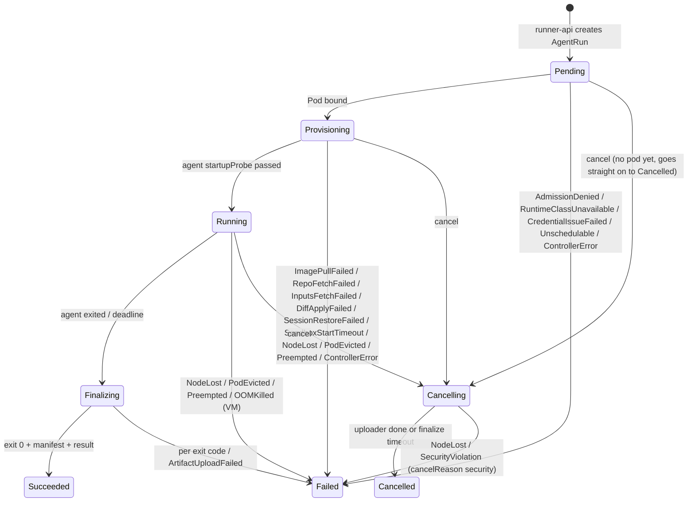
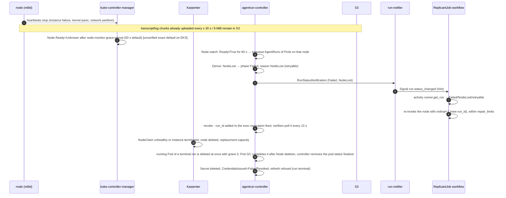

# Run Lifecycle, Failure Paths, and Must-Answers

**Workstream:** WS-02 · **Constraints:** D-04, D-05, D-07, D-08, D-21 · **Contracts:** C-CRD (phases, reasons), C-RUNNER, C-MSG (`run.status_changed`), C-ART
**State machine code:** [controller/derive.go](controller/derive.go) (table-tested in [derive_test.go](controller/derive_test.go))

## Purpose

One place that answers the brief's must-answer questions and lists the defined behavior of every
failure path in a run's lifecycle, from `POST /v1/runs` to garbage collection.

## Decisions summary

| # | Decision | Ref |
|---|---|---|
| LF-1 | An AgentRun executes the agent at most once; every failure is terminal for that run, and retry is a workflow decision with a new ordinal (new `run_id`) | ADR-008, C-CRD |
| LF-2 | Failures that destroy the pod (node loss, eviction, preemption, VM OOM) go straight to `Failed` without finalization; everything the entrypoint can observe goes through `Finalizing` with a partial manifest | C-CRD §1 rule 2 |
| LF-3 | Node loss is declared after 60 s of `Ready≠True` (controller-side, faster than the 300 s default NoExecute toleration), or immediately on Node deletion / Karpenter NodeClaim deletion | §2 |

---

## 1. Must-answer: what the sandbox contains when the CLI starts, and how each piece got there

| Path in the sandbox | Contents | Put there by | Source and integrity |
|---|---|---|---|
| VM / Sentry boundary | Kata CLH VM (guest kernel + kata-agent) or gVisor Sentry | containerd shim for the RuntimeClass `handler` | Kata 4.3.1 static payload and guest image baked into the AMI (digest-pinned in the AMI build) |
| Container root filesystems | environment image (agent), CLI image (agentd, prepare), WS-02 images (guard, watchdog, uploader) | kubelet/containerd pull by digest (pre-pulled by `replicant-image-warmer`) | ECR digests from the Release Bundle (environment, CLI) or the platform release (WS-02 images); admission enforces `replicant/…@sha256:` |
| `/workspace` (block device, ext4, exactly the limit) | empty filesystem → `repo/` checkout of `base_sha`, `context/<name>` additional repos, prior diff applied | NRI plugin (device and size), `prepare` (git through agentd → repo-mirror) | Git object IDs verified by git; `HEAD == base_sha` asserted |
| `/opt/replicant` (ro) | entrypoint, agentd, CLI distribution | `prepare` copies from the CLI image into `tools` | CLI image digest; embedded SHA-256 list checked by `prepare` |
| `/replicant/inputs` (ro) | inputs manifest, task packet, briefing, memory injection, handoff, steering backlog, plan | `prepare` via agentd's inputs route (S3 GET of `inputs/` with run-scoped STS) | `inputs.manifestSha256` from the AgentRun spec, per-object sha256 from the manifest |
| `/etc/claude-code`, `/etc/replicant` (ro) | managed settings and managed instructions (security layer) | `prepare` renders from the plan | derived only from verified inputs |
| `/home/agent` | user-scope CLI config, restored CLI session state (if listed), package-manager config pointing at the curated mirror | `prepare` (session restore), entrypoint `run` (user layer, after deleting any pre-existing CLI config) | session state from the run's own `inputs/` (staged by the workflow from the job's earlier run) |
| `/replicant/out`, `/replicant/spool` | empty | — | — |
| `/run/replicant/ipc` | agentd socket; status markers | agentd, watchdog | — |
| Environment | `REPLICANT_*` (C-IDS §7), `TRACEPARENT`, `OTEL_*`, `HOME`, `TMPDIR`; **no credentials** | controller (Pod spec) | AgentRun spec |
| Network | loopback ports 7800–7803 (agentd); egress only per the run's CiliumNetworkPolicy | Cilium, controller | bundle `network_profiles` policy |
| Credentials | **none in the agent container**; per-audience run tokens only in `replicant-agentd`; S3 session credentials only in agentd and the uploader | controller Secret (agentd mount only), runner-api | KMS-signed tokens within the core-signed run grant |
| Sidecars running | `replicant-agentd`, `watchdog`, QA services (if any); the `uploader` starts with the agent | kubelet | — |

## 2. Must-answer: what exactly happens when a node is lost mid-run

| Question | Answer |
|---|---|
| Is the agent's work lost? | The workspace on the lost node is gone (scratch, D-07). Streamed transcript and log chunks up to the last 30 s are in S3. The CLI session state captured by an earlier run of the same job (if any) is still usable by the retry. The diff produced so far by this run is lost |
| Can the old run come back (partition, not failure)? | If the node rejoins, the agent may still be running. The run is already terminal and **revoked** (runner-service.md §7.3): the shim, memory-mcp, context-mcp and repo-mirror reject its tokens within ≤ 10 s, and token refresh is refused. The controller deletes a still-running Pod of a terminal AgentRun **immediately** (`gracePeriodSeconds: 0`), as soon as the node's kubelet reports it; the 1-hour TTL applies only to Pods whose containers have all terminated (controller.md §7.1, R1-040). A partition that keeps the node Ready but cuts the sandbox off is caught by the run lease (no agentd heartbeat for 120 s → `NodeLost` and revoke). Any artifacts it uploads land under **its own** `run_id` prefix, which the workflow no longer reads; the retry has a new `run_id`. The manifest write-once rule prevents a late upload from overwriting a committed manifest. At-most-once applies per `run_id` |
| Is the workflow blocked? | No: the Signal is a hint; even if run-notifier is down, the workflow's poll (15/120 s) sees `Failed` |
| Detection time | ≈ 60–75 s after heartbeats stop (B-NODE-01 gate: p95 ≤ 90 s) |
| Spot interruption | Not applicable in v1 (on-demand only). If spot is adopted, the 2-minute interruption notice would trigger a graceful delete with intent `cancel` reason `operator` so finalization uploads a partial manifest |
| Karpenter consolidation | Sandbox Pods carry `karpenter.sh/do-not-disrupt: "true"`, so voluntary disruption never targets a node with a running sandbox; nodes drain only when empty |

## 3. Failure catalog (every path, with defined behavior)

| # | Stage | Failure | Detected by | Run outcome | Retryable | User-visible | Operator |
|---|---|---|---|---|---|---|---|
| 1 | createRun | invalid spec / key mismatch | runner-api | 400, no run | no | node fails: workflow bug | alert on rate |
| 2 | createRun | run grant missing/invalid/expired/revoked | runner-api | 422 `run_grant_invalid` | yes after re-signing (the activity re-signs an expired grant on retry); otherwise no | node fails if not fixable | alert |
| 3 | createRun | bundle/definitions not resolvable | runner-api | 422 `definition_not_resolvable` | no | node fails | alert |
| 4 | createRun | tenant active-run limit | runner-api RS-5 (namespace label `max-active-runs`; WS-09 `sbx-quota` pods quota is the backstop, which the controller maps to Pending then `Unschedulable`) | 429 `tenant_quota_exceeded` | yes | "Waiting for sandbox capacity" | capacity dashboard |
| 5 | createRun | K8s API / S3 unavailable | runner-api | 503 | yes | delayed | alert |
| 6 | createRun | same key, different spec | runner-api | 422 `idempotency_key_reuse` | no | node fails | alert (bug) |
| 7 | createRun | key after GC | runner-api tombstone | 410 | no | node fails | — |
| 8 | Pending | RuntimeClass missing / no pool | controller | Failed `RuntimeClassUnavailable` | yes | retried | alert |
| 9 | Pending | definition digest mismatch | controller | Failed `AdmissionDenied` | no | node fails | alert (registry integrity) |
| 10 | Pending | token mint (KMS) failure | controller | Failed `CredentialIssueFailed` after 60 s | yes | retried | alert |
| 11 | Pending | no capacity until `startupSeconds` | controller | Failed `Unschedulable` | yes | retried | capacity alert |
| 12 | Pending | crash between marker and Pod create | controller | Failed `ControllerError` | yes | retried | alert |
| 13 | Provisioning | image pull failure | controller (Pod waiting reason) | Failed `ImagePullFailed` (`manifest unknown` → non-retryable per C-CRD note) | mostly | retried | alert |
| 14 | Provisioning | NRI plugin error (container creation fails) | controller (CreateContainerError past startup) | Failed `SandboxStartTimeout` | yes | retried | alert `ReplicantWorkspaceNRIFailures` |
| 15 | Provisioning | hard limit absent | workspace-guard exit 84 | Failed `ControllerError` | yes | retried | page |
| 16 | Provisioning | repo-mirror / GitHub failure | prepare exit 43 | Failed `RepoFetchFailed` | yes | retried | alert on rate |
| 17 | Provisioning | inputs missing / digest mismatch | prepare exit 40 | Failed `InputsFetchFailed` | no | node fails (workflow bug) | alert |
| 18 | Provisioning | prior diff does not apply | prepare exit 41 | Failed `DiffApplyFailed` | no | workflow rebases | — |
| 19 | Provisioning | session incompatible | prepare exit 42 | Failed `SessionRestoreFailed` | no | WS-04 falls back to handoff | — |
| 20 | Provisioning | startup too slow | controller | Failed `SandboxStartTimeout` | yes | retried | SLO alert |
| 21 | Running | agentd crash | kubelet restarts the sidecar | none (CLI retries) | — | — | metric |
| 22 | Running | gateway budget | agent exit 20 | Failed `GatewayBudgetExceeded` (Finalizing) | no | `budget_extension` gate (WS-01) | — |
| 23 | Running | gateway down | agent exit 21 | Failed `GatewayUnavailable` | yes | retried | alert |
| 24 | Running | disk limit | watchdog/ENOSPC → exit 30 | Failed `WorkspaceDiskExceeded` (partial manifest) | no | "Workspace full", resize proposal | WS-03 right-sizing |
| 25 | Running | CLI child OOM | exit 31 | Failed `OOMKilled` | no | resize proposal | — |
| 26 | Running | container OOM (cgroup) | container reason `OOMKilled` | Failed `OOMKilled` | no | resize proposal | — |
| 27 | Running | VM/pod OOM (whole pod dies) | uploader `OOMKilled` together with the workload (Derive branch) | Failed `OOMKilled` | no | resize | alert (B-MEM evidence) |
| 27a | Running | run lease expired (no heartbeat 120 s) on a Ready node | controller Lease watch | Failed `NodeLost`, revoked | yes | retried | alert |
| 27b | Any | Pod CREATE refused by admission policy | controller | Failed `AdmissionDenied` | no | node fails | alert (VAP/template mismatch) |
| 28 | Running | bootstrap/service setup fails | exit 44/45 | Failed `EnvironmentSetupFailed` | yes | retried | env-definition alert |
| 29 | Running | CLI crash | exit 10 | Failed `AgentExitedNonZero` | yes | retried | — |
| 30 | Running | node lost | controller | Failed `NodeLost` | yes | retried | — |
| 31 | Running | evicted (node pressure) | Pod `Evicted` | Failed `PodEvicted` | yes | retried | alert |
| 32 | Running | evicted for ephemeral storage | Pod `Evicted` + message | Failed `WorkspaceDiskExceeded` | no | resize | page (hard limit bypassed) |
| 33 | Running | preempted by urgent run | `DisruptionTarget` | Failed `Preempted` | yes | retried | — |
| 34 | Running | deadline | controller timer | Finalizing → Failed `DeadlineExceeded` | no | "Timed out" | — |
| 35 | Running | security automation | runner-api cancel `security` | Cancelling → Failed `SecurityViolation` | no | "Stopped by security policy" | incident |
| 36 | Running | cancel / takeover | runner-api cancel | Cancelling → Cancelled (takeover: workspace archive) | no | as requested | — |
| 37 | Finalizing | result missing / invalid | exit 11 / 12 | Failed `AgentResultMissing` (yes) / `AgentResultInvalid` (no) | per reason | — | — |
| 38 | Finalizing | S3 errors beyond retries | uploader exit 20 | Failed `ArtifactUploadFailed` | yes | retried | alert |
| 39 | Finalizing | manifest checksum/size mismatch | controller HEAD verification | Failed `ArtifactUploadFailed` | yes | retried | alert (integrity) |
| 40 | Finalizing | finalize timeout | controller timer | force delete; reason from exit or `ArtifactUploadFailed` | per reason | — | — |
| 41 | Any | controller restart | — | no effect; recomputed | — | — | — |
| 42 | Any | runner-api down | activities get 503 | runs continue; polling resumes | — | delayed | alert |
| 43 | Any | run-notifier / Temporal down | controller retries | polling completes waits | — | ≤ 1 poll interval | alert after 5 min |
| 44 | Any | Cilium agent restart | DNS proxy gap | transient fetch errors | — | — | drain first |
| 45 | Terminal | Secret deletion fails | controller retry | — | — | — | alert |
| 46 | Terminal | `agentrun_record` write fails | controller retry, GC blocked | — | — | — | alert |

## 4. Must-answer: which runtime facts are unverified, and the fallback for each

| Unverified fact | Where used | Fallback |
|---|---|---|
| virtiofsd returns the host `ENOSPC` from an XFS project quota to the guest | Kata `xfsProjectQuota` fallback | `guestBlockDevice` (default) or `fixedSizeVolume` |
| End-to-end NRI-provisioned direct volume for an emptyDir (ordering, multiple containers, discard) | Kata `guestBlockDevice` | `xfsProjectQuota` on virtio-fs (B-DISK fallback rule 3) |
| gVisor (directfs off) surfaces host `ENOSPC` to the app | gVisor `xfsProjectQuota` | TopoLVM fixed volume or `fixedSizeVolume` |
| XFS project quota reported as `statfs` size through virtiofsd/gofer | `workspace-guard` check for quota modes | guard checks quota via a host-side marker file written by the NRI plugin (`.replicant-limit`, readable through the shared fs) |
| NRI `fail_request` shipped in the pinned containerd | NRI failure semantics | `workspace-guard` fail-closed check (always present) |
| Kata runtime-rs `runtime_type`/`ConfigPath` and handler name from kata-deploy 4.3.1 | containerd config, RuntimeClass | AMI build test asserts effective config; adjust names |
| SOCI parallel pull compatible with Kata virtio-fs rootfs | cold image path | disable `FastImagePull` |
| Service ClusterIP reachability from Kata under Cilium with `socketLB.hostNamespaceOnly` | repo-mirror, Alloy | Headless Service + `toEndpoints` (no ClusterIP needed) |
| Termination message transport under Kata/gVisor | failure messages | exit code is authoritative; `FallbackToLogsOnError` |
| Nested-virt performance for builds | default node pool | metal pool (B-GATE fallback 1) |
| Karpenter `cpuOptions.nestedVirtualization` enum value `enabled` | node pool manifest | CI validates against the installed CRD; managed node groups with a launch template (A-3) |
| Image volumes under Kata/gVisor | tier-2 caches, CLI tools | init-container copy (current default) |
| XFS returns `ENOSPC` (not `EDQUOT`) at a project hard limit | quota enforcement, watchdog and entrypoint `ENOSPC` detection | detectors match both errnos and the WS-03 entrypoint maps either to exit 30 |
| `memory.peak` readable from the container cgroup inside a Kata guest (and gVisor's cgroupfs) | `run_result.usage.peak_memory_bytes`, rp-1 baselines | host-side pod cgroup `memory.peak` sampled by the B-MEM host probe and the controller from kubelet stats |
| Rootless BuildKit and buildah under gVisor | gVisor `qa_build` fallback | gVisor QA runs without image builds (`runtime_unsupported`, runner-service.md §3.4) |
| EBS attach and format time, and per-size dedicated attachment limits for M8id/C8id | `fixedSizeVolume` overflow | B-START-02 measures; overflow runs get `startupSeconds ≥ 300`; attachment counts are far below any limit at < 5 % overflow runs |
| Firecracker drive-hotplug limit in runtime-rs | `replicant-kata-fc` (never selected) | Firecracker stays disabled |
| Kata 4.3.1 inside kind with `/dev/kvm` passed through | local `k8s` profile | `isolation.degraded` RuntimeClasses (runc) locally; the `k8s-kata` Linux CI job is the proof |
| Nitro instance store encrypted at rest (XTS-AES-256) on M8id/C8id/R8id | workspace confidentiality | NRI `block-encrypted`-style per-pod dm-crypt for regulated tenants (WS-09 decides) |
| SeaweedFS `If-Match` / `If-None-Match` on PutObject and STS session-policy enforcement | runner-local inbox CAS, manifest write-once, per-run credentials | runner-local startup probe; `per-run-identity` credentials; nightly real-S3 contract job |
| Downward API annotation updates reaching running Kata/gVisor pods | cancel reason, second channel | inbox control key `inbox/_control.json` read by agentd's heartbeat (primary channel, R2-040) |
| `/var/log/pods` receives sandbox stdout under kata-clh and gvisor | WS-08 node log pipeline, uploader transcript lines | benchmark probe B-LOG-01; fallback: the uploader also emits transcript lines as OTLP logs to `otel-sandbox` (R2-039) |
| (none: no longer relied on) Internal NLB source-IP preservation | fallback rule 6 attribution | client IP preservation is **off** by design (RS-2, XD-FIX-R1-211); WS-08 attributes by the run token's `run_id` claim logged by repo-mirror and the OTLP gateway (`attribution=token`, XD-FIX-R2-037; R1V-108) |
| `hubble.export.static` file rotation under load | WS-08 denied-flow pipeline | the dynamic exporter (`hubble.export.dynamic`) |
| Karpenter launch time for the custom AMI | warm capacity sizing | larger placeholder reserve |
| gVisor Sentry memory return to host | gVisor memory requests | `match_limit` for gVisor classes too |

## Open questions

| Question | Who decides | Options | Recommendation |
|---|---|---|---|
| Node-loss threshold 60 s vs. waiting for Kubernetes' own taint eviction (300 s) | WS-02 | 60 s / 300 s | 60 s: a partitioned node's run is already doomed for this job's latency; at-most-once is preserved by token refusal and new `run_id` |

## Risks

- A partitioned (not dead) node: the run lease expires after 120 s without a heartbeat, the controller fails
  the run `NodeLost` and adds it to the exec revocation feed, and the shim, memory-mcp, context-mcp and
  repo-mirror reject its tokens within 15 s (runner-service.md §7.3, C-RUNNER 3.0.0). agentd itself stops
  the agent after 120 s without a heartbeat. Residual: at most about 135 s of spend in parallel with the
  retry, and S3 writes confined to the dead run's own prefix (R1V-107).

## Interfaces consumed / provided

- **Consumed:** C-CRD, C-RUNNER, C-MSG, WS-03 exit codes and process model, WS-01 retry policy.
- **Provided:** failure catalog (to WS-01 retry policy, WS-07 user messages, WS-08 alerts).
