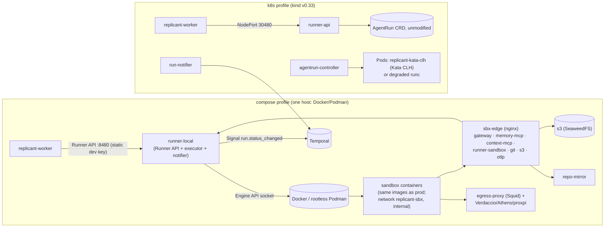

# Local Implementations of the Execution Contract

**Workstream:** WS-02 (implementation), WS-11 (local stack, parity inventory) · **Constraints:** D-20, D-06, D-07, D-08 (amended: local object store is the S3-compatible service `s3`, SeaweedFS by default, MinIO-from-source as compose profile `s3-minio`; C-ARCH 1.0.1 via accepted CCR-11-02), D-21
**Contracts:** C-RUNNER (both runners pass the same contract test suite, XD-00-18), C-CRD (the `k8s` profile applies the frozen CRD unmodified), C-ART
**Aligned with WS-11:** [compose/config/runner-local/runner-local.yaml](../11-local-dev/compose/config/runner-local/runner-local.yaml) (XD-11-02), [compose/kind/](../11-local-dev/compose/kind/) (XD-11-15), [parity.md](../11-local-dev/parity.md) P-04 to P-09, P-17, P-19

## Purpose

Two local profiles exercise the execution side before any cloud spend: **compose** (`runner-local`,
a Go implementation of the Runner API that runs sandboxes as Docker or Podman containers with the
same images, mounts, and artifact upload path), and **k8s** (the real runner-api, agentrun-controller,
run-notifier, and CRD on `kind`, with Kata where KVM exists). This document specifies both and lists
every behavior that differs from production.

## Decisions summary

| # | Decision | Ref |
|---|---|---|
| L-1 | `runner-local` is a separate Go binary (`go/cmd/runner-local`) that **shares packages** with runner-api: OpenAPI server (generated), idempotency and `run_id` derivation, admission and bundle resolution, token signer interface, inbox, run-token verification, credential vending, and the controller's pure `Derive` state machine. Only the "executor" differs (Docker/Podman Engine API instead of AgentRun + Pod) | D-20, XD-11-02 |
| L-2 | runner-local keeps a **local AgentRun record** (`$RUNNER_STATE_DIR/agentruns/<run_id>.json`, the same `AgentRun` Go type serialized) plus container labels, so status, idempotency (create with `O_EXCL`), and restart recovery behave like the CRD. Status JSON is produced from it by the same mapper runner-api uses | C-RUNNER, C-CRD rule 5 |
| L-3 | **Rootless Podman preferred** on Linux (`podman system service` socket), Docker accepted (Docker Desktop on macOS). Socket path from `RUNNER_CONTAINER_HOST` (the variable WS-11's compose passes; R1-059) | D-20 |
| L-4 | Object store is the compose service `s3` (SeaweedFS 4.48 per WS-11) reached by sandboxes as `http://s3.sbx.local` through `sbx-edge`; no SeaweedFS- or MinIO-specific APIs are used. Per-run credentials: **mode `sts`** (`AssumeRole` with a session policy against the `s3` STS endpoint) when the contract test RC-SBX-04 proves session-policy scoping works on the configured store; otherwise **mode `per-run-identity`** (an S3 IAM identity created for the run with a prefix-scoped policy and deleted at terminal) | D-08 amended, XD-11-03 |
| L-5 | `k8s` profile: the production Helm chart `replicant-exec` with `values-local-kind.yaml`; Kata 4.3.1 via kata-deploy when `/dev/kvm` is available; otherwise WS-11's degraded RuntimeClasses (handler `runc`, label `replicant.example.com/isolation-degraded=true`) and `isolation.degraded=true`, which makes runner-api report `isolation` honestly and log a warning on every run | XD-11-15 |



---

## 1. Compose profile: `runner-local`

### 1.1 Configuration

runner-local reads WS-11's [runner-local.yaml](../11-local-dev/compose/config/runner-local/runner-local.yaml)
and the environment in WS-11's `compose.yaml` (`RUNNER_*`). WS-11's file is the configuration
contract and its key paths win (R1V-071); the keys runner-local's parser reads for WS-02 behavior are:

```yaml
credentials:
  mode: auto                 # auto | sts | per-run-identity ; auto = sts if the startup probe (RC-SBX-04) passes
  session_seconds: 3600
executor:
  engine: auto               # auto | docker | podman  (detected from the socket's /version)
  pull_policy: if-not-present
  stop_grace_seconds_extra: 15
policy:
  bundle_source: registry    # resolve runtime_selection/network_profiles from the local registry bucket
grants:                      # core run-grant verification (XD-FIX-R1-253); env RUNNER_GRANTS_ISSUER, _JWKS_URL, _REVOCATION_URL
  issuer: replicant-local-core
  jwks_url: http://grants.replicant.localhost:8403/.well-known/jwks.json
  revocation_url: http://grants.replicant.localhost:8403/grants/revoked
revocations:                 # exec revocation feed (R1V-030): served at GET /v1/revocations on the orchestration listener
  bucket: local-replicant-local-ops            # env RUNNER_REVOCATIONS_BUCKET
  prefix: exec-revocations/local/            # env RUNNER_REVOCATIONS_PREFIX; objects <yyyymmddhh>.ndjson
  readers_file: /run/secrets/runner_revocations_readers   # env RUNNER_REVOCATIONS_READERS_FILE: static dev tokens of the shim, memory-service, context-mcp, repo-mirror
  retain_seconds: 7200
sandbox:
  pod_group:
    containers: [workspace-guard, replicant-agentd, watchdog, prepare, svc-<name>, stub-<name>, builder, agent, uploader]   # C-IDS §8 names; no shipper (R1V-184)
    container_name_template: "ar-{run_body}-{container}"
  security:
    overrides:
      builder:
        allow_on_runc: true  # env RUNNER_ALLOW_BUILDER_RELAXATION_ON_RUNC (XD-FIX-R1-263, parity P-33)
  workspace:
    loopback:                # used on Linux with runner-local-diskd
      diskd_socket: /run/runner-local-diskd.sock
```

Revocation readers locally (R1V-030): every verifier polls with `REPLICANT_EXEC_REVOCATIONS_URLS`
(comma-separated: `http://runner-local:8480/v1/revocations` and the kind runner-api
`http://replicant-local-control-plane:30480/v1/revocations`), `REPLICANT_EXEC_REVOCATIONS_TOKEN_FILE`
(its static token from `runner_revocations_token`) and `REPLICANT_EXEC_REVOCATIONS_POLL_SECONDS`
(`10`); repo-mirror uses the same names with the `MIRROR_` prefix. runner-local and the kind
runner-api accept exactly the tokens listed in the readers file, and only on `GET /v1/revocations`.

Images (XD-FIX-R1-256): registry prefix `localhost/replicant/`, tag `dev`. Sandbox images are
`cli-claude-code` and `cli-codex` (each carries `/opt/replicant/bin/replicant-entrypoint` and
`replicant-agentd`; there is no separate entrypoint image), `sandbox-sidecars` (WS-02: one local image
with the uploader (which also ships spool chunks; there is no separate shipper container) and watchdog binaries; production splits them into `replicant/sandbox-utils`
and `replicant/sandbox-uploader`), `env-<name>` environment images, and the QA images `qa-svc-postgres`,
`qa-svc-s3mock`, `qa-builder`, `contract-probe`. Extra images go in `REPLICANT_IMAGES_TO_LOAD_EXTRA`.

### 1.2 How a run executes locally

| Production step | runner-local equivalent |
|---|---|
| AgentRun create (etcd, name uniqueness) | write `$RUNNER_STATE_DIR/agentruns/<run_id>.json` with `O_CREAT\|O_EXCL`; on `EEXIST` read and compare `spec-digest` (200/422); execution-evidence check as in prod (`agentrun_record`, `manifest.json`, transcripts in `s3`) |
| Controller `Accepted` | same code: registry blobs from `local-replicant-local-registry`, digests verified |
| Credentials Secret | **same process model as production (R1-051):** one token per audience in the run grant, written to `$RUNNER_STATE_DIR/runs/<run_id>/tokens/<audience>` (mode 0400, uid 10000) and bind-mounted read-only **only into `replicant-agentd`** at `/run/replicant/token-seed`; agentd keeps refreshed copies in its own tmpfs at `/run/replicant/tokens` (`REPLICANT_RUN_TOKEN_DIR`). The agent container gets no credential. The uploader gets S3 credentials from agentd over the private `uploader-ipc` socket |
| CiliumNetworkPolicy | none: sandboxes sit on the `internal` Docker network `replicant-sbx` whose only peers are `sbx-edge`, `sbx-dns`, and `egress-proxy` (WS-11 P-17) |
| Pod with init containers, sidecar, main containers | containers created in order on a shared **pod-like group**: a pause container owns the network namespace (`--network container:<pause>`); `workspace-guard` runs first, then `replicant-agentd` and `watchdog`, then `prepare` runs to completion; then QA services `svc-<name>`, stubs `stub-<name>` and the `builder` start (no readiness gate, as in prod); then `agent` and `uploader` start together (XD-FIX-R1-263, XD-W2-05-03). Container names are `ar-<run body>-<container>` with `<container>` ∈ the C-IDS §8 container names (XD-FIX-R1-209), which is what WS-08's local.alloy parses. Labels: the C-IDS §8 keys and `com.docker.compose.project=replicant`; no `replicant.example.com/container` label (orchestrator ruling on XD-W2-02-06: the container name carries the container) |
| QA builder on runc | in `qa_build` runs the `builder` container gets `--security-opt seccomp=unconfined`, `--security-opt apparmor=unconfined`, `--cap-add SETUID --cap-add SETGID`, and **no** `no-new-privileges`, only when `RUNNER_ALLOW_BUILDER_RELAXATION_ON_RUNC=true` (default `true`); otherwise the builder is not started and WS-05 reports image-build stages `runtime_unsupported`. On runc this relaxation is weaker than prod, where the same profile applies only inside a Kata VM: parity P-33 (High) |
| emptyDir volumes | the production names and sizes: named volumes `ar-<body>-workspace`, `-home`, `-tools`, `-managed`, `-inputs`, `-out`, `-spool`; `ipc`, `uploader-ipc` and `agentd-state` are `tmpfs` mounts (`--mount type=tmpfs,tmpfs-size=…`) shared only with the containers that mount them in production |
| RuntimeClass | `RUNNER_LOCAL_RUNTIME` = `runc` (default), `runsc`, or `kata` (`--runtime` flag per container); `isolation_label_map` maps the requested isolation to it; `RunStatus.isolation` reports what actually ran |
| Security context | `--read-only`, `--cap-drop ALL`, `--security-opt no-new-privileges`, default seccomp, production UIDs (agentd 10000, prepare/agent 10001, uploader and watchdog 10003, group 10002 as the shared `--group-add`), `--pids-limit 4096`, no Docker socket, no host mounts other than the per-run token directory into agentd |
| Resources | `--cpus`, `--memory` from `spec.resources.limits`; ephemeral-storage is not enforced by Docker for volumes (see P-09); `--storage-opt size=` is not used |
| Startup probe | runner-local polls `test -f /run/replicant/ipc/status/agent-started` with `exec` every 1 s (same as the production startupProbe) |
| Deadline / cancel | `docker stop -t <finalizeSeconds+15>` on `agent` and `uploader` (SIGTERM, then SIGKILL) after persisting the intent in the local record |
| Exit mapping | container `State.ExitCode` and `State.OOMKilled` from the Engine API → the same `Derive` observation types → identical phases and reasons |
| Notifications | in-process notifier: `client.SignalWorkflow` to `temporal:7233` (no mTLS locally, P-03) with the same payload and `notification_id` |
| GC | containers removed `container_ttl_after_terminal` (1 h) after terminal; records kept `agentrun_retention` (1080 h = 45 days) |
| Restart recovery | on start, list containers with label `app.kubernetes.io/managed-by=agentrun-controller` and all non-terminal records; re-derive phases from container state and `s3` manifest presence; re-send undelivered notifications |

### 1.2a Operations (R1-066, XD-11-02)

| Item | Specification |
|---|---|
| `runner-local healthcheck --url <readyz>` | exits 0 when `GET <url>` returns 200 within 2 s; `/readyz` is 200 when the container engine socket answers `/version`, the signing key is loaded, the `s3` endpoint answers `HeadBucket` on the registry bucket, Temporal answers `GetSystemInfo`, and the state directory is writable |
| State directory `$RUNNER_STATE_DIR` (default `/var/lib/runner-local`) | `agentruns/<run_id>.json` (local AgentRun records), `runs/<run_id>/tokens/<audience>` (per-audience tokens, deleted at terminal), `leases/<run_id>` (heartbeat timestamps), `overrides.json` (applied runtime overrides). WS-11 adds `state_dir` to runner-local.yaml (XD-FIX-R1-066) |

### 1.3 Workspace enforcement locally (WS-11 P-09)

| Host | `workspace.enforcement` | Mechanism | Difference from prod |
|---|---|---|---|
| macOS (Docker Desktop / Podman machine) | `watchdog` | the watchdog stops the agent at 98 % of the limit; no `ENOSPC` | the hard limit is absent; RC-RUN-14 still passes because the failure path (`WorkspaceDiskExceeded` via Finalizing) is the same |
| Linux, `runner-local-diskd` running | `watchdog` is what the local AgentRun record carries (a C-CRD enum value, R1-062); the executor detail `loopback` is recorded only in the container label `replicant.example.com/local-workspace-backing=loopback` | a small privileged helper creates a sparse ext4 image of exactly the limit per run, loop-mounts it on the host, and runner-local binds that mount as the workspace | `ENOSPC` at the limit like prod `guestBlockDevice`, but via a host loop device instead of a guest block device |

## 2. Credentials against the local `s3`

| Mode | How | Contract behavior preserved |
|---|---|---|
| `sts` | `AssumeRole` on `RUNNER_S3_STS_ENDPOINT` as `runner-local` with the same session policy JSON as prod (runner-service.md §7.2), minus the KMS statement (local SSE mode `sse-s3`, P-05) | `GET /sandbox/v1/credentials/aws` returns the container-credentials shape, ≤ 1 h |
| `per-run-identity` | at `Accepted`: create an S3 identity `run-<body>` with an inline policy equal to the session policy (via the store's IAM API), return its keys from the same endpoint; at terminal: delete the identity (revocation is immediate, which is stronger than prod's ≤ 60 min expiry) | same endpoint and shape; expiry reported as `now + 1 h` |

`auto` runs a startup probe: assume a role with a policy allowing only `probe/<random>/*`, try to
write `probe/<random>/ok` (must succeed) and `probe/other/x` (must be denied). If either result is
wrong, runner-local uses `per-run-identity` and logs `sts session policies not enforced by this
store`. `[unverified: SeaweedFS STS session-policy enforcement; WS-11 records the same]`.

## 3. `k8s` profile (kind)

Aligned with WS-11's [bootstrap.sh](../11-local-dev/compose/kind/bootstrap.sh) and
[kind-config.yaml](../11-local-dev/compose/kind/kind-config.yaml). WS-02 provides the
`replicant-exec` chart and its `values-local-kind.yaml`:

```yaml
image:
  registry: localhost/replicant
  tag: dev
runnerApi:
  auth:
    mode: static-dev-keys            # orchestration listener; prod verifies core-cluster SA JWTs
    secretName: runner-local-keys
  revocations:                       # XD-W3-R1V-070: the chart reads all three here, never top-level revocations.*
    bucket: local-replicant-local-ops
    prefix: exec-revocations/local/
    readersSecretKey: runner_revocations_readers   # key in Secret runner-local-keys: the same static reader tokens as runner-local; GET /v1/revocations only
  issuer: http://runner-api.replicant-runner.svc:8480          # run-token issuer of the kind runner-api (XD-FIX-R1-258)
  sandboxListener:
    publicBaseUrl: http://runner-sandbox-k8s.sbx.local       # sbx-edge proxies this host to replicant-local-control-plane:30490
    nodePort: 30490                                          # JWKS: http://replicant-local-control-plane:30490/.well-known/jwks.json
  signer:
    mode: file                       # ES256 PEM from the Secret; prod uses KMS (P-04)
  service:
    type: NodePort
    nodePort: 30480
  s3:
    endpoint: http://s3.replicant-runner.svc:8333
    forcePathStyle: true
    sseMode: sse-s3
    credentialsMode: auto            # §2
grants:                              # XD-FIX-R1-253 (d); bootstrap bridges Service grants to the compose container
  issuer: replicant-local-core
  jwksUrl: http://grants.replicant-runner.svc:8403/.well-known/jwks.json
  revocationUrl: http://grants.replicant-runner.svc:8403/grants/revoked
repoMirror:
  runTokenIssuers: "http://runner-api.replicant-runner.svc:8480"                                   # MIRROR_RUN_TOKEN_ISSUERS (list)
  runTokenJwksUrls: "http://replicant-local-control-plane:30490/.well-known/jwks.json"             # MIRROR_RUN_TOKEN_JWKS_URLS (list)
controller:
  workspace:
    nriPlugin: false                 # kind nodes have no XFS prjquota array; enforcement degrades to watchdog
temporal:
  address: temporal.replicant-runner.svc:7233
  tls: false
isolation:
  degraded: false                    # bootstrap.sh sets true when Kata is unavailable
networkPolicy:
  provider: cilium                   # the controller renders the same CiliumNetworkPolicy as prod
```

Notes and requests to WS-11 (XD-02-11):

1. **Cilium values:** add `--set socketLB.hostNamespaceOnly=true` to the Cilium install; without
   it, Service ClusterIPs do not work from Kata (and gVisor) pods (runtime-evaluation.md F-17).
2. **Kata shim (XD-FIX-R1-257, agreed):** kata-deploy 4.3.1 with only
   `shims.clh-runtime-rs.enabled=true`; `replicant-kata-clh` → handler `kata-clh-runtime-rs`, and
   bootstrap fails if that handler is absent. `replicant-kata-fc` is a degraded `runc` class labelled
   `replicant.example.com/isolation-degraded=true` (Firecracker needs a devmapper thin-pool that
   kata-deploy does not create, runtime-evaluation.md F-10; prod policy never selects it).
3. **gVisor (XD-FIX-R1-257):** `replicant-gvisor` is the same degraded `runc` class unless
   `REPLICANT_GVISOR=on` and the node image carries `runsc`, in which case it maps to handler `runsc`.
   runner-local.yaml carries WS-02's keys `credentials.mode`, `executor.engine`,
   `workspace.loopback.diskd_socket`, `policy.bundle_source` verbatim (§1.1).
4. **Kata in kind** requires `/dev/kvm` passed into the node container (WS-11 renders the
   `extraMounts`); this is not documented by kind or Kata `[unverified: works with kata-deploy
   4.3.1 inside a kind node; the `k8s-kata` CI job is the proof]`.

## 4. macOS (honest limits)

| Option | Gives `/dev/kvm` in the Linux VM? | Kata possible? |
|---|---|---|
| Docker Desktop | not documented for Apple Silicon `[unverified]` | treat as no |
| Lima `vmType: vz` with `nestedVirtualization: true` | yes on **Apple M3 or later with macOS 15 or later** [verified: https://github.com/lima-vm/lima/blob/master/templates/default.yaml (`nestedVirtualization` comment), 2026-10-24] | only partially: the guest is **arm64**, and kata-deploy marks `clh` and `fc` amd64-only (runtime-evaluation.md F-12); Kata QEMU works on arm64 but is not the production hypervisor |
| Podman machine (`applehv`/`libkrun`) | `[unverified]` | treat as no |

Therefore on macOS the compose profile runs sandboxes with `runc` (or `runsc` on arm64 Linux VMs,
systrap), and the `k8s` profile runs degraded. Isolation-dependent tests (`SEC-ESC-*`, B-DISK,
B-NET) run on Linux CI with KVM (`k8s-kata` job). This is a documented parity gap (P-06).

## 5. Behaviors that differ from production (exhaustive for the execution side)

| # | Area | Production | compose (`runner-local`) | `k8s` (kind) | Risk / how covered |
|---|---|---|---|---|---|
| X-01 | Isolation runtime | Kata CLH (runtime-rs) or gVisor per policy | runc by default; runsc/kata optional on Linux | Kata CLH if `/dev/kvm`, else runc (degraded) | High; SEC-ESC-* on `k8s-kata` CI (P-06) |
| X-02 | Run object store | AgentRun in etcd, CEL-validated | JSON record files, same Go type, validated with the same CEL rules compiled via `cel-go` from the frozen CRD | AgentRun in etcd (same CRD) | Low; contract tests RC-RUN-* on both runners |
| X-03 | Idempotency atomicity | etcd name uniqueness | `O_EXCL` file create (single host) | etcd | Low |
| X-04 | Pod composition | one Pod; native sidecars; kubelet ordering | container group with a pause netns container; runner-local implements ordering | real Pod | Medium: ordering bugs in runner-local; RC-RUN-02 asserts init-before-main |
| X-05 | Workspace hard limit | `guestBlockDevice` (Kata) / `xfsProjectQuota` (gVisor) via NRI | `watchdog` (macOS) or `loopback` (Linux) | `watchdog` (no NRI, no prjquota) | Medium; P-09; RC-RUN-14 |
| X-06 | ephemeral-storage accounting and eviction | kubelet | none | kubelet (kind node disk) | Low |
| X-07 | Egress control | Cilium FQDN policy per run, DNS proxy REFUSED, IMDS denied | internal network + Squid + sbx-dns allowlist | Cilium policy (same renderer), but names resolve via sbx-dns bridge | Medium; SEC-EGRESS-* on both (P-17) |
| X-08 | Run token signing | KMS ES256 | file ES256 | file ES256 | Medium; P-04 |
| X-09 | Per-run S3 credentials | STS session policy + tenant KMS key | `sts` or `per-run-identity` against `s3`; no KMS | same as compose | High for IAM/KMS semantics; P-05, RC-SBX-04 |
| X-10 | SSE and tags | SSE-KMS per tenant, bucket-key, tag-required bucket policy | `sse-s3`; tags set but not required by policy | same | P-05 |
| X-11 | Conditional writes | S3 `If-None-Match`/`If-Match` | depends on the store (`[unverified: SeaweedFS If-Match on PutObject]`; If-None-Match per a SeaweedFS wiki mirror `[unverified]`) | same | Medium: the inbox CAS (runner-service.md §6) and manifest write-once; RC-ART-0x run against SeaweedFS and real S3 nightly |
| X-12 | Checksums | `x-amz-checksum-sha256` validated, `BadDigest` | store-dependent `[unverified]` | same | Low; the uploader also verifies by re-reading in local mode (`REPLICANT_S3_VERIFY_READBACK=true`, an uploader-container variable registered by CCR-02-08) |
| X-13 | Notifier credentials | mTLS, Signal-only Authorizer | no TLS, no Authorizer (P-03) | same as compose | High; TMP-AUTHZ test |
| X-14 | Caller authentication | core-cluster SA JWT (aud `replicant-runner`) | static dev keys | static dev keys | Medium; contract test asserts 401/403 paths with both modes |
| X-15 | Node lifecycle | Karpenter, NodeLost, preemption, eviction | not applicable; container kill simulates (chaos profile) | kind node `docker stop` simulates NodeLost | Medium; B-NODE-01 on EKS staging |
| X-16 | Warm capacity, image pre-pull, SOCI | placeholders, image warmer, SOCI parallel pull | local image cache | kind image load | Low (performance only) |
| X-17 | repo-mirror upstream | GitHub via broker installation tokens | Gitea (and GitHub for walkthrough 11) via broker Gitea tokens (P-12) | same | Medium; P-19 |
| X-18 | Separate exec cluster (ADR-007) | `fct-<env>-exec` | single host | single kind cluster, compose networks bridged | Medium; documented in C-ARCH as a parity gap |
| X-19 | Kubernetes API access from sandbox | none (no token, policy denies `kube-apiserver`) | not applicable (no API) | same as prod | Low |
| X-20 | DiskPressure condition source | watchdog `disk-{state,used,limit,peak}` via the agentd heartbeat and the run Lease (CCR-02-12), plus Node conditions | the same watchdog files, read directly by runner-local (it can read the volume) | same as prod | Low |
| X-24 | Run lease and revocation feed | Lease objects, revocation feed polled by verifiers | in-memory lease in runner-local; the gateway stub and repo-mirror poll runner-local's `GET /v1/revocations` | same as prod | Low |
| X-25 | Runtime override (security exception) | ConfigMap from GitOps | `runner-local.yaml` key `runtime_overrides[]` | same as prod | Low |
| X-26 | QA `builder` security relaxation | only inside a Kata VM (`qa_build` on `replicant-kata-clh`) | on runc when `RUNNER_ALLOW_BUILDER_RELAXATION_ON_RUNC=true` (default) | same as prod on Kata kind nodes | High (WS-11 parity P-33): the relaxed builder shares the host kernel locally |
| X-27 | Kill-switch mirror | S3 object in the `ops` bucket (XD-FIX-R2-016) | `REPLICANT_KILL_SWITCH_MIRROR=file:///var/lib/replicant/kill-switches/kill-switches.json` (XD-11-16; JSON `{generated_at, switches: [{scope, scope_value, switch, engaged, issued_at, notice_id}]}`, where `switch` carries the mode), read by runner-local for `global`/`repo`/`bundle` `starts` switches | same file | Low |
| X-21 | Termination message | `/dev/termination-log` via kubelet | runner-local reads the file from the stopped container (`docker cp`) | kubelet | Low |
| X-22 | Steering inbox | S3 `inbox/` with CAS | same code against `s3` | same | covered by X-11 |
| X-23 | Concurrency | active-run limit per tenant (runner-service.md RS-5) + pods ResourceQuota | `max_concurrent_runs` (default 2) → 429 `tenant_quota_exceeded` | same as prod | Low |

## Open questions

| Question | Who decides | Options | Recommendation |
|---|---|---|---|
| Run `runner-local-diskd` (privileged helper) by default on Linux | WS-11 | opt-in / default | Opt-in; it needs root on the host for loop devices |
| Should runner-local also emulate CEL validation | WS-02 | yes (cel-go from the frozen CRD) / no | Yes, so invalid specs fail identically on both runners |

## Risks

- The compose profile cannot show VM-boundary behavior (virtio-fs, guest block devices, guest
  seccomp). The `k8s-kata` Linux CI job is the only pre-EKS proof.
- Store-dependent S3 semantics (conditional writes, STS) are the highest local parity risk; the
  nightly real-S3 contract job is mandatory.

## Interfaces consumed / provided

- **Consumed:** WS-11 compose services (`s3`, `sbx-edge`, `sbx-dns`, `egress-proxy`, mirrors,
  Temporal), runner-local.yaml, kind bootstrap; C-RUNNER contract test suite (WS-11).
- **Provided:** runner-local binary and its added config keys, `replicant-exec` chart with
  `values-local-kind.yaml`, the differences table above (input to WS-11 parity.md).
