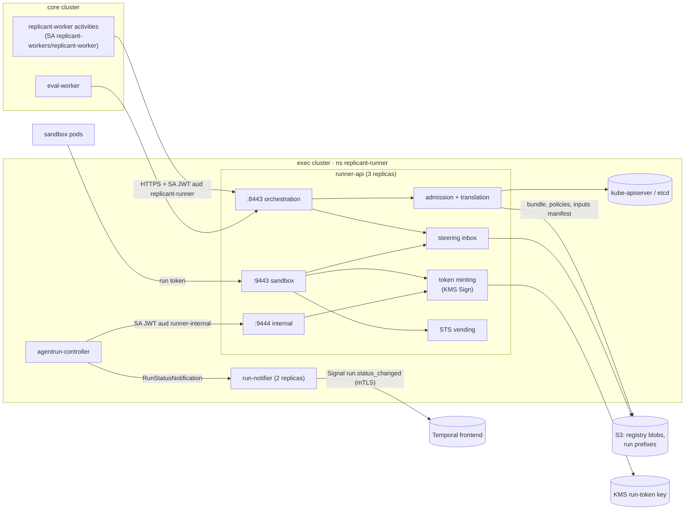
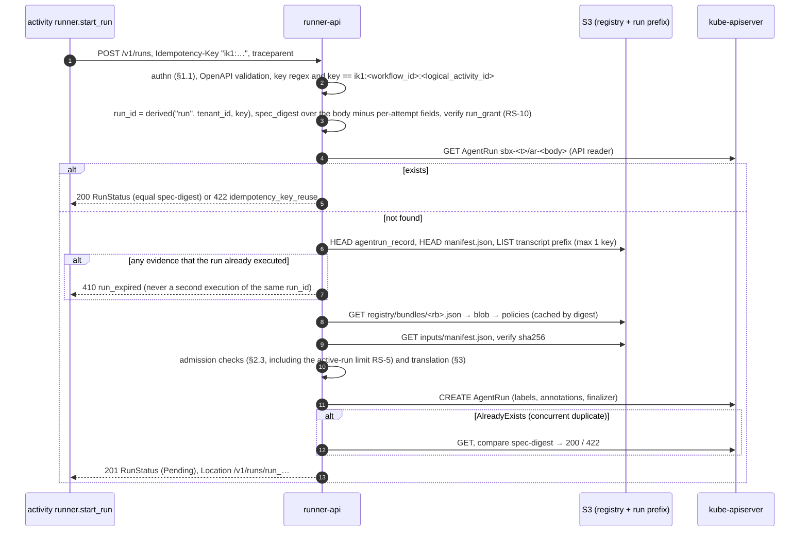

# Runner Service (runner-api) and run-notifier

**Workstream:** WS-02 · **Constraints:** D-04, D-05, D-21, D-23 · **Contracts implemented:** C-RUNNER v3.0.0 ([runner-api.openapi.yaml](../00-contracts/runner-api.openapi.yaml), both listeners plus the `runStatusChanged` webhook), C-CRD v3.0.0 (creator of AgentRuns), C-ART 2.0.0 §2 (inbox, `ops` bucket feed), C-IDS 2.0.0 §1 (run_id derivation), C-ARCH 2.0.0
**ADRs consumed:** ADR-002, ADR-007, ADR-008, ADR-010, ADR-011 · **WS-02 ADRs:** [ADR-02-003](adr/02-003-in-pod-uploader-split-tokens.md)
**Contract change requests filed:** CCR-02-01 (inbox control keys), CCR-02-02 (bundle pointer objects), CCR-02-04 (`agentrun_record` artifact type), CCR-02-06..11 (accepted), CCR-02-12 (heartbeat disk report, quota fields; applied in C-RUNNER 3.0.0 and C-IDS 2.0.0), CCR-02-13 (proposed)

## Purpose

runner-api is the only door from orchestration into execution (D-04). It authenticates Temporal
activity callers, admits and translates run specs into AgentRuns with idempotency stored on the
AgentRun itself (no database, D-23), serves authoritative status from the CRD, records cancellation,
runs the steering inbox, and on a second listener vends per-run credentials to sandboxes.
run-notifier is the separate, Signal-only Temporal client that turns controller notifications into
`run.status_changed` hints (ADR-002).

## Decisions summary

| # | Decision | Ref |
|---|---|---|
| RS-1 | Go 1.25, stdlib `net/http` with Go 1.22+ pattern routing; request/response types and a strict server interface generated from the frozen OpenAPI by `oapi-codegen` v2; request validation with `kin-openapi` `openapi3filter` against the same file. The contract test suite (WS-11) runs against both this server and runner-local | C-RUNNER |
| RS-2 | **Four listeners in one binary**: orchestration `:8443` (PrivateLink endpoint-service NLB in exec subnet `10.41.8.0/24`, from core workers), sandbox `:9443` (internal NLB in `10.41.9.0/24`, from sandbox node subnets), internal `:9444` (ClusterIP, agentrun-controller pods only), ops `:8080` (`/healthz`, `/readyz`, `/metrics`, cluster-only). NLB target groups use IP targets with **client IP preservation off**; who may reach each NLB is enforced by the NLB security group and the endpoint-service allowlist, and callers are authenticated by token, never by source IP (XD-FIX-R1-211; subnets network.md §6.1) | C-RUNNER "Listeners", ADR-007 |
| RS-3 | Idempotency = AgentRun name uniqueness + `spec-digest` annotation (ADR-008), with an **execution-evidence check** (`agentrun_record`, `manifest.json`, transcript chunks) in S3 that returns `410 run_expired` instead of re-executing a `run_id` after GC or exec-cluster loss, and status reconstruction from a committed manifest (R1-047) | ADR-008 |
| RS-4 | Admission resolves policy **only through the job's Release Bundle** (ADR-005): runner-api reads `registry/bundles/<release_bundle_id>.json` (pointer, CCR-02-02) → bundle blob by digest → `runtime_selection` and `network_profiles` policy blobs by digest, all verified and cached forever in-process | C-DEF §6, ADR-005, ADR-013 |
| RS-5 | Tenant concurrency: runner-api counts the tenant's **non-terminal** AgentRuns from its informer (CRD selectable field `status.phase`) against the namespace label `replicant.example.com/max-active-runs` (namespace label schema XD-FIX-R1-031; a missing or non-integer label refuses with `422 admission_denied`, because onboarding always writes it; WS-09's `sbx-quota` is the single ResourceQuota per tenant namespace, R1-032) and returns `429 tenant_quota_exceeded` with `Retry-After: 30` at or above it. A ResourceQuota on `pods` in `sbx-<tenant>` is the hard backstop (replicas racing can overshoot by at most 2). `count/agentruns` quota is not usable for concurrency because terminal AgentRuns are retained 45 days. Example: `sbx-replicant-eval` carries `max-active-runs: "90"` (XD-FIX-R2-056); its 2,000 runs/day cap is a tenancy setting enforced by eval-worker, not by runner-api | C-RUNNER errors |
| RS-6 | Steering inbox sequence numbers are allocated by compare-and-swap on `inbox/_head.json` with `If-Match` (CCR-02-01), then the message object is written with `If-None-Match: *` | ADR-010, C-ART §2 |
| RS-7 | Run tokens: ES256 JWTs signed by AWS KMS (`ECC_NIST_P256`, `ECDSA_SHA_256`, `MessageType=DIGEST`), DER signatures converted to JOSE `r‖s`; **one token per audience** (accepted CCR-09-01), each embedding the core-signed **run grant** and minted only within it (accepted CCR-09-02). All tokens are held by `replicant-agentd` only (WS-03 ADR-001, WS-09 G-01). KMS ECC Sign quota is 1,000 requests/s shared per account and Region [verified: https://docs.aws.amazon.com/kms/latest/developerguide/requests-per-second.html, 2026-10-24]; peak need < 1/s | C-RUNNER `RunTokenClaims`, ADR-02-003 |
| RS-8 | Per-run AWS credentials: `sts:AssumeRole` into `replicant-sandbox-artifacts` with an inline session policy scoped to the run's three prefixes and the tenant KMS key; role chaining caps sessions at 1 h (C-RUNNER, verified in V00-27) | C-RUNNER sandbox listener |
| RS-10 | **Run grants (C-RUNNER 3.0.0; added in 2.1.0 by CCR-09-02):** `RunSpec.run_grant` (compact JWS, core KMS key class `run-grant`) is verified at admission against the core run-grant JWKS `https://grants.<env>.replicant.internal/.well-known/jwks.json` (cached ≤ 10 min) and the revocation list `/grants/revoked` (entries are `job_id`s and `run_id`s, polled every 60 s): signature, `typ`, `exp`, `grant.spec_digest == spec_digest`, `run_id`/`tenant_id`/`job_id`/`role` equal, `repo_ids` ⊇ `repo.repo_id` ∪ `additional_repos`. Failure → `422 run_grant_invalid`. The first create stores it in `AgentRun.spec.runGrant` (immutable); a retry's re-signed grant is verified but not stored. Every token mint and refresh re-checks expiry and revocation. Configuration (XD-FIX-R1-253): `REPLICANT_RUN_GRANT_ISSUER` (`replicant-<env>-core`; local `replicant-local-core`), `REPLICANT_RUN_GRANT_JWKS_URL`, `REPLICANT_RUN_GRANT_REVOCATION_URL`, `REPLICANT_RUN_GRANT_REVOCATION_POLL_SECONDS` (default 60) | WS-09 ADR-005 |
| RS-11 | **Separate exec AWS account (CCR-09-07):** runner-api's IAM roles (KMS run-token key, STS role `replicant-sandbox-artifacts`) live in `replicant-<env>-exec`; the run buckets and tenant KMS keys (core/data account) grant those two exec roles by cross-account bucket and key policies (WS-10). Orchestration traffic from core arrives through a PrivateLink endpoint service in front of the internal NLB | ADR-007 |
| RS-9 | run-notifier is a separate Deployment with the only exec-side Temporal credential (mTLS, Signal-only), and authenticates the controller with TokenReview | ADR-002, C-MSG §1.1 |



---

## 1. Authentication of callers

### 1.1 Orchestration listener (`:8443`)

| Step | Mechanism |
|---|---|
| Transport | TLS 1.3, server certificate from cert-manager (`ClusterIssuer replicant-internal-ca`, 30-day certs, rotated at 2/3 life); internal NLB in TCP passthrough mode so TLS terminates in the pod; NLB security group allows only the core cluster worker node security group (ADR-007) |
| Caller identity | `Authorization: Bearer <JWT>`: a projected ServiceAccount token from the **core** cluster, audience `replicant-runner`, `expirationSeconds: 3600` |
| Verification | `github.com/coreos/go-oidc/v3` verifier for the core cluster's EKS OIDC issuer (`https://oidc.eks.<region>.amazonaws.com/id/<id>`), JWKS cached and refreshed on unknown `kid`; checks `iss`, `aud == "replicant-runner"`, `exp`, `nbf`; `sub` ∈ {`system:serviceaccount:replicant-workers:replicant-worker`, `system:serviceaccount:replicant-eval:eval-worker`} for every path; additionally, **for `GET /v1/revocations` only**, the run-token verifiers in core: `system:serviceaccount:replicant-gateway:replicant-gateway-shim` (XD-W2-03-04), `system:serviceaccount:replicant-control:control-plane-api` (WS-09 secrets.md §12 names it a verifier; R1V-049), `system:serviceaccount:replicant-context:memory-service` (memory-service, which serves the memory-mcp listener; WS-04 data-model.md, memory-service.openapi.yaml) and `system:serviceaccount:replicant-context:context-mcp` (WS-04 memory-service.openapi.yaml `x-allowed-callers`). All three poll every 10 s and reject listed runs within 15 s (R2-030, XD-FIX-R2-030). Any other subject or path → `403 forbidden` |
| Exec-cluster callers (ClusterIP, never the NLB) | a second go-oidc verifier for the **exec** cluster's EKS OIDC issuer accepts exactly two subjects, each on its own paths: `system:serviceaccount:replicant-mirror:repo-mirror` on `GET /v1/revocations`; and the security response automation `system:serviceaccount:replicant-security:security-automation` (`svc_security-automation`, tenancy.md §3.5; R1V-059) on `POST /v1/runs/{run_id}:cancel` with `reason: security` only (any other reason → `403 forbidden`) and `GET /v1/runs/{run_id}`. It finds the runs on a cordoned node from the Pods' `replicant.example.com/run-id` label (its own read-only RBAC, WS-09) |
| Tenant authority | None from the caller. Tenant policy is enforced from the spec and the bundle (C-RUNNER) |
| Local profile | static development key (runner-local) |

### 1.2 Sandbox listener (`:9443`)

`Authorization: Bearer <run token>` (always the `runner-sandbox`-audience token, presented by
`replicant-agentd`). Every sandbox-listener endpoint applies the C-RUNNER 3.0.0 verifier obligations
(R1-038): (1) the token signature against runner-api's own KMS public key (fetched once with
`kms:GetPublicKey`, cached) with `aud == "runner-sandbox"` exactly; (2) the embedded grant's signature
against the core run-grant JWKS and the subset relation (scopes, `repo_ids`, `budget_usd`,
`exp ≤ grant.exp`, `acting_for` equal); (3) the grant's `job_id`/`run_id` not on the core
`/grants/revoked` list nor on the exec revocation feed (§7.3); (4) authorization by `run_id`,
`tenant_id` and scope for the endpoint (`credentials:aws`, `inbox:read`); plus `exp`,
`sub == "run:" + run_id`, and that the AgentRun exists (informer cache) and is
non-terminal, or terminal for less than `finalizeSeconds` (`runner-sandbox` token, for the partial upload only). The NLB security
group admits only the sandbox node pools' security group.

### 1.3 Internal listener (`:9444`)

ClusterIP Service `runner-internal.replicant-runner.svc`, CiliumNetworkPolicy ingress only from
`agentrun-controller` pods. Bearer projected SA token from the exec cluster with audience
`runner-internal`, verified with `TokenReview`; only `system:serviceaccount:replicant-runner:agentrun-controller`.

## 2. `POST /v1/runs` (createRun)

### 2.1 Pipeline



### 2.2 Idempotency details

- `Idempotency-Key` is parsed as an RFC 9651 sf-string (quoted); the inner value must match the
  C-IDS `idempotency_key` regex and equal `"ik1:" + workflow_id + ":" + logical_activity_id`
  (otherwise `400 invalid_request`; missing header `400 missing_idempotency_key`).
- `run_id` uses the C-IDS reference `derived()` in the shared Go `replicantids` package, whose unit
  tests reproduce the C-IDS test vectors (`run_gj3h3ep3phjfs9e23v768zrca5`,
  `run_chxtsxqzcpds1fc1c4dvw9e4em`).
- `spec_digest = "sha256:" + hex(sha256(JCS(body without the per-attempt fields)))` over the request
  body as received (RFC 8785 JCS via `github.com/gowebpki/jcs`). The per-attempt fields are those
  C-RUNNER 3.0.0 enumerates, at least `run_grant` (re-signed on every activity retry: new `jti`,
  `iat`) and `trace_context` (a new attempt span). Defaults are not applied before hashing, so a
  retry always matches. On a 200 replay the retry's grant is verified (it must be valid) but the
  stored `spec.runGrant` and `spec.traceContext` from the first create are kept (C-CRD 2.3.1 and later).
- The existence check reads from the API server, not the cache. A concurrent duplicate that loses
  the create race receives `AlreadyExists`, reads, and compares (ADR-008).
- **No AgentRun, but evidence of execution** (R1-047, XD-10-11). The AgentRun can be absent because
  it was GC'd (≥ 45 days) or because the exec cluster was lost and rebuilt. Before creating,
  runner-api checks the canonical prefixes for evidence that this `run_id` already executed:
  `agentrun_record/agentrun.json` (written at terminal, CCR-02-04), `manifest.json`, or any object
  under the transcripts prefix (streamed while the run was alive). Any hit returns `410 run_expired`,
  so a `run_id` never executes twice, and the workflow re-runs the node with a new ordinal if it still
  needs the result. Only a prefix with nothing but `inputs/` (the run was never started) is created.

### 2.3 Admission checks (in order; first failure wins)

| # | Check | Failure |
|---|---|---|
| A-1 | Body validates against `RunSpec` (additionalProperties false) | `400 invalid_request` with `violations[]` |
| A-2 | `callback.workflow_id == workflow_id`; `workflow_id` starts with `job_id`; `callback.namespace == replicant-<env>` of this deployment | `400 invalid_request` |
| A-3 | `artifact_prefixes.*` equal the canonical prefixes for `(tenant, job, run_id)` in this environment's buckets (`<org>-replicant-<env>-{artifacts,transcripts,session}`) | `422 admission_denied` |
| A-4 | `inputs.manifest_uri` is under `<artifacts>inputs/`; object exists; `sha256(body) == manifest_sha256`; manifest ≤ 1 MiB | `422 admission_denied` (`inputs.manifest_*`) |
| A-5 | Tenant namespace `sbx-<tenant>` exists with labels `replicant.example.com/zone=sandbox` and `replicant.example.com/tenant-ready=true`, and without `replicant.example.com/exec-kill-switch=true` (namespace label schema: XD-FIX-R1-031). Kill switches at global, repo and bundle scope arrive independently of Postgres (XD-FIX-R2-016): runner-api refuses when the out-of-band mirror `s3://acme-replicant-<env>-ops/kill-switches/v1/state.json` (schema `replicant.kill-switches/v1`, 09 secrets.md §12) has an engaged `starts` switch with `scope=global`, `scope=repo` matching `repo` or any `additional_repos` entry (`<host>/<owner>/<name>`), or `scope=bundle` matching `release_bundle_id`; the tenant scope is the namespace label. Latest `issued_at` per (scope, scope_value, mode) wins. runner-api reads the object cross-account (GetObject on that key through the exec-system S3 endpoint, `kms:Decrypt` on `alias/replicant/<env>/ops`), caches it ≤ 30 s with `If-None-Match` on the ETag, and **fails closed** (`503 runner_unavailable`, `Retry-After: 30`) when it cannot read the object and its cached copy is older than 5 minutes | `422 admission_denied` (`tenant_id`, `repo`, or `release_bundle_id`); `503 runner_unavailable` when the mirror is unreadable |
| A-5b | `run_grant` valid (RS-10) | `422 run_grant_invalid` |
| A-6 | Bundle resolvable: pointer → blob digest verified; if the bundle has `spec.tenant_layer`, its tenant equals `tenant_id` | `422 definition_not_resolvable` |
| A-7 | `agent_definition` and `environment_definition` refs are members of the bundle closure (`spec.agents[]`, `spec.environments[]`, same name, version, digest), and their blobs verify. **One exception (CCR-06-07, XD-FIX-R1-134):** when `role = eval` **and** `tenant_id = replicant-eval`, `agent_definition` may be a global AgentDefinition outside the closure whose envelope carries label `replicant.example.com/eval-toolchain: "true"`; runner-api fetches it by digest from the registry and verifies digest and label. The environment definition must still come from the closure. Any other role or tenant naming an out-of-closure definition is refused | `422 definition_not_resolvable` / `admission_denied` |
| A-8 | `resource_profile` exists in the environment definition; resolved `requests ≤ limits`; when backing is `emptyDir`, `workspace.sizeLimit ≤ limits.ephemeralStorage`; `workspace.sizeLimit ≤ runtime_selection.workspace.maxSize` (1 Ti, R2-064); profile CPU and memory limits ≤ the class ceiling (`runtime_selection.classes[cls].maxCpu`, `maxMemory`). The pod-level margin for workspace headroom and the fixed volumes is **added by the controller at render time** (controller.md §4.1, one formula), never required of the profile, so the C-CRD example (40Gi/40Gi) and every WS-03/WS-05 profile pass (R1-036) | `422 admission_denied` |
| A-9 | Runtime resolution (§3.2): the result is a RuntimeClass the policy allows for `(tenant, workload_class)`; `qa_build` builder exceptions are allowed only on `kata-clh` | `422 admission_denied` (`isolation_hint`) |
| A-10 | `network_profile` is defined in the bundle's `network_profiles` policy (one of the eight profiles of network.md §5), allowed for `workload_class`, tenant (`tenants`) and role (`roles`) | `422 admission_denied` (`network_profile`) |
| A-11 | `steering.enabled` requested but agent definition lacks `steering.live`: accepted, effective `false` (C-CRD §2 AND rule) | — |
| A-12 | `limits.max_cost_usd ≤ 5000` and > 0 (schema) | `400` |
| A-13 | Runner overload: in-flight creates > 64 per replica | `429 rate_limited`, `Retry-After: 2` |
| A-14 | Kubernetes API unreachable | `503 kubernetes_unavailable`, `Retry-After: 5` |
| A-15 | Active-run limit reached (RS-5) | `429 tenant_quota_exceeded`, `Retry-After: 30`; the Problem body carries `quota_used`, `quota_limit` and `retry_after_seconds` (XD-FIX-R2-020; C-RUNNER 3.0.0 `Problem`, CCR-02-12) |

Latency target p99 < 500 ms (C-RUNNER): bundle and definition blobs are content-addressed and cached
forever per replica, so the steady-state cost is one S3 HEAD (tombstone), one S3 GET (inputs
manifest), one API GET, and one API CREATE.

## 3. Translation: RunSpec → AgentRun

### 3.1 Field mapping (implements agentrun-crd.md §2)

```go
func translate(rs RunSpec, key string, rt Resolved) *v1.AgentRun {
	runID := replicantids.Derived("run", rs.TenantID, key)
	name := "ar-" + strings.TrimPrefix(runID, "run_")
	ar := &v1.AgentRun{ // spec.runGrant = rs.RunGrant (verified, immutable)
		ObjectMeta: metav1.ObjectMeta{
			Name:      name,
			Namespace: "sbx-" + rs.TenantID,
			Labels: map[string]string{
				v1.LabelTenant:        rs.TenantID,
				v1.LabelJobID:         rs.JobID,
				v1.LabelRunID:         runID,
				v1.LabelRole:          string(rs.Role),
				v1.LabelWorkloadClass: string(rs.WorkloadClass),
				v1.LabelBundle:        rs.ReleaseBundleID[:min(30, len(rs.ReleaseBundleID))],
			},
			Annotations: map[string]string{
				v1.AnnotationSpecDigest:     rt.SpecDigest,
				v1.AnnotationIdempotencyKey: key,
			},
			Finalizers: []string{v1.FinalizerCleanup},
		},
		Spec: v1.AgentRunSpec{
			TenantID: rs.TenantID, JobID: rs.JobID, RunID: runID,
			WorkflowID: rs.WorkflowID, LogicalActivityID: rs.LogicalActivityID,
			IdempotencyKey: key, Role: v1.RunRole(rs.Role), WorkloadClass: v1.WorkloadClass(rs.WorkloadClass),
			ReleaseBundleID:       rs.ReleaseBundleID,
			AgentDefinition:       v1.DefinitionRef{Name: rs.AgentDefinition.Name, Version: rs.AgentDefinition.Version, Digest: rs.AgentDefinition.Digest},
			EnvironmentDefinition: v1.DefinitionRef{Name: rs.EnvironmentDefinition.Name, Version: rs.EnvironmentDefinition.Version, Digest: rs.EnvironmentDefinition.Digest},
			ResourceProfile:       rs.ResourceProfileOrDefault(),
			Repo:                  repoRef(rs.Repo, rt.DefaultFetchDepth),
			AdditionalRepos:       repoRefs(rs.AdditionalRepos, rt.DefaultFetchDepth),
			Inputs:                v1.RunInputs{ManifestURI: rs.Inputs.ManifestURI, ManifestSHA256: rs.Inputs.ManifestSHA256},
			Artifacts: v1.RunArtifacts{
				ArtifactsPrefix: rs.ArtifactPrefixes.Artifacts, TranscriptsPrefix: rs.ArtifactPrefixes.Transcripts,
				SessionPrefix: rs.ArtifactPrefixes.Session, MaxOutputBytes: rt.MaxOutputBytes,
			},
			RuntimeClassName:  rt.RuntimeClass,
			Resources:         rt.Resources,
			Workspace:         rt.Workspace,
			NetworkProfile:    rs.NetworkProfile,
			PriorityClassName: priorityClass(rs), // role eval or tenant replicant-eval → "replicant-eval", else "replicant-run-"+priority
			Timeouts: v1.RunTimeouts{
				StartupSeconds: rs.Timeouts.StartupSeconds, ActiveDeadlineSeconds: rs.Timeouts.ActiveDeadlineSeconds,
				FinalizeSeconds: rs.Timeouts.FinalizeSeconds,
			},
			WorkflowType: workflowType(rs.WorkflowType),                // optional, set iff present (CCR-08-03)
			Limits:       maxCostMicros(rs.Limits),                     // floor(usd * 1e6)
			Steering:     steering(rs.Steering, rt.AgentSteeringLive),  // AND rule
			TraceContext: traceContext(rs.TraceContext, rt.CreateSpan), // parent replaced by runner.create_run span
			Callback:     v1.RunCallback{Namespace: rs.Callback.Namespace, WorkflowID: rs.Callback.WorkflowID, SignalName: "run.status_changed"},
			RunGrant:     rs.RunGrant,
		},
	}
	return ar
}
```

Priority mapping (R1-046, R1V-017): runs with `role: eval` **or** tenant `replicant-eval`
map to `replicant-eval` regardless of `priority`; every other run maps to `replicant-run-<priority>`. Eval runs
map to `replicant-eval` (value 50, never preempts; C-CRD 3.0.0, CCR-02-06 accepted), so WS-06's "below
production" requirement holds exactly. Labels set on the AgentRun also include
`replicant.example.com/workflow-type` when `workflow_type` is present (R1-033).

`additionalRepos`, `limits`, `steering`, `traceContext`, and `workflowType` are set if and only if present in the
RunSpec (the CRD forbids adding or removing optional fields later). `fetchDepth` is defaulted from
the environment definition when absent. `maxOutputBytes` is `limits.max_output_bytes` or the
environment definition default.

### 3.2 Runtime and workspace resolution

Inputs: the bundle's `runtime_selection` policy (base plus tenant layer, ADR-013;
schema [schemas/policy-runtime-selection.schema.json](schemas/policy-runtime-selection.schema.json)),
`workload_class`, `isolation_hint`, the environment profile's workspace size and overflow
preference.

```
cls      = workload_class
allowed  = policy.classes[cls].allowedRuntimes ∩ tenantLayer.classes[cls].allowedRuntimes (if any)
           minus kata-fc (never selectable, R1-280)
runtime  = isolation_hint if (policy.hintPolicy == honorIfAllowed and isolation_hint ∈ allowed)
           else tenantLayer.classes[cls].default or policy.classes[cls].default
runtime  = override.to if an active runtime_override matches (scope, from=runtime)      # §3.4, R2-045
size     = profile.workspace.sizeLimit                                                  # ≤ policy.workspace.maxSize
localMax = policy.workspace.localMaxByPool[pool(runtime)]                                # e.g. sbx-kata 400Gi
backing  = per WS-03 profile.workspace.overflow.policy:
             never      → emptyDir (422 admission_denied if size > localMax)
             auto       → genericEphemeralVolume if size > min(profile.overflow.thresholdSize, localMax) else emptyDir
             always     → genericEphemeralVolume
             local_only → emptyDir (422 admission_denied if size > localMax)
enforce  = fixedSizeVolume if backing == genericEphemeralVolume
           else policy.workspace.enforcementByRuntime[runtime]
storageClassName = policy.workspace.overflowStorageClass   (only when backing is genericEphemeralVolume)
memory   = requests.memory per profile.memoryRequestPolicy (WS-03 EnvironmentDefinition is the single
           home, default median_peak): match_limit ⇒ requests.memory = limits.memory      # R1-050
```

The overflow enum (`never`, `auto`, `always`, `local_only`) and `thresholdSize` are WS-03's
EnvironmentDefinition fields (XD-FIX-R1-279); `localMaxByPool` is WS-02's published per-pool local
maximum (`sbx-kata` 400 Gi, `sbx-gvisor` 200 Gi, `sbx-kata-metal` 800 Gi: 10 % of the smallest
allowed node's instance store per pod). `memoryRequestPolicy` lives only in the environment
definition; `runtime_selection` no longer carries it, and the example keeps `median_peak` until
B-MEM-01 evidence exists (D-12 as amended).

`isolation_hint` values map 1:1 to RuntimeClass names (`gvisor` → `replicant-gvisor`, `kata-fc` →
`replicant-kata-fc`, `kata-clh` → `replicant-kata-clh`). The response `RunStatus.isolation` reports the
resolved value.

### 3.4 Runtime override (security exception path, R2-045)

A runtime CVE without a fix must move **new** runs off a runtime within hours, without a new bundle,
two signers and a ramp. The runtime class is therefore an **operational execution policy** (ADR-013:
operational configuration may change *where*, not *how* the agent behaves; the runtime is where it
runs), applied after bundle resolution and outside the bundle digest:

| Aspect | Design |
|---|---|
| Object | `RuntimeOverride` entries in ConfigMap `replicant-runner/replicant-runtime-overrides`, applied by GitOps from the platform repo (exec-side, independent of Postgres): `{override_id, scope: platform \| tenant:<t> \| class:<cls>, from: kata-clh, to: gvisor, reason, approved_by: [two principals], expires_at}` |
| Approval | two-person (platform security + exec on-call), recorded in audit (WS-09 security-exception path); `expires_at` ≤ 14 days, renewable |
| Effect | runner-api applies it to new AgentRuns only; the AgentRun carries annotation `replicant.example.com/runtime-override: <override_id>:<from>-><to>`, and the controller copies it into the run manifest's producer attributes (WS-08 sees it on the run). In-flight runs finish where they are; jobs keep their bundle (CC-3) |
| Re-verification | an override is accepted only to a runtime that passed the latest nightly benchmark gates (B-NET-01, B-DISK-01, B-START-01) in this environment; the override controller check rejects otherwise |
| `qa_build` | with no Kata: QA runs on gVisor **without image builds** (the builder sidecar is not rendered; WS-05 reports image-build stages `runtime_unsupported`), and the publish gate shows QA as partial (XD-FIX-R2-045) |
| Capacity | `sbx-gvisor` NodePool limit is raised by the same GitOps change to production peak (2,000 vCPU); until nodes arrive runs queue as `Unschedulable` (retryable). Degraded-concurrency mode: the active-run limit labels are halved by the same change |
| Rehearsal | the WS-11 kind profile applies an override from `kata-clh` to `gvisor` in the nightly `k8s-kata` job (XD-FIX-R2-045) |

### 3.3 Example: runtime_selection resolution for the C-RUNNER example

`workload_class=coding`, `isolation_hint=kata-clh`, base policy allows `[kata-clh, gvisor]` with
`hintPolicy: honorIfAllowed`, profile `default` workspace `40Gi`, `overflow.policy: auto`, `localMaxByPool.sbx-kata: 400Gi` →
`runtimeClassName: replicant-kata-clh`, `workspace: {sizeLimit: 40Gi, backing: emptyDir,
enforcement: guestBlockDevice}`. This is exactly the C-CRD example object.

## 4. `GET /v1/runs/{run_id}`, `GET /v1/runs`

- **Get:** `run_id` → namespace and name require the tenant. runner-api keeps an in-memory index
  `run_id → namespace` from its AgentRun informer (label `replicant.example.com/run-id`); a miss
  falls back to an API **list by label across `sbx-*` namespaces** (cluster-scoped list with label
  selector). The returned status is read by an uncached GET, satisfying "never cached longer than
  1 s". Not found: if the run prefix holds an `agentrun_record`, return `410`; if it holds only a
  `manifest.json` (exec-cluster loss before the record was written), return `200` with a status
  **reconstructed** from the manifest (`phase` Succeeded when `partial=false` and a result exists,
  else Failed with reason from the manifest's `producer` exit code mapping, `terminal=true`,
  `artifact_manifest_uri` set, condition messages prefixed `reconstructed:`) so the workflow can
  proceed (XD-10-11); else `404`.
- **Status mapping:** `phase`, `terminal = phase ∈ {Succeeded, Failed, Cancelled}`,
  `failure = {reason: Succeeded.reason, message: Succeeded.message, retryable:
  FailureReason.Retryable(message)}` (`ImagePullFailed` with `manifest unknown` is non-retryable, R1-056) when `phase ∈ {Failed, Cancelled}`, conditions copied
  (camelCase → snake_case), timestamps, URIs, `observed_generation`, `isolation` from
  `runtimeClassName`.
- **List:** label selector on `tenant`/`job-id`, CRD field selector `status.phase` (selectableFields),
  `terminal` filter applied server-side via field selector set; `page_token` wraps the Kubernetes
  `continue` token with an HMAC-SHA256 (key in the Runner's Secret) so callers cannot forge it;
  `page_size` → `limit`.

## 5. `POST /v1/runs/{run_id}:cancel`

JSON merge patch `{"spec":{"cancelRequested":true,"cancelReason":"<reason>"}}` (reasons include
`security` from accepted CCR-09-04; such runs end `Failed/SecurityViolation`, non-retryable) with
`resourceVersion` precondition and retry on conflict. runner-api then writes the run's control key
`inbox/_control.json` = `{"cancel_reason": "<reason>", "at": "<ts>"}` (write-once,
`If-None-Match: *`; CCR-02-09). agentd sees it on its next heartbeat (§7.3) and raises the IPC event
`cancel_requested{reason}` to the entrypoint, which works identically on every runtime (R2-040). The
Pod annotation and downward-API file remain a best-effort second channel `[unverified: downward API
updates propagate into running Kata/gVisor pods]`. The controller writes `_control.json` itself
(`deadline`) before a deadline termination. CEL allows only the one-way change. If the
run is already terminal → `200` with status; otherwise `202`. `requested_by` and `detail` are
recorded as a Kubernetes Event on the AgentRun (`reason: CancelRequested`, message ≤ 1 KiB, no
user text beyond `detail` truncated) and in the audit log line.

## 6. Steering inbox (`/v1/runs/{run_id}/messages`, `/sandbox/v1/messages`)

Keys (under the run's artifacts prefix; CCR-02-01 registers the two control keys):

```
inbox/_head.json                       # {"next_seq": 7}; CAS with If-Match (runner-api only)
inbox/<seq:06d>-<message_id>.json      # steering_message (write-once, If-None-Match: *)
inbox/ack-<message_id>.json            # {"state":"delivered","detail":"…","at":"…"} (write-once)
```

**Post** (orchestration listener):
1. AgentRun exists (`404`), `spec.steering.enabled == true` (else `409 steering_not_supported`),
   phase ∈ {Pending, Provisioning, Running} (else `409 run_not_active`).
2. `ListObjectsV2(prefix=inbox/)`; if an object ends with `-<message_id>.json` → `200` with its
   seq and current state (dedupe by `message_id`).
3. Allocate: `GET inbox/_head.json` (or treat as `next_seq=1` if 404) → `PUT inbox/_head.json`
   `{next_seq: n+1}` with `If-Match: <etag>` (`If-None-Match: *` on first). On `412`, re-read and
   retry (≤ 10 times with jitter). S3 conditional writes support both headers (C-ART §2, verified
   V00-24).
4. `PUT inbox/<n:06d>-<message_id>.json` with `If-None-Match: *`, SSE-KMS tenant key, tags
   `replicant-retention=r90d&replicant-type=steering_message&replicant-tenant=<t>`.
5. Return `202 {message_id, run_id, seq: n, state: queued}`.

A crash between steps 3 and 4 leaves a gap in `seq`; consumers tolerate gaps. Two concurrent posts
of the same `message_id` can produce two objects with different seqs; the entrypoint dedupes by
`message_id` and acks once.

**Poll** (sandbox listener, `runner-sandbox` token with `inbox:read`, called by `replicant-agentd`): loop every 1 s up to `wait_seconds`
(≤ 30): list `inbox/`, parse seqs, return up to 50 messages with `seq > after_seq` in seq order.
Cost at 150 live runs: ≈ 150 LIST/s across the fleet, well under S3 per-prefix limits.

**Ack:** `PUT inbox/ack-<message_id>.json` (`If-None-Match: *`; `412` = already acked, `204`).
**Status** (`GET /v1/runs/{run_id}/messages/{message_id}`): ack object → `delivered`/`rejected`;
no ack and run terminal → `expired`; else `queued`.

## 7. Sandbox listener and internal listener

### 7.1 Token minting

```go
// signES256 signs the JWS signing input with the KMS key and returns the JOSE signature (r||s).
func (s *Signer) signES256(ctx context.Context, signingInput []byte) ([]byte, error) {
	digest := sha256.Sum256(signingInput)
	out, err := s.kms.Sign(ctx, &kms.SignInput{
		KeyId:            aws.String(s.keyARN),
		Message:          digest[:],
		MessageType:      types.MessageTypeDigest,
		SigningAlgorithm: types.SigningAlgorithmSpecEcdsaSha256,
	})
	if err != nil {
		return nil, err
	}
	var sig struct{ R, S *big.Int }
	if _, err := asn1.Unmarshal(out.Signature, &sig); err != nil { // KMS returns DER (RFC 3279)
		return nil, err
	}
	jose := make([]byte, 64)
	sig.R.FillBytes(jose[:32])
	sig.S.FillBytes(jose[32:])
	return jose, nil
}
```

Key management: alias `alias/replicant/<env>/run-token`; a new KMS key every 30 days; `kid` =
KMS key ID; `/.well-known/jwks.json` publishes the current and previous public keys (overlap of two
token lifetimes, C-RUNNER). Verification by consumers (gateway, MCP, repo-mirror) uses JWKS.

| Endpoint | Listener | Behavior |
|---|---|---|
| `POST /internal/v1/runs/{run_id}/tokens` | internal | Mints one token per audience in the run grant (controller.md §4.3): `aud` is a single audience, scopes/`repo_ids` ⊆ grant, `exp = min(now + 60 min, grant.exp)`, claims `grant` and `grant_jti`, `acting_for` (CCR-09-03). Idempotent per replica for 5 min; a second set from another replica is harmless |
| `POST /sandbox/v1/token:refresh` | sandbox | Requires a valid `runner-sandbox` token. Returns `{"tokens": {"<audience>": {"token", "expires_at"}}}` (CCR-09-01) for every audience in the grant. Refused (`409 run_not_active`) when the run is terminal beyond `finalizeSeconds`, the grant is expired or its `job_id`/`run_id` is on the revocation list, or the run lease has expired (§7.3). When `cancelRequested`: for `cancelReason=security`, **all** refresh is refused immediately (C-CRD §1 rule 4) and the uploader finalizes with the STS session agentd already holds (≤ 50 min old); for every other reason only the `runner-sandbox` token is re-issued (partial upload), never `ai-gateway`/MCP/mirror tokens (R1-039) |
| `POST /sandbox/v1/heartbeat` | sandbox | agentd every 30 s with its `runner-sandbox` token (CCR-02-09). Renews the run lease and returns `{"continue": bool, "cancel_reason": "<reason>\|null"}` read from `inbox/_control.json`. `continue=false` when the run is terminal or revoked. The request body (C-RUNNER 3.0.0, CCR-02-12) carries the watchdog's `disk` report, which runner-api copies to the Lease annotation `replicant.example.com/disk` (controller.md §11). **Self-stop (the timeout C-RUNNER 3.0.0 asks WS-02 to define):** agentd stops the agent and lets the uploader finalize when it has had no successful heartbeat for **120 s** (= `leaseDurationSeconds`), so a partitioned sandbox stops at about the moment the controller declares `NodeLost` |
| `GET /sandbox/v1/credentials/aws` | sandbox | Called by `replicant-agentd` with its `runner-sandbox` token; requires scope `credentials:aws`; agentd hands the result only to the uploader over the private socket. `AssumeRole` with the session policy below, `RoleSessionName = <run_id>`, `DurationSeconds = 3600`, source identity `run_id`; cached per run for 50 min. Returns the AWS container-credentials shape |
| `GET /sandbox/v1/messages`, `POST …:ack` | sandbox | §6 |

### 7.3 Run lease and revocation (R2-030)

| Element | Design |
|---|---|
| Lease | `coordination.k8s.io/v1 Lease` `ar-<body>-lease` in `sbx-<tenant>` (owner: the AgentRun), `holderIdentity = run_id`, renewed by runner-api on every agentd heartbeat (`leaseDurationSeconds: 120`). About 5 Lease writes per second at 150 runs |
| Expiry | the controller watches Leases: a Running/Finalizing run whose lease is older than 120 s while its Node still reports Ready is **partitioned or wedged**. The controller fails it `NodeLost` (retryable), deletes the Pod immediately (`gracePeriodSeconds: 0`), and revokes |
| Revocation on every terminal phase | the controller calls `POST /internal/v1/runs/{run_id}:revoke` on runner-api, which appends `{run_id, job_id, at, reason}` to the exec revocation feed. runner-api serves the feed at `GET /v1/revocations?since=<cursor>` on the orchestration listener (CCR-02-09). replicant-gateway-shim, memory-mcp and context-mcp poll it every 10 s through the existing core → exec PrivateLink path, and repo-mirror polls it in-cluster. Verifiers reject tokens whose `run_id` is listed, alongside the core `/grants/revoked` list (C-RUNNER verifier obligation 3) |
| Feed storage | the feed is an hourly append log in S3, type `exec_revocation_feed`, key `exec-revocations/<env>/<yyyymmddhh>.ndjson` in the **`ops`** bucket (`acme-replicant-<env>-ops`), written by the `runner-api` role with a prefix-scoped `s3:PutObject` and `kms:GenerateDataKey` on the ops key, 90-day lifecycle expiry (C-RUNNER 3.0.0, C-ART 2.0.0). runner-api never writes the `audit` bucket. The `replicant-exec` chart sets the location in Helm values `runnerApi.revocations.bucket` (`acme-replicant-<env>-ops`), `runnerApi.revocations.prefix` (`exec-revocations/<env>/`) and, locally only, `runnerApi.revocations.readersSecretKey` (static reader tokens); there are no top-level `revocations.*` values (XD-W3-R1V-070). The served window is cached in memory; entries are served for at least two token lifetimes after the run's last token `exp` |
| Effect on a partitioned run | gateway, MCP and mirror refuse its tokens within ≤ 10 s of the terminal phase, so it cannot spend or read in parallel with its retry. Its S3 session (≤ 50 min) can still write only under its own `run_id` prefix, which the workflow no longer reads |

### 7.2 Session policy for run credentials (rendered per run; ≤ 2,048 packed characters)

```json
{
  "Version": "2012-10-17",
  "Statement": [
    {
      "Sid": "WriteRunPrefixes",
      "Effect": "Allow",
      "Action": [
        "s3:PutObject",
        "s3:PutObjectTagging",
        "s3:AbortMultipartUpload"
      ],
      "Resource": [
        "arn:aws:s3:::acme-replicant-prod-*/tenants/payments/jobs/job_01m5p7x7r0bt69j0h0fbxepw90/runs/run_gj3h3ep3phjfs9e23v768zrca5/*"
      ]
    },
    {
      "Sid": "NoWritesToInputsInboxOrRecord",
      "Effect": "Deny",
      "Action": [
        "s3:PutObject",
        "s3:PutObjectTagging"
      ],
      "Resource": [
        "arn:aws:s3:::acme-replicant-prod-*/tenants/payments/jobs/job_01m5p7x7r0bt69j0h0fbxepw90/runs/run_gj3h3ep3phjfs9e23v768zrca5/inputs/*",
        "arn:aws:s3:::acme-replicant-prod-*/tenants/payments/jobs/job_01m5p7x7r0bt69j0h0fbxepw90/runs/run_gj3h3ep3phjfs9e23v768zrca5/inbox/*",
        "arn:aws:s3:::acme-replicant-prod-*/tenants/payments/jobs/job_01m5p7x7r0bt69j0h0fbxepw90/runs/run_gj3h3ep3phjfs9e23v768zrca5/agentrun_record/*"
      ]
    },
    {
      "Sid": "ReadInputsAndOwnManifest",
      "Effect": "Allow",
      "Action": [
        "s3:GetObject"
      ],
      "Resource": [
        "arn:aws:s3:::acme-replicant-prod-*/tenants/payments/jobs/job_01m5p7x7r0bt69j0h0fbxepw90/runs/run_gj3h3ep3phjfs9e23v768zrca5/inputs/*",
        "arn:aws:s3:::acme-replicant-prod-artifacts/tenants/payments/jobs/job_01m5p7x7r0bt69j0h0fbxepw90/runs/run_gj3h3ep3phjfs9e23v768zrca5/manifest.json"
      ]
    },
    {
      "Sid": "TenantKey",
      "Effect": "Allow",
      "Action": [
        "kms:GenerateDataKey",
        "kms:Decrypt"
      ],
      "Resource": "arn:aws:kms:us-east-1:111111111111:key/2f6c1a9e-7b3d-4c5e-9a8f-0d1e2c3b4a59",
      "Condition": {
        "StringEquals": {
          "kms:ViaService": "s3.us-east-1.amazonaws.com"
        }
      }
    }
  ]
}
```

The bucket wildcard `acme-replicant-<env>-*` covers exactly the three run buckets because a session policy can only narrow the role, and the role names only `artifacts`, `transcripts` and `session` (R1V-018). So `GetObject` on `inputs/*` and the `Deny` on `inputs/`, `inbox/` and `agentrun_record/` apply in all three buckets, matching C-RUNNER 3.0.0 `getRunAwsCredentials` ("`<each artifact prefix>inputs/*`"); session restore reads `session` `inputs/` (WS-03). `agentrun_record/*` is denied so a sandbox cannot pre-empt the controller's write-once tombstone (R1-049). `GetObject` on the run's own `manifest.json` lets the uploader compare digests after a `412` on the write-once manifest (C-ART §2 rule 3); CCR-02-07 adds it to the C-RUNNER `getRunAwsCredentials` text. The session policy can only narrow the role's permissions; the role `replicant-sandbox-artifacts`
(exec account, CCR-09-07) itself allows the same actions on `tenants/*/jobs/*/runs/*` of the three
buckets and the tenant keys, its trust policy allows only runner-api's Pod Identity role, and the
buckets and keys (core/data account) name it in cross-account policies. STS sessions are
Runner-asserted and cannot be bound to run grants; a compromised runner-api can vend sessions for
in-flight run prefixes of any tenant (WS-09 residual R-04, accepted for v1 with detection:
CloudTrail `AssumeRole` events whose `RoleSessionName` does not match a live AgentRun alert). WS-10 writes the bucket
policies (deny untagged writes, deny non-environment KMS keys, C-ART §5.3); WS-09 reviews.
The packed size of this example is checked in CI against the 2,048-character limit
(`aws sts assume-role --policy` dry run in the integration test; currently 1,439 characters
after whitespace removal).

### 7.4 runner-api permissions (exact; R1V-001, R1V-002, R1V-003)

WS-09 writes the IAM, network and RBAC policies from this table (XD-W3-R1V-001).

| Kind | Permission | Resource | Used by |
|---|---|---|---|
| S3 | `s3:GetObject` | `<org>-replicant-<env>-artifacts/tenants/*/jobs/*/runs/*/inputs/manifest.json` | A-4 inputs manifest check |
| S3 | `s3:GetObject` | `…-artifacts/tenants/*/jobs/*/runs/*/agentrun_record/*`, `…-artifacts/tenants/*/jobs/*/runs/*/manifest.json` | RS-3 execution-evidence check (HEAD = GetObject), §4 status reconstruction |
| S3 | `s3:GetObject`, `s3:PutObject` (with `If-Match` / `If-None-Match`) | `…-artifacts/tenants/*/jobs/*/runs/*/inbox/*` (including `_head.json`, `_control.json`, `ack-*`) | §5 cancel control key, §6 steering inbox |
| S3 | `s3:ListBucket` with `s3:prefix` condition `tenants/*/jobs/*/runs/*/inbox/*` on `artifacts` and `tenants/*/jobs/*/runs/*/*` on `transcripts` | the two buckets | inbox delivery lookup (§6); evidence check "LIST transcript prefix, max 1 key" (§2.2) |
| S3 | `s3:GetObject` | `<org>-replicant-<env>-registry/blobs/sha256/*`, `…-registry/bundles/*` | RS-4 bundle pointer and blobs (A-6, A-7) |
| S3 | `s3:GetObject` | `<org>-replicant-<env>-ops/kill-switches/v1/state.json` | A-5 kill-switch mirror |
| S3 | `s3:PutObject`, `s3:GetObject` | `<org>-replicant-<env>-ops/exec-revocations/<env>/*` | §7.3 revocation feed |
| KMS | `kms:Decrypt`, `kms:GenerateDataKey` (via S3) | tenant keys (alias ARNs in the core account), the `registry` key (Decrypt only), the `ops` key | the reads and writes above |
| KMS | `kms:Sign`, `kms:GetPublicKey` | exec key `alias/replicant/<env>/run-token` | RS-7 run tokens |
| STS | `sts:AssumeRole`, `sts:TagSession`, `sts:SetSourceIdentity` | role `replicant-sandbox-artifacts` | RS-8 run sessions |
| Network (CNP `runner-api` egress) | `toFQDNs` + DNS `matchName` | `<org>-replicant-<env>-artifacts`, `-transcripts`, `-registry`, `-ops` `.s3.us-east-1.amazonaws.com` (443); `grants.<env>.replicant.internal`; KMS and STS endpoints; `oidc.eks.us-east-1.amazonaws.com`; Pod Identity agent | all of the above |
| Kubernetes (cluster-scoped ClusterRole `replicant-runner-api-cluster-read`, WS-09) | `namespaces` get/list/watch; `agentruns.replicant.example.com` get/list/watch (informer, all namespaces) | cluster | A-5/RS-5 namespace labels, RS-5 active-run count, §4 `GET /v1/runs` |
| Kubernetes (per `sbx-<tenant>` RoleBinding, WS-09 `replicant-agentrun-writer`) | `agentruns` get/list/watch/create/patch (cancel); `leases` get/create/update/patch | tenant namespaces | createRun, cancel, run leases (XD-W2-02-01) |
| Kubernetes (`replicant-runner`) | `configmaps` get/list/watch on `replicant-runtime-overrides` | `replicant-runner` | §3.4 runtime override |

## 8. run-notifier

| Aspect | Design |
|---|---|
| Endpoint | `POST /internal/v1/notifications` on `run-notifier.replicant-runner.svc:8080` (C-RUNNER `webhooks.runStatusChanged`) |
| AuthN | Projected SA token of agentrun-controller, audience `run-notifier`, verified with `TokenReview` (result cached by token hash for 5 min) |
| Validation | Payload validates against `RunStatusNotification`; `notification_id == run_id + ":" + phase + ":" + observed_generation`; `callback.workflow_id` from the AgentRun (the notifier GETs it by `run_id` through its informer and checks it starts with `job_id`); namespace == configured `replicant-<env>` |
| Payload codec (R1-044, XD-01-08) | The Go client is built with a `converter.PayloadCodec` implementing WS-01's tenant-routed format (ADR-01-010, `binary/replicant-encrypted-v1`): `kms:GenerateDataKey` (AES_256) with `KeyId` = the **alias ARN** `arn:aws:kms:us-east-1:111111111111:alias/replicant/<env>/tenant/<tenant_id>` (tenant keys live in the core account 111111111111; run-notifier runs in exec 222222222222, and KMS resolves a bare alias only in the caller's own account, R1V-004) with encryption context `{"replicant:purpose":"temporal-payload","replicant:tenant":"<tenant_id>"}` under the exec role **`run-notifier`** (encrypt-only, C-ARCH fourth exec role); AES-256-GCM with a 12-byte random nonce and the tenant name as associated data; payload metadata `encoding=binary/replicant-encrypted-v1`, `replicant-tenant=<tenant_id>`, `replicant-wrapped-key=<KMS CiphertextBlob>`; `data = nonce ‖ ciphertext`. Key material comes from WS-09's Go `EncryptOnlyKeyProvider` (`09-security/policies/temporal/kmskeyprovider/kms_key_provider.go`, implementing WS-01's `KeyProvider` unchanged; XD-FIX-R1-214): configured with the core account ID so it always passes the alias ARN (`arn:aws:kms:us-east-1:<core account>:alias/replicant/<env>/tenant/<tenant_id>`, and `…/tenant/replicant-system` for `sys:*` tenants), never a bare alias; data keys are cached 5 min or 10,000 payloads per tenant. `Decode` is not implemented (returns an error): the notifier never decodes. The notifier registers the tenant from the notification's `tenant_id` after checking that it equals the AgentRun's `spec.tenantId` (a mismatch is a `400` and an alert). Wire-format equality with the Python codec is tested with shared vectors (XD-FIX-R1-044) |
| Temporal call | Go SDK `client.SignalWorkflow(ctx, workflowID, "" /* runID: current run */, "run.status_changed", payload)` with the `traceparent` injected into Signal headers via the SDK's OpenTelemetry interceptor; 10 s timeout |
| Outcomes | success → `200 {"outcome":"delivered"}`; `serviceerror.NotFound` → `200 {"outcome":"workflow_closed"}`; anything else → `503` (the controller retries 1 s → 5 min, unbounded, C-CRD §5.1) |
| Temporal identity | mTLS client cert from cert-manager (`Certificate run-notifier-temporal`, 24 h, renew at 16 h), authorized by the Temporal Authorizer for `SignalWorkflowExecution` on `replicant-<env>` only (C-MSG §1.1) |
| Network | egress only to the Temporal frontend PrivateLink endpoint on 7233, the KMS VPC endpoint, and the kube-apiserver |
| HA | 2 replicas, stateless; the controller tolerates either |

## 9. Rate limiting, HA, and metrics

| Item | Value |
|---|---|
| Replicas | 3 (PDB `minAvailable: 2`), topology spread across AZs on `exec-system` nodes |
| Orchestration limits | per caller subject 200 req/s, burst 400; createRun concurrency 64 per replica |
| Sandbox limits | per `run_id` 10 req/s, burst 20; `messages` long-polls ≤ 2 concurrent per run |
| Readiness | Kubernetes API reachable, KMS public key loaded, informers synced, S3 registry reachable (C-RUNNER `/readyz`) |
| Caches | AgentRun informer (labels only needed fields via `cache.TransformStripManagedFields`); registry blobs LRU 512 MiB keyed by digest; bundle pointer cache (immutable, forever) |

Metrics (labels only from C-IDS §11: `env`, `cluster`, `service`, `tenant`, `workload_class`,
`isolation`, `phase`, `reason`, `outcome`; R1-055, XD-FIX-R1-055):

| Metric | Type | Labels | Values of `outcome` / `reason` |
|---|---|---|---|
| `replicant_runner_runs_created_total` | counter | `tenant`, `workload_class`, `isolation`, `outcome` | `created`, `replayed`, `key_reuse`, `expired`, `quota_exceeded`, `admission_denied`, `grant_invalid`, `unavailable` |
| `replicant_runner_create_duration_seconds` | histogram | `outcome` | as above |
| `replicant_runner_admission_denied_total` | counter | `tenant`, `reason` | admission rule IDs `A-1` … `A-15` |
| `replicant_runner_sandbox_requests_total` | counter | `outcome` | `refreshed`, `refused`, `credentials`, `heartbeat`, `messages`, `ack` |
| `replicant_runner_tokens_minted_total` | counter | `outcome` | `minted`, `refused` |
| `replicant_runner_kms_sign_duration_seconds` | histogram | — | — |
| `replicant_runner_sts_assume_duration_seconds` | histogram | `outcome` | `ok`, `throttled`, `error` |
| `replicant_runner_inbox_messages_total` | counter | `outcome` | `queued`, `delivered`, `rejected`, `expired` |
| `replicant_runner_revocations_total` | counter | `reason` | terminal reason or `lease_expired` |
| `replicant_notifier_signals_total` | counter | `outcome` | `delivered`, `workflow_closed`, `error` |
| `replicant_notifier_signal_duration_seconds` | histogram | `outcome` | as above |

## 10. Failure modes

| Failure | Behavior | Caller sees |
|---|---|---|
| Kubernetes API down | `503 kubernetes_unavailable` + `Retry-After: 5`; sandbox listener serves token refresh from the informer cache for up to 10 min (stale-but-safe: refusal only becomes possible when the cache shows terminal) | activity retries (retryable) |
| S3 registry unreachable on a cold cache | `503 runner_unavailable` + `Retry-After: 10` | retry |
| KMS throttled/unavailable | token mint fails → controller sets `CredentialIssueFailed` after its retry budget (60 s); refresh fails → sandbox retries; tokens have 15 min headroom | run fails retryably, or none if KMS recovers |
| STS failure | `503` to the uploader; the uploader retries; prolonged → `ArtifactUploadFailed` | retryable failure |
| runner-api replica crash mid-create | the AgentRun either exists (idempotent replay returns 200) or not (activity retry creates) | none |
| Inputs manifest missing or wrong digest | `422 admission_denied` (non-retryable): a workflow bug | node fails |
| Grant invalid, expired, or revoked | `422 run_grant_invalid` | activity re-signs on retry if expired; otherwise node fails, alert |
| Spec reuse (different body, same key) | `422 idempotency_key_reuse`: a workflow bug (key derivation) | node fails, alert |
| Tenant active-run limit | `429 tenant_quota_exceeded` with `quota_used`, `quota_limit`, `retry_after_seconds` | WS-01 sets `JobSnapshot.waiting = {reason: tenant_run_quota, …}` (C-MSG 1.6.0, XD-FIX-R2-020) |
| Cluster capacity short | the run is created; the AgentRun stays `Pending` with `Scheduled=False` (reason `Unschedulable` from the Pod) until capacity arrives or `startupSeconds` expires (`Failed/Unschedulable`, retryable). runner-api does not refuse creates for cluster capacity (it cannot see a queue at admission); WS-01 maps a run that is `Pending` with `Scheduled=False` for > 60 s to `waiting.reason = cluster_capacity` (XD-W2-02-04) | job sub-status `waiting_capacity_cluster` |
| Kill-switch mirror unreadable > 5 min | `503 runner_unavailable`, `Retry-After: 30` (fail closed, A-5) | activity retries |
| run-notifier down | controller retries; workflow polling completes the wait (ADR-002) | latency ≤ one poll interval |
| Temporal frontend down | notifier returns 503; controller keeps retrying | none until recovery |

## Open questions

| Question | Who decides | Options | Recommendation |
|---|---|---|---|
| Expose `/v1/runs` to operator tooling outside the worker identities | WS-07/WS-09 | workers only / add an operator SA | Workers only; operators use the control plane, which reads projections |
| Long-term: replace S3 LIST polling for the inbox with a push channel | WS-02 | S3 polling / Runner-to-Runner gossip | Keep polling (simple, durable); cost is trivial at this scale |

## Risks

- The inbox CAS relies on S3 `If-Match` on PutObject; MinIO and other local stores may differ (see
  [local-runner.md](local-runner.md) §5; D-08 amended to SeaweedFS `s3` locally).
- The heartbeat, control key, revocation feed, heartbeat disk report and quota fields are all in C-RUNNER 3.0.0 (CCR-02-09, CCR-02-12).

## Interfaces consumed / provided

- **Provided:** C-RUNNER (both listeners, webhook), runner-api internal token endpoint (WS-02
  internal), run-notifier Signals (C-MSG `run.status_changed`).
- **Consumed:** C-CRD, C-DEF §6 (registry blobs), C-ART (prefixes, inbox), C-IDS (run_id, headers),
  `runtime_selection` and `network_profiles` policies (WS-02 schemas), core cluster OIDC issuer,
  KMS, STS, Temporal frontend.
