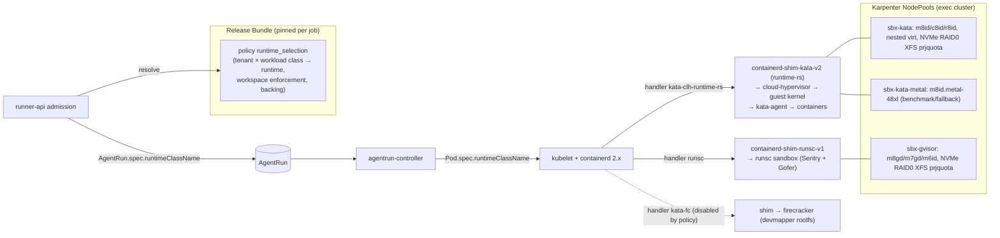

# Isolation Runtime Evaluation and Recommendation

**Workstream:** WS-02 · **Constraints:** D-06, D-07, D-12, D-16, D-21, D-22 · **Contracts consumed:** C-CRD (`runtimeClassName`, `workspace.enforcement`), C-RUNNER (`isolation_hint`, `workload_class`), ADR-007, ADR-014
**Decision record:** [ADR-02-001](adr/02-001-default-runtime-per-workload-class.md) (runtime per workload class), [ADR-02-007](adr/02-007-sandbox-node-pools.md) (node pools)
**Verification date for every tag in this file:** 2026-10-24 unless stated otherwise.

## Purpose

Choose the default isolation runtime for each AgentRun workload class (`coding`, `qa_build`,
`review`, `utility`) from gVisor (systrap and KVM platforms), Kata Containers with Firecracker,
and Kata Containers with Cloud Hypervisor, on evidence, and keep the choice swappable through
`RuntimeClass` and the bundle-pinned `runtime_selection` policy (D-06). The document ends with a
benchmark plan that the team runs before the default goes live, with numeric pass thresholds. The
default flips automatically to the documented fallback if a threshold fails.

## Decisions summary

| # | Decision | Constraint / ADR |
|---|---|---|
| R-1 | **Default for all four workload classes: Kata Containers 4.x, `runtime-rs` shim, Cloud Hypervisor (`replicant-kata-clh`)**, on KVM-capable nodes with local NVMe | D-06, [ADR-02-001](adr/02-001-default-runtime-per-workload-class.md) |
| R-2 | **Standby runtime: gVisor `runsc`, systrap platform (`replicant-gvisor`)**. Deployed, conformance-tested in CI every week, and selectable by policy per tenant and workload class. It becomes the default for a class automatically if that class fails the Kata gates in the benchmark (B-GATE table), and it is the only option for node families without nested virtualization (Graviton) | D-06 |
| R-3 | **`replicant-kata-fc` (Firecracker) is defined but disabled by policy** (`runtime_selection` never selects it). Firecracker has no filesystem sharing, needs the devmapper snapshotter, and Kata keeps emptyDir volumes inside the guest when fs sharing is unsupported, where kubelet cannot enforce `sizeLimit`. Re-evaluate only if boot latency becomes the bottleneck | D-06, D-07 |
| R-4 | Node pools: **non-metal nested-virtualization instances with local NVMe (`m8id`, `c8id`, `r8id`) as default**, `*.metal` (`m8id.metal-48xl`) as the measured comparison and fallback | D-06, D-07, [ADR-02-007](adr/02-007-sandbox-node-pools.md) |
| R-5 | Workspace hard limit per runtime: `guestBlockDevice` under Kata, `xfsProjectQuota` under gVisor, `fixedSizeVolume` for overflow. The mechanism is detailed in [workspace-storage.md](workspace-storage.md) | D-07 (amended by ADR-014), [ADR-02-004](adr/02-004-workspace-hard-limit-per-runtime.md) |
| R-6 | The runtime is swappable without code change: `RuntimeClass` objects are fixed (`replicant-gvisor`, `replicant-kata-fc`, `replicant-kata-clh`), the default is a `runtime_selection` policy value inside the Release Bundle ([schemas/policy-runtime-selection.schema.json](schemas/policy-runtime-selection.schema.json)), and an **operational runtime override** outside the bundle digest moves new runs within hours for a runtime CVE (security exception path, [runner-service.md §3.4](runner-service.md); R2-045) | D-03, D-06, ADR-013 |



---

## 1. Verified facts this evaluation rests on

Every row below is load-bearing for a decision. Rows marked unverified have an explicit fallback in
§9.

### 1.1 Versions at time of writing

| Component | Version | Tag |
|---|---|---|
| Kata Containers | **4.3.1** (2026-10-21). 4.0.0 (2026-07-20) made the Rust runtime (`runtime-rs`) the default; 4.1.0 made it the default shim on every architecture | [verified: GitHub releases API `kata-containers/kata-containers`; https://github.com/kata-containers/kata-containers/blob/main/docs/releases/4.1.0.md, 2026-10-24] |
| Cloud Hypervisor | v54.0 (2026-10-14) | [verified: GitHub releases API `cloud-hypervisor/cloud-hypervisor`, 2026-10-24] |
| Firecracker | v1.17.0 (2026-09-10) | [verified: GitHub releases API `firecracker-microvm/firecracker`, 2026-10-24] |
| gVisor | `release-20261019.0` (published 2026-10-22); weekly release tags | [verified: GitHub releases API `google/gvisor`, 2026-10-24] |
| containerd | 2.4.2 / 2.3.7 / 2.2.10 (2026-10-13). The EKS AL2023 AMI installs `containerd_version = "2.*"` | [verified: GitHub releases API; https://github.com/awslabs/amazon-eks-ami/blob/main/templates/al2023/variables-default.pkrvars.hcl, 2026-10-24] |
| Karpenter (AWS provider) | v1.15.1 (2026-10-23) | [verified: GitHub releases API `aws/karpenter-provider-aws`, 2026-10-24] |
| Cilium | v1.20.4 (2026-10-23) | [verified: GitHub releases API `cilium/cilium`, 2026-10-24] |
| EKS AL2023 AMI | v20261019 | [verified: GitHub releases API `awslabs/amazon-eks-ami`, 2026-10-24] |

### 1.2 Runtime behavior

| # | Fact | Tag |
|---|---|---|
| F-1 | gVisor's default platform is `systrap` (replaced `ptrace` mid-2023). `ptrace` is unsupported. "The KVM platform runs best on bare-metal setups"; under nested virtualization "the `systrap` platform will often provide better performance" | [verified: https://gvisor.dev/docs/architecture_guide/platforms/, 2026-10-24] |
| F-2 | gVisor root filesystem overlay default is `--overlay2=root:self`: the upper layer is a file inside the container root, which "allows Kubernetes to account for the overlay usage against the container's ephemeral storage limits"; an optional `size=` caps it | [verified: https://gvisor.dev/docs/user_guide/filesystem/, 2026-10-24] |
| F-3 | gVisor turns an `emptyDir` into a sandbox-internal `tmpfs` **only when the pod carries `dev.gvisor.spec.mount.<name>.*` annotations** (GKE's admission controller adds them). The shim's `UpdateVolumeAnnotations` iterates only over annotated volumes. For a disk-backed emptyDir with hints, the tmpfs is backed by a "self filestore" file created inside the host emptyDir directory. `dev.gvisor.empty-dir.<name>.force-shared: "true"` opts a volume out | [verified: source `google/gvisor` `pkg/shim/v1/utils/volumes.go` and `runsc/container/container.go` (`createGoferFilestoreInSelf`), HEAD 2026-10-24; https://gvisor.dev/docs/user_guide/containerd/configuration/, 2026-10-24] |
| F-4 | Without those annotations (our EKS configuration), an emptyDir is an ordinary bind mount served by the Gofer, or by the Sentry directly when directfs is on (the default; we turn it off, §11.3). Writes land in the host directory, so kubelet accounting and host XFS project quotas apply directly | [verified: same sources as F-3 (directfs default: https://gvisor.dev/docs/user_guide/filesystem/), 2026-10-24]. Error propagation of host `ENOSPC` to the sandboxed process through directfs: `[unverified: benchmark B-DISK-02 asserts it]` |
| F-5 | gVisor runs Docker inside the sandbox when the sandbox has extra capabilities (`--cap-add all` in the tutorial; GKE variant adds `NET_ADMIN`, `SYS_ADMIN`, supports Docker Engine up to 27) | [verified: https://gvisor.dev/docs/tutorials/docker-in-gvisor ; https://gvisor.dev/docs/tutorials/docker-in-gke-sandbox, 2026-10-24] |
| F-6a | Kata runtime-rs CLH ships `reclaim_guest_freed_memory = false` ("Enabling this will result in the VM balloon device having f_reporting=on set. Then the hypervisor will use it to reclaim guest freed memory… Default false"), so memory the guest has touched is not returned to the host by default | [verified: `src/runtime-rs/config/configuration-clh-runtime-rs.toml.in`, main @ 2026-10-23 (same text in the Go runtime config cited by WS-03 ADR-008)] |
| F-6 | Kata (runtime-rs) CLH config: `shared_fs = virtio-fs` default; `static_sandbox_resource_mgmt = true` for CLH (VM sized at boot: `vm_memory = requested_memory + overhead_memory`, `vm_vcpus = requested_vcpus + overhead_vcpus`); `sandbox_cgroup_only = true` for CLH; network model `tcfilter` | [verified: `src/runtime-rs/config/configuration-clh-runtime-rs.toml.in` and `src/runtime-rs/Makefile` (`DEFSTATICRESOURCEMGMT_CLH := true`, `DEFSANDBOXCGROUPONLY_CLH := true`, `DEFNETWORKMODEL_CLH := tcfilter`), main @ 2026-10-23] |
| F-7 | Kata `emptydir_mode` ∈ `shared-fs` (default), `block-encrypted`, `block-plain`. `block-*` modes **do not use `emptyDir.sizeLimit`** for the device size: "it sizes the sparse backing image to the total capacity of the host filesystem" (tracked in kata-containers issue #2438) | [verified: https://github.com/kata-containers/kata-containers/blob/main/docs/Limitations.md, 2026-10-24; source `block_emptydir_volume.rs` `get_filesystem_capacity`] |
| F-8 | When filesystem sharing is unsupported (Firecracker) and the mode is not `block-*`, runtime-rs handles an emptyDir as a guest-local volume and logs "Kubelet cannot enforce sizeLimit-based eviction" | [verified: `src/runtime-rs/crates/resource/src/volume/mod.rs` `need_local_volume`, main @ 2026-10-23] |
| F-9 | Kata runtime-rs uses a **pre-existing direct-volume `mountInfo.json`** for a mount source instead of creating its own disk (`if !is_volume_mounted(&source) { …create… }`), and the documented interface for writing it is `kata-runtime/kata-ctl direct-volume add --volume-path <path> --mount-info <json>` (root `/run/kata-containers/shared/direct-volumes/<base64url(path)>/mountInfo.json`). Direct-assigned volumes do not support `fsGroup` | [verified: `block_emptydir_volume.rs`, `kata-types/src/mount.rs` (`DEFAULT_KATA_DIRECT_VOLUME_ROOT_PATH`), https://github.com/kata-containers/kata-containers/blob/main/docs/design/direct-blk-device-assignment.md, main @ 2026-10-23] |
| F-10 | Kata Firecracker requires a block-device rootfs via containerd's devmapper snapshotter, which kata-deploy does **not** set up ("Firecracker does not implement filesystem sharing"); default devmapper `base_image_size = "10GB"` | [verified: https://github.com/kata-containers/kata-containers/blob/main/docs/how-to/how-to-use-kata-containers-with-firecracker.md ; `tools/packaging/kata-deploy/helm-chart/kata-deploy/try-kata-fc.values.yaml`, 2026-10-24] |
| F-11 | kata-deploy default `RuntimeClass.overhead.podFixed`: `clh`, `clh-runtime-rs`, `fc` = `memory: 130Mi, cpu: 250m`; QEMU shims 320Mi | [verified: `tools/packaging/kata-deploy/helm-chart/kata-deploy/templates/runtimeclasses.yaml`, main @ 2026-10-23] |
| F-12 | kata-deploy marks `clh`, `clh-runtime-rs`, `fc` as `supportedArches: [amd64]` | [verified: kata-deploy `values.yaml`, main @ 2026-10-23] |
| F-13 | Kata `disable_guest_seccomp` defaults to `true` (container seccomp profiles are not applied inside the guest unless changed) | [verified: `configuration-clh-runtime-rs.toml.in`, `DEFDISABLEGUESTSECCOMP := true`, main @ 2026-10-23] |
| F-14 | Kata does not support `volumeMounts.subPath` | [verified: https://github.com/kata-containers/kata-containers/blob/main/docs/Limitations.md, 2026-10-24] |
| F-15 | Firecracker spec: ≤ 125 ms from InstanceStart to guest init (serial console off), VMM memory overhead ≤ 5 MiB for a 1 vCPU / 128 MiB guest | [verified: https://github.com/firecracker-microvm/firecracker/blob/main/SPECIFICATION.md, 2026-10-24] |
| F-16 | Recent Kata CVE example: CVE-2026-24054 (fixed in 3.26.0): a malformed image with no layers makes containerd bind-mount an empty snapshot dir that Kata misreads as a block device, causing host filesystem errors | [verified: https://security-tracker.debian.org/tracker/CVE-2026-24054, 2026-10-24] |
| F-17 | Cilium's socket-level load balancer is "ineffective (e.g., KubeVirt, Kata Containers, gVisor)"; set `socketLB.hostNamespaceOnly=true` so service translation falls back to the tc program at the veth | [verified: https://docs.cilium.io/en/stable/network/kubernetes/kubeproxy-free/ (1.20.4), 2026-10-24] |
| F-18 | An AWS sample running Kata on EKS for agent sandboxes uses m8i nested KVM with Cloud Hypervisor as default; it reports that "Kata VMs cannot access Kubernetes Service ClusterIPs" **on VPC CNI** | [verified: https://github.com/aws-samples/sample-aws-eks-kata-for-agents, 2026-10-24]. Under Cilium with F-17 configured: `[unverified: benchmark B-NET-01]` |

### 1.3 EC2 and EKS operability

| # | Fact | Tag |
|---|---|---|
| A-1 | Nested virtualization on virtual (non-metal) EC2 instances. Supported families: **M7i, M7i-flex, M8i, M8id, M8i-flex, C7i, C7i-flex, C8i, C8id, C8i-flex, R7i, R7iz, R8i, R8id, R8i-flex, X8i, I7i, I7ie**. L1 hypervisors KVM and Hyper-V. Enabled per instance with `CpuOptions NestedVirtualization=enabled` (stopped instance to change). No extra cost. AWS: performance-sensitive workloads "evaluate bare metal instances" | [verified: https://docs.aws.amazon.com/AWSEC2/latest/UserGuide/amazon-ec2-nested-virtualization.html, 2026-10-24] |
| A-2 | Karpenter `EC2NodeClass.spec.cpuOptions.nestedVirtualization` (added in v1.13.0); "When enabled, Karpenter filters instance types to only those reporting `nested-virtualization` in ProcessorInfo.SupportedFeatures" | [verified: https://pkg.go.dev/github.com/aws/karpenter-provider-aws/pkg/apis/v1 (v1.15.0); https://kubespec.dev/karpenter/karpenter.k8s.aws/v1/EC2NodeClass, 2026-10-24]. The literal value `enabled` mirrors the EC2 API: `[unverified: exact enum spelling; CI validates the manifest against the installed CRD]` |
| A-3 | EKS managed node groups: the launch-template nested-virtualization setting was reported respected from 2026-07-08; roadmap issue closed "completed" 2026-10-12 | [verified: https://github.com/aws/containers-roadmap/issues/2784, 2026-10-24] |
| A-4 | M8id: `m8id.24xlarge` = 96 vCPU, 384 GiB, 2 × 2,850 GB NVMe, 40 Gbps; `m8id.48xlarge` = 192 vCPU, 768 GiB, 3 × 3,800 GB; metal sizes `m8id.metal-48xl`, `m8id.metal-96xl`. C8id same storage at half memory | [verified: https://aws.amazon.com/ec2/instance-types/m8i/ ; https://aws.amazon.com/ec2/instance-types/c8i/, 2026-10-24] |
| A-5 | M8id/C8id have a **dedicated** EBS attachment limit not shared with NVMe instance store or ENIs | [verified: https://docs.aws.amazon.com/AWSEC2/latest/UserGuide/volume_limits.html, 2026-10-24]. Per-size numbers for 8th generation: `[unverified: AWS 2023 blog gives 32 baseline, 48 at 16xlarge, 128 at 48xlarge for 7th gen]` |
| A-6 | AL2023 `setup-local-disks raid0` builds an md RAID0, `mkfs.xfs`, mounts it with `Options=defaults,noatime` (**no `prjquota`**) at `/mnt/k8s-disks/0`, and bind-mounts `/var/lib/kubelet`, `/var/lib/containerd`, `/var/lib/soci-snapshotter-grpc`, `/var/log/pods` onto it. Karpenter `instanceStorePolicy: RAID0` uses this path | [verified: https://github.com/awslabs/amazon-eks-ami/blob/main/templates/al2023/runtime/bin/setup-local-disks ; Karpenter API docs, 2026-10-24] |
| A-7 | AL2023 boot order: `nodeadm-config.service` runs **before** `cloud-init`; `nodeadm-run.service` runs **after** `cloud-final.service`, so user-data shell scripts run between them and can prepare disks before kubelet starts | [verified: `templates/al2023/runtime/rootfs/etc/systemd/system/nodeadm-{config,run}.service`, 2026-10-24] |
| A-8 | nodeadm `NodeConfig.spec.containerd.config` is an inline TOML merged into the defaults | [verified: `nodeadm/api/v1alpha1/nodeconfig_types.go`, 2026-10-24] |
| A-9 | Karpenter `metadataOptions` default `httpPutResponseHopLimit: 1`, `httpTokens: required` | [verified: https://karpenter.sh/docs/concepts/nodeclasses/, 2026-10-24] |
| A-10 | Bottlerocket support for installing `runsc` or Kata | `[unverified: no Bottlerocket documentation found; not load-bearing, AL2023 custom AMI is used]` |

---

## 2. Isolation boundary and escape classes

| Property | gVisor (systrap) | gVisor (KVM platform) | Kata + Firecracker | Kata + Cloud Hypervisor |
|---|---|---|---|---|
| What the untrusted code talks to | Sentry (a Go user-space kernel) implementing the Linux syscall ABI; "no system call is passed through directly to the host" [verified: https://gvisor.dev/docs/architecture_guide/security/, 2026-10-24] | Same Sentry; the address-space switch uses KVM | A full Linux guest kernel, inside a KVM VM run by the Firecracker VMM (Rust, minimal device model, `jailer`) | A full Linux guest kernel inside a KVM VM run by Cloud Hypervisor (Rust; virtio-fs via `virtiofsd`, hotplug) |
| Host attack surface after an in-sandbox compromise | Sentry's host syscalls (seccomp-filtered), Gofer/directfs file operations on the container's own files, netstack | Same plus KVM ioctls | KVM, Firecracker's virtio-net/blk/vsock emulation, kata shim API over vsock | KVM, CLH's virtio devices, **virtiofsd** (a host process serving the guest's file requests), kata shim |
| Escape needs | A Sentry bug plus a host-kernel bug reachable through the Sentry's filtered syscall set | Same, plus KVM-specific paths | A guest-to-VMM bug (device emulation) or a KVM bug; then the jailer's chroot/seccomp | A guest-to-VMM or guest-to-virtiofsd bug, or a KVM bug |
| Nested virtualization effect (A-1) | none (systrap needs no KVM) | L2 guest under L1 KVM under Nitro: works but slower (F-1) | Kata VM is an L2 guest; Nitro isolates the L1 instance from other tenants regardless | same as FC |
| Kernel diversity | Host kernel bugs are mostly unreachable (the Sentry re-implements syscalls) | same | Guest kernel bugs give root **inside the VM only** | same |
| What a container breakout inside the sandbox reaches | Other containers of the same pod (same Sentry) | same | Other containers of the same pod (same VM) | same |
| Known weakness classes | Sentry logic bugs; compatibility gaps (unimplemented syscalls, `/proc` differences) that push teams to grant extra caps; directfs widens the Sentry's host syscall set | same | Small VMM, but devmapper/devicemapper host plumbing complexity; F-16-type host-side image handling bugs | virtiofsd is a larger host-side component than a block device; F-16-type bugs |

**Assessment.** Both families are a large step above runc. For this workload (prompt-injectable
agents with a shell, arbitrary dependency install scripts, image builds) the decisive security
difference is **what the workload needs to run comfortably**: under gVisor, image builds and
Testcontainers-style flows need extra capabilities (F-5), and teams then widen the sandbox. Under
Kata, the guest kernel runs those builds natively with ordinary namespaces, and extra privileges
stay inside the VM. The prior lean in D-06 is confirmed on isolation grounds for `qa_build`, and on
operability grounds (§3) for all classes.

Defense in depth applied regardless of runtime (details in [controller.md](controller.md) §4 and
[network.md](network.md)): non-root UIDs, `allowPrivilegeEscalation: false`, all capabilities
dropped except per-container allowances, `RuntimeDefault` seccomp (and Kata
`disable_guest_seccomp = false` so it is enforced inside the guest, F-13), read-only root
filesystems, no Kubernetes API token, default-deny egress, IMDS hop limit 1 plus explicit deny, and
a separate execution cluster (ADR-007).

---

## 3. EKS operability

| Aspect | gVisor | Kata + Firecracker | Kata + Cloud Hypervisor |
|---|---|---|---|
| Instance requirement | Any Nitro instance (systrap). KVM platform only on metal or nested-virt (and slower nested, F-1) | `/dev/kvm`: `*.metal` or nested-virt families (A-1). Intel only (A-1 list has no Graviton or AMD) | same as FC |
| Graviton (arm64) | Supported (systrap) | kata-deploy marks `fc` amd64-only (F-12) | kata-deploy marks `clh` amd64-only (F-12) |
| AMI | AL2023 EKS AMI plus `runsc` and `containerd-shim-runsc-v1` (baked into a custom AMI) | AL2023 plus Kata static payload, **plus a devmapper thin-pool on every node** (F-10) | AL2023 plus Kata static payload (kata-deploy can also install it) |
| containerd config | `runtime_type = "io.containerd.runsc.v1"`, `ConfigPath = "/etc/containerd/runsc.toml"` [verified: https://gvisor.dev/docs/user_guide/containerd/configuration/, 2026-10-24] | `runtime_type = "io.containerd.kata-fc.v2"`, per-runtime `snapshotter = "devmapper"` (F-10) | `runtime_type = "io.containerd.kata-clh.v2"` (runtime-rs shim) |
| Node bootstrap | user-data: disk setup; nodeadm containerd merge (A-7, A-8) | + thin-pool must be re-created after each reboot (F-10) | same as gVisor |
| `RuntimeClass.overhead` | We set `cpu: 250m, memory: 192Mi` (measured in B-OVH; starting value, unverified) | 448Mi / 250m (starting value until B-OVH-01; §9, manifests/runtimeclasses.yaml) | 448Mi / 250m (same formula: `roundup_32Mi(overhead_memory 256Mi + p95(VMM + virtiofsd RSS))`) |
| Karpenter vs managed node groups | Either | Karpenter (A-2) or MNG (A-3) | same |
| Pod features we rely on | sidecars, init containers, emptyDir, Secrets, projected volumes: all supported | **no shared fs**: ConfigMaps/Secrets are copied, emptyDir is guest-local (F-8) | all supported except `subPath` (F-14) |
| Image lazy loading | Any host snapshotter (gofer reads the host rootfs) | devmapper only (block) | Any host snapshotter whose rootfs is shared via virtio-fs, or block devices |

**Firecracker is excluded on operability.** The devmapper thin-pool per node, the absence of
filesystem sharing (ConfigMaps and Secrets copied, emptyDir in the guest where kubelet cannot see
it, F-8), and the loss of host-side image caching that our fast path relies on outweigh its boot
time advantage. Our cold-start budget is dominated by image pull and repo fetch, not VM boot
([fast-path.md](fast-path.md) §2).

---

## 4. Firecracker specifics under Kata (for the record and for re-evaluation)

| Topic | Behavior | Consequence for us |
|---|---|---|
| Rootfs | Block device from the devmapper snapshotter; each container gets a thin snapshot of `base_image_size` (default 10 GB) (F-10) | Per-node thin-pool sizing and lifecycle; images larger than `base_image_size` need a pool reconfiguration |
| virtio-fs | Not available; kata-deploy states FC "does not implement filesystem sharing" (F-10) | ConfigMaps, Secrets, and token refreshes are copied into the guest |
| emptyDir | `shared-fs` mode cannot work; runtime-rs falls back to guest-local storage (F-8), or `block-*` modes with a host-capacity-sized sparse image (F-7) | No kubelet `sizeLimit` enforcement in guest-local mode; `guestBlockDevice` would need our NRI provisioning (workspace-storage.md §4), which is untested on FC |
| Device hotplug | FC exposes post-boot drive updates through `PATCH /drives` "to effectively simulate hot plug/unplug functionality for block devices" with a cooperative guest [verified: https://github.com/firecracker-microvm/firecracker/blob/main/docs/api_requests/patch-block.md, 2026-10-24] | Works for Kata's pre-attached placeholder drives `[unverified: count limit in runtime-rs fc]`; caps the number of block volumes per pod |
| Image lazy loading | Block-only rootfs, so SOCI/stargz FUSE snapshotters do not apply | Every image byte is pulled before start |
| Mixed snapshotters | A community Kata+FC validation reports that with two snapshotters on one node (overlayfs for runc, devmapper for kata-fc) the first unpack discards compressed blobs and needs a containerd config change | [unverified: awslabs/ai-on-eks PR #378 discussion via search result] |

---

## 5. Performance (expected, to be confirmed by §8)

No public benchmark covers this exact workload on nested-virt M8id. The table states the expected
direction and the mechanism. The numbers in §8 are pass thresholds, not predictions.

| Metric | gVisor systrap | Kata CLH (nested virt) | Kata CLH (metal) | Mechanism |
|---|---|---|---|---|
| Sandbox start (pod create → first container running, image cached) | ~1–2 s | ~1–3 s | ~1–2 s | CLH boot plus agent; FC ≤ 125 ms VMM spec (F-15) does not dominate |
| `npm ci` (many small files) | slowest: every file op through Sentry → gofer/directfs | fast with **guest block device** (ext4 in guest); slow with virtio-fs | fastest | Small-file metadata cost: host fs > guest ext4 on virtio-blk > virtio-fs > gofer |
| `go build` / `cargo build` (CPU-heavy, many reads) | moderate overhead (syscall interception) | near-native CPU in guest; nested-virt adds VM-exit cost on I/O and timers | near-native | Nested virt exits are the main nested-virt cost |
| Container image build (BuildKit rootless) | requires extra caps (F-5) and is the least mature path | native namespaces inside guest | native | §6 |
| Memory overhead per sandbox | Sentry + gofer (measured in B-OVH) | VMM ~130Mi (F-11) + guest kernel/agent + **guest page cache inside the VM size** | same | Static sizing (F-6) means guest page cache is bounded by the VM size |
| Density limiter | CPU requests | CPU requests; memory at limits (static sizing commits limit-sized VMs) | same | §7 |

---

## 6. Rootless image builds and QA sidecars

| Capability | gVisor | Kata CLH |
|---|---|---|
| BuildKit rootless | Upstream rootless BuildKit needs `seccomp=unconfined`, `apparmor=unconfined`, and either `systempaths=unconfined` or `--oci-worker-no-process-sandbox` (the Kubernetes example uses the latter) [verified: https://github.com/moby/buildkit/blob/master/docs/rootless.md, 2026-10-24]. Under gVisor, user-namespace and overlayfs behavior inside the Sentry is the risk `[unverified: B-BUILD-01]` | Same flags, but they apply to the **guest** kernel. `seccompProfile: Unconfined` on the builder container only affects the guest (F-13 with our `disable_guest_seccomp=false`) |
| buildah | `--isolation chroot`, `STORAGE_DRIVER=vfs` portable fallback `[unverified: B-BUILD-02]` | `--isolation chroot` with `overlay` storage driver on the guest ext4 workspace |
| Docker-socket tools (Testcontainers) | Docker-in-gVisor requires `SYS_ADMIN`/`NET_ADMIN` in the sandbox (F-5) | **Unsupported in v1 under any runtime** (WS-05 XD-05-13); dependencies run as declared sidecars |
| Sidecar services (Postgres, Kafka) in the pod | Supported as native sidecars; I/O through Sentry | Supported; all containers share one VM and its kernel |
| Recommendation | Not used for `qa_build` unless benchmark gates fail for Kata | **Default for `qa_build`** |

WS-05 owns the dependency strategy; this table is the runtime input it needs (cross-ws XD-02-06).

---

## 7. emptyDir and `sizeLimit` under each runtime

Summary; mechanisms and YAML are in [workspace-storage.md](workspace-storage.md).

| Runtime / mode | Where writes land | kubelet sees usage? | Hard limit available | Our choice |
|---|---|---|---|---|
| runc (local only) | host dir | yes | XFS project quota | `xfsProjectQuota` |
| gVisor, emptyDir without gVisor mount hints (our config) | host dir via the Gofer (directfs off, §11.3) | yes | XFS project quota `bhard` on the dir (host ENOSPC) | **`xfsProjectQuota`** |
| gVisor, emptyDir with tmpfs hint | self-filestore file in host dir (F-3) | yes (file blocks) | quota bounds the filestore file; app-visible error unverified | not used |
| Kata CLH, `shared-fs` | host dir via virtiofsd | yes | XFS project quota on the host dir `[unverified: virtiofsd returns the host ENOSPC to the guest; B-DISK-02]` | fallback (`xfsProjectQuota`) |
| Kata CLH, `block-plain` (Kata-native) | sparse `disk.img` in the host dir, ext4 in guest | allocated blocks only | **no**: image sized to host fs capacity (F-7) | not used as-is |
| Kata CLH, **NRI-provisioned direct block volume** | sized `disk.img` in the host dir, ext4 in guest (F-9) | allocated blocks | **yes**: device size = limit, guest `ENOSPC` | **`guestBlockDevice` (default)** |
| Kata FC | guest-local (F-8) | **no** | no | excluded |
| any, generic ephemeral EBS volume | EBS volume (virtio-fs share under Kata) | no (not ephemeral-storage) | volume size | `fixedSizeVolume` (overflow) |

`LocalStorageCapacityIsolationFSQuotaMonitoring` is **not** enabled: it does not enforce (ADR-014)
and it requires user namespaces, which do not apply to Kata ("Kata Containers uses VMs instead")
[verified: https://kubernetes.io/docs/concepts/workloads/pods/user-namespaces/, 2026-10-24].

---

## 8. Benchmark plan (runnable; gates the default)

**Owner:** WS-02, executed as spike S-1 in the implementation plan, then nightly on a reduced set.
**Harness:** [benchmark/README.md](benchmark/README.md) (k6-free; a Go driver `sbxbench` that
creates AgentRuns through the real Runner API with fixed `environment_definition`s, plus in-pod
probes). Results go to Prometheus (`replicant_bench_*`) and an S3 report.

### 8.1 Matrix

| Axis | Values |
|---|---|
| Runtime | `replicant-kata-clh` (guestBlockDevice), `replicant-kata-clh` (xfsProjectQuota on virtio-fs), `replicant-gvisor` (systrap, xfsProjectQuota), `runc` (baseline only; never offered to tenants) |
| Node | `m8id.24xlarge` nested virt; `c8id.24xlarge` nested virt; `m8id.metal-48xl`; `m8gd.24xlarge` (gVisor only) |
| Concurrency per node | 1, 8, 16, 24, 32 sandboxes |
| Image state | cold (not on node, SOCI parallel pull), warm (cached) |

### 8.2 Workloads (pinned repos and lockfiles, stored as golden snapshots in the `eval` bucket)

| ID | Workload | Repo / command | Why |
|---|---|---|---|
| W-NPM | `npm ci` then `npm run build` | Next.js app, ~1,800 packages (`package-lock.json` pinned) | small-file metadata storm |
| W-GO | `go build ./...` then `go test ./... -count=1 -run XXX` (compile only) | ~400k LOC Go service, GOPROXY via mirror | CPU + read-heavy |
| W-CARGO | `cargo build --release` | ~300 crate workspace, sparse registry via mirror | CPU + many object files |
| W-IMG | BuildKit rootless `buildctl-daemonless.sh build` of a multi-stage Dockerfile (Go → distroless) | same Go service | rootless build path |
| W-IMG-B | `buildah bud --isolation chroot` same Dockerfile | — | alternative builder |
| W-QA | App + Postgres 17 + Kafka (KRaft) native sidecars, readiness, 200 HTTP smoke requests, Playwright 20 pages | Next.js app + backing services | sidecars + browser |
| W-AGENT | Replay of a recorded implementer session (gateway replay mode) | `ledger-api` sample | realistic mixed load |
| W-DISK | write until the limit (`fallocate` + many small files) | synthetic | enforcement correctness |
| W-START | pod create → `AgentRunning` | minimal env image | cold-start components |

### 8.3 Metrics

`replicant_bench_wall_seconds{workload,runtime,node,concurrency,image_state}`, sandbox start
breakdown (scheduled → sandbox ready → init containers → agent start, from pod condition
timestamps and the controller's phase timestamps), host and guest CPU (`node_cpu_seconds_total`,
in-guest `/proc/stat`), memory (host RSS of VMM/Sentry, guest `MemAvailable`, pod cgroup
`memory.peak`), node disk throughput and IOPS, page-cache footprint, OOM and eviction counts,
error rates, and for W-DISK the exit code, errno observed by the writer, condition timeline, and
whether kubelet evicted before the hard limit fired.

### 8.4 Pass thresholds (B-GATE)

A runtime/node combination becomes the default for a workload class only if every applicable gate
passes. Ratios are against `runc` on the same node type at the same concurrency.

| Gate | Threshold | Applies to |
|---|---|---|
| B-START-01 | p95 pod-create → `AgentRunning` ≤ **25 s** warm image, ≤ **55 s** cold image (2 GiB image), at concurrency 16 | all |
| B-NPM-01 | W-NPM wall ≤ **1.6×** runc (p50 of 5) | coding, qa_build |
| B-GO-01 | W-GO wall ≤ **1.35×** runc | coding, qa_build |
| B-CARGO-01 | W-CARGO wall ≤ **1.35×** runc | coding, qa_build |
| B-BUILD-01 | W-IMG succeeds 20/20 with no extra capabilities beyond the [controller.md](controller.md) §4.2a builder profile, wall ≤ 1.6× runc | qa_build |
| B-QA-01 | W-QA: all sidecars ready ≤ 60 s p95; zero flaky failures in 50 runs | qa_build |
| B-OVH-01 | `overhead_memory + p95(VMM + virtiofsd RSS)` (Kata) or `p95(Sentry + Gofer RSS)` (gVisor) ≤ **512 MiB**; the measured value rounded up to 32Mi becomes `RuntimeClass.overhead.podFixed.memory` (§9 formula; starting 448Mi Kata, 192Mi gVisor) | all |
| B-DENS-01 | 20 coding sandboxes (the §9 density) on `m8id.24xlarge` (W-AGENT mix) with no OOM, no eviction, and per-sandbox W-GO wall ≤ 1.25× its single-tenant value | coding |
| B-DISK-01 | W-DISK: writer gets `ENOSPC` at the hard limit ± 1%, **before** any kubelet eviction, 50/50 runs, for every enforcement mode | all |
| B-DISK-02 | `statfs("/workspace")` inside the sandbox reports total = workspace limit ± 1% (used by `workspace-guard` to fail closed) | all |
| B-DISK-03 | After W-DISK, the run reaches `Failed/WorkspaceDiskExceeded` via `Finalizing` with a committed partial manifest, 50/50 | all |
| B-DISK-04 | The `guestBlockDevice` workspace mounted **into several containers at once** (workspace-guard, watchdog ro, prepare, agent, builder sidecar, Postgres and Kafka sidecars writing under `/workspace/.services/`): all see the same filesystem, writes are visible across containers, ENOSPC applies to all, discard works (WS-05 P5) | kata-clh |
| B-BUILD-03 | Rootless BuildKit inside the Kata guest in the `builder` sidecar with exactly the WS-05 privileges (Unconfined seccomp/AppArmor, `allowPrivilegeEscalation: true`, SETUID/SETGID), overlayfs snapshotter on the guest ext4 workspace, 20/20 builds (WS-05 P8); repeated with `allowPrivilegeEscalation: false` to record whether the exception is still needed (XD-05-02) | kata-clh, qa_build |
| B-NET-01 | Default-deny holds: 0 of the denied probes in [network.md](network.md) §9 succeed; allowed destinations succeed 100%; Service ClusterIP reachability works (probe 38, F-17, F-18). **Gate on the Kata default** (R2-037): if probe 38 fails, fallback rule 6 applies before Kata may be the default | all |
| B-NODE-01 | Node loss chaos (terminate instance mid-run): `NodeLost` within 90 s p95, partial transcript chunks present | all |
| B-LOG-01 | Checks (a)–(e) of WS-08 session-capture.md §1 item 5 for `replicant-kata-clh`, `replicant-kata-fc` and `replicant-gvisor` (XD-FIX-R2-039): sandbox container stdout (uploader transcript lines, agent stderr, watchdog lines) appears in `/var/log/pods/<ns>_<pod>_<uid>/` on the host, 100 % of lines within 5 s, with correct container attribution. A RuntimeClass that fails gets annotation `replicant.example.com/log-transport: otlp`; the controller copies it to bootstrap `endpoints.log_transport` and the uploader, watchdog and WS-03 entrypoint then send each line as an OTLP log record to `https://otel-sandbox.<env>.replicant.internal:4318/v1/logs` (controller.md §4.4) | all |
| B-MEM-01 | **Host-side memory footprint** per sandbox, sampled every 5 s from the pod cgroup on the host (`memory.current`, `memory.peak`, `memory.stat` anon vs file; with `sandbox_cgroup_only = true` the VMM and guest memory are charged there), reported as the ratio footprint ÷ memory limit over each W-AGENT, W-NPM, W-GO, W-QA run, in three configurations: Kata default; Kata with `reclaim_guest_freed_memory = true`; Kata with reclaim plus a guest `drop_caches` after bootstrap. gVisor measured the same way. Output feeds WS-03 ADR-008's decision rule (p50 ratio ≥ 0.8 ⇒ `memoryRequestPolicy: match_limit`) | all (evidence, not a pass/fail gate) |
| B-MEM-02 | With the chosen request policy, 24 h soak at the §9 density: zero kubelet memory-pressure evictions, zero host OOM kills of VMMs | all |

### 8.5 Fallback rules (automatic from results)

1. If Kata CLH on nested virt fails B-NPM-01, B-GO-01, or B-DENS-01 but metal passes: set the
   `sbx-kata-metal` NodePool weight from 1 to 20 (above `sbx-kata`'s 10), so Karpenter provisions
   `m8id.metal-48xl` first (ADR-02-007 option B; manifests/karpenter-sandbox-pools.yaml; R1V-105).
2. If Kata CLH fails on both nested virt and metal for `coding`, but gVisor passes: set
   `runtime_selection` default for `coding`, `review`, `utility` to `gvisor` (new bundle), keep
   `qa_build` on Kata.
3. If `guestBlockDevice` fails B-DISK-01/03: use `xfsProjectQuota` on virtio-fs for Kata. This
   **re-opens the virtiofsd surface for the workspace** (the hottest, attacker-controlled I/O path),
   which WS-09's threat-model T-SBX-03 control ("workspace on guest block device") assumed removed.
   WS-09 pre-approves it (threat-model.md "Fallback approvals", R2-038, R1V-021) only under these
   conditions; outside them the fallback needs a new WS-09 approval:
   - residual while active: T-SBX-03 rises from L2 / I4 = 8 to **L3 / I4 = 12 (high)**;
   - Kata ≥ 4.3.1; virtiofsd runs `--sandbox=namespace --seccomp=kill`; the Tetragon virtiofsd rule
     (tenancy.md §3.5) is deployed and alerting;
   - **`restricted` tenants never take this fallback**: the automation skips their runtime-selection
     layers, and their Kata runs go to `fixedSizeVolume` if it passes, otherwise to gVisor with
     `xfsProjectQuota`;
   - recorded as a security exception (`security.exception_granted`, two `replicant-security` principals);
   - time box 90 days, renewable once with fresh benchmark evidence.
   The same applies to rule 4 for `fixedSizeVolume` under Kata (EBS shared into the guest through
   virtio-fs).
4. If both Kata enforcement modes fail B-DISK-01: Kata runs use `fixedSizeVolume`
   (EBS gp3) for the workspace until fixed, accepting attach latency (workspace-storage.md §6).
5. If gVisor fails B-DISK-01 with directfs off, re-run with directfs on (WS-09 pre-approval: T-SBX-04 rises from 4 to 8, only for the classes that need it, Tetragon rule on `runsc-gofer`/`runsc-sandbox` deployed, 90 days; G-13);
   if still failing, gVisor runs use `fixedSizeVolume`.
6. If B-NET-01 probe 38 (Service ClusterIP from Kata) fails: expose repo-mirror and the sandbox OTLP
   collector through internal NLBs with `toFQDNs` policies, as the gateway and MCPs already are
   ([network.md §3.1](network.md); R2-037), then re-run B-NET-01 and B-START-01.

---

## 9. Concurrency per node (must-answer)

Node: **`m8id.24xlarge`** (96 vCPU, 384 GiB, 5.7 TB NVMe RAID0) (A-4). Allocatable estimate after
kube-reserved and system-reserved (Karpenter defaults plus our `systemReserved: cpu 1, memory 4Gi,
ephemeral-storage 50Gi`) and node agents (Cilium, Alloy, NRI plugin, ~1.5 vCPU, 3 GiB): about
**93 vCPU, 360 GiB, 5.2 TB**.

**Effective VM size (R1-278).** Under runtime-rs static sizing the VM gets
`vm_memory = Σ container memory limits + overhead_memory` and
`vm_vcpus = ceil(Σ container CPU limits + overhead_vcpus)`; `default_memory`/`default_vcpus` apply
only when no limits are set (verified in `configuration-clh-runtime-rs.toml.in`, main @ 2026-10-23:
"When workload limits are present, vm_memory = requested_memory + overhead_memory … When no workload
limits are present, default_memory is used instead"). We set `overhead_memory = 256` (MiB) and
`overhead_vcpus = 0.25`. With `sandbox_cgroup_only = true` the pod cgroup on the host holds the guest
memory plus the VMM and virtiofsd, so `RuntimeClass.overhead.podFixed.memory` must cover
`overhead_memory` plus the VMM/virtiofsd RSS.

**One overhead value and one formula (WS-02 owns `overhead.podFixed`):**
`podFixed.memory = roundup_32Mi(overhead_memory + p95(VMM + virtiofsd RSS))`, measured by B-OVH-01;
starting value **448Mi** (256 MiB guest overhead + ≈ 160 MiB VMM/virtiofsd + rounding), and
`podFixed.cpu = 250m`. The manifest uses this value; WS-03's rp-1 and WS-05's sizing use it
(XD-FIX-R1-278). gVisor: `podFixed.memory = roundup_32Mi(p95(Sentry + Gofer RSS))`, starting 192Mi.

Per-sandbox footprint = container requests + `podFixed` (Kata 250m / 448Mi) + fixed WS-02/WS-03
sidecars (agentd 100m/96Mi, uploader 200m/256Mi, watchdog 20m/32Mi; limits 1 CPU/256Mi, 1 CPU/512Mi,
200m/64Mi). Committed memory = container limits + 448Mi. The `qa_build` row uses **WS-05's single QA
footprint** exactly as WS-05 dependencies.md §7 publishes it (pod totals: requests 5.42 CPU / 8.94 GiB,
limits 14.95 CPU / 17.44 GiB, Kata VM 17.69 GiB and 16 vCPUs, workspace 40 GiB; R1-052, R1V-101, R1V-106).

| Workload class | Profile (requests → limits) | Workspace | Scheduling CPU | Committed memory | **Per `m8id.24xlarge`** (93 vCPU / 355 GiB allocatable) |
|---|---|---|---|---|---|
| `coding` (CRD example) | 4 CPU / 12Gi → 6 CPU / 16Gi | 40Gi | 4.5 | 17.0 GiB | **20** (CPU-bound) |
| `qa_build` (WS-05 Go/Postgres/Kafka example) | 5.42 CPU / 8.94Gi → 14.95 CPU / 17.44Gi (pod) | 40Gi | 5.67 | 17.9 GiB | **16** (CPU-bound) |
| `review` | 2 CPU / 6Gi → 4 CPU / 8Gi | 20Gi | 2.5 | 9.0 GiB | **37** |
| `utility` | 1 CPU / 2Gi → 2 CPU / 4Gi | 10Gi | 1.5 | 5.0 GiB | **62** (`maxPods` 80) |

**Density for every allowed shape (R1-277, R1 §5.1).** Allocatable ≈ vCPU − 3 and memory × 0.94 −
6 GiB; per-node sandboxes = min(⌊CPU / scheduling CPU⌋, ⌊memory / committed memory⌋, 80). Disk is
never binding (≥ 3.8 TB NVMe on every shape, ≤ 56 GiB per coding pod).

| Shape (pool) | Allocatable vCPU / GiB | coding | qa_build | review | utility | Blast radius (coding) |
|---|---|---|---|---|---|---|
| `m8id.24xlarge` (sbx-kata) | 93 / 355 | 20 | 16 | 37 | 62 | 20 |
| `m8id.16xlarge` (sbx-kata) | 61 / 235 | 13 | 10 | 24 | 40 | 13 |
| `c8id.24xlarge` (sbx-kata) | 93 / 174 | 10 | 9 | 19 | 34 | 10 (memory-bound) |
| `c8id.16xlarge` (sbx-kata) | 61 / 114 | 6 | 6 | 12 | 22 | 6 (memory-bound) |
| `r8id.24xlarge` (sbx-kata) | 93 / 716 | 20 | 16 | 37 | 62 | 20 |
| `r8id.16xlarge` (sbx-kata) | 61 / 475 | 13 | 10 | 24 | 40 | 13 |
| `m8id.metal-48xl` (sbx-kata-metal, fallback) | 189 / 716 | 42 | 33 | 75 | 80 | 42 |

`c8id` shapes are kept for capacity diversity but are memory-bound at half the density; the NodePool
lists `m8id` and `r8id` first through Karpenter's price-weighted selection and caps `c8id` with a
separate lower-weight NodePool (manifests/karpenter-sandbox-pools.yaml).

Peak sizing (150 concurrent runs, assumed mix 55% coding, 25% qa_build, 15% review, 5% utility) on
`m8id.24xlarge`: 83 coding / 20 = 4.2 nodes, 38 qa_build / 16 = 2.4, 22 review / 37 = 0.6,
7 utility / 62 = 0.1 → **≈ 8 nodes plus 2 warm = 10** at peak. WS-06 eval runs (up to 90 concurrent,
XD-06-10) add ≈ 5 nodes when they run; the `sbx-kata` NodePool limit stays 2,000 vCPU. On the metal
fallback the same load needs 4 production + 3 eval `m8id.metal-48xl` nodes (1,344 vCPU), so
`sbx-kata-metal` is limited to 1,600 vCPU. The design changes shape above about 1,000 concurrent runs
(ADR-007 revisit).

**Memory requests under Kata (WS-03 Challenge: D-12, ADR-03-008).** The density above is already
computed with memory committed **at the limit** for Kata (the "Fit by memory (limits)" column),
because Kata sizes the VM at the limits at boot (F-6) and does not return guest-touched memory to
the host by default (F-6a); build workloads fill the guest page cache. WS-02 therefore **supports
the challenge**: memory requests for Kata classes should follow the measured host-side footprint
(B-MEM-01), and `match_limit` where the p50 footprint ratio is ≥ 0.8. The effect on node count is
small for this mix because CPU binds first on `m8id`/`r8id` (coding 20 by CPU vs 20 by committed memory;
qa_build 16 by CPU vs 19 by committed memory), so accepting it costs about 0–1 extra nodes at peak, while rejecting it risks memory-pressure
evictions and host OOM kills of VMMs (`NodeLost`-like failures without finalization). We do **not**
enable `reclaim_guest_freed_memory` by default: page-cache-heavy guests keep little memory on free
lists, so the gain is uncertain and the option "may sometimes reduce the speed of memory access in
the VM" (F-6a); B-MEM-01 measures it, and it is switched on only if it cuts the p50 ratio below 0.6
without failing B-GO-01/B-NPM-01. gVisor's Sentry memory behavior is measured the same way
`[unverified: whether the Sentry returns freed memory to the host promptly]`.

Sensitivity: if B-OVH-01 measures 512 MiB overhead, coding density stays 20 (CPU-bound). If
nested-virt CPU overhead forces `coding` requests to 5 CPU, density drops to 16 and the peak node
count rises to 13.

---

## 10. Recommendation

1. `coding`, `review`, `utility`, `qa_build` → **`replicant-kata-clh`**, enforcement
   `guestBlockDevice`, backing `emptyDir`, on the `sbx-kata` NodePool (m8id/c8id/r8id,
   nested virt). Overflow workspaces (WS-03 overflow policy against the per-pool local maximum, 400 Gi on sbx-kata) → `fixedSizeVolume` on gp3.
2. **`replicant-gvisor`** kept warm as standby: separate small `sbx-gvisor` NodePool (min 0 nodes,
   Karpenter scales from zero), enforcement `xfsProjectQuota`. Tenants or classes are moved by a
   new `runtime_selection` policy version (a new bundle, no deploy), or within hours by an
   operational runtime override for a runtime CVE (runner-service.md §3.4).
3. **`replicant-kata-fc`** RuntimeClass exists for experiments only; `runtime_selection` schema
   permits it, and the base policy never selects it.
4. Re-run the benchmark on every Kata, gVisor, containerd, kernel, or instance-family change
   (WS-06 treats a runtime change as a bundle-affecting change because `runtime_selection` lives
   in the bundle; node AMI changes are platform changes gated by the nightly benchmark).

## 11. Runtime hardening configuration (WS-09 control review G-12, G-13)

### 11.1 containerd CRI runtime handlers (merged via nodeadm `spec.containerd.config`)

containerd 2.x CRI runtime options include `runtime_type`, `pod_annotations`,
`container_annotations`, `privileged_without_host_devices`, and a per-runtime `snapshotter`
[verified: https://github.com/containerd/containerd/blob/v2.4.2/internal/cri/config/config.go,
2026-10-24]. Only annotations listed in `pod_annotations` / `container_annotations` are passed to
the runtime. **No annotation is passed to any sandbox handler**: every 2026 Kata
annotation-to-host advisory WS-09 lists needs the annotation to reach the shim, and nothing in our
design needs one (the NRI plugin reads pod **labels**, the cancel cause reaches the entrypoint
through a downward API file, and gVisor needs no mount hints because we use plain bind mounts with
directfs off).

```toml
version = 3

[plugins.'io.containerd.cri.v1.runtime'.containerd.runtimes.kata-clh-runtime-rs]
  runtime_type = "io.containerd.kata-clh.v2"
  privileged_without_host_devices = true
  pod_annotations = []
  container_annotations = []

[plugins.'io.containerd.cri.v1.runtime'.containerd.runtimes.kata-clh-runtime-rs.options]
  ConfigPath = "/opt/kata/share/defaults/kata-containers/runtime-rs/configuration-clh.toml"

[plugins.'io.containerd.cri.v1.runtime'.containerd.runtimes.runsc]
  runtime_type = "io.containerd.runsc.v1"
  pod_annotations = []
  container_annotations = []

[plugins.'io.containerd.cri.v1.runtime'.containerd.runtimes.runsc.options]
  TypeUrl = "io.containerd.runsc.v1.options"
  ConfigPath = "/etc/containerd/runsc.toml"
```

This tightens WS-09's fragment ([containerd-kata-runtime.toml](../09-security/policies/kubernetes/containerd-kata-runtime.toml)),
which allowed `dev.gvisor.spec.mount.workspace.*` on `runsc`; we need none. The Kata
`runtime_type` and `ConfigPath` spellings for the runtime-rs CLH shim are taken from kata-deploy's
generated configuration on the pinned 4.3.1 release `[unverified: confirm against the kata-deploy
4.3.1 output on the AMI build; the AMI build test runs `kata-runtime env --json` / `kata-ctl env`
and asserts the effective values]`. The handler name `kata-clh-runtime-rs` is what
`RuntimeClass replicant-kata-clh` points to ([manifests/runtimeclasses.yaml](manifests/runtimeclasses.yaml)).

### 11.2 Kata configuration (runtime-rs CLH)

We adopt WS-09's hardening fragment ([kata-configuration-hardening.toml](../09-security/policies/kubernetes/kata-configuration-hardening.toml))
in full: `enable_annotations = []`, virtiofsd with `--sandbox=namespace --seccomp=kill`,
`disable_guest_seccomp = false`, debug console off, `sandbox_cgroup_only = true`, minimum Kata
4.3.0. WS-02 additions in the same file:

```toml
[hypervisor.clh]
overhead_vcpus = 0.25            # static sizing: vm_vcpus = Σ CPU limits + overhead_vcpus (F-6)
overhead_memory = 256            # static sizing: vm_memory = Σ memory limits + overhead_memory (MiB)
default_vcpus = 1                # used only when a pod sets no limits (never for sandboxes)
default_memory = 2048
disable_block_device_use = true   # container rootfs via virtio-fs from the host snapshot (fast path, §3)
block_device_driver = "virtio-blk"

[runtime]
emptydir_mode = "shared-fs"       # the workspace becomes a direct block volume through replicant-workspace-nri;
                                  # all other emptyDirs (home, out, spool, ipc…) stay shared via virtio-fs
```

### 11.3 gVisor configuration (`/etc/containerd/runsc.toml`), used only when policy selects gVisor

```toml
[runsc_config]
  platform = "systrap"
  directfs = "false"     # WS-09 G-13: narrower Sentry host syscall set; revisit only if B-DISK/B-NPM need it
  overlay2 = "root:self"
  network = "sandbox"
  net-raw = "false"
```

Flag names and defaults (`directfs` default `true`, `net-raw` default `false`, `platform` default
`systrap`, `overlay2`) [verified: https://github.com/google/gvisor/blob/master/runsc/config/flags.go,
2026-10-24]. With directfs off, the Gofer serves file access, which costs I/O throughput; the gVisor
rows of the benchmark (§8) run with this setting, and the `runtime_selection` policy records it
(`gvisor.directfs: false`).

## Open questions

Decided by the orchestrator (R1-283): nested virtualization as the production layer under Kata
(accepted, with the metal fallback); the NRI direct-volume `guestBlockDevice` mechanism (accepted,
with the B-DISK gate on Kata upgrades); WS-03's Challenge: D-12 (adjudicated, D-12 amended; WS-02
keeps `median_peak` until B-MEM-01 evidence exists).

| Question | Who decides | Options | Recommendation |
|---|---|---|---|
| Allow gVisor tenants to opt out of Kata for cost (Graviton) | WS-09, product | yes per tenant / no | Not in v1: the gVisor pool is amd64-only until environment images are multi-arch (R1-277) |
| Spot capacity for sandbox pools | WS-10 (cost) | on-demand only / spot for `utility` | On-demand only in v1: AgentRuns are at-most-once; a spot interruption is a `NodeLost` retry costing tokens |

## Risks

- **Nested-virt performance unknown for this workload.** Mitigation: the benchmark gates and the
  metal fallback (§8.5).
- **`guestBlockDevice` depends on Kata's direct-volume interface (F-9).** It is documented, but our
  use for emptyDir is unusual. Mitigation: Kata upgrades are gated on B-DISK-01/03 in CI;
  fallback to `xfsProjectQuota`.
- **Kata `clh` is amd64-only in kata-deploy (F-12)** and nested virt is Intel-only (A-1). Graviton
  savings are unavailable for Kata pools.
- **Single runtime default** concentrates escape risk in one codebase. Mitigation: gVisor standby,
  weekly conformance, and rapid switch by policy.

## Interfaces consumed / provided

- **Consumed:** C-CRD (`runtimeClassName` enum, `workspace.enforcement`), C-RUNNER (`isolation_hint`,
  `workload_class`), C-DEF (`runtime_selection` policy type owned by WS-02 with WS-09), ADR-007,
  ADR-014.
- **Provided:** RuntimeClass objects ([manifests/runtimeclasses.yaml](manifests/runtimeclasses.yaml)),
  `runtime_selection` policy schema ([schemas/policy-runtime-selection.schema.json](schemas/policy-runtime-selection.schema.json)),
  benchmark harness and gates, runtime facts for WS-05 (builds, sidecars) and WS-09 (threat model).
