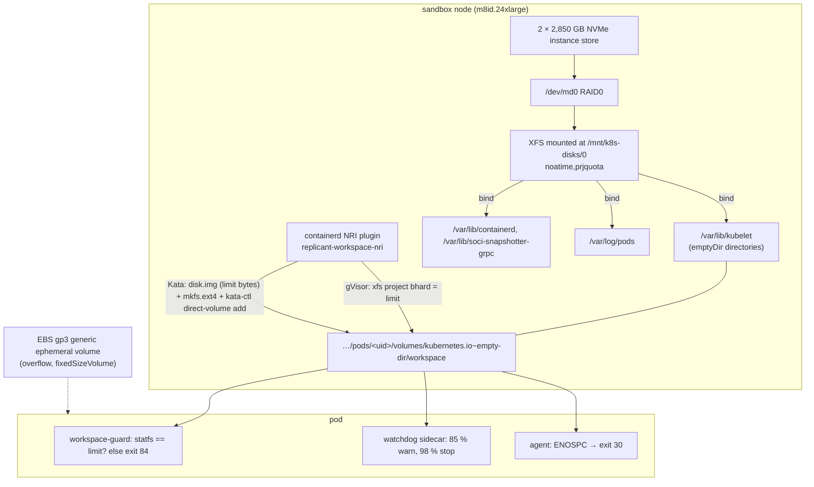

# Workspace Storage

**Workstream:** WS-02 · **Constraints:** D-07 (as amended by accepted ADR-014), D-08, D-12, D-21 · **Contracts:** C-CRD `spec.workspace` (`sizeLimit`, `backing`, `storageClassName`, `enforcement`), C-CRD failure reason `WorkspaceDiskExceeded` and condition `DiskPressure`
**ADRs:** [ADR-014](../00-contracts/adr/014-challenge-d07-fsquota-monitoring-is-not-enforcement.md) (accepted), [ADR-02-004](adr/02-004-workspace-hard-limit-per-runtime.md)
**Manifests:** [manifests/node-bootstrap.yaml](manifests/node-bootstrap.yaml) (EC2NodeClass user data), [manifests/storageclass-workspace-gp3.yaml](manifests/storageclass-workspace-gp3.yaml), [manifests/workspace-nri.yaml](manifests/workspace-nri.yaml)

## Purpose

Give every AgentRun a fast, local, scratch workspace whose size limit is **enforced at write time**
(the writer gets `ENOSPC`), that the in-sandbox watchdog turns into a structured
`WorkspaceDiskExceeded` failure before kubelet would evict the pod, and that falls back to a
fixed-size EBS volume when the workspace is larger than local disk allows. Nothing in the workspace
survives the pod; anything worth keeping is uploaded first (D-07, D-08).

## Decisions summary

| # | Decision | Ref |
|---|---|---|
| WS-1 | Default backing: `emptyDir` on **NVMe instance store RAID0, XFS mounted with `prjquota`**, with `/var/lib/kubelet`, `/var/lib/containerd`, `/var/lib/soci-snapshotter-grpc`, and `/var/log/pods` bind-mounted onto it. We run our own disk setup because the AL2023 RAID0 helper mounts XFS without `prjquota` | D-07; runtime-evaluation.md A-6, A-7 |
| WS-2 | **Hard limit per runtime** (`spec.workspace.enforcement`): `replicant-kata-clh` → `guestBlockDevice`; `replicant-gvisor` → `xfsProjectQuota`; any runtime with `backing: genericEphemeralVolume` → `fixedSizeVolume`; `watchdog` alone is never selected by policy | ADR-014, ADR-02-004 |
| WS-3 | Both local mechanisms are applied **synchronously before any container sees the volume** by a containerd **NRI plugin** `replicant-workspace-nri`, configured with `fail_request` so a plugin error fails container creation. `workspace-guard` re-checks the limit from inside the sandbox (`statfs`) and exits 84 (fail closed) if it is absent | §4 |
| WS-4 | emptyDir `sizeLimit` is rendered **above** the hard limit (`limit + H`, `H = ceil_Gi(0.05 × limit + 1 Gi)`; 43Gi for 40Gi) so that the hard limit (ENOSPC) always fires before kubelet's periodic eviction; the watchdog stops the agent at 98 % of the hard limit | §5 |
| WS-5 | Overflow: **generic ephemeral volume** from StorageClass `replicant-workspace-gp3` (EBS CSI, `reclaimPolicy: Delete`, `volumeBindingMode: WaitForFirstConsumer`, gp3 with provisioned IOPS/throughput) when WS-03's overflow policy says so: `always`, or `auto` with the workspace above `min(thresholdSize, localMaxByPool[pool])` (sbx-kata 400 Gi, sbx-gvisor 200 Gi, sbx-kata-metal 800 Gi), resolved by runner-api (runner-service.md §3.2, R1-279) | D-07 |
| WS-6 | `LocalStorageCapacityIsolationFSQuotaMonitoring` stays **disabled**: it does not enforce, requires user namespaces (inapplicable to Kata), and would compete for XFS project IDs | ADR-014 |
| WS-7 | Rejected: CSI ephemeral inline volumes, EBS snapshots as checkpoints, memory-medium workspaces, `local-path-provisioner`, and TopoLVM as the default | §7 |



---

## 1. Node storage configuration

### 1.1 Filesystem choice

**XFS** with project quotas. Reasons: XFS project quotas are the enforcing directory-tree quota
on Linux and are applied without remounting once the filesystem is mounted with `prjquota`
(they cannot be enabled by a remount, which is why we own the mount); AL2023 already formats the
array with XFS (A-6); kubelet ephemeral-storage accounting works on it. ext4 project quotas
need the `project`/`quota` mkfs features and are less established for this use.
`[unverified: XFS returns ENOSPC (not EDQUOT) when a project hard limit is hit; B-DISK-01 asserts
the errno observed by writers under each runtime]`.

### 1.2 Bootstrap (user data, runs between `nodeadm-config` and `nodeadm-run`)

AL2023 runs user-data shell parts after `nodeadm-config.service` and before `nodeadm-run.service`
starts kubelet (runtime-evaluation.md A-7), so disks are ready before kubelet and containerd
start. The EC2NodeClass therefore omits `instanceStorePolicy` (Karpenter's RAID0 path mounts
without `prjquota`, A-6), and its user data contains the script below plus a NodeConfig. Full
manifest: [manifests/node-bootstrap.yaml](manifests/node-bootstrap.yaml).

```bash
#!/usr/bin/env bash
# replicant-sandbox-disks: RAID0 all NVMe instance-store disks, XFS with project quotas,
# bind-mount kubelet/containerd/SOCI/pod-log state onto it. Idempotent across reboots
# (instance store is wiped on stop/start; the array is rebuilt).
set -euo pipefail
MNT=/mnt/k8s-disks/0
MD=/dev/md/replicant0
mapfile -t DISKS < <(lsblk -dpno NAME,MODEL | awk '/Amazon EC2 NVMe Instance Storage/ {print $1}')
if [[ ${#DISKS[@]} -eq 0 ]]; then
  echo "replicant-sandbox-disks: no instance-store NVMe found" >&2
  exit 1   # node never becomes Ready for sandboxes; Karpenter replaces it
fi
if [[ ! -e "$MD" ]]; then
  if [[ ${#DISKS[@]} -eq 1 ]]; then
    MD="${DISKS[0]}"
  else
    mdadm --create --force --verbose "$MD" --level=0 --name=replicant0 \
      --raid-devices="${#DISKS[@]}" "${DISKS[@]}"
    udevadm settle
  fi
fi
if ! blkid -t TYPE=xfs "$MD" >/dev/null 2>&1; then
  mkfs.xfs -f -K -l su=8b "$MD"
fi
mkdir -p "$MNT"
if ! mountpoint -q "$MNT"; then
  mount -t xfs -o noatime,prjquota "$MD" "$MNT"
fi
xfs_quota -x -c 'state -p' "$MNT" | grep -q 'Enforcement: ON' || {
  echo "replicant-sandbox-disks: project quota enforcement is not ON" >&2
  exit 1
}
for d in /var/lib/kubelet /var/lib/containerd /var/lib/soci-snapshotter-grpc /var/log/pods; do
  src="$MNT/$(basename "$d")"
  mkdir -p "$src" "$d"
  mountpoint -q "$d" || mount --bind "$src" "$d"
done
echo "replicant-sandbox-disks: ready (${#DISKS[@]} disks)"
```

Notes:
- `lsblk` model string "Amazon EC2 NVMe Instance Storage" is how the AWS helper scripts identify
  instance-store devices `[unverified: exact model string on 8th-generation instances; the AMI
  build test asserts it]`.
- Instance-store data is lost on stop/terminate; nothing durable lives there (D-07).
- The kubelet, containerd, SOCI, and pod-log directories share the array, so `nodefs` and
  `imagefs` are the same filesystem and kubelet sees all of it as `ephemeral-storage` capacity.

### 1.3 kubelet settings (NodeConfig / EC2NodeClass `kubelet`)

| Setting | Value | Why |
|---|---|---|
| `systemReserved` | `cpu: 1000m, memory: 4Gi, ephemeral-storage: 50Gi` | headroom for containerd, Kata shims, Cilium |
| `kubeReserved` | Karpenter default | — |
| `evictionHard` | `nodefs.available: 5%`, `nodefs.inodesFree: 5%`, `imagefs.available: 10%`, `memory.available: 2Gi` | node-level safety; per-pod limits fire first |
| `localStorageCapacityIsolation` | `true` (default) | emptyDir `sizeLimit` and `ephemeral-storage` limits are evaluated |
| feature gate `LocalStorageCapacityIsolationFSQuotaMonitoring` | `false` (default) | WS-6 |
| `maxPods` | 80 | density table in runtime-evaluation.md §9 |
| `imageGCHighThresholdPercent` / `Low` | 70 / 60 | keeps image cache bounded on the shared array |
| `containerLogMaxSize` / `containerLogMaxFiles` | `50Mi` / 3 | bounded logs (the shipper uploads transcripts separately) |

## 2. Pod spec (real YAML)

### 2.1 emptyDir workspace (default)

```yaml
volumes:
  - name: workspace
    emptyDir:
      sizeLimit: 43Gi          # spec.workspace.sizeLimit 40Gi + H, H = ceil_Gi(0.05 × 40Gi + 1Gi) = 3Gi (WS-4, R1V-095)
metadata:
  labels:                      # labels, not annotations: containerd forwards no annotations to Kata (WS-09 G-12)
    replicant.example.com/workspace-enforcement: guestBlockDevice    # or xfsProjectQuota (gVisor)
    replicant.example.com/workspace-bytes: "42949672960"             # exactly spec.workspace.sizeLimit
containers:
  - name: agent
    resources:
      requests: {ephemeral-storage: 30Gi}
      limits: {ephemeral-storage: 56Gi}   # spec 40Gi + H 3Gi + F 8Gi + O 5Gi (controller.md §4.1, the one formula)
```

(Fragment for readability; the complete Pod is [manifests/sandbox-pod.example.yaml](manifests/sandbox-pod.example.yaml).)

### 2.2 Generic ephemeral volume workspace (overflow, `fixedSizeVolume`)

```yaml
volumes:
  - name: workspace
    ephemeral:
      volumeClaimTemplate:
        metadata:
          labels:
            app.kubernetes.io/managed-by: agentrun-controller
            replicant.example.com/run-id: run_gj3h3ep3phjfs9e23v768zrca5
            replicant.example.com/tenant: payments
        spec:
          accessModes: ["ReadWriteOncePod"]
          storageClassName: replicant-workspace-gp3
          volumeMode: Filesystem
          resources:
            requests:
              storage: 300Gi       # = spec.workspace.sizeLimit; the volume size is the hard limit
```

The PVC is named `<pod name>-workspace` and owned by the Pod, so it is deleted with the Pod and the
EBS volume with it (`reclaimPolicy: Delete`) [verified: https://kubernetes.io/docs/concepts/storage/ephemeral-volumes/, see V00-21].

## 3. Hard enforcement per runtime

| Runtime | `enforcement` | Mechanism | Writer sees at limit | kubelet accounting | Verified status |
|---|---|---|---|---|---|
| `replicant-kata-clh` | `guestBlockDevice` | NRI plugin pre-creates `disk.img` of exactly the limit inside the host emptyDir directory, formats ext4, registers it with `kata-ctl direct-volume add`; Kata runtime-rs then **skips its own host-capacity-sized image** and hot-plugs ours as virtio-blk, mounted in the guest | `ENOSPC` from guest ext4 | allocated blocks of the sparse image (≤ limit + ext4 metadata) | Kata's skip-if-mountInfo-exists and the direct-volume path are verified in source (runtime-evaluation.md F-7, F-9). End-to-end behavior: `[unverified: B-DISK-01/02/03]` |
| `replicant-kata-clh` (fallback) | `xfsProjectQuota` | emptyDir shared via virtio-fs (`emptydir_mode = "shared-fs"`, Kata default); NRI plugin sets an XFS project with `bhard = limit` on the host directory | `ENOSPC` returned by the host through virtiofsd `[unverified]` | exact | fallback if B-DISK fails for `guestBlockDevice` |
| `replicant-gvisor` | `xfsProjectQuota` | emptyDir is a plain gofer/directfs bind mount (we set no gVisor mount hints, runtime-evaluation.md F-3, F-4); NRI plugin sets the project quota | `ENOSPC` from host syscalls through directfs `[unverified: B-DISK-01]` | exact | — |
| any | `fixedSizeVolume` | EBS gp3 volume of `sizeLimit` | `ENOSPC` from the volume's filesystem | not ephemeral-storage | volume size semantics verified (EBS CSI) |
| `replicant-kata-fc` | — | not offered (guest-local emptyDir, F-8) | — | none | excluded |

Why `guestBlockDevice` is the Kata default: the workspace is the hottest I/O path (`npm ci`,
compilers), and a guest-native ext4 on virtio-blk avoids routing every metadata operation through
virtiofsd. The benchmark decides (runtime-evaluation.md B-NPM-01, fallback rule 3).

## 4. `replicant-workspace-nri` (node plugin)

A Go binary running as an **external NRI plugin** in a privileged platform DaemonSet that connects to
`/var/run/nri/nri.sock` ([manifests/workspace-nri.yaml](manifests/workspace-nri.yaml)); upgrades are
ordinary DaemonSet rollouts. If it is disconnected, NRI proceeds without it, which is why
`workspace-guard` fails closed. NRI is enabled by default in containerd 2.0
and later [verified: https://github.com/containerd/containerd/blob/main/docs/NRI.md, 2026-10-24].
NRI calls plugins for lifecycle events, and "If a plugin returns an error for a request, NRI does
not call the remaining plugins. It returns the error to the runtime, and the runtime fails the pod
or container operation" [verified: https://github.com/containerd/nri/blob/main/README.md,
2026-10-24]. The plugin subscribes with failure policy `fail_request: true` so that a timeout also
fails the request (`FailurePolicy.fail_request` exists in the NRI API on `main`
[verified: https://github.com/containerd/nri/blob/main/pkg/api/api.proto, 2026-10-24];
`[unverified: shipped in the containerd minor we pin]`). The NRI `PodSandbox` carries the pod
`uid` and `labels` [verified: same api.proto], which is all the plugin needs. It reads the pod
**labels** `replicant.example.com/workspace-enforcement` and `replicant.example.com/workspace-bytes`, not
annotations: WS-02 forwards no annotations to sandbox runtimes (runtime-evaluation.md §11.1), and
labels are passed to containerd in the CRI sandbox config regardless of that setting.

### 4.1 Event handling

| Event | Action |
|---|---|
| `CreateContainer` for a container of a pod with label `replicant.example.com/workspace-enforcement` and a mount whose source is `/var/lib/kubelet/pods/<uid>/volumes/kubernetes.io~empty-dir/workspace` | Idempotently provision the workspace (below), **before** containerd calls the runtime shim. The first container of the pod that mounts the workspace is `workspace-guard`, so provisioning happens before any other container sees the volume; later containers find it done |
| `RemovePodSandbox` | Release: `kata-ctl direct-volume remove --volume-path <src>` (Kata), `xfs_quota -x -c 'limit -p bhard=0 <projid>'` and clear the project ID (gVisor); kubelet deletes the directory and `disk.img` with the pod |
| Registration (startup) | Reconcile all known sandboxes from the handshake (NRI sends existing pods and containers at registration), then remove the node startup taint `replicant.example.com/workspace-nri-not-ready:NoSchedule` (set by Karpenter `startupTaints`) via a narrowly scoped node-patch identity |

Provisioning, `xfsProjectQuota`:

```bash
projid=$(( 0x40000000 + (fnv1a32 "$POD_UID" & 0x3FFFFFFF) ))    # high range; kubelet assigns none (WS-6)
xfs_quota -x -c "project -s -p $SRC $projid" /mnt/k8s-disks/0  # tag tree, set inherit flag
xfs_quota -x -c "limit -p bhard=${BYTES} $projid" /mnt/k8s-disks/0
```

(The plugin uses the `quotactl(2)` / `FS_IOC_FSSETXATTR` ioctls directly through
`golang.org/x/sys/unix`; the commands above are the operator-equivalent form used in the runbook.)
Collisions (two pods hashing to the same ID) are detected by reading the current project's usage
and owner directory before assignment; on collision the plugin probes `projid+1`.

Provisioning, `guestBlockDevice`:

```bash
truncate -s "${BYTES}" "$SRC/disk.img"
mkfs.ext4 -F -q -m 0 -E lazy_itable_init=1,lazy_journal_init=1,root_owner=10001:10001 "$SRC/disk.img"
kata-ctl direct-volume add --volume-path "$SRC" \
  --mount-info '{"volume-type":"blk","device":"'"$SRC"'/disk.img","fstype":"ext4","options":["discard"]}'
```

- Formatting on the host keeps the guest path independent of Kata's `createFilesystem` metadata,
  and `root_owner` replaces `fsGroup`, which direct-assigned volumes do not support
  (runtime-evaluation.md F-9).
- The `discard` mount option lets deletions inside the guest punch holes in the sparse image so
  host accounting tracks real usage `[unverified: CLH discard passthrough; B-DISK-01 measures]`.
- The command form `kata-ctl direct-volume add` is the documented runtime-rs interface (the Go
  runtime's equivalent is `kata-runtime direct-volume add`) [verified: Kata design doc
  direct-blk-device-assignment.md, 2026-10-24].

### 4.2 Fail-closed check inside the sandbox

`workspace-guard` (the first init container): `statfs("/workspace")`; pass if `f_blocks × f_bsize` is within 1 % of
`REPLICANT_WORKSPACE_LIMIT_BYTES` (guest ext4 size for `guestBlockDevice`; XFS reports the project
hard limit as the filesystem size for a directory carrying the project-inherit flag, which reaches
the sandbox through virtiofsd/directfs `[unverified: B-DISK-02]`). Otherwise exit 84 →
`ControllerError` + alert `ReplicantWorkspaceLimitNotEnforced`. This catches an NRI plugin that is not
registered at all (NRI then simply does not call it).

## 5. Watchdog and the structured failure

| Level | Trigger | Action |
|---|---|---|
| Report | every 2 s | watchdog rewrites `/run/replicant/ipc/status/disk-state` (`ok`\|`warn`\|`exceeded`), `disk-used`, `disk-limit`, `disk-peak` (decimal bytes, atomic rename); agentd forwards them on its heartbeat (CCR-02-12, XD-W2-03-01) |
| Warn | used ≥ 85 % of the hard limit | watchdog writes `/run/replicant/ipc/status/disk-warn` (JSON: used, limit, top 5 directories by size from an incremental walk bounded to 2 s CPU per minute); entrypoint may inform the agent ("workspace 85 % full: clean build caches") per WS-03; controller sets `DiskPressure=True/ApproachingLimit` from kubelet stats (controller.md §11) |
| Stop | used ≥ 98 %, or any process reported `ENOSPC` (the entrypoint watches the CLI's stderr/events for `ENOSPC`/`No space left on device`) | watchdog writes `/run/replicant/ipc/status/disk-exceeded`; the WS-03 entrypoint stops the CLI (SIGINT, then SIGTERM, then SIGKILL, WS-03 §4.5), writes `handoff` and `run_result` (`outcome: failed`) into the separate `out` volume, writes the termination message, exits **30** |
| Finalize | agent exit 30 | uploader commits a `partial: true` manifest; controller ends the run `Failed/WorkspaceDiskExceeded` via `Finalizing`, `DiskPressure=True/Exceeded`; the message names the biggest directories (C-RUNNER `FailedDiskRunStatus` example) |
| Kubelet backstop | emptyDir usage > `sizeLimit` (only reachable if the hard limit failed) | eviction → controller maps it to `WorkspaceDiskExceeded` (never `PodEvicted`), plus alert `ReplicantWorkspaceHardLimitBypassed` |

The ordering guarantee: hard limit `L`, watchdog stop at `0.98 L`, kubelet eviction at
`1.05 L + 1 Gi`. Kubelet's check is periodic (ADR-014), so writes above `L` are impossible and
eviction cannot win the race.

## 6. Overflow: generic ephemeral EBS volumes

StorageClass ([manifests/storageclass-workspace-gp3.yaml](manifests/storageclass-workspace-gp3.yaml)):

```yaml
apiVersion: storage.k8s.io/v1
kind: StorageClass
metadata:
  name: replicant-workspace-gp3
provisioner: ebs.csi.aws.com
reclaimPolicy: Delete
volumeBindingMode: WaitForFirstConsumer
allowVolumeExpansion: false
parameters:
  type: gp3
  iops: "12000"
  throughput: "750"
  csi.storage.k8s.io/fstype: xfs
  encrypted: "true"
  kmsKeyId: arn:aws:kms:us-east-1:222222222222:alias/replicant/prod/exec-ebs   # exec account 222222222222 (C-ARCH §4); key owned by WS-09 (R1-240 ruling)
  tagSpecification_1: "replicant-purpose=workspace"
  tagSpecification_2: "replicant-cluster=fct-prod-exec"
```

Parameter names and defaults are from the EBS CSI driver (`type`, `iops`, `throughput` default 125,
`encrypted`, `kmsKeyId`, `csi.storage.k8s.io/fstype`) [verified:
https://github.com/kubernetes-sigs/aws-ebs-csi-driver/blob/master/docs/parameters.md, 2026-10-24].
gp3 baseline is 3,000 IOPS and 125 MiB/s, up to 80,000 IOPS (500 IOPS/GiB) and 2,000 MiB/s
(0.25 MiB/s per IOPS) [verified: https://docs.aws.amazon.com/ebs/latest/userguide/general-purpose.html,
2026-10-24]. 12,000 IOPS needs ≥ 24 GiB and 750 MiB/s needs ≥ 3,000 IOPS, both satisfied by
any overflow volume (> 200 Gi).

| Aspect | Value |
|---|---|
| When chosen | WS-03 `overflow.policy` `always`, or `auto` with the workspace above `min(thresholdSize, localMaxByPool[pool])`; `never`/`local_only` fail admission above the pool maximum (runner-service.md §3.2) |
| Attach-time cost | `CreateVolume` + attach + `mkfs.xfs` adds tens of seconds to sandbox start `[unverified: B-START-02 measures p50/p95]`; it counts against `startupSeconds` and is excluded from the 90 s p95 SLO only for overflow runs (reported separately) |
| Per-node attachment limit | M8id/C8id have a dedicated EBS attachment limit not shared with instance store or ENIs (runtime-evaluation.md A-5). The EBS CSI node plugin reports the node's attachable count to the scheduler (`CSINode.spec.drivers[].allocatable.count`); overflow runs are rare (< 5 %), far below any limit |
| Under Kata | the filesystem PVC is mounted on the host and shared into the guest via virtio-fs (EBS CSI does not call Kata direct-volume), so performance is virtio-fs-bound |
| Under gVisor | gofer/directfs bind mount |
| Encryption | EBS-encrypted with the exec-cluster key; scratch only, deleted with the pod |
| Snapshots | no `VolumeSnapshotClass` exists in the exec cluster; the EBS CSI controller's IAM role has no `ec2:CreateSnapshot` |

## 7. Rejected alternatives

| Alternative | Why rejected |
|---|---|
| **CSI ephemeral inline volumes** (`volumes[].csi`) | The AWS EBS CSI driver declares no `Ephemeral` lifecycle mode, so it cannot serve inline ephemeral volumes, and inline volumes do not use StorageClasses at all (no type/IOPS/encryption parameters) [verified: V00-21; https://github.com/kubernetes-sigs/aws-ebs-csi-driver/blob/master/deploy/kubernetes/base/csidriver.yaml] |
| **EBS snapshots as checkpoints** | D-06/D-07 forbid it; snapshots of a workspace would persist untrusted code and secrets beyond the run, take minutes to create, and contradict "workspaces are scratch". Session continuity is explicit (`cli_session_state`, `handoff`, WS-04) |
| **FSQuotaMonitoring** | monitors, does not enforce (ADR-014) |
| **Memory-medium emptyDir** | counts toward pod memory; 40 GiB workspaces would multiply memory cost |
| **local-path-provisioner** | no size enforcement |
| **TopoLVM (LVM thin or thick on NVMe) as the default** | a second storage control plane (scheduler extender or capacity tracking, a node daemon, an LVM VG), and under Kata its volumes would still go through virtio-fs unless integrated with direct-volume. Kept as the documented fallback for gVisor if XFS project quotas fail B-DISK-01 (TopoLVM v0.42.0, 2026-10-08 [verified: GitHub releases API]) |
| **Kata `emptydir_mode = block-plain` as shipped** | sizes the image to the host filesystem, not `sizeLimit` (runtime-evaluation.md F-7); ext4 metadata of a 5.7 TB logical image (~0.08 %) is about 4.5 GB per pod |

## 8. Disk sizing method (tied to the resource profile; WS-03 owns the format)

Inputs (per environment definition × profile, from the last 30 days of runs):
`run_result.usage.peak_workspace_bytes` (written by the entrypoint from watchdog data) and
`replicant_sandbox_workspace_peak_bytes` (watchdog metric shipped via OTLP), the full checkout size
`C` (from repo-mirror pack statistics), and dependency footprint.

```
workspace.sizeLimit       = roundup_5Gi( max( p95(peak_workspace_bytes) × 1.3 , 2 × C + 2 GiB ) )       # profile (WS-03)
limits.ephemeralStorage   ≥ workspace.sizeLimit                                                         # profile; Runner A-8 checks only this
requests.ephemeralStorage = roundup_1Gi( p50(peak_workspace_bytes) + 8 GiB )                            # profile

# added by the controller at render time (never by the profile; controller.md §4.1, R1-036):
H = ceil_Gi( 0.05 × workspace.sizeLimit + 1 GiB )      # emptyDir sizeLimit = workspace.sizeLimit + H
F = 8 GiB                                            # home 2, tools 1, inputs 2, spool 2, logs 1
O = ceil_Gi( maxOutputBytes ) + 1 GiB                  # the out volume
rendered agent limits.ephemeral-storage = limits.ephemeralStorage + H + F + O
```

New codebases with no history start from the D-12 guidance (node_modules, image layers, and
compiler caches reach 20–40 GB): `workspace.sizeLimit = 40Gi` for JS/TS and JVM, `30Gi` for Go and
Python, `60Gi` for Rust and image-building QA profiles, then converge after 20 runs. WS-03's
right-sizing proposals use the same formula and a human approves the new environment definition
version (D-12).

## Open questions

| Question | Who decides | Options | Recommendation |
|---|---|---|---|
| Accept the `guestBlockDevice` mechanism's dependency on Kata's direct-volume interface | WS-09 (supply chain/compat), WS-02 | accept with CI gate / use virtio-fs quotas only | Accept; Kata upgrades are gated on B-DISK tests |
| Should the workspace be encrypted at the filesystem level in addition to Nitro instance-store encryption | WS-09 | Nitro only / per-pod dm-crypt (Kata `block-encrypted`-style) | Nitro instance store is encrypted at rest by the platform `[unverified: confirm XTS-AES-256 statement for M8id]`; per-pod keys add CPU cost for scratch data; Nitro only |

## Risks

- **NRI ordering assumption:** the plugin must run before the Kata shim processes the mount. NRI
  `CreateContainer` adjustments are applied before the runtime creates the container, but our
  side effect (a file outside the OCI spec) depends on that ordering being preserved
  `[unverified: B-DISK-01 covers it end to end]`.
- **Sparse image growth without discard** would make host accounting overstate usage; only
  DiskPressure (advisory) depends on host accounting.
- **XFS project ID exhaustion** is not a concern (2^30 IDs, ≤ 80 pods per node).

## Interfaces consumed / provided

- **Consumed:** C-CRD `spec.workspace`, `resources`; WS-03 resource profile fields (`workspace.sizeLimit`,
  `overflow`); runtime facts (runtime-evaluation.md).
- **Provided:** node bootstrap, StorageClass, NRI plugin behavior, watchdog semantics, sizing formula
  (to WS-03), `peak_workspace_bytes` data path (to WS-03/WS-08).
