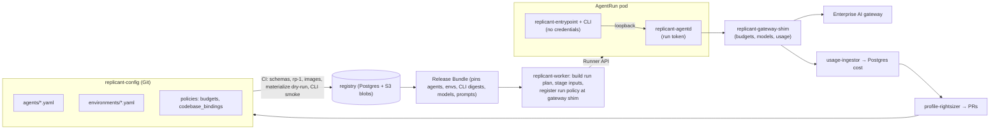

# 03 — Agent Definitions, Tool/Environment Provisioning, and AI Gateway (WS-03)

## Purpose

How native coding CLIs (Claude Code, Codex) are configured and invoked inside AgentRuns with nothing committed to
target repositories (D-10); how sandboxes are provisioned with tools and sized from measured baselines (D-12); and how
every model call goes through the internal AI/ML gateway with per-run credentials, attribution, and budgets (D-11).

## Contents

| File | What it specifies |
|---|---|
| [cli-invocation.md](cli-invocation.md) | Pod process model, exact sandbox `$HOME` contents, Claude Code and Codex argv/env/config, the runner entrypoint (`replicant-entrypoint`) and credential sidecar (`replicant-agentd`), exit-code and result contract, reviewer read-only intent, CLI upgrade rollout |
| [agent-definition.md](agent-definition.md) | `AgentDefinition` kind: fields, lint rules, effective limits, examples |
| [environment-definition.md](environment-definition.md) | `EnvironmentDefinition` kind, sidecar services, resource profile derivation procedure (rp-1), right-sizing proposals, image strategy and supply chain |
| [config-publishing.md](config-publishing.md) | `replicant-config` repo layout, CI validation (incl. materialization dry-run and CLI smoke), publish to the registry, bundle references, rollback |
| [gateway.md](gateway.md) | Minimum gateway interface GW-1–GW-17, model catalog with `retires_at`, budget accounts, revocation feeds, `replicant-gateway-shim`, per-run credentials, budgets, rate-limit/budget behavior mid-run, usage export, local stub gateway |
| [gateway-interface.openapi.yaml](gateway-interface.openapi.yaml) | OpenAPI 3.1.1 for the gateway interface (data plane, control, internal) |
| [schemas/](schemas/) | JSON Schemas (Draft 2020-12): `agent-definition`, `environment-definition`, `policy-budgets`, `policy-codebase_bindings`, `common`, `run-inputs` (manifest, single writer `context.stage_inputs`), `run-plan`, `run-outputs` (incl. the 12 QA types), `role-result-{implementer,planner,reviewer,takeover}`, `gateway-usage-event`, `rightsizing-proposal` |
| [examples/](examples/) | Implementer on Claude Code, reviewer on Codex, `qa-runner` (role qa), `contract-probe` (WS-11 contract suite), Next.js environment (Playwright, 40 GiB, Postgres sidecar), Go environment, budgets and bindings policies, run inputs manifest and run plan, run results, outputs index, usage event, right-sizing proposal |
| [ddl/](ddl/) | `cost` schema (owner WS-03; views `job_rollups`, `v_daily_spend`, `v_pr_spend`) and `registry` definition tables (owner WS-03); FORCE RLS via `ops.apply_tenant_rls`, grants on parents to capability roles only (grant model v2) |
| [adr/](adr/) | ADR-03-001 to ADR-03-010 (ADR-03-008 is **Challenge: D-12**) |
| [tools/](tools/) | `validate.py` (schemas incl. WS-01's `graphModifier`, examples, rp-1/rp-2 recompute, negative cases, OpenAPI), `rp1.py` (formulas rp-1 and rp-2), `check_ddl.sh` (DDL on WS-10's framework: isolation, global definitions, partition, views) |

Validation (run from the repository root; all pass as of 2026-10-24, wave 2):

```bash
uv run --with jsonschema --with referencing --with pyyaml --with openapi-spec-validator \
  python spec/03-agents-and-tools/tools/validate.py      # 20 schemas meta-valid (incl. WS-01 graph-definition), example checks, 18 negative cases, OpenAPI
spec/03-agents-and-tools/tools/check_ddl.sh              # cost + registry DDL on WS-10's framework (pgvector pg17): constraints, FORCE RLS isolation, partition isolation
PY=/path/to/ws10-venv/bin/python  # WS-10 venv (schema-management.md §12)
STRICT=1 spec/10-data-platform/tools/validate.sh "$PY"   # authoritative: all owners' DDL; check_grants.py "grants OK", check_rls.py "0 tenant tables without RLS, 0 without FORCE", check_partitions.py "partitions OK"
```

All Mermaid diagrams in this section render with `npx -y @mermaid-js/mermaid-cli@11.4.2`.

## Decisions summary

| # | Decision | Constraint | ADR |
|---|---|---|---|
| 1 | Credential isolation: the per-audience run tokens live only in the `replicant-agentd` sidecar; the agent container (CLI + entrypoint) holds no credential and reaches gateway/MCP/mirror through agentd's loopback proxy | D-21 | [001](adr/001-entrypoint-and-agentd-credential-isolation.md), [006](adr/006-loopback-auth-proxy.md) |
| 2 | Entrypoint, agentd, and the CLI adapter ship inside the pinned CLI image, so CLI upgrades (including flag changes) are configuration | D-10, D-03, CC-1 | [001](adr/001-entrypoint-and-agentd-credential-isolation.md), [004](adr/004-cli-delivery-into-toolchain-pod.md) |
| 3 | Claude Code CLI for every Claude role; Agent SDK reserved | D-10 | [002](adr/002-claude-code-cli-over-agent-sdk.md) |
| 4 | Codex via `codex exec --json --sandbox danger-full-access`; app-server only for evaluation | D-10 | [003](adr/003-codex-exec-over-app-server.md) |
| 5 | Security-relevant CLI config in read-only managed layers (`/etc/claude-code/managed-settings.json`, Codex `-c` overrides); permission mode `dontAsk` with explicit allow/deny | D-10, D-21 | cli-invocation.md §2.3 |
| 6 | Repo instruction files are not auto-loaded; quoted as untrusted context by default | D-10, D-21 | [007](adr/007-repo-instruction-files.md) |
| 7 | Gateway: minimum interface GW-1–12, provided by a thin replicant-owned Go shim in front of the enterprise gateway | D-11 | [005](adr/005-gateway-shim.md) |
| 8 | Budgets: reservation admission in Valkey, bounded overshoot, 402 on exhaustion, `budget_extension` gate | D-11 | [009](adr/009-budget-enforcement-model.md) |
| 9 | Toolchain images prebuilt per build-spec hash, signed, attested; repo-dependent steps at start | D-12, D-21 | [010](adr/010-prebuilt-environment-images.md) |
| 10 | Resource profiles carry evidence; CI recomputes formula rp-2; weekly and failure-triggered right-sizing proposals become PRs a human approves | D-12 | environment-definition.md §5 |
| 11 | **Challenge: D-12 (accepted)**: under Kata, memory requests follow the host-side footprint and equal the limit at a p50 ratio ≥ 0.8; implemented as rp-2 | D-12 (amended) | [008](adr/008-challenge-d12-kata-memory-requests.md) |
| 12 | Inputs have one writer (`context.stage_inputs` writes the manifest; `agents.build_run_plan` writes `run-plan.json`); composed `system-append.md` and `first-message.md` | C-ART §4 | cli-invocation.md §4.4 (R1-067) |
| 13 | One session-resume rule SR-1 (same cycle, identical CLI image digest, < 24 h, ≤ 256 MiB, tree match), owned here | D-14 | cli-invocation.md §2.8 (R2-053) |
| 14 | Run-level turn budget enforced across steering by the entrypoint | D-11 | cli-invocation.md §2.6 (R2-043) |
| 15 | Role `qa` runs WS-05's `replicant-qa` from the `qa-runner` CLI image | D-16 | cli-invocation.md §4.10 (R1-073) |
| 16 | Gateway: embeddings, eval judges, and worker LLM calls are bound service callers; `budget_usd_max` is absolute; unparsed usage fails closed; usage is durable and replayable | D-11 | gateway.md (R2-057/058/060, R1-077) |
| 17 | Memory text is staged once (`memory-injection.json`, purgeable) and joined with `system-append.md` on tmpfs by the entrypoint; the joined prompt is never uploaded or captured | D-21, C-ART | cli-invocation.md §1.4, §4.4 (XD-W2-04-01) |
| 18 | Eval, harness, shadow, and proposer spend goes to budget accounts, never the tenant quota; the tenant quota is required and a platform ceiling caps all tenants | D-11 | gateway.md §6.1, §6.7 (XD-FIX-R2-061, R2-055) |
| 19 | QA outcome follows the verdict: inconclusive (incl. exits 44/45) is `failed`, never `blocked` | C-RUNNER | cli-invocation.md §4.10 (XD-FIX-R1-116, XD-W2-05-01) |
| 20 | agentd heartbeats every 30 s with the disk report and stops the run after 120 s without one | D-21 | cli-invocation.md §5.1 (XD-FIX-R2-030, XD-W2-02-07) |



## Disposition of the WS-09 control review (spec/09-security/control-review.md)

| Item | Disposition | Where |
|---|---|---|
| G-01 credential custody | Kept and made explicit: no token of any audience in the `agent` container; agentd is the only custodian; QA harness uses agentd routes | cli-invocation.md §1.1, §1.2, §5.1; ADR-001 |
| G-02 managed keys | Added `allowManagedPermissionRulesOnly`, `allowManagedMcpServersOnly` + `allowedMcpServers` (verified); additionally moved MCP config to `/etc/claude-code/managed-mcp.json` (exclusive control), dropping `--mcp-config`/`--strict-mcp-config`, which conflict with it | cli-invocation.md §2.1, §2.3, §2.5, F-CC-16 |
| G-07 budget self-approval | `budgets.extension.requesterSelfApproveMaxUsd` (default 0) and `maxExtensionsPerJob` | schemas/policy-budgets.schema.json; gateway.md §6.6 |
| G-10 curated mirrors | Bootstrap endpoints are curated virtual repos; curation policy stated; Go `-mod=readonly`, empty `GONOSUMDB` | environment-definition.md §3.1; cli-invocation.md §1.4, §4.2 |
| G-22 per-audience tokens | agentd holds the token set and binds routes to audiences; gateway shim requires `aud == "ai-gateway"` | cli-invocation.md §5.1; gateway.md §3 GW-2, §5.1 |
| CCR-09-01/02/03 (accepted) | Gateway shim verifies the embedded run grant against the core grant JWKS, enforces token ⊆ grant, consumes the grant revocation list, and records `acting_for` and `grant_jti` on every usage event | gateway.md §3, §5; schemas/gateway-usage-event.schema.json; ddl/cost.sql |
| Disagreements | None | — |

## Must-answer index

| Question | Answer |
|---|---|
| Exactly which files exist in the sandbox home directory when the CLI starts, and what writes them? | [cli-invocation.md §1.4](cli-invocation.md#14-must-answer-exactly-which-files-exist-in-the-sandbox-home-directory-when-the-cli-starts-and-what-writes-them): one layout for all workstreams (XD-FIX-R1-068): inputs under `/replicant/inputs/{manifest.json, run-plan.json, system-append.md, memory-injection.json, first-message.md, context/, qa/}`, joined prompt on tmpfs `/run/replicant/prompt/system-append.md` (never uploaded); managed settings and managed MCP written by the `prepare` init container into read-only `/etc/claude-code`; user-scope files under `/home/agent` (`CLAUDE_CONFIG_DIR=/home/agent/.claude`, `CLAUDE_CODE_PROJECT_DIR_NAME=replicant-workspace`, `CODEX_HOME=/home/agent/.codex`) rewritten by `replicant-entrypoint run` just before the CLI starts; nothing in `/workspace/repo` |
| How is a CLI upgrade rolled out, evaluated, and rolled back? | [cli-invocation.md §7](cli-invocation.md#7-must-answer-how-a-cli-upgrade-is-rolled-out-evaluated-and-rolled-back): new signed CLI image with adapter contract tests → new AgentDefinition versions → candidate bundle → WS-06 CLI eval tier → ramp by bundle assignment → rollback by reassignment; running jobs stay pinned; images stay rollback-able because `svc_release-controller` tags every bundle-referenced image `bundle-ref-<first 20 chars of rb_ body>`, which WS-10's ECR lifecycle never expires |
| How does a reviewer agent run with read-only intent while still executing tests? | [cli-invocation.md §6](cli-invocation.md#6-must-answer-how-a-reviewer-runs-with-read-only-intent-while-still-executing-tests): diff output forbidden by contract, edit tools denied where the CLI allows, tracked-file integrity check (`git write-tree` before/after, `enforce`) voids any modified review, QA is the authority on tests (one rule: reviewers require `workspaceIntegrity: enforce`) |
| What happens when the gateway returns rate-limit or budget-exceeded errors mid-run? | [gateway.md §6.6](gateway.md#66-must-answer-what-happens-when-the-gateway-returns-rate-limit-or-budget-exceeded-errors-mid-run): 429/529 retried by agentd honoring `retry-after`; persistent failure ⇒ exit 21 `GatewayUnavailable` (retryable, session resume); 402 ⇒ non-retryable error to the CLI, finalize with handoff, exit 20 `GatewayBudgetExceeded`, workflow opens `budget_extension` gate; tenant quota ⇒ `TenantBudgetExhausted` → `waiting.reason = tenant_budget_exhausted`; budget-account jobs fail without a gate; the termination message carries the scope prefix `run:`/`job:`/`tenant_period:` and WS-01 calls `budget.tenant_quota_status` for the tenant case |

## Open questions (top; full lists in each file and in `spec/_coordination/open-questions.md`)

| ID | Question | Recommendation |
|---|---|---|
| OQ-03-01 | Enterprise gateway capabilities (refines OQ-00-09) | Shim in front; remove only if GW-1–17 are native |
| OQ-03-03 | Default handling of repo `CLAUDE.md`/`AGENTS.md` | `quote_as_context` |
| OQ-03-04 | Provider data retention and per-tenant data-classification ceilings | `dataClassificationCeiling` in budgets + `zdr` flag per model |
| OQ-03-05 | Price-book source of truth | Enterprise export when available, else contract sheet via admin API |

## Risks

- CLI behavior drift between versions (2.1.302 already changed the `-p` default permission mode). Mitigated by
  mandatory adapter contract tests in the CLI image CI.
- The gateway shim is on the hot path for all agent work (HA design, break-glass runbook).
- Measurement accuracy differs by runtime (cAdvisor gaps under gVisor; guest vs host memory under Kata).

## Interfaces consumed / provided

- **Contract versions cited (FROZEN.md, final):** C-ARCH 2.0.0, C-STATE 2.0.0, C-IDS 2.0.0, C-RUNNER 3.0.0, C-CRD
  2.4.0, C-MSG 2.0.0, C-JOBREQ 2.0.0, C-DEF 3.0.0, C-ART 2.0.0, C-PG 2.0.0 (CCR-02-12 and CCR-03-10 accepted).
- **Consumed:** C-DEF (envelope, references, bundle derivation), C-RUNNER (`RunSpec`, `RunTokenClaims`, sandbox
  listener, run-result envelope), C-CRD (phases, failure reasons, child objects), C-ART (artifact types, prefixes,
  upload semantics), C-IDS (env vars, headers, trace rule, ID formats), C-PG (`cost`, `registry`), C-MSG
  (`budget_extension` gate, steering).
- **Provided:** kind schemas `agent-definition/v1`, `environment-definition/v1`, `policy-budgets/v1`,
  `policy-codebase_bindings/v1`; runtime schemas `run-inputs/v1`, `run-outputs/v1`, role results (implementer,
  planner, reviewer, takeover), `gateway-usage/v1`, `rightsizing-proposal/v1`; gateway OpenAPI; `cost` and registry
  definition DDL; the entrypoint exit-code contract; rp-1/rp-2; activities `agents.build_run_plan`, `budget.*`,
  `agents.stage_inputs`, `cost.record_run`, `cost.batch_spend`, `platform.dependency_health`.
