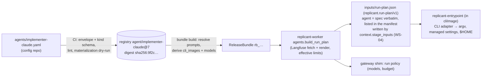

# Agent Definition (`AgentDefinition` kind)

**Workstream:** WS-03 · **Constraints:** D-10, D-11, D-03, D-21 · **Contract:** C-DEF 3.0.0 (envelope, references, kind ownership)
**Schema:** [schemas/agent-definition.schema.json](schemas/agent-definition.schema.json) (`$id`
`https://schemas.replicant.example.com/kinds/agent-definition/v1.json`), shared defs in
[schemas/common.schema.json](schemas/common.schema.json)
**Examples:** [examples/agent-implementer-claude.yaml](examples/agent-implementer-claude.yaml),
[examples/agent-reviewer-codex.yaml](examples/agent-reviewer-codex.yaml)

## Purpose

An agent definition is the versioned, immutable, CLI-agnostic description of one native-CLI invocation: which CLI
(pinned by image digest), which model, which Langfuse prompts, which tools and MCP servers, which limits, how the
CLI reaches the AI gateway, how it is steered and resumed, and what it must produce. It contains no secrets and no
URLs (C-DEF §2). The sandbox entrypoint shipped inside `cliImage` turns it into CLI flags and user-scope files
(cli-invocation.md).

## Decisions summary

| Decision | Reference |
|---|---|
| The kind schema validates the **whole document** (`allOf` the C-DEF envelope) so CI needs one validation call per file | C-DEF §4.2 |
| Everything security-relevant is abstract (`tools`, `mcpServers`, `gateway.protocol`); CLI-specific escape hatches (`claudeCode.extraSettings`, `codex.extraConfig`) cannot touch permissions, hooks, MCP, env, models, or instruction loading | D-21; cli-invocation.md §2.4, §3.1 |
| Required C-DEF fields map as: `cli`, `cliImage` (digest), `model`, `prompts`, `tools`, `mcpServers`, `limits`, `gateway`, `steering.live`, `outputContract` | C-DEF §2 |
| Reference fields (`prompts.*`) are marked `x-replicant-ref: prompt`; models are gateway model IDs (exact snapshots) collected into `ReleaseBundle.spec.models` | C-DEF Risks, §4.3 |
| `cliImage.version` is required because `ReleaseBundle.spec.cli_images[]` needs `{cli, version, image}` and the bundle builder derives it from agents | C-DEF §5 |
| Web tools are always off (`const: false`) | D-21; F-CC-14 |
| Reviewer/planner roles cannot produce a diff (schema), and lint requires `workspaceIntegrity` for reviewers | §5 |



## 1. Field reference

| Field | Required | Meaning | Consumed by |
|---|---|---|---|
| `roles[]` | yes | Run roles served (`planner`, `implementer`, `repair`, `reviewer`, `qa`, `takeover`, `eval`) | Runner admission (role ∈ roles), workflow |
| `workloadClass` | yes | Default `RunSpec.workload_class` | workflow, runtime selection (WS-02) |
| `cli` | yes | `claude-code` \| `codex` \| `claude-agent-sdk` (eval-only: allowed only in definitions scoped to tenant `replicant-eval`, §2 rule 2) | bundle (`cli_images[].cli`), entrypoint |
| `cliImage.{image,version,entrypointVersion}` | yes | Digest-pinned CLI image; must be `…/replicant/cli-claude-code@sha256:` or `…/replicant/cli-codex@sha256:` matching `cli`; labels must match versions | bundle, controller (image pull), CI |
| `model.primary`, `fallbacks[]`, `small`, `subagent`, `parameters` | primary | Gateway model IDs; parameters map to CLI knobs (`MAX_THINKING_TOKENS`, `model_reasoning_effort`, …) | bundle `models`, gateway run policy, entrypoint |
| `prompts.role{ref,mode}`, `constraints`, `task`, `finalize` | role, task | Langfuse selectors resolved at bundle build; rendered by the worker | bundle `prompts`, worker |
| `tools.{read,edit,shell,web,subagents,denyTools}` | yes | Capability model rendered per CLI | entrypoint adapter |
| `mcpServers[]{name,service,tools,required,toolTimeoutSeconds}` | yes (may be empty) | Replicant MCP services only (`memory`, `context`, `code_search`) | entrypoint, agentd routes, Runner token audiences/scopes |
| `limits.{maxTurns,maxWallSeconds,maxCostUsd,maxModelCalls,maxInputTokens,maxOutputTokens,startupSeconds,finalizeSeconds,cliGraceSeconds}` | first three | Upper bounds; the workflow derives `RunSpec.timeouts` and `limits.max_cost_usd` as the min of these and policy | workflow, entrypoint, agentd |
| `gateway.{protocol,retry,requestTimeoutSeconds,softBudgetFraction,unavailableAfterSeconds}` | protocol | How the CLI reaches the gateway via agentd | entrypoint, agentd |
| `env` | no | Extra non-secret env; protected names rejected | entrypoint |
| `steering.live` | yes | Live steering capability (contracts ADR-010) | Runner (`steering_not_supported`), workflow |
| `session.{capture,resumable}` | capture | Session capture policy (D-14) | entrypoint, WS-04 |
| `outputContract.{roleResultSchema,structuredResult,outputs,diffPolicy,workspaceIntegrity}` | first three | What the run must/may/must not produce | entrypoint, uploader, workflow |
| `claudeCode.*` / `codex.*` | per CLI | CLI-specific knobs (Codex block required for `cli: codex`) | entrypoint adapter |

## 2. Semantic rules beyond JSON Schema (CI lint, `tools/validate.py` implements the first group)

1. `tools.edit` must be false when every role is in `{reviewer, planner}`; reviewers must set `workspaceIntegrity:
   enforce` (the single rule, R1-090; `detect` is for other roles that only want a flag).
2. Codex agents cannot use `tools.shell.mode: allowlist`; `codex.mode: app_server` and `cli: claude-agent-sdk` are
   allowed only in definitions scoped to tenant `replicant-eval` (ADR-003, ADR-002, XD-03-11). Both are **eval-only
   capabilities**: the bundle build sets the bundle's `eval_only` flag when any definition in its closure uses either
   (XD-FIX-R1-151), so such a bundle can never be assigned to production tenants; `editPaths` requires
   `edit: true`; role `qa` requires `qaHarness`.
3. `prompts.role.mode: replace` only for `planner` and `reviewer` (Claude Code default system prompt carries tool
   guidance implementers need).
4. Every model ID must have a price-book entry in every environment's registry at publish time (gateway would deny
   an unpriced model, gateway.md §11).
5. The CLI image must exist in ECR, carry a valid cosign signature from the Replicant CLI-image key, an SLSA
   provenance attestation, and labels `org.opencontainers.image.version == cliImage.version` and
   `replicant.example.com/entrypoint-version == cliImage.entrypointVersion` (checked via `registry.image_verifications`).
6. `limits.maxWallSeconds + startupSeconds + finalizeSeconds ≤ 28800 + 1800 + 1800` (C-RUNNER bounds).
7. `mcpServers[].name` unique; `required: true` servers must be reachable from every network profile the agent may
   run under (cross-checked against `network_profiles` policy at bundle build).
8. Materialization dry-run (config-publishing.md §2 step 7) must succeed for every role in `roles`.
9. Model IDs are the provider's exact published IDs (current Claude IDs are undated, e.g. `anthropic/claude-sonnet-5-5`;
   C-DEF §4.3 step 3) and none may retire inside the bundle's expected assignment window (WS-06 calendar
   `registry.model_retirements`, imported daily from the gateway catalog's `retires_at`, gateway.md §4.4; R1-084,
   XD-FIX-XD-ORCH-01).

## 3. WS-03 worker activities: contracts (R1-071, XD-01-04)

All run on task queue `replicant-jobs` (`replicant-worker`, WS-01 places them; logical activity IDs per C-IDS §2.1, using
`implement` as the example node key).

| Activity | Logical ID effect | Input | Result | Side effects |
|---|---|---|---|---|
| `agents.build_run_plan` | `.plan` (`implement.c0.n1.plan`) | `{job_id, tenant_id, run_id (precomputed), role, node_key, cycle, ordinal, release_bundle_id, agent_ref, environment_ref, resource_profile, workflow_type, steering_requested, deterministic, received_at}` | `{run_plan: {name: "run_plan", key, sha256, size_bytes}, audiences: [..], scopes: [..], network_profile, resource_profile, timeouts: {startup_seconds, active_deadline_seconds, finalize_seconds}, max_cost_usd, isolation_hint?, max_output_bytes?, steering_live, models: [..], max_turns, budget_account?}`. `audiences` and `scopes` use the C-RUNNER `RunGrantClaims` enums (`scopes` ⊆ `gateway:invoke, memory:read, memory:search, context:read, code_search:read, repo:fetch, inbox:read, credentials:aws`), derived from the agent's MCP servers and role; WS-01 copies them into `RunSpec` and the run grant unchanged (XD-FIX-R1-014) | Writes `inputs/run-plan.json` (write-once). Prompt loads: Langfuse by `(name, version)` verified against the bundle digest; **on HTTP 404 only**, the prompt-escrow blob `registry` bucket `blobs/sha256/<digest hex>.json`, digest-checked; a digest mismatch from Langfuse fails closed and never falls back (C-DEF §6, CCR-06-02; R1-083) |
| `budget.allocate_run` | `.alloc` | `{job_id, role, workflow_type, agent_max_cost_usd}` | `{budget_usd, extension_usd, job_cap_usd, job_spent_usd}` | Reads usage-ingestor `GET /internal/v1/spend?job_id=`; applies §3.1. Raises `BudgetExhausted{scope: "job"}` (non-retryable `ApplicationError`) when `budget_usd < 0.10` |
| `budget.tenant_quota_status` | none: default activity ID, so the hourly re-check during a quota wait is never memoized (XD-W2-01-04 ruling) | `{tenant_id, job_id?, raise_if_exhausted: bool = false}` | `{available: bool, period: "yyyy-mm", spent_usd, limit_usd, resets_at, reason: "ok" \| "tenant_period" \| "tenant_day" \| "platform" \| "tenant_quota_unset"}` | Reads the same quota the shim enforces (control-plane-api `GET /internal/v1/tenants/{tenant_id}/gateway-quota` plus usage-ingestor spend); used before starting a run and when a run failed with `tenant_period:`. With `raise_if_exhausted: true` (WS-01's pre-run admission check only) an unavailable quota raises the non-retryable `TenantBudgetExhausted{resets_at, contact_group}` (`contact_group` = the tenant's admin group; WS-07 is asked to add `contact_group` to the gateway-quota response, XD-W2-03-05; until then the activity reads it from the tenant record), which WS-01 maps to `waiting.reason = tenant_budget_exhausted` (XD-FIX-R2-020); jobs bound to a budget account skip this check. With the default `false` it never raises and returns `available: false`, which is what WS-01's wait loop re-probes with, so the wait is not ended early (R1V-009) |
| `budget.apply_extension` | `.extend` | `{job_id, decision_id, extension_usd}` | `{job_cap_usd}` | Refuses an extension that would exceed `min(budget_usd_max, jobHardCapUsd)` (R2-060); `PUT /internal/v1/jobs/{job_id}/budget` on the shim (idempotent by `decision_id`) |
| `agents.stage_inputs` | `.stage_agent` | `{run_id, tenant_id, job_id, role, release_bundle_id, models, budget_usd, max_concurrency, expires_at, budget_account?, stub?}` | `{policy_registered: true}` | `PUT /internal/v1/runs/{run_id}/policy` on the shim. Writes **no** inputs objects and never the manifest (`context.stage_inputs`, WS-04, is the single manifest writer, XD-FIX-R1-067) |
| `cost.record_run` | `.cost` | `{run_id, tenant_id, job_id, RunStatus, run_result usage, resolved resources, runtime_class, parent_job_id?}` (`parent_job_id` from ReplicantJob state) | `{}` | `POST /internal/v1/run-usage` on usage-ingestor (`cost.run_resource_usage`; `parent_job_id` stored on `cost.job_costs`, XD-FIX-R2-062; `repo_id`/`pr_number` come from `jobs_read.jobs`, XD-ORCH-05) |
| `cost.batch_spend` | `.batch_spend` | `{batch_job_id, tenant_id}` | `{spent_usd}` | Reads `cost.job_costs` (tenant context set) summing `llm + worker_llm + compute` over jobs with `parent_job_id = batch_job_id`; called before each wave of child starts; the batch stops at `repair_limits.maintenance.max_batch_usd` (default 2000) (XD-FIX-R2-062) |
| `platform.dependency_health` | `.dep_health` | `{dependency: "ai-gateway" \| "repo-mirror" \| "exec-node-pool", tenant_id}` | `{dependency, state: "closed" \| "half_open" \| "open", since?, reason?}` | Module `replicant_gateway_client.health`; rules in gateway.md §11.1 (XD-FIX-R2-012) |

`GatewayBudgetExceeded` failure messages start with the budget scope `run:`, `job:`, or `tenant_period:`
(cli-invocation.md §4.5 step 7), which WS-01 parses.

### 3.1 Effective values per run

```python
def effective_limits(agent: AgentSpec, budgets: BudgetsPolicy, job: JobBudgetState, role: str,
                     workflow_type: str, policy_deadline_s: int, job_request_cap_usd: float | None) -> Effective:
    b = budgets.resolve(workflow_type)                      # defaults overlaid by byWorkflowType
    # R2-060: the job cap is absolute; extensions and cycle grants never exceed budget_usd_max or jobHardCapUsd.
    job_cap = min(x for x in (job_request_cap_usd, b.job_hard_cap_usd,
                              b.job_base_usd + job.extensions_usd + job.cycles * b.repair_cycle_usd) if x is not None)
    role_cap = b.run_usd_by_role.get(role, agent.limits.max_cost_usd)
    remaining = job_cap - job.spent_usd - job.reserved_for_pending_mandatory_nodes(b.reserve_per_run_usd)
    budget = round(min(agent.limits.max_cost_usd, role_cap, remaining), 2)
    if budget < 0.10:
        raise BudgetExhausted(scope="job")                  # workflow may open budget_extension (gateway.md 6.6)
    return Effective(
        budget_usd=budget,
        max_turns=agent.limits.max_turns,                   # run-level budget, enforced across steering (R2-043)
        active_deadline_seconds=min(agent.limits.max_wall_seconds, policy_deadline_s),
        finalize_seconds=agent.limits.finalize_seconds,
        steering_live=agent.steering.live and run_steering_requested,
        models=agent.model.all_ids(),                       # primary + fallbacks + small + subagent
        audiences=audiences_for(role, agent.mcp_servers),   # ai-gateway, runner-sandbox, repo-mirror + MCP audiences used
    )
```

## 4. Example: implementer on Claude Code

See [examples/agent-implementer-claude.yaml](examples/agent-implementer-claude.yaml). Rendered argv, env, managed
settings, and `$HOME` files: cli-invocation.md §1.4 and §2.

## 5. Example: reviewer on Codex

See [examples/agent-reviewer-codex.yaml](examples/agent-reviewer-codex.yaml). Rendered argv and `config.toml`:
cli-invocation.md §3. Read-only intent: cli-invocation.md §6.

## 6. Versioning and evolution

- A change to any field is a new version (C-DEF digest over the whole document).
- Additive schema changes (new optional fields) keep `replicant.example.com/v1`; the entrypoint ignores unknown
  optional fields only if the field is listed in its compatibility table, otherwise it exits 40
  (`unsupported_agent_field`), so a newer definition is never silently half-applied by an older entrypoint. Bundle
  build checks `cliImage.entrypointVersion` supports every field used (the entrypoint publishes its supported field
  set as image label `replicant.example.com/agent-schema-fields`).
- Breaking changes introduce `replicant.example.com/v2` for this kind (C-DEF envelope).

## Open questions

| Question | Who decides | Options | Recommendation |
|---|---|---|---|
| Should tenants own tenant-scoped agent definitions (own prompts) | WS-06, WS-07 | allowed with full eval / forbidden | Allowed only with a full eval tier (ADR-013 revisit trigger) |
| Per-role model diversity requirement (reviewer on a different family than implementer) | WS-06 | lint / advisory | Lint warning in bundle build |

## Risks

- Prompt-text behavior depends on CLI version-specific system prompts; a CLI upgrade can change agent behavior with no
  definition change other than the digest. Mitigated by the CLI-upgrade eval tier (cli-invocation.md §7).

## Interfaces consumed / provided

- **Consumed:** C-DEF envelope, reference grammar, bundle derivation (`cli_images`, `models`, `prompts`).
- **Provided:** kind schema `agent-definition/v1`, role result schemas, the rendering rules (cli-invocation.md).
