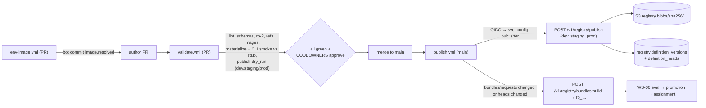

# Config Repository and Registry Publishing

**Workstream:** WS-03 (CI design; publish API owned by control-plane-api / WS-07; bundles by WS-06)
**Constraints:** D-12, D-03, D-02, D-26 · **Contract:** C-DEF 3.0.0 §4 · **DDL:** [ddl/registry-definitions.sql](ddl/registry-definitions.sql)

## Purpose

Specify the Git-backed `replicant-config` repository, the CI that validates every change (schema, policy, references,
images, and a dry-run materialization that runs the real CLI against the gateway stub), the publish into the Postgres
registry as immutable versions, how Release Bundles reference the results, and how rollback works.

## Decisions summary

| Decision | Constraint |
|---|---|
| One repository `replicant-config` holds all authored registry documents for all environments; every environment's registry is published from the same commit (C-DEF §4.2) | D-12, D-03 |
| CI is GitHub Actions; validation runs the same `replicantctl` Python package the registry uses server-side, so CI and publish cannot disagree | D-26 |
| Image digests in definitions are written by CI (bot commit), never by hand; publish re-verifies signatures | D-21 |
| Unpinned selectors resolve to the **head** (the version matching the default branch), not the highest version, so a `git revert` restores the old version as the head (CCR-03-02) | D-03 |
| Publish has a `dry_run` mode used by PR CI against every environment's registry (CCR-03-02, accepted in C-DEF 2.0.0) | C-DEF §4.2 |
| Rollback of behavior is bundle reassignment (seconds); rollback of a definition is a revert commit (new head, same old digest) | D-02, D-03 |



## 1. Repository layout

```
replicant-config/
├── CODEOWNERS                         # GENERATED from metadata.owners (replicantctl codeowners); CI fails if stale
├── replicantctl.lock                    # pinned replicantctl version + kind schema digests
├── agents/
│   ├── implementer-claude.yaml        # kind AgentDefinition, scope global
│   └── reviewer-codex.yaml
├── environments/
│   ├── nextjs-app.yaml                # kind EnvironmentDefinition (image.resolved written by CI)
│   └── go-service.yaml
├── graphs/                            # WS-01 GraphDefinition
├── policies/
│   ├── global/
│   │   ├── budgets.yaml               # policyType budgets (WS-03)
│   │   ├── codebase-bindings.yaml     # policyType codebase_bindings (WS-03)
│   │   └── …                          # other policy types (owners per C-DEF §2)
│   └── tenants/
│       └── payments/
│           ├── budgets.yaml           # tenant layer (tightening only, ADR-013)
│           └── codebase-bindings.yaml
├── tenants/
│   └── payments/
│       └── agents/…                   # tenant-scoped definitions (metadata.scope.level: tenant)
├── bundles/
│   └── requests/main.yaml             # WS-06 ReleaseBundleRequest
├── baselines/
│   └── nextjs_app/repos.yaml          # resource-profile baseline repo selection (environment-definition.md 5.1)
├── prompts/                           # NOT authoritative: Langfuse is. Optional mirror for review only
└── .github/workflows/
    ├── validate.yml
    ├── env-image.yml
    ├── publish.yml
    └── rightsize-proposals.yml
```

Rules: one document per file; file path must equal `<kind dir>/<metadata.name>.yaml` (tenant-scoped under
`tenants/<tenant_id>/…`, tenant policies under `policies/tenants/<tenant_id>/`); YAML 1.2 core schema, no anchors,
aliases, tags, or duplicate keys (C-DEF §4.1 rule 3, enforced by `yamllint` config `replicant-strict` plus the
canonicalizer); deleting a file removes the head (pinned references keep resolving).

## 2. CI validation (`validate.yml`, every PR)

| Step | Tool | Fails when |
|---|---|---|
| 1 Canonicalize | `replicantctl canon` (ruamel.yaml in YAML 1.2 safe mode → JSON → RFC 8785 JCS) | anchors/aliases/tags, duplicate keys, non-string keys, integers beyond ±2^53, floats where the kind schema does not declare `number` |
| 2 Envelope + kind schema | `replicantctl validate` (jsonschema Draft 2020-12, schemas pinned by digest in `replicantctl.lock`) | any schema error |
| 3 Semantic lint | `replicantctl lint` | agent rules (agent-definition.md §2), environment rules (rp-1/rp-2 recompute, `profileByRole` targets, `sizeLimit ≤ limits.ephemeralStorage`), budgets tightening for tenant layers, bindings resolve to definitions of the right kind, no secret values (gitleaks + entropy check + "only `secretRef` objects may name secrets"), no URLs outside the allowlisted internal service names (WS-09 list), model IDs not ending in `latest` |
| 4 CODEOWNERS freshness | `replicantctl codeowners --check` | generated file differs |
| 5 References dry-run | `POST /v1/registry/publish` with `"dry_run": true` against dev, staging, prod (CCR-03-02) | any reference unresolvable in any environment, or graph compile failure against declared NodeCatalogs |
| 6 Images | `cosign verify --key awskms:///alias/replicant/<env>/image-signing` and `cosign verify-attestation --type slsaprovenance1` for every digest (CLI, environment, base, service); label checks (agent-definition.md §2 rule 5); `image.resolved.buildSpecDigest == sha256(JCS(image.build))` | any failure |
| 7 Materialization dry-run | for each changed agent × each role × each bound environment: build a synthetic run plan (`replicantctl plan --agent … --environment … --role …`, same Python code as `agents.build_run_plan` with a stub Langfuse returning the pinned prompt versions), then `docker run <cliImage> /opt/replicant/bin/replicant-entrypoint materialize --plan plan.json --out /out --print-argv` | entrypoint rejects the plan (unknown field, filtered key, unsupported CLI feature); output diff vs the committed golden (`tests/materialized/<agent>.<role>.json`) is not approved |
| 8 CLI smoke | in a kind-free container (Docker in the CI runner, not in sandboxes): environment image + tools from the CLI image + `replicant-gateway-shim --upstream-backend script` + script `smoke-<role>.yaml`; run `replicant-entrypoint run` end to end on a fixture repo | exit ≠ 0, `run_result` invalid, or a planted repo `CLAUDE.md`/`AGENTS.md`/`.mcp.json`/`.claude/settings.json` was loaded |
| 9 Diff summary | `replicantctl diff --against registry:prod` posts a PR comment: which versions will be created, which bundles' closures change, which tenants are affected | never fails |

Required checks: steps 1–8. Step 7 goldens are updated by running `replicantctl materialize --update-goldens`
locally; their diff is part of review (reviewers see exactly which flags and files change).

## 3. Environment image workflow (`env-image.yml`)

Triggered on PRs touching `environments/**`:

1. `replicantctl env-spec <file>` → `image.build` JSON and `buildSpecDigest`.
2. If `replicant/env-<name>:bs-<hex12>` exists in ECR, reuse its digest; else build with
   `docker buildx build --platform <platform> --attest type=sbom --attest type=provenance,mode=max --push -t …`, then
   `syft` SBOM, `grype` gate, `cosign sign` and `cosign attest` (environment-definition.md §7.4).
3. Bot commit to the PR updating `image.resolved` (`image`, `buildSpecDigest`, `sbomDigest`, `builtAt`). The bot is
   the repository's GitHub Actions identity; branch protection allows its commits only to `image.resolved` paths
   (enforced by step 3 of `validate.yml`: a PR whose human commits touch `image.resolved` fails).

## 4. Publish (`publish.yml`, on push to `main`)

```yaml
name: publish
on:
  push:
    branches: [main]
permissions:
  id-token: write
  contents: read
concurrency:
  group: registry-publish
  cancel-in-progress: false
jobs:
  publish:
    runs-on: ubuntu-24.04
    strategy:
      max-parallel: 1
      matrix:
        env: [dev, staging, prod]
    environment: registry-${{ matrix.env }}
    steps:
      - uses: actions/checkout@v5
      - uses: astral-sh/setup-uv@v6
      - name: Exchange GitHub OIDC token for replicant service token
        run: |
          uv run replicantctl auth exchange \
            --audience https://api.${{ matrix.env }}.replicant.internal \
            --principal svc_config-publisher > "$RUNNER_TEMP/token"
      - name: Publish all documents changed since the last published commit
        run: |
          uv run replicantctl publish \
            --api https://api.${{ matrix.env }}.replicant.internal \
            --token-file "$RUNNER_TEMP/token" \
            --commit "${GITHUB_SHA}" \
            --source config_repo \
            --publish-id-cache ".replicant/publish-ids/${GITHUB_SHA}-${{ matrix.env }}" \
            --all-documents
      - name: Build bundles whose requests or closures changed
        run: |
          uv run replicantctl bundles build \
            --api https://api.${{ matrix.env }}.replicant.internal \
            --token-file "$RUNNER_TEMP/token" \
            --requests bundles/requests/ \
            --if-closure-changed
```

`replicantctl publish --all-documents` sends **every** document in the repository at that commit (C-DEF: atomic per
request; identical content is a no-op), so the registry heads always equal the commit, deletions are detected
(documents absent from the request lose their head), and a partially failed earlier run is healed by the next one.
Request (C-DEF 3.0.0 §4.2): `{publish_id: "pub_<ulid>" (client-generated, idempotent), commit_sha, source:
"config_repo", dry_run: false, documents: [{path, content_yaml}]}`. `replicantctl` mints `publish_id` (ULID) once per
(commit, environment), stores it in the `--publish-id-cache` file (persisted across job re-runs with `actions/cache`
keyed by commit and environment), and reuses it on retries. Server behavior (control-plane-api, C-DEF §4.1 rule 5 "blob, then
index, then row", R1-081):

1. Validate envelope + kind schema + lint (same `replicantctl` package, server-side); resolve references; for
   `source: config_repo` require the full snapshot.
2. For each document: `digest = sha256(JCS(doc))`. If `(kind, scope, name, digest)` exists ⇒ `created: false`,
   existing version. Else `version = max(version) + 1` and:
   1. **blob:** `PutObject blobs/sha256/<hex>.json` with `If-None-Match: *` to the registry bucket (412 with equal
      content is success);
   2. **index:** `PutObject index/<kind>/<scope>/<name>/<version>.json` = `{"digest", "published_at",
      "source_commit"}` with `If-None-Match: *`; a 412 whose existing index object carries a **different digest aborts
      the whole publish** (a version number is never reused for different content);
   3. **row:** `INSERT registry.definition_versions`.
3. Upsert `registry.definition_heads` to the version of each document in the request; set `deleted_at` for heads of
   names absent from the snapshot (their versions remain pinnable).
4. Insert `registry.publish_requests` (keyed by `publish_id`) and `audit.emit(...)` (one audit event per created
   version).
5. Return `[{path, ref, digest, created, head}]` (`head: true` when the document's version is now the head; with
   `dry_run` the same shape describes what would happen). A repeated `publish_id` returns the stored result.

Database identity and tenant context (grant model v2, XD-FIX-R1-160): steps 2–4 run in one transaction as
control-plane-api's registry module role `svc_cpa_registry` (`SET ROLE` per transaction; DML comes from
`r_registry_write`, never from the `svc_control_plane_api` login). The definition tables have FORCE RLS with WS-10's
canonical tenant policy plus a global-row policy (ddl/registry-definitions.sql): global definitions (`tenant_id = ''`)
are written with no tenant set, and each tenant-scoped document is written after
`set_config('replicant.tenant_id', '<tenant>', true)` for its scope, so a publish that touches several scopes switches
the setting before each scope's rows. Readers (replicant-worker, publisher-worker, eval-worker, memory-service, the
control-plane UI) see global rows plus their own tenant's rows.

After a Replicant database restore, lost version rows are rebuilt from the index objects (C-DEF §4.1 rule 5).

## 5. How a Release Bundle references definitions

The bundle request (WS-06) names selectors (`agent/implementer-claude` or `agent/implementer-claude@7`); bindings and
graphs name selectors; bundle build resolves each selector **to the head at build time** (or the exact version), walks
`x-replicant-ref` fields to compute the closure (C-DEF §4.3), and writes pinned references
`{ref: "agent/implementer-claude@7", digest: "sha256:…"}` into `spec.agents`, `spec.environments`, `spec.policies`,
plus the derived `spec.cli_images[] = {cli, version: cliImage.version, image: cliImage.image}` and
`spec.models[] = {gateway_model_id, used_by}`. The Runner and controller then fetch exactly those digests from the
registry blob mirror (C-DEF §6).

## 6. Rollback

| What went wrong | Rollback | Time to effect | Running jobs |
|---|---|---|---|
| New bundle misbehaves | Reassign the previous promoted bundle (control-plane UI, `registry.bundle_assignments`) | next job intake (seconds) | stay on their pinned bundle; offer migration if needed (`job.offer_bundle_migration`) |
| A definition version is harmful | `revoked` state on the version (UI/API) ⇒ new bundle builds cannot select it; `release.notice(bundle_revoked)` to running jobs on bundles containing it (C-DEF §4.1 rule 4) | immediate for new builds; running jobs pause at next safe point | migrate per C-MSG |
| Revert the authored change | `git revert` ⇒ publish ⇒ identical old digest ⇒ old version becomes **head** again (CCR-03-02) ⇒ next bundle build picks it | one CI run | unaffected |
| Bad environment image | Revert the definition (old `image.resolved` digest) as above; images are never deleted while referenced | one CI run | unaffected |

Nothing is ever deleted from the registry or the blob mirror (C-DEF, C-ART `registry` class: bucket policy denies
`DeleteObject`).

## 7. Failure modes

| Failure | Behavior |
|---|---|
| Publish to prod fails after dev and staging succeeded | Matrix is sequential (`max-parallel: 1`); the job fails and is re-run; publish is idempotent (no duplicate versions) |
| Blob written, row insert fails | Orphan blob, swept after 7 days (C-DEF §4.1 rule 5) |
| Two merges race | `concurrency: registry-publish` serializes; heads converge to the later commit because each publish sends the full document set |
| Registry unreachable | Publish job retries 3× with backoff, then alerts `ReplicantRegistryPublishFailed`; heads stay at the last good commit |
| Langfuse label moves after a bundle build | No effect on built bundles (prompt versions pinned with digests) |

## Open questions

| Question | Who decides | Options | Recommendation |
|---|---|---|---|
| Who may merge to `replicant-config` main | WS-09, WS-07 | CODEOWNERS only / plus replicant-admins | CODEOWNERS from `metadata.owners`, plus required review by `replicant-platform` for global scope |

## Risks

- The materialization goldens can become rubber-stamped. Mitigation: the PR comment highlights flag and
  managed-settings changes separately.
- A CLI smoke run uses Docker on the CI runner, not the sandbox runtime; runtime-specific issues surface only in the
  eval tier (WS-06 runs evals on the real execution path).

## Interfaces consumed / provided

- **Consumed:** C-DEF §3–§6 (references, publish API, bundle build, runtime resolution), C-ART `registry` bucket,
  C-PG `registry` (writer control-plane-api).
- **Provided:** repository layout, `replicantctl` CLI, CI workflows, `registry` definition DDL, CCR-03-02.
