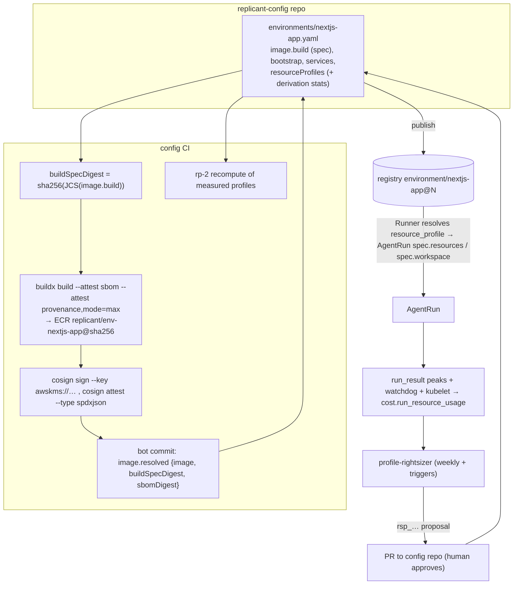

# Environment Definition, Resource Profiles, and Image Strategy

**Workstream:** WS-03 (QA section: WS-05) · **Constraints:** D-12, D-07 (as amended by ADR-014), D-06, D-16, D-21
**Schema:** [schemas/environment-definition.schema.json](schemas/environment-definition.schema.json) (`$id`
`https://schemas.replicant.example.com/kinds/environment-definition/v1.json`)
**Examples:** [examples/environment-nextjs-app.yaml](examples/environment-nextjs-app.yaml) (Next.js, Playwright,
40 GiB workspace, Postgres sidecar), [examples/environment-go-service.yaml](examples/environment-go-service.yaml)
**Formula implementation:** [tools/rp1.py](tools/rp1.py)

## Purpose

Define declaratively, outside target repos, everything a sandbox needs to work on a codebase: the toolchain image
(pinned by digest, built from a declared spec), workspace bootstrap steps, environment, caches, sidecar services,
and resource profiles derived from measured baselines. Local and production read the same documents (D-12, D-20).

## Decisions summary

| # | Decision | Constraint | ADR |
|---|---|---|---|
| 1 | Toolchain images are **prebuilt** by config CI from a declared build spec and pinned by digest in the definition (`image.resolved`); only repo-dependent steps (dependency install, codegen) run at sandbox start (`bootstrap`) | D-12, D-03 | [ADR-010](adr/010-prebuilt-environment-images.md) |
| 2 | The CLI is not in the toolchain image; it arrives from the pinned CLI image via the `tools` volume, so environment and CLI versions vary independently | D-10 | [ADR-004](adr/004-cli-delivery-into-toolchain-pod.md) |
| 3 | Resource profiles carry their **evidence** (`derivation.baseline.stats`) and CI recomputes them with formula rp-2 (rp-1 plus the Kata memory branch); a profile that does not match its evidence cannot be published | D-12 | §5 |
| 4 | Runtime overhead is **not** added to the profile: WS-02 sets it on the RuntimeClass (`overhead.podFixed`) from the same baseline runs, and Kubernetes adds it to scheduling, cgroup sizing, and eviction ranking (PodOverhead, GA 1.24) | D-12, C-CRD | [verified: https://kubernetes.io/docs/concepts/scheduling-eviction/pod-overhead/, 2026-10-24] |
| 5 | **D-12 as amended by accepted Challenge ADR-008:** under Kata, memory requests follow the measured **host-side** footprint and equal the limit when the p50 footprint ratio is ≥ 0.8 (Kata does not return guest-touched memory by default). rp-2 implements it; gVisor/runc keep requests at the container median peak | D-12 | [ADR-008](adr/008-challenge-d12-kata-memory-requests.md) |
| 6 | Sidecar services are native sidecars on localhost; no Docker socket | D-16, D-21 | §4 |
| 7 | Every image used by a sandbox (base, environment, CLI, service) is signed (cosign, KMS key), has SBOM and SLSA provenance attestations, and is admitted only through Kyverno `ImageValidatingPolicy` in the exec cluster | D-21 | §7.4 |

## 1. Field reference (spec)

| Field | Meaning |
|---|---|
| `codebaseType` | Baseline family for derivation (`go_service`, `nextjs_app`, `node_service`, `python_pipeline`, `python_service`, `jvm_service`, `rust_service`, `docs_site`, `generic`) |
| `image.build.{base,platform,packages,steps,bakeFromRepo}` | Image build spec (authored) |
| `image.resolved.{image,buildSpecDigest,sbomDigest,builtAt}` | Written by CI; publish rejects a mismatch with `sha256(JCS(image.build))` |
| `repo.{fetchDepth,submodules,lfs,sparse}` | Checkout parameters used by prepare |
| `env` | Non-secret env for bootstrap, CLI, and agent shells |
| `packageMirrors[]` | Named mirrors; endpoints come from the environment's bootstrap config (cli-invocation.md §4.2) |
| `bootstrap.{steps,forRoles}` | Repo-dependent setup run by the entrypoint before the CLI |
| `caches[]` | `image` (baked), `workspace` (on the workspace volume), `tmpfs` |
| `services[]` | Sidecar services (§4) |
| `resourceProfiles{name → profile}` | Requests/limits/workspace + `derivation` evidence (§5) |
| `profileByRole` | Which profile each role uses (overridable per codebase binding) |
| `isolationHint{workloadClass → isolation}` | Advisory runtime per workload class |
| `networkProfile{workloadClass → name}` | Network profile names from the `network_profiles` policy |
| `outputs.maxOutputBytes` | Default `RunSpec.limits.max_output_bytes` |
| `budgets.computeUsdPerJob` | Compute dollars per job (decimal USD, default 50; XD-FIX-R2-064). WS-01 checks it before dispatching each run against `cost.run_resource_usage` for the job and fails the job `budget_exceeded` (runner-api has no database, D-23). Workspace size is capped separately by WS-02's runtime-selection `workspace.maxSize` (1 Ti) |
| `resourceProfiles.*.workspace.overflow` | `{policy: never \| auto \| always \| local_only, thresholdSize?}` (deprecated aliases `generic_ephemeral_volume_above` = `auto` and `always_generic_ephemeral_volume` = `always`, with an ignored `storageClassName`, are still accepted with a lint warning, R1V-031); resolved by runner-api (02-execution runner-service.md §3.2): `never`/`local_only` keep emptyDir and fail admission above the pool's local maximum, `auto` overflows to EBS gp3 above `min(thresholdSize, localMaxByPool[pool])` (`sbx-kata 400Gi`, `sbx-kata-metal 800Gi`, `sbx-gvisor 200Gi`), `always` uses gp3. The StorageClass is WS-02's policy value (XD-FIX-R1-050/279) |
| `resourceProfiles.*.memoryRequestPolicy` | `median_peak \| host_footprint \| match_limit`; this definition is its single home (WS-02's runtime-selection policy no longer carries it, XD-FIX-R1-050) |
| `qa` | WS-05-owned section (`schema: replicant.env-qa/v1`) |

## 2. Bootstrap steps

Executed by `replicant-entrypoint run` in order, as uid 10001 in `/workspace/repo/<workingDir>`, with `bash -euo
pipefail -c`, the definition `env` + step `env` + mirror env + cache env, a per-step `timeoutSeconds`, and output
captured to `sandbox_log` (`/replicant/spool/sandbox_log/`). `when.pathsExist` skips non-applicable steps (one
definition serves npm and pnpm repos). A failing step with `onFailure: fail` ends the run with exit 44
(`EnvironmentSetupFailed`, CCR-03-01); `continue` records it in `role_result.bootstrap`. Bootstrap executes repository
code (`postinstall` scripts), so the entrypoint treats everything after the first step as untrusted
(cli-invocation.md §1.2).

## 3. Caches

- **image** caches are populated at image build (`bakeFromRepo` pre-warms dependency caches from a repo's lockfiles;
  the lockfile hashes are part of `buildSpecDigest`, so a changed lockfile rebuilds the image). Read-mostly; misses
  write to the container overlay and count against `ephemeral-storage`.
- **workspace** caches (`GOCACHE`, `npm_config_cache`, `PNPM_STORE_DIR`, `.next/cache`) live on the workspace volume
  and count against `workspace.sizeLimit`; they vanish with the pod (D-07: scratch).
- **tmpfs** caches count against the memory limit.
- Cross-run persistent caches (shared volumes, snapshots) are out of scope for v1 (D-06: snapshots are not
  persistence). The package mirror (Artifactory/Nexus) is the cross-run cache for downloads.

### 3.1 Package mirrors: curated virtual repositories only (control-review G-10, SC-36)

`packageMirrors` names ecosystems; the endpoint for each is set per environment in the sandbox bootstrap config
(cli-invocation.md §4.2) and is always a **curated virtual repository** (`npm-virtual`, `pypi-virtual`, `go-virtual`,
`maven-virtual`, `cargo-virtual`), never a raw `*-remote` repository. WS-02 operates the mirror; WS-09 owns the
curation policy (spec/09-security/agent-capabilities.md §7); WS-05 uses the same endpoints for QA builds. The policy
Replicant relies on:

| Control | Setting |
|---|---|
| Access | Anonymous read on virtual repos only, from the exec VPC endpoint; no deploy permission |
| Upstreams | Only `registry.npmjs.org`, `pypi.org`, `proxy.golang.org`, Maven Central, `index.crates.io`; no generic or VCS remotes |
| Go | `GOPROXY=<go-virtual>`, `GONOSUMDB=` empty, `GOFLAGS=-mod=readonly`; the mirror never fetches from origin VCS |
| Freshness quarantine | Versions published less than 72 h ago are not served; exceptions per package by a security approver |
| Malicious packages | Blocked from the OSV `MAL-*` feed (or the vendor equivalent) |
| First-seen names | Blocked in curated mode for `implementer`/`qa` runs of tenants marked `restricted`; logged for all |
| Rate limit | ≤ 50 cache misses per run per minute |

Consequence for agents: a dependency added by the agent that is younger than 72 h or first-seen fails to install;
the bootstrap or test step fails with the mirror's 403/404, and the agent reports it as `blocked` with kind
`missing_access` (role result) so the requester can request an exception. Feature availability in the installed
Artifactory edition is `[unverified]` per WS-09; their fallback (a replicant-owned resolver proxy such as Verdaccio or
devpi in front of Artifactory) changes only the endpoint values in the bootstrap config, not definitions.

## 4. Sidecar services (with WS-05)

- Rendered by the controller as **native sidecars** (`initContainers[]` with `restartPolicy: Always`), so they start
  before the agent container and stop after it. For non-QA roles `readiness` becomes the sidecar's `startupProbe`; for
  role `qa` **no** `startupProbe` is rendered and the `replicant-qa` harness waits for readiness itself, so a broken
  service yields a classified report (exit 45) instead of `SandboxStartTimeout` (XD-05-14, XD-02-15, R1-074). Containers in a pod
  share the network namespace, so services listen on `127.0.0.1:<port>`; definitions use ports ≥ 1024 and run as
  non-root (exec cluster Pod Security `restricted`).
- `forRoles` limits which runs get the service (default `[qa]`); implementers that run integration tests opt in.
- Resource requests of services are added to the pod by the controller (the resource profile covers the agent
  container only); the derivation procedure measures services separately (§5.3).
- Service data lives **under the enforced workspace** at `/workspace/.services/<name>[/<subdir>]` (the controller sets
  the variable named in `data.env`, for example `PGDATA`), never a separate emptyDir (XD-02-15). An overrun therefore
  gives `ENOSPC` instead of eviction, and service data is part of workspace sizing: measured baselines include it in
  the workspace peak, and lint requires `workspace.sizeLimit ≥ Σ data.sizeEstimate + 10Gi` for every profile used by
  a role in the service's `forRoles` (R1-074).
- `seed` runs in the agent container after readiness (migrations, fixtures) with the bootstrap rules.
- **Docker-socket approaches (Testcontainers):** no Docker daemon or socket exists in sandboxes (D-21). Test suites
  that use Testcontainers must be configured to use the declared services instead (for example Spring
  `@DynamicPropertySource` reading `DATABASE_URL`, or Testcontainers' "existing container" patterns). WS-05 owns the
  final answer, including whether Kata QA pools may run rootless Podman inside the guest for image builds.

## 5. Resource profile derivation (procedure)

This is a procedure a team runs, not guidance. Formula version **rp-2** ([tools/rp1.py](tools/rp1.py) `derive_rp2`;
rp-1 remains valid for profiles already published with it); every
measured profile records `formulaVersion` and its inputs, and CI recomputes it (`tools/validate.py`
`lint_environment`).

### 5.1 Step 1: choose baseline repositories

For each `codebaseType` in use: select **5 repositories** spanning the size distribution of that type in the
service catalog (WS-04 ecosystem): the 10th, 30th, 50th, 70th, and 90th percentile by
`(lockfile dependency count, tracked bytes)` rank. Record them in `baselines/<codebaseType>/repos.yaml` in the config
repo. Reselect yearly or when the type's repo count changes by 25%.

### 5.2 Step 2: run the baseline suite

- Suite: the WS-06 golden tasks for these repos, run as an `EvalSuite` in tenant `replicant-eval` with
  `baseline: true`, for each role that will use the profile (implementer, repair, reviewer, qa) and for each
  RuntimeClass the type will run under (`replicant-kata-clh`, `replicant-gvisor`, …).
- Measurement profile `measure-xl`: requests = limits = 16 CPU, 64 GiB memory, 200 GiB workspace, overflow
  `always`, so no run is constrained by the profile being measured.
- Sample size: **at least 30 successful runs per (codebaseType, role, runtimeClass)** across the 5 repos (≥ 6 per
  repo). Runs that fail for non-resource reasons are excluded; runs that fail with `OOMKilled` or
  `WorkspaceDiskExceeded` under `measure-xl` are investigated (likely a runaway task), not counted.

### 5.3 Step 3: measure per-run peaks

| Quantity | Definition | Source |
|---|---|---|
| CPU peak | Maximum over the run of the 60 s average CPU of the agent container, millicores | Prometheus recording rule `replicant:sandbox_cpu_millicores:rate60s = 1000 * rate(container_cpu_usage_seconds_total{namespace=~"sbx-.*",container="agent"}[60s])`, then `max_over_time(...[run lifetime])`; under gVisor, where cAdvisor may see only the pod scope (gvisor issue #13067), use `pod_cpu_usage_seconds_total` minus the service containers' series [verified: https://github.com/google/gvisor/issues/13067, 2026-10-24] |
| Memory peak | Peak memory of the agent container cgroup | `run_result.usage.peak_memory_bytes` (cgroup v2 `memory.peak`, read by the entrypoint at finalize; cli-invocation.md §4.7) |
| Host footprint peak | Peak working set of the whole pod on the host (includes VMM/guest kernel or Sentry) | `max_over_time(container_memory_working_set_bytes{container="",pod=~"ar-.*"}[run])` (pod-level cAdvisor series) |
| Workspace peak | High-water mark of bytes used on the workspace volume | watchdog sidecar (WS-02) → `run_result.usage.peak_workspace_bytes` |
| Ephemeral peak | Workspace peak + peaks of all other emptyDirs (`home`, `out`, `spool`, `inputs`) + writable-layer usage | watchdog reports per-volume peaks (XD-03-06); cross-checked against kubelet Summary API `ephemeral-storage` for the pod, since no Prometheus metric exists for pod ephemeral storage [verified: https://kubernetes.io/docs/reference/instrumentation/metrics/, 2026-10-24] |
| Service peaks | Same CPU/memory definitions per service container | cAdvisor per container (or pod scope minus agent under gVisor) |

usage-ingestor stores one row per run in `cost.run_resource_usage` ([ddl/cost.sql](ddl/cost.sql)).

### 5.4 Step 4: compute the profile (rp-2)

Over the per-run peaks for a (codebaseType, role set, runtimeClass): take p50 and p95 (nearest-rank).

| Output | Formula (rp-2) |
|---|---|
| `requests.cpu` | `max(500m, ceil_250m(p50 CPU peak))` |
| `limits.cpu` | `max(requests.cpu, ceil_500m(1.30 × p95 CPU peak))` |
| `requests.memory`, gVisor/runc (`memoryRequestPolicy: median_peak`) | `min(limits.memory, max(1Gi, ceil_256Mi(p50 container memory peak)))` |
| `requests.memory`, Kata (`replicant-kata-clh`, `replicant-kata-fc`) | let `ratio = p50 host footprint / limits.memory`, where host footprint = pod-cgroup working-set peak − Σ service peaks − `overhead.podFixed.memory`. If `ratio ≥ 0.8`: `= limits.memory` (`match_limit`); else `min(limits.memory, max(1Gi, ceil_256Mi(p50 host footprint)))` (`host_footprint`). D-12 as amended (ADR-008, WS-02 B-MEM-01) |
| `limits.memory` | `ceil_512Mi(1.30 × p95 memory peak)` |
| `workspace.sizeLimit` | `max(10Gi, ceil_1Gi(1.30 × p95 workspace peak))` |
| `limits.ephemeralStorage` | `max(ceil_1Gi(1.30 × p95 ephemeral peak), sizeLimit)`: the profile asserts only the A-8 inequality `sizeLimit ≤ limits.ephemeralStorage` and adds no margin of its own (XD-FIX-R1-036) |
| `requests.ephemeralStorage` | `min(limits.ephemeralStorage, ceil_1Gi(p50 ephemeral peak))` |
| RuntimeClass `overhead.podFixed.memory` (WS-02, normative there) | WS-02 runtime-evaluation.md B-OVH-01: Kata `roundup_32Mi(overhead_memory + p95(VMM + virtiofsd RSS))`, gVisor `roundup_32Mi(p95(Sentry + Gofer RSS))`, per runtime class across all types; current values **448Mi** (`replicant-kata-clh`, XD-FIX-R1-278) and 192Mi (gVisor). The baseline runs here only supply the measurements (R1V-106) |
| RuntimeClass `overhead.podFixed.cpu` (WS-02) | `ceil_50m(p95(pod CPU peak − Σ container CPU peaks))`; current `replicant-kata-clh` value **250m** |

The 1.30 factor is D-12's "roughly 30% headroom". CPU and ephemeral requests at the median peak, limits at p95 + 30%,
and the Kata memory branch are D-12 as amended; the runtime overhead is "plus measured runtime overhead" expressed
where Kubernetes accounts for it (Decision 4). The container's ephemeral-storage limit is rendered by the controller as
`limits.ephemeralStorage + H + F + O` (`H = ceil_Gi(0.05 × sizeLimit + 1Gi)`, `F = 8Gi`, `O = ceil_Gi(max_output_bytes)
+ 1Gi`; 02-execution workspace-storage.md §3), so the profile carries no margin (XD-FIX-R1-036). Kata sizing everywhere:
VM memory = Σ container limits + `overhead_memory` 256 MiB (static sizing), RuntimeClass `replicant-kata-clh`
`overhead.podFixed: {memory: 448Mi, cpu: 250m}` (XD-FIX-R1-278); capacity tables use these numbers.

### 5.5 Step 5: fit to the node pool and choose the workspace backing

1. `limits.cpu ≤ 0.45 × allocatable CPU` and `limits.memory ≤ 0.45 × allocatable memory` of the smallest instance type
   in the runtime class's node pool (so at least two sandboxes fit; WS-02 publishes allocatable per pool). If not,
   the type needs a larger pool class; the proposal is flagged `requires_pool_change` and not auto-generated.
2. Workspace backing: proposals set `overflow.policy: auto` (no `thresholdSize`), so runner-api keeps emptyDir up to
   the pool's local maximum (`localMaxByPool`, WS-02) and resolves `backing: genericEphemeralVolume` (EBS gp3 through
   WS-02's `overflowStorageClass`, `reclaimPolicy: Delete`, `WaitForFirstConsumer`, D-07) above it. `local_only` is
   proposed only when the type must never use network storage.
3. The hard-limit `enforcement` is chosen by WS-02 per runtime class (ADR-014); the profile only declares the size.

### 5.6 Step 6: re-measure and propose (continuous)

`profile-rightsizer` (a job in usage-ingestor, Temporal-free CronJob `0 5 * * 1` UTC, plus event triggers) evaluates
each published (environment, profile, runtimeClass) over a **trailing 14-day window** of production runs:

| Trigger | Condition | Action |
|---|---|---|
| `oom_failures` | ≥ 2 `OOMKilled` in 7 days, or ≥ 1% of runs | Proposal immediately: rp-2 over the window with the failed runs' memory set to `limits.memory × 1.25` (censored data) |
| `disk_failures` | ≥ 2 `WorkspaceDiskExceeded` in 7 days, or ≥ 1% | As above for workspace |
| `throttling` | p95 of `cpu_throttled_ratio` > 0.25 | Proposal with `limits.cpu` from rp-2 |
| `scheduled_drift` | ≥ 30 samples and any rp-2 output differs from the current value by > 20% | Proposal |
| `waste` | `1.3 × p95 < 0.6 × limit` for memory or workspace over ≥ 50 samples | Proposal (downsize) |
| `cli_image_change`, `base_image_change`, `runtime_class_change` | A new bundle changes the CLI, the base image major, or the runtime class for the profile | Mark the profile `stale`; schedule a 30-run baseline (§5.2) in `replicant-eval` |

Proposal flow:

1. The rightsizer writes `cost.rightsizing_proposals` (schema `replicant.rightsizing-proposal/v1`,
   [example](examples/rightsizing-proposal.json)) with current and proposed profiles, stats, failure counts, estimated
   cost delta, and a Grafana link. At most one open proposal per profile.
2. A scheduled GitHub Actions workflow in the config repo (`rightsize-proposals.yml`, every 30 min) fetches open
   proposals from control-plane-api (`GET /v1/registry/rightsizing-proposals?state=open`, OIDC → `svc_config-publisher`)
   and opens one PR per proposal that edits the profile and its `derivation` block (`proposalId`, stats, window). It
   uses the workflow's own `GITHUB_TOKEN`; no new GitHub App token holder is introduced (ADR-011).
3. CODEOWNERS (generated from `metadata.owners`) must approve. The PR body shows the evidence table; CI recomputes
   rp-2 from the stats in the diff.
4. Merge publishes a new EnvironmentDefinition version; WS-06 builds a candidate bundle; resource-only changes use the
   smoke eval tier (WS-06 decides); promotion and ramp as usual.
5. Rejected PRs set the proposal `rejected`; the rightsizer will not re-propose the same numbers for 30 days.

### 5.7 Worked example (Next.js implementer, Kata CLH)

From [examples/environment-nextjs-app.yaml](examples/environment-nextjs-app.yaml) `default` profile, 146 runs:

| Stat | p50 | p95 | rp-2 |
|---|---|---|---|
| CPU peak | 2,100m | 3,600m | requests 2,250m; limits ⌈4,680m⌉₅₀₀ = 5 |
| Memory peak (container) | 5.2 GiB | 8.9 GiB | limits ⌈11.57 GiB⌉₅₁₂Mi = 12 GiB |
| Host footprint (Kata) | 10.4 GiB | — | ratio 10.4 / 12 = 0.87 ≥ 0.8 ⇒ requests = limits = 12 GiB (`match_limit`); under gVisor the request would be ⌈5,324.8 Mi⌉₂₅₆ = 5,376 Mi |
| Workspace peak | 18 GiB | 30.5 GiB | sizeLimit ⌈39.65⌉ = 40 GiB |
| Ephemeral peak | 20.5 GiB | 33 GiB | requests 21 GiB; limits max(⌈42.9⌉ = 43, sizeLimit 40) = 43 GiB |

The open proposal [examples/rightsizing-proposal.json](examples/rightsizing-proposal.json) (trigger `disk_failures`)
shows the next iteration: p95 workspace rose to 34.8 GiB, so rp-2 proposes `sizeLimit: 46Gi` (and, with a host
footprint of 12.6 GiB against the new 14,848 Mi limit, `match_limit`).

## 6. Example: Next.js app

[examples/environment-nextjs-app.yaml](examples/environment-nextjs-app.yaml): Node toolchain image with Playwright
Chromium baked in (`image` cache `/opt/ms-playwright`), npm mirror, pnpm/npm bootstrap with `when.pathsExist`,
Postgres 17 native sidecar on `127.0.0.1:5432` (for `qa`, `implementer`, `repair`) with readiness `pg_isready` and a
Prisma migration seed, 40 GiB workspace with `overflow.policy: auto`, three measured
profiles (`default`, `qa`, `review`), Kata CLH hints, and network profiles per workload class. Gateway configuration
for this codebase comes from the agent definitions the codebase binding selects
([examples/policy-codebase-bindings.yaml](examples/policy-codebase-bindings.yaml) → `agent/implementer-claude`,
`agent/reviewer-codex`), and the network profiles include the gateway shim route.

## 7. Image strategy

### 7.1 Layers

| Image | Built by | Contents | Pinned in |
|---|---|---|---|
| `replicant/base-<lang>` (`base-go`, `base-node`, `base-python`, `base-jvm`, `base-rust`, `base-generic`) | Replicant images repo CI, weekly and on CVE | Debian 13 slim, `ca-certificates`, `git`, `bash`, `coreutils`, `zstd`, `tar`, `ripgrep`, `ast-grep` (structural search the context tooling expects, XD-04-02), users `replicant` (10000) and `agent` (10001, home `/home/agent`), group `replicant-io` (10002); language toolchain at pinned versions | `image.build.base` digest |
| `replicant/env-<name>` | config CI from `image.build` | base + packages + image steps (+ `bakeFromRepo` caches) | `image.resolved.image` |
| `replicant/cli-claude-code`, `replicant/cli-codex` | CLI images repo CI | CLI binaries (glibc and musl variants for Claude Code; static musl Codex), `replicant-entrypoint`, `replicant-agentd`, hardened gitconfig. The `cli-claude-code` image used by `qa-runner` also carries WS-05's `replicant-qa`, `replicant-stubgen`, `replicant-redact`, `replicant-svc-wrap`, and `@replicant/qa-web` under `/opt/replicant/lib/node_modules` (pinned release, label `replicant.example.com/replicant-qa-version`; R1-073, XD-05-07, XD-05-19). The `contract-probe` variant (test only) adds `replicant-agentd debug tokens --claims-only` (XD-FIX-R1-254) | `AgentDefinition.cliImage.image` |
| QA additions to environment images (`image.build` of environments whose `qa` section enables them) | config CI | Probe clients used by service readiness (`postgresql-client` for `pg_isready`, `kcat`, `grpcurl`), test reporters the codebase needs (`gotestsum`, JUnit reporters), and for `appKind: web` the Playwright browsers under `/opt/ms-playwright`, fonts (`fonts-noto-core`, `fonts-noto-cjk`), and `@replicant/qa-web` under `/opt/replicant-qa/web` (XD-05-07; WS-05 owns the list, CI lint L-QA-IMG checks the binaries exist in the built image) | `image.resolved.image` |
| `mirror/<upstream path>` | ECR pull-through cache (Docker Hub, ECR Public, Quay, GHCR) | unwrapped service images (postgres, redis, localstack): `<image account>.dkr.ecr.us-east-1.amazonaws.com/mirror/<1–4 path segments>@sha256:<64 hex>`, e.g. `mirror/library/postgres@sha256:…` (XD-FIX-R1-212) | `services[].image` |
| `replicant/svc-<name>` | image CI | the mirrored upstream service image plus one layer with `/usr/local/bin/replicant-svc-wrap`, cosign-signed; used for services whose `serviceOptions.wrapLogs` is true (XD-05-20) | `services[].image` |

### 7.2 Prebuilt and cached by content hash vs install at start

Decision ([ADR-010](adr/010-prebuilt-environment-images.md)): **prebuilt**. `buildSpecDigest = sha256(JCS(image.build))`
is the cache key; the image is tagged `bs-<first 12 hex>` and referenced by digest. Rebuilding an unchanged spec is a
no-op (CI checks ECR for the tag first). Rationale: sandbox-ready p95 < 90 s cannot absorb apt/npm-global installs;
images are scanned and signed once; runs are reproducible. Install-at-start is used only for work that depends on the
checked-out commit (`bootstrap`).

### 7.3 Rebuild cadence

- Base images: weekly (Monday 03:00 UTC) and on critical CVE. Renovate opens bot PRs in the config repo updating
  `image.build.base` digests for every environment; each merge yields new environment versions and a candidate
  bundle (WS-06 smoke tier).
- Environment images: whenever `image.build` changes.
- Images referenced by any non-revoked bundle are retained (WS-10 lifecycle policy).

### 7.4 Supply-chain controls

| Control | Mechanism |
|---|---|
| Build provenance | `docker buildx build --attest type=sbom --attest type=provenance,mode=max` [verified: https://docs.docker.com/build/metadata/attestations/, 2026-10-24] plus `actions/attest` (GitHub attestation, SLSA predicate `https://slsa.dev/provenance/v1`) [verified: https://github.com/actions/attest-build-provenance, 2026-10-24] |
| Signing | every `replicant/*` and `mirror/*` image: `cosign sign --key awskms:///alias/replicant/<env>/image-signing <image@digest>` (KMS key spec `ECC_NIST_P256`, XD-FIX-R1-224; cosign v3.1.4) [verified: https://github.com/sigstore/cosign/blob/main/doc/cosign_sign.md, 2026-10-24] |
| SBOM | `syft <image@digest> -o spdx-json` and `cosign attest --type spdxjson --predicate sbom.spdx.json --key awskms:///…` [verified: https://github.com/sigstore/cosign/blob/main/doc/cosign_attest.md, 2026-10-24] |
| Vulnerability gate | `grype sbom:./sbom.spdx.json --fail-on critical` with an allowlist file (each entry has an expiry ≤ 30 days) |
| Registry | ECR repositories with `IMMUTABLE` tag mutability [verified: https://docs.aws.amazon.com/AmazonECR/latest/userguide/image-tag-mutability.html, 2026-10-24]; upstream service images only through pull-through cache rules into `mirror/` [verified: https://docs.aws.amazon.com/AmazonECR/latest/userguide/pull-through-cache.html, 2026-10-24] |
| Admission | Kyverno 1.19 `ImageValidatingPolicy` (stable; the ClusterPolicy `verifyImages` form is deprecated) in the exec cluster: images under `*/replicant/*` and `*/mirror/*` must carry the Replicant KMS signature and an SLSA provenance attestation; `mutateDigest`/`verifyDigest` on [verified: https://kyverno.io/docs/policy-types/image-validating-policy/, 2026-10-24]. WS-09 owns the policy text |
| Publish-time check | control-plane-api registry verifies signature and provenance for every image digest in a definition before inserting the version (`registry.image_verifications`) |

## Open questions

| Question | Who decides | Options | Recommendation |
|---|---|---|---|
| Per-node local NVMe maximum per pod | WS-02 | — | WS-02 publishes per pool; drives overflow threshold |
| Testcontainers support | WS-05 | sidecars only / rootless podman in Kata guests | Sidecars only for v1 |

## Risks

- Measurement sources differ by runtime (cAdvisor gaps under gVisor, guest vs host memory under Kata). The procedure
  names the source per quantity and per runtime; WS-02 must confirm `memory.peak` inside guests (cli-invocation.md
  §9 U-7).
- Correlated peaks (many builds at once on a node) are not captured by per-run percentiles. Requests at the median
  assume statistical multiplexing; ADR-008 covers the Kata case, and node-level memory pressure evictions are tracked
  (`PodEvicted` rate) as a trigger to revisit.
- Baking dependencies from lockfiles (`bakeFromRepo`) ties an environment image to one repo; use only for very large,
  stable repos.

## Interfaces consumed / provided

- **Consumed:** C-DEF (envelope, `resourceProfiles`, `isolationHint`, `networkProfile`, `qa` required), C-CRD
  (`spec.resources`, `spec.workspace{sizeLimit,backing,storageClassName,enforcement}`), C-RUNNER (`resource_profile`,
  `isolation_hint`, `network_profile`, `max_output_bytes`), ADR-014.
- **Provided:** kind schema `environment-definition/v1`, rp-1/rp-2 (tools/rp1.py), `replicant.rightsizing-proposal/v1`,
  `cost.run_resource_usage`, the base and environment image contracts (uids, paths).
