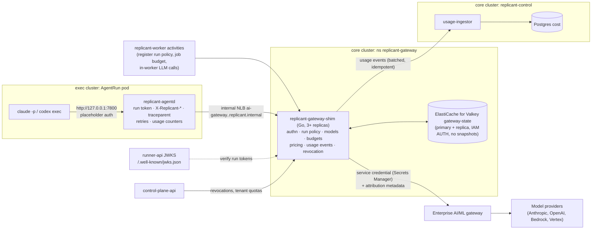
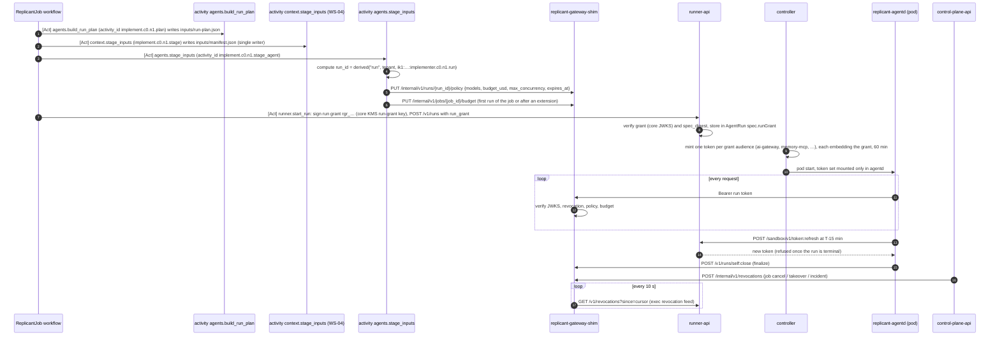

# AI Gateway Integration

**Workstream:** WS-03 · **Constraints:** D-11, D-17, D-21, D-03 (budgets are behavioral), D-20 (local stub)
**Contracts consumed:** C-RUNNER 3.0.0 (`RunTokenClaims`, `RunGrantClaims`, `GET /v1/revocations`, `GatewayBudgetExceeded`/`GatewayUnavailable`), C-IDS 2.0.0 §5/§7 (incl. CCR-03-10 headers), C-PG 1.4.2 `cost`, C-STATE 1.10.1
**Interface provided:** [gateway-interface.openapi.yaml](gateway-interface.openapi.yaml) (validated, OpenAPI 3.1.1)

## Purpose

Route every model call made by a coding CLI (and by in-worker LLM calls) through the internal AI/ML gateway with
per-run scoped credentials, attribution, budgets enforced per run, per job, and per tenant, tenant model allowlists,
and a usage record per request that feeds the cost ledger. OQ-00-09 (does the internal gateway support per-run tokens,
budgets, and usage export?) is **open**, so this document states the **minimum interface Replicant requires**
(GW-1 to GW-17) and specifies a **thin replicant-owned shim** that provides it in front of whatever the enterprise
gateway turns out to support.

## Decisions summary

| # | Decision | Constraint | ADR |
|---|---|---|---|
| 1 | Replicant depends only on GW-1 to GW-15 (§3). `replicant-gateway-shim` implements them; the enterprise gateway is an upstream that needs only a service credential and the provider protocols | D-11 | [ADR-005](adr/005-gateway-shim.md) |
| 2 | The shim is a replicant-owned Go service (`net/http` + `httputil.ReverseProxy`), not LiteLLM or Agent Router: LiteLLM's JWT auth is Enterprise-licensed and its budgets live in its own Postgres; Agent Router charges only after the response with static limits. Replicant needs per-run dynamic budgets taken from a Replicant JWT | D-11, D-17 | [ADR-005](adr/005-gateway-shim.md) |
| 3 | The per-run credential **is** the Runner's run token for audience `ai-gateway` (one token per audience, CCR-09-01; ES256; 60 min; refresh refused after terminal), which embeds the core-signed **run grant** (CCR-09-02) and the `acting_for` principal (CCR-09-03). The shim verifies both signatures and that the token is within the grant. No second credential is minted. No token enters the agent container: agentd injects it (ADR-006, control-review G-01/G-22) | D-11, D-21 | [ADR-006](adr/006-loopback-auth-proxy.md) |
| 4 | Budgets: run budget = token `budget_usd`; job and tenant budgets are counters in the shim's state store; admission denies when `spent + reserved ≥ limit`; per-run in-flight concurrency is capped so overshoot is bounded. Budget exhaustion is HTTP 402 `budget_exceeded`, never 429 | D-11 | [ADR-009](adr/009-budget-enforcement-model.md) |
| 5 | Per-run policy (allowed models, concurrency) is registered by the worker before the run (`PUT /internal/v1/runs/{run_id}/policy`, run_id is computable in advance per ADR-008), so no frozen contract changes | D-03, C-RUNNER | this doc §5.2 |
| 6 | Retries for 429/529/5xx happen in **agentd** (one policy for both CLIs), honoring `retry-after`; CLI retry counts are lowered accordingly | D-11 | §6 |
| 7 | Local mode runs the **same shim binary** with a different upstream backend: `passthrough` (dev key), `record`, `replay` (deterministic cassettes), `script` (fully scripted), plus fault injection | D-20 | §8 |
| 8 | Effective job cap = min(`budget_usd_max`, `jobHardCapUsd`, `jobBaseUsd` + extensions + cycles × `repairCycleUsd`): the requester's cap is absolute | D-11 | §6.1 (R2-060) |
| 9 | Embeddings, worker LLM calls, and eval judge calls all route through the shim as bound service callers with budgets and attribution | D-11 | §5.4 (R2-057, R1-150) |
| 10 | Unparsed usage settles at the reserved estimate and stops admissions above a threshold; break-glass keeps a hard ceiling and never bypasses the shim | D-11 | §6.2a, Risks (R2-058) |
| 11 | Usage is durable before acknowledgement (S3 usage log) and replayable through `cost.ingest_cursor`; Valkey is ElastiCache for Valkey with IAM AUTH, ephemeral | D-09 | §4.1, §9.1 (R1-077, R1-085) |
| 12 | Eval, harness, shadow, and proposer jobs are charged to registered **budget accounts** (`fgw:eval:<eval_run_id>`, `fgw:pipeline:<pipeline_id>`, `fgw:proposal:<prop_id>`), never to the tenant quota; usage events and rollups carry `evaluation_mode` and `budget_account` | D-11 | §6.1, §6.7 (XD-FIX-R2-061) |
| 13 | Three revocation sources, all rejecting within 15 s: the shim's own (`self:close`, control-plane-api), the core grant list (`/grants/revoked`, 60 s), and the exec revocation feed (`GET /v1/revocations`, polled every 10 s) | D-21 | §5.3 (XD-FIX-R2-030, XD-W2-02-03) |
| 14 | The tenant quota is required: the shim denies a tenant with no quota (`tenant_quota_unset`) and enforces a platform-wide daily and monthly ceiling over all tenants | D-11 | §6.1 (XD-FIX-R2-055) |



---

## 1. Verified facts this design relies on

| Fact | Status |
|---|---|
| Claude Code honors `ANTHROPIC_BASE_URL`; `ANTHROPIC_AUTH_TOKEN` is sent as `Authorization: Bearer`; `CLAUDE_CODE_PROPAGATE_TRACEPARENT=1` sends `traceparent` to a custom base URL | [verified: https://code.claude.com/docs/en/env-vars.md, 2026-10-24]; [verified: https://code.claude.com/docs/en/monitoring-usage.md, 2026-10-24] |
| Claude Code retries failed API requests up to `CLAUDE_CODE_MAX_RETRIES` (default 10, cap 15) with exponential backoff | [verified: https://code.claude.com/docs/en/env-vars.md, 2026-10-24] |
| Codex custom providers support only `wire_api = "responses"`; with neither `env_key` nor `requires_openai_auth` Codex sends no auth; `request_max_retries` default 4, `stream_max_retries` 5; HTTP-layer 429 is not retried except with retry advice; `insufficient_quota`/usage-limit codes are terminal | [verified: https://learn.chatgpt.com/docs/config-file/config-reference, 2026-10-24]; source `codex-rs/codex-api/src/api_bridge.rs` @ rust-v0.164.0 |
| Anthropic errors: 429 `rate_limit_error` (not every 429 has `retry-after`), 529 `overloaded_error`, 402 `billing_error`; body `{"type":"error","error":{"type","message"},"request_id"}`; headers `anthropic-ratelimit-*`, `retry-after`; `POST /v1/messages/count_tokens` | [verified: https://platform.claude.com/docs/en/api/errors, 2026-10-24]; [verified: https://platform.claude.com/docs/en/api/rate-limits, 2026-10-24] |
| OpenAI billing 429s carry `error.code` (`credit_balance_exhausted`, `organization_spend_limit_exceeded`, …) with `error.type` possibly `insufficient_quota` | [verified: https://developers.openai.com/api/docs/guides/error-codes, 2026-10-24] |
| LiteLLM proxy 1.106.3: virtual keys, budgets, spend tracking are OSS; JWT auth is Enterprise ("JWT Auth is an enterprise only feature"); budget exceeded returns HTTP 422 `budget_exceeded` by default (`litellm.budget_exceeded_status_code`) | [verified: https://docs.litellm.ai/docs/enterprise, 2026-10-24]; [verified: https://docs.litellm.ai/docs/proxy/token_auth, 2026-10-24]; [verified: https://docs.litellm.ai/docs/proxy/team_budgets, 2026-10-24] |
| Envoy AI Gateway is renamed Agent Router (v1.2.0); usage-based rate limiting charges after the response via the global rate-limit service (Redis) | [verified: https://github.com/theagentrouter/agent-router, 2026-10-24] |
| Kong AI rate limiting by tokens/cost is Enterprise-only | [verified: https://developer.konghq.com/plugins/ai-rate-limiting-advanced/, 2026-10-24] |

---

## 2. What is known about the enterprise gateway (OQ-00-09)

Nothing about the internal gateway's capabilities has been confirmed by its owner. The design therefore treats it as
a black box that is assumed to provide only **E-1 to E-3**:

| ID | Assumed enterprise capability | If absent |
|---|---|---|
| E-1 | Anthropic Messages API and OpenAI Responses API (or Bedrock InvokeModel) pass-through for the models in the tenants' allowlists, with streaming | Replicant cannot use the gateway; the shim's upstream is pointed at providers directly with replicant-held keys (requires a security exception; OQ-03-01) |
| E-2 | Authentication of Replicant as one (or one-per-tenant) service client | Shim holds one credential |
| E-3 | Either a per-request metadata header (for chargeback) or nothing | Shim records attribution itself; reconciliation (§9.3) is by totals |

Everything else Replicant needs is in the shim. If the enterprise gateway is later shown to implement all of
GW-1 to GW-12 itself, the shim can be removed by changing the `ai_gateway` endpoint in the sandbox bootstrap
config (cli-invocation.md §4.2) and the worker's gateway client config; agent definitions, CLIs, and agentd do not
change.

## 3. Minimum gateway interface (normative)

| ID | Requirement | Shim implementation |
|---|---|---|
| GW-1 | **Protocols:** `POST /anthropic/v1/messages` (incl. SSE streaming), `POST /anthropic/v1/messages/count_tokens`, `POST /openai/v1/responses` (incl. SSE); optional `POST /bedrock/model/{id}/invoke[-with-response-stream]` and `POST /vertex/v1/projects/{p}/locations/{l}/publishers/anthropic/models/{m}:{rawPredict\|streamRawPredict}` (every `gateway.protocol` value of the agent definition has a route end to end, R1-080) | §4.3 |
| GW-2 | **Per-run credential:** accept the `ai-gateway` run token (`Authorization: Bearer`); verify the ES256 signature against the Runner JWKS (`/.well-known/jwks.json`, cache ≤ 10 min, C-RUNNER), `iss`, `aud == "ai-gateway"` (single string; during the CCR-09-01 N/N+1 window also an array containing it), `exp`, `scopes ∋ gateway:invoke`, required `acting_for`; verify the embedded run grant (JWS, core `run-grant` key, core grant JWKS cached ≤ 10 min) and that token claims ⊆ grant (`ai-gateway ∈ grant.audiences`, scopes ⊆, `budget_usd ≤ grant.budget_usd`, `exp ≤ grant.exp`, same `tenant_id`/`job_id`/`run_id`/`acting_for`); reject grants on the core grant revocation list and runs that are closed or revoked | §5 |
| GW-3 | **Service credentials** for replicant-worker (`worker_llm`), memory-service (`embedding`), and eval-worker (`eval_judge`, role `eval-judge`, `system:serviceaccount:replicant-eval:eval-worker`) (projected SA tokens, audience `ai-gateway`) with caller-asserted `X-Replicant-Job-Id`/`X-Replicant-Tenant-Id`/`X-Replicant-Pipeline-Id`/`X-Replicant-Role`; tool-carrying `worker_llm`/`eval_judge` requests rejected (G-24) | §5.4 (XD-FIX-R1-150, XD-FIX-R2-063) |
| GW-4 | **Attribution:** every request attributed to `tenant_id`, `job_id`, `run_id`, `role`, `release_bundle_id` from token claims (headers are informational and must match) | §7 |
| GW-5 | **Run budget** from `budget_usd`; **job budget**; **tenant period quota** (required; platform-wide daily and monthly ceilings) or, for registered jobs, a **budget account**; denial is HTTP 402 with `X-Replicant-Budget-Exceeded: run\|job\|tenant_period\|account\|platform` before any upstream call | §6 |
| GW-6 | **Model allowlist** per run (registered policy) and per tenant; denial 403 `model_not_allowed` | §5.2 |
| GW-7 | **Usage export:** one `replicant.gateway-usage/v1` event per request, including denied ones, delivered at least once, idempotent by `event_id`, within 60 s | §9 |
| GW-8 | **Budget visibility:** response headers `X-Replicant-Budget-Run-Limit-Usd`, `X-Replicant-Budget-Run-Spent-Usd`, `X-Replicant-Budget-Job-Spent-Usd`; `GET /v1/budget` | §6.4 |
| GW-9 | **Rate limits:** tenant RPM/TPM/concurrency → 429 with `retry-after` and `X-Replicant-Limit`; upstream 429/529 passed through with `retry-after` preserved | §6.5 |
| GW-10 | **Trace propagation:** accept `traceparent`, emit a server span as its child, forward `traceparent` upstream | §7 |
| GW-11 | **Revocation:** `POST /v1/runs/self:close` (run token), `POST /internal/v1/revocations` (control-plane-api), effective within 5 s on all replicas; plus the core grant revocation list (60 s) and the exec revocation feed `GET /v1/revocations` (10 s poll, rejection within 15 s) | §5.3 |
| GW-12 | **No content retention by the Replicant layer:** the shim never logs request or response bodies; only usage metadata. (Provider retention is the enterprise gateway's/vendor contract's concern, OQ-03-04) | §10 |
| GW-13 | **Embeddings:** `POST /embeddings/v1/embeddings` (default `voyage/voyage-code-4`, 1,024 dims; fallback `openai/text-embedding-3-large` with `dimensions=1024`), memory-service only, budgeted per tenant per day and per backfill pipeline, usage `purpose = embedding` (R2-057, XD-04-03) | §5.4 |
| GW-14 | **Served model:** the provider's response body `model` field is passed through **unchanged** (WS-06's J1 and `served_model_mismatch` read it, XD-FIX-R1-150); the usage event records `served_model`. The informational `X-Replicant-Served-Model` header (trailer for streams) is kept for agentd and logs; no consumer depends on it | §5.4 |
| GW-15 | **Unparsed usage fails closed:** settle at the reserved estimate, cap estimated settlements per minute (R2-058) | §6.2a |
| GW-16 | **Model catalog:** `GET /internal/v1/models` lists every gateway model ID with its upstream name, price-book version, and `retires_at` (from the enterprise catalog, else the provider deprecation page, else null), so `svc_release-controller` imports it daily into `registry.model_retirements` (XD-FIX-XD-ORCH-01) | §4.4 |
| GW-17 | **Budget accounts:** `PUT /internal/v1/budgets/jobs/{job_id}` `{account, cap_usd, evaluation_mode}` (control-plane-api) binds a job to an account; spend of such jobs is charged to the account, not the tenant quota | §6.7 (XD-FIX-R2-061) |

## 4. `replicant-gateway-shim` design

### 4.1 Deployment

| Item | Value |
|---|---|
| Cluster / namespace | core / `replicant-gateway` (new; CCR-03-03 adds it to C-ARCH) |
| Language | Go 1.25, single static binary (D-23 allows Go for services that do not touch the Replicant DB; the shim never connects to Postgres) |
| Replicas | 3 (HPA 3–12 on in-flight streams; each replica handles ≥ 500 concurrent streams; peak need is about 150 runs × ≤ 4 in-flight + worker calls ≈ 700) |
| Ingress | internal NLB `ai-gateway.<env>.replicant.internal:443` (TLS by cert-manager) with security group: sandbox node pools of the exec cluster, core `replicant-workers` nodes |
| Egress | enterprise gateway FQDN only (Cilium FQDN policy) |
| State | Valkey `gateway-state` as **Amazon ElastiCache for Valkey** (WS-10's deployment, adopted per R1-085): node-based, cluster mode disabled, 1 primary + 1 replica across AZs, Multi-AZ automatic failover, in-transit and at-rest encryption, **IAM AUTH** (the shim's EKS Pod Identity role holds `elasticache:Connect` on the replication group and user `gateway-shim`), **no snapshots** (ephemeral by design: C-STATE "rebuilt from PG[cost] after loss"). C-ARCH's row still says "primary + replica, Sentinel ×3"; CCR-03-07 aligns it |
| Durable usage log | Every usage event is appended to `s3://<org>-replicant-<env>-artifacts/platform/gateway-usage/<yyyy>/<mm>/<dd>/<hh>/<pod>-<seq:010d>.ndjson.zst` (one object per pod per ≤ 10 s or 1,000 events; `If-None-Match: *`; retention 7 days, CCR-03-06) **before** the event is considered delivered; usage-ingestor consumes the log and the direct POSTs idempotently (R1-077, XD-10-13) |
| Secrets | enterprise gateway credential from AWS Secrets Manager via External Secrets (`replicant/<env>/ai-gateway/upstream`), rotated by WS-09 |
| Config | `gateway-shim.yaml` (ConfigMap) with keys `listen`, `routes.<name>{prefix, upstream \| upstream_by_model, protocol}`, `model_map`, `catalog` (§4.4), `price_book{source, path}`, `quotas{refresh_interval}`, `auth.run_token{audience, issuers_env, jwks_urls_env}`, `auth.run_grant{issuer_env, jwks_url_env, revocation_url_env}`, `auth.service_tokens_file_env` (local only), `budgets{dev_defaults, embeddings}`, `revocations{exec_feed_urls_env, exec_feed_token_file_env, exec_feed_poll_seconds_env}`, `usage_copy{s3_uri_env}`, and the local-only block `local{dev_keys_env, cassette_roots_env, cassette_layout, miss, record_root}` (rejected by production config validation). These are the keys of WS-11's spec/11-local-dev/compose/config/gateway-shim/gateway-shim.yaml, adopted as normative (XD-FIX-R1-255) |
| Image and command | `replicant/replicant-gateway-shim`, built from `go/cmd/replicant-gateway-shim/Dockerfile`; `replicant-gateway-shim --config=<file> --upstream-backend=<enterprise\|passthrough\|record\|replay\|script> [--replay-match=<sequence\|content>] [--state=<valkey\|local>]`; subcommand `replicant-gateway-shim healthcheck --url <url>`; listens on `0.0.0.0:8420` (Service port 443 → 8420) |
| Environment | `REPLICANT_GATEWAY_STATE_ADDR` (Valkey `host:port`), `REPLICANT_GATEWAY_USAGE_URL`, `REPLICANT_GATEWAY_USAGE_TOKEN_FILE`, `REPLICANT_GATEWAY_USAGE_S3_URI`, `REPLICANT_RUN_TOKEN_ISSUERS` and `REPLICANT_RUN_TOKEN_JWKS_URLS` (comma lists, paired by position: a token is accepted if `iss` is listed and verifies against that issuer's JWKS), `REPLICANT_RUN_GRANT_ISSUER`, `REPLICANT_RUN_GRANT_JWKS_URL`, `REPLICANT_RUN_GRANT_REVOCATION_URL`, `REPLICANT_RUN_GRANT_REVOCATION_POLL_SECONDS` (default 60), `REPLICANT_EXEC_REVOCATIONS_URLS`, `REPLICANT_EXEC_REVOCATIONS_TOKEN_FILE` (local only), `REPLICANT_EXEC_REVOCATIONS_POLL_SECONDS` (default 10), the AWS SDK default credential chain (Pod Identity in EKS; `AWS_SHARED_CREDENTIALS_FILE` locally, XD-W2-11-07), `REPLICANT_CONTROL_PLANE_URL` (quotas; the shim calls `GET /internal/v1/tenants/{tenant_id}/gateway-quota` with its projected SA token, audience `control-plane-api`; locally a static token from `REPLICANT_CONTROL_PLANE_TOKEN_FILE`, and the control-plane-api host must be in `NO_PROXY`, R1V-067), `OTEL_EXPORTER_OTLP_ENDPOINT`; local only: `REPLICANT_GATEWAY_SERVICE_TOKENS_FILE` (static service tokens; production uses projected SA tokens), `REPLICANT_GATEWAY_CASSETTE_ROOTS` (`name=path` comma list), `ANTHROPIC_API_KEY`/`OPENAI_API_KEY`/`VOYAGE_API_KEY` (passthrough and record only) (XD-FIX-R1-253, XD-FIX-R1-255) |

### 4.2 Request pipeline (per data-plane request)

1. **Parse** route → protocol. Reject other paths (404).
2. **Authenticate** (§5): run token (with its embedded run grant) or service token. Unknown, invalid, wrong
   audience, grant signature invalid, token outside its grant, or grant revoked ⇒ 401 `unauthenticated` (agentd refreshes
   its token once and retries).
3. **Revocation and run-state check:** `SISMEMBER fgw:revoked:runs <run_id>` / `fgw:revoked:jobs <job_id>` (cached 5 s
   locally; pub/sub invalidation on channel `fgw:revocations`). The sets merge the shim's own revocations (§5.3) with
   the core grant revocation list keyed by `job_id`/`run_id` (C-RUNNER verifier obligation 3, XD-09-07a) and the exec
   revocation feed (`GET /v1/revocations`, C-RUNNER verifier obligation 5). A run whose lease lapsed, or that reached
   any terminal phase, is revoked by the controller through that feed (`POST /internal/v1/runs/{run_id}:revoke`,
   XD-FIX-R2-030), which is how a lost-but-alive run stops spending (XD-02-03).
4. **Run policy:** `HGETALL fgw:run:<run_id>:policy` (registered by the worker). Missing ⇒ **503 `run_policy_missing`,
   `retry-after: 5`** (retryable: the policy is a derived copy whose owner is the workflow, C-STATE row requested by
   CCR-03-05; replicant-worker re-registers it on its next run poll, §5.2). `budget_usd` differs from the token ⇒ 403
   `run_policy_mismatch`.
5. **Tenant quota** (§6.1): the tenant's cached quota (≤ 60 s) must exist, else 402 `tenant_quota_unset`; jobs bound
   to a budget account (§6.7) skip the tenant quota and are charged to the account.
6. **Read** `model`, `stream`, `max_tokens` (Anthropic) / `max_output_tokens` (OpenAI) from the JSON body (streaming
   JSON decoder, body ≤ 32 MiB). Model not in `policy.models` or not in the tenant allowlist ⇒ 403 `model_not_allowed`.
7. **Tenant rate limits** (§6.5) and **run concurrency** (`INCR fgw:run:<run_id>:inflight` ≤ `max_concurrency`) ⇒ 429.
8. **Budget admission** (§6.2, one Lua call): reserves an estimate against run, job, and the tenant period (or the budget account) plus the platform-wide day and month. Denied ⇒ 402.
9. **Forward** upstream: rewrite `model` to the upstream model name (model map), set the upstream credential and the
   enterprise metadata header (§7), forward `anthropic-version`, `anthropic-beta`, `traceparent`; strip `X-Replicant-*`
   from upstream if the enterprise gateway rejects unknown headers (config).
10. **Stream back** without buffering; tee SSE frames to a usage parser (Anthropic `message_start.message.usage`,
   `message_delta.usage`; OpenAI `response.completed.response.usage`). Non-streaming: parse `usage` from the body. The
   body, including its `model` field, is returned unchanged (only the `model` the client sent is rewritten upstream).
11. **Settle** (§6.2) with the actual cost, decrement in-flight, emit the usage event (§9), record metrics and span.
12. On client abort mid-stream: settle with the tokens seen so far plus the upstream's final usage if it arrives
    within 10 s; otherwise with `max_tokens`-based estimate, status `client_aborted`.

### 4.3 Upstream adapters

| Protocol | Upstream | Notes |
|---|---|---|
| `anthropic_messages` | `${enterprise}/anthropic/v1/messages` (configurable) | Model map, e.g. `anthropic/claude-sonnet-5-5` → `claude-sonnet-5-5` |
| `openai_responses` | `${enterprise}/openai/v1/responses` | `openai/gpt-5-codex-2025-09-15` → `gpt-5-codex` snapshot name per the enterprise catalog |
| `bedrock_invoke` | `${enterprise}/bedrock/model/{id}/invoke…` or AWS Bedrock runtime with SigV4 (role via IRSA) | Optional; enabled only where the enterprise gateway fronts Bedrock |
| `direct_*` (local only) | provider public API with a key from Secrets Manager | Disabled in prod by config validation unless OQ-03-01 resolves to "direct" |
| `embeddings` | `${enterprise}/embeddings/v1/embeddings` (Voyage and OpenAI embeddings behind the enterprise gateway) | GW-13 |
| `vertex_raw_predict` | `${enterprise}/vertex/…` or Vertex AI with a Replicant service account | Optional, like Bedrock |

### 4.4 Model catalog and retirement dates (GW-16, XD-FIX-XD-ORCH-01)

`GET /internal/v1/models` (callers `svc_release-controller`, `svc_control-plane-api`, `svc_replicant-worker`) returns
`{"models": [{"gateway_model_id", "protocol", "upstream_model", "price_book_version", "retires_at", "retires_at_source",
"zdr"}], "as_of"}`. `retires_at` (RFC 3339 or null) comes from the `catalog` block of `gateway-shim.yaml`, refreshed
every 6 h from the enterprise gateway's catalog when it publishes one (`retires_at_source: enterprise_catalog`) and
otherwise maintained by the platform team from provider deprecation notices (`provider_notice`, with the notice URL
in the config). WS-06's `svc_release-controller` imports it daily into `registry.model_retirements`; the shim itself
keeps serving a model until its `retires_at` and then answers 403 `model_not_allowed` with detail `model_retired`.

## 5. Per-run credentials: issuance, TTL, revocation

### 5.1 Lifecycle



| Property | Value |
|---|---|
| Issuer | Runner (ES256 key in KMS), C-RUNNER `RunTokenClaims` (as amended by CCR-09-01/02/03) |
| Authorization root | Core-signed run grant (`rgr_…`, KMS key class `run-grant`, signed by the `runner.start_run` activity) embedded in every token; a compromised exec side can mint only within grants of in-flight runs (WS-09 ADR-09-005) |
| Audience required | exactly `ai-gateway` (per-audience tokens; a memory-mcp or repo-mirror token is rejected here, and an `ai-gateway` token is rejected there) |
| Scope required | `gateway:invoke` (in token and grant) |
| Principal | `acting_for` (requester `usr_…`, or `on_behalf_of` for service-triggered jobs) is recorded on every usage event and gateway span; the gateway does not authorize by it (model access is per tenant and run policy), but chargeback and audit use it |
| TTL | 60 min; agentd refreshes when < 15 min remain |
| Scope of authority | one run: `run_id`, `tenant_id`, `job_id`, `role`, `budget_usd` (≤ grant budget), plus the registered run policy (whose `budget_usd` must equal the token's) |
| Revocation on run end | (a) agentd `POST /v1/runs/self:close` at finalize (≤ 1 s); (b) refresh refused after terminal + finalize window (C-RUNNER) so any copy dies within 60 min; (c) `POST /internal/v1/revocations` by control-plane-api on `job.cancel`, `job.takeover`, tenant suspension, or incident (≤ 5 s); (d) run policy `expires_at`; (e) the core grant revocation list, keyed by `job_id`/`run_id` (not grant `jti`) and polled every 60 s, the C-RUNNER interval (R1-070, XD-09-07a); (f) the exec revocation feed `GET /v1/revocations` on runner-api, polled every 10 s, which lists every run at its terminal phase and every run whose lease expired (XD-FIX-R2-030) |
| Assumed exfiltratable (D-21) | Mitigated: never in the agent container; bound to one run's budget and models; replay from another sandbox only reaches this shim (sandbox-pool SG) and is revoked at run end |

### 5.2 Run policy registration

`PUT /internal/v1/runs/{run_id}/policy` (caller `svc_replicant-worker`) with `{tenant_id, job_id, role,
release_bundle_id, models[], budget_usd, max_concurrency, expires_at}` plus optional `budget_account` (the job's
account, §6.7; must equal the account registered for the job, else 409), `stub` (local and eval-stub backends only,
§8), and `experiment` (Langfuse attributes, XD-06-05). The worker computes `models` as the agent
definition's primary, fallbacks, small, and subagent models, intersected with the bundle's `budgets.gatewayAccess.allow`
minus `deny` (bundle build already guarantees the intersection is the full set). Stored as Valkey hash
`fgw:run:<run_id>:policy` with TTL to `expires_at`. Idempotent: an identical body returns 200; a different body 409.
This keeps the run token claim set as frozen in C-RUNNER while giving the gateway everything it needs.

**Ownership and rebuild (R1-286).** The policy's source of truth is the workflow (the run plan in Temporal state);
the Valkey hash is a derived copy (CCR-03-05 adds the C-STATE row). After Valkey data loss the shim answers 503
`run_policy_missing` (retryable); agentd retries for up to 120 s (then exit 21); and the workflow's run-wait loop
(`runner.get_run` poll, WS-01) calls `GET /internal/v1/runs/{run_id}/policy` with each poll and re-PUTs the policy
from the run plan when it receives 404. The same loop therefore heals every in-flight run within one poll interval
(≤ 120 s, `runner_polling`).

### 5.3 Revocation propagation

Revoked run IDs and job IDs are stored in Valkey sets with TTL ≥ 2 h (token lifetime plus margin) and published on
`fgw:revocations`; every replica keeps a local copy refreshed by pub/sub and a full resync every 30 s. Requests from a
revoked run get 401 `run_closed`; agentd does not retry them.

The sets have three sources, merged by one leader replica (Valkey lock `fgw:revocations:leader`, 30 s TTL) and
written with `SADD` plus a `PUBLISH`:

| Source | Transport | Poll | Keyed by | Rejection latency |
|---|---|---|---|---|
| Shim's own | `POST /v1/runs/self:close`, `POST /internal/v1/revocations` | push | `run_id`, `job_id` | ≤ 5 s |
| Core grant revocation list | `GET <REPLICANT_RUN_GRANT_REVOCATION_URL>` (`/grants/revoked` on the grants host) | 60 s | `job_id`, `run_id` | ≤ 65 s |
| Exec revocation feed (C-RUNNER 3.0.0 verifier obligation 5) | `GET /v1/revocations?since=<cursor>` on runner-api's orchestration listener (`REPLICANT_EXEC_REVOCATIONS_URLS`), over the core → exec PrivateLink, authenticated with the shim's projected SA token (locally `REPLICANT_EXEC_REVOCATIONS_TOKEN_FILE`, XD-W2-11-04); response `{revoked: [{run_id, job_id, at, reason}], next_cursor}`; the cursor is kept in Valkey `fgw:revocations:exec_cursor` and reset to empty (full window) after Valkey loss. The shim never reads the `ops` bucket objects behind the feed (the contract read path wins over XD-W2-09-02, as XD-W2-02-03 states) | `REPLICANT_EXEC_REVOCATIONS_POLL_SECONDS` (10) | `run_id` | ≤ 15 s (XD-FIX-R2-030) |

If a feed is unreachable for more than 3 polls, the shim keeps serving with the sets it has and raises
`ReplicantGatewayRevocationFeedStale` (WS-08 alert on `replicant_gateway_state_errors_total{reason="revocation_feed"}`, XD-W2-03-03); each failed poll increments that counter; it does not fail closed, because the token
TTL (60 min) and the run policy `expires_at` still bound the exposure.

### 5.4 Service callers (in-worker LLM calls, embeddings, evaluation judges)

Service callers use projected ServiceAccount tokens (audience `ai-gateway`, core cluster issuer). Each subject is
bound to purposes and routes (gateway-interface.openapi.yaml):

| Subject | Purpose (`X-Replicant-Purpose`) | Routes | Charged to |
|---|---|---|---|
| `replicant-workers:replicant-worker` | `worker_llm` (router, triage, extraction) | messages, responses, count_tokens | job counter `fgw:job:<job_id>:worker_spent` (cap `budgets.workerLlm.maxUsdPerJob`) and the tenant period |
| `replicant-context:memory-service` | `embedding` (R2-057) | `/embeddings/v1/embeddings`, count_tokens | tenant day counter `fgw:tenant:<t>:emb:<yyyymmdd>` (cap `budgets.embeddings.perTenantDayUsd`), plus `fgw:pipeline:<id>` (cap `reembedBackfillUsdMax`) when `X-Replicant-Pipeline-Id` is sent by the re-embedding backfill |
| `replicant-eval:eval-worker` (`system:serviceaccount:replicant-eval:eval-worker`) | `eval_judge`, with `X-Replicant-Role: eval-judge` (XD-FIX-R1-150, XD-FIX-R2-063) | messages, responses | the budget account of the case's job (`X-Replicant-Job-Id`), registered as `fgw:eval:<eval_run_id>` (§6.7); never the tenant quota |

The shim trusts `X-Replicant-Job-Id`/`X-Replicant-Tenant-Id`/`X-Replicant-Pipeline-Id`/`X-Replicant-Role` for attribution
only from these subjects. For eval-worker, `X-Replicant-Role` must be `eval-judge` and `X-Replicant-Purpose` must be
`eval_judge`; the usage event records `role = eval-judge`, `purpose = eval_judge`, `evaluation_mode = eval`, and the
job's `budget_account`. A judge call whose job has no registered account is refused with 402 `account_unset`.
`worker_llm` and `eval_judge` requests that carry `tools`, `tool_choice`, or server-tool definitions are rejected with
400 `tools_not_allowed` (WS-09 G-24). The response body is passed through unchanged, so its `model` field is the
provider's (WS-06 J1 and `served_model_mismatch` compare it, XD-FIX-R1-150); `X-Replicant-Served-Model` is also set but
is informational. A batch path is **not** offered in v1 (XD-06-06 marked it optional): eval traffic uses the same
routes, rate-limited per tenant `replicant-eval`.

## 6. Budget enforcement

### 6.1 Budget hierarchy and who computes what

| Level | Limit source | Enforced by | Notes |
|---|---|---|---|
| Run | `budget_usd` claim = `RunSpec.limits.max_cost_usd` = min(agent `limits.maxCostUsd`, budgets `runUsdByRole[role]`, remaining job budget − reservations for mandatory nodes not yet run) | shim (hard), Claude Code `--max-budget-usd` (client early stop), agentd soft limit | Computed by workflow activity `budget.allocate_run` (WS-03 node helper, WS-01 places it) reading `cost.job_costs` |
| Job | **effective job cap = min(`JobRequest.constraints.budget_usd_max`, `jobHardCapUsd`, `jobBaseUsd` + approved extensions + cycles × `repairCycleUsd`)** (R2-060). `budget_usd_max` is an absolute ceiling: extensions and repair-cycle grants never raise the cap above it or above `jobHardCapUsd`; an extension request that would exceed either is refused by `budget.apply_extension` and the gate is not opened | shim (`fgw:job:<job_id>:limit`, set by the worker), workflow allocation | Parallel runs of one job (reviewer and QA in parallel) split the remaining job budget by allocation, so the job counter is a backstop. Eval cases rely on `budget_usd_max` as their cap (WS-06) |
| Tenant period | Operational quota in `tenancy`, read by the shim from control-plane-api `GET /internal/v1/tenants/{tenant_id}/gateway-quota` (caller `svc_replicant-gateway-shim`) → `{tenant_id, monthly_budget_usd, daily_budget_usd, platform_daily_usd_max, platform_monthly_usd_max, version, as_of}`, cached ≤ 60 s. **404 ⇒ deny** with 402 `tenant_quota_unset` (a quota is required, XD-FIX-R2-055) | shim | Operational config (ADR-013). A tenant at quota gets 402 `tenant_period` for new requests; WS-01 raises `TenantBudgetExhausted` (§6.6). control-plane-api intake reads `cost.v_daily_spend` and refuses a new job with 429 before it starts |
| Platform | `platform_daily_usd_max` and `platform_monthly_usd_max` from the same response (the platform ceiling, identical for every tenant), enforced against the sum of all tenants' spend in the shim's counters `fgw:platform:<yyyymmdd>` and `fgw:platform:<yyyymm>` | shim | 402 `platform`; operator alert `ReplicantGatewayPlatformCeiling`. Budget-account spend counts toward the platform ceiling |
| Budget account | `cap_usd` registered with the account (§6.7) | shim (`fgw:acct:<account>:{limit,spent,reserved}`) | Replaces the tenant period level for jobs bound to an account (eval, harness, shadow, proposer) |

### 6.2 Admission and settlement (atomic, Valkey Lua)

Levels per request, each a `{limit, spent, reserved}` key triple (micro-USD integers): `fgw:run:<run_id>` (limit =
token `budget_usd`), `fgw:job:<job_id>`, then **either** `fgw:tenant:<tenant_id>:<yyyymm>` and
`fgw:tenant:<tenant_id>:<yyyymmdd>` (production jobs) **or** `fgw:acct:<account>` (jobs bound to a budget account,
§6.7), then `fgw:platform:<yyyymmdd>` and `fgw:platform:<yyyymm>` (the platform ceiling, XD-FIX-R2-055). The caller
passes the levels in that order; the first blocked level names the denial.

```lua
-- KEYS: for each level i (1-based): 3i-2 = limit, 3i-1 = spent, 3i = reserved; last key = reservation hash
-- ARGV: level names (comma-separated, e.g. "run,job,tenant_period,tenant_period,platform,platform"),
--       run_limit (the run level's limit comes from the token), estimate, request_id, ttl_seconds
local names = {}
for n in string.gmatch(ARGV[1], '[^,]+') do names[#names + 1] = n end
local levels = #names
local resv_hash = KEYS[3 * levels + 1]
local function blocked(i)
  local limit = (i == 1) and tonumber(ARGV[2]) or tonumber(redis.call('GET', KEYS[3 * i - 2]) or '')
  if limit == nil then return false end                     -- no limit configured at this level
  local spent = tonumber(redis.call('GET', KEYS[3 * i - 1]) or '0')
  local resv  = tonumber(redis.call('GET', KEYS[3 * i]) or '0')
  return spent + resv >= limit
end
for i = 1, levels do
  if blocked(i) then return {0, names[i]} end
end
local est = tonumber(ARGV[3])
for i = 1, levels do redis.call('INCRBY', KEYS[3 * i], est) end
redis.call('HSET', resv_hash, ARGV[4], est)
redis.call('EXPIRE', resv_hash, tonumber(ARGV[5]))
return {1, 'ok'}
```

All keys of one request share the Valkey slot only in cluster mode; the deployment is cluster mode disabled (§4.1),
so the script runs atomically on the primary. Settlement (`settle.lua`) removes the reservation (`HDEL`, `DECRBY`
every level's `reserved` by the stored estimate) and `INCRBY`s every level's `spent` by the actual cost. The tenant
and platform `limit` keys are written from the cached quota response (§6.1); a missing tenant `limit` key is never
read as "no limit": step 5 of §4.2 has already denied a tenant without a quota. A janitor (every 60 s) releases
reservations older than `requestTimeoutSeconds + 60 s` (crashed replica) and charges their estimate (conservative).
Estimate = `price_in × input_tokens_est + price_out × min(max_tokens, 32000)`, with
`input_tokens_est = request_bytes / 3` (conservative: no cache discount).

**Admission rule:** deny when `spent + reserved ≥ limit`. Requests already in flight complete. **Overshoot bound** per
run: at most `max_concurrency` (default 4) in-flight requests' actual cost, typically under $2 for the default
models; the bound is reported on every denial (`budget.reserved_usd`). This is chosen over "deny if estimate would
exceed" because conservative estimates would otherwise refuse the last legitimate requests of a run that is well
under budget ([ADR-009](adr/009-budget-enforcement-model.md)).

Seeding: on a Valkey failover with data loss, the shim reseeds `run`, `job`, `tenant`, `acct`, and `platform` `spent`
from usage-ingestor (`GET /internal/v1/spend?run_id=` / `?job_id=` / `?tenant_id=&period=` / `?account=` /
`?platform=true&period=`; the shim never connects to Postgres, D-23,
R1-286), lazily on first use of each key. Until a key is reseeded, admissions for it **fail closed** with 503
`gateway_state_unavailable` (retryable); the revoked sets are rebuilt from control-plane-api `/grants/revoked` and
the shim's own revocation log before any admission.

### 6.2a Unparsed usage fails closed (R2-058)

A response whose usage cannot be read (missing `usage`, zero output tokens on a 200 with content, parser error, or a
stream that ends without its final usage event) is **settled at the reserved estimate** (never at zero), the usage
event carries `usage_source = estimated`, and counters `fgw:unparsed:<route>:<minute>` and
`fgw:unparsed:tenant:<t>:<minute>` are incremented. When estimated settlements exceed **N = 20 per minute per route**
(or 5 per minute per tenant), new admissions on that route (or tenant) are denied with 503 `usage_unparsed_limit`
(retryable) and alert `ReplicantGatewayUsageUnparsed` fires (WS-08 rule over the catalogued series `replicant_gateway_requests_total{reason="usage_unparsed_limit"}`, R1V-051); the provider-format contract tests (§Risks) then
identify the change. agentd treats 503 as retryable, so runs wait rather than spend unmetered.

### 6.3 Soft limit and finalize

When `run_spent ≥ softBudgetFraction × budget` (header-visible to agentd), agentd emits IPC `budget_soft_limit` once;
the entrypoint injects the finalize prompt (Claude Code only, cli-invocation.md §2.6) so the agent writes its handoff
while budget remains.

### 6.4 Budget headers

On every data-plane response: `X-Replicant-Request-Id`, `X-Replicant-Budget-Run-Limit-Usd`,
`X-Replicant-Budget-Run-Spent-Usd`, `X-Replicant-Budget-Job-Spent-Usd` (decimal strings with 6 fractional digits). For
streams the spent value is the pre-request figure; agentd adds its own parsed usage to stay current.

### 6.5 Rate limits

| Limit | Key | Default (operational, per tenant in `tenancy`) | Response |
|---|---|---|---|
| Requests per minute | sliding window `fgw:rl:<tenant>:rpm` | 600 | 429, `retry-after`, `X-Replicant-Limit: tenant_rpm` |
| Input+output tokens per minute | `fgw:rl:<tenant>:tpm` (charged at settle) | 4,000,000 | 429, `X-Replicant-Limit: tenant_tpm` |
| Concurrent streams per tenant | `fgw:rl:<tenant>:inflight` | 60 | 429, `X-Replicant-Limit: tenant_concurrency` |
| Concurrent requests per run | `fgw:run:<run_id>:inflight` | policy `max_concurrency` (4) | 429, `X-Replicant-Limit: run_concurrency`, `retry-after: 2` |
| Upstream 429/529 | — | — | passed through unchanged (body, `retry-after`, `anthropic-ratelimit-*`), no `X-Replicant-Limit` |

### 6.6 Must-answer: what happens when the gateway returns rate-limit or budget-exceeded errors mid-run

| Case | agentd | CLI sees | Entrypoint | AgentRun / workflow | User sees |
|---|---|---|---|---|---|
| Upstream 429 (provider rate limit) or 529 overloaded | Retries with `retry-after` if present, else exponential backoff with full jitter (base 1 s, cap 60 s), up to `gateway.retry.maxAttempts` (6) and `maxCumulativeWaitSeconds` (900). Each attempt carries `X-Replicant-Retry-Attempt`. The CLI's request stays open (within `API_TIMEOUT_MS`) | A slow response, normally success | Transcript records `api_retry` notes from agentd | Nothing | Timeline note "Model provider rate limited, waited 1m40s" (from `role_result.budget.rate_limited_seconds`) |
| Same, retries exhausted | Returns the last 429/529 to the CLI | An API error; Claude Code retries up to `CLAUDE_CODE_MAX_RETRIES=4` more times; Codex retries only with retry advice, up to `stream_max_retries` | If the CLI ends with `error_during_execution`/`turn.failed` and agentd reports `gateway_unavailable` (continuous failure > `unavailableAfterSeconds`, 600 s) ⇒ finalize, exit 21 | `Failed / GatewayUnavailable` (retryable). Workflow re-runs the node with ordinal+1, resuming the session (D-14), after a backoff from `repair_limits` | "Model provider unavailable; retrying (attempt 2 of 3)" |
| Tenant quota 429 (`X-Replicant-Limit: tenant_*`) | Same retry path, but `retry-after` from the shim reflects the window; tenant concurrency waits are not counted toward `unavailableAfterSeconds` | Slow response | — | — | "Waiting for tenant model capacity" when waits exceed 60 s |
| Run concurrency 429 | Queues the request locally (FIFO) until an in-flight request finishes | Slow response | — | — | — |
| **Run budget exhausted** (402 `run`) | Never retried. Converts to a protocol-native **non-retryable 400** for the CLI (Anthropic: `{"type":"error","error":{"type":"invalid_request_error","message":"replicant: run budget exhausted"}}`; OpenAI: `{"error":{"type":"invalid_request_error","code":"replicant_budget_exhausted",…}}`) so neither CLI loops on retries; emits IPC `budget_exceeded` | Error ends the turn | Waits ≤ 30 s for the CLI to end the turn, SIGINT, finalize (diff, handoff if written, session capture), exit **20** with termination message prefix `run:` | `Failed / GatewayBudgetExceeded` (non-retryable). Workflow opens a `budget_extension` gate if `budgets.extension.enabled` and fewer than `maxExtensionsPerJob` extensions were approved; the gate has `requester_may_decide: false` unless the requested amount ≤ `requesterSelfApproveMaxUsd` (default 0, control-review G-07); on approve, `PUT /internal/v1/jobs/{job_id}/budget` and a new run (ordinal+1) that resumes the captured session with a fresh run budget; on reject or expiry the job fails with outcome `budget_exhausted` | Approval request "Implementer used its $15.00 run budget. Approve another $10.00?" with cost breakdown |
| Job budget exhausted (402 `job`) | Same as run | Same | exit 20, message prefix `job:` | Same gate, keyed on the job budget; refused when the job cap is already `min(budget_usd_max, jobHardCapUsd)` (R2-060) | Same |
| Tenant period quota exhausted (402 `tenant_period`), platform ceiling (402 `platform`), or no quota (402 `tenant_quota_unset`) | Same | Same | exit 20, message prefix `tenant_period:` | WS-01 parses the prefix and calls activity `budget.tenant_quota_status` (agent-definition.md §3); when `available` is false the activity raises the non-retryable `TenantBudgetExhausted{resets_at, contact_group}`, which WS-01 maps to `JobSnapshot.waiting.reason = tenant_budget_exhausted` (**not** `waiting_human`; XD-FIX-R2-020); the `budget_extension` gate is **not** offered (operational quota); tenant admins notified; the workflow re-checks at `resets_at` or on a quota change and resumes when `available` becomes true | "Waiting: team model budget for October is exhausted" (no ETA, WS-07) |
| Budget account exhausted (402 `account`) | Same | Same | exit 20, message prefix `job:` (the account replaces the tenant level for this job) | Same as job budget, except that no `budget_extension` gate is opened: the eval run, shadow pipeline, or proposal fails the job `budget_exhausted` and its owner (WS-06 eval-worker, WS-07 intake) decides | Eval/shadow report shows the case as budget-limited |
| Claude Code client-side `--max-budget-usd` hit first | — | `result.subtype = error_max_budget_usd` | exit 20 (same handling) | Same as run budget | Same |
| Gateway 401 after refresh (revoked or closed) | No retry | Error | exit 21 if the run was not being cancelled; on cancel the controller already knows | Cancelled or `GatewayUnavailable` | — |
| Shim 503 `gateway_state_unavailable` | Retries like 5xx | Slow / error | as unavailable | as unavailable | operator alert `ReplicantGatewayStateUnavailable` |

### 6.7 Budget accounts (XD-FIX-R2-061)

Jobs that are not production work for the tenant are charged to an account instead of the tenant quota:

| Account key | Jobs | `evaluation_mode` | Registered by |
|---|---|---|---|
| `fgw:eval:<eval_run_id>` | eval cases, harness tasks (XD-FIX-R1-134), and eval-worker judge calls for that eval run | `eval` | control-plane-api intake (eval run start) |
| `fgw:pipeline:<pipeline_id>` | shadow runs of a release pipeline | `shadow` | control-plane-api intake |
| `fgw:proposal:<prop_id>` | proposer jobs (WS-06 improvement proposals) | `eval` | control-plane-api intake |

`PUT /internal/v1/budgets/jobs/{job_id}` (caller `svc_control-plane-api` only) with body
`{"account": "fgw:eval:evr_…", "cap_usd": 400.0, "evaluation_mode": "eval"}` (`evaluation_mode` optional; default by
prefix as in the table). The first registration of an account sets its cap (`fgw:acct:<account>:limit`); a later
registration of another job to the same account must carry the same `cap_usd` or gets 409 `account_cap_conflict`.
Re-registering the same job with the same body returns 200 (idempotent); a different account for a job already bound
returns 409. WS-07 calls it in the intake transaction's after-commit hook and retries until it succeeds, before the
workflow's first run; the run policy registration (§5.2) of a bound job carries the account, and a run of a job whose
`JobRequest` says `evaluation` but which has no account yet gets 503 `account_pending` (retryable).

Spend of a bound job is admitted against `run`, `job`, `acct`, and `platform` (never `tenant`), and its usage events
and rollups carry `evaluation_mode` and `budget_account` (schemas/gateway-usage-event.schema.json, ddl/cost.sql), so
`cost.v_daily_spend` (tenant quota) excludes it while chargeback still attributes it.

## 7. Attribution and trace context

Headers from agentd (C-IDS §7): `X-Replicant-Tenant-Id`, `X-Replicant-Job-Id`, `X-Replicant-Run-Id`, `X-Replicant-Role`,
`traceparent`/`tracestate`; plus `X-Replicant-Retry-Attempt` (CCR-03-04). The shim checks header values equal the token
claims (mismatch ⇒ 401) and uses claims. Upstream, it adds the enterprise gateway's metadata header (configurable;
default `X-Gateway-Metadata: {"app":"replicant","tenant":"payments","job_id":"job_…","run_id":"run_…","role":"implementer"}`)
and `X-Replicant-Request-Id: gwu_…`.

Trace: the shim starts span `gateway.request` (kind SERVER, instrumentation scope `replicant.gateway`) as a child of the
incoming `traceparent` (whose trace id is the job trace, C-IDS T-1), with attributes `replicant.tenant_id`,
`replicant.job_id`, `replicant.run_id`, `replicant.role`, `replicant.request_id` (= `gwu_…`), `replicant.purpose`,
`gen_ai.request.model`, `gen_ai.response.model` (served model), `gen_ai.usage.input_tokens`,
`gen_ai.usage.output_tokens`, `replicant.cost_micros`, and, for eval-case jobs, the Langfuse experiment attributes from
the run policy (XD-06-05). It never records content. Spans are exported via OTLP to `alloy-otlp` in core (XD-08-05,
R1-076). It forwards a child `traceparent` upstream. Claude Code sends `traceparent` with `CLAUDE_CODE_PROPAGATE_TRACEPARENT=1`; Codex sends
it when its trace exporter is configured (cli-invocation.md F-CC-9, F-CX-9); agentd creates one when absent. Spans go
to Tempo via Alloy; Langfuse receives generation observations from the usage event stream (WS-08 decides the export).

## 8. Local stub gateway (D-20)

Local mode runs the **same `replicant-gateway-shim` binary** (production code path for auth, policy, budgets, usage
events) with `--upstream-backend`:

| Backend | Purpose | Behavior |
|---|---|---|
| `passthrough` | Developer runs against real models | Forwards to `api.anthropic.com` / `api.openai.com` with a developer key from `~/.config/replicant/dev-keys.env` (never committed); budgets enforced as in prod (defaults: run $2, job $5) |
| `record` | Create cassettes | Passthrough plus appends each exchange to `<root>/<set>/<key>.ndjson` (one `replicant.gateway-cassette/v1` entry per line, in `seq` order; root `local.record_root`) |
| `replay` | Deterministic tests (CI, WS-11) | Serves recorded responses; no network |
| `script` | Unit/contract tests of entrypoint, agentd, CLIs | Responses generated from a YAML script; supports tool-use turns |
| fault injection (any backend) | Resilience tests | `X-Replicant-Stub-Fault` per request or script-level faults |

Run tokens locally are signed by runner-local's dev key; the shim trusts the issuers and JWKS URLs in
`REPLICANT_RUN_TOKEN_ISSUERS`/`REPLICANT_RUN_TOKEN_JWKS_URLS` (runner-local and the kind runner-api), and run grants from
the local grants host (`replicant-local-core`, `REPLICANT_RUN_GRANT_*`, XD-FIX-R1-253). Valkey runs as a compose service;
usage events go to the local usage-ingestor. Image, command, environment, and config keys are those of §4.1
(XD-FIX-R1-255); the local image is the production image (only config differs).

**Cassette selection (XD-FIX-R1-264).** One layout for WS-03, WS-06, and WS-11: `<root>/<set>/<key>.ndjson`, roots
named in `REPLICANT_GATEWAY_CASSETTE_ROOTS`: `tests` (`tests/fixtures/cassettes`), `evals` (`evals/smoke-local/cassettes`,
set `<gtask>`, key `<agent>`), `scripts` (`tests/fixtures/gateway-scripts`, files `<key>.yaml` in
`replicant.gateway-script/v1`). The run policy body (§5.2) gains the optional
`"stub": {"root": "tests|evals|scripts", "set": "<string ≤ 100>", "key": "<string ≤ 100>"}`, honored only by the
`record`, `replay`, and `script` backends; a production shim (`enterprise` backend) rejects a policy carrying `stub`
with 400 `stub_not_allowed`. replicant-worker fills it when `REPLICANT_GATEWAY_CASSETTE_SET` is non-empty (`root: tests`,
key = logical activity ID without its effect, e.g. `implementer.c0.n1`). For eval-case and harness jobs in local mode
replicant-worker sets `{"root": "evals", "set": <golden_task_id from related.eval_case>, "key": <agent name>}` whenever
the job carries `related.eval_case` (file `evals/smoke-local/cassettes/<golden_task_id>/<agent>.ndjson`, replay only;
XD-W2-06-02 correction row). A miss in any mode is `599 cassette_miss` with the computed keys; for an eval case WS-06
records it as `harness_error`, not a model failure.

**Eval compatibility stub (XD-FIX-R1-134).** WS-06's compatibility checks C1–C4 and C6–C9 run against a
`gateway-stub` Deployment in namespace `replicant-eval` (core cluster): the same image with
`--upstream-backend=script`, config `gateway-shim.yaml` with only the `local` block's `cassette_roots_env` pointing at
a read-only volume of WS-06's scripts (ConfigMap `gateway-stub-scripts`), its own ephemeral Valkey sidecar, 1 replica,
Service `gateway-stub.replicant-eval.svc:443`, NetworkPolicy ingress from `replicant-eval` only and **no egress** except
the run-token JWKS and grant hosts. It accepts only tokens with `tenant_id = replicant-eval` and emits usage events with
`evaluation_mode = eval` and zero cost.

### 8.1 Cassette format and matching

```json
{
  "schema": "replicant.gateway-cassette/v1",
  "seq": 3,
  "protocol": "anthropic_messages",
  "match": {
    "model": "anthropic/claude-sonnet-5-5",
    "tools_hash": "sha256:5f1c…",
    "last_user_content_hash": "sha256:a9d2…"
  },
  "request_body_sha256": "1f0e…",
  "response": {
    "status": 200,
    "headers": {"content-type": "text/event-stream"},
    "sse": [
      {"event": "message_start", "data": {"type": "message_start", "message": {"id": "msg_01", "model": "claude-sonnet-5-5", "usage": {"input_tokens": 1204, "output_tokens": 1}}}},
      {"event": "content_block_start", "data": {"type": "content_block_start", "index": 0, "content_block": {"type": "tool_use", "id": "toolu_01", "name": "Bash", "input": {}}}},
      {"event": "content_block_delta", "data": {"type": "content_block_delta", "index": 0, "delta": {"type": "input_json_delta", "partial_json": "{\"command\":\"go test ./...\"}"}}},
      {"event": "message_delta", "data": {"type": "message_delta", "delta": {"stop_reason": "tool_use"}, "usage": {"output_tokens": 37}}},
      {"event": "message_stop", "data": {"type": "message_stop"}}
    ]
  }
}
```

Matching modes (`--replay-match`):
- `sequence` (default for CLI tests): the n-th request of a run gets cassette `seq = n`, after checking `model` and
  `tools_hash` (hash of sorted tool names). Robust to volatile prompt content (dates, paths, session ids).
- `content`: match on `last_user_content_hash` computed over the last user message after normalization (strip
  ISO timestamps, UUIDs, `run_…`/`job_…` IDs, absolute temp paths). Used for prompt-regression tests.
- A miss returns 599 `cassette_miss` with the computed keys, failing the test loudly (same code in every mode).

### 8.2 Script format

```yaml
schema: replicant.gateway-script/v1
name: implementer-happy-path
protocol: anthropic_messages
turns:
  - expect: {model: anthropic/claude-sonnet-5-5}
    respond:
      tool_use: {name: Bash, input: {command: "go test ./internal/billing/..."}}
      usage: {input_tokens: 1500, output_tokens: 40}
  - respond:
      tool_use: {name: Edit, input: {file_path: /workspace/repo/internal/billing/proration.go, old_string: "math.Round", new_string: "roundHalfEven"}}
  - respond:
      text: "Done."
      structured_output_from: agent_report.json     # file next to the script
  - fault: {status: 429, retry_after: 2}           # exercised on the 4th request
  - fault: {status: 402, replicant_code: budget_exceeded, budget_level: run}
```

## 9. Usage export and the cost ledger

### 9.1 Event flow (durable, replayable: R1-077, XD-10-13)

1. At settlement the shim builds a `replicant.gateway-usage/v1` event (schemas/gateway-usage-event.schema.json).
2. **Durable log first.** It appends the event to the pod's current log segment and, every ≤ 10 s or 1,000 events,
   writes the segment with `If-None-Match: *` to
   `s3://<org>-replicant-<env>-artifacts/platform/gateway-usage/<yyyy>/<mm>/<dd>/<hh>/<pod>-<seq:010d>.ndjson.zst`
   (artifact type `gateway_usage_log`, retention 7 days ≥ the 72 h XD-10-13 requires; registration requested in
   CCR-03-06). A segment is the unit of durability; the shim keeps at most 64 Ki unwritten events in memory and fails
   closed (503 `gateway_state_unavailable`) when S3 writes fail for more than 60 s, so no admitted spend can go
   unrecorded.
3. **Fast path.** The shim also posts batches of ≤ 500 to usage-ingestor `POST /internal/v1/usage-events` every second
   (idempotent on `event_id`, `INSERT … ON CONFLICT (event_id, occurred_at) DO NOTHING`).
4. **Replay path.** usage-ingestor lists new segments per pod stream, ingests them, and advances
   `cost.ingest_cursor` (stream, object key, line offset) in the same transaction. After a database restore it
   resumes from the restored cursor and re-ingests the log; duplicates from the fast path are no-ops by `event_id`.
   Rollups are recomputed for every job touched by replayed events.

Delivery is at least once; the ingestor's p99 lag target is 60 s (C-STATE: rollups ≤ 60 s).

### 9.2 usage-ingestor

Python service (C-ARCH, WS-03 owner), writer of schema `cost` ([ddl/cost.sql](ddl/cost.sql)):
- inserts `cost.usage_events` (through the partitioned parent only; WS-10 maintenance creates and secures partitions);
- updates `cost.run_costs`, `cost.job_costs`, `cost.tenant_daily_costs` in the same transaction, carrying
  `evaluation_mode` and `budget_account` from the event;
- **tenant context:** every `cost` table has FORCE RLS with WS-10's canonical policy (XD-FIX-R1-160), so the ingestor
  groups each batch by `tenant_id` and writes each group with `set_config('replicant.tenant_id', <tenant>, true)` in its
  transaction (`replicant_db.session.tx(tenant_id=…)`); it never uses a cross-tenant scope;
- ingests compute usage per run (`cost.run_resource_usage`) from `RunStatus` terminal notifications relayed by
  replicant-worker activity `cost.record_run` (payload: run_result usage, resolved resources, runtime class, and from
  ReplicantJob state `parent_job_id`, stored on `cost.job_costs`, XD-FIX-R2-062);
- copies `jobs_read.jobs.pr_repo_id` and `pr_number` (filled by replicant-projector; usage-ingestor reads `jobs_read`
  under the same tenant context) into `cost.job_costs.repo_id` and `pr_number` on every `job_costs` upsert, and a
  reconcile pass every 5 min fills rows whose PR was linked after the job's first spend (XD-ORCH-05, XD-FIX-R2-059);
- exposes to control-plane-api (SELECT for `svc_cpa_read`): `cost.job_rollups`, `cost.rightsizing_proposals`,
  `cost.v_daily_spend(tenant_id, day, spend_usd)` (tenant-quota spend: `evaluation_mode = none` only; intake refuses
  with 429 before a job starts, XD-FIX-R2-055) and `cost.v_pr_spend(repo_id, pr_number, spend_usd)` (intake checks
  `budgets.prLifetimeUsd`, XD-FIX-R2-059);
- serves `GET /internal/v1/spend` (shim reseeding, budget allocation), `GET /internal/v1/price-book?version=`, and the
  cost views read by control-plane-api;
- runs the profile-rightsizer (environment-definition.md §5.6) and nightly reconciliation.

### 9.3 Reconciliation

Nightly, if the enterprise gateway offers a usage export (E-3), usage-ingestor compares per tenant and day Replicant
totals with the enterprise totals and writes one `cost.reconciliation_runs` row per tenant and day (under that tenant's
context; platform totals are a sum over rows); a delta above 2% sets `replicant_cost_reconciliation_drift_ratio` and
raises `ReplicantCostReconciliationDrift`.
If the enterprise gateway reports per-request cost in a response header, the shim records `cost.source = upstream`
and that value is authoritative for chargeback.

## 10. Observability (WS-08 owns dashboards)

Metrics (prefix `replicant_gateway_`, labels only from C-IDS §11):
`replicant_gateway_requests_total{tenant,role,outcome,reason}`, `replicant_gateway_request_duration_seconds{tenant,role}`,
`replicant_gateway_ttfb_seconds`, `replicant_gateway_tokens_total{tenant,role,outcome}` (outcome = input|output|cache_read|cache_write),
`replicant_gateway_cost_micros_total{tenant,role}`, `replicant_gateway_budget_denials_total{tenant,reason}` (reason =
run|job|tenant_period), `replicant_gateway_upstream_errors_total{reason}`, `replicant_gateway_inflight{tenant}`,
`replicant_gateway_usage_queue_depth`, `replicant_gateway_state_errors_total{reason}` (`state_store`: Valkey errors;
`revocation_feed`: a failed poll of `/grants/revoked` or `GET /v1/revocations`); usage-ingestor
`replicant_cost_reconciliation_drift_ratio`; control-plane-api registry `replicant_registry_publish_requests_total{outcome}`.
Names, types, and labels follow WS-08's normative catalog (telemetry-model.md §8.4, XD-FIX-R1-195/196).
`replicant_gateway_budget_denials_total{reason}` gains the reason values `account`, `platform`, `tenant_quota_unset`,
`account_unset` (§6), filed with WS-08 in XD-W2-03-03. Exemplars carry `trace_id` and `job_id`.
Logs: one structured line per request with `job_id`, `run_id`, `trace_id` as Loki structured metadata, never bodies.

## 11. Failure modes

| Failure | Effect | Handling |
|---|---|---|
| Shim replica crash mid-stream | CLI sees a broken stream | agentd retries (idempotent for model calls: a fresh request); reservation released by janitor and charged (conservative) |
| Valkey failover | Short write errors | Retry 3× within 2 s; then 503 `gateway_state_unavailable`; reseed counters after failover |
| usage-ingestor down | Fast-path posts fail | Events are already durable in the S3 usage log; the ingestor replays from `cost.ingest_cursor` on recovery; budgets unaffected (counters live in Valkey) |
| Price book missing for a model | Cost unknown | Request denied 403 `model_not_allowed` with detail `unpriced_model` (never run unpriced models) |
| Enterprise gateway down | 502/504 | agentd retries; GatewayUnavailable after 600 s; alert `ReplicantGatewayUpstreamDown` |
| JWKS fetch failure | Cannot verify new keys | Keep cached keys up to 2 h (two token lifetimes overlap per C-RUNNER rotation); alert |
| Run policy missing (Valkey loss, or worker bug) | 503 `run_policy_missing` (retryable) | The workflow's run-wait loop re-registers it within one poll interval (§5.2); agentd retries ≤ 120 s, then exit 21 (retryable); alert `ReplicantGatewayRunPolicyMissing` if it persists (WS-08 rule over `replicant_gateway_requests_total{reason="run_policy_missing"}`, R1V-051) |

### 11.1 Gateway circuit breaker input (XD-FIX-R2-012)

WS-03 implements activity `platform.dependency_health` (task queue `replicant-jobs`, replicant-worker image, module
`replicant_gateway_client.health`). Input `{dependency: "ai-gateway" | "repo-mirror" | "exec-node-pool", tenant_id}`;
output `{dependency, state: "closed" | "half_open" | "open", since?, reason?}`:

| Dependency | Signals | Opens when | Half-open |
|---|---|---|---|
| `ai-gateway` | shim `/readyz` (3 probes, 2 s apart) and the shim's upstream error ratio over 60 s from Mimir (`sum(rate(replicant_gateway_upstream_errors_total[1m])) / sum(rate(replicant_gateway_requests_total[1m]))`) | ratio ≥ 0.5, or `/readyz` fails 3 times in a row | 120 s after opening; one probe decides |
| `repo-mirror` | WS-02/WS-09 repo-mirror `/healthz` | 3 consecutive failures | 120 s |
| `exec-node-pool` | WS-02 controller's `replicant_exec_nodes_not_ready_ratio` | > 0.2 | when ≤ 0.2 for 120 s |

State is kept per worker process for 10 s (shared across jobs); `since` is the first time the current state was seen.
WS-01 treats `GatewayUnavailable`, `RepoFetchFailed`, and `NodeLost` as platform failures while the breaker is open
(no `run_retries` consumed). agentd keeps `GatewayUnavailable` after `unavailableAfterSeconds` (600 s) as the run
failure reason.

## Open questions

| ID | Question | Who decides | Options | Recommendation |
|---|---|---|---|---|
| OQ-03-01 | Does the enterprise gateway provide E-1 to E-3, and will it accept the shim as a single service client? (refines OQ-00-09) | Platform owner of the AI gateway | (a) shim in front (default); (b) gateway implements GW-1–12 natively; (c) direct provider access | (a). Revisit (b) once the owner confirms per-request dynamic budgets from an external JWT |
| OQ-03-04 | Provider data retention (zero-data-retention terms) per model, and the data-classification ceiling per tenant | WS-09 with legal | per-model flag in price book / per-tenant ceiling in budgets | Encode `dataClassificationCeiling` in budgets (already in schema) and a `zdr` flag per model in the price book |
| OQ-03-05 | Source of truth for prices | FinOps | enterprise gateway export / contract sheet | Enterprise export when present, else contract sheet entered via the admin API |

## Risks

- The shim is on the hot path of every model call; an outage stops all agent work. Mitigation: stateless replicas,
  Valkey HA, and a time-boxed **break-glass that keeps a hard ceiling** (R2-058). Break-glass no longer bypasses the
  shim: it switches the shim to `--state=local` for at most `breakGlass.maxMinutes` (default 60, set through
  control-plane-api, two-person approval, `audit.emit`, auto-revert) when Valkey is unavailable. In local mode each
  replica enforces, from its in-memory counters, the run budget divided by the replica count, a per-replica job cap of
  `job_limit / replicas`, and a platform-wide ceiling `breakGlass.maxUsd` (default $500 per activation, split across
  replicas); usage events still flow (and are reconciled into Valkey after it returns). If the shim itself is down,
  there is no bypass: runs pause through the gateway-outage circuit breaker (R2-012, WS-01) instead of spending
  unmetered.
- Budget accuracy depends on the price book; a wrong price silently mis-allocates budget. Mitigation: nightly
  reconciliation, `cost.source = upstream` when available.
- SSE usage parsing depends on provider event shapes; a provider change could zero out usage. Mitigation: unparsed
  usage settles at the reserved estimate and admissions stop above N per minute (§6.2a), plus shim contract tests with
  recorded streams per provider.

## Interfaces consumed / provided

- **Consumed:** C-RUNNER `RunTokenClaims`, `/.well-known/jwks.json`; C-IDS §5, §7, §11; C-PG `cost` (writer
  usage-ingestor), `tenancy` (quotas via control-plane-api `GET /internal/v1/tenants/{tenant_id}/gateway-quota`); C-RUNNER
2.5.2 `GET /v1/revocations` (exec revocation feed); C-CRD failure reasons `GatewayBudgetExceeded`,
  `GatewayUnavailable`; C-MSG gate kind `budget_extension`.
- **Provided:** gateway-interface.openapi.yaml (GW-1 to GW-17), `replicant.gateway-usage/v1`, `cost` DDL (incl.
  `cost.v_daily_spend`, `cost.v_pr_spend`), `replicant.gateway-cassette/v1`, `replicant.gateway-script/v1`, the model
  catalog (`retires_at`), budget accounts, activities `budget.allocate_run`, `platform.dependency_health`,
  `cost.batch_spend`.
