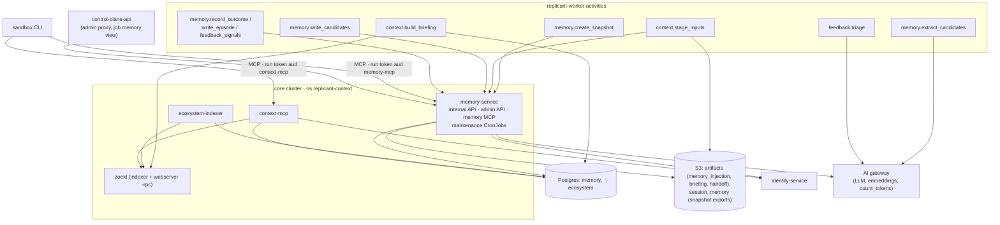

# 04 — Memory System and Context Engineering (WS-04)

## Purpose

Memory decides whether Replicant improves or rots. This section specifies the replicant-owned
memory subsystem (D-14): what is remembered, how it is scoped, written, defended, retrieved,
injected, pinned, evaluated, curated (admins only, D-25), and deleted. It also specifies job
working memory and CLI session continuity, context budgeting, and ecosystem briefings (D-13).

## Decisions summary

| Area | Decision | Constraints | Reference |
|---|---|---|---|
| Types | `rule`, `negative`, `procedure`, `preference` (team scope only), `episode` (pull-only) | D-14 | [taxonomy.md](taxonomy.md), [ADR-04-005](adr/005-preferences-team-scope-only.md) |
| Scope | org → tenant → service group → repo → path, plus facets; deterministic precedence; unresolved conflicts suppressed, never silently resolved | D-14 | [scoping.md](scoping.md) |
| Storage | Postgres `memory`: immutable versions, lifecycle history enforced by triggers (D-25 actor rules in the DB), FORCE RLS on WS-10's vocabulary, halfvec + HNSW per embedding space, weighted FTS | D-09, D-14, D-25, D-26 | [data-model.md](data-model.md), [sql/memory.sql](sql/memory.sql) |
| Write path | Identity-gated extraction from human comment text only, six-gate generalization test, dedupe/merge, contradiction detection, candidate → active under admin-configured policy; repo/path rules auto-activate after merge with 14-day probation and holdout; tenant/org need two admins; episodes hold templated facts only and activate after merge + 24 h | D-14, D-15, D-25 | [write-path.md](write-path.md) |
| Human corrections | Job viewers flag entries; source authors and CODEOWNERs request corrections and see a public provenance view; post-merge reverts and "this was wrong" reports demote what the job taught. All tighten only, under system policy, and queue an admin decision (D-25 unchanged) | D-14, D-25 | [write-path.md §9](write-path.md), [curation-ui.md §4–§6](curation-ui.md) |
| Safety | Containment first (memory cannot change permissions, egress, credentials, gates); 14 content rules + classifier; anomaly detection; one-action quarantine; per-call-site controls for worker LLM calls | D-21, D-25 | [safety.md](safety.md) |
| Retrieval and injection | Scope filter then exact hybrid ranking (RRF FTS + cosine, confidence, recency, outcome) for push; HNSW for episodes; push in the CLI system-prompt slot, pull through a read-only memory MCP; CLI-native memory and repo instruction files disabled | D-10, D-13, D-14 | [retrieval-injection.md](retrieval-injection.md), [ADR-04-002](adr/002-push-pull-and-snapshot-semantics.md), [ADR-04-003](adr/003-embeddings-and-hybrid-retrieval.md), [ADR-04-007](adr/007-injection-slots-and-cli-native-memory.md) |
| Pinning | Snapshot content-addressed over tenant + entries + policy, holdouts per job, subtract-only revocation, as-of pull universe, retrieval log, recorded injection refs and renderer version; exact replay names the source job | D-03, D-14 | [retrieval-injection.md §7](retrieval-injection.md) |
| Working memory | `WorkingMemory` refs in Temporal state; handoff document for every run; session resume only under WS-03's rule SR-1; `context.stage_inputs` is the single writer of the run's inputs manifest | D-01, D-07, D-14 | [working-memory.md](working-memory.md), [ADR-04-001](adr/001-cli-session-continuity-per-role.md) |
| Budgets | Per-role working window (≤ 400k of ~1M), section caps, ≥ 70–85% headroom, exact token counts, recorded cuts | D-14 | [context-budget.md](context-budget.md) |
| Ecosystem | Derived catalog, contracts, dependency graph in Postgres; Zoekt code search; deterministic briefings; compat checks in QA; requester-filtered content | D-13, D-18 | [ecosystem-context.md](ecosystem-context.md), [ADR-04-004](adr/004-ecosystem-graph-in-postgres.md) |
| Evaluation | Fact-based metrics (a merged-then-reverted job is a failure); per-entry randomized holdouts; Bayesian auto-disable; ANN recall probe; curation-queue SLOs; golden-set replay aligned with WS-06 | D-14, D-03 | [memory-evals.md](memory-evals.md) |
| Curation | Admin-only API and UI requirements, read-only job view for others | D-25 | [curation-ui.md](curation-ui.md), [api/memory-service.openapi.yaml](api/memory-service.openapi.yaml) |
| PR replies | Reactions to acknowledge, one reply per thread, templated declines, memory footer, no default thread resolution | D-15 | [pr-replies.md](pr-replies.md) |
| Access | replicant-worker uses the memory-service API only | D-25, C-PG | [ADR-04-006](adr/006-memory-access-via-api-only.md) |

## Files

| File | Content |
|---|---|
| [taxonomy.md](taxonomy.md) | Memory types, sources, delivery, lifetimes |
| [scoping.md](scoping.md) | Scope hierarchy, precedence, conflicts, who writes where, cross-tenant rules |
| [data-model.md](data-model.md) | Schema walkthrough, provenance and telemetry mapping, embeddings, FTS, RLS, audit, purge propagation |
| [write-path.md](write-path.md) | Feedback → candidate → active, generalization test, dedupe, contradictions, lifecycle state machine, evidence |
| [safety.md](safety.md) | Threat model, containment, content rules, anomaly detection, quarantine, rollback timing, worker LLM call sites |
| [retrieval-injection.md](retrieval-injection.md) | Ranking formulas, push vs pull, MCP, rendering, per-CLI slots, capacity, pinning and reproduction |
| [working-memory.md](working-memory.md) | Working memory, handoff, session continuity per role, repair inputs |
| [context-budget.md](context-budget.md) | Budgets per role, measurement, enforcement, overflow |
| [ecosystem-context.md](ecosystem-context.md) | Sources, storage, Zoekt, briefings, MCP, visibility, compat checks, local stubs |
| [memory-evals.md](memory-evals.md) | Metrics, experiments, auto-deprecation, offline replay, component evals |
| [curation-ui.md](curation-ui.md) | Admin operations and data; non-admin read-only view |
| [pr-replies.md](pr-replies.md) | Reply behavior and templates |
| [adr/](adr/) | ADR-04-001 … ADR-04-007 |
| [sql/memory.sql](sql/memory.sql), [sql/ecosystem.sql](sql/ecosystem.sql) | Reviewed target DDL |
| [sql/test_memory.sql](sql/test_memory.sql), [sql/test_ecosystem.sql](sql/test_ecosystem.sql), [sql/test_analytics.sql](sql/test_analytics.sql), [sql/run_tests.sh](sql/run_tests.sh) | Behavioral tests and runner on WS-10's real framework DDL, including `check_partitions.py`, `check_grants.py`, `check_rls.py`, and the model drift check |
| [models/replicant_db/models/memory.py](models/replicant_db/models/memory.py), [models/replicant_db/models/ecosystem.py](models/replicant_db/models/ecosystem.py), [models/check_drift.py](models/check_drift.py) | SQLAlchemy 2.0 models and drift check |
| [models/replicant_context/working_memory.py](models/replicant_context/working_memory.py) | `WorkingMemory` carried-state sketch for WS-01 |
| [schemas/](schemas/) | `handoff`, `memory-injection`, `memory-candidates`, `briefing`, `context-assembly-report`, `memory-snapshot-export`, `memory-governance`, kind schema `policy-memory_snapshot` |
| [mcp/memory-mcp.tools.json](mcp/memory-mcp.tools.json), [mcp/context-mcp.tools.json](mcp/context-mcp.tools.json) | MCP tool definitions (MCP 2026-07-28) |
| [api/memory-service.openapi.yaml](api/memory-service.openapi.yaml) | Internal and admin API |
| [examples/](examples/) | Default snapshot policy (registry document), default governance policy, and example documents for every schema |
| [tools/](tools/) | Re-runnable validators: `validate_examples.py`, `validate_mcp.py`, `parse_mermaid.mjs` |

## Must-answer

**1. A reviewer leaves a bad comment that becomes an active repo rule. How is it detected, and how
fast can it stop affecting new jobs?** It can only become active automatically after the PR merged
with the fix intact, a 24-hour quiet period, and passing generalization, grounding, and content
gates. It then serves a 14-day probation in which 20% of jobs withhold it. Detection: a single
authorized reviewer contradiction in a job that received it auto-disables it; two agent
`appears_wrong`/`unsafe` flags do the same; nightly outcome statistics disable it when the posterior
probability of harm exceeds 0.9; conflicts with other entries block or surface it; admins get a daily
digest of auto-activations. People can also stop it directly: the comment's author or a CODEOWNER
runs `/replicant memory-wrong` (immediate hold, or disable in probation), two distinct viewers of an
affected job flag it, or a revert of the PR is detected; each tightens by system policy and queues an
admin (D-25 unchanged). Stopping it: one admin action (or an automatic disable) commits a state
change; the next snapshot excludes it (sub-second, no cache); running jobs drop it at their next node;
pull calls stop returning it immediately; runs already holding the text are listed in the blast radius
for cancellation. If the text itself must be erased (secret, PII), a purge writes the deletion ledger
first, deletes the single staged copy per run (`memory-injection.json`; the block is no longer
duplicated into other inputs) and the snapshot exports, and opens a WS-08 LeakPurge for session state
and transcripts. [write-path.md §5, §9](write-path.md), [safety.md §5.3](safety.md),
[data-model.md §8](data-model.md), [memory-evals.md §4](memory-evals.md).

**2. Two scopes give contradicting rules. What does the agent see?** Exactly one: an `enforced`
org/tenant entry if either is enforced; otherwise the more specific scope (path > repo > service
group > tenant > org, then facets), rendered with "(overrides mem_…@v)". The loser is visible only
through explicit search, labelled as overridden. If they are equally specific and unresolved, the
agent sees neither and an admin conflict opens. [scoping.md §3](scoping.md).

**3. How large can a repo's active memory grow before retrieval quality drops, and what keeps it
below that?** About 150 active repo-plus-path entries is the designed comfort zone (hard stop 300),
with at most 80 injected per run inside an 8k-token memory budget. Quality degrades through selection
error and instruction dilution; both are measured (injected recall, capacity curve) rather than
assumed. Admission control at activation, weekly consolidation proposals, promotion of repeated
rules to broader scopes, path scoping, staleness review, outcome-based disable, and pull-only
episodes keep repos below it. [retrieval-injection.md §6](retrieval-injection.md).

**4. How does a job from 3 weeks ago get reproduced with the exact memory it saw?** Its snapshot ID
(content-addressed over tenant, entries, and policy), `pull_as_of`, per-run injection refs in order
with the renderer version and `rendered_sha256`, its holdout arms, and every pull result are stored
(Temporal history by reference, Postgres for 2 years, S3 `memory_injection` and
`memory_snapshot_export` for 2 years, Langfuse metadata for 90 days). A WS-06 `EvalCase` sets
`options.evaluation.memory_snapshot_id` **and** `memory_replay_job_id` (CCR-04-05) with
`memory_scope_context.as_of` = the original `pull_as_of`. The eval job binds to the same snapshot
(`eval_pinned`); each run re-renders the source run's recorded refs with the recorded renderer
version and verifies the sha256, so no cross-tenant S3 read is needed; the memory MCP replays
recorded pull results and answers new queries as of `pull_as_of`. The bundle pins everything else.
Only purged entries differ, and they render as reported tombstones.
[retrieval-injection.md §7](retrieval-injection.md).

## Validation performed (2026-10-24)

| Artifact | Method | Result |
|---|---|---|
| `memory.sql`, `ecosystem.sql` | Applied to PostgreSQL 18 + pgvector 0.8.1 container on top of WS-10's `ops` helpers and roles; FORCE RLS | Clean |
| Behavioral tests | `sql/run_tests.sh`: lifecycle guard, immutability, D-25 actor CHECKs, RLS isolation, admin-only governance writes, hybrid query, purge, cross-tenant blast radius, repo visibility, analytics views for `grafana_ro` | All pass |
| HNSW | `EXPLAIN` shows the partial expression index serving ANN order | Confirmed |
| SQLAlchemy models | `py_compile`; Alembic `compare_metadata` against the migrated DB | 0 differences (18 tables) |
| WS-10 framework (wave 2) | `10-data-platform/tools/validate.sh`; `check_grants.py`; `check_rls.py`; `check_partitions.py` | memory.sql and ecosystem.sql apply; grants OK; 0 tenant tables without RLS/FORCE; partitions OK (13 leaves, incl. runtime tenant partitions, no sweep) |
| JSON Schemas | Draft 2020-12 meta-validation; every example validated (policy also against the frozen C-DEF envelope) | Pass |
| MCP tools | Validated against the official MCP 2026-07-28 `Tool` schema | 15/15 pass |
| OpenAPI | `openapi-spec-validator` (3.1.1) with relative schema refs | Valid |
| `WorkingMemory` | Round trip through the Temporal Python SDK default payload converter | Equal, 1,010 bytes |
| Mermaid | All 16 diagrams parsed with mermaid 11.4.1 (`tools/parse_mermaid.mjs`) | Pass |

## Review responses (orchestrator relays)

| Item | Response |
|---|---|
| WS-09 G-04 (single RLS vocabulary) | Conformed to WS-10's canonical values: `tenant`, `admin:memory`, `operator:all-tenants`, `system:all-tenants`, via `ops.current_tenant()` / `ops.principal_scope()`. WS-04's former `replicant_admin` and `system` are gone; memory background jobs run per tenant in `tenant` scope; ecosystem writes use a policy targeted at the writer role. XD-10-07 answered |
| WS-09 G-05 (existence oracle) | Removed **all** hidden-result counts and flags (code search, call sites, consumers, briefing) rather than thresholding them |
| WS-09 G-19 | `FORCE ROW LEVEL SECURITY` on every `memory` and `ecosystem` table; analytics views owned by `memory_analytics_owner` (requested from WS-10, XD-04-12) |
| WS-09 G-24 | Per-call-site table in [safety.md §6](safety.md): all calls tool-less and closed-schema; all selection-only **except extraction**, which is generative by necessity. Disagreement recorded with compensating controls. Extraction now reads only human comment text and metadata (WS-09 A-06) |
| WS-09 open question #4 (two-person for tenant scope) | Adopted: tenant and org activation and edits need two distinct admins; one admin can always disable, quarantine, or purge |
| CCR-09-03 (`acting_for`) | memory-mcp and context-mcp filter by the token's `acting_for` and cross-check it against the job binding |
| CCR-09-06 | Supersedes WS-04's drafted broker-caller request; CI contract ingestion changed from pulling Actions artifacts (`actions` is never granted) to a push with GitHub Actions OIDC |
| WS-06 XD-06-03/04/12, CCR-06-01 | Snapshot `scope_context {tenant_id, repo, as_of}`, `eval_pinned` binding to `options.evaluation.memory_snapshot_id`, no writes from evaluation bindings, triage `topic_key` vocabulary = `subject_key`, memory-policy changes via WS-06 shadow and two signers |
| WS-03 XD-03-09 | Handoff schema accepts WS-03's `handoff.md` as `narrative_markdown`; disagreement on cross-cycle resume recorded in cross-ws-dependencies |

## Fix round (wave 1, 2026-10-24)

| Finding | Status | Where |
|---|---|---|
| R1-095 (blocker) memory audit types missing from WS-08's catalog | Fixed: one closed list of 18 types (WS-08's two existing names kept) handed to WS-08 as XD-FIX-R1-095 | data-model.md §8 |
| R1-096 (blocker) snapshot ID has no tenant; holdouts in shared snapshot | Fixed: tenant in the hash (CCR-04-04); holdouts per (job, entry) only; `snapshot_items.holdout` removed | sql/memory.sql, data-model.md §2, retrieval-injection.md §2.1, ADR-04-002 |
| R1-097 identity of admin verbs differs from WS-07 | Fixed on WS-04's side: explicit verbs, merge direction, `:restore` meaning, If-Match/412, 409, 202 two-approval state, no `DELETE`; XD-FIX-R1-097 for WS-07 | curation-ui.md §5, api/memory-service.openapi.yaml (`x-public-path`) |
| R1-098 (blocker, WS-07 lead) identity endpoints | WS-04 now calls `POST /internal/v1/authorize {action: "memory:admin"}` and `POST /internal/v1/authorize:batch-repos {action: "repo:read"}`; exact shapes in XD-FIX-R1-098 | retrieval-injection.md §4.3, ecosystem-context.md §6 |
| R1-100 snapshot request shape and XD-01-05 behaviors | Fixed: mode `create`, `repos[]`, job-less `eval_prepare`, request-changes staging, steering backlog, extraction by URI | api, working-memory.md §5, write-path.md §2.1 |
| R1-101 / R1 §5.1 must-answer 4 | Fixed: `memory_replay_job_id` (CCR-04-05), re-render from recorded refs plus sha256 check | retrieval-injection.md §7.2 |
| R1-102 XD-10-12 unmet | Fixed: restore-resync and imports endpoints, ledger before delete, blob before row, replacement table | sql/memory.sql, data-model.md §8, api |
| R1-103 no service-callable purge for LeakPurge | Fixed: `POST /internal/v1/purges:leak`, actor kind `leak_purge`, DDL relaxed | sql/memory.sql, api, data-model.md §8 |
| R1-104 contract fetch API for QA | Fixed: internal contract API with `deployed_prod`, `ecosystem.deployments` | ecosystem-context.md §5.1, sql/ecosystem.sql |
| R1-105 purge leaves copies | Fixed: single staged copy (XD-FIX-R1-105 for WS-03), LeakPurge for session/transcripts, CCR-04-06 for `memory_export` deletes | data-model.md §8, retrieval-injection.md §1 |
| R1-106 no `active → expired`, system purge impossible | Fixed: edge added; horizon purge path under governance | write-path.md §5.1, sql/memory.sql |
| R1-107 `grafana_ro` table grants on ecosystem | Fixed: two aggregate views; CCR-04-07 | sql/ecosystem.sql |
| R1-108 enum and edge mismatches | Fixed: decisions enum = SQL, `:unrestrict`, `:dismiss`, `:reopen`, quarantine edges | api, write-path.md §5.1 |
| R1-109 verifier obligations incomplete | Fixed: five obligations plus `aud ∈ grant.audiences`, grant equality, decision logging | retrieval-injection.md §4.1 |
| R1-110 retired vocabulary | Fixed | data-model.md §9 |
| R1-111 activity IDs | Fixed: WS-01 node keys (`context`, `implement`, `memory`) | retrieval-injection.md §1, write-path.md §7, ecosystem-context.md §4 |
| R1-112 latency budget | Fixed: 12 s split per activity | context-budget.md §5 |
| Syntax `memory.sql` line 984 | Fixed: grafana_ro grants precede the ownership change (XD-10-18) | sql/memory.sql |
| R2-008 episodes from model text | Fixed: facts-only template, merged-only retrieval, activation after merge + 24 h; XD-FIX for WS-09's T-PI-07 | taxonomy.md §1.5, safety.md T9 |
| R2-017 merged wrong fix trains memory | Fixed on WS-04's side: outcome reports, revert detection contract, demotion effects, metric; XD-FIX for WS-07/WS-06 | write-path.md §9, memory-evals.md |
| R2-018 contributor cannot see or correct | Fixed: rendered statement and true next state in footer, public view, `/replicant memory-wrong`, in-thread notices | pr-replies.md §5, curation-ui.md §4 |
| R2-028 job viewers cannot flag | Fixed: flag endpoint, two-distinct-flag hold, admin SLA | curation-ui.md §4, write-path.md §9 |
| R2-051 retrieval at 100k+ | Fixed: per-tenant partitions, exact below 20k, pruning, recall probe, partitioned snapshot items | sql/memory.sql, retrieval-injection.md §2.4, ADR-04-003 |
| R2-052 curation throughput | Fixed: sizing model, clustering, caps, SLOs, expiry notices and alerts | curation-ui.md §6 |

## Fix round (wave 2, 2026-10-24): co-owner entries applied

| Entry | Applied |
|---|---|
| XD-FIX-R1-067 (WS-03) single manifest writer | Done: `context.stage_inputs` writes `replicant.run-inputs/v1` (system-append, first-message, context and qa files, apply-diff, restore-session) write-once. **One deviation:** the memory block stays in `memory-injection.json` (`place: system_append_memory`) instead of inside `system-append.md`, because C-ART rule 5 and XD-FIX-R1-217 let a purge delete only `memory-injection.json` (XD-W2-04-01) |
| XD-FIX-R1-068, R1-092 (WS-03) | Done: agentd holds all tokens, managed-mcp.json with loopback routes, no `--strict-mcp-config`, WS-03's paths and session header, handoff narrative as markdown, `goal` in `task_packet.json`, CLI-overhead image label, no Agent SDK |
| XD-FIX-R2-053 (WS-03) SR-1 | Done: working-memory.md §4.2 and ADR-04-001 cite SR-1 |
| XD-FIX-R2-057 (WS-03) embeddings via shim | Done: `POST /embeddings/v1/embeddings` with purpose, tenant and pipeline headers and budgets; no provider key in memory-service |
| XD-FIX-R2-030 (WS-02) revocation feed | Done: memory-mcp and context-mcp poll `GET /v1/revocations` every 10 s besides `/grants/revoked` |
| XD-FIX-R1-253, R1-258 (WS-11) | Done: grant and token issuer/JWKS environment variables (lists) |
| XD-FIX-R1-265 (WS-11) | Done: every admin operation carries `x-replicant-permission: "memory:admin"`; control-plane-api denials emit `authz.denied`, memory-service's second-layer denials emit `memory.admin_denied`, both with `details.permission` (XD-W2-04-02) |
| XD-FIX-R1-098-WS07 (WS-07) | Done: response fields `evidence`, `evaluated_at`, `source`, `as_of`; flags authorize `memory:flag` |
| XD-FIX-R1-103 (WS-08) | Done: leak purge caller `ops-worker` (`svc_ops-worker`) |
| XD-FIX-R1-095 (WS-08) | Done: 19 names seeded by WS-08 match data-model.md §8 |
| XD-FIX-R1-196 (WS-08) | Done: WS-04's metrics missing from the catalog are filed with WS-08 (XD-W2-04-03) |
| XD-FIX-R1-233 (WS-10) | Done: ledger key, tag `r7y`, platform key, no delete on ledger failure |
| XD-FIX-R1-237 (WS-10) | Done: restore-resync uses the restore envelope (`?since=`, `restore:execute`, 409 `restore_not_open`, 202 step, status GET) |
| XD-ORCH-04 / XD-FIX-ORCH-04 / XD-FIX-R1-113 | Done: parent-only grants, every DDL-created partition and every tenant partition secured with `ops.secure_partition()`; `check_partitions.py`: partitions OK |
| XD-FIX-R2-019 (WS-01) | Done: `approver_feedback` input, `<untrusted_input>` framing, `approver_feedback_consumed` |
| XD-FIX-R1-014 (WS-01) | Done: write-once manifest and return shape |
| XD-FIX-R1-225 (WS-09) | Done: MS-01 and the ecosystem indexer use `replicant-secretscan` |
| XD-FIX-R1-213 (WS-09) | Done: reviewer runs (`review-readonly`) get no memory-mcp; push only |
| XD-FIX-R1-145 (WS-06) | Done: `memory_snapshot` policies are global only (schema annotation and validator rule) |
| XD-FIX-R1-151 (WS-06) | Done: `POST /internal/v1/eval/components/{suite}` for the seven memory suites |
| XD-FIX-R1-024 (WS-01) | Nothing to change: extraction is the named generative exception (safety.md §6) |

## Open questions (top; all also in `spec/_coordination/open-questions.md`)

| Question | Who decides | Options | Recommendation |
|---|---|---|---|
| Auto-activate repo/path rules without an admin? | Orchestrator (product) | admin for all / auto with probation | Auto with probation and holdout |
| 2% global memory-off holdout and 20% probation holdout | Product | 0–5% / 0–20% | 2% and 20% (only unbiased measurement) |
| Hide commenter identity from non-admins | Product / WS-07 | show / hide | Hide |
| Embedding provider through the gateway | WS-03 + platform | Voyage code / OpenAI / internal | `voyage-code-4` 1,024 dims; swappable per space |
| Cross-cycle session resume | resolved | — | SR-1 (WS-03): same cycle only |

## Risks

- Extraction quality is the main lever on memory quality; it is bundle-pinned and evaluated, and
  outcome monitoring backs it up.
- Admin workload at 1,500 repos with two-person tenant/org approvals. Mitigated by auto-activation at
  repo scope, prioritized queues, and promotion suggestions.
- Several facts are version-sensitive (MCP 2026-07-28 is stateless; MCP Python SDK v2 renamed FastMCP;
  current Claude models have 1M windows; the bundle example pins a retiring model). Re-verify at
  implementation time.

## Interfaces consumed / provided

- **Provided:** C-PG `memory` and `ecosystem` DDL; memory-service internal/admin API (XD-00-11); memory
  and context MCP servers (C-RUNNER audiences `memory-mcp`, `context-mcp`); `memory_snapshot` policy
  kind schema (C-DEF); handoff, memory-injection, briefing, memory-candidates, snapshot-export schemas
  (C-ART types); `WorkingMemory` carried state (C-STATE §1.1); risk input `blast_radius.level`.
- **Consumed:** C-IDS 2.0.0 (IDs, Langfuse keys, trace rule), C-ART 2.0.0 (types, key layout), C-RUNNER
  2.5.2 (per-audience run tokens with `aud` equal to `memory-mcp` / `context-mcp`, embedded run grant,
  revocation list, required `acting_for`, exec revocation feed), C-JOBREQ 2.0.0 (`options.evaluation.memory_snapshot_id`,
  `memory_scope_context` → snapshot `use_snapshot_id` / `scope_context`), C-DEF 3.0.0 (the bundle
  request's unpinned `policy/memory-snapshot-default` selector resolves to the registry head at build;
  the bundle still pins the version and digest, so nothing in WS-04 changes), C-MSG (`pr.event`, `JobSnapshot.memory_snapshot_id`,
  `job.working_memory_refs`), C-DEF (bundle pins), C-CRD (`SessionRestoreFailed`), C-PG rules, ADR-011
  as amended by CCR-09-06, WS-10 session protocol, WS-03 entrypoint and gateway, WS-06 eval harness,
  WS-07 identity and proxy, WS-08 redaction and Langfuse deletion.
