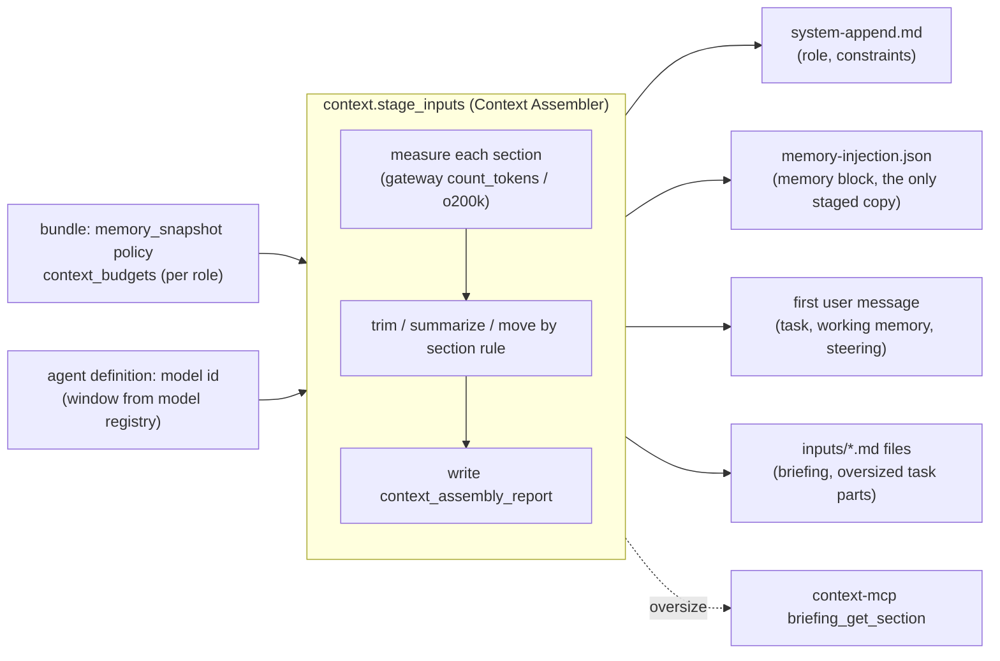

# Context Budgeting

**Section:** WS-04 · **Constraints:** D-14, D-13, D-03, D-11 · **Contracts:** C-DEF (`memory_snapshot` policy carries the budget profiles), C-ART (`briefing`, `run_inputs`, proposed `context_assembly_report`), C-IDS §10 (Langfuse metadata)

## Purpose

Decide how much of each agent's context window goes to Replicant's role prompt, constraints,
briefing, long-term memory, working memory, and task input; how much is reserved for the agent's
own work; and how the Context Assembler measures and enforces it.

## Decisions summary

| Decision | Constraint | Reference |
|---|---|---|
| Budgets are a fraction of a **working window** (`min(model window, role cap)`), with an absolute token cap per section. Current Claude and GPT models have about 1M-token windows; the Replicant deliberately uses at most 200k–400k of them | D-14 | §1 |
| At least 70–85% of the working window is reserved for the agent's own work (tool output, file reads, reasoning) | D-14 | §1 |
| Budgets are behavioral configuration: they live in the bundle-pinned `memory_snapshot` policy (`context_budgets`) | D-03 | [schemas/policy-memory-snapshot.schema.json](schemas/policy-memory-snapshot.schema.json) |
| Token counts use the target model's tokenizer: the gateway's Anthropic-compatible `count_tokens` endpoint for Claude models, `tiktoken` `o200k_base` locally for OpenAI chat models. Fallback is a conservative character estimate, recorded as such | D-11 | §2 |
| Overflow is handled per section by a fixed rule: trim by priority, deterministic summarization, move to a file in inputs, move to MCP, or fail. Everything cut is recorded in a `context_assembly_report` | D-14 | §3 |
| Oversized briefings go to S3 and are served by `context-mcp` `briefing_get_section`; the inline briefing keeps a section index | D-13 | §3.3 |



## 1. Budget allocation

### 1.1 Windows

Current Claude models (`claude-opus-5-5`, `claude-sonnet-5-5`, `claude-haiku-5-5`, `claude-fable-5-1`) have
1M-token context windows and 128k max output; `claude-sonnet-4-5-20250929` is deprecated and retires
2026-11-30 [verified: https://platform.claude.com/docs/en/models/overview and
…/about-claude/model-deprecations, 2026-10-24]. OpenAI's current Codex models include
`gpt-6.1-sol` with a 1,050,000-token window [verified:
https://developers.openai.com/api/docs/models/gpt-6.1-sol, 2026-10-24]. Large windows do not mean
Replicant should fill them: cost and latency grow with context, and agents work better with
focused context `[unverified: quantitative long-context quality degradation for the specific
models; Replicant measures it through the capacity curve and eval]`. The working window is
therefore capped per role:

`working_window = min(model_context_window, policy.context_budgets.roles[role].working_window_cap)`

The model's window comes from a model registry table in the agent definition's model entry (WS-03);
if absent, the assembler uses 200,000 and records `window_source = default`.

Note on the bundle example: the C-DEF example pins `anthropic/claude-sonnet-4-5-20250929`, which retires on
2026-11-30. Real bundles must pin a current model (WS-03/WS-06; recorded in cross-ws dependencies).

### 1.2 Default allocation (`context-default@2`)

Percent of the working window, with the absolute cap in tokens (the smaller wins):

| Section | Slot | Planner (400k) | Implementer (400k) | Repair (400k) | Reviewer (300k) | QA (200k) |
|---|---|---|---|---|---|---|
| Role prompt (Replicant, from Langfuse via bundle) | system append | 2% · 8k | 2% · 8k | 2% · 8k | 2% · 8k | 3% · 6k |
| Constraints and policy (risk rules fired, network profile summary, output contract) | system append | 1% · 4k | 1% · 4k | 1% · 4k | 1% · 4k | 1.5% · 3k |
| Long-term memory (memory block) | system prompt (entrypoint renders it from memory-injection.json at run start) | 2% · 8k | 2% · 8k | 1.5% · 6k | 2% · 8k | 1% · 2k |
| Briefing | `inputs/briefing.md`, referenced in the first message | 4% · 16k | 3% · 12k | 2% · 8k | 3% · 12k | 2% · 4k |
| Working memory (handoff, plan, prior QA) | first user message | 2% · 8k | 2.5% · 10k | 3% · 12k | 2% · 8k | 3% · 6k |
| Task input (issue, plan steps, reviewer feedback, diff for reviewer) | first user message (overflow to files) | 4% · 16k | 4% · 16k | 5% · 20k | 16% · 48k | 4% · 8k |
| Steering backlog | first user message | 1% · 4k | 1% · 4k | 1% · 4k | 1% · 4k | 0.5% · 1k |
| **Sum of caps** | | 64k (16%) | 62k (15.5%) | 62k (15.5%) | 92k (31%) | 30k (15%) |
| **Reserved headroom** (`min_headroom_pct`) | agent's own work | ≥ 80% | ≥ 80% | ≥ 80% | ≥ 70% | ≥ 85% |

The CLI's own system prompt and tool schemas also occupy context. The assembler subtracts a
measured `cli_overhead_tokens` per CLI version: a calibration run per CLI image digest in CI records
the input tokens of an empty task (`usage.input_tokens` of the first turn, via the gateway usage
event) and stores it in the CLI image label `replicant.example.com/cli-overhead-tokens` = `{"<gateway model id>": tokens}`
(WS-03, XD-FIX-R1-068 g).
`[unverified: typical Claude Code / Codex built-in prompt and tool-schema size; measured, not assumed]`.

### 1.3 Why these numbers

- The memory cap of 8k tokens holds about 80–130 rendered entries (40–90 tokens each), above the
  per-role entry cap of 80, so the entry cap binds before the token cap in normal repos.
- Reviewer task input is large because the diff is the task. Diffs beyond 48k tokens are written to
  `inputs/diff.patch` and the message lists files with stats. The reviewer reads them with its tools.
- Repair gets more working memory and task budget (reviewer threads, prior handoff) and less
  briefing (the briefing was already used by the implementer; repair gets a path-filtered rendering).
- Sensitivity: if a role's working window were below about 100k tokens, the 80% headroom would leave
  less than 20k for injected sections and the caps would need to become percentages only. That is
  the threshold at which this allocation must be revisited (a smaller model for a role).

## 2. Measurement

| Model family (gateway model id prefix) | Method | Recorded as |
|---|---|---|
| `anthropic/*` | Gateway pass-through to `POST /v1/messages/count_tokens` with the exact system text and messages. The endpoint is free but rate-limited (per-minute tiers, separate from Messages limits) and returns an estimate [verified: https://platform.claude.com/docs/en/build-with-claude/token-counting, 2026-10-24]. One call per section plus one for the assembled request; results cached by `(model, sha256(text))` in the worker (immutable inputs) | `anthropic:count_tokens:<model>`, `exact_endpoint` |
| `openai/*` chat models | `tiktoken` with `o200k_base` (the mapping used for GPT-5-era and o-series models) [verified: https://github.com/openai/tiktoken/blob/main/tiktoken/model.py, 2026-10-24]. Newer model families without a published mapping: use `o200k_base` and add a 10% margin | `tiktoken:o200k_base`, `exact_local` |
| Anything else, or the count endpoint unavailable | `ceil(chars / 3) × 1.15` | `estimate_chars` |

Tokenizers differ across model generations, so a budget measured on one model does not transfer to
another; counts are always taken for the run's model `[unverified: magnitude of tokenizer changes
between recent Claude generations; not load-bearing because every count targets the run's model]`.
Embedding inputs for OpenAI embedding models use `cl100k_base`, not `o200k_base` [verified:
tiktoken model.py, 2026-10-24]; embedding inputs here are short and are not budgeted.

The gateway must expose the count endpoint for Anthropic models (XD-04-03 to WS-03). Without it the
assembler degrades to `estimate_chars`, which is conservative and safe.

## 3. Enforcement

### 3.1 Algorithm (`context.stage_inputs`, deterministic given its inputs)

```python
def assemble(role, model, sections, policy, cli_overhead):
    window = min(model.context_window, policy.roles[role].working_window_cap) - cli_overhead
    report = []
    for s in sections:                       # fixed order: role_prompt, constraints, memory, briefing,
        rule = policy.roles[role].sections[s.name]   #   working_memory, task, steering
        budget = min(int(window * rule.pct / 100), rule.cap)
        used = count(model, s.render())
        if used > budget:
            s, used, cut = apply_overflow(rule.overflow, s, budget)    # see 3.2
        else:
            cut = []
        report.append(SectionReport(s.name, s.slot, budget, used, s.source_tokens, s.action, cut))
    injected = sum(r.used for r in report)
    if injected > window * (1 - policy.roles[role].min_headroom_pct / 100):
        raise ContextBudgetExceeded(report)   # non-retryable for the node; operator alert
    return report
```

### 3.2 Overflow rules and priorities

| Section | Overflow rule | Trim order (lowest priority cut first) |
|---|---|---|
| Role prompt | `fail` | Never trimmed: a prompt over its cap is a bundle bug (`ContextBudgetExceeded`, caught in bundle eval) |
| Constraints | `fail` | Never trimmed |
| Memory | `trim_by_priority` | memory-service already packs to the budget (utility order); enforced entries are never cut (an over-budget enforced set fails the assembly) |
| Briefing | `move_to_mcp` | Inline keeps: blast radius, contracts touched, constraints, owners. Moved first: recent incidents, code-search hints, consumers beyond depth 1, service description. Moved sections are listed in `omitted_sections` and fetched with `briefing_get_section` |
| Working memory | `summarize_deterministic` | Keep goal, mechanical facts, failing tests, open issues; then narrative decisions (newest first); then commands that worked; then failures to avoid; drop older handoffs first. "Summarize" means field selection and truncation by these rules: no LLM call, so it is reproducible |
| Task input | `move_to_file` | The issue body, attachments, long reviewer threads, and large diffs are written to `inputs/` files and the message lists them with sizes; the agent reads them with its file tool. Nothing in the task is dropped |
| Steering | `move_to_file` | Messages beyond the budget go to `inputs/steering.md` with a pointer |

### 3.3 Oversized briefings

The briefing JSON is always complete in S3 (`briefing` artifact, up to 16 MiB). The rendered
`briefing.md` is cut to its budget by section priority; `omitted_sections` lists what was moved.
context-mcp serves `briefing_get_section(section, cursor)` from the S3 object for the run's job
(run token → job → step key), paginated at 200 KB.

### 3.4 What is recorded

`inputs/context-assembly-report.json` (schema
[schemas/context-assembly-report.schema.json](schemas/context-assembly-report.schema.json), example
validated) per run, listed in the inputs manifest; artifact type `context_assembly_report` proposed
in CCR-04-02. Counts (not text) are also set on the context-assembler span as Langfuse observation
metadata (`replicant.context.injected_tokens`, `replicant.context.headroom_ratio`,
`replicant.context.cut_items`). Metric `replicant_context_injected_tokens` (histogram, labels `role`,
`workflow_type`).

## 5. Latency budget (R1-112)

The sandbox-ready SLO (p95 < 90 s, shared context §2) gives "memory snapshot + context" 12 s p95 on
the core side (XD-02-09). WS-04's split, measured per activity (histogram
`replicant_context_activity_seconds{reason=<activity>}`):

| Activity | p95 budget | What dominates |
|---|---|---|
| `memory.create_snapshot` (`context.c0.n1.snapshot`) | 2.0 s | One REPEATABLE READ eligibility query (≤ 2,000 rows), snapshot export PUT, inserts |
| `context.build_briefing` (`context.c0.n1.briefing`) | 5.0 s | `consumers_of` CTE, batched repo-permission check, ≤ 10 Zoekt queries in parallel, S3 PUT |
| `memory.create_snapshot(revocation_filter)` (`<node>.c<c>.n<o>.resnap`) | 0.5 s | State check on the snapshot's refs (often a no-op) |
| `context.stage_inputs` (`<node>.c<c>.n<o>.stage`) | 4.0 s | `…:select` (exact scoring over ≤ 400 items), `count_tokens` calls (cached by digest), ≤ 8 S3 PUTs |
| Slack | 0.5 s | — |

Repair cycles and later nodes pay only `resnap` + `stage` (≈ 4.5 s). Exceeding a budget for 10
minutes raises `ReplicantContextAssemblySlow`.

## Open questions

| Question | Who decides | Options | Recommendation |
|---|---|---|---|
| Working-window caps | WS-04 + WS-06 eval | 200k / 400k / full window | 400k for coding roles, revisited with eval cost and quality data |
| Should the assembler ever call an LLM to summarize? | WS-04 | never / for handoffs over budget | Never in v1: deterministic field selection keeps assembly reproducible |

## Risks

- `count_tokens` rate limits under peak (about 10 sections × 3 runs × 1,000 jobs/day ≈ 30k calls/day,
  far below per-minute tiers) — caching by content digest reduces it further.
- Under-measured CLI overhead could push a long session into compaction earlier. Mitigation: the
  handoff's `mechanical.context.compactions` is monitored per role; a rising rate lowers the caps.

## Interfaces consumed / provided

- **Consumed:** bundle `memory_snapshot` policy (C-DEF), agent definition model metadata (WS-03),
  gateway count endpoint (WS-03), Langfuse prompts by pinned version (C-DEF §6).
- **Provided:** `context_budgets` schema, the assembly algorithm, `context_assembly_report`.
