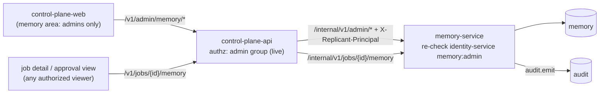

# Curation UI Requirements

**Section:** WS-04 (requirements; WS-07 designs the screens) · **Constraints:** D-25, D-18, D-14, §4 UX · **Contracts:** C-PG (`jobs_read`, `memory`), C-ART §5 (presigned access)

## Purpose

What the memory curation surface must let Replicant admins do, the data each operation needs, and
the read-only memory view every authorized job viewer gets.

## Decisions summary

| Decision | Constraint | Reference |
|---|---|---|
| Every curation capability is admin-only (`replicant-admins`, configurable), enforced server-side twice: control-plane-api checks before proxying, memory-service re-checks with identity-service on every request. Denials are audited | D-25 | §1 |
| Non-admins see no memory navigation or actions. On jobs and approvals they can already see, they get a read-only "Memory used" panel that hides provenance identities and internals | D-25 | §4 |
| Every mutation goes through the admin API with an Idempotency-Key and an ETag; the UI shows the resulting audit event | D-25, D-26 | [api/memory-service.openapi.yaml](api/memory-service.openapi.yaml) |
| Bulk actions always start as a dry run showing affected entries and running jobs | D-14 | §2.6 |

## 1. Access control

- Route family `/v1/admin/memory/*` on control-plane-api maps 1:1 to memory-service
  `/internal/v1/admin/*`. control-plane-api authorizes the user (Okta session, admin group) and
  forwards `X-Replicant-Principal`. memory-service then calls identity-service
  `POST /internal/v1/authorize {principal_id, action: "memory:admin"}` per request: SCIM group removals take effect on the next
  request (D-25). A 403 from either layer emits audit `memory.admin_denied`.
- The UI hides the memory area for non-admins, but correctness never depends on hiding.
- Tenant admins outside the admin group have no access (D-25).

## 2. Operations and the data each needs

### 2.1 Candidate queue

Default sort: scope (broader first), then evidence, then age; filters: tenant, repo, type, origin,
has-conflict, anomaly-flagged, author. Per candidate:

| Data | Source |
|---|---|
| Statement, title, rationale, examples, structured payload, proposed scope and facets | current version |
| Evidence list: each source with excerpt, link, author (identity, GitHub login), repo permission, CODEOWNER flag, job and PR, extraction prompt and model, generalization scores | `provenance` |
| Safety results (rules passed, classifier score, warnings) | write-path decision detail |
| Neighbors: nearest active/candidate entries with similarity; open conflicts with both sides side by side | dedupe/conflict data |
| **Applicability preview**: jobs per week in scope (from `job_outcomes` volume) and the exact rendered line as an agent would see it | computed |
| Candidate-shadow statistics (`learned_repeat_rate` on the subject) | `entry_outcome_stats` |

Actions: approve (optionally superseding entries), reject (reason), edit then approve, narrow or
widen scope (with an evidence check; widening beyond evidence requires `override_evidence` and a
reason), merge into an existing entry, restrict the author. Keyboard: `a` approve, `r` reject,
`e` edit, `m` merge, `j/k` next/previous (WS-07 owns the shortcut map).

### 2.2 Entry detail

All versions with diffs; state history (who, when, policy version or curator action); provenance;
usage (injection count, last injected, jobs and runs, retrievals); outcome statistics and verdict;
holdout arms; conflicts; relations (supersedes, merged, promoted from). Actions: disable, enable,
deprecate, restore, edit (new version), promote, quarantine, purge.

### 2.3 Conflicts

Queue of open conflicts with both entries, scope relation, detector and explanation, and the jobs
where the runtime detector suppressed both. Resolutions: keep A, keep B, scope split (edit both
scopes in one action), merge, both valid, neither, dismiss.

### 2.3a Flags and correction requests

Queue of open human flags, correction requests, and agent flags, oldest due first, with the entry,
the job (for flags), the reporter's role (job viewer, source author, CODEOWNER), the reason, and the
automatic effect already applied (hold, probation disable). Actions: resolve as actioned (with the
entry action taken) or dismissed, both notifying the reporter.

### 2.4 Probation and auto-activation digest

Entries currently in probation, with exposures, holdout counts, contradictions, agent flags, and
verdict; the daily digest of system transitions (auto-activations, auto-disables, expiries,
quarantines) with one-click review.

### 2.5 Blast radius ("which jobs used this entry")

For an entry or version: jobs and runs that received it (injected) or retrieved it (pull), job
status from `jobs_read`, repo, time; filter running only. Links to job detail. From here: bulk
disable, and "cancel running jobs" (issued by control-plane-api as `job.cancel` after confirmation).

### 2.6 Bulk disable and quarantine

Selector builder (author, time window, tenant, repo, scope level, origin, extractor version, entry
list, states) → dry run (affected entries with statement and scope, running jobs) → confirm with
reason. Release with per-entry exclusions. Every bulk action is one curator action and one audit
event.

### 2.7 Purge

Entry list, reason code, explicit confirmation, option to request transcript deletion (break-glass,
for `secret_leak` and `legal_request`). Shows propagation status per target until complete.

### 2.8 Export

Scope (tenant or org), states, include identities (default off). Produces `memory_export`
(NDJSON zstd) in the memory bucket; download through a presigned GET (15 minutes) issued by
control-plane-api and audited (C-ART §5).

### 2.9 Governance

View effective policy (org default plus tenant layer) with history; edit as a new version with a
change note; validation shows which fields tighten or loosen relative to the org default (tenant
layers may only tighten).

### 2.10 Analytics (admin-only, D-25)

Overview, candidate flow, injection volume and tokens, outcome metrics and holdout comparisons,
verdict distribution, capacity per repo (active vs caps), anomalies.

## 3. Non-functional requirements

- Candidate queue first page < 500 ms at 10k candidates (indexed by `entries_candidates`).
- Every mutating action shows the outcome and audit event ID; ETag conflicts show the current entry
  and a diff.
- No memory content in URLs or browser titles (entry IDs only).

## 4. Read-only memory view for non-admins

Where: job detail ("Memory used") and the approval packet view. Who: anyone authorized to see the
job (control-plane-api's job authorization). Data: `GET /internal/v1/jobs/{job_id}/memory`.

| Shown | Hidden |
|---|---|
| Entry ref (`mem_…@v`), type, scope label, title, statement | Author identity, login, permission, CODEOWNER flag |
| How it was used (injected into which runs, or retrieved) | Source excerpt (raw comment text) |
| Curated vs auto-activated flag | Confidence, outcome statistics, holdout arms |
| Current state (for example "disabled since 2026-10-30") | Conflicts and other jobs that used the entry |
| Source kind and link to the source PR comment **only if the viewer can read the source repo** (live check through identity-service); otherwise "from another repository in your tenant" | Extraction prompt, model, scores, governance policy |
| Entries suppressed by an unresolved conflict for this job (count and refs) | Snapshot internals (cut entries, precedence scores) |

Rationale for hiding the commenter: the entry is a team convention, not a person's opinion;
attributing it invites friction and profiling. Admins see full provenance. Approvers get the
statements, which is the context they need (D-25).

**Flag this entry (R2-028).** Each row of the panel has "Flag this entry" for any viewer of the job:
reason (`wrong`, `outdated`, `too_broad`, `harmful`, `unsafe`, `other`) plus an optional note,
`POST /v1/jobs/{job_id}/memory/{entry_id}/flags`. The viewer sees the effect returned ("queued for
an administrator, due by …", or "held: two people flagged this"). Flags never change content; two
flags from distinct people on a candidate or probation entry set a hold or disable it by system
policy (D-25 intact). Rate limit 20 flags per person per day.

**Public entry view (R2-018).** `GET /v1/memory/entries/{entry_id}/public` is open to the author of a
source comment and to readers of a source repo. It shows the line exactly as agents receive it, the
state and next automatic transition with its time, any hold, and the viewer's own correction
requests, with "Request a correction" (author or CODEOWNER of the source path). It never shows other
authors, scores, or other jobs. The PR-reply footer links to it.

## 5. One verb table (R1-097)

control-plane-api exposes `/v1/admin/memory/<x>` and proxies each call 1:1 to memory-service
`/internal/v1/admin/<x>`; the non-admin routes map as listed. The OpenAPI document carries the
public route on every operation as `x-public-path`. Every single-entry mutation needs `If-Match:
"<entry_id>:<state_seq>"` and `Idempotency-Key`.

| Public route (control-plane-api) | memory-service | Meaning | Allowed from |
|---|---|---|---|
| `GET /v1/admin/memory/candidates` | `GET /internal/v1/admin/candidates` | Queue, clustered (§6) | — |
| `GET, POST /v1/admin/memory/entries` | same under `/internal/v1/admin/entries` | Search; create (origin curator) | — |
| `GET, PATCH /v1/admin/memory/entries/{id}` | same | Detail; new version (same or narrower scope) | PATCH: candidate, active, disabled |
| `POST …/entries/{id}:approve` | same | → active (`supersedes[]` optional) | candidate |
| `POST …/entries/{id}:reject` | same | → rejected | candidate |
| `POST …/entries/{id}:disable` | same | → disabled | active |
| `POST …/entries/{id}:deprecate` | same | → deprecated | active |
| `POST …/entries/{id}:restore` | same | → the state recorded before the removal | disabled, deprecated, quarantined (single entry; bulk quarantines use `:release`) |
| `POST …/entries/{id}:reopen` | same | → candidate | rejected, expired |
| `POST …/entries/{id}:quarantine` | same | → quarantined | candidate, active, disabled, deprecated |
| `POST …/entries/{id}:promote` | same | New version with a wider scope (evidence thresholds) | active |
| `POST …/entries/{id}:merge` | same | **Path entry survives**; `absorb_entry_ids` become superseded with `merged_into → survivor` | candidate, active |
| `POST …/entries/{id}:clear-hold` | same | Clear an activation hold | any with a hold |
| `GET …/entries/{id}/jobs` | same | Blast radius | — |
| `GET …/conflicts`, `POST …/conflicts/{id}:resolve`, `POST …/conflicts/{id}:dismiss` | same | Conflict queue | open conflicts |
| `POST /v1/admin/memory/quarantines` (the public "bulk disable") | same | Dry run, then apply | — |
| `POST …/quarantines/{id}:release` | same | Restore members' prior states | — |
| `POST /v1/admin/memory/purges`, `GET …/purges/{id}` | same | Hard delete (no `DELETE` verb anywhere) | — |
| `POST …/exports`, `POST …/imports` | same | Export; import | — |
| `POST …/restore-resync?since=&dry_run=`, `GET …/restore-resync/{restore_step_id}` | same path pattern, but both layers check `restore:execute`, not `memory:admin` (restore envelope, XD-FIX-R1-237, R1V-027) | Post-restore resync (R1-102). A dry run first, then the apply (XD-W3-R1V-029) | requires an open `ops.restore_events` row |
| `GET, PUT …/governance/{tenant_id}` | same | Governance policy | — |
| `POST …/authors/{id}:restrict`, `POST …/authors/{id}:unrestrict` | same | Author restriction | — |
| `GET …/flags`, `POST …/flags/{id}:resolve` | same | Flag and correction queue | open flags |
| `GET …/analytics/{report}` | same | Analytics | — |
| `GET /v1/jobs/{job_id}/memory` (non-admin) | `GET /internal/v1/jobs/{job_id}/memory` | Read-only panel | — |
| `POST /v1/jobs/{job_id}/memory/{entry_id}/flags` (non-admin) | `POST /internal/v1/jobs/{job_id}/memory/{entry_id}/flags` | Flag (R2-028) | entry used by the job |
| `GET /v1/memory/entries/{id}/public`, `POST /v1/memory/entries/{id}/correction-requests` (non-admin) | `/internal/v1/entries/{id}/public`, `/internal/v1/entries/{id}/correction-requests` | Provenance view and correction (R2-018) | source author / CODEOWNER / repo reader |
| `POST /v1/jobs/{job_id}/outcome-reports` (non-admin) | `POST /internal/v1/outcome-reports` | Post-merge "this was wrong" (R2-017) | terminal jobs |

Responses the UI must render: **412** (stale ETag; body has the current entry, show a diff and
retry), **409** `invalid_transition` (action not allowed from the current state), **202** with
`pending_second_approval: true`, `first_approver`, `second_approval_expires_at` (tenant and org
scope: the UI shows "Awaiting a second administrator", and a second, different admin's `:approve`,
`:promote`, or `PATCH` completes it; the first admin cannot complete it).

## 6. Curation throughput and queue SLOs (R2-052)

Sizing model at the design scale (300 jobs/day steady, 1,000 peak):

| Source | Volume per day (steady) | Needs an admin? | Admin decisions per day |
|---|---|---|---|
| Review feedback reaching extraction | 300 jobs × 40% with review comments × 3 comments ≈ 360 comments | — | — |
| Feedback candidates after the generalization test (≈ 15%) | ≈ 54 | — | — |
| … of which merged as evidence into existing entries (≈ 40%) | ≈ 22 | no | 0 |
| … new repo/path rules auto-activated after merge (≈ 60% of the rest) | ≈ 19 | no (probation) | 0 |
| … needing an admin (preferences, negatives, conflicts, held items) | ≈ 13 | yes | 13 |
| Agent proposals (≤ 2 per job, ≈ 15% of jobs propose) | ≈ 90 raw → ≈ 25 clusters after dedupe and clustering | yes (lowest priority) | 25 |
| Promotion suggestions (service group, tenant, org) | ≈ 3 | yes (tenant/org: two admins) | 4 |
| Flags and correction requests | ≈ 2 | yes | 2 |
| **Total** | | | **≈ 45 decisions/day**, about 2 admin-hours at 2–3 minutes each; ≈ 150/day at peak |

Controls that keep the queue alive:

- **Clustering.** Candidates with similarity ≥ `queue.cluster_similarity` (0.85) and the same type
  and overlapping scope are shown as one cluster with one decision (approve one, merge the rest).
- **Caps.** At most 2 agent proposals per job; `queue.max_open_candidates_per_tenant` (500): above it,
  new agent proposals are dropped with `rate_limited` (feedback candidates are never dropped).
- **SLOs.** Candidate age p90 ≤ `queue.age_slo_days_p90` (7 days) per tenant for feedback candidates;
  flags and correction requests within their SLA (72 h / 48 h). View
  `memory.v_analytics_curation_queue` and `memory.v_analytics_flags`.
- **Never silent.** Seven days before a candidate expires it is listed in the weekly admin digest; at
  expiry `replicant_memory_candidates_expired_unreviewed_total{tenant}` increments and the source
  comment thread gets a notice. Alerts: `ReplicantMemoryCandidatesExpiring` when more than 20 feedback
  candidates per tenant expire unreviewed in a week; `ReplicantMemoryQueueAgeSLO` when p90 age exceeds
  14 days; `ReplicantMemoryFlagsOverdue` for any flag past due.

**Producer metrics (R1V-028, XD-W2-08-01).** memory-service exports these from its queue-metrics job,
which runs every 60 s. The job reads no analytics view: those belong to `grafana_ro` and
`memory_analytics_owner`. It iterates the onboarded tenants and `replicant-system`, and for each one opens
an ordinary `tenant`-scope transaction (G-04: no cross-tenant scope). It queries the base tables, which
memory-service owns, through the same predicates that `memory.v_analytics_curation_queue` and
`memory.v_analytics_flags` use. A tenant whose query fails keeps its last values, and
`replicant_memory_queue_metrics_errors_total{tenant}` increments.

| Metric | Type | Labels | Value |
|---|---|---|---|
| `replicant_memory_candidate_age_p90_seconds` | gauge | `tenant` | `percentile_cont(0.9)` of `now() − created_at` over `memory.entries` with `state = 'candidate'` whose provenance `source_kind` is review feedback (`pr_review_comment`, `pr_review_body`, `pr_issue_comment`, `replicant_command`). It is 0 when none are open. This SLO covers feedback candidates only, so agent proposals are excluded |
| `replicant_memory_flags_overdue` | gauge | `tenant` | count of `memory.entry_flags` with `status = 'open' AND due_at < now()`. This covers viewer and agent flags and both correction-request kinds (`author_correction`, `codeowner_correction`). `due_at` carries the 72 h / 48 h SLA |
| `replicant_memory_flags_total` | counter | `tenant`, `reason` (the flag `kind`) | incremented by the write path when a flag or correction request is inserted (XD-W2-04-03) |
| `replicant_memory_queue_metrics_errors_total` | counter | `tenant` | failed per-tenant collections |

WS-08's `ReplicantMemoryQueueAgeSLO` and `ReplicantMemoryFlagsOverdue` rules read the two gauges. Tenant
labels are tenant IDs, never names, so cardinality is bounded by the tenant count.

## Open questions

| Question | Who decides | Options | Recommendation |
|---|---|---|---|
| Show cut entries to approvers? | WS-07 | no / count only | Count only |
| Should the PR author be able to see "memory used" on the PR itself? | WS-07 | no / summary link | A footer with entry refs linking to the job's read-only view |

## Risks

- Admin workload at 1,500 repos. Mitigation: auto-activation for repo/path rules under probation,
  prioritized queues, promotion suggestions, consolidation proposals.

## Interfaces consumed / provided

- **Provided:** admin and job-view APIs ([api/memory-service.openapi.yaml](api/memory-service.openapi.yaml)).
- **Consumed:** control-plane-api proxy and job authorization, identity-service `memory:admin` and
  repo-permission checks (WS-07), WS-07 design system.
