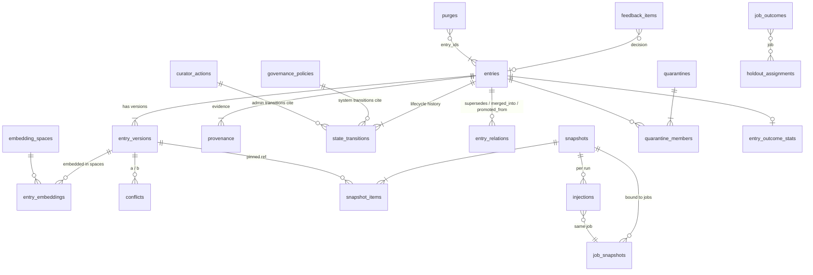

# Data Model: schemas `memory` and `ecosystem`

**Section:** WS-04 · **Constraints:** D-09, D-14, D-25, D-26, D-13 · **Contracts:** C-PG 2.0.0, C-IDS 2.0.0, C-ART 2.0.0

## Purpose

The reviewed target DDL for the two Postgres schemas WS-04 owns, the SQLAlchemy 2.0 models for the
core tables, and the rules for embeddings, full-text search, tenant isolation, audit, and deletion.

Files:

| File | Content | Validation (2026-10-24) |
|---|---|---|
| [sql/memory.sql](sql/memory.sql) | Full DDL for `memory`: 26 tables (2 partitioned), triggers, RLS, functions, analytics views, grants | Applied to PostgreSQL 18 + pgvector 0.8.1 (`pgvector/pgvector:0.8.1-pg18`) as `replicant_migrator` |
| [sql/test_memory.sql](sql/test_memory.sql) | Behavioral test run as `svc_memory_service`: lifecycle guard, immutability, D-25 actor rules, RLS isolation under FORCE, admin-only governance writes, hybrid query, purge | All 11 assertions pass |
| [sql/ecosystem.sql](sql/ecosystem.sql) | Full DDL for `ecosystem`: 14 tables, blast-radius function, visibility RLS | Applied |
| [sql/test_ecosystem.sql](sql/test_ecosystem.sql) | Cross-tenant blast radius, repo-visibility filtering, single-writer RLS | Passes |
| [sql/test_analytics.sql](sql/test_analytics.sql), [sql/test_prelude.sql](sql/test_prelude.sql), [sql/run_tests.sh](sql/run_tests.sh) | Analytics views under FORCE RLS as `grafana_ro`; test-only stand-ins for WS-10 roles and `ops` helpers; one-command runner | Passes (revision 2, after WS-09 G-04/G-19) |
| [models/replicant_db/models/memory.py](models/replicant_db/models/memory.py), [ecosystem.py](models/replicant_db/models/ecosystem.py) | SQLAlchemy 2.0 `Mapped[]` models for 12 + 6 core tables | `py_compile`; `alembic.autogenerate.compare_metadata` against the migrated DB: **0 differences** ([models/check_drift.py](models/check_drift.py)) |

## Decisions summary

| Decision | Constraint | Reference |
|---|---|---|
| Content is versioned and immutable (`entry_versions`); identity, state, confidence, and counters are mutable on `entries`. A pinned ref `mem_…@v` always resolves to the same content, or to a tombstone after purge | D-14 | §2 |
| Scope and facets are part of a version: a scope change is a new version, so snapshots are reproducible | D-14 | §2 |
| Every state change writes `state_transitions` in the same transaction (trigger-enforced), with actor `admin` (with a curator action) or `system_*` (with the governing policy version). This makes D-25 checkable in the database | D-25 | §3 |
| Embeddings in a side table with `halfvec` (no typmod) and one partial HNSW expression index per embedding space. Default space `vc4-1024` (1,024 dims, cosine, `m=16`, `ef_construction=128`) | D-14 | §5, [ADR-04-003](adr/003-embeddings-and-hybrid-retrieval.md) |
| Full-text with a STORED weighted `tsvector` (title A, statement B, rationale C, subject key A) and GIN, plus a trigram index for admin search | D-14 | §6 |
| RLS on every tenant table, driven by the WS-10 session variables. Admin tables are invisible to tenant-scoped sessions | C-PG rule 4, D-25 | §7 |
| Hard delete is a purge: content nulled, embeddings deleted, tombstone kept, propagation to derived copies tracked in `memory.purges` | D-14 | §8 |
| replicant-worker never reads `memory` directly. It uses the memory-service API (resolves the C-PG open question) | D-25 | [ADR-04-006](adr/006-memory-access-via-api-only.md) |
| The ecosystem graph is plain Postgres tables with recursive CTEs, not a graph database | D-13 | [ADR-04-004](adr/004-ecosystem-graph-in-postgres.md) |

## 1. Schema map

| Table | Rows (steady state, estimate) | Mutability | Purpose |
|---|---|---|---|
| `embedding_spaces` | < 5 | admin-managed | Embedding model, dimension, and the dedupe/conflict thresholds calibrated for that model |
| `governance_policies` | < 200 | append-only versions | Admin-configured write-path policy (D-25) |
| `entries` | 30k rules/negative/procedure/preference; 110k episodes per year | state, counters | Identity and lifecycle |
| `entry_versions` | ≈ 1.3 × entries | immutable (purge excepted) | Content |
| `entry_embeddings` | ≈ current versions of active and candidate entries × active spaces | LIST-partitioned per tenant; embeddings of non-current, superseded, rejected, expired, and purged versions are deleted nightly (R2-051) | Vectors |
| `provenance` | ≈ 2 × entries | withdraw-only | Evidence: sources, authors, extraction prompt and model, curator |
| `state_transitions` | ≈ 3 × entries | append-only | Bitemporal lifecycle |
| `entry_relations`, `conflicts` | small | resolve-only | Graph of entries; conflict queue |
| `snapshots`, `snapshot_items`, `snapshot_export_replacements` | ≈ 1 snapshot per job (content addressing over tenant + entries + policy dedupes identical sets within a tenant); default policy cap 400 items, hard cap 2,000 (the policy schema maximum) | append-only; `snapshot_items` monthly partitions dropped after the 2-year lifetime | What a job could receive. Holdout arms are per job, in `holdout_assignments` (R1-096) |
| `entry_flags`, `job_outcome_reports` | per human flag, correction request, or post-merge report | status only | Human correction paths (R2-017, R2-018, R2-028) |
| `job_snapshots` | ≈ 1.2 per job | append-only | Job ↔ snapshot binding, `pull_as_of` |
| `injections` | ≈ 3 per job (one per agent run) | append-only | What each run received |
| `retrievals` (partitioned) | ≈ 60 per job | append-only | Pull log for replay and telemetry |
| `usage_events` (partitioned) | ≈ 200 per job | append-only | Injected, retrieved, cut, holdout, agent and reviewer signals |
| `holdout_assignments`, `job_outcomes`, `entry_outcome_stats` | per job / per entry | revisable | Effectiveness measurement ([memory-evals.md](memory-evals.md)) |
| `feedback_items` | ≈ 5 per job with review | upsert-once | Ingest ledger: every feedback item's decision, idempotency |
| `quarantines`, `quarantine_members`, `author_restrictions`, `anomaly_alerts` | small | admin / safety | Poisoning controls ([safety.md](safety.md)) |
| `curator_actions`, `pending_approvals` | per admin action | append-only | D-25 trail, two-person rule |
| `purges`, `exports` | small | status updates | Deletion (admin, leak, horizon paths; deletion-ledger IDs) and export bookkeeping |

Volume at the design scale (1,000 jobs/day peak, 300 steady): `usage_events` ≈ 2–6 M rows/month,
`retrievals` ≈ 0.6–1.8 M rows/month. Both are monthly range partitions; retention is 13 months
(partition drop by the `migrate` Job's maintenance mode, which also creates partitions three months
ahead, because service roles hold no DDL, C-PG rule 1). Everything else stays well under 10 M rows
for years.

## 2. Entries and versions

- `entries` holds `scope_level`, `service_group`, `repo`, and `subject_key` **denormalized** from the
  current version for indexed filtering. The deferred constraint trigger
  `entries_scope_matches_version` rejects any commit where they differ from `entry_versions` at
  `current_version`.
- `memory_snapshot_id = msnap_ + b32_130(sha256(JCS({"tenant_id": t, "entries": sorted refs,
  "policy": pinned policy ref})))`. The tenant is part of the hash (CCR-04-04, R1-096): two tenants
  with the same eligible set (for example only org entries, or nothing) get different snapshots, so
  the single-column primary key never collides across tenants and RLS never hides a row another
  tenant created. Holdout arms are per (job, entry) in `memory.holdout_assignments`; the shared
  snapshot holds no per-job data.
- `entry_versions` is immutable (`tg_entry_versions_immutable`). Edits, merges, and scope changes
  insert version `v+1` and move `current_version`. Snapshots keep pointing at `v`.
- `content_digest = sha256(JCS({scope, facets, subject_key, title, statement, rationale, structured,
  examples}))`. It is the duplicate check for identical content and the integrity check for
  exports.
- `structured` is validated by memory-service against the JSON Schema named in `structured_schema`
  (`replicant.memory.rule/v1`, and so on; [taxonomy.md](taxonomy.md)).
- Length limits: statements ≤ 600 characters for candidates created by the write path (schema
  `memory-candidates`), ≤ 4,000 in the table for episodes and admin-authored procedures.

## 3. Lifecycle state and D-25 in the database

States: `candidate`, `active`, `disabled`, `quarantined`, `deprecated`, `superseded`, `rejected`,
`expired`, `purged`. The state machine is in [write-path.md §5](write-path.md). The database
enforces:

| Check | Mechanism |
|---|---|
| Every state change has a history row in the same transaction | Trigger `entries_state_guard` requires a `state_transitions` row with matching `from_state`/`to_state` at `transaction_timestamp()`; `state_seq` must increase by exactly 1 (it doubles as the HTTP ETag) |
| Admin transitions carry a human and a curator action | CHECK `st_admin_is_human` (`actor_principal_id ~ '^usr_'`, `curator_action_id` not null). `curator_actions` records the Okta groups confirmed live for that request |
| System transitions carry a policy | CHECK `st_system_has_policy` (actor `svc_memory-service`, FK to `governance_policies(tenant_id, policy_version)`) |
| The safety system can only take entries out of service | CHECK `st_safety_tightens` |
| Leak purges carry the leak and only purge | CHECK `st_leak_purge` (`actor_kind = leak_purge` ⇒ `leak_id` set, `to_state = purged`) |
| Every purge has deletion-ledger IDs; admin purges have a curator action; horizon purges a governance version | CHECKs on `memory.purges` (tested) |
| History is immutable | `state_transitions_append_only` trigger, and the service role has no UPDATE grant |
| Rows are never deleted | Trigger `entries_no_delete` plus no DELETE grant |

`memory.state_as_of(entry_id, ts)` reads the state at a past instant. It defines the pull universe
of a job and supports reproduction ([retrieval-injection.md §7](retrieval-injection.md)).

## 4. Provenance and usage telemetry (brief requirements → columns)

| Requirement | Columns |
|---|---|
| Source PR/comment URLs | `provenance.source_url`, `repo`, `repo_id`, `pr_number`, `comment_id`, `review_id`, `thread_node_id`, `delivery_id` |
| Author Okta identity | `provenance.author_principal_id` (`usr_`, the Okta-linked principal), plus `author_github_user_id`, `author_repo_permission` and `author_is_codeowner` captured live at extraction, and `author_association` |
| Job and run IDs | `provenance.job_id`, `run_id`, `cycle`, `release_bundle_id` |
| Extraction model and prompt version | `provenance.extraction_prompt_name`, `extraction_prompt_version`, `extraction_model`, `extraction_trace_id` (Langfuse trace = job trace, Rule T-1) |
| Approving curator | `provenance.approving_curator`; `state_transitions.actor_principal_id` + `curator_action_id` |
| What the source said at extraction | `provenance.comment_digest` (edit detection), `source_excerpt` (redacted, admin-only) |
| Generalization evidence | `provenance.generalization` (scores per gate), `independence_key` |
| Injection count, jobs injected into | `entries.injection_count`, `last_injected_at`; `injections.injected_refs` (GIN) per run; `usage_events` (`injected`, `retrieved`, `cut_budget`, `withheld_holdout`) |
| Outcome correlation (fewer review rounds, repeated comments) | `job_outcomes` (`review_rounds`, `repeated_comment_count`, `learned_repeat_count`, `first_pass_qa`, `first_review_approved`); `usage_events` (`reviewer_confirmed`, `reviewer_contradicted`, `reviewer_repeated`, `agent_flagged`); `entry_outcome_stats` (exposed vs holdout means, `p_harm`, `p_benefit`, verdict) |

## 5. Embeddings

- **Model and dimension:** default space `vc4-1024` = `voyage-code-4` at 1,024 dimensions, requested
  from WS-03's gateway shim `POST /embeddings/v1/embeddings` (OpenAI-compatible `{model, input[≤128],
  dimensions: 1024, input_type}`), caller ServiceAccount `replicant-context:memory-service`, headers
  `X-Replicant-Purpose: embedding`, `X-Replicant-Tenant-Id`, and `X-Replicant-Pipeline-Id: reembed-<uuid>`
  for re-embedding backfills; budgets `budgets.embeddings.perTenantDayUsd` and
  `reembedBackfillUsdMax` (the backfill job also stops itself at the cap). memory-service holds no
  provider key (XD-FIX-R2-057). Voyage code and general models offer 256/512/1,024/2,048 output dimensions and a
  32k-token context; the newest generation is `voyage-4` / `voyage-code-4` [verified:
  https://docs.voyageai.com/docs/embeddings, 2026-10-24]. Anthropic offers no embedding model and
  points to Voyage [verified: https://platform.claude.com/docs/en/build-with-claude/embeddings,
  2026-10-24]. If the gateway cannot serve Voyage, the fallback space is `te3l-1024` =
  OpenAI `text-embedding-3-large` with `dimensions=1024` (native 3,072; the `dimensions` parameter
  shortens) [verified: https://developers.openai.com/api/docs/guides/embeddings, 2026-10-24]. The
  choice is a row in `embedding_spaces`, not code. See [ADR-04-003](adr/003-embeddings-and-hybrid-retrieval.md).
- **Type:** `halfvec` (2 bytes per dimension, about 2 KiB per vector). HNSW supports `halfvec` up to
  4,000 dimensions and `vector` up to 2,000 [verified:
  https://github.com/pgvector/pgvector/blob/master/README.md, 2026-10-24].
- **Index:** `USING hnsw ((embedding::halfvec(1024)) halfvec_cosine_ops) WITH (m = 16,
  ef_construction = 128) WHERE space_id = 'vc4-1024'`. The pgvector defaults are `m = 16`,
  `ef_construction = 64`, `hnsw.ef_search = 40` [verified: same README]. `ef_construction = 128`
  trades build time, which is negligible at this size, for recall.
- **Per-tenant partitions (R2-051):** `entry_embeddings` is `PARTITION BY LIST (tenant_id)`, one
  partition per tenant created by `memory.ensure_tenant_partitions()` at onboarding (migrate Job
  maintenance; XD-FIX-R2-051 for WS-10), plus `replicant-system` and a default partition that must stay
  empty (alert). The parent's partial HNSW index is created on every partition, so each tenant's
  graph contains only its own vectors and a tenant-filtered ANN query never wades through other
  tenants' points. Verified: the index exists on the onboarded partitions in the test run.
- **Exact below 20k:** when the filtered candidate set (tenant, type, repos, state) is estimated at
  ≤ 20,000 rows, the pull path uses exact cosine over the btree-filtered rows instead of HNSW, which
  removes the "iterative scan ran out of tuples" failure mode for small and medium tenants.
- **Pruning:** the nightly job deletes embeddings whose version is not current or whose entry is
  superseded, rejected, expired, or purged. Snapshots never need embeddings (they pin versions,
  not vectors).
- **Recall probe:** nightly per tenant, 200 sampled pull queries from `memory.retrievals` are re-run
  with HNSW and with exact search; recall@10 is exported as `replicant_memory_ann_recall` (labels
  `tenant`); alert below 0.90, page below 0.80 ([memory-evals.md §6](memory-evals.md)).
- **Query settings** (pull path only; push uses exact scoring over the scope-filtered set, §ADR-04-003):
  `SET LOCAL hnsw.ef_search = 100; SET LOCAL hnsw.iterative_scan = relaxed_order;
  SET LOCAL hnsw.max_scan_tuples = 20000`. Iterative scans (pgvector ≥ 0.8.0) keep scanning when
  filters remove results. Without them, a filter with 10% selectivity returns about 4 rows at
  `ef_search = 40` [verified: same README]. The test run confirmed the planner uses the partial
  HNSW index for unfiltered ANN ordering and the btree plus exact sort for selective tenant filters.
- **What is embedded:** `title + "\n" + statement + "\n" + rationale` for push types;
  the templated statement (facts only) plus file paths for episodes. `input_digest` records the exact text,
  so a re-embed is skipped when nothing changed.
- **Re-embedding procedure** (model change): (1) admin inserts the new space with
  `state = 'building'` and calibrated thresholds; (2) WS-10 migration creates its partial HNSW index
  `CONCURRENTLY`; (3) the memory-service backfill CronJob embeds all active and candidate versions
  in batches of 128 through the gateway; (4) a shadow comparison runs the retrieval eval
  ([memory-evals.md §6](memory-evals.md)) on both spaces; (5) admin flips `state` (the partial
  unique index allows one `active`); (6) after 30 days the old space is `retired`, its rows deleted
  and its index dropped by migration.
- Builds: production migrations use `CREATE INDEX CONCURRENTLY` in a non-transactional Alembic
  migration (`with op.get_context().autocommit_block()`), which squawk's
  `require-concurrent-index-creation` rule expects. pgvector recommends concurrent builds in
  production and sizing `maintenance_work_mem` so the graph fits [verified: pgvector README,
  2026-10-24].

## 6. Full-text search

`entry_versions.tsv` is `GENERATED ALWAYS AS (...) STORED`. It must say STORED: PostgreSQL 18
made VIRTUAL the default, and virtual generated columns cannot be indexed [verified:
https://www.postgresql.org/docs/18/release-18.html, 2026-10-24]. The two-argument
`to_tsvector('english', …)` is immutable, so it can be used in a generated column [verified:
https://www.postgresql.org/docs/18/textsearch-tables.html, 2026-10-24]. Queries use
`websearch_to_tsquery('english', $q)` and `ts_rank_cd(tsv, q)` [verified:
https://www.postgresql.org/docs/18/textsearch-controls.html, 2026-10-24]. The subject key is
indexed with the `simple` configuration so `money.arithmetic` matches "money arithmetic". Admin
search adds `statement % $q` over the `gin_trgm_ops` index.

## 7. Tenant isolation (RLS)

Session protocol and vocabulary are WS-10's (schema-management.md §4; `ops.current_tenant()`,
`ops.principal_scope()`): every transaction starts with `set_config('replicant.tenant_id', $tenant,
true)` and `set_config('replicant.principal_scope', $scope, true)`. The memory policies use the
canonical values (WS-09 G-04); WS-04 has no scope values of its own.
`SET LOCAL` lasts until the end of the transaction [verified:
https://www.postgresql.org/docs/18/sql-set.html, 2026-10-24]. Policies read
`NULLIF(current_setting('replicant.tenant_id', true), '')`: with `missing_ok = true` a missing setting
returns NULL [verified: https://www.postgresql.org/docs/18/functions-admin.html, 2026-10-24], and
`NULLIF` covers a variable that reads as an empty string after an earlier `SET LOCAL` went out of
scope.

| Scope value | Set when | Read | Write |
|---|---|---|---|
| `tenant` (default) | Any request acting for a job or tenant, **and** every memory-service background job, which iterates tenants (org rows run as tenant `replicant-system`) | own tenant + org rows; admin tables only own `author_restrictions` and `anomaly_alerts` | own tenant only; governance, curator actions, purges, exports never |
| `admin:memory` | Only after identity-service `POST /internal/v1/authorize {action: "memory:admin"}` returns allow **for this request** | all | all |
| `operator:all-tenants` | grafana_ro role default (WS-10) | analytics views only, via `memory_analytics_owner` (member of `r_cross_tenant_read`) | none |
| `system:all-tenants` | migrate Job data revisions (`r_cross_tenant_write`) | all | all |

**Partitions (XD-ORCH-04).** RLS on a partitioned parent does not cover a direct query on a
partition. Every leaf partition (`retrievals_*`, `usage_events_*`, `snapshot_items_*`,
`entry_embeddings_*`) is secured with WS-10's `ops.secure_partition()`: RLS enabled and forced, the
canonical tenant policy, and no privilege for any role but the owner. The DDL secures the partitions
it creates, `memory.ensure_tenant_partitions()` secures each tenant partition right after creating
it, and WS-10's hourly sweep re-secures every leaf. Grants name the parents explicitly (never `ON ALL
TABLES IN SCHEMA`), so services reach partitions only through the parent and its policies. Verified
with WS-10's `check_partitions.py`: 13 leaf partitions, all isolated, without a maintenance sweep.

Every table has `FORCE ROW LEVEL SECURITY` (WS-09 G-19): owners bypass RLS unless FORCE is set;
superusers and `BYPASSRLS` roles always bypass [verified:
https://www.postgresql.org/docs/18/ddl-rowsecurity.html, 2026-10-24]. With FORCE, a future
ownership change cannot silently disable isolation. Data migrations run as `replicant_migrator` with
`replicant.principal_scope = 'system:all-tenants'`, honored by the role-targeted `_xt_write`
policies (WS-10 standard). Analytics views are owned by `memory_analytics_owner` so that they keep
working under FORCE; [sql/test_analytics.sql](sql/test_analytics.sql) checks that `grafana_ro` gets
cross-tenant aggregates and no base-table access. The ecosystem schema needs no cross-tenant scope:
its writes are allowed by a policy targeted at the single writer role `svc_ecosystem_indexer`.

## 8. Audit and deletion

**Audit (R1-095).** Every admin action writes `memory.curator_actions` and calls `audit.emit()` in the
same transaction; system transitions are audited with actor `svc_memory-service` and the governance
policy version. `audit.events.event_type` has a foreign key to `audit.event_types` (WS-08), so the
catalog below is the closed list memory-service emits. It is given to WS-08 to seed as
XD-FIX-R1-095 (category `memory`):

| Event type | Emitted when | `details` keys |
|---|---|---|
| `memory.entry_transition` (WS-08's existing name) | Every lifecycle transition, admin or system | `entry_ref`, `from_state`, `to_state`, `actor_kind`, `reason_code`, `curator_action_id` or `governance_policy_version` or `leak_id` |
| `memory.entry_edited` | `PATCH` creates a version | `entry_ref`, `change_kind`, `content_digest` |
| `memory.entry_promoted` | `:promote` | `entry_ref`, `from_scope`, `to_scope`, `approvers[]` |
| `memory.entry_merged` | `:merge` | `survivor`, `absorbed[]` |
| `memory.conflict_resolved` | `:resolve` / `:dismiss` | `conflict_id`, `resolution` |
| `memory.quarantine_created` / `memory.quarantine_released` | bulk disable or quarantine, release | `quarantine_id`, `selector_digest`, `entries_affected` |
| `memory.purge_requested` / `memory.purge_completed` | purge start (after ledger write) and propagation done | `purge_id`, `path` (`admin`/`leak`/`horizon`), `deletion_ledger_ids`, `entry_count` |
| `memory.export_created` / `memory.import_applied` | exports, imports, restore-resync | `export_id` or `export_key`, `entry_count` |
| `memory.governance_changed` | governance version | `tenant_id`, `policy_version`, `digest` |
| `memory.author_restricted` | restrict / unrestrict (admin or anomaly policy) | `author_principal_id`, `restriction` |
| `memory.flag_created` / `memory.correction_requested` / `memory.hold_cleared` | flags, correction requests, admin clears a hold | `entry_ref`, `kind`, `effect` |
| `memory.outcome_report_applied` | post-merge outcome report | `job_id`, `kind`, `source`, `effects` |
| `memory.admin_denied` (WS-08's existing name) | memory-service or control-plane-api refuses a memory admin request | `principal_id`, `route` |

WS-08 seeds these plus `memory.admin_action` (19 names, kept but unused by memory-service), and
`memory.admin_purge` in WS-08's LeakPurge text became `memory.purge_requested` with `path = leak`.
Denials: control-plane-api's first-layer check emits `authz.denied` with `details.permission =
"memory:admin"` (XD-FIX-R1-265); memory-service's second-layer check emits `memory.admin_denied` with
the same `details.permission` (XD-W2-04-02). A cross-workstream test in
WS-11's suite emits every type above through `audit.emit()`.

**Soft removal** (disable, deprecate, quarantine, reject, supersede, expire) keeps content; the entry
stops being eligible for new snapshots at commit.

**Hard delete (purge).** Three paths share one function, `memory.purge_entry(entry_id, purge_id)`,
which reads actor, reason, and approvals from the `memory.purges` row:

| Path | Who | Trigger | Actor recorded |
|---|---|---|---|
| `admin` | Replicant admin (D-25), `POST /internal/v1/admin/purges` | poisoned content, leaked secret, PII, legal request, tenant offboarding | `admin` + curator action |
| `leak` | WS-08 `LeakPurge` workflow (activity `memory.leak_purge` on ops-worker, task queue `replicant-ops`, principal `svc_ops-worker`; XD-FIX-R1-103), `POST /internal/v1/purges:leak` | an approved `leak_purge` gate (two distinct admins, re-verified) | `leak_purge` + `leak_id` (R1-103) |
| `horizon` | memory-service maintenance job | episodes older than the 2-year horizon (`expired` → `purged`) | `system_policy` + governance version (R1-106) |

Order of operations (R1-102):

1. **Ledger first.** Write one `deletion_ledger_entry` per purge (C-STATE "Deletion ledger", C-IDS
   `del_`, WS-10 schema `deletion-ledger-entry`, reason `memory_hard_delete`, `targets` = the
   Postgres rows, the snapshot-export keys, the `memory_injection` keys and the `memory_export` keys, each on the primary bucket and its `-us-west-2` DR replica, `replay: always`) to the
   audit bucket key `org/deletion-ledger/<yyyy>/<mm>/<dd>/<del_id>.json` with `If-None-Match: *`, tag
   `replicant-retention=r7y`, and the platform `audit` KMS key. If the write fails, nothing is deleted
   (XD-FIX-R1-233; WS-10's `config/iam/memory-service.s3.json` grants exactly that statement). Its IDs are stored in `memory.purges.deletion_ledger_ids`
   (NOT NULL). A restore followed by `POST /internal/v1/admin/restore-resync?since=<restore point>` (dry run first) replays these entries,
   so purged memory is never resurrected.
2. **Database.** Insert `purges`, then call `memory.purge_entry()` per entry. It nulls version
   content, deletes embeddings, scrubs provenance excerpts and author IDs and flag text, sets
   `state = 'purged'`, and writes the transition. The tombstone keeps `entry_id`, versions,
   `content_digest`, and history, so refs still resolve to "purged" rather than dangling.
3. **Propagation**, tracked per target in `purges.propagation` and retried until done. Every S3
   deletion below acts on the primary bucket **and** its DR replica `<org>-replicant-<env>-<class>-us-west-2`
   (C-ART 2.0.0 §DR replicas and rule 5, CCR-10-07; R1V-064). Replication does not carry version
   deletions, so memory-service deletes the replica's versions itself, through the replica's multi-Region
   KMS key. A target counts as `done` only when no versions remain in both buckets. WS-10's
   `config/iam/memory-service.s3.json` grants the matching `s3:ListBucketVersions`,
   `s3:DeleteObjectVersion` and KMS statements on the `memory-us-west-2` and `artifacts-us-west-2` keys
   (WS-10 owns that IAM change for R1V-064):

| Derived copy | Where | Action | Owner |
|---|---|---|---|
| Snapshot exports containing the entry | `memory` bucket `tenants/<t>/snapshots/<msnap>.json` (r2y) | Delete all object versions; write the replacement `….purged-<purge_id>.json` (C-ART rule 5) and record it in `memory.snapshot_export_replacements` | memory-service |
| Run memory injections containing the entry | `artifacts` `…/runs/<run_id>/inputs/memory-injection.json` (r2y), found through `memory.injections.injected_refs` | Delete all object versions (C-ART rule 5) | memory-service |
| Memory exports listing the entry | `memory` bucket `tenants/<t>/exports/<export_id>/*` and `org/exports/<export_id>/*` (r1y) | Delete all object versions of every export whose manifest lists a purged entry (C-ART 2.0.0 rule 5(iii), CCR-04-06 applied); `propagation.memory_export` goes `pending` → `done` | memory-service |
| Other staged inputs | `inputs/system-append.md`, WS-03 rendered prompts | **Not duplicated** (R1-105): the memory block exists only in `memory-injection.json`; the entrypoint concatenates it into the system-prompt file on tmpfs at run start, never uploaded (XD-FIX-R1-105 for WS-03) | WS-03 |
| Session state and transcripts | `session` (≤ 37 days), `transcripts` (90 days) | For `secret_leak` and `pii`, the purge opens a WS-08 LeakPurge request (gate `leak_purge`) for the affected jobs, which rewrites or deletes them under C-ART rule 4a; for other reasons they age out | WS-08 |
| LLM traces | Langfuse (90 days) | `DELETE /api/public/traces` in batches of ≤ 30 job trace IDs (asynchronous, usually within 15 minutes) [verified: https://langfuse.com/docs/administration/data-deletion, 2026-10-24] | WS-08 endpoint called by memory-service (XD-04-08) |
| Approval records | `audit` (Object Lock) | Not affected: packets hold `mem_…@v` refs only (C-ART rule 5) | — |
| Postgres backups / PITR | RDS (WS-10 retention) | Age out; a restore replays the ledger (step 1) | WS-10 |

The admin UI shows propagation status per target. "Complete" means every target is `done` or
`not_applicable`.

**Snapshot exports are written before the row (R1-102).** memory-service builds the snapshot,
writes `tenants/<t>/snapshots/<msnap>.json` with `If-None-Match: *` (a 412 with an equal digest is
success), then inserts `memory.snapshots` with the non-null `export_key` and `export_sha256`.
`memory.snapshots` is strictly append-only.

## 9. Ecosystem schema summary

Tables: `graph_versions`, `sources`, `source_runs`, `repos`, `services`, `service_repos`,
`owner_rules`, `contracts`, `contract_versions` (normalized documents ≤ 2 MiB, lz4 TOAST
compression), `contract_elements`, `edges`, `call_sites`, `incidents`. Function
`ecosystem.consumers_of(service, depth)` walks consumers with a cycle-safe recursive CTE. Catalog
metadata is org-readable by design (blast radius crosses tenants). `contract_versions` and
`call_sites` contain repository content and are filtered by `replicant.visible_repo_ids`, set per
transaction by context-mcp from the requester's live read permissions (D-18). Writes are allowed only
to the writer role `svc_ecosystem_indexer` through role-targeted RLS policies (no session scope is
involved), plus the migrate Job's `system:all-tenants` policies (R1-110). `ecosystem.deployments`
records deployed commits per service and environment (R1-104). `grafana_ro` reads only the aggregate
views `v_source_freshness` and `v_graph_stats` (R1-107, CCR-04-07). Details:
[ecosystem-context.md](ecosystem-context.md).

lz4 TOAST compression requires a server built with lz4 (PostgreSQL 14+). `[unverified: RDS/Aurora
PostgreSQL 17/18 build includes lz4 for SET COMPRESSION lz4]`. Fallback: omit the `ALTER … SET
COMPRESSION` line; the default `pglz` works, at a lower ratio.

## 10. SQLAlchemy models and migrations (D-26)

- Models live in `replicant_db.models.memory` and `replicant_db.models.ecosystem` (C-PG rule 7), one
  `DeclarativeBase` per schema with `MetaData(schema=...)`. Only memory-service imports `memory` for
  writes. Import-linter contracts: `memory-writer-only`, `ecosystem-writer-only`.
- Vector columns use `pgvector.sqlalchemy.HALFVEC` (pgvector-python 0.5.1; `VECTOR`, `HALFVEC`, `BIT`,
  `SPARSEVEC` exported, with `Vector` as an alias of `VECTOR`) [verified:
  https://github.com/pgvector/pgvector-python/blob/master/pgvector/sqlalchemy/__init__.py, 2026-10-24].
- Autogenerate does not model triggers, RLS policies, or SQL functions. The migration declares them
  with `alembic_utils` (`PGFunction`, `PGTrigger`, `PGPolicy`) so they are diffable in review, or
  with `op.execute` of the reviewed DDL fragments.
- The drift check renders the models' DDL and compares them to a database migrated from
  [sql/memory.sql](sql/memory.sql). It found 0 differences for the 18 modelled tables.

## Open questions

| Question | Who decides | Options | Recommendation |
|---|---|---|---|
| Embedding provider through the gateway | WS-03 + platform owner | Voyage (`voyage-code-4`), OpenAI `text-embedding-3-large`, self-hosted (e.g. via the gateway to an internal model) | Voyage code model if available; the space table makes this swappable |
| Retention of `usage_events` / `retrievals` | WS-10 / WS-08 | 13 months / 25 months | 13 months; aggregates in `entry_outcome_stats` persist |
| Give `grafana_ro` direct SELECT on `ecosystem` freshness tables? | WS-10 | yes / views only | Yes for `sources`, `source_runs`, `graph_versions`, `repos`, `services`, `edges` (no repository content) |

## Risks

- The state-guard trigger compares `state_transitions.at` with `transaction_timestamp()`. A
  service that sets `at` explicitly would break it. Mitigation: the column has a default and the
  model never sets it; covered by the test.
- Partition maintenance depends on the `migrate` Job's scheduled mode. If it lapses, inserts fail
  after the last partition. Mitigation: three months ahead, plus an alert
  `replicant_memory_partition_horizon_days < 30` (memory-service exports it from `pg_inherits`).

## Interfaces consumed / provided

- **Provided:** `memory` and `ecosystem` DDL and models (C-PG); purge propagation semantics.
- **Consumed:** C-PG rules 1–8, WS-10 session-variable protocol, `audit.emit()` (WS-08), C-IDS
  formats, C-ART key layout.
