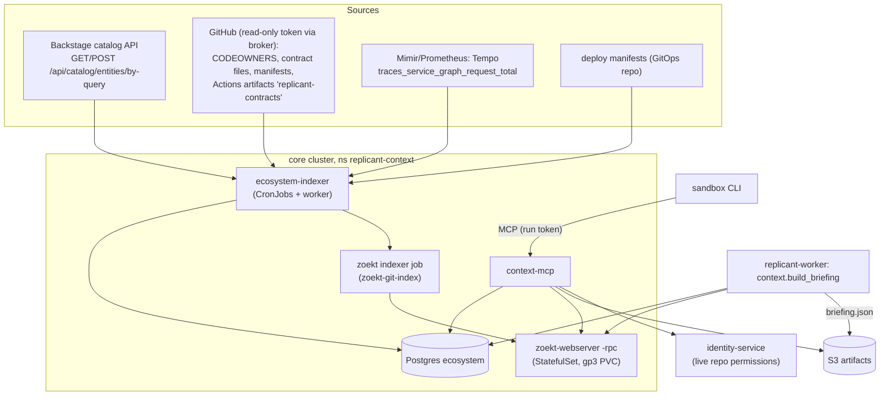

# Ecosystem Context and Briefings

**Section:** WS-04 · **Constraints:** D-13, D-18, D-19, D-20, D-21 · **Contracts:** C-PG (`ecosystem`), C-ART (`briefing`), C-RUNNER (`context-mcp` audience, scopes `context:read`, `code_search:read`), ADR-011 (token broker)

## Purpose

Give agents awareness of the service they change and of the services around it (contracts,
consumers, owners, blast radius) using only automatically derived sources (D-13): no manual schema
registry and no embedding index over repositories.

## Decisions summary

| Decision | Constraint | Reference |
|---|---|---|
| Sources: Backstage catalog (`/entities/by-query`), CODEOWNERS, repo scans for contract files, CI-produced contract artifacts, build-manifest dependency graphs, Tempo service-graph metrics, deploy manifests | D-13 | §1 |
| Storage: Postgres `ecosystem` (adjacency tables + recursive CTEs), versioned by a monotonic `graph_seq` | D-13, D-09 | §2, [ADR-04-004](adr/004-ecosystem-graph-in-postgres.md) |
| Code search: self-hosted **Zoekt** (Apache-2.0), lexical plus symbol search (`sym:` with universal-ctags), exposed only through context-mcp. Structural (AST) search is done locally in the sandbox with `ast-grep` on the checkout, not in an index | D-13 | §3 |
| Briefings are generated **deterministically** (no LLM) per job at context assembly, re-rendered per run with planned/touched paths, and budgeted ([context-budget.md](context-budget.md)) | D-13, D-14 | §4 |
| Repository content (contract bodies, code, call sites) is shown only from repos the job's requester can read, checked live; catalog metadata is org-visible | D-18 | §6 |
| Compatibility checks (`buf breaking`, `oasdiff breaking`, `graphql-inspector diff`, `asyncapi diff`, JSON Schema validator) run in the QA sandbox against the base branch; breaking changes on consumed contracts raise risk and feed repair | D-13, D-16, D-19 | §7 |
| `zoekt-indexer` and `ecosystem-indexer` get read-only installation tokens (`contents:read`, `metadata:read`, opted-in repos) from the broker under accepted CCR-09-06 (amends ADR-011). No `actions` permission is ever requested, so CI-produced contracts are pushed to the indexer instead of pulled | D-21, ADR-011, CCR-09-06 | §1, §3.2 |



## 1. Sources and extraction

| Source | Extractor (ecosystem-indexer) | Produces | Schedule / max staleness |
|---|---|---|---|
| Backstage catalog | `POST /api/catalog/entities/by-query` with cursor pagination (`GET /entities` is deprecated in favor of `by-query`) [verified: https://backstage.io/docs/features/software-catalog/software-catalog-api/, 2026-10-24]. Kinds `Component`, `API`, `System`, `Resource`, `Group`; relations `providesApi`, `consumesApi`, `dependsOn`, `ownedBy`, `partOf` [verified: https://backstage.io/docs/features/software-catalog/well-known-relations/, 2026-10-24]. `API` entities' `spec.definition` (inline or `$text` reference) [verified: https://backstage.io/docs/features/software-catalog/descriptor-format/, 2026-10-24] | `services`, `service_repos` (from `backstage.io/source-location` annotation), `edges` (`consumes_api`, `depends_on`), contracts with `source = backstage` | every 30 min / 6 h |
| CODEOWNERS | Read the first of `.github/CODEOWNERS`, `CODEOWNERS`, `docs/CODEOWNERS`; last matching pattern wins; files over 3 MB are not loaded by GitHub [verified: https://docs.github.com/en/repositories/managing-your-repositorys-settings-and-features/customizing-your-repository/about-code-owners, 2026-10-24] | `owner_rules` (at the default-branch commit) | on default-branch change, max 24 h |
| Repo scan: contract files | Globs at the default-branch head: `**/openapi*.{yaml,yml,json}`, `**/swagger*.{yaml,json}`, `**/*.proto` (with `buf.yaml`/`buf.work.yaml` module roots), `**/*.graphql`, `**/schema.graphqls`, `**/asyncapi*.{yaml,yml,json}`, `**/schemas/**/*.json` with `$schema`, `**/*.avsc`. Normalization: OpenAPI bundled and dereferenced (`prance`), protobuf compiled to a `FileDescriptorSet` with `buf build -o image.binpb` then rendered as JSON, GraphQL SDL normalized with `graphql-core` `print_schema`, AsyncAPI parsed with `@asyncapi/parser`. `digest = sha256(JCS(normalized))` | `contracts`, `contract_versions` (≤ 2 MiB), `contract_elements` | on default-branch change, max 24 h |
| CI-produced contracts | Opt-in per repo, for contracts generated from code annotations: a reusable workflow step POSTs the normalized contracts to `https://ecosystem-ingest.<env>.replicant.internal/v1/contracts` authenticated with a GitHub Actions OIDC token (audience `replicant-ecosystem-ingest`; the indexer verifies `repository_id` and `ref` = default branch). Replicant never requests the GitHub `actions` permission (CCR-09-06 never-granted list) | as above, `source = ci_artifact` | on each default-branch CI run |
| Build graph | Manifests at head: `go.mod` (`require` of internal module paths), `package.json` (internal scopes `@acme/*`), `pyproject.toml`/`requirements*.txt` (internal index packages), Maven `pom.xml` (internal groupIds), `Cargo.toml`, `buf.yaml` deps. Internal = matches the org's module/package prefixes configured on the source | `edges` `build_dependency` | daily |
| Client stub usage | Zoekt query per provided RPC/operation for generated client symbols (e.g. `sym:NewLedgerServiceClient`, OpenAPI operationId names) across the org | `edges` `client_stub_usage`, `call_sites` | weekly |
| Tempo service graph | PromQL against Mimir: `sum by (client, server, connection_type) (rate(traces_service_graph_request_total[7d]))` and `…request_failed_total`; labels `client`, `server`, `connection_type` (`unset`, `virtual_node`, `messaging_system`, `database`) [verified: https://grafana.com/docs/tempo/latest/metrics-from-traces/service_graphs/, 2026-10-24]; requires the metrics-generator `service-graphs` processor (Tempo 3.x) [verified: same page; Tempo v3.1.1 release, 2026-10-24]. `client`/`server` are `service.name` values, mapped to catalog services through the `replicant.example.com/otel-service-name` annotation or name equality | `edges` `calls_runtime` with `calls_per_min`, `error_ratio` | hourly / 24 h |
| Deploy manifests | GitOps repo: Kubernetes `Deployment` env vars and ConfigMaps containing `http(s)://<svc>.<ns>.svc` or service DNS names; Kafka topic names in config; image references resolved to their source commit via the OCI label `org.opencontainers.image.revision` | `edges` `depends_on`, `publishes_to`/`subscribes_to` (`via` = topic); `deployments` (deployed commit per service and environment, R1-104) | hourly for deployments, daily for edges |
| Incidents (optional) | Only if the org has an incident tool with an API (configured as a source); otherwise empty | `incidents` | hourly |

RPC call-graph derivation from spans must handle the OpenTelemetry rename: `rpc.service` is
deprecated in favor of the fully qualified `rpc.method`, and `rpc.system` in favor of
`rpc.system.name` [verified: https://opentelemetry.io/docs/specs/semconv/registry/attributes/rpc/,
2026-10-24]. The indexer parses the service from `rpc.method` and accepts both forms.

Every source run writes `source_runs` (counts, errors) and, on success, a new `graph_versions` row;
rows touched get the new `graph_seq`. Removal: an entity absent from a source for 3 consecutive
successful runs gets `removed_at`.

## 2. Storage, freshness, and staleness

- Postgres tables ([sql/ecosystem.sql](sql/ecosystem.sql)); blast radius by
  `ecosystem.consumers_of(service, depth)` (recursive CTE, cycle-safe; tested).
- Each source has `max_staleness`. The briefing's `freshness` block lists every source with
  `last_success_at` and `stale`. Stale sources do not block a job; the briefing says so, and if the
  runtime graph is stale the blast radius is computed from catalog and build edges only and marked
  `confidence` lower.
- Metric `replicant_ecosystem_source_staleness_seconds{reason=<source kind>}` and alert when a source
  exceeds `max_staleness` by 2×.

## 3. Code search (Zoekt)

### 3.1 Deployment

- Upstream `github.com/sourcegraph/zoekt` (Apache-2.0, active; no tagged releases, so pin a commit
  SHA in the image) [verified: https://github.com/sourcegraph/zoekt, 2026-10-24]. Binaries used:
  `zoekt-git-index`, `zoekt-webserver` [verified: same README].
- `zoekt-webserver -rpc` serves the JSON API `POST /api/search` (`Q`, optional `RepoIDs`, `Opts`
  such as `NumContextLines`, `MaxDocDisplayCount`, `ChunkMatches`) and `/api/list`; the API exists
  only with `-rpc` [verified: https://github.com/sourcegraph/zoekt/blob/main/doc/json-api.md and
  api.go, 2026-10-24].
- Query syntax used by agents and by the indexer: regex, `repo:`, `file:`, `lang:`, `sym:`,
  `case:`, `branch:`, negation with `-` [verified:
  https://github.com/sourcegraph/zoekt/blob/main/doc/query_syntax.md, 2026-10-24]. Symbol search and
  ranking need universal-ctags in the indexer image [verified: README, 2026-10-24].
- Sourcegraph is not used: its core repository has been private since 2024 under an enterprise
  license [verified: https://github.com/sourcegraph/sourcegraph-public-snapshot, 2026-10-24], which
  conflicts with the open-source preference, and its structural search is disabled by default and
  no longer developed [verified: https://sourcegraph.com/docs/code-search/types/structural,
  2026-10-24].
- Zoekt has no structural/AST search. Agents get structural search **in the sandbox** on their own
  checkout (`ast-grep` installed in the environment images by WS-03); that is local, not an index.
- Sizing: 1,500 repos default branch only; index roughly 3–4× source size `[unverified: Zoekt index
  size ratio for this corpus; measure on the first full index]`. Start with a 500 GiB gp3 PVC,
  `StatefulSet` with 2 replicas each holding a full index (rebuildable, C-STATE: derived).
- **At 10x scale (15,000 repos; R2-046, R1V-006).** The WS-04 parts that do not scale by configuration
  alone, and their change path:
  - *Zoekt.* A single full-index replica stops fitting one PVC at roughly 5,000 repos, extrapolating
    the ratio above `[unverified: measure on the first full index]`. Change path: shard the index
    by `hash(repo_id) mod K`. Run K `zoekt-webserver` StatefulSets (2 replicas each), with indexer
    jobs per shard. context-mcp fans each query out only to the shards that own the query's
    `RepoIDs`, or to all K for an unscoped query, and merges by score, keeping the `max_files` cap (≤ 50).
    K is a Helm value. Re-sharding is a full re-index, because the index is derived (C-STATE).
    Trigger: index PVC above 70%, or p95 `code_search` above 2 s.
  - *Ecosystem graph.* Tables grow linearly. `consumers_of` is a bounded-depth recursive CTE
    (depth ≤ 3), so its cost tracks the fan-in of one service, not the repo count. The indexer's full
    rebuild becomes per-shard incremental runs, using the same shard key.
  - *Memory.* Entries and embeddings are partitioned per tenant, and retrieval filters by
    repo and scope before the ANN search (retrieval-injection.md §2.1, §2.4). Repo count changes no
    per-query cost. The ANN recall gauge `replicant_memory_ann_recall` is the trigger to re-tune
    HNSW `ef_search` per tenant.
  - The C-JOBREQ `max_repos` limit and maintenance fan-out sharding belong to WS-00 and WS-01. WS-04's
    `repos` array on snapshots stays at most 20 per job.

### 3.2 Indexing and credentials

The indexer clones or fetches each repo's default branch into a local mirror (bare repos on the
same PVC) and runs `zoekt-git-index -index /data/index -branches <default> <repo>` when the head
changed. It needs read access to every opted-in repository. ADR-011 makes `github-token-broker` the
only key holder and lists three token holders (publisher-worker, github-integration, repo-mirror).
repo-mirror lives in the exec cluster and authenticates sandboxes, so it is not a suitable source
for a core-cluster indexer. Accepted **CCR-09-06** (WS-09, adjudicated 2026-10-24) adds broker callers
`replicant-context/zoekt-indexer` and `replicant-context/ecosystem-indexer` with `contents:read` and
`metadata:read`, opted-in repos only, one repository per token, audited like the others. WS-04 had
drafted the same request; it is not filed separately.

Head detection: hourly GitHub GraphQL batch query of `defaultBranchRef.target.oid` for all opted-in
repos (100 per query), plus push events for default branches forwarded by github-integration when
available (XD-04-09).

## 4. Briefings

### 4.1 When

- `context.build_briefing` (replicant-worker activity, logical activity ID
  `context.c<cycle>.n<ord>.briefing`) runs once at the job's first context assembly and
  again at the start of each repair cycle and after a rebase (base SHA changed).
- Per run, `context.stage_inputs` re-renders `briefing.md` from the stored JSON with the run's
  planned/touched paths and budget.

### 4.2 Schema

[schemas/briefing.schema.json](schemas/briefing.schema.json) (`replicant.briefing/v1`), example
[examples/briefing.example.json](examples/briefing.example.json) (validated). Sections: `service`,
`contracts_touched`, `consumers`, `blast_radius`, `owners`, `recent_incidents`, `constraints`,
`compat_checks`, `code_search_hints`, plus `freshness` and `graph_seq`.

### 4.3 Generation (deterministic)

1. Map the target repo to services (`service_repos`; monorepo: prefixes matching predicted or
   planned paths).
2. **Contracts touched:** contracts in the repo whose path, or whose generating code path, matches
   predicted/planned/touched paths (predicted paths before planning: files named in the issue text
   and Zoekt hits for identifiers in it); plus all contracts the service provides, marked
   `service_provides`.
3. **Consumers:** `consumers_of(service, 3)` for each service; per consumer, owners, call rate, and
   the number of call sites in repos the requester can read. Call sites in other repos are neither
   shown nor counted (WS-09 G-05: a count would be an existence oracle).
4. **Blast radius level** (input to `risk.classify`, which may only raise risk, D-19):
   `high` if any direct consumer in another tenant has tier 0–1, or transitive consumers > 5;
   `medium` if any direct consumer exists, or any cross-tenant consumer at depth ≤ 2;
   `low` if only depth ≥ 2 same-tenant consumers or all edges have confidence < 0.5;
   `none` otherwise.
5. **Owners:** CODEOWNERS matches for the paths.
6. **Constraints:** generated text from templates, e.g. `contract.<pkg>.wire_compat` when a
   provided protobuf package has runtime consumers.
7. **Compat checks:** commands for §7 per contract touched.
8. **Code-search hints:** Zoekt queries for the touched symbols across the org.
9. Write `steps/context.c<cycle>.n<ord>/briefing/briefing.json` with `If-None-Match: *` and a
   step manifest; `input_digest = sha256(JCS({repo, base_sha, paths, graph_seq, visibility digest}))`.

Untrusted fields (`description_untrusted`, `title_untrusted`) come from catalog files and incident
titles; the renderer quotes them.

## 5. MCP: context-mcp

Tool definitions: [mcp/context-mcp.tools.json](mcp/context-mcp.tools.json) (11 tools, validated
against the official MCP 2026-07-28 `Tool` schema). Same transport and the same five C-RUNNER 3.0.0 verifier obligations as the memory MCP
([retrieval-injection.md §4.1](retrieval-injection.md)), with `aud` equal to `context-mcp` (the
token from `$REPLICANT_RUN_TOKEN_DIR/context-mcp`), embedded run-grant verification, the revocation
list, and authorization by `tenant_id`, `repo_ids`, `scopes`, and `acting_for`; `context:read` for
catalog, contracts, graph, owners, and briefing tools; `code_search:read` for `code_search`,
`find_call_sites`, and `file_get`. context-mcp reads Postgres `ecosystem` as `svc_context_mcp`
(SELECT only), Zoekt over the in-cluster JSON API, and the briefing object in S3 for the run's job.

### 5.1 Internal contract API for the QA stage (R1-104, XD-05-04)

context-mcp also serves an internal (non-MCP) listener for replicant-worker, authenticated with the
worker's projected ServiceAccount token (audience `context-mcp-internal`):

```
GET /internal/v1/contracts?service_ref=<ref>&name=<path or logical name>&revision=<rev>
    rev ∈ {default_branch, deployed_prod, deployed_staging, sha256:<hex64>}
→ 200 {contract_ref, kind, revision_resolved: {kind, commit_sha, digest}, normalized, elements[]}
   404 contract_not_found | 409 revision_unavailable (e.g. never deployed) | 403 repo_not_visible
GET /internal/v1/jobs/{job_id}/compat-checks
→ 200 {briefing_digest, compat_checks: [replicant.briefing/v1 compat_checks items]}
```

- `default_branch`: `ecosystem.contracts.current_digest`.
- `deployed_prod` / `deployed_staging`: `ecosystem.deployments` gives the deployed `commit_sha` for the
  service and environment (from the GitOps repo: image reference → OCI label
  `org.opencontainers.image.revision`); the contract version extracted at that commit is returned.
  When the deployed commit changes, the indexer extracts the service's contracts at that commit, so
  the version normally exists; if not, `409 revision_unavailable` and QA falls back to
  `default_branch` with a warning in `qa_report.contract_compat`.
- The caller passes `X-Replicant-Job-Id`; repository-content visibility is checked against the job's
  requester exactly as for MCP calls (§6).

## 6. Visibility (no confused deputy)

- The run token carries the required `acting_for` claim (the requester's principal, or
  `on_behalf_of` for service-triggered jobs; accepted CCR-09-03). context-mcp uses it directly; it
  also checks that the claim matches the job binding in memory-service
  (`GET /internal/v1/jobs/{job_id}/binding`) and refuses on mismatch.
- For any result containing repository content, context-mcp collects the distinct repos, asks
  identity-service `POST /internal/v1/authorize:batch-repos {principal_id, action: "repo:read", repo_ids[]}` for the requester (live, ≤ 60 s cache,
  display-grade caching as C-STATE allows for non-gate reads; XD-FIX-R1-098), drops repos without read
  permission. Responses never say that results were withheld: no counts and no flags (G-05).
- Defense in depth: it sets `replicant.visible_repo_ids` for the transaction; RLS on
  `contract_versions` and `call_sites` returns only those repos (tested in
  [sql/test_ecosystem.sql](sql/test_ecosystem.sql)).
- Zoekt queries are restricted to the tenant's GitHub orgs plus repos marked `internal`/`public`
  before post-filtering, to bound work.

## 7. CI compatibility checks and feedback into the job

The briefing's `compat_checks` lists commands; the QA stage (WS-05) runs them in the QA sandbox
against the base branch and reports a `contract_compat` section in `qa_report` (XD-04-06).

| Kind | Command | Verified |
|---|---|---|
| protobuf | `buf breaking <input> --against '.git#branch=main,subdir=proto' --error-format json` (categories FILE default, PACKAGE, WIRE_JSON, WIRE; consumed-over-the-wire packages use `WIRE_JSON`) | [verified: https://buf.build/docs/reference/cli/buf/breaking/ and https://buf.build/docs/breaking/rules/, 2026-10-24; buf v1.75.0] |
| OpenAPI | `oasdiff breaking base.yaml revision.yaml --fail-on ERR --format json` (3.0 and 3.1; mixed 3.0/3.1 needs `--auto-upgrade`) | [verified: https://github.com/oasdiff/oasdiff/blob/main/docs/BREAKING-CHANGES.md and …/OPENAPI-31.md, 2026-10-24; oasdiff v1.34.1] |
| GraphQL | `graphql-inspector diff old.graphql new.graphql` (fails on breaking changes); `@graphql-inspector/cli` 7.x, now under `graphql-hive` | [verified: https://the-guild.dev/graphql/inspector/docs/commands/diff, 2026-10-24] |
| AsyncAPI | `asyncapi diff old.yaml new.yaml -t breaking -f json` | [verified: https://www.asyncapi.com/docs/tools/cli/usage, 2026-10-24] |
| JSON Schema | Atlassian `json-schema-diff-validator` (breaking-change classification; plain `json-schema-diff` only lists additions/removals) | [verified: https://npmjs.org/package/json-schema-diff-validator, 2026-10-24] |

Feedback:

1. **Risk:** a breaking result on a contract with consumers sets a deterministic risk input
   `contract_breaking_with_consumers` (WS-07 risk rules raise to `high` and require the plan or
   publish gate; D-19).
2. **Repair inside the job:** the QA failure goes into working memory (`failing_tests` plus the
   compat report) and the implementer re-runs in the same cycle (session resume allowed).
3. **Approval packet:** compat results and the consumer list (with owners) are part of the packet.
4. **PR:** the publisher adds a "Consumers" section listing consumer services and owners; owners of
   affected consumers can be added as reviewers per tenant policy (WS-07).
5. **Memory:** repeated breakages of the same kind in a repo feed the negative miner.

## 8. Local mode (D-20)

| Component | Local substitute |
|---|---|
| Backstage | `ecosystem-stubs` serves a fixture catalog (`fixtures/catalog/*.yaml` in Backstage descriptor format) on the same `/api/catalog/entities/by-query` path |
| GitHub sources | Gitea/Forgejo sample repos (`ledger-api`, `billing-worker`, `checkout-web`) with CODEOWNERS, protobuf, OpenAPI, and GraphQL files |
| Tempo service graph | A static PromQL response fixture (`fixtures/service-graph.json`) served by the stub, or the real local Tempo when the observability profile runs |
| Zoekt | `zoekt-git-index` over the sample repos at `replicant dev up`; `zoekt-webserver -rpc` container |
| Incidents | Empty |
| Source config | `sources` rows of kind `fixture`, seeded through the API (`replicant dev seed`, D-26) |

## Open questions

| Question | Who decides | Options | Recommendation |
|---|---|---|---|
| Opt-in for CI contract artifacts | Tenants / WS-07 | org-wide reusable workflow / per repo | Per repo opt-in; committed contract files already cover most repos |
| Run compat checks in QA or a separate verifier step | WS-05 | QA sandbox / verifier activity | QA sandbox (needs the checkout and toolchain) |
| Zoekt index scope | WS-04 / WS-09 | all org repos / opted-in only | All repos visible to Replicant's GitHub App installation, filtered at query time by requester permission |

## Risks

- Tempo service names do not match catalog names. Mitigation: the annotation mapping and a
  "unmapped runtime services" report in admin analytics.
- Contract discovery by glob misses generated contracts. Mitigation: CI artifact opt-in, Backstage
  `API` entities.
- Two more GitHub token callers widen the credential surface (CCR-09-06). Mitigation: read-only,
  per-repo, audited, core cluster only.

## Interfaces consumed / provided

- **Consumed:** Backstage API, GitHub through the token broker (CCR-09-06), Mimir PromQL (WS-08),
  identity-service repo permissions (WS-07), C-ART `briefing`.
- **Provided:** `ecosystem` schema, context-mcp tools, briefing schema, `compat_checks` contract for
  WS-05, `blast_radius.level` risk input for WS-07.
