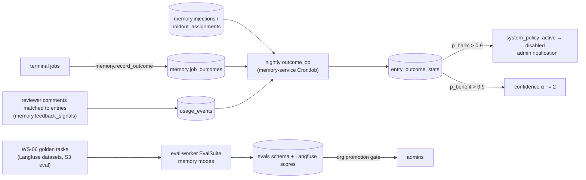

# Evaluating Memory

**Section:** WS-04 (with WS-06) · **Constraints:** D-14, D-03, D-25 · **Contracts:** C-PG (`memory`, `evals`), C-DEF (bundle `memory_snapshot_policy`), C-IDS (`gtask_`, `eval_`)

## Purpose

Prove that memory helps, per entry and in aggregate, and take entries out of service automatically
when the evidence says they hurt. Memory that cannot be shown to help is cost and risk.

## Decisions summary

| Decision | Constraint | Reference |
|---|---|---|
| Five online metrics, all computed from Replicant facts (no LLM opinion in the primary metrics): review rounds per PR, repeated-comment rate, learned-repeat rate, first-pass QA success, first-review approval | D-14 | §1 |
| Per-entry measurement by **randomized holdout** during probation (20% of eligible jobs) and periodic re-checks (5%) for mature entries; enforced entries are never held out | D-14 | §3 |
| Automatic disable when, after ≥ 20 exposures and ≥ 5 holdout jobs, the posterior probability that the entry increases review rounds or repeated comments exceeds 0.9 (system transition under governance) | D-14, D-25 | §4 |
| Offline replay on WS-06's golden set with memory modes `none`, `pinned`, `current`, `counterfactual`, `replay`. Bundle comparisons use one snapshot per task, built with `scope_context` (source tenant, repo, `as_of` = suite start) and shared by both arms, exactly as WS-06's eval harness specifies, so live memory changes do not confound promotion. Memory-policy changes go through WS-06 shadow mode and two-person sign-off | D-03 | §5 |
| Component evals with labelled sets: extraction, grounding, dedupe thresholds, retrieval, capacity curve, safety classifier | D-14 | §6 |



## 1. Metrics

Unit: one terminal job with a PR (other jobs contribute to QA metrics only).

| Metric | Definition | Source |
|---|---|---|
| `review_rounds` | Number of repair cycles triggered by authorized human feedback before merge or close | workflow counters → `job_outcomes.review_rounds` |
| `repeated_comment_rate` | Authorized human review comments that match an entry **that was injected into the job** (judge-matched, see below) ÷ authorized human review comments. A high value for an entry means it is not being followed | `feedback_signals.reviewer_repeated` → `job_outcomes.repeated_comment_count` |
| `learned_repeat_rate` | Comments that match an **active entry not in the job's push set** (held out, cut, or out of scope) ÷ comments. Measures what memory could have prevented | `job_outcomes.learned_repeat_count` |
| `first_pass_qa` | The cycle-0 QA run passed on the first attempt | QA result |
| `first_review_approved` | The first human review on the PR was an approval with no change requests | `pr.event review_submitted` |
| `seconds_to_merge` | PR opened → merged (secondary) | PR events |
| `post_merge_reverted` | The merged PR was reverted within 30 days, or a "this was wrong" / regression report was filed (R2-017). A merged-then-reverted job counts as a **failure** in every metric above, never as a success | `memory.job_outcome_reports` → `job_outcomes.post_merge_reverted` |

Per-job outcomes for WS-06 (XD-W2-06-01): `memory.v_job_outcomes` exposes `job_id`, `tenant_id`, `release_bundle_id`, `workflow_type`, `terminal_status`, `pr_merged`, `merged_at`, `post_merge_reverted`, `outcome_report_count`, `review_rounds`, `first_pass_qa`, `first_review_approved`, `report_kind` (`reverted` wins, else the earliest report's kind), and `reported_at` (first report). There is no free text: report notes and evidence URLs are never exposed. The view is `security_invoker` (XD-W2-10-07), so the caller's own privileges and RLS apply. WS-10's `ops.eval_job_outcomes` runs as `eval_metrics_reader`, a member of `r_cross_tenant_write`, and pins `system:all-tenants`. The canonical `*_xt_write` policies then admit the read across tenants. `eval_metrics_reader` holds column-level SELECT on the view and on only the code, flag, count, ID and timestamp columns of `memory.job_outcomes` and `memory.job_outcome_reports`. Under any other scope it reads 0 rows. `sql/test_eval_invoker.sql` proves both. `grafana_ro` has no access to the view.
| `contradiction_rate` (per entry) | Jobs where an authorized reviewer contradicted the entry ÷ exposed jobs | `usage_events.reviewer_contradicted` |

**Comment-to-entry matching** (activity `memory.feedback_signals`, run after triage): candidate
entries are the job's snapshot items plus active entries in scope; match if cosine ≥ 0.85 and a
judge (prompt `memory-comment-match@1`, bundle-pinned) labels the comment `repeats`, `confirms`, or
`contradicts` the entry. Calibrated on 400 labelled comment-entry pairs (precision ≥ 0.9 for
`repeats` and `contradicts`). Signals never create content; they move statistics.

Dashboards (Grafana, `grafana_ro` on `memory.v_analytics_*` views; D-25 aggregates only): weekly
metrics per tenant and workflow type; candidate flow; auto-activations and auto-disables; verdict
distribution; injected entries and tokens per run.

## 2. Aggregate effect

- **Memory on vs off (continuous):** 2% of jobs per tenant (deterministic by job hash) run with an
  empty push set (`policy.experiments`, "global holdout"; pull still available). Compared weekly on
  all five metrics with a two-sided permutation test. This is the headline answer to "does memory
  help" and the alarm for silent regressions.
- **Regression alert:** a tenant's 4-week rolling `repeated_comment_rate` or `review_rounds` worse than
  the global-holdout arm by more than 25% raises `outcome_regression` ([safety.md §5.1](safety.md)).

The global holdout is a policy field and shipped through a bundle; whether 2% is acceptable is an
open question for product (it deliberately withholds learned conventions from some jobs).

## 3. Per-entry experiments

| Experiment | Who | Arm assignment | Rate |
|---|---|---|---|
| `probation` | Every auto-activated entry until `probation_until` and ≥ 10 exposures | `sha256("mholdout:" ‖ entry ‖ ":" ‖ job) mod 10000 < 2000` | 20% holdout |
| `periodic_recheck` | Mature active entries, one quarter at a time (round-robin by entry hash) | same hash, different salt | 5% holdout |
| `candidate_shadow` | Candidates: computed as if injected, not injected | — | 100% shadow (measures `learned_repeat_rate` for the candidate's subject) |

Assignments are written to `memory.holdout_assignments` at snapshot creation; the snapshot item has
`holdout = true` and is never rendered. Enforced entries are excluded. A job's assignment is fixed
for its lifetime (pinned snapshot).

## 4. Automatic deprecation rule

Nightly, for every active entry with at least 20 exposed jobs and 5 holdout jobs (governance
`outcomes.min_exposures`, `min_holdout`), restricted to jobs where the entry was *applicable*
(selected or held out, not cut by budget):

```
Review rounds:   λ_x ~ Gamma(0.5 + Σ rounds_x, 1 + n_x)      λ_h ~ Gamma(0.5 + Σ rounds_h, 1 + n_h)
Repeat/contra:   p_x ~ Beta(1 + k_x, 1 + n_x − k_x)          p_h ~ Beta(1 + k_h, 1 + n_h − k_h)
                 (k = jobs with a repeated or contradicting comment on the entry's subject)
p_harm    = P(λ_x > 1.10·λ_h  OR  p_x > p_h + 0.05)   estimated with 20,000 Monte Carlo draws (seeded by entry_id)
p_benefit = P(λ_x < 0.90·λ_h  AND p_x ≤ p_h)
```

Jobs with `post_merge_reverted = true` count as harmful exposures for every entry injected into them
(R2-017): a wrong fix that merged must not train memory toward plausible wrong fixes. The playbook
and negative miners exclude reverted jobs.

| Condition | Verdict | Action |
|---|---|---|
| `p_harm > 0.9` (`outcomes.harm_probability`) | `harms` | `active → disabled`, `actor_kind = system_policy`, reason `auto_disabled_outcome`, admin notification with the evidence; admins can re-enable |
| exposed `repeated_comment_rate` on the entry's subject ≥ 0.30 (`ineffective_repeat_rate`) and not `harms` | `ineffective` | Admin review queue: reword, narrow scope, or attach examples; no state change |
| `p_benefit > 0.9` | `helps` | Confidence α += 2 (once per verdict change); probation ends early if exposures ≥ 10 |
| otherwise, or below the sample minimums | `neutral` / `insufficient_data` | none |

Additionally, during probation a single authorized contradiction disables the entry
([write-path.md §5.3](write-path.md)). Entries without any holdout data (for example, admin-approved
before this system existed) get `periodic_recheck` before they can be judged.

Statistics are recomputed from `job_outcomes` and `usage_events` each night, so late PR events
(revision > 1) are included. The method is versioned (`entry_outcome_stats.method_version`).

## 5. Offline replay (with WS-06)

| Memory mode | Behaviour | Used for |
|---|---|---|
| `none` | Empty push set, MCP returns nothing | Baseline |
| `pinned(as_of)` | `eval.prepare_memory` calls `POST /internal/v1/snapshots` with `scope_context {tenant_id, repo, as_of = suite start}`; the resulting `msnap_…` goes into `JobRequest.options.evaluation.memory_snapshot_id` (CCR-06-01) for **both arms** when their snapshot policies are digest-equal; the job binds with `mode = eval_pinned` | **Bundle evaluation** (WS-06 eval-harness.md §3.3): identical memory across arms; no candidate or outcome writes from eval jobs |
| `current` | Snapshot taken now from live memory for the golden task's repo | Memory health: does today's memory help on known tasks |
| `counterfactual(+add, −remove)` | `counterfactual.add_entry_refs` / `remove_entry_ids` (mode `eval_prepare`) | Gate for org promotion and for bulk changes (re-embedding, ranking changes) |
| `replay(job_id)` | Exact snapshot and recorded injections of a past job ([retrieval-injection.md §7.2](retrieval-injection.md)) | Reproduction, incident analysis |

Golden tasks (WS-06 owns the set) carry, for memory purposes: the repo and base SHA, the task, and
**review expectations**: labelled reviewer comments the original PR received (for example "used
float for money"). The memory score per case is:

- `expectation_hit_rate`: share of labelled reviewer expectations the produced diff already satisfies
  (judge plus the rule's optional `check`, a grep/semgrep pattern), and
- the standard WS-06 task scores (tests, QA, reviewer-judge).

Gates:

- **Org promotion** (`evidence.org.require_eval_pass`): `counterfactual(+entry)` vs `current` on the
  golden tasks of at least 2 tenants in the entry's languages: `expectation_hit_rate` not lower and
  task score not lower by more than 1 standard error.
- **Ranking, embedding, or selection code changes:** `current` on the full set must not regress.
- **Snapshot policy changes** (part of bundles; change class "memory policy" in WS-06): shadow mode on
  10% of eligible live jobs for up to 5 days (WS-06 promotion PR-3), the mechanism check with memory
  disabled for one arm on tasks that have `expect_rule_key` (WS-06 eval-harness.md), and two distinct
  signers at promotion (WS-06 `twoPersonFor` includes memory policy). This is independent of D-25:
  memory **policy** is bundle configuration released by release managers; memory **entries** are
  curated by Replicant admins.
- `expect_rule_key` in golden tasks uses the same dotted vocabulary as `subject_key`
  ([write-path.md §2.1](write-path.md)), so expectation hits can be attributed to entries.

## 6. Component evals

| Component | Labelled set | Metric and target |
|---|---|---|
| Extraction generalization test | 1,000 real review comments labelled generalizable / not (two raters) | precision ≥ 0.90 at threshold 0.70; recall reported |
| Grounding gate (G5) | 200 injected-hunk adversarial cases from the red-team set | ≥ 0.98 rejection |
| Dedupe thresholds per embedding space | 500 statement pairs (same / refinement / contradiction / unrelated) | merge precision ≥ 0.98; duplicate recall ≥ 0.95 in the judge band |
| Retrieval (`memory_search`, push utility) | 300 (task, relevant entries) pairs from merged jobs where reviewers reinforced entries | nDCG@10, injected recall ≥ 0.9 |
| ANN recall (pull path, R2-051) | Nightly, per tenant: 200 sampled queries from `memory.retrievals`, HNSW vs exact top-10 | recall@10 ≥ 0.95 target; alert < 0.90 (`replicant_memory_ann_recall{tenant}`); underfilled results counted (`replicant_memory_ann_underfill_total`) |
| Curation health (R2-052) | `v_analytics_curation_queue`, `v_analytics_flags` | candidate age p90 ≤ 7 d; expired-unreviewed feedback candidates ≤ 20 per tenant per week; flags within SLA |
| Capacity curve | Golden tasks with 10, 20, 40, 80, 160 injected entries (padding with real, applicable entries) | Repeated-expectation misses and task score per bucket; the knee sets `max_entries` |
| Safety classifier | 300 red-team items + 300 benign conventions | block ≥ 0.95, false block ≤ 0.03 |
| Comment-to-entry matcher | 400 pairs | precision ≥ 0.90 |

These run in `eval-worker` as `EvalSuite`s on a schedule (weekly) and on changes to the relevant
prompt or code; results go to `evals` (WS-06) and Langfuse scores.

## Open questions

| Question | Who decides | Options | Recommendation |
|---|---|---|---|
| Global 2% memory-off holdout | Product (orchestrator) | 0% / 2% / 5% | 2%; it is the only unbiased aggregate measurement |
| Should reviewers be told when a job was in a holdout arm? | WS-07 / product | never / in the PR footer | Never per job (it biases reviews); documented in the Replicant help page |
| Labelling budget for component sets | WS-06 | — | Two raters, 2,500 items initially |

## Risks

- Small repos never reach 20 exposures. Mitigation: those entries rely on probation contradiction,
  agent flags, and admin review; the aggregate holdout still covers them.
- Matching comments to entries with a judge introduces noise. Mitigation: calibrated thresholds and
  the high posterior bar (0.9) before any automatic action.

## Interfaces consumed / provided

- **Consumed:** WS-06 eval harness (`EvalSuite`, `EvalCase`, golden tasks, `evals` schema), job
  outcomes from WS-01 activities, PR events (C-MSG).
- **Provided:** memory modes for `EvalCase` (`POST /internal/v1/snapshots` modes `eval_prepare` with `counterfactual`, and `eval_pinned` with `replay_job_id`), metric
  definitions, the deprecation rule, analytics views for Grafana.
