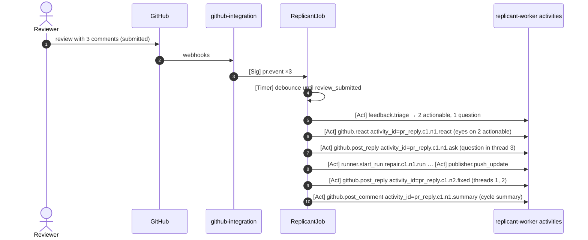

# PR Reply Behavior

**Section:** WS-04 (content and policy; github-integration posts) · **Constraints:** D-15, D-21, D-24, D-25 · **Contracts:** C-MSG (`pr.event`, sender rule 4 on untrusted text), ADR-009, ADR-011

## Purpose

How Replicant responds on a PR it owns when reviewers comment: acknowledging, reporting fixes,
asking, declining, threading, resolving, and telling the reviewer that feedback was stored as
memory.

## Decisions summary

| Decision | Constraint | Reference |
|---|---|---|
| Acknowledge with a reaction, not a comment: `eyes` within 60 s on each comment that will be acted on | §4 UX | §1 |
| One reply per review thread after the fix is pushed, in that thread, with the commit link and a one-line summary; one PR-level summary comment per repair cycle | D-15 | §2 |
| Ask a clarifying question when triage confidence < 0.6 or the comment is ambiguous; decline politely, with a reason, when the request conflicts with an enforced rule, security policy, or the job's scope | D-15, D-21 | §3 |
| Replicant does **not** resolve review threads by default (the reviewer owns resolution); tenant policy can enable resolve-after-fix | D-15 | §4 |
| When feedback became a memory candidate, the thread reply says so in a collapsed footer with the entry ID; when the reviewer used `/replicant no-memory`, nothing is stored | D-14, D-25 | §5 |
| Model-written text in replies is sanitized: no @-mentions, no links outside an allowlist, no `/replicant` commands, length-capped | D-21 | §6 |



All GitHub writes go through github-integration with installation tokens from the broker
(ADR-011); the activities call its internal API, which is idempotent on the logical activity ID.

## 1. Acknowledgement

- `POST /repos/{owner}/{repo}/pulls/comments/{comment_id}/reactions` with `content = "eyes"`
  (200 if it already exists, 201 if created) [verified:
  https://docs.github.com/en/rest/reactions/reactions, 2026-10-24]. Needs Pull requests: write.
- For review bodies (no line comment), react on the review's top-level issue comment equivalent is
  not available; the cycle summary comment acknowledges them.
- Comments from bots, Replicant, or unlinked users get no reaction; unlinked humans get the
  link-your-account reply defined by WS-07.

## 2. Fix replies

Per thread, after the push that addressed it:

- Endpoint: `POST /repos/{owner}/{repo}/pulls/{pull_number}/comments/{comment_id}/replies`, where
  `comment_id` must be the thread's top-level comment (replies to replies are not supported)
  [verified: https://docs.github.com/en/rest/pulls/comments, 2026-10-24].
- Template (`fixed`):

```markdown
Fixed in [`3f9a1c2`](https://github.com/acme-payments/ledger-api/pull/1431/commits/3f9a1c2e7d4b6a8c0e2f4a6b8c0d2e4f6a8b0c2d): proration now uses `decimal.Decimal` with half-even rounding at the minor unit; added USD/JPY day-17 tests.

<details><summary>Replicant memory: this comment produced a repository convention</summary>

Agents working in this repository will see:

> [mem_01m42qyvr0dzhe1xg73b1bq38b@1] repo acme-payments/ledger-api · Represent monetary amounts with github.com/shopspring/decimal.Decimal; never float64.

**Next:** activates automatically 24 h after this PR merges unless you object, then runs a 14-day probation. [View or request a correction](https://replicant.acme.internal/memory/entries/mem_01m42qyvr0dzhe1xg73b1bq38b). Reply `/replicant memory-wrong <reason>` to put it on hold now, or `/replicant no-memory` to withdraw your comment as a source.
</details>
```

- PR-level summary per cycle (`POST /repos/{owner}/{repo}/issues/{issue_number}/comments`, which
  works for PRs [verified: https://docs.github.com/en/rest/issues/comments, 2026-10-24]): a table of
  threads with status `fixed`, `asked`, `declined`, the commits, QA result, and remaining repair
  budget ("Repair cycle 1 of 3").
- Bodies stay under 60,000 characters; GitHub rejects bodies over 65,536 characters
  `[unverified: documented limit; observed API error text "maximum is 65536 characters"]`.

## 3. Questions and declines

| Situation | Reply | Job behavior |
|---|---|---|
| Ambiguous request (triage `question` or confidence < 0.6) | `asked` template in the thread: what is unclear and the options Replicant sees | The thread is excluded from this cycle's repair; the job waits in `pr_review` for the answer (`pr.event` in that thread) |
| Conflicts with an `enforced` memory entry or a security policy | `declined`: states the rule by ID and asks the reviewer to confirm an exception; a confirmation from a CODEOWNER is passed to the next repair as an explicit override note (the enforced entry is not changed; admins see a conflict) | Not applied this cycle |
| Out of the job's scope ("also refactor module X") | `declined`: suggests a new Replicant job (`/replicant new …`) | Not applied |
| Requires access Replicant does not have (secrets, infra changes outside the repo) | `declined` with the reason | Not applied |
| Repair budget exhausted | PR comment from the workflow (C-ARCH §5.1) | Job ends `failed` |

The decline text is produced from templates plus the rule ID, never free model text.

## 4. Threading and resolution

- Replies always go in the thread of the comment; general summaries go to the PR conversation.
- Resolution is GraphQL only: `resolveReviewThread(input: {threadId})`; thread IDs come from
  `pullRequest.reviewThreads { id isResolved comments { fullDatabaseId } }` (`databaseId` is
  deprecated in favor of `fullDatabaseId`) [verified: https://docs.github.com/public/fpt/schema.docs.graphql,
  2026-10-24]. The GitHub App permission needed for the mutation is assumed to be Pull requests:
  write `[unverified: required GitHub App permission for resolveReviewThread; WS-07 tests on the dev
  App]`.
- Default `resolve_threads = never`: reviewers resolve. Tenant option `after_fix` resolves threads
  whose status is `fixed` once QA passed. Replicant never resolves `asked` or `declined` threads.
- When the PR gets new commits after a reply, outdated threads are left alone (no
  `minimizeComment`).

## 5. Memory notes (R2-017, R2-018)

- Shown only when the comment produced a candidate or merged as evidence into an existing entry.
- The footer renders the **statement exactly as agents will see it** (the `replicant.memory-block/v1`
  line) and the **true next state**: "activates 24 h after merge unless you object" for repo/path
  rules under auto-activation, "waiting for an administrator" otherwise. It links to the public
  entry view (`/v1/memory/entries/{id}/public`), which the comment's author and readers of the repo
  can open (D-25 unchanged: it is read-only).
- **Follow-up notices in the same thread**, posted by github-integration from memory-service's
  notice call (XD-FIX-R2-018): when the entry **activates** ("now active in this repository; probation
  until …"), when it is **held or disabled** by a correction request, flags, or a post-merge report,
  when an admin **acts** on a correction request, and when a candidate **expires** unreviewed ("not
  adopted; an administrator can reopen it"). One notice per (entry, kind); nothing for the PR author's
  own commits.
- **`/replicant memory-wrong <reason>`** (the comment's author, or a CODEOWNER of the path): a
  correction request. It immediately puts a candidate on hold or disables an entry still in
  probation (system policy), and queues it for an administrator with a 48 h SLA. The reply says which
  of these happened. Content changes remain admin actions (D-25).
- **`/replicant no-memory`** in the original comment, or as a reply in the thread, withdraws that
  comment as evidence (`withdrawn_reason = author_opt_out`) and records an `opted_out` decision. A
  candidate left without evidence gets a hold and then expires; an active entry whose only source
  was this comment gets a hold and goes to the admin queue (it no longer waits silently).
- **`/replicant wrong <reason>`** on a merged Replicant PR (linked user with ≥ write): a post-merge
  outcome report (`kind: wrong_fix`), the same as "Report a problem with this result" on the job
  page. A revert of the PR is detected automatically for 30 days (`kind: reverted`).

## 6. Sanitization of model-written text

The fix summary comes from the repair run's `role_result` (untrusted). Before posting:

- neutralize `@` mentions by wrapping `@name` in code formatting (`` `@name` ``), which GitHub does
  not notify (zero-width tricks are not used: they are rejected elsewhere as MS-10),
- drop links whose host is not github.com/<the org> or the docs allowlist,
- remove lines starting with `/replicant`,
- cap at 600 characters per thread reply.

## Open questions

| Question | Who decides | Options | Recommendation |
|---|---|---|---|
| Resolve threads by default | Tenants / WS-07 | never / after_fix | never |

## Risks

- Reply noise. Mitigation: reactions instead of comments for acknowledgement; one reply per thread;
  one summary per cycle.

## Interfaces consumed / provided

- **Consumed:** github-integration reply API (WS-07), token broker (ADR-011), triage output,
  `role_result` per comment (WS-03 repair schema).
- **Provided:** templates, decline rules, memory footer semantics, sanitization rules.
