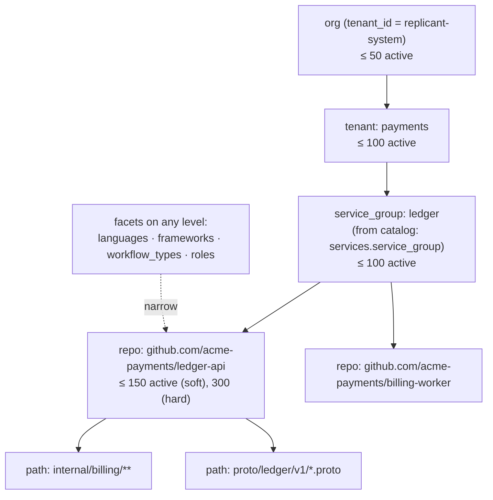

# Scoping, Inheritance, and Precedence

**Section:** WS-04 · **Constraints:** D-14, D-25, D-18 · **Contracts:** C-PG rule 4 (tenant isolation), C-IDS (`tenant_id`)

## Purpose

Decide which memory applies to a job, what happens when scopes disagree, who may write at each
scope, and how knowledge crosses tenant boundaries (by default it does not).

## Decisions summary

| Decision | Constraint | Reference |
|---|---|---|
| Five anchor levels: `org` → `tenant` → `service_group` → `repo` → `path`. Each entry version has exactly one anchor plus optional **facets** (languages, frameworks, workflow types, roles) that narrow it further | D-14 | [data-model.md §2](data-model.md) |
| Inheritance is additive: a job sees every active entry whose anchor contains the job's target and whose facets match | D-14 | §2 |
| Conflicts resolve by an explicit total order: `enforced` first, then the most specific anchor, then facet count, then curated over auto-activated, then confidence, then recency. The agent sees only the winner, annotated "overrides …" | D-14 | §3 |
| Unresolvable conflicts (same specificity, contradictory, no admin resolution) are **suppressed**: neither side is injected, and a conflict record goes to the admin queue. Never silently resolved | D-14 | §3.3 |
| Writers can create candidates at `path`, `repo`, or `service_group` only. `tenant` and `org` are reachable only by admin promotion with evidence thresholds, and both need **two distinct admins** to activate or edit (one admin can always disable) | D-14, D-25 | §5 |
| No cross-tenant sharing except through `org` promotion. Tenant-scoped content is invisible to other tenants at the database layer (RLS) | D-14, C-PG rule 4 | §6 |



## 1. Levels

| Level | Key | How a job matches it | Example |
|---|---|---|---|
| `org` | none (`tenant_id = 'replicant-system'`) | Always | "Never log full card numbers; mask PANs to the last 4 digits." |
| `tenant` | `tenant_id` | Job's tenant | "All payments services emit OpenTelemetry spans with `payment.provider`." |
| `service_group` | `(tenant_id, service_group)`; the group comes from the derived catalog (`ecosystem.services.service_group`, usually a Backstage `System` or a team-defined grouping) | Any service the target repo maps to belongs to the group | "ledger services use zap for logging." |
| `repo` | `<host>/<owner>/<name>` (C-IDS repo form) | Job's target repo | "Use shopspring/decimal for money." |
| `path` | repo plus 1–20 gitignore-style globs, evaluated with `pathspec` `GitWildMatchPattern` relative to the repo root | At least one path the run will touch (planned paths from the plan, touched paths from the diff, predicted paths before planning) matches | `internal/billing/**`: "Proration helpers take a `clock.Clock`." |

Facets (`languages`, `frameworks`, `workflow_types`, `roles`) are AND-ed with the anchor. An empty
facet list means "any". Languages and frameworks of a repo come from `ecosystem.repos`
(`primary_languages`, `frameworks`, derived by the repo scan from manifests: `go.mod`,
`package.json`, `pyproject.toml`, `pom.xml`, `Cargo.toml`).

Monorepos: a monorepo is one `repo`; its services map to subtrees through
`ecosystem.service_repos.path_prefix`. A service-group entry applies inside a monorepo only to runs
whose touched paths fall under a prefix of a service in that group.

## 2. Inheritance

For a job with tenant `T`, repo `R`, service groups `G(R)`, languages `L(R)`, frameworks `F(R)`, and
workflow type `W`, the **eligible set** at snapshot time is:

```
E = { e ∈ active entries | anchor(e) ∈ {org} ∪ {T} ∪ {(T,g) : g ∈ G(R)} ∪ {R} ∪ {R:paths}
                          ∧ facets(e).languages ⊆∅ L(R) ∧ facets(e).frameworks ⊆∅ F(R)
                          ∧ (facets(e).workflow_types = ∅ ∨ W ∈ facets(e).workflow_types)
                          ∧ type(e) ∈ policy.eligibility.types ∧ confidence(e) ≥ policy.min_confidence }
```

where `A ⊆∅ B` means `A = ∅ ∨ A ∩ B ≠ ∅`. Path entries enter the snapshot unconditionally (their
paths are unknown at snapshot time). Per-run selection then keeps a path entry only if a planned or
touched path matches, and keeps a role-faceted entry only for that role
([retrieval-injection.md §3](retrieval-injection.md)).

## 3. Precedence and conflict resolution

### 3.1 Total order

Every pair of eligible entries is ordered by this key (higher wins), so the injected list is
deterministic:

| # | Component | Values |
|---|---|---|
| 1 | `enforced` | true > false. Only admins can set it, only at org/tenant, only for `rule`/`negative` |
| 2 | anchor level | path 4 > repo 3 > service_group 2 > tenant 1 > org 0 |
| 3 | facet count | number of non-empty facet lists (more specific wins) |
| 4 | curation | current version approved by an admin > auto-activated under policy |
| 5 | confidence | Beta posterior mean, descending |
| 6 | `last_confirmed_at` | newer first |
| 7 | `entry_id` | ascending (final, arbitrary but stable tie-break) |

`precedence_rank` in `memory.snapshot_items` is the position in this order (1 = highest).

### 3.2 Overrides (the normal case)

Two entries **conflict** when they share a `subject_key` with incompatible assertions, or when a
`memory.conflicts` row of kind `contradiction` links them. When conflicting entries are both
eligible and component 1 or 2 separates them, the higher one wins:

- The winner is injected with an annotation: `(overrides mem_01m40c2r9g7hz5w3k8v1n4p6qd@1)`. It
  tells the agent not to apply the broader rule it may also find in docs or code.
- The loser is not injected. `memory_search` still returns it, with `overridden_by` set.
- Exception: a narrower entry can **never** override an `enforced` entry. If one contradicts an
  enforced entry, the narrower entry is suppressed and a conflict opens with
  `blocks_activation = true`.

**Answer to "Two scopes give contradicting rules. What does the agent see?"** It sees exactly one
of them: the enforced one if either is enforced, otherwise the more specific one, marked as
overriding the other by ID. The other is visible only on explicit search, labelled as overridden.
If the two are equally specific and no admin has resolved the conflict, it sees neither (§3.3).

### 3.3 Suppression (the unresolved case)

If the two contradicting entries tie on components 1–3 (same specificity), precedence by
confidence would be a silent resolution, which D-14 forbids. Then:

1. Neither is injected. `memory_injection.suppressed_conflicts` records the pair.
2. If no open conflict row exists, the assembler asks memory-service to open one
   (`detected_by = runtime_assembly`), which appears in the admin conflict queue.
3. Both entries remain in `memory.snapshot_items` for the job but get no `injected` usage event,
   so the outcome analysis neither credits nor blames them for it.

The write path prevents most ties: a candidate that contradicts an active entry at the same
specificity cannot be auto-activated ([write-path.md §4](write-path.md)).

### 3.4 Admin resolutions

`keep_a` / `keep_b` (the loser is disabled or superseded), `scope_split` (each side gets a new,
narrower version, e.g. different path globs or languages), `merged`, `both_valid` (the admin
asserts they are compatible: the conflict is closed and the subject-key check is waived for this
pair), `neither`. Every resolution is a curator action with an audit event.

## 4. Size limits per scope

Limits are governance policy (`limits.active_per_scope`) and are enforced at activation time
(admission control): activating beyond a limit returns `scope_cap_exceeded`. The admin must
deprecate, merge, or promote first. Defaults: org 50, tenant 100, service_group 100, repo 150
(soft, warning) / 300 (hard), path 150 per repo. The effective push set for one run is further
capped per role by the snapshot policy (`push.roles.*.max_entries`, 20–80). Why these numbers:
[retrieval-injection.md §6](retrieval-injection.md).

## 5. Who may write at each scope

"Write" here means *cause a state change*. Under D-25 only two actors change memory state: a
member of the Replicant admin Okta group (default `replicant-admins`), or the system under a
governance policy version that admins configured. Humans outside the admin group influence memory
only by leaving PR feedback, which can create **candidates**.

| Scope | Create a candidate | Activate | Edit / disable / deprecate | Promote into this scope |
|---|---|---|---|---|
| `path`, `repo` | System, from feedback by a linked org member with ≥ `write` on the repo (policy `extraction.min_author_permission`), or from agent proposals (lowest prior) | System under `auto_activation.repo_rule` / `path_rule` after merge and quiet period (probation), or an admin | Admin; system may only **tighten** (disable on probation contradiction or outcome harm; quarantine on safety) | n/a |
| `service_group` | System, when the same rule recurs in ≥ 2 repos of the group (merge evidence), or an admin | Admin, with evidence ≥ `evidence.service_group` (2 independent occurrences, 2 authors, 2 repos) | Admin; system tightening as above | Admin |
| `tenant` | Admin only | **Two distinct admins** (`memory.pending_approvals`, first approval expires after 7 days), evidence ≥ `evidence.tenant` (3 occurrences, 2 authors, 3 repos) | Two admins for edit and enable; any single admin may disable | Admins |
| `org` | Admin only | **Two distinct admins** (`memory.pending_approvals`, first approval expires after 7 days), evidence ≥ `evidence.org` (5 occurrences, 3 authors, 4 repos, 2 tenants) and a memory eval pass ([memory-evals.md §5](memory-evals.md)) | Two admins for edit and enable; any single admin may **disable** (fast rollback must never wait for a second person) | Admins |

**Decision on WS-09's open question #4 (two-person approval for tenant scope): adopted.** A tenant
entry reaches every repo of a team (dozens to hundreds), which is a blast radius comparable to org
scope for that team. Both approvers must be members of the Replicant admin group (D-25); the second
approval must come from a different principal than the first and than the author of the version
being approved. A single admin can still disable, quarantine, or purge immediately, so rollback never
waits for a second person.

Tenant admins who are not in the Replicant admin group have no memory-management capability (D-25).
They may file a request through the normal tenant support channel. Replicant does not model it.

"Independent occurrence" is defined in [write-path.md §6](write-path.md).

## 6. Tenant isolation and cross-tenant sharing

- Every row carries `tenant_id`. Org rows use the reserved `replicant-system`. RLS policies
  (`memory.rls_can_read`, `memory.rls_can_write`, built on WS-10's `ops.current_tenant()` and
  `ops.principal_scope()`, all tables `FORCE ROW LEVEL SECURITY`) allow a session scoped to tenant
  `T` to read `T`'s rows and org rows, and to write only `T`'s rows. Admin sessions use the
  canonical scope `admin:memory` (WS-10 vocabulary, WS-09 G-04), which memory-service sets **only
  after** identity-service confirms admin membership for that request. No `BYPASSRLS` role is used.
  Behaviour verified against PostgreSQL 18 in [sql/test_memory.sql](sql/test_memory.sql).
- RLS is defense in depth against application bugs (a missing tenant filter). It does not protect
  against a compromised memory-service process, which holds the single writer role by design
  (C-PG rule 1).
- **Promotion to org** copies the content into a new `org` entry (`entry_relations.promoted_from`)
  after an admin rewrite that removes tenant-specific identifiers (repo names, internal hostnames,
  service names). Safety rule MS-12 rejects org entries that mention a repo, service, or host that
  belongs to a single tenant in `ecosystem.repos` / `ecosystem.services`.
- Episodes are never shared across repos the requester cannot read
  ([retrieval-injection.md §4.3](retrieval-injection.md)), even within a tenant.

## Open questions

| Question | Who decides | Options | Recommendation |
|---|---|---|---|
| Source of `service_group` | WS-04 with platform owners | Backstage `System`; Backstage `spec.owner` team; explicit mapping file | Backstage `System` when present, else the owning team, so the level always exists |
| Should `enforced` exist at service_group? | Admins | org/tenant only; any level | org/tenant only. Enforcement is policy, not team convention |
| Tenant and org changes need two admins. Is that too slow for incident-driven rules? | Orchestrator | one admin / two admins | Two for enable and edit, one for disable. An urgent rule can start at repo or service-group scope with one admin while the second approval for the wider scope is pending |

## Risks

- Scope inflation: admins promote too eagerly and org memory grows into generic advice.
  Mitigation: evidence thresholds, eval gate for org, 50-entry org cap.
- Path globs drift as repos are restructured. Mitigation: the repo scan flags path entries whose
  globs match no file at HEAD (`review_due_at = now()`).

## Interfaces consumed / provided

- **Consumed:** `ecosystem.services.service_group`, `ecosystem.repos` (languages, frameworks);
  identity-service authorization (`memory:admin`, live repo permission); C-PG rule 4.
- **Provided:** precedence order used by the snapshot builder and selection
  ([retrieval-injection.md](retrieval-injection.md)), scope caps for governance.
