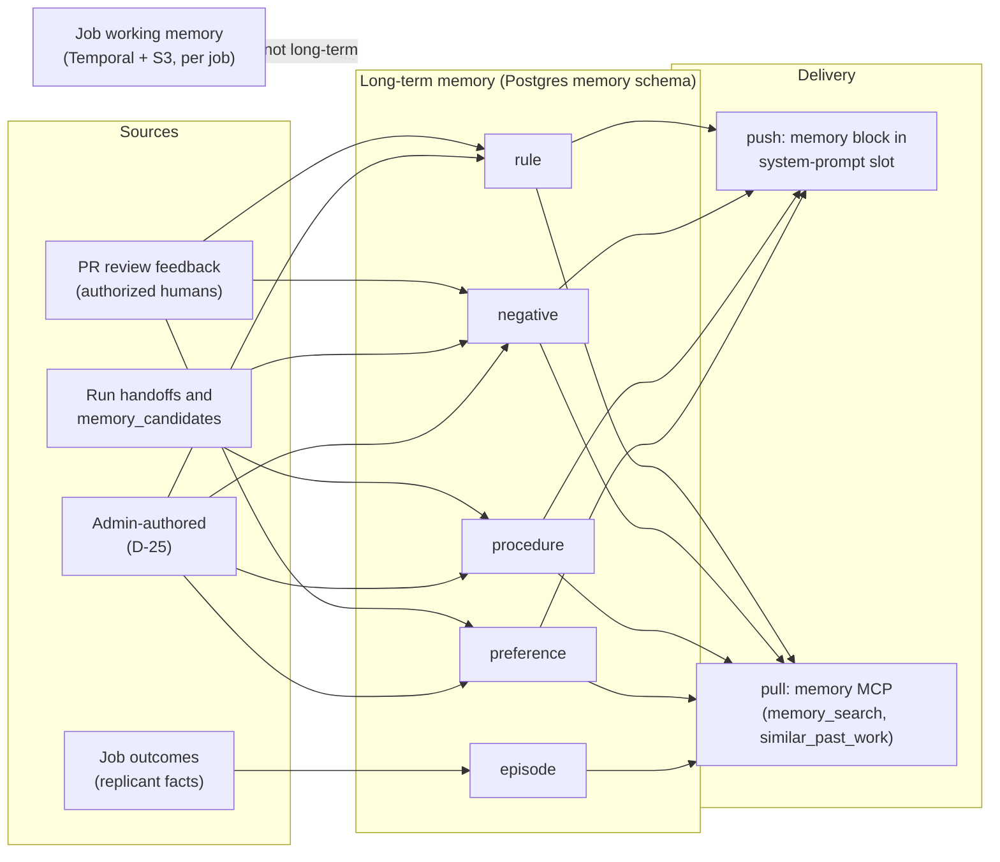

# Memory Taxonomy

**Section:** WS-04 · **Constraints:** D-14, D-15, D-13, D-25 · **Contracts:** C-PG (`memory`), C-IDS (`mem_`, `msnap_`)

## Purpose

Define every kind of memory Replicant keeps: what it is, where it comes from, how it reaches an
agent, and how long it lives. A memory type exists only if it changes agent behavior in a way we
can measure (see [memory-evals.md](memory-evals.md)). Anything else is a log, which lives in Loki,
Langfuse, or object storage.

## Decisions summary

| Decision | Constraint | Reference |
|---|---|---|
| Five long-term types: `rule`, `episode`, `procedure`, `negative`, `preference`. One table, one lifecycle, type-specific `structured` payload | D-14 | [data-model.md](data-model.md) |
| Rules, procedures, and negative knowledge are **pushed** (injected at start). Episodes are **pull-only** (memory MCP). Preferences are pushed only to roles that write or review code | D-14 | [ADR-04-002](adr/002-push-pull-and-snapshot-semantics.md) |
| Preferences are allowed only at **team scope** (service group, repo, path). No per-person preference profiles | D-14, D-25 | [ADR-04-005](adr/005-preferences-team-scope-only.md) |
| Job working memory is not long-term memory. It lives in Temporal state and S3 artifacts and dies with the job's retention | D-14, D-05 | [working-memory.md](working-memory.md) |
| CLI-native memory (Claude Code auto memory, project CLAUDE.md, Codex project AGENTS.md) is **disabled** inside sandboxes. Replicant's memory is the only memory | D-10, D-14 | [ADR-04-007](adr/007-injection-slots-and-cli-native-memory.md) |

## 1. Types

### 1.1 `rule` (semantic: conventions)

| Aspect | Value |
|---|---|
| What | A prescriptive statement about how code in a scope should be written, with a rationale: "In `payments-*` repos use `zap`, not `logrus`." |
| Structured payload `replicant.memory.rule/v1` | `{"prefer": [..], "avoid": [..], "applies_to": "...", "check": {"kind": "grep", "pattern": "logrus\\."} }`. `check` is optional and used only by eval tooling to detect violations; it is never executed in a sandbox |
| Subject key | Required. Dotted canonical topic, e.g. `logging.library`, `money.arithmetic`, `http.client.timeouts`. Used for deterministic conflict detection |
| Sources | PR review comments that pass the generalization test; admin authoring; promotion from repeated repo rules; import from existing human-written docs (`origin=import`, always admin-approved) |
| Delivery | Push (section `rule`, or `enforced` when admins mark an org/tenant rule non-overridable); also searchable through `memory_search` |
| Lifetime | Until deprecated, superseded, disabled, or purged. Staleness review every 180 days without confirming evidence (governance `lifecycle.staleness_review_days`) |
| Example | `mem_01m42qyvr0dzhe1xg73b1bq38b@3` (repo `github.com/acme-payments/ledger-api`): "Represent monetary amounts with `github.com/shopspring/decimal.Decimal`; never `float64`. Round half-even to the currency minor unit only at presentation." |

### 1.2 `negative` (known failures)

| Aspect | Value |
|---|---|
| What | An approach known to fail in a scope, with evidence: "`go test ./...` without `-tags=integration` skips the ledger invariants suite; run `make test-integration`." |
| Structured payload `replicant.memory.negative/v1` | `{"approach": "...", "failure": "...", "evidence": [{"kind": "qa_report", "job_id": "job_…", "run_id": "run_…"}], "instead": "..."}` |
| Sources | Repair rejections (a reviewer rejected an approach and said why), QA failures repeated across jobs with the same signature (negative miner), `failures_to_avoid` in handoffs, admin authoring |
| Delivery | Push (section `negative`), filtered by path and relevance |
| Lifetime | As rules. A negative entry whose evidence is older than its staleness window and has not recurred enters review |

### 1.3 `procedure` (playbooks)

| Aspect | Value |
|---|---|
| What | A step sequence that worked for a task type in a codebase: "Bump a gRPC dependency in a Go service: `go get google.golang.org/grpc@vX`, `buf generate`, `buf breaking --against .git#branch=main`, commit `gen/` in the same commit." |
| Structured payload `replicant.memory.procedure/v1` | `{"task": "dependency_bump.grpc", "workflow_types": ["maintenance"], "steps": [{"n": 1, "action": "...", "command": "...", "verify": "..."}], "derived_from_jobs": ["job_…"]}` |
| Sources | Playbook miner (weekly): clusters successful episodes by task signature (workflow type plus normalized command sequence from handoff `mechanical.commands`), proposes a procedure when ≥ 3 merged jobs share it; admin authoring. Never auto-activated by default |
| Delivery | Push when the job's workflow type and task text match (`min_relevance`); otherwise pull |
| Lifetime | Until deprecated; reviewed when the repo's build files change materially (a `repo_scan` diff of `Makefile`, `go.mod`, `package.json`, `buf.yaml` raises `review_due_at`) |

### 1.4 `preference` (team style)

| Aspect | Value |
|---|---|
| What | A style choice a team makes that is not a correctness rule: "Prefer table-driven tests with `t.Run` subtests." |
| Allowed scopes | `service_group`, `repo`, `path` only (CHECK `entries_preference_scope`). **Never** tied to an individual reviewer ([ADR-04-005](adr/005-preferences-team-scope-only.md)) |
| Sources | Feedback where the reviewer hedged ("nit", "I'd prefer") but the extractor still found a generalizable team convention, with ≥ 2 distinct authors in the scope before activation |
| Delivery | Push to implementer, repair, and reviewer roles only, after rules (lowest precedence) |
| Lifetime | As rules |

### 1.5 `episode` (records of past jobs)

| Aspect | Value |
|---|---|
| What | A record of one terminal job: what was attempted, which files, what reviewers asked for, how it ended. Used for "similar past work" |
| Structured payload `replicant.memory.episode/v2` | **Facts only** (R2-008): job ID, repo, workflow type, outcome, review rounds, files, PR URL, QA first pass, and the triage topic keys reviewers raised (`subject_key` vocabulary). The statement is rendered by memory-service from a fixed template, for example "bugfix · 3 files under internal/billing · merged after 1 review round (money.arithmetic) · QA passed first time". No agent-written summary and no comment text is stored. v1's `summary_untrusted` and `reviewer_asked_for` are removed |
| Scope | `repo` (or `path` for monorepos). CHECK `entries_episode_scope` |
| Sources | Activity `memory.write_episode` at every terminal job (system write). It becomes active only under governance `auto_activation.episode`, which requires the PR merged plus a 24 h quiet period; episodes of unmerged jobs stay as non-retrievable candidates for outcome statistics and expire. A post-merge revert or wrong-fix report disables the episode (R2-017) |
| Delivery | **Pull only** (`similar_past_work`), merged and not reverted jobs only. Never injected |
| Lifetime | `lifecycle.episode_retention_days` (default 365), then `expired` by the maintenance job; purged with the job's audit horizon (2 years) |

## 2. What is deliberately not long-term memory

| Thing | Where it lives | Why not memory |
|---|---|---|
| Plan, decisions, files touched, test results of a running job | Temporal state plus S3 (`plan`, `handoff`, `qa_report`) | Job working memory: scoped to one job ([working-memory.md](working-memory.md)) |
| Briefings (service, contracts, consumers) | Generated per job from `ecosystem` (D-13) | Derived from systems of record at assembly time; storing them as memory would make them stale |
| Raw reviewer comments | GitHub (system of record); `pr_event_payload` (90 days) | Only generalized statements become memory, with a link back |
| Transcripts | `transcripts` bucket (90 days) | Evidence, not knowledge; too large and untrusted |
| CLI-native memory (`~/.claude/projects/
/memory/MEMORY.md`, project `CLAUDE.md`, `AGENTS.md`) | Disabled in sandboxes | Unscoped, unreviewed, unversioned writes by the agent itself would bypass every control here. Claude Code's auto memory writes under `~/.claude/projects/<project>/memory/` and is disabled with `CLAUDE_CODE_DISABLE_AUTO_MEMORY=1` [verified: https://code.claude.com/docs/en/memory and https://code.claude.com/docs/en/env-vars, 2026-10-24] |

## 3. Type × property matrix

| Property | rule | negative | procedure | preference | episode |
|---|---|---|---|---|---|
| Push | yes | yes | if relevant | yes (code roles) | no |
| Pull (MCP) | yes | yes | yes | yes | yes |
| `enforced` allowed | org/tenant | org/tenant | no | no | no |
| Lowest scope | path | path | path | path | path |
| Highest scope | org | org | org | service_group | repo |
| Default auto-activation | repo/path after merge (probation) | no (admin) | no (admin) | no (admin) | after merge + 24 h (templated facts only) |
| Typical rendered size | 40–90 tokens | 50–120 | 100–300 | 30–60 | n/a (pull) |
| Prior (α, β) at creation | (2, 1) feedback; (1, 1) agent proposal | (2, 1) | (2, 1) | (1.5, 1) | (1, 1) |

## Open questions

| Question | Who decides | Options | Recommendation |
|---|---|---|---|
| Allow preferences at all? | Product (orchestrator) with WS-07 | none / team-scoped / per-reviewer | Team-scoped only (ADR-04-005) |
| Import human-written repo docs (CONTRIBUTING.md, existing CLAUDE.md) as memory? | WS-04 / admins | never / admin-approved import | Admin-approved import as candidates with `origin=import`, so repos with good docs are not ignored and nothing loads unreviewed |

## Risks

- Type confusion: an extractor labels a team preference as a rule, which gives it higher precedence.
  Mitigation: hedging detection in the generalization test, and admin review for any preference or
  rule with a single author.
- Episodes could carry injected text into future jobs. Since R2-008 they hold templated facts only,
  are retrievable only for merged, not-reverted PRs, and are pull-only and repo-visibility filtered.

## Interfaces consumed / provided

- **Provided:** type vocabulary used by `memory.entries.memory_type` (C-PG `memory`), the memory MCP
  ([mcp/memory-mcp.tools.json](mcp/memory-mcp.tools.json)), and the admin API
  ([api/memory-service.openapi.yaml](api/memory-service.openapi.yaml)).
- **Consumed:** C-IDS (`mem_` IDs), C-ART (`memory_candidates`, `handoff`).
