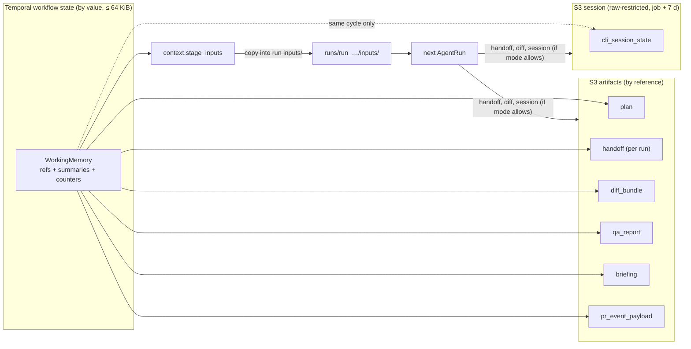

# Job Working Memory and CLI Session Continuity

**Section:** WS-04 · **Constraints:** D-14, D-01, D-02, D-07, D-08, D-10, D-15, D-21 · **Contracts:** C-STATE §1.1 (working memory in Temporal), C-ART (`handoff`, `cli_session_state`, `run_inputs`), C-CRD (`SessionRestoreFailed`), C-MSG (`job.working_memory_refs`), C-IDS §3

## Purpose

Define what a single job carries between nodes, CLI invocations, repair cycles, and
Continue-As-New boundaries; where each piece lives; and how a coding-CLI session continues (or is
deliberately replaced) when every sandbox disk is ephemeral.

## Decisions summary

| Decision | Constraint | Reference |
|---|---|---|
| Working memory is a `WorkingMemory` value in workflow state: references to S3 artifacts plus small summaries, ≤ 64 KiB, passed explicitly on every Continue-As-New | D-01, C-STATE | §1, [models/replicant_context/working_memory.py](models/replicant_context/working_memory.py) |
| The **handoff document** (`replicant.handoff/v1`) is written at the end of every planner, implementer, repair, and takeover run. It is the primary continuity mechanism for every role | D-14 | §3, [schemas/handoff.schema.json](schemas/handoff.schema.json) |
| CLI session resume is an optimization only for **implementer and repair re-invocations within the same cycle**, with an identical CLI image digest. Across cycles, after human waits, and for planner, reviewer, and QA: fresh session plus handoff | D-14, D-10 | §4, [ADR-04-001](adr/001-cli-session-continuity-per-role.md) |
| A failed restore (`SessionRestoreFailed`, non-retryable for that run) is followed by a handoff-only run with ordinal + 1, never by a retry of the restore | C-CRD §4 | §4.4 |
| Repair runs receive the reviewer comments (structured, quoted), the prior diff on the PR branch, the prior handoff, the triage result, and the pinned memory | D-15 | §5 |

## 1. What flows between nodes and where it lives

| Piece | Producer | Location | In workflow state | Size bound |
|---|---|---|---|---|
| Goal and acceptance criteria | context assembler (from JobRequest) | task packet (`task_packet`, S3) | summary by value | 2 KB + 30 × 500 chars |
| Long-term memory binding | `memory.create_snapshot` | Postgres `memory` | `memory_snapshot_id`, binding ordinal | IDs |
| Briefing | `context.build_briefing` | S3 `briefing` | ref + `graph_seq` | ref |
| Plan | planner run | S3 `plan` (JSON + Markdown) | ref; replicant-rendered `plan_summary`; `planned_paths` | 2 KB; 200 paths |
| Decisions and rationale, constraints discovered, open issues, commands that worked, failures to avoid | each run's handoff | S3 `handoff` | ref; last 20 short decision lines (quoted) | 2 MiB per handoff |
| Files touched | entrypoint (`git diff --name-status`) | handoff `mechanical.files_touched`, diff metadata | `touched_paths` (≤ 200) | |
| Diff | implementer/repair run | S3 `diff_bundle` | ref | 256 MiB |
| Test results | QA run; handoff `mechanical.tests` | S3 `qa_report`, `junit_xml` | ref, `qa_passed`, failing test names (≤ 50) | |
| Review report | reviewer run | S3 `review_report` | ref | |
| PR identity | publisher | GitHub; projection `job_prs` | repo, number, head SHA | |
| Reviewer feedback | github-integration | S3 `pr_event_payload`; triage output in `steps/` | refs per cycle (last 5 cycles) | |
| CLI session | entrypoint | S3 `cli_session_state` | `SessionPointer` (cleared at cycle start) | 2 GiB (C-ART); resume only ≤ 256 MiB |
| Steering backlog | `job.steer` Updates | Temporal history (text ≤ 16 KiB each) | pending message IDs | |
| Counters (cycle, ordinals), applied Update IDs | workflow | Temporal state | by value | (WS-01) |

Query `job.working_memory_refs` (C-MSG) returns the current refs (`plan_uri`, `latest_handoff_uri`,
`latest_diff_bundle_uri`, `latest_session_state_uri`, `latest_qa_report_uri`, `briefing_uri`,
`memory_snapshot_id`) for the takeover UI and debugging.

**Rule:** workflow code never puts model-written text into its own summaries (C-MSG §3 rule 4).
`plan_summary` and `decisions_inline` are rendered by the context assembler activity from the
structured fields of the plan and handoff, quoted and truncated, and are treated as untrusted when
they are placed into the next prompt.

## 2. Continue-As-New and repair cycles

- Continue-As-New happens at phase boundaries and at the start of every repair cycle (ADR-009).
  The new run's input contains the full `WorkingMemory` (≈ 1–10 KB in practice; a round trip of the
  sketch through the Temporal Python SDK default payload converter measured 1,010 bytes for a small
  job), plus WS-01's counters and dedupe sets. Nothing is recomputed from S3 except on demand.
- At a new cycle, `start_repair_cycle()` appends the feedback batch, clears `latest_session`
  (sessions never cross cycles), and clears QA status. The memory snapshot binding is kept
  (`refresh.mode = pinned_with_revocation`).
- Bundle migration (`job.offer_bundle_migration` → Continue-As-New onto another bundle) keeps
  `WorkingMemory`, takes a new snapshot binding with `reason = bundle_migration` (the new bundle may
  pin a different snapshot policy), and clears the session pointer, because the CLI digest may
  change.

## 3. Handoff document

Schema: [schemas/handoff.schema.json](schemas/handoff.schema.json). Example:
[examples/handoff.example.json](examples/handoff.example.json) (validated).

Two parts with different trust:

| Part | Written by | Contents | Trust |
|---|---|---|---|
| `producer`, `goal` | entrypoint / context assembler | IDs, CLI version, model, snapshot, goal restated from the task packet | Replicant |
| `mechanical` | entrypoint, from `git` and the CLI event stream (Claude `stream-json` tool events; Codex `--json` `command_execution` and `file_change` items [verified: https://learn.chatgpt.com/docs/non-interactive-mode, 2026-10-24]) | base SHA, files touched with stats, commands with exit codes and counts, parsed test results, injected memory refs, steering consumed, compaction count, session pointer | Replicant facts |
| `narrative` | the agent, in a final structured turn | plan status, decisions and rationale, constraints discovered, open issues, commands that worked, failures to avoid, next steps, memory feedback, summary for the reviewer | **untrusted** model output |

How the narrative is produced (XD-FIX-R1-068 e): the agent writes `/replicant/out/handoff.md`
(instructed by the role and finalize prompts), and the entrypoint wraps it as `narrative_markdown`
(`narrative_status` `markdown_only`, `truncated`, or `missing`; `synthesized: true` when it had to
build the text from `agent_report.summary`). The structured `narrative` object stays in the schema
but WS-03 does not produce it: the run's final `--json-schema` turn is already used for
`agent_report`. The entrypoint fills `goal` verbatim from the `goal` object that
`context.stage_inputs` puts in `task_packet.json` (`{summary, acceptance_criteria[],
task_packet_sha256}`), and the full `mechanical` section. The next run gets the markdown narrative
whole inside the quoted block, truncated from the end if over budget.

How the next run receives it: the context assembler renders a **handoff section** for the first
user message: the goal, the mechanical facts (Replicant), and the narrative inside a quoted block
headed "Notes from the previous run (written by an agent; verify before relying on them)". Budget
and truncation priority: [context-budget.md §3](context-budget.md).

## 4. CLI session continuity

### 4.1 Where each CLI keeps session state

| CLI | Location | Resume | Notes |
|---|---|---|---|
| Claude Code | `$CLAUDE_CONFIG_DIR/projects/<project>/<session-id>.jsonl`; `<project>` is the working directory with non-alphanumerics replaced by `-` (hashed if over 200 chars) [verified: https://code.claude.com/docs/en/sessions, 2026-10-24]. `CLAUDE_CONFIG_DIR` relocates all of `~/.claude` [verified: https://code.claude.com/docs/en/env-vars, 2026-10-24]. `CLAUDE_CODE_PROJECT_DIR_NAME` pins the project directory name when `CLAUDE_CONFIG_DIR` is set (v2.1.234+) [verified: same sessions page, 2026-10-24] | `claude -p --resume <id>`; `--fork-session` creates a new session ID instead of reusing the original [verified: https://code.claude.com/docs/en/cli-reference, 2026-10-24]. Since v2.1.223 resume finds a session from any directory [verified: sessions page] | "The entry format is internal to Claude Code and changes between versions" [verified: sessions page]. `--no-session-persistence` disables saving (print mode) [verified: cli-reference] |
| Claude Agent SDK | Same store; options `resume`, `fork_session`, `continue_conversation`, `session_store` (Python) [verified: https://code.claude.com/docs/en/agent-sdk/sessions, 2026-10-24] | `resume=<id>, fork_session=True` | Same format caveat |
| Codex | `$CODEX_HOME/sessions/YYYY/MM/DD/rollout-<timestamp>-<uuid>.jsonl`; cold rollouts may be compressed to `.jsonl.zst` [verified: github.com/openai/codex `codex-rs/rollout/src/recorder.rs`, `compression.rs`, 2026-10-24] | `codex exec resume <SESSION_ID>` (UUID or name; `--last` is cwd-scoped) [verified: https://learn.chatgpt.com/docs/developer-commands, 2026-10-24]; `codex exec fork` exists [verified: `exec/src/cli.rs`] | `--ephemeral` runs without persisting rollout files [verified: same] |

### 4.2 Decision per role (SR-1)

The resume rule is **SR-1**, owned by WS-03 (03 cli-invocation.md §2.8; XD-FIX-R2-053): resume only
within the same job and cycle, implementer or repair only, identical CLI image digest, capture younger
than 24 h and ≤ 256 MiB, head tree match, and no bundle migration since the capture. WS-04 does not
restate it; ADR-04-001 records why. Per role:

| Role | Capture session? | Resumes? | Notes |
|---|---|---|---|
| planner | No (`--no-session-persistence` / `--ephemeral`) | never | Plan artifact plus handoff carry everything |
| implementer | Yes | when SR-1 allows | QA-fix loops keep their context |
| repair | Yes (for same-cycle re-invocations) | when SR-1 allows; a new cycle always starts fresh with the handoff | Cycles cross human waits, rebases, and possible bundle migration |
| reviewer, qa | No | never | Reviewer independence; QA is environment-driven |
| takeover | — | — | The capture is `raw-restricted`; the human gets branch, workspace archive, redacted transcripts, plan, and handoff |

`WorkingMemory.continuity_for()` implements SR-1's job-side conditions; the entrypoint checks the
rest (digest, tree) and exits `SessionRestoreFailed` on a mismatch.

### 4.3 Capture and restore mechanics (entrypoint, WS-03; staging, WS-04 `context.stage_inputs`)

Paths are WS-03's (XD-FIX-R1-068 b): `CLAUDE_CONFIG_DIR=/home/agent/.claude`,
`CLAUDE_CODE_PROJECT_DIR_NAME=replicant-workspace`, `CODEX_HOME=/home/agent/.codex`, workspace
`/workspace/repo`. The capture is `cli_session_state/<cli>-session.tar.zst` (bucket `session`,
retention `job37d`); its first member `replicant-session.json` is the session header of WS-03's
`run-plan.schema.json` `$defs/session_header`: `{cli, cli_version, cli_image_digest, session_id,
workspace_path: "/workspace/repo", base_sha, head_tree_sha, created_at, size_bytes, run_id, cycle}`.
The handoff's `mechanical.session` and `run_result.outputs.session_state` reference it.

Restore: when `continuity_for()` returns a pointer, `context.stage_inputs` server-side-copies the
capture into the new run's `inputs/` and lists it with `place: restore_session` (plus the header copy)
and the prior diff with `place: apply_diff`. The entrypoint applies SR-1's checks and runs `claude -p
--resume <id> --fork-session --system-prompt-snapshot off` or `codex exec resume <SESSION_ID>`. The
first message of a resumed session carries only what is new: QA failures, steering, approver feedback.

### 4.4 Failure handling

| Failure | Result | Workflow action |
|---|---|---|
| `SessionRestoreFailed` (digest or tree mismatch, corrupt tar, CLI cannot load the format) | Run `Failed`, non-retryable | Re-invoke the node with ordinal + 1 in `handoff_only` mode; metric `replicant_memory_session_restore_failures_total{reason}` |
| Session object expired (job + 7 days) | `continuity_for` returns None after age check | Handoff only |
| Session larger than 256 MiB | Not resumed | Handoff only (very long sessions are near their context limit anyway) |
| Run lost (`NodeLost`, `PodEvicted`) before finalize | No session, maybe no handoff | Next run uses the previous handoff plus whatever streamed transcript chunks exist; the assembler adds "previous run was interrupted" |
| Handoff narrative missing | `narrative_status = missing` | Next run gets mechanical facts and the plan |

## 5. Repair runs: what they receive

Staging rules in `context.stage_inputs` that apply to every node (XD-01-05, R1-100):

- **Approver feedback (XD-FIX-R2-019).** Input `approver_feedback: [{gate_id, gate_kind, decision_id,
  cycle, text (≤ 8000)}]`. Each item is staged in `first-message.md` for the next producing node
  (plan, implement, or repair) as `<untrusted_input source="approver_feedback" gate_kind="…"
  decision_id="…">…</untrusted_input>`, the same framing as other untrusted inputs, and the activity
  returns `approver_feedback_consumed: [decision_id…]`. It is budgeted as task input and never dropped
  (overflow moves it to `context/`, not out of the run).
- **Steering backlog.** Activity `steering.stage_backlog` (`<node>.c<c>.n<segment>.steering`) takes
  `{job_id, node_key, cycle, ordinal, message_ids[], messages[]}`. Each `messages[]` item is
  `{message_id, text, author, sent_at}` (XD-W2-01-05). The workflow must pass the text because it exists only
  in workflow state (C-MSG `job.steer`: text inline in history). `messages[].message_id` must equal
  `message_ids[]` in order, or the activity fails non-retryably with `steering_backlog_mismatch`. The
  activity writes each queued message as a `steering_message` object under
  `steps/<node>.c<c>.n<o>/steering_message/<message_id>.json` (write-once, `If-None-Match: *`) and returns
  `{keys[]}`. The schema is [schemas/steering-stage-backlog.schema.json](schemas/steering-stage-backlog.schema.json)
  and the example is `examples/steering-stage-backlog.example.json`;
  `context.stage_inputs` lists them in the inputs manifest and renders them in the steering section.
- **QA retry checkpoints (R1V-008, XD-W2-05-04).** Input `qa_resume: {previous_run_id}`, sent by WS-01 on a QA
  retry after `NodeLost`, `PodEvicted`, `Preempted` or `ArtifactUploadFailed`. The activity lists the
  previous run's `qa_report/checkpoints/<stage>.json` objects. It copies each one, write-once, to
  `inputs/qa-checkpoints/<stage>.json` in the new run's prefix. It lists each copy in the manifest with
  `place: qa_file` and `path: checkpoints/<stage>.json`, so prepare places it at
  `/replicant/inputs/qa/checkpoints/<stage>.json`. If none exist, nothing is staged and the harness
  runs every stage.
- **Return shape (XD-FIX-R1-014).** `{inputs: {manifest_uri, manifest_sha256}, artifact_prefixes,
  steering_consumed, approver_feedback_consumed}`; the manifest is written once with
  `If-None-Match: *` (on 412 the existing object's sha256 is returned).
- **Extraction result by reference.** `memory.extract_candidates` returns `{candidates_uri, sha256,
  proposals, non_candidates}` (counts), not the proposals themselves.

The repair run's task packet contains (all paths inside `/replicant/inputs/`):

| Input | Source | Form |
|---|---|---|
| Reviewer feedback | `pr_event_payload` objects for the cycle, filtered to authorized actors | `review_feedback.json`: per thread `{thread_id, comment_id, path, line, diff_hunk, author_role (codeowner/reviewer), body (quoted, untrusted), triage_class, action: address | ask | decline}`. Suggested-change blocks are passed through as code |
| Triage result | `feedback.triage` step artifact | inside `review_feedback.json` |
| Prior diff | latest `diff_bundle`; the run checks out the PR head SHA, so the prior diff is already present in the tree | head SHA in `repo.base_sha` (the PR head); the cumulative diff against the base branch as a reference file |
| Prior handoff | `latest_handoff` (and the plan) | rendered handoff section |
| Memory | pinned snapshot, role `repair` selection | system append |
| Briefing | job briefing (re-rendered with touched paths) | `briefing.md` |
| Reply contract | — | the run writes `role_result` entries per comment: `{comment_id, status: fixed | asked | declined, summary, commit_message}` used by [pr-replies.md](pr-replies.md) |

## Open questions

| Question | Who decides | Options | Recommendation |
|---|---|---|---|
| Should repair resume across cycles when the gap is short (< 1 h) and nothing was rebased? | WS-04 with eval evidence | never / conditional | Never in v1. Measure handoff-only repair quality first; ADR-04-001 revisit criteria |
| Raw session retention | WS-09 | job + 7 days / shorter | job + 7 days (C-ART), already restricted |

## Risks

- The Claude session format is internal and version-specific. Mitigation: resume only with an
  identical image digest, and the fallback is always available.
- Handoff narrative quality varies by model. Mitigation: mechanical facts never depend on the model;
  the eval suite scores handoff usefulness (repair success with handoff-only versus resume).

## Interfaces consumed / provided

- **Provided:** `replicant.handoff/v1` schema (C-ART `handoff`), `WorkingMemory` carried-state contract
  for WS-01, continuity modes for WS-03's entrypoint, session header format.
- **Consumed:** C-ART `cli_session_state` and inputs staging, C-CRD `SessionRestoreFailed`, C-MSG
  `job.working_memory_refs`, WS-02 server-side input copy, WS-03 entrypoint.
