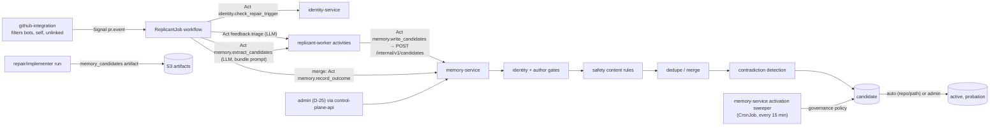
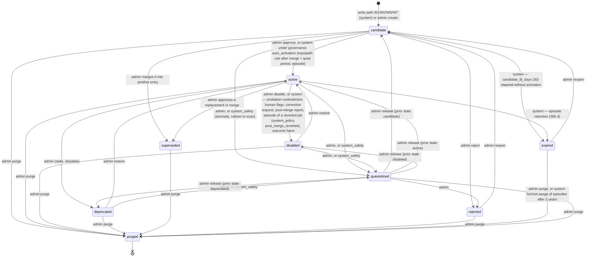
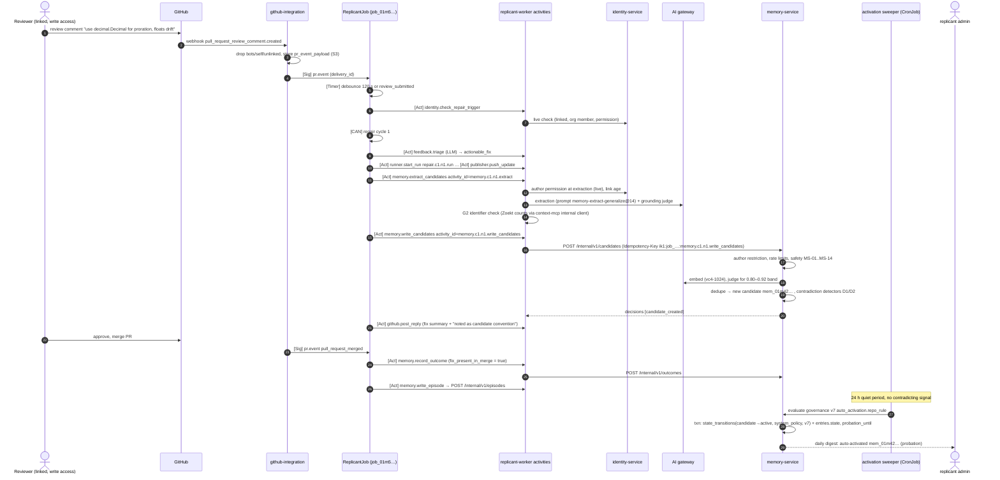

# Write Path: from PR Feedback to Active Memory

**Section:** WS-04 · **Constraints:** D-14, D-15, D-25, D-18, D-21 · **Contracts:** C-MSG (`pr.event`), C-ART (`pr_event_payload`, `memory_candidates`), C-IDS (logical activity IDs), C-PG (`memory`)

## Purpose

Turn reviewer feedback, job outcomes, and agent proposals into memory entries without letting a
single careless, malicious, or prompt-injected input become an instruction to every future job.
Every write path below has an authorization control and a poisoning control (acceptance criterion).

## Decisions summary

| Decision | Constraint | Reference |
|---|---|---|
| Only one component writes memory: memory-service. Sandboxes cannot write (the memory MCP is read-only); agent proposals arrive as an artifact that the workflow forwards and that can only become a low-prior candidate | D-14, D-21 | §1 |
| Extraction is an in-worker LLM call with a bundle-pinned prompt (`prompt/memory-extract-generalize`), run after each repair cycle's push. It proposes an entry only when the comment passes a six-part generalization test | D-14, D-03 | §2 |
| Dedupe and contradiction checks combine deterministic keys (`content_digest`, `subject_key`) with embedding similarity and an LLM judge; thresholds are per embedding space and calibrated | D-14 | §3, §4 |
| Conflicts are recorded and block automatic activation. Nothing is resolved silently | D-14 | §4 |
| Automatic transitions happen only under an admin-configured governance policy version recorded on the transition. Repo/path rules may auto-activate after the PR merged with the fix intact, a 24 h quiet period, and no conflict; they then serve a 14-day probation with a 20% holdout. Everything broader needs an admin | D-25 | §5 |
| "Independent occurrence" is defined over distinct (author, PR) pairs that are not replies to each other; broader scopes need occurrences from several authors and repos | D-14 | §6 |

## 1. Write paths and their controls

| # | Path | Producer → memory-service | Authorization control | Poisoning control |
|---|---|---|---|---|
| W1 | PR review feedback → candidate rule/negative/preference | `memory.extract_candidates` → `memory.write_candidates` (replicant-worker) | Author re-verified live at extraction: linked Okta identity, org member, repo permission ≥ policy (`write`), not a bot or the Replicant app, identity link older than 7 days, no author restriction (`memory.author_restrictions`). The worker ServiceAccount is the only allowed caller (`x-allowed-callers`) | Generalization test (§2), grounding check, safety rules ([safety.md](safety.md) MS-01..MS-14), per-author and per-tenant rate limits, max scope `service_group`, candidate state, auto-activation only after merge + quiet period + probation |
| W2 | Agent proposal (`memory_candidates` artifact from a run), at most 2 per job (governance `extraction.max_agent_proposals_per_job`, R2-052) | Same activity, `producer.kind = agent_run` | The run's own job; proposals cannot cite a human source they did not get from the task packet (memory-service checks every `source.comment_id` against the job's `feedback_items`) | Prior (1, 1), `origin = agent_proposal`, never auto-activated (governance `auto_activation.agent_proposal.enabled = false`), admin review required |
| W3 | Episode at job terminal | `memory.write_episode` | Worker only; facts derived by workflow code | **Facts only** (R2-008): the statement is rendered by memory-service from a fixed template (workflow type, files, review rounds, review topic keys, QA first pass, outcome); no agent-written or comment text is stored. Retrievable only for merged, not-reverted PRs, and activated only after the merge plus a 24 h quiet period (governance `auto_activation.episode`); pull-only; repo-visibility filter at read |
| W8 | Human corrections: job-viewer flags, author/CODEOWNER correction requests, post-merge outcome reports (§9) | control-plane-api, github-integration | The caller's own authorization (job view, source author, CODEOWNER, linked user with ≥ write) | Cannot create or change content; can only set an activation hold or disable a probation entry by system policy, and always queues an admin decision (D-25) |
| W4 | Outcome and reviewer signals | `memory.record_outcome`, `memory.feedback_signals` | Worker only; signals reference authorized reviewers' comments only | Signals can only lower confidence, suspend probation entries, or add evidence counts; they never create content |
| W5 | Mined procedures and negatives | memory-service CronJob (`playbook-miner`, `negative-miner`, weekly) | System, from existing episodes | Always admin-approved (governance defaults) |
| W6 | Admin authoring, edit, promotion, merge | control-plane-api → admin API | Live admin-group check per request (D-25); tenant and org need two admins | Same safety rules as W1 (admins are not exempt; an admin can override a classifier *warning* with a reason, never a hard rule) |
| W7 | Import of human-written docs | Admin API (`origin = import`) | Admin only | Candidates only; safety rules |

## 2. Normalization and the generalization test (W1)

### 2.1 Normalization (Feedback Ingestor)

1. github-integration has already dropped bot senders (`user.type == "Bot"`, `<slug>[bot]` logins;
   review comments carry no `performed_via_github_app`, so login and type are the signals
   [verified: GitHub REST OpenAPI description, 2026-10-24]), Replicant's own app, and unlinked
   identities (D-15). The workflow re-checks each actor with `identity.check_repair_trigger`.
2. `feedback.triage` (LLM, bundle prompt `prompt/feedback-triage`) classifies each comment:
   `actionable_fix`, `question`, `optional_suggestion`, `disagreement`, `out_of_scope`,
   `praise_or_noise`, and assigns a stable `topic_key` per comment from the same dotted vocabulary as
   `subject_key` (for example `money.arithmetic`; new keys are allowed and normalized), which WS-06
   uses for the repeated-comment metric and golden-task `expect_rule_key` (XD-06-12). Matched memory
   entry IDs per comment are recorded by `memory.feedback_signals`. Only `actionable_fix` and
   `optional_suggestion` comments that the repair run
   actually addressed (handoff `decisions` plus diff) are candidates for extraction. Questions and
   declines produce replies, not memory ([pr-replies.md](pr-replies.md)).
3. Opt-out and opt-in: a comment containing `/replicant no-memory` is never extracted
   (`decision = opted_out`). A comment with `/replicant remember` sets `explicit_remember = true`
   (raises recurrence prior; it still passes every gate). Reviewer syntax is documented on the
   Replicant's help page linked from every Replicant PR.
4. `memory.extract_candidates` writes its proposals as a `memory_candidates` artifact under
   `steps/memory.c<cycle>.n<ord>/memory_candidates/candidates.json` and returns `{candidates_uri,
   sha256, proposals, non_candidates}`; `memory.write_candidates` reads that URI (XD-01-05, keeps the
   activity result small).
5. Each item gets a `source_key` (`gh-review-comment:<repo_id>:<comment_id>`) and a body digest. The
   ledger `memory.feedback_items` makes extraction idempotent per (tenant, source, extractor
   version) and records every non-candidate decision.

### 2.2 Generalization test

Extraction input is **only the human reviewer's comment text and metadata** (WS-09 A-06): the
comment body (trusted author, untrusted text), suggested-change blocks inside it, the file path and
line it is attached to, the repo's languages and service group, and the triage class. It never
receives repository files, the code hunk, the diff, or any agent output. The fix diff is used only
deterministically (G2 identifier counts and `fix_present_in_merge`). The extractor is a tool-less
call that must return `replicant.memory-candidates/v1` (structured output; see
[safety.md §6](safety.md) for the per-call-site controls). A proposal is accepted only if **all hard
gates pass and the score ≥ `extraction.generalization_threshold` (0.70)**:

| Gate | Kind | Test |
|---|---|---|
| G1 Prescriptive | score `prescriptive` ≥ 0.6 | The comment states or implies a norm ("use X", "never Y", "we always Z"), not a question or a one-off correction |
| G2 PR independence | hard + score `pr_independence` | The statement must not reference PR-specific identifiers. Deterministic check: every identifier token (camelCase, snake_case, dotted) in the statement must occur in ≥ 3 files of the repository at the base SHA, **or** be a package/module name in the repo's dependency manifests (Zoekt count query through context-mcp's internal client). Identifiers only present in the diff fail the gate |
| G3 Recurrence | score `recurrence` | Judge estimate: would a reviewer in this repo plausibly leave the same comment on a different PR? Includes evidence from `memory_search` for similar active candidates |
| G4 Counterfactual applicability | hard | At least two concrete, different situations where the rule applies (`counterfactual_examples`), neither of which is the current change |
| G5 Grounding | hard | A separate tool-less judge call sees only the comment text and the proposed statement and answers `grounded` / `not_grounded`: "Is this rule stated or directly implied by the reviewer's own words?" Since no repository content reaches extraction, injected repository text cannot become a rule through this path |
| G6 Not tool-enforced | soft | If a linter config in the repo already enforces it (`tool_enforceable = true` and the corresponding linter rule is enabled), confidence prior is lowered and the entry is typed `preference` or dropped |

Score: `0.35·prescriptive + 0.35·pr_independence + 0.30·recurrence`, minus 0.15 if the comment is
hedged ("nit", "maybe", "personally", "I'd prefer") unless `explicit_remember`. The proposed scope
is the narrowest anchor that covers the counterfactual examples, at most `service_group`. Path globs
are derived from the comment's file path when the counterfactuals are all under one directory.

## 3. Deduplication and merge

For each proposal (memory-service, one transaction per proposal):

1. **Exact:** compute `content_digest`. Same digest as an existing candidate/active version → merge
   as evidence.
2. **Embed** the normalized text in the active space (and the building space if one exists).
3. **Neighbors:** top `dedupe.neighbors` (10) candidates/active entries of the same type in
   overlapping scope (same tenant; scope overlap = one anchor contains the other, or same
   service group), by cosine similarity, exact scan.
4. Decide:

| Condition (space `vc4-1024` defaults) | Action |
|---|---|
| similarity ≥ `dedupe_merge_threshold` (0.92) **and** (same `subject_key` or judge says `same_rule`) | **Merge as evidence**: insert `provenance` for the existing entry; update evidence counters; Beta update α += 1 (independent) or α += 0.25 (not independent); `last_confirmed_at = now()`. No new entry |
| 0.80 ≤ similarity < 0.92 (`dedupe_judge_threshold`) | Judge (`dedupe.judge_prompt`): `same_rule` → merge; `refinement` (narrower/clearer) → new candidate with `entry_relations.refines` → admin decides whether it supersedes; `contradiction` → §4; `unrelated` → new candidate |
| < 0.80 | New candidate |

Thresholds are stored per embedding space and calibrated on a labelled set of 500 pairs per space:
the merge threshold is set where precision of "same rule" ≥ 0.98, the judge band where recall of
duplicates ≥ 0.95 ([memory-evals.md §6](memory-evals.md)). A different embedding model gets its own
thresholds.

## 4. Contradiction detection

Run on every new candidate and on every edit or scope change:

| Detector | How | Result |
|---|---|---|
| D1 Subject key | Active/candidate entries with the same `subject_key` in overlapping scope whose `structured.prefer` ∩ other `structured.avoid` ≠ ∅ (or vice versa) | `conflicts` row, `detected_by = subject_key` |
| D2 Semantic judge | Neighbors with similarity ≥ `conflict_probe_threshold` (0.60) in overlapping scope; judge `dedupe.contradiction_prompt` returns `contradicts` with a short explanation | `conflicts` row, `detected_by = semantic_judge` |
| D3 Runtime | At context assembly, two eligible entries share a subject key with incompatible assertions and tie on specificity | `detected_by = runtime_assembly`; both suppressed for that run ([scoping.md §3.3](scoping.md)) |
| D4 Reviewer signal | In a job that received entry E, an authorized reviewer comment is judged to contradict E | `usage_events.reviewer_contradicted`; during probation E is suspended (§5.3); an open conflict is created against the new candidate the comment produced |

A conflict with `blocks_activation = true` (default) stops any automatic transition of either side.
Conflicts across different specificities do not block (precedence resolves them for the agent) but
still appear in the admin queue as `scope_overlap` so admins can decide whether the broad rule is
wrong.

## 5. Lifecycle

### 5.1 State machine

Every arrow writes `memory.state_transitions` with `actor_kind` ∈ {`admin`, `system_policy`,
`system_safety`}; system arrows cite the governance policy version. `system_safety` may only enter
`quarantined`, `disabled`, `rejected`, or `expired` (DB CHECK). Only `active` entries are eligible
for snapshots. Edits create versions without changing state; editing an `active` entry is an admin
action and the new version is active at once.

**Activation hold** (R2-017, R2-018, R2-028) is a flag on the entry, not a state: while set, no
automatic transition may activate or re-activate the entry. The system sets it (tightening only)
on a correction request, two independent human flags, two agent flags, or a post-merge outcome
report; only an admin clears it (`:clear-hold`). Admin verbs and their meaning are fixed in the one
verb table in [curation-ui.md §5](curation-ui.md) (R1-097): `:restore` returns a disabled,
deprecated, or singly quarantined entry to the state recorded before that removal; `:reopen` returns
a rejected or expired entry to `candidate`.

### 5.2 Promotion criteria per scope

| Target | Criteria | Actor |
|---|---|---|
| `path` / `repo` rule, auto | Governance `auto_activation.repo_rule` enabled; source author permission ≥ `write`; generalization ≥ 0.75; the PR **merged** and `fix_present_in_merge = true`; no reviewer objection; quiet period 24 h after merge with no contradicting signal; no open blocking conflict; scope cap not exceeded; safety re-check passes; author has no restriction | System (activation sweeper) → enters probation |
| `path` / `repo` rule, manual | Any time, any evidence | Admin |
| `negative`, `procedure`, `preference`, agent proposals | Admin (defaults); policy may enable auto for `negative` later | Admin |
| `episode` | PR merged + 24 h quiet period, facts-only template (R2-008) | System |
| `service_group` | Evidence ≥ `evidence.service_group` (2 independent occurrences, 2 authors, 2 repos), no blocking conflict | Admin |
| `tenant` | ≥ 3 occurrences, 2 authors, 3 repos | Two admins (WS-09 recommendation, adopted) |
| `org` | ≥ 5 occurrences, 3 authors, 4 repos, 2 tenants; memory eval pass; content rewritten free of tenant identifiers | Two admins |

Promotion creates a new version with the wider scope (`change_kind = scope_change`) or, for org, a
new org entry `promoted_from` the source entries, which are then superseded. Admins see "promotion
suggestions" when evidence crosses a threshold (memory-service computes them nightly).

### 5.3 Probation

An auto-activated entry has `probation_until = activated_at + 14 days`, extended until it has at
least 10 exposures. During probation:

- 20% of eligible jobs withhold it (`holdout_assignments.experiment = probation`), so outcome
  differences can be measured ([memory-evals.md §3](memory-evals.md)).
- One authorized reviewer contradiction in a job that received it (D4), or two independent
  `appears_wrong`/`unsafe` agent flags, makes the activation sweeper disable it
  (`system_policy`, reason `probation_contradiction`) and notify admins.
- It is listed in the admins' daily digest of auto-activations.

## 6. Evidence and independence

An occurrence is a `provenance` row. Two occurrences are **independent** iff all hold:

1. Different authors (`author_principal_id`), or the same author on PRs more than 14 days apart in
   different repos.
2. Different PRs.
3. Neither comment is a reply in the other's thread, and neither quotes the other (5-gram overlap
   < 0.5).
4. Neither was produced from the other's job (an agent proposal in job J does not count as
   independent of the reviewer comment that J addressed).

`independence_key = sha256(author_principal_id ‖ repo ‖ pr_number)` collapses multiple comments on
one PR by one author into one occurrence (partial unique index `provenance_one_per_source`).
Counters on `entries` are recomputed in the same transaction as each provenance insert or
withdrawal. Withdrawal happens when the source comment is deleted, edited so that its digest changes
and the re-extraction no longer yields the rule, or its author is quarantined. If withdrawal drops
an entry below the evidence required for its current scope, the entry goes to the admin review
queue (it is not demoted automatically).

## 7. Sequence: review comment → candidate → active

## 8. Failure modes

| Step | Failure | Behavior | Visible to |
|---|---|---|---|
| Extraction LLM call | Gateway 5xx / timeout | Activity retry (WS-01 policy); after exhaustion the cycle continues; ledger rows are not written, so the next cycle or the merge-time sweep (`memory.extract_candidates` re-run at merge for unprocessed items) picks the items up | Timeline: `memory.extraction_deferred` |
| Extraction | Output fails schema | Treated as `not_generalizable` with `detail.reason = invalid_output`; metric `replicant_memory_extraction_invalid_total` | Admin analytics |
| identity-service down | Cannot verify author | Fail closed: item deferred (no candidate). Retried at merge | — |
| memory-service down | `write_candidates` fails | Activity retries with the same idempotency key (schedule-to-close 24 h); the job is not blocked (non-awaited after the reply is posted) | Alert `ReplicantMemoryServiceUnavailable` |
| Duplicate delivery / activity retry | Same items again | `feedback_items` PK and the idempotency key return the original decisions | — |
| Comment edited after extraction | Digest changes on a later `review_comment_edited` event | Re-extract; if the rule no longer follows, withdraw provenance (`comment_edited`); if the entry is a candidate with no other evidence, it expires; an anomaly alert `edit_after_extract` fires when an edit turns a benign comment into a different rule | Admin queue |
| Comment deleted | GitHub `deleted` action | Provenance withdrawn (`comment_deleted`); same handling | Admin queue |
| PR closed unmerged | `pull_request_closed` | Candidates from the job never auto-activate; they expire after 30 days unless an admin approves | Admin queue; expiry notice |
| Candidate about to expire unreviewed | `candidate_expires_at − 7 days` | Weekly admin digest lists it; at expiry the source thread gets a memory notice ("not adopted; ask an admin to reopen") and `replicant_memory_candidates_expired_unreviewed_total{tenant}` increments; never a silent drop (R2-052) | Admins, comment author |
| Scope cap reached | Activation would exceed `active_per_repo_hard` | Sweeper leaves it as candidate and adds `review_due` with reason `scope_cap`; admin consolidates | Admin queue |
| Embedding space mid-migration | Two spaces | Dedupe uses the active space; the building space is filled by the backfill | — |

## 9. Human correction paths (R2-017, R2-018, R2-028)

All three paths respect D-25: none of them lets a non-admin create, edit, or activate memory. Each
can only **tighten** (set an activation hold, or disable an entry still in probation) under the
admin-configured governance policy, and each lands in the admin queue with an SLA.

| Path | Who | Entry point | Immediate effect (system_policy) | Admin follow-up |
|---|---|---|---|---|
| Job-viewer flag (R2-028) | Any principal authorized to view a job the entry influenced | UI "Flag this entry" on the Memory used panel → `POST /v1/jobs/{job_id}/memory/{entry_id}/flags` → memory-service `/internal/v1/jobs/{job_id}/memory/{entry_id}/flags` | Two flags from distinct principals while the entry is a candidate (hold) or in probation (disable); otherwise none | Flag queue, SLA `flags.sla_hours` (72 h) |
| Correction request (R2-018) | The source comment's author, or a CODEOWNER of the source path | `/replicant memory-wrong <reason>` in the PR thread, or "Request a correction" on the public entry view → `POST /internal/v1/entries/{entry_id}/correction-requests` | Immediately: candidate → hold; probation entry → disabled; mature entry → admin queue only (`corrections.suspend_on_request`) | SLA `corrections.sla_hours` (48 h); the requester gets an in-thread reply when an admin acts |
| Post-merge outcome report (R2-017) | Any job viewer ("Report a problem with this result" on terminal jobs), `/replicant wrong <reason>` by a linked user with ≥ write, github-integration's revert detector (30 days after merge), or a linked follow-up bug | `POST /v1/jobs/{job_id}/outcome-reports` / github-integration → `POST /internal/v1/outcome-reports` | Episode → disabled and excluded from `similar_past_work` and mining; job's candidates → hold; job's probation entries → disabled; older entries sourced only from the job → β += 2 and admin queue; `job_outcomes.post_merge_reverted`; metric `replicant_jobs_post_merge_reverted_total{tenant, release_cohort, bundle}` (`bundle` = the job's base bundle short ID, XD-W2-06-04); the authoritative guardrail reads per-job rows from `memory.v_job_outcomes` through WS-10's audited `ops.eval_job_outcomes` (XD-W2-06-01) | Admin queue; WS-06 guardrail "revert rate within 14 d" |

Revert detection (github-integration, XD-FIX-R2-017): a PR merged into the default branch whose body
contains `This reverts commit <sha>` where `<sha>` is a commit of a Replicant PR merged in the last 30
days, or a commit carrying the `Replicant-Job: job_…` trailer, posts `{kind: reverted, source:
revert_detector, dedupe_key: revert:<repo_id>:<revert_pr_number>}`.

Visibility for contributors (R2-018): the PR-reply footer shows the statement exactly as agents will
see it and the true next state ("activates after merge + 24 h unless you object"); the thread gets
a reply when the entry activates, is held, or expires ([pr-replies.md §5](pr-replies.md)); the
public entry view `GET /v1/memory/entries/{entry_id}/public` is open to the source author and to
readers of the source repo.

## Open questions

| Question | Who decides | Options | Recommendation |
|---|---|---|---|
| Should repo rules auto-activate at all? | Orchestrator (product) | admin approval for everything; auto with probation | Auto with probation for repo/path rules only. Requiring approval for every repo rule at 1,500 repos would create a queue no admin group can keep up with, and the probation controls bound the damage |
| Extract per cycle or only at merge? | WS-04 | per cycle; at merge only | Per cycle (the reply can mention the candidate), activation only after merge |
| Minimum identity-link age | WS-09 | 0 / 7 / 30 days | 7 days |

## Risks

- Extraction quality determines everything downstream. Mitigation: the extraction prompt is
  bundle-pinned and evaluated (WS-06 golden set with labelled comments), and outcome monitoring
  catches what the evaluation misses.
- Judges are LLM calls on untrusted text. Mitigation: they only *add* friction (block, conflict,
  refine); no judge output can activate or broaden an entry.

## Interfaces consumed / provided

- **Consumed:** C-MSG `pr.event`, `PrEventSignal.comment_refs`; C-ART `pr_event_payload`,
  `memory_candidates`; identity-service live checks (WS-07); AI gateway completions and embeddings
  (WS-03); context-mcp internal Zoekt counts.
- **Provided:** `POST /internal/v1/candidates`, `/outcomes`, `/episodes`, `/feedback-signals`
  ([api/memory-service.openapi.yaml](api/memory-service.openapi.yaml)); activity contracts for
  WS-01 (`memory.extract_candidates`, `memory.write_candidates`, `memory.record_outcome`,
  `memory.write_episode`, `memory.feedback_signals`).
