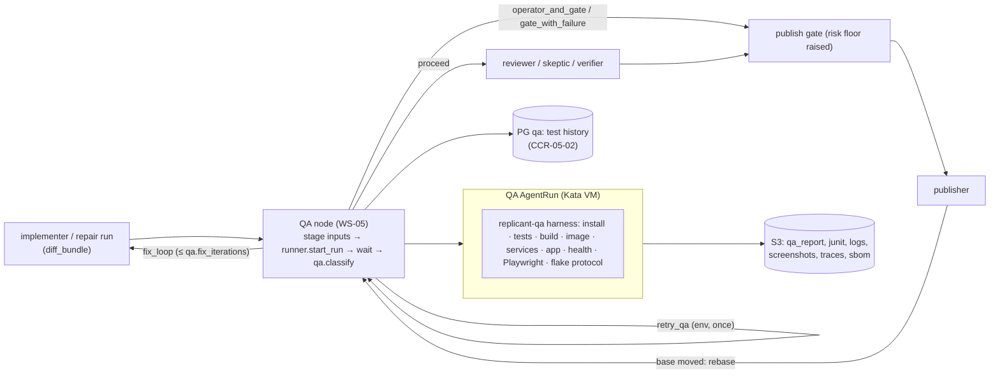

# 05 — QA/QE Stage (WS-05)

## Purpose

The QA/QE stage proves a change works before a human sees it: it builds the exact tree the Publisher
will push, starts the app with its dependencies, checks health, validates web apps in headless
Playwright, classifies every failure (caused by the change, pre-existing, flaky, environment), routes
it (fix loop, operator, user), and leaves evidence an approver can trust. It runs inside its own
AgentRun (`role: qa`, `workload_class: qa_build`) under the isolation runtime chosen by WS-02, and is
designed for the expected Kata recommendation for QA/build workloads, with the gVisor delta specified.

## Decisions summary

| Area | Decision | Constraint | Reference |
|---|---|---|---|
| Placement | QA node `qa` after implement/repair in every graph shape; before review; again after rebase (D-19); bounded fix loop `repair_limits.qa.fix_iterations` (default 2), `qa.env_retries` (1), then `qa.on_fail_after_fixes` (WS-01 default `fail_job`; `gate_with_failure` draft-only is the alternative, OQ-05-01) | D-01, D-15, D-19 | [stage-design.md §1](stage-design.md#1-placement-in-each-graph-shape) |
| Run shape | Separate AgentRun on a fresh checkout of `base_sha` + diff bundle; `head_tree_sha` recorded | D-05, D-16, D-21 | [ADR-05-001](adr/001-separate-qa-agentrun-fresh-checkout.md) |
| Dependencies | WS-03 `spec.services[]` as native sidecars (QA adds log wrapping, readiness timeout, reset); contract stubs (Prism, GripMock, WireMock) from WS-04 contracts; **no Docker API / Testcontainers in v1** (needs `/dev/net/tun` and privileged, forbidden by WS-09 admission); no managed resources | D-16, D-06, D-13 | [ADR-05-002](adr/002-dependency-strategy.md), [dependencies.md](dependencies.md) |
| Image builds | BuildKit v0.34.1 rootless in a dedicated `builder` sidecar (the single WS-02 security exception, Kata `qa_build` only), OCI archive never pushed, SPDX SBOM via syft 1.55, image secret scan → `secret_scan_report` | D-16, D-21 | [ADR-05-003](adr/003-image-builder.md) |
| Harness vs agent | Deterministic harness decides; agent (Claude Code via `replicant-agentd`) only generates smoke flows and diagnoses; may raise, never lower | D-10, D-19 |
| Credentials | Harness holds no credential (WS-09 G-01): inputs in `/replicant/inputs`, outputs via `/replicant/out` + uploader, gateway only through agentd | D-21 | [ADR-05-004](adr/004-deterministic-harness-agent-split.md) |
| Health | Declarative readiness (http/grpc/tcp/exec/log), stability window, failure patterns, smoke requests, batch completion with SQL/exec output assertions | D-16 | [health.md](health.md) |
| Web | Playwright 1.64.1 baked browsers (headless shell), repo tests via overlay config, deterministic route crawl, generated flows, traces on failure, video off, axe-core 4.14 delta vs base, same-run visual baseline | D-16, D-08 | [headless-validation.md](headless-validation.md), [ADR-05-006](adr/006-visual-baseline-same-run.md) |
| Classification | Fixed rules on change/base evidence (2 change + 3 base reruns, interleaved) plus 30-day history; history never dismisses a consistent failure | — | [failure-feedback.md](failure-feedback.md), [ADR-05-005](adr/005-flake-classification.md) |
| Result schema | `replicant.role-result.qa/v1` (in `run_result`), `replicant.qa-report/v1` (sandbox and classified), `replicant.qa-feedback/v1` | C-RUNNER 3.0.0, C-ART 2.0.0 | [schemas/](schemas/) |
| Artifacts | C-ART QA types; one new type `qa_generated_flow` (CCR-05-01); QA also produces `secret_scan_report` (CCR-05-05); check run `replicant/qa` and PR comment section | D-08 | [artifacts.md](artifacts.md) |
| Reviewer packet | `qa` section of the approval packet is a schema, `replicant.approval-packet.qa/v1`, adopted by WS-07 (XD-FIX-R1-5.1-WS05): verdict, node decision, classified-report digest, counts, test-inventory delta, ≤ 12 masked screenshots, Restricted evidence by count only, actions | D-08, D-19 | [artifacts.md §3](artifacts.md#3-what-the-approver-sees), [schemas/approval-packet-qa.schema.json](schemas/approval-packet-qa.schema.json) |
| Routing | One owner: the qa_run node runs `route_after_qa`; `qa.classify` returns facts only (`classification_facts`), and the decision is passed to the packet and `qa.index_results` (R1-118). Inconclusive runs end with C-RUNNER outcome `failed`; consumers read `verdict` (R1-116) | D-01, C-RUNNER | [stage-design.md §6](stage-design.md), [schemas/qa-activities-io.schema.json](schemas/qa-activities-io.schema.json) |
| Test inventory | QA lists tests on base and change (`listCommand`, JUnit fallback, static skip-marker scan) and reports removed tests and added skips; `deleted_or_skipped` feeds WS-07 rule `tests.deleted_or_skipped` (R2-006) | D-19 | [stage-design.md §4.4](stage-design.md), [schemas/qa-report.schema.json](schemas/qa-report.schema.json) |
| Re-run QA | Inconclusive gates offer `rerun_qa` (C-MSG 1.6.0 V5, CCR-05-04 accepted; max 2 per gate, `GateView.qa_reruns_used`) (R2-027) | D-19 | [stage-design.md §6](stage-design.md), [artifacts.md §3](artifacts.md#3-what-the-approver-sees) |
| Checkpoints | After each stage the harness writes `/replicant/out/qa-checkpoints/<stage>.json` `{stage, inputs_digest, image_digest, diff_digest, status}` and the uploader ships that stage's evidence at once (WS-02 controller.md §9); a retry (new ordinal) gets them as `inputs/qa-checkpoints/` and skips deterministic result-only stages (unit, integration, e2e_repo, contract_compat, secret_scan) whose `inputs_digest` matches (R2-033, XD-FIX-R2-033) | D-05 | [stage-design.md §4.7](stage-design.md) |
| History store | `qa` schema: monthly RANGE partitions registered in `ops.partitioned_tables`, `ops.apply_tenant_rls` (ENABLE + FORCE) on parents **and every partition** with direct partition grants revoked, `security_invoker` view, Grafana only through an owner-pattern aggregate view (R1-113) | C-PG | [sql/qa-schema.sql](sql/qa-schema.sql), [tools/test_qa_rls.sh](tools/test_qa_rls.sh) |
| Configuration | `spec.qa` = `replicant.env-qa/v1` inside WS-03's `EnvironmentDefinition`, reusing WS-03 services, bootstrap, profiles; lints L1–L21; three examples valid against WS-03's published kind schema | D-12, C-DEF | [configuration.md](configuration.md) |
| Harness interface | WS-03 cli-invocation §4.10 (R1-073, R1V-023): the `qa-runner` CLI image `replicant/cli-claude-code` ships `replicant-qa`, `replicant-svc-wrap`, `replicant-stubgen`, `replicant-redact`; the entrypoint runs `replicant-qa run --inputs /replicant/inputs --out /replicant/out/qa --plan /replicant/inputs/run-plan.json` and reads `result.json {verdict, exit_class ∈ pass, pass_with_warnings, fail, inconclusive_other, not_applicable (0), environment_setup (44), environment_services (45)}` plus `outputs.entries.json`; outcome never `blocked` (XD-W2-05-01 ruling: inconclusive → `failed`) | C-RUNNER 2.5.2 | [stage-design.md §4.4](stage-design.md) |
| Contract compatibility | Runs once, in QA stage `contract_compat` with run input `contract_compat: report_only`; result exported as `role_result.contract_compat`; WS-01's `contract_check` node applies the workflow-type policy (R1-120). Contracts fetched from context-mcp `/internal/v1/contracts` (R1-104) | XD-04-06 | [dependencies.md §4.1](dependencies.md) |
| Runtime | `replicant-kata-clh` (matches WS-02's recommendation for all classes; `kata-fc` disabled by WS-02); gVisor delta: no QA image builds | D-06 | [runtime-assumptions.md](runtime-assumptions.md) |

## Files

| File | Content |
|---|---|
| [stage-design.md](stage-design.md) | Placement per graph, RunSpec, pod layout, workspace layout, stage sequence, Temporal sequence, security profiles, routing function, failure modes, local mode |
| [dependencies.md](dependencies.md) | Dependency strategy, sidecar pod YAML, stubs, Testcontainers, seeding, Postgres + Kafka sizing |
| [health.md](health.md) | Health specification, evaluation algorithm, Go gRPC / Next.js / Python batch definitions |
| [headless-validation.md](headless-validation.md) | Browsers in images, overlay config, route crawl, generated flows, evidence policy, axe, visual diff |
| [failure-feedback.md](failure-feedback.md) | Result documents, verdict rules, classification rules and code, flake protocol, routing, metrics |
| [artifacts.md](artifacts.md) | Retained artifacts, uploader hand-off, approval view, check run, PR comment |
| [configuration.md](configuration.md) | `qa` section of the environment definition, lints, examples |
| [runtime-assumptions.md](runtime-assumptions.md) | Properties relied on (P1–P11), alignment with WS-02, gVisor delta |
| [adr/](adr/) | ADR-05-001 … ADR-05-006 |
| [schemas/qa-config.schema.json](schemas/qa-config.schema.json) | EnvironmentDefinition `spec.qa` |
| [schemas/qa-report.schema.json](schemas/qa-report.schema.json) | `replicant.qa-report/v1` |
| [schemas/role-result-qa.schema.json](schemas/role-result-qa.schema.json) | `replicant.role-result.qa/v1` |
| [schemas/qa-feedback.schema.json](schemas/qa-feedback.schema.json) | `replicant.qa-feedback/v1` |
| [schemas/qa-activities-io.schema.json](schemas/qa-activities-io.schema.json) | Inputs and outputs of `qa.stage_contract_stubs`, `qa.classify`, `qa.index_results` |
| [schemas/approval-packet-qa.schema.json](schemas/approval-packet-qa.schema.json) | `replicant.approval-packet.qa/v1`, the packet's QA section |
| [sql/qa-schema.sql](sql/qa-schema.sql) | `qa` schema DDL (CCR-05-02, accepted in C-PG 1.1.0); partitioned, RLS forced |
| [examples/](examples/) | Three environment definitions, a classified failed report, a passed run result, a feedback packet, classify output and test inventory (skip added), an inconclusive packet section |
| [tools/validate_examples.py](tools/validate_examples.py) | Validation of schemas, examples, lints, negative cases |
| [tools/test_qa_rls.sh](tools/test_qa_rls.sh) | Applies WS-10's RLS functions and the `qa` DDL to `postgres:17` and checks tenant isolation |

Validation (2026-10-24, wave 3; contracts per FROZEN.md final: C-ARCH 2.0.0, C-STATE 2.0.0, C-IDS 2.0.0,
C-RUNNER 3.0.0, C-CRD 3.0.0, C-MSG 2.0.0, C-JOBREQ 2.0.0, C-DEF 3.0.0, C-ART 2.0.0, C-PG 2.0.0):
`uv run --with jsonschema --with pyyaml --with referencing python spec/05-qa/tools/validate_examples.py`
→ all 94 checks passed (6 schemas meta-valid; 3 environment definitions valid against the C-DEF
envelope, WS-03's current kind schema and `replicant.env-qa/v1`, with canonical overflow policies only
(R1V-031), lints L2–L7, L15, L16, A-8 as the bare inequality, WS-03's service-data lint, and the VAP image
and ephemeral-storage rules; QA report, run result, harness `result.json`, feedback, classify output,
test inventory and packet examples valid; C-IDS run-ID derivations reproduced; 17 negative cases
rejected). `STRICT=1 spec/10-data-platform/tools/validate.sh` passes: `qa-schema.sql` applies OK,
"grants OK", "0 tenant tables without RLS, 0 without FORCE", "partitions OK" (the six `qa` partitions
secured). `tools/test_qa_rls.sh` passes 17 isolation checks. `route_after_qa` was exercised with 10
vectors and the classifier with 13 rule vectors. Mermaid diagrams render with
`@mermaid-js/mermaid-cli@11.4.2`.

## Must-answer index

| Question | Answer |
|---|---|
| How does QA run an app that needs Postgres and Kafka, inside the chosen runtime, within the disk and memory profile? | Postgres 17.11 and Kafka 4.4.0 (KRaft) as native sidecars (WS-03 `spec.services`) in the same Kata VM, loopback only, images `replicant/svc-postgres` and `replicant/svc-kafka` (wrapped, XD-05-20 ruling) started after `prepare` and wrapped by `/opt/replicant/bin/replicant-svc-wrap`, with data under `/workspace/.services/<name>` (no separate volumes, R1-114, R1-074); seeded by the harness; WS-02's pod shape (workspace-guard, agentd, watchdog, services, prepare, agent, stubs and builder after prepare, uploader): pod ≈ 5.4 CPU / 8.9 GiB requests and 14.95 CPU / 17.4 GiB limits, static Kata VM ≈ 17.7 GiB (limits + 256Mi `overhead_memory`), 16 vCPUs, ≈ 16 pods per m8id.24xlarge by CPU; 40 GiB enforcing workspace with profile `ephemeralStorage` 40 GiB (A-8: `sizeLimit ≤ ephemeralStorage`), rendered agent limit 54 GiB (40 + H 3 + F 8 + O 3, XD-FIX-R1-036); services declare `data.sizeEstimate` (Postgres 3 GiB, Kafka 2 GiB; WS-03 lint ≥ +10 GiB holds); service logs on a 1 GiB `qa-svc-logs` volume; p95 workspace use ≈ 23.5 GiB including service data. The same footprint (requests 5.42 CPU / 8.94 GiB, limits 14.95 CPU / 17.44 GiB, VM 17.69 GiB, ≈ 16 per `m8id.24xlarge`) is the single QA footprint WS-02's capacity table cites (R1V-101/106); every example uses canonical overflow policies that pass WS-03's schema (R1V-031). [dependencies.md §7](dependencies.md#7-must-answer-postgres-and-kafka-inside-kata-within-the-profile) |
| What does a reviewer see when QA passed? When it failed? | The packet's `qa` section (`replicant.approval-packet.qa/v1`, WS-07 adopts it via XD-FIX-R1-5.1-WS05). Passed: one-line QA summary in the approval packet and Slack, `replicant/qa` check run `success`, PR comment table, screenshots strip for web. Failed: red banner with each blocking finding's evidence ("failed 3/3 here, passed 3/3 on main"), file:line annotations, masked screenshots (traces only for viewers with repo write), fix-iteration count, draft-only constraint. Inconclusive: amber "QA inconclusive" banner, raised risk floor, and a **Re-run QA** action. Any verdict: a "Δ vs base" chip when tests were removed or skips added. The packet `qa` section must validate against `schemas/approval-packet-qa.schema.json`; WS-07's approvals.md §3 example and components.md §8 (inconclusive banner, Re-run QA button) conform on WS-07's side (R1V-045, R1V-155). [artifacts.md §3–§4](artifacts.md#3-what-the-approver-sees) |
| How is a flaky test distinguished from a regression caused by the change? | Interleaved in-run reruns on the change tree (2) and a base worktree (3): consistent change failure + consistent base pass = regression; failure on both = pre-existing; mixed outcomes use quarantine, base flakes, and 30-day history to separate known flakes (non-blocking) from new flakes introduced by the change (blocking). A 5%-flaky test is misread as a regression with probability ≈ 1 × 10⁻⁴. [failure-feedback.md §4](failure-feedback.md#4-the-flake-protocol-must-answer-flaky-test-vs-regression) |

## Open questions (top; full lists in each file and in `spec/_coordination/open-questions.md`)

| ID | Question | Recommendation |
|---|---|---|
| OQ-05-01 | Gate with failing QA (draft only) or fail the job after the fix budget? | Gate with failure (draft only); fail for maintenance children |
| OQ-05-04 | `allowPrivilegeEscalation: true` for the `builder` sidecar | Decided: allowed (orchestrator; WS-02 controller.md §4.1) |
| OQ-05-17 | No `startupProbe` for QA services, so failures produce evidence | Decided: WS-02 renders none; the harness owns readiness |
| OQ-05-10 | How does an approver re-run QA after an environment fix? | Decided: `rerun_qa` gate decision (C-MSG 1.6.0, CCR-05-04 accepted) |
| OQ-05-16 | Mixed fleet (gVisor coding, Kata QA) if gVisor wins for coding? | Yes |
| OQ-05-05 | Stub contract revision default | `deployed_prod`; both for `api_change` |

## Risks

- Runtime properties needed for image builds are unverified (P5, P8 in
  [runtime-assumptions.md](runtime-assumptions.md)); the fallback is skipping QA image builds.
- QA is the largest consumer of sandbox minutes (Next.js with base pass ≈ 30 minutes); variants,
  path-gated visual passes, and baseline reuse bound it.
- Environment definitions will be the main source of `inconclusive` QA; operator alerts and the
  `repair_harness_config` proposals shorten the loop, but each codebase type needs an owner.

## Interfaces

- **Provided:** QA node type `qa_stage` and `route_after_qa`; activities `qa.stage_contract_stubs`,
  `qa.classify`, `qa.index_results`; schemas `replicant.role-result.qa/v1` (the `role_result` for role
  `qa`, per C-RUNNER run-result), `replicant.qa-report/v1`, `replicant.qa-feedback/v1`, EnvironmentDefinition
  `spec.qa`; harness `replicant-qa`, `replicant-svc-wrap`, `replicant-stubgen`, `@replicant/qa-web`; QA
  artifact usage of C-ART; approval packet QA section, check-run and PR comment content; metrics
  `replicant_qa_*`.
- **Consumed:** C-RUNNER, C-CRD, C-ART, C-DEF, C-IDS, C-MSG, C-STATE, C-PG; WS-01 graphs and
  `repair_limits`; WS-02 pod rendering, runtime, workspace enforcement, mirrors, network profiles;
  WS-03 environment kind schema, images, entrypoint, `qa-runner` agent definition, `replicant-agentd`; WS-04 contracts API
  and context assembler; WS-06 metrics; WS-07 packet, UI, Slack, check runs, `notify.operator`; WS-08
  redaction; WS-09 security profile approval; WS-10 `qa` schema; WS-11 local parity.
- **Contract change requests:** CCR-05-01 (artifact type `qa_generated_flow`), CCR-05-02 (Postgres
  schema `qa`, accepted in C-PG 1.1.0), CCR-05-03 (Prometheus label key `qa_stage`, accepted in C-IDS
  1.10.0), CCR-05-04 (C-MSG gate decision `rerun_qa`, accepted in C-MSG 1.6.0), CCR-05-05 (QA as a
  `secret_scan_report` producer, accepted in C-ART 1.10.0). Uses accepted CCR-09-04 (`SecurityViolation`) and CCR-09-05 (`secret_scan_report`).
